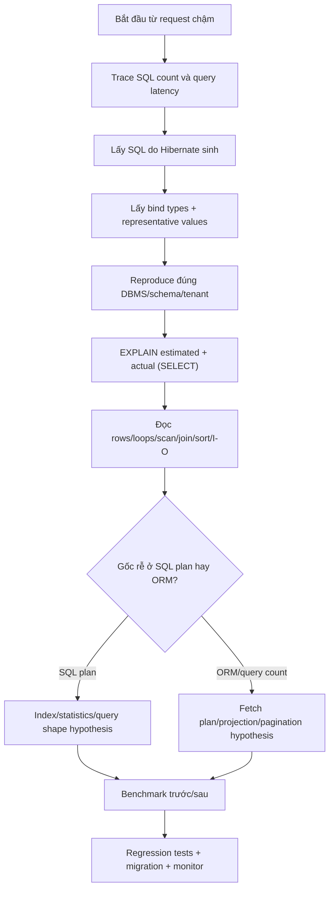

# Đọc kế hoạch truy vấn từ SQL do Hibernate sinh

Một API tìm đơn hàng có thể viết bằng JPQL rất gọn:

```java
List<PurchaseOrder> orders = entityManager
    .createQuery("""
        select o
        from PurchaseOrder o
        where o.status = :status
        order by o.createdAt desc
        """, PurchaseOrder.class)
    .setParameter("status", OrderStatus.PAID)
    .setMaxResults(50)
    .getResultList();
```

Nhưng để chẩn đoán hiệu năng, câu hỏi quan trọng không phải “JPQL trông có đơn giản không?” mà là:

- Hibernate đã sinh ra **những câu SQL nào**?
- Các giá trị bind parameter và SQL types thực tế là gì?
- Database chọn **sequential/table scan**, **index scan**, **nested-loop join** hay **hash join**?
- Bộ tối ưu dự đoán bao nhiêu rows, và câu truy vấn thật trả bao nhiêu rows?
- Có sắp xếp lớn, đọc nhiều blocks, dùng temporary disk hay không?
- Query chậm do kế hoạch thực thi, do N+1, do network, hay do Hibernate materialize quá nhiều entities?
- Một index mới hoặc thay đổi fetch plan có thực sự cải thiện độ trễ khi chạy với dữ liệu giống production không?

**Kế hoạch truy vấn (query execution plan)** do **hệ quản trị cơ sở dữ liệu** tạo ra cho SQL, không phải do Hibernate tự quyết định. Hibernate chuyển HQL/JPQL/Criteria/native query thành SQL phù hợp Dialect, bind tham số qua JDBC và quản lý kết quả thành entities, DTOs hoặc scalars. Sau đó optimizer của PostgreSQL, MySQL, Oracle hay SQL Server quyết định cách thực thi.

Bài học này trình bày một quy trình quan sát đầu cuối: **từ code Java → SQL thật → bind parameters → kế hoạch ước lượng → kế hoạch thực tế → đối chiếu chỉ số → tối ưu và đo lại**. Ví dụ chính dùng Hibernate ORM với PostgreSQL, đồng thời chỉ ra cách tiếp cận tương ứng trên các database khác.

## 1. Đặt đúng câu hỏi: SQL nào cần được EXPLAIN?

Giả sử ứng dụng gọi một repository method:

```java
List<PurchaseOrder> findByStatusOrderByCreatedAtDesc(
    OrderStatus status,
    Pageable pageable
);
```

Có thể có nhiều SQL liên quan tới một lần gọi:

1. SQL chính lấy danh sách đơn hàng.
2. SQL đếm bản ghi để tính tổng trang, nếu API trả `Page`.
3. SQL lấy `Customer` theo lazy association.
4. SQL lấy order lines.
5. SQL lấy sequence hoặc thực hiện flush trước query.
6. SQL do entity listener, converter hoặc application code khác gây ra.

Vì vậy, **EXPLAIN một câu SQL ngẫu nhiên trong log chưa đủ**. Cần xác định chính xác SQL nào chiếm thời gian, số lần gọi và dữ liệu nào được trả về.

Mô hình:

```text
HTTP request / scheduled job
             |
             v
Application service
             |
             v
HQL / JPQL / Criteria / repository
             |
             v
Hibernate SQL generation + bind
             |
             +--> SQL statement #1
             +--> SQL statement #2
             +--> SQL statement #3 ... N+1
             |
             v
JDBC driver / connection
             |
             v
Database optimizer -> execution plan
             |
             v
Rows -> JDBC -> Hibernate hydration -> DTO/JSON
```

**Mỗi câu SQL có plan riêng.** Thời gian request là tổng của nhiều thành phần, trong đó execution plan chỉ là một phần.

## 2. Phân biệt HQL/JPQL, SQL và kế hoạch thực thi

| Tầng | Ví dụ | Do ai quyết định? | Điều cần quan sát |
|---|---|---|---|
| HQL/JPQL | `from PurchaseOrder o where o.status = :s` | Developer và ORM semantics | Fetch plan, predicates, projection |
| Criteria API | `criteria.where(...); criteria.orderBy(...)` | Developer và ORM semantics | Cây truy vấn sẽ được Hibernate biên dịch |
| SQL JDBC | `select ... from purchase_orders where status = ?` | Hibernate Dialect/mapping | Join, columns, aliases, LIMIT, bind types |
| Execution plan | Index Scan, Hash Join, Sort, Seq Scan | DB optimizer | Estimated/actual rows, cost, I/O, loops |
| Runtime application | Hydration, dirty checking, serialization | Hibernate/JVM/app | Số queries, memory, latency, GC |

Một câu JPQL có thể sinh SQL khác nhau tùy:

- Hibernate major version.
- Database Dialect.
- Entity mappings và inheritance.
- Fetch type, entity graph, join fetch, batch fetching.
- Pagination/locking modes.
- Filters, soft delete, tenant predicates.
- Polymorphic queries, composite identifiers.
- Explicit/implicit type conversions.
- Criteria/HQL transformation và optimizations.

Do đó, tối ưu dựa trên **SQL thực tế** thay vì đoán từ source code.

## 3. Chuẩn bị dữ liệu mẫu

Các ví dụ giả định schema PostgreSQL:

```sql
create table customers (
    id bigint primary key,
    name varchar(200) not null
);

create table purchase_orders (
    id bigint primary key,
    customer_id bigint not null references customers(id),
    status varchar(30) not null,
    created_at timestamp with time zone not null,
    total_amount numeric(19,2) not null
);

create table order_lines (
    id bigint primary key,
    order_id bigint not null references purchase_orders(id),
    product_id bigint not null,
    quantity integer not null
);
```

Entity tương ứng:

```java
@Entity
@Table(name = "purchase_orders")
public class PurchaseOrder {

    @Id
    private Long id;

    @ManyToOne(fetch = FetchType.LAZY)
    @JoinColumn(name = "customer_id")
    private Customer customer;

    @Enumerated(EnumType.STRING)
    private OrderStatus status;

    @Column(name = "created_at")
    private Instant createdAt;

    @Column(name = "total_amount")
    private BigDecimal totalAmount;

    // getters và domain methods
}
```

Ở môi trường thực tế, cột `status`, `created_at` và indexes phải được kiểm tra từ migrations đang triển khai. Đây chỉ là schema minh họa để bàn về plan.

## 4. Bước 1 — Bật logging SQL của Hibernate

Với Hibernate 6 và logging framework qua Spring Boot:

```properties
logging.level.org.hibernate.SQL=DEBUG
logging.level.org.hibernate.orm.jdbc.bind=TRACE

spring.jpa.properties.hibernate.format_sql=true
spring.jpa.properties.hibernate.use_sql_comments=true
```

Ví dụ log:

```sql
select
    p1_0.id,
    p1_0.customer_id,
    p1_0.created_at,
    p1_0.status,
    p1_0.total_amount
from
    purchase_orders p1_0
where
    p1_0.status=?
order by
    p1_0.created_at desc
fetch first ? rows only
```

Cú pháp `FETCH FIRST`, `LIMIT` hay `OFFSET` phụ thuộc Dialect và Hibernate version. **Không copy một câu SQL giả định trong tutorial khi code của bạn sinh SQL khác.**

### Hibernate 5 và Hibernate 6 có logger category khác nhau

- Hibernate 6 thường dùng `org.hibernate.orm.jdbc.bind` cho JDBC bind values.
- Hibernate 5 thường thấy logger `org.hibernate.type.descriptor.sql.BasicBinder` ở mức TRACE.
- `org.hibernate.SQL` vẫn là category phổ biến để quan sát SQL statements.

Tên category có thể thay đổi theo minor/major version. Khi logger không ra output, xác nhận Hibernate version, logging backend và effective configuration, không bật TRACE cho toàn bộ JVM chỉ để thử.

## 5. Phân biệt `show_sql` và structured logging

Hibernate có property:

```properties
hibernate.show_sql=true
```

Hoặc qua Spring Boot:

```properties
spring.jpa.show-sql=true
```

Nó hữu ích để học nhanh, nhưng thường ghi SQL trực tiếp ra console thay vì đi qua hệ thống structured logging như ý muốn. Đối với chẩn đoán nghiêm túc, ưu tiên log category `org.hibernate.SQL`, cấu hình levels và correlation IDs.

### Không bật bind TRACE tùy tiện ở production

Bind parameters có thể chứa:

- Email, địa chỉ, số điện thoại.
- Access tokens hoặc secrets nếu hệ thống query theo chúng.
- Số tài khoản, thông tin thanh toán.
- Giá trị thuộc tenant khác.
- Dữ liệu nghiệp vụ nhạy cảm.

TRACE bind values trong môi trường thật có thể tạo rủi ro bảo mật và chi phí log lớn. Nếu cần truy vết, bật có thời hạn trong môi trường kiểm soát, redact/mask giá trị nhạy cảm, hạn chế quyền truy cập logs và tuân thủ retention policy.

**Để dựng plan, thường cần bind values đại diện và SQL types, không cần chép dữ liệu cá nhân thật vào ticket.**

## 6. Bước 2 — Tìm bind values và types thực tế

SQL log có:

```sql
where status = ?
  and created_at >= ?
limit ?
```

Nhưng optimizer có thể chọn kế hoạch khác khi:

- `status='PAID'` chiếm 80% rows.
- `status='FAILED'` chỉ chiếm 0,1% rows.
- `created_at` giới hạn 1 ngày hay 5 năm.
- Bind type là `varchar`, `timestamp` hay loại khác.
- Query chạy với tenant lớn hay tenant nhỏ.

Log bind trong Hibernate 6 có thể hiển thị ví dụ (format chỉ minh họa):

```text
binding parameter (1:VARCHAR) <- [PAID]
binding parameter (2:TIMESTAMP_UTC) <- [2026-10-01T00:00:00Z]
binding parameter (3:INTEGER) <- [50]
```

Không phụ thuộc từng chữ của logger vì version có thể thay đổi. Điều cần ghi nhận:

1. Thứ tự tham số.
2. Kiểu JDBC/SQL nếu liên quan conversion.
3. Giá trị hoặc khoảng giá trị đại diện đã được làm sạch dữ liệu nhạy cảm.
4. Trường hợp null.
5. Tenant/schema/database và DB session settings.

### Không thay dấu `?` bằng string một cách máy móc

Nếu SQL có literal chứa dấu hỏi, JSON operators, escape sequences hoặc nhiều parameter types, thay toàn bộ `?` bằng string thủ công dễ tạo câu SQL sai.

Tốt hơn: dùng prepared statement/`EXPLAIN EXECUTE` trên DBMS hỗ trợ, hoặc dựng một bản SQL repro có typed literals được xác nhận cẩn thận, không tự nối dữ liệu request raw thành SQL.

## 7. Bước 3 — Xác định SQL thực sự được chạy nhiều lần hay một lần

Ví dụ truy vấn 100 orders:

```java
List<PurchaseOrder> orders =
    em.createQuery("""
        select o from PurchaseOrder o
        order by o.createdAt desc
        """, PurchaseOrder.class)
    .setMaxResults(100)
    .getResultList();

for (PurchaseOrder o : orders) {
    System.out.println(o.getCustomer().getName());
}
```

Nếu `customer` là lazy và không được fetch trước, có thể có:

```sql
select ... from purchase_orders order by created_at desc
fetch first ? rows only;

select ... from customers where id = ?;
select ... from customers where id = ?;
select ... from customers where id = ?;
-- ... nhiều SELECT khác
```

Một SELECT customer bằng primary key có thể có plan rất tốt và chạy 0,5 ms. Nhưng nếu gọi 100 lần, tổng thời gian mạng/JDBC/hydration vẫn lớn. **Tối ưu index của từng customer SELECT không giải quyết gốc rễ N+1.**

Trước khi đọc plan, xác định **số lượng statements** và thời gian tổng theo statement group.

## 8. Bước 4 — Capture SQL qua `StatementInspector`

Hibernate cung cấp `org.hibernate.resource.jdbc.spi.StatementInspector` để quan sát SQL string trước khi nó được chuẩn bị/thực thi theo JDBC path.

Ví dụ test/debug:

```java
import org.hibernate.resource.jdbc.spi.StatementInspector;
import java.util.concurrent.ConcurrentLinkedQueue;
import java.util.Queue;

public final class SqlCaptureInspector
        implements StatementInspector {

    private static final Queue<String> SQLS =
        new ConcurrentLinkedQueue<>();

    @Override
    public String inspect(String sql) {
        SQLS.add(sql);
        return sql;
    }

    public static void clear() {
        SQLS.clear();
    }

    public static List<String> snapshot() {
        return List.copyOf(SQLS);
    }
}
```

Cấu hình (Hibernate property):

```properties
hibernate.session_factory.statement_inspector=com.example.SqlCaptureInspector
```

Trong Spring Boot:

```properties
spring.jpa.properties.hibernate.session_factory.statement_inspector=com.example.SqlCaptureInspector
```

### Giới hạn quan trọng

- `inspect(String sql)` nhận **SQL text**, thường vẫn có `?` placeholders, **không tự có bind values**.
- Inspector có thể được dùng rộng qua nhiều Sessions/threads: implementation phải thread-safe.
- Trả về SQL ban đầu nếu chỉ quan sát; sửa string có thể làm thay đổi hành vi query.
- Đừng lưu toàn bộ SQL vô thời hạn trong static queue ở production.
- Test chạy song song cần correlation/isolation, tránh dữ liệu các tests trộn nhau.
- SQL được đưa qua một số đường JDBC trực tiếp bên ngoài Hibernate có thể không đi qua inspector.

Với test, một collector có phạm vi test/session sẽ thuận tiện hơn static global queue. Ví dụ trên chỉ giúp minh họa interface.

## 9. Có thể dùng datasource-proxy hoặc P6Spy không?

Có. Một JDBC proxy quanh `DataSource` có thể quan sát statements, bind parameters và thời gian JDBC ở tầng gần driver hơn.

Các công cụ phổ biến:

- `datasource-proxy`.
- P6Spy.
- OpenTelemetry JDBC instrumentation hoặc APM agent tương ứng.
- Driver/database tracing.
- Built-in Hibernate SQL logs và statistics.

Điểm khác nhau:

| Nguồn quan sát | Thường thấy gì? | Điều cần cảnh giác |
|---|---|---|
| `StatementInspector` | SQL text do Hibernate xử lý | Không tự có bind values hoặc thời gian DB |
| Hibernate SQL/bind logging | SQL và JDBC binding theo logger/version | PII, log volume |
| JDBC proxy | Statements, bind values, JDBC elapsed time | Overhead, masking, pool integration |
| Database slow query log | Queries chậm ở DB | Threshold, normalized SQL, sampling |
| APM trace | Span request → JDBC → downstream | Sampling, khác biệt elapsed time |
| Database query statistics | Aggregate per statement/query shape | Không gắn đúng một user request nếu thiếu correlation |

Đừng bật đồng thời quá nhiều instrumentation nặng mà không đo overhead. Số liệu sẽ bị ảnh hưởng bởi chính cơ chế quan sát.

## 10. Bước 5 — Chọn đúng DBMS để EXPLAIN

Câu HQL giống nhau có thể tạo SQL khác nhau theo Dialect. Lệnh đọc plan cũng khác:

| Database | Kế hoạch ước lượng | Kế hoạch thực tế / runtime |
|---|---|---|
| PostgreSQL | `EXPLAIN SELECT ...` | `EXPLAIN (ANALYZE, BUFFERS) SELECT ...` |
| MySQL 8 | `EXPLAIN SELECT ...` hoặc `EXPLAIN FORMAT=JSON ...` | `EXPLAIN ANALYZE SELECT ...` trên versions hỗ trợ |
| SQL Server | Estimated execution plan, `SET SHOWPLAN_XML ON` | Actual plan, `SET STATISTICS XML ON` hoặc SSMS |
| Oracle | `EXPLAIN PLAN FOR ...` + `DBMS_XPLAN.DISPLAY` | `DBMS_XPLAN.DISPLAY_CURSOR` với runtime stats được thu thập |
| H2 | `EXPLAIN`/`EXPLAIN ANALYZE` theo version | Không thay thế production DBMS plan |

**Plan của H2 không chứng minh PostgreSQL production sẽ chọn cùng index/join algorithm.** Hãy reproduce trên DBMS, Dialect, schema và thống kê dữ liệu tương đương production.

## 11. PostgreSQL: đọc estimated plan

Một truy vấn mẫu với giá trị an toàn:

```sql
EXPLAIN
SELECT
    id, customer_id, created_at, status, total_amount
FROM purchase_orders
WHERE status = 'PAID'
  AND created_at >= TIMESTAMPTZ '2026-10-01 00:00:00+00'
ORDER BY created_at DESC
LIMIT 50;
```

Kết quả minh họa:

```text
Limit  (cost=0.43..135.20 rows=50 width=56)
  -> Index Scan using ix_orders_status_created
       on purchase_orders
       (cost=0.43..21605.10 rows=8015 width=56)
       Index Cond: ((status = 'PAID') AND
                    (created_at >= '2026-10-01...'::timestamptz))
```

Các con số là **giả định để học cách đọc**, không phải output đo thật.

Cách đọc:

- `Limit`: dừng sau khi lấy tối đa 50 rows theo plan.
- `Index Scan`: đi qua index `ix_orders_status_created`.
- `Index Cond`: điều kiện có thể được index hỗ trợ.
- `cost=...`: cost đơn vị nội bộ của optimizer, **không phải milliseconds**.
- `rows=...`: số rows optimizer **ước lượng** tại node.
- `width=...`: kích thước row ước lượng tính bằng bytes theo plan.

Một plan có cost thấp hơn chưa chắc request thực tế nhanh hơn trong mọi điều kiện; cần đo runtime và độ ổn định với nhiều parameter sets.

## 12. PostgreSQL: đọc actual plan với ANALYZE

```sql
EXPLAIN (ANALYZE, BUFFERS, VERBOSE)
SELECT
    id, customer_id, created_at, status, total_amount
FROM purchase_orders
WHERE status = 'PAID'
ORDER BY created_at DESC
LIMIT 50;
```

Kết quả minh họa:

```text
Limit  (cost=0.43..90.00 rows=50 width=56)
       (actual time=0.035..0.115 rows=50 loops=1)
  Buffers: shared hit=58
  -> Index Scan using ix_orders_status_created
       on public.purchase_orders
       (cost=0.43..18000.00 rows=10000 width=56)
       (actual time=0.034..0.109 rows=50 loops=1)
       Index Cond: (status = 'PAID'::text)
       Buffers: shared hit=58
Planning Time: 0.410 ms
Execution Time: 0.154 ms
```

### Ý nghĩa chỉ số

- `actual time=a..b`: thời gian đo tại node để tạo row đầu và hoàn thành việc tạo rows, theo cơ chế đo của PostgreSQL.
- `actual rows=50`: số rows thực tại node cho mỗi lần lặp, trong cách trình bày plan PostgreSQL.
- `loops=1`: node được thực thi một lần.
- `Buffers: shared hit=58`: blocks được tìm trong PostgreSQL shared buffers; **không có nghĩa từng hit miễn phí**.
- `Planning Time`: thời gian planner.
- `Execution Time`: thời gian thực thi plan trên DB server.

**`EXPLAIN ANALYZE` thực thi câu query thật.** Với SELECT thường an toàn hơn; với UPDATE/DELETE/INSERT, nó có thể thay dữ liệu và kích hoạt triggers. Không chạy `EXPLAIN ANALYZE` trên DML production nếu không có phương án kiểm soát tác động.

## 13. Estimated rows và actual rows là hai khái niệm khác nhau

Ví dụ:

```text
Hash Join  (cost=... rows=100)
           (actual time=... rows=150000 loops=1)
```

Optimizer dự đoán 100 rows, nhưng thực tế có 150.000. Sai lệch lớn có thể làm database chọn join algorithm không phù hợp hoặc cấp bộ nhớ cho sort/hash không đủ.

Những nguyên nhân thường gặp:

- Thống kê bảng/cột đã cũ.
- Phân phối giá trị lệch nhiều (data skew).
- Các predicates có tương quan nhưng optimizer giả định độc lập.
- Kiểu dữ liệu/bind casting ảnh hưởng selectivity.
- Correlated conditions trên nhiều bảng.
- Temporary tables hoặc dữ liệu mới load chưa được analyze.
- Parameter-sensitive plan: các bind values có selectivity rất khác.

Không tối ưu bằng cách “cứ ép index” ngay. Trước tiên xác định vì sao estimates sai, cập nhật thống kê khi phù hợp và thử lại với nhiều parameter sets.

## 14. `rows` và `loops`: đọc cho đúng

Trong PostgreSQL `EXPLAIN ANALYZE`, `actual rows` tại một node thường là trung bình rows cho **mỗi lần execution/loop**, trong khi `loops` cho biết số lần node chạy. Vì vậy tổng rows processed có thể xấp xỉ `rows × loops`.

Ví dụ:

```text
Index Scan using pk_customers
  (actual time=0.01..0.02 rows=1 loops=5000)
```

Một index lookup trả 1 row rất nhanh, nhưng đã chạy 5.000 lần. Trong nested loop join, đây có thể là hành vi hợp lý nếu outer rows ít; nếu outer rows rất nhiều, tổng random I/O có thể cao.

Đừng nhìn `rows=1` rồi kết luận công việc nhỏ khi `loops=5000`.

Cũng đừng trộn `actual time` của từng child node bằng phép cộng đơn giản: thời gian node có thể bao gồm công việc của descendants, cần hiểu inclusive/exclusive relationship trong plan tree.

## 15. Các scan nodes thường gặp

| Node | Diễn giải | Khi nào đáng chú ý? |
|---|---|---|
| `Seq Scan` / table scan | Đọc tuần tự nhiều phần của bảng | Bảng lớn, selectivity thấp hay thiếu index |
| `Index Scan` | Dùng index tìm row locations rồi đọc heap/table data | Truy vấn lọc tốt, cần columns ngoài index |
| `Index Only Scan` | Có thể phục vụ query chủ yếu từ index | Kiểm tra heap fetches và visibility map |
| `Bitmap Index Scan` + `Bitmap Heap Scan` | Gom row locations rồi đọc heap hiệu quả hơn trong một số phân bố | Kết quả trung bình/lớn, nhiều pages |
| `Parallel Seq Scan` | Nhiều workers cùng đọc | Không tự đồng nghĩa “plan xấu” |
| `CTE Scan` / `Subquery Scan` | Đọc intermediate result | Cần xem materialization và filters |

Một sequential scan **không luôn là vấn đề**:

- Bảng chỉ có 30 rows.
- Query trả phần lớn bảng.
- Đọc tuần tự rẻ hơn nhiều index random lookups.
- Cache/buffer đã ấm.
- Optimizer đã ước lượng đúng rằng index không đáng dùng.

Đánh giá phải dựa trên **rows processed, I/O, tổng latency và dữ liệu thực**, không gắn nhãn “Seq Scan = lỗi”.

## 16. Index Scan không bảo đảm nhanh

Giả sử có index:

```sql
create index ix_orders_status
on purchase_orders (status);
```

Nếu `status='PAID'` chiếm 90% bảng, index có thể dẫn tới rất nhiều random heap accesses. Một sequential scan có thể nhanh hơn.

Nếu query cần `ORDER BY created_at DESC LIMIT 50`, composite index có thể hữu ích:

```sql
create index ix_orders_status_created
on purchase_orders (status, created_at desc);
```

Nhưng **không tự tạo index chỉ vì thấy WHERE và ORDER BY**. Cần xem:

- Selectivity của status.
- Số rows và distribution của created_at.
- Filter phụ khác.
- Query projection.
- Write overhead và index size.
- Index maintenance, VACUUM/ANALYZE behavior.
- Cùng workload có nhiều query shapes khác nhau không.

Index tốt cho một query có thể làm INSERT/UPDATE chậm và tăng dung lượng database.

## 17. Phân biệt `Index Cond` và `Filter`

Ví dụ PostgreSQL:

```text
Index Scan using ix_orders_status_created
  Index Cond: (status = 'PAID')
  Filter: (total_amount > 1000000)
  Rows Removed by Filter: 50000
```

- `Index Cond`: điều kiện được sử dụng để tìm qua index.
- `Filter`: điều kiện còn lại được áp sau khi row candidate được lấy.
- `Rows Removed by Filter`: số rows bị loại bởi filter tại node.

Nếu rất nhiều rows bị loại sau khi đọc từ index, hãy xem lại index columns, data distribution và cách sắp xếp predicates; nhưng không có quy tắc rằng mọi `Filter` phải được đẩy vào index.

Ví dụ index `(status, created_at)` không tự hỗ trợ hiệu quả filter `total_amount > ...` nếu không có cột/thứ tự/cấu trúc index phù hợp.

## 18. Join algorithms: Nested Loop, Hash Join và Merge Join

JPQL:

```java
List<PurchaseOrder> orders = em.createQuery("""
    select o
    from PurchaseOrder o
    join fetch o.customer c
    where o.status = :status
    """, PurchaseOrder.class)
    .setParameter("status", OrderStatus.PAID)
    .getResultList();
```

SQL minh họa:

```sql
select
    o.id, o.status, o.customer_id,
    c.id, c.name
from purchase_orders o
join customers c on c.id = o.customer_id
where o.status = ?;
```

Database có thể chọn:

**Nested Loop:** lấy rows từ outer input rồi tra matching rows ở inner input, thường hiệu quả khi outer nhỏ và inner có index phù hợp.

**Hash Join:** xây hash table từ một input rồi probe input còn lại, thường phù hợp khi xử lý nhiều rows và có đủ memory.

**Merge Join:** hai inputs theo join key order (có thể qua index hoặc sort), sau đó merge; phù hợp một số workload có thứ tự sẵn hoặc cần ordered operations.

Không có “join tốt nhất” cho mọi trường hợp. Một nested loop trên 20 rows có thể rất nhanh; nested loop trên 10 triệu rows × inner lookup đắt có thể rất chậm. Hash join có thể nhanh nhưng tốn memory và spill ra disk.

## 19. Đọc plan tree theo quan hệ cha-con

Ví dụ giả định:

```text
Hash Join
  Hash Cond: (o.customer_id = c.id)
  -> Seq Scan on purchase_orders o
       Filter: (status = 'PAID')
  -> Hash
       -> Seq Scan on customers c
```

Đọc như sau:

1. Database quét `customers` và xây hash table theo `id`.
2. Database quét `purchase_orders` và lọc status.
3. Hash Join ghép `o.customer_id=c.id`.
4. Parent node nhận rows đã join.

Hình thụt lề là **cây operator**, không phải thứ tự SQL text từ trên xuống. PostgreSQL plan thường dễ đọc từ leaf/inner nodes lên parent.

Khi một node chậm, xem descendants của nó trước; một parent `Hash Join` mất 500 ms có thể do child `Seq Scan` mất phần lớn thời gian.

## 20. Đọc Sort và nguy cơ spill ra disk

```text
Sort
  Sort Key: o.created_at DESC
  Sort Method: external merge  Disk: 120000kB
  -> Seq Scan on purchase_orders o
```

Điều này cho biết sort không nằm hoàn toàn trong memory và có sử dụng external sort/disk work, theo ví dụ.

Các yếu tố cần xem:

- Query sort bao nhiêu rows trước LIMIT?
- Index có thể cung cấp đúng thứ tự không?
- `work_mem` của PostgreSQL có phù hợp workload không?
- Có nhiều concurrent sorts, mỗi sort đều dùng memory?
- ORDER BY có cần thiết cho API không?
- Có thể lọc/giới hạn trước sort mà vẫn giữ semantics không?

Không tăng `work_mem` toàn server một cách bừa bãi chỉ vì một query spill: mỗi query có thể có nhiều sort/hash nodes và nhiều sessions đồng thời, dẫn tới memory pressure.

## 21. `LIMIT` có thể nhanh, `OFFSET` lớn có thể đắt

Một query:

```sql
select *
from purchase_orders
where status = 'PAID'
order by created_at desc, id desc
limit 50 offset 100000;
```

Database có thể vẫn phải đi qua lượng lớn rows để bỏ 100.000 rows rồi trả 50. `LIMIT 50` không đảm bảo chỉ đọc 50 rows.

Một hướng keyset pagination:

```sql
select *
from purchase_orders
where status = 'PAID'
  and (
        created_at < :last_created_at
        or (
            created_at = :last_created_at
            and id < :last_id
        )
      )
order by created_at desc, id desc
limit 50;
```

Với PostgreSQL và key comparison compatible, có thể dùng row-value comparison:

```sql
where status = :status
  and (created_at, id) < (:last_created_at, :last_id)
order by created_at desc, id desc
limit 50
```

Điều này chỉ đúng khi sort direction, null semantics, data types và cursor handling phù hợp. Composite index có thể được cân nhắc:

```sql
create index ix_orders_status_created_id
on purchase_orders (status, created_at desc, id desc);
```

**Không thay OFFSET bằng keyset mà bỏ kiểm tra thứ tự ổn định**: chỉ ORDER BY created_at có thể không xác định thứ tự với timestamps trùng nhau. Thêm tie-breaker như ID thường cần thiết.

## 22. Entity projection và DTO projection tạo SQL khác nhau

Nếu query tải toàn bộ entity:

```java
List<PurchaseOrder> orders = em.createQuery("""
    select o from PurchaseOrder o
    where o.status = :status
    """, PurchaseOrder.class)
    .setParameter("status", OrderStatus.PAID)
    .getResultList();
```

Hibernate cần đủ mapped columns theo entity state/load plan. Nếu API chỉ hiển thị ID, trạng thái và tổng tiền, có thể dùng DTO projection:

```java
public record OrderSummary(
    Long id,
    OrderStatus status,
    BigDecimal totalAmount
) {}
```

```java
List<OrderSummary> rows = em.createQuery("""
    select new com.example.OrderSummary(
        o.id, o.status, o.totalAmount
    )
    from PurchaseOrder o
    where o.status = :status
    """, OrderSummary.class)
    .setParameter("status", OrderStatus.PAID)
    .getResultList();
```

Projection có thể giảm số columns, JDBC transfer và entity hydration/dirty-checking overhead. Nó cũng có thể cho optimizer nhiều lựa chọn tốt hơn, ví dụ index-only scan khi index phù hợp.

Tuy nhiên, đừng ép một DTO query dùng quá nhiều joins chỉ để tránh entities; hãy đo SQL và plan của cả hai phương án.

## 23. N+1 không nhất thiết hiện trong một execution plan

Giả sử:

```text
1 query tải 100 orders: 15 ms
100 queries tải customer: mỗi query 0.8 ms
JDBC + network + hydration overhead: thêm nhiều ms

Total request: >100 ms
```

EXPLAIN của mỗi SELECT customer có thể hiện:

```text
Index Scan using customers_pkey
  rows=1 ...
```

Plan đó không sai. Vấn đề là **số round trips**.

Các biện pháp ORM-level:

- `JOIN FETCH` cho to-one association cần dùng.
- `@EntityGraph` để biểu đạt fetch plan tại repository method.
- Batch fetching với `@BatchSize` hoặc cấu hình batch fetch size.
- DTO projection với join cần thiết.
- Tránh truy cập lazy associations trong serializer/toString/mapper.
- Thiết kế API trả dữ liệu cần thiết, không toàn bộ graph.

**Tối ưu query count trước khi tối ưu từng plan con** khi root cause là N+1.

## 24. Join fetch to-many và pagination là bẫy riêng

JPQL:

```java
List<PurchaseOrder> orders = em.createQuery("""
    select distinct o
    from PurchaseOrder o
    join fetch o.lines
    order by o.createdAt desc
    """, PurchaseOrder.class)
    .setMaxResults(50)
    .getResultList();
```

Khi collection fetch join kết hợp pagination, Hibernate có thể phải áp pagination trong memory hoặc cảnh báo/từ chối tùy version/config. SQL rows bị nhân theo số line items, nên database-level LIMIT không thể luôn giữ đúng 50 parent orders.

Một thiết lập Hibernate hữu ích trong môi trường test:

```properties
hibernate.query.fail_on_pagination_over_collection_fetch=true
```

Khi được hỗ trợ, nó giúp fail fast thay vì vô tình tải lượng lớn rows.

### Hướng thay thế

1. Query trang IDs của parent theo thứ tự ổn định.
2. Query fetch parent/details cho tập IDs đó, với IN/batch fetching phù hợp.
3. Sắp lại theo thứ tự trang ban đầu nếu query fetch không giữ order.
4. Trả DTO/projection với số collection items phù hợp API.

Không chỉ nhìn plan SELECT parent rồi bỏ qua việc join collection làm số SQL rows tăng nhiều lần.

## 25. Kiểm tra count query do Spring Data JPA sinh

Một repository trả `Page<PurchaseOrder>` có thể phát:

```sql
select ... from purchase_orders
where status=?
order by created_at desc
limit ? offset ?;
```

và:

```sql
select count(*)
from purchase_orders
where status=?;
```

Trên bảng rất lớn, `count(*)` có thể tốn nhiều thời gian, đặc biệt với predicates phức tạp.

Khi API không cần total count, `Slice` hoặc keyset/cursor pagination có thể tránh query count, tùy Spring Data version và design.

Nếu cần count chính xác, đọc **kế hoạch count query riêng**, không giả định index dùng tốt cho query lấy trang cũng tối ưu count.

## 26. Parameter sniffing và plan cache phía database

Một PreparedStatement có SQL:

```sql
select *
from purchase_orders
where status = ?;
```

Có thể chạy với:

```text
PAID: 85% rows
FAILED: 0.1% rows
```

Optimizer có thể có kế hoạch phù hợp cho mỗi trường hợp, nhưng plan caching/parameter sniffing/generic plan behavior khác theo DBMS và driver.

Trên PostgreSQL, prepared statements có thể dùng **custom plan** hoặc **generic plan** tùy thống kê và plan cache decisions. MySQL, SQL Server và Oracle có cơ chế plan cache/parameter sensitivity riêng.

Vì vậy, `EXPLAIN` với literal `status='FAILED'` chưa chắc tái hiện plan thực tế của JDBC PreparedStatement đã được server prepare và dùng generic cached plan.

Cần quan sát:

- Server-side prepared statement có thực sự được dùng không?
- Driver prepare threshold và execution count.
- Parameter values đại diện.
- DB session settings.
- Plan cache/query store metadata.
- Khác biệt giữa first execution và repeated executions.

Không sửa Hibernate query plan cache khi vấn đề nằm ở optimizer/database prepared plan cache.

## 27. PostgreSQL: `PREPARE` và `EXPLAIN EXECUTE`

Ví dụ để tiệm cận hành vi PreparedStatement:

```sql
PREPARE find_orders(text, timestamptz) AS
SELECT id, status, created_at
FROM purchase_orders
WHERE status = $1
  AND created_at >= $2
ORDER BY created_at DESC
LIMIT 50;

EXPLAIN (ANALYZE, BUFFERS)
EXECUTE find_orders(
    'PAID',
    TIMESTAMPTZ '2026-10-01 00:00:00+00'
);

DEALLOCATE find_orders;
```

Đây là thao tác minh họa trên một DB session. Type `text` trong PREPARE phải phù hợp kiểu column/cast thực tế; nếu column là custom enum hoặc varchar, có thể cần type khác.

Kết quả vẫn có thể khác ứng dụng nếu driver/server chọn generic/custom plan theo lịch sử execution hoặc session settings khác. Với chẩn đoán nhạy cảm, ghi rõ JDBC driver version, prepared threshold và DB configuration.

### An toàn dữ liệu

Chỉ dùng giá trị anonymized/synthetic có selectivity tương tự production. Không chép user secrets hoặc token thật vào console query history.

## 28. PostgreSQL `EXPLAIN (FORMAT JSON)`

Để máy xử lý plan thay vì parse text:

```sql
EXPLAIN (ANALYZE, BUFFERS, FORMAT JSON)
SELECT id
FROM purchase_orders
WHERE status='PAID'
ORDER BY created_at DESC
LIMIT 50;
```

Kết quả là JSON plan structure, có fields như `Plan`, `Node Type`, `Actual Rows`, `Plans`, `Execution Time` tùy options/version.

Ưu điểm:

- Có thể lưu artifact cho benchmark.
- Dễ so sánh plan shape trên CI.
- Có thể phân tích nodes, row estimates và timing có cấu trúc.
- Tránh regex trên output text có format thay đổi.

Nhưng plan JSON có estimated costs, actual times và node attributes biến động theo stats/engine version. Đừng snapshot toàn bộ JSON rồi assert phải byte-identical sau mỗi build. Test hiệu năng nên có thresholds và baseline rõ, không quá nhạy với plan format.

## 29. PostgreSQL: `BUFFERS` và I/O

Ví dụ:

```text
Buffers: shared hit=3000 read=1200
```

- `shared hit`: blocks đã nằm trong PostgreSQL buffer cache.
- `shared read`: blocks được đọc vào shared buffers, có thể từ OS cache hoặc physical disk tùy tầng caching.
- `temp read/written` nếu có: temporary blocks, thường liên quan sort/hash spill.
- `local`: local buffers trong một số operation như temp tables.

Không quy đổi `read=1200` trực tiếp thành “1.200 lần truy cập ổ cứng vật lý”; OS cache có thể phục vụ reads.

`EXPLAIN (ANALYZE, BUFFERS, I/O timing)` có những cách cấu hình I/O timing theo PostgreSQL version (ví dụ `track_io_timing`). Nếu không được bật/hỗ trợ, plan không có đủ I/O timing details.

Quan sát read/hit cùng latency, concurrency và working set; một benchmark chạy lần đầu trên cold cache có thể khác đáng kể lần chạy thứ hai.

## 30. PostgreSQL: xem số dòng bị loại bởi Filter

Một plan minh họa:

```text
Seq Scan on purchase_orders
  Filter: ((status = 'PAID') AND (total_amount > 1000000))
  Rows Removed by Filter: 850000
  (actual rows=150000 loops=1)
```

Điều này có thể cho thấy query phải duyệt rất nhiều rows để trả kết quả.

Nhưng chưa chắc thêm index là tốt nhất:

- Query có trả 15% bảng không?
- Có pagination không?
- Bảng vừa được VACUUM/ANALYZE chưa?
- Cần scan columns rộng hay chỉ ID?
- Query thực tế có join sang bảng nhỏ hơn để filter sớm không?
- Có thể dùng partial index cho một predicate ổn định không?
- Index mới có chi phí maintenance lớn không?

Nên hình thành hypothesis cụ thể: “index trên `(status, created_at)` giúp tránh scan/sort cho truy vấn LIMIT 50” thay vì “có Seq Scan nên cứ thêm index”.

## 31. SQL Server: đọc execution plan

SQL Server có estimated/actual graphical plans trong SQL Server Management Studio hoặc các công cụ hỗ trợ.

Ví dụ estimated plan dạng XML:

```sql
SET SHOWPLAN_XML ON;
GO

SELECT TOP (50)
    id, status, created_at
FROM dbo.purchase_orders
WHERE status = 'PAID'
ORDER BY created_at DESC;
GO

SET SHOWPLAN_XML OFF;
GO
```

`SHOWPLAN_XML` dùng để xem estimated plan mà **không thực thi câu SELECT** khi setting đang bật. Cú pháp `GO` là batch separator của một số client tools, **không phải lệnh T-SQL JDBC gửi như SQL statement thông thường**.

Để xem actual plan có thể dùng SSMS “Include Actual Execution Plan” hoặc:

```sql
SET STATISTICS XML ON;

SELECT TOP (50)
    id, status, created_at
FROM dbo.purchase_orders
WHERE status='PAID'
ORDER BY created_at DESC;

SET STATISTICS XML OFF;
```

Trong SQL Server, xem estimated vs actual row counts, logical reads, memory grants, spills, key lookups, missing index suggestions và parameter sniffing. Missing index suggestions chỉ là tín hiệu, không phải DDL khuyến nghị tuyệt đối.

Nếu ứng dụng dùng Microsoft SQL Server, không tái dùng `EXPLAIN (ANALYZE, BUFFERS)` của PostgreSQL.

## 32. SQL Server: `STATISTICS IO` và Query Store

Ví dụ:

```sql
SET STATISTICS IO ON;
SET STATISTICS TIME ON;

SELECT TOP (50)
    id, status, created_at
FROM dbo.purchase_orders
WHERE status = 'PAID'
ORDER BY created_at DESC;

SET STATISTICS IO OFF;
SET STATISTICS TIME OFF;
```

Có thể quan sát logical reads, CPU time, elapsed time. SQL Server **Query Store** còn giúp theo dõi kế hoạch và runtime metrics theo thời gian trong các phiên bản/cấu hình hỗ trợ.

Khi query chỉ chậm sau deployment, so sánh plans và parameter distribution trước/sau có thể hiệu quả hơn thay đổi entity annotations ngay.

Nhớ rằng thời gian đo bằng DB tools có thể khác end-to-end request latency vì network, application processing và concurrency.

## 33. MySQL: `EXPLAIN FORMAT=JSON` và `EXPLAIN ANALYZE`

Một câu MySQL:

```sql
EXPLAIN FORMAT=JSON
SELECT id, status, created_at
FROM purchase_orders
WHERE status='PAID'
ORDER BY created_at DESC
LIMIT 50;
```

JSON plan cho phép xem access type, key, estimated rows, cost information và các node/operations theo MySQL version.

Trên các MySQL 8.0 versions hỗ trợ:

```sql
EXPLAIN ANALYZE
SELECT id, status, created_at
FROM purchase_orders
WHERE status='PAID'
ORDER BY created_at DESC
LIMIT 50;
```

`EXPLAIN ANALYZE` **thực thi câu SELECT** và cung cấp runtime information. Không assume output format và các options giống PostgreSQL.

Các chỉ báo MySQL thường thấy trong EXPLAIN gồm:

- `type` hoặc access type.
- `possible_keys`, `key`.
- Estimated `rows`.
- `Extra` như `Using filesort`/`Using temporary`.
- Join order và filtered percentage.

“Using filesort” không nhất thiết là disk spill; đó là thuật ngữ MySQL cho một cơ chế sort không lấy trực tiếp thứ tự từ index, và có thể sử dụng memory/disk tùy kích thước.

## 34. Oracle: estimated và actual plan

Oracle có thể dùng:

```sql
EXPLAIN PLAN FOR
SELECT id, status, created_at
FROM purchase_orders
WHERE status='PAID'
ORDER BY created_at DESC
FETCH FIRST 50 ROWS ONLY;

SELECT *
FROM TABLE(DBMS_XPLAN.DISPLAY);
```

Đây chủ yếu là estimated plan theo context lúc EXPLAIN. Để xem runtime stats của cursor đã thực thi, Oracle có `DBMS_XPLAN.DISPLAY_CURSOR`, với yêu cầu về privileges, SQL ID/cursor, statistics collection và version.

Ví dụ minh họa:

```sql
SELECT *
FROM TABLE(
    DBMS_XPLAN.DISPLAY_CURSOR(
        NULL, NULL, 'ALLSTATS LAST'
    )
);
```

Không giả định kết quả này luôn là cursor của query Hibernate bạn cần: cần xác định SQL ID/child cursor phù hợp và chắc chắn runtime statistics được thu thập.

Các thuật ngữ Oracle như TABLE ACCESS FULL, INDEX RANGE SCAN, NESTED LOOPS, HASH JOIN, BUFFER GETS và A-Rows/E-Rows mang ý nghĩa tương tự ở mức khái niệm nhưng cần đọc theo Oracle documentation của version triển khai.

## 35. PostgreSQL: Index Only Scan và Heap Fetches

Một index chỉ bao phủ đủ query columns có thể cho phép:

```text
Index Only Scan using ix_orders_status_created
  (actual rows=50 loops=1)
  Heap Fetches: 0
```

Tuy nhiên, một `Index Only Scan` ở PostgreSQL không nhất thiết hoàn toàn không chạm heap. Do MVCC visibility checks, nó có thể cần heap fetches tùy visibility map.

Nếu `Heap Fetches` rất lớn, lợi ích index-only scan có thể thấp hơn kỳ vọng. Cần xem VACUUM/visibility, query projection, index INCLUDE và table write activity.

Ví dụ index PostgreSQL:

```sql
create index ix_orders_status_created_cover
on purchase_orders (status, created_at desc, id desc)
include (total_amount);
```

Đây chỉ là **index candidate**. Nó không tự bao phủ mọi entity fields, và INCLUDE columns tăng index size/write overhead. Benchmark trước khi áp dụng.

## 36. Partial index: hữu ích nhưng cần đúng workload

Ví dụ PostgreSQL nếu hệ thống thường truy vấn đơn hàng đang chờ:

```sql
create index ix_orders_pending_created
on purchase_orders (created_at desc, id desc)
where status='PENDING';
```

Một partial index chỉ chứa rows thỏa predicate `status='PENDING'`. Nó có thể nhỏ và hiệu quả nếu workload chủ yếu truy vấn trạng thái đó.

Nhưng PreparedStatement với `status=?` có thể gặp khác biệt khi planner dùng generic plan và không chứng minh được predicate cụ thể tại planning time. Vì vậy query với literal PENDING chạy nhanh không nhất thiết chứng minh Hibernate bind query sẽ luôn dùng partial index.

Trước khi dùng, kiểm tra plan với **cơ chế JDBC preparation và parameter cases thực tế**. Không hardcode status vào query chỉ để ép index nếu domain cần dynamic status.

## 37. Function/cast trên indexed column

Query:

```sql
select *
from customers
where lower(email) = lower(?);
```

Một index thường trên `email` có thể không trực tiếp hỗ trợ predicate `lower(email)` theo cách mong muốn. Tùy DBMS, có thể dùng expression/function-based index hoặc normalized column.

PostgreSQL ví dụ:

```sql
create index ix_customers_lower_email
on customers (lower(email));
```

Hoặc dùng column được chuẩn hóa trước khi persist, nếu business case cho phép.

Cần xem cả:

- Implicit casts từ JDBC bind type.
- Database collation/case-insensitive types.
- `LIKE '%term%'` và khả năng dùng btree index.
- Arithmetic/function transformations trên date columns.
- ORM converter mapping và enum strategy.

Không kết luận “Hibernate không dùng index” khi thực tế SQL operator/cast hoặc database statistics mới là yếu tố quyết định.

## 38. Cẩn thận với date ranges

Một query nghiệp vụ:

> Tìm các đơn hàng của ngày 15/11.

Có thể viết theo function:

```sql
where date(created_at) = date '2026-11-15'
```

Tùy DBMS và index, function trên column có thể làm kế hoạch kém hiệu quả hoặc đổi cách so sánh timezone.

Một range predicate thường rõ hơn:

```sql
where created_at >= :startInclusive
  and created_at < :endExclusive
```

Với `Instant` và `TIMESTAMP WITH TIME ZONE`, ứng dụng cần chuyển business timezone sang UTC Instants đúng. Không đơn giản lấy ngày local rồi coi là UTC date nếu yêu cầu theo múi giờ tổ chức.

Plan có thể dùng range scan hiệu quả hơn; xác nhận qua EXPLAIN và không đánh đổi correctness thời gian.

## 39. Statistics và `ANALYZE`

Database optimizer thường dựa trên statistics:

- Số rows và table size.
- Histogram/most common values của columns.
- Correlations.
- Number of distinct values.
- Index statistics.
- Extended/multivariate statistics trong DBMS hỗ trợ.

Trên PostgreSQL:

```sql
ANALYZE purchase_orders;
```

là một thao tác thu thập statistics. Tuy nhiên, chạy ANALYZE production cần tuân thủ operational policy và hiểu overhead/locking trên DBMS/version.

### Dấu hiệu stats cần xem lại

- `estimated rows=10` nhưng `actual rows=500000`.
- Query plan đổi xấu ngay sau bulk import.
- Một tenant có distribution khác rất lớn với tenant mẫu.
- Planner chọn nested loop trên tập lớn.
- Sorting/hash operations bị ước lượng thấp.

Đừng “sửa” estimated rows bằng cách liên tục tạo indexes. Thống kê cũ hoặc distribution skew có thể là nguyên nhân chính.

## 40. Multi-tenancy ảnh hưởng kế hoạch truy vấn

Nếu dùng shared table có tenant predicate:

```sql
select id, created_at
from purchase_orders
where tenant_id = ?
  and status = ?
order by created_at desc
limit 50;
```

Một index candidate:

```sql
create index ix_orders_tenant_status_created
on purchase_orders (tenant_id, status, created_at desc);
```

Nhưng tenant A có 100 đơn hàng và tenant B có 10 triệu đơn hàng. Kế hoạch hiệu quả có thể khác nhau đáng kể.

Với schema-per-tenant, mỗi schema có thể có statistics/row counts riêng, cùng SQL text nhưng khác plan. Với database-per-tenant, pool/server settings và engine version cũng có thể khác.

Khi reproduce query:

1. Chọn **đúng tenant**.
2. Dùng schema/database tương ứng.
3. Xác nhận connection role/search_path.
4. Đảm bảo EXPLAIN không đọc nhầm schema.
5. Không đưa cross-tenant dữ liệu nhạy cảm vào report.
6. Kiểm tra tenant-aware cache/RLS nếu có.

Không benchmark trên schema có 500 rows rồi kết luận plan sẽ tốt với tenant có 50 triệu rows.

## 41. Optimizer không biết business constraints nếu schema không biểu đạt

Một application biết `order_code` là duy nhất, nhưng database không có unique constraint tương ứng. Optimizer có thể không có đủ thông tin để ước lượng join cardinality hiệu quả.

Ví dụ:

```sql
alter table purchase_orders
add constraint uk_orders_order_code unique (order_code);
```

Constraint/index thay đổi semantics và optimizer information, không chỉ performance. Nhưng không thêm unique constraint nếu dữ liệu/requirement không thật sự unique.

Foreign keys cũng giúp đảm bảo tính toàn vẹn, còn hiệu ứng optimizer-specific cần kiểm chứng. Một query plan xấu đôi khi bắt nguồn từ **schema thiếu constraints/thống kê đúng**, không phải một HQL operator sai.

## 42. Lock waits không thể giải thích chỉ bằng node cost

Một query có plan đơn giản:

```text
Index Scan on purchase_orders ...
Execution Time: 2 ms
```

nhưng trong production request chờ 15 giây. Có thể do:

- Transaction chờ row/table lock.
- Pool chờ connection.
- Network latency.
- Application thread queue.
- JVM GC pause.
- Disk I/O contention.
- Replication lag hoặc failover.
- Slow serialization lớn.
- APM span tính cả chờ chứ EXPLAIN không thể tái hiện lock scenario.

Cần đối chiếu lock/wait observability của DBMS: PostgreSQL `pg_stat_activity`/`pg_locks`, SQL Server DMVs/Query Store, Oracle wait events, MySQL Performance Schema theo version/quyền.

**Kế hoạch truy vấn mô tả cách DB dự kiến/thực sự xử lý SQL trong lần đo; không thay thế full-stack latency tracing.**

## 43. Đọc Hibernate Statistics để biết bức tranh ORM

Có thể bật:

```properties
hibernate.generate_statistics=true
```

Spring Boot:

```properties
spring.jpa.properties.hibernate.generate_statistics=true
```

Ví dụ:

```java
SessionFactory sessionFactory =
    entityManagerFactory.unwrap(SessionFactory.class);

Statistics statistics =
    sessionFactory.getStatistics();

long preparedStatements =
    statistics.getPrepareStatementCount();

long entityLoads =
    statistics.getEntityLoadCount();

long collectionFetches =
    statistics.getCollectionFetchCount();

long queryExecutions =
    statistics.getQueryExecutionCount();
```

Imports chính:

```java
import org.hibernate.SessionFactory;
import org.hibernate.stat.Statistics;
```

Hibernate Statistics APIs/semantics có thể thay đổi theo version. Một số counters aggregate theo SessionFactory, không riêng request hiện tại.

Chúng giúp trả lời:

- Có bao nhiêu prepared statements?
- Hibernate load bao nhiêu entities/collections?
- Có N+1 không?
- L2 cache hit/miss ra sao?
- Query execution count và latency có tăng không?

**Hibernate statistics không thay cho EXPLAIN**, vì nó không chứa đầy đủ DB operator tree, row estimates, buffer reads hoặc sort spills.

## 44. Hibernate query plan cache khác DB execution plan cache

Hibernate có thể cache kết quả **biên dịch/diễn giải HQL/JPQL/Criteria query** thành mô hình thực thi SQL. Còn database có thể cache SQL execution plan.

| Loại cache | Nằm ở đâu | Cache cái gì? |
|---|---|---|
| Hibernate query interpretation/plan cache | JVM / Hibernate ORM | Cấu trúc query/mapping/SQL generation |
| JDBC PreparedStatement caching | Driver/connection pool | Prepared statement objects/handles |
| Database execution plan cache | DBMS | Optimizer plan và metadata theo SQL/parameter context |
| Hibernate L2 cache | ORM/cache provider | Entity/collection state |
| Hibernate query result cache | ORM/cache provider | Query results theo quy tắc riêng |

Một Hibernate query plan cache hit **không chứng minh database không cần tối ưu SQL**, cũng không chứng minh DB execution plan tốt. Tương tự, một L2 hit có thể khiến SQL không được gửi đến database nên không có plan mới để đo cho lần đọc đó.

Phải biết “plan cache” đang nói thuộc tầng nào.

## 45. Đừng dùng `EXPLAIN ANALYZE` trên DML production vô điều kiện

PostgreSQL:

```sql
EXPLAIN (ANALYZE, BUFFERS)
UPDATE purchase_orders
SET status='CANCELLED'
WHERE created_at < now() - interval '2 years';
```

**Câu này thực thi UPDATE thật**, dù chỉ hiển thị plan thay vì rows. Tác động có thể gồm:

- Sửa dữ liệu.
- Chạy triggers.
- Tạo WAL và lock.
- Gọi functions có side effects.
- Chạm external systems nếu có cơ chế trigger/extension đặc biệt.

Có thể dùng transaction rồi ROLLBACK trong môi trường kiểm soát để giảm tác động lên database data, nhưng **rollback không hoàn tác mọi external side effect, sequence advances hay chi phí load/lock**. Không coi đó là “safe preview” trên production.

Với DML, ưu tiên estimated EXPLAIN trước, bản sao production-like trong staging và kiểm soát chặt khi đo actual plan.

## 46. Quy trình benchmark đáng tin cậy

Một phép đo tốt cần so sánh **trước và sau** trong điều kiện tương đương.

| Yếu tố | Cần kiểm soát |
|---|---|
| Data volume | Rows và distribution gần production |
| Tenant | Đúng tenant/schema, hoặc mẫu lớn/nhỏ |
| Bind parameters | Nhiều selectivity cases đại diện |
| DB version | Engine, optimizer, statistics, configuration |
| Connection | Pool/driver/session settings |
| Cache | Cold/warm cache được nêu rõ |
| Concurrency | Số sessions và throughput tương đương |
| SQL shape | Hibernate-generated SQL trước/sau |
| Plan | EXPLAIN estimated và actual |
| ORM overhead | Query count, hydration, GC, serialization |
| Metrics | p50/p95/p99 latency, throughput, I/O |
| Regression risk | Other queries bị chậm vì index/schema change |

Không quyết định chỉ dựa trên một lần chạy nhanh nhất. Cần nhiều repetitions, phân biệt warmup và đo variance.

### Tránh microbenchmark sai

Nếu chạy cùng SELECT một nghìn lần trên tiny test database, mọi pages có thể đã trong cache. Index mới trông “nhanh hơn” nhưng production còn chịu lock waits, writes và concurrent scans. Thực nghiệm phải phản ánh workload thật.

## 47. Dùng `pg_stat_statements` để biết query nào đáng tối ưu

Ở PostgreSQL, extension `pg_stat_statements` (khi được cài và bật phù hợp) có thể tổng hợp số lần gọi, thời gian, rows và I/O của normalized SQL statements.

Đây là một nguồn để xác định:

- Query shape gọi nhiều nhất.
- Query tổng thời gian cao nhất.
- Query có mean/max latency đáng chú ý.
- Query có số rows hay buffer use bất thường.

Ví dụ một ý tưởng tìm slow statements:

```sql
select
    calls,
    total_exec_time,
    mean_exec_time,
    rows,
    query
from pg_stat_statements
order by total_exec_time desc
limit 20;
```

Tên columns/metrics có thể khác theo PostgreSQL extension version; cần quyền phù hợp và tránh làm lộ query text/bind data. Extension tổng hợp theo normalized query, không tự cung cấp một request trace hoặc mọi parameter values.

**Ưu tiên sửa query gây tổng chi phí cao cho hệ thống**, không chỉ query đơn lẻ có latency cao nhất nhưng hiếm gặp.

## 48. Tối ưu theo hypothesis, không theo cảm tính

Ví dụ sau khi đọc plan:

```text
Query:
  WHERE status = 'PAID'
  ORDER BY created_at DESC
  LIMIT 50

Observation:
  Seq Scan ~5M rows
  Sort ~3M rows
  Execution Time ~850 ms

Hypothesis:
  Index (status, created_at DESC)
  có thể hỗ trợ filter/order và dừng sớm.
```

Quy trình:

1. Ghi baseline SQL + parameters.
2. Lưu plan và metrics.
3. Thử index trong staging.
4. Chạy `ANALYZE`/statistics maintenance nếu cần.
5. Chạy lại EXPLAIN và request benchmark.
6. So sánh rows, buffer reads, sort, latency.
7. Kiểm tra INSERT/UPDATE overhead.
8. Kiểm tra các query shapes khác.
9. Chỉ triển khai nếu improvement và tradeoffs được chấp nhận.

Không sửa nhiều thứ một lúc — index, fetch join, data type, pagination và Hibernate version — rồi không biết yếu tố nào tạo ra cải thiện hoặc regression.

## 49. Một ca thực hành: query chậm vì sort

**Code ban đầu:**

```java
List<PurchaseOrder> latest = em.createQuery("""
    select o
    from PurchaseOrder o
    where o.status = :status
    order by o.createdAt desc
    """, PurchaseOrder.class)
    .setParameter("status", OrderStatus.PAID)
    .setMaxResults(50)
    .getResultList();
```

**SQL minh họa:**

```sql
select o.id, o.customer_id, o.created_at, o.status, o.total_amount
from purchase_orders o
where o.status=?
order by o.created_at desc
limit ?;
```

**Plan trước (giả định):**

```text
Limit
  -> Sort
       Sort Key: created_at DESC
       Sort Method: top-N heapsort
       -> Seq Scan on purchase_orders
            Filter: status='PAID'
            Rows Removed by Filter: 800000
```

**Hypothesis:** nhiều rows phải qua filter/sort; composite index có thể giảm công việc.

```sql
create index ix_orders_status_created
on purchase_orders (status, created_at desc);
```

**Plan sau (giả định):**

```text
Limit
  -> Index Scan using ix_orders_status_created
       Index Cond: status='PAID'
```

Dù plan sau nhìn tốt, vẫn phải đo actual execution time, buffer reads, query row count và INSERT/UPDATE cost. Nếu `status='PAID'` quá phổ biến và query không có LIMIT nhỏ, planner vẫn có thể thích Seq Scan.

## 50. Một ca thực hành: plan tốt nhưng API vẫn chậm

**Triệu chứng:** API trả 100 orders mất 1,5 giây.

**SQL chính:** EXPLAIN cho thấy Index Scan 2 ms.

**Log:** 1 SELECT orders + 100 SELECT customers + 100 SELECT shipping addresses.

**Nguyên nhân:** N+1 khi DTO mapper truy cập lazy relationships.

**Cách xử lý:**

- Xác định field API thật sự cần.
- Dùng projection hoặc fetch plan cho to-one associations cần thiết.
- Batch fetch nếu không muốn join lớn.
- Tránh fetch join nhiều to-many collections một lúc.
- Test number of statements trước/sau.
- Đọc EXPLAIN của SQL mới để chắc rằng join plan không tệ hơn quá mức.

**Bài học:** execution plan của SQL chính chỉ tốt một phần; **request-level SQL inventory** mới tìm ra root cause.

## 51. Một ca thực hành: số liệu sai vì parameter khác

**Triệu chứng:** EXPLAIN ở máy developer dùng index, production lúc nào cũng chậm.

**Khác biệt:**

```text
Developer:
  status='FAILED'  (0.1% orders)

Production:
  status='PAID'    (85% orders)
```

Optimizer có thể chọn index cho nhóm hiếm và sequential scan cho nhóm phổ biến. Đây là quyết định hợp lý.

Nếu cả hai query được gọi qua PreparedStatement, plan caching có thể thêm yếu tố generic/custom plan. Cần đo cả rare/common values, chứ không chỉ chọn một parameter “đẹp”.

Với multi-tenant, cũng so sánh tenant lớn và tenant nhỏ.

## 52. Một ca thực hành: count query áp đảo

Spring Data repository trả Page:

```java
Page<PurchaseOrder> page =
    orderRepository.findByStatus(
        OrderStatus.PAID,
        pageable
    );
```

SQL lấy 20 rows mất 3 ms; SQL `count(*)` với nhiều joins mất 900 ms.

**Sai cách sửa:** tạo index chỉ tối ưu SQL lấy trang.

**Cách tiếp cận:**

- Capture cả content query và count query.
- EXPLAIN hai statements riêng.
- Xem SQL count có joins không cần thiết không.
- Cân nhắc count query tường minh phù hợp nếu repository query phức tạp.
- Nếu UI không cần tổng trang, xem xét Slice/cursor-based API.
- Nếu cần tổng chính xác, benchmark index/schema phù hợp với count.
- Không trả approximate count thay exact count nếu business contract không cho phép.

## 53. Một ca thực hành: JOIN làm số rows phình ra

Entity:

```java
@Entity
public class PurchaseOrder {

    @OneToMany(mappedBy = "order")
    private List<OrderLine> lines;
}
```

Query fetch join:

```java
select distinct o
from PurchaseOrder o
join fetch o.lines
where o.status = :status
```

Nếu mỗi order có trung bình 30 lines, 1.000 orders có thể dẫn tới khoảng 30.000 SQL rows trước khi Hibernate deduplicate parent entities. Plan có thể hiển thị nhiều join rows và sort/hash work.

Cân nhắc:

- Query parent IDs rồi fetch lines theo batch.
- Chỉ lấy aggregate counts khi API cần thống kê, không toàn bộ lines.
- DTO projection ở mức line/parent phù hợp.
- Cache collections chỉ khi lifecycle và invalidation được quản lý rõ.
- Không dùng pagination to-many fetch join như một cách lấy đúng 50 parents trong SQL.

**Hibernate trả về 1.000 entity instances không có nghĩa database chỉ truyền 1.000 SQL rows.**

## 54. Một ca thực hành: WHERE bị implicit cast

Java:

```java
query.setParameter("id", idAsString);
```

Nếu DB column `id` là `bigint` nhưng query/binding tạo cast trên column hoặc mismatch type, optimizer/index usage có thể khác. Hibernate thường có type system giúp bind đúng khi dùng typed entity properties; nhưng native queries/custom functions/converters có thể gây cast.

Các bước:

1. Xem SQL thực tế có `CAST(column AS ...)` không.
2. Kiểm tra JDBC bind type.
3. Xác định database column type.
4. Kiểm tra converter/enum mapping.
5. Dùng Java type phù hợp với property mapping.
6. Re-run plan với typed parameters.
7. Không cast mọi field về string chỉ để “đỡ lỗi” từ API.

Một cast trên **parameter** không nhất thiết phá index, trong khi cast/function trên **indexed column** có thể ảnh hưởng access path. Cần đọc actual SQL và plan.

## 55. Thử nghiệm index cần chạy qua migration

Một index candidate trong staging:

```sql
create index ix_orders_status_created
on purchase_orders(status, created_at desc);
```

Khi quyết định đưa production, cần:

- Viết Flyway/Liquibase migration.
- Chọn cách tạo index phù hợp DBMS và lock/downtime constraints.
- Dự đoán index build resource usage.
- Giám sát replication lag nếu có.
- Cân nhắc rollback/drop index.
- Không dùng `hibernate.hbm2ddl.auto=update` để “tự thêm index” như cơ chế release.
- Đo ảnh hưởng tới writes và maintenance.

PostgreSQL có tùy chọn `CREATE INDEX CONCURRENTLY` với yêu cầu transaction riêng; không copy vào migration mặc định nếu migration tool đang bao trong transaction, phải dùng cơ chế phù hợp của tool/DBMS.

## 56. Kế hoạch thực thi trong môi trường nhiều connection/session

Một truy vấn có thể có plan khác nhau khi:

- Session dùng khác `search_path`.
- Transaction isolation khác.
- Database statistics thay đổi.
- DB session parameters khác.
- Query đang chạy trên primary hay replica.
- Server version khác.
- Temp tables tồn tại/chưa ANALYZE.
- JDBC PreparedStatement được cache.
- Tenant schema có indexes khác.
- Connection role có Row-Level Security policy.

Khi chụp kế hoạch để chẩn đoán, lưu lại ít nhất:

```text
DBMS/version:
Database/schema/tenant:
Hibernate/version/Dialect:
JDBC driver:
Exact SQL:
Bind values/types (redacted):
Schema/index version:
EXPLAIN mode:
Plan output:
Execution/DB I/O metrics:
Number of SQL statements in request:
Approximate data size and concurrency:
```

Đây là “bối cảnh tái hiện” cần thiết để người khác không phải đoán tại sao plan trong ticket khác production.

## 57. Query hints, optimizer hints và locking

Hibernate/JPA có các cơ chế query hints, timeout, fetch size, lock modes. Một số SQL Dialects có optimizer hints riêng. Chúng có thể thay đổi SQL/plan hoặc cách JDBC xử lý.

Ví dụ:

```java
query.setHint("jakarta.persistence.query.timeout", 2000);
```

Timeout hint có thể điều khiển timeout theo provider/integration; nó **không ép optimizer chọn kế hoạch tốt hơn**.

Tương tự, query cache hints ảnh hưởng ORM caching, không thay database execution plan một cách trực tiếp.

Chỉ dùng optimizer-specific hints khi đã hiểu regression, có bằng chứng đo và kiểm tra behavior trên DBMS/version. Một hint khóa plan có thể hiệu quả hôm nay nhưng tệ khi data distribution thay đổi.

`PESSIMISTIC_WRITE` có thể thêm `FOR UPDATE` hoặc locking SQL tùy Dialect và khiến blocking behavior khác. Đọc plan với đúng locking mode thực tế.

## 58. Slow query logging ở Hibernate và database

Một số Hibernate versions có khả năng log SQL queries vượt threshold thời gian (slow query logger) cùng property cấu hình tương ứng như `hibernate.log_slow_query` trong những phiên bản hỗ trợ.

Các DBMS cũng có slow statement logs hoặc query monitoring. Độ chính xác và phạm vi thời gian khác nhau:

- Hibernate/JDBC logger có thể tính thời gian JDBC execution.
- Database metric đo server processing/waits theo cách riêng.
- APM đo end-to-end span, có thể gồm network/pool.
- User request latency gồm service logic, serialization và downstream calls.

Khi có sự lệch nhau, điều tra **độ dài đoạn đang được đo**. Không kết luận một source “sai” chỉ vì con số không bằng nguồn khác.

Logger category/property name và threshold semantics cần kiểm tra đúng Hibernate version trước khi áp dụng production.

## 59. Phân tích plan theo thứ tự ưu tiên

Khi nhận một actual plan, có thể đọc theo thứ tự:

1. **Thời gian tổng**: planning vs execution, JDBC span, end-to-end latency.
2. **Rows/loops**: node nào đọc nhiều hơn dữ liệu đầu ra cần thiết?
3. **Estimate error**: estimated vs actual rows sai lệch lớn ở đâu?
4. **I/O**: shared reads/hits, temp spills, logical reads.
5. **Join strategy**: nested loop nhiều lần, hash/sort memory, merge inputs.
6. **Sort/aggregate**: làm trên bao nhiêu rows, dùng disk không?
7. **Filters**: predicates áp ở index scan hay post-filter?
8. **Pagination**: LIMIT/OFFSET có tránh được việc đọc quá nhiều không?
9. **Projection**: lấy quá nhiều columns không?
10. **Concurrency**: lock waits, plan cache và parameter sensitivity.

Một kết quả tốt của phân tích không phải “có thể gọi tên mọi node”, mà là phát biểu được **một hypothesis kiểm thử được** về nơi phát sinh chi phí và cách giảm nó.

## 60. Quy trình end-to-end 10 bước



Diễn giải:

1. Tìm endpoint/job có latency hoặc database load bất thường.
2. Thu thập mọi SQL được gọi, count và thời gian.
3. Chọn statements có tổng chi phí cao nhất.
4. Ghi lại SQL text và bind values/types an toàn.
5. Dựng môi trường có schema, tenant và data distribution phù hợp.
6. Đọc estimated plan, rồi actual plan với SELECT.
7. Xác định nodes đọc quá nhiều rows/I/O/sort hoặc estimate errors.
8. Phân biệt SQL optimizer problem với N+1/hydration/network.
9. Thay đổi từng giả thuyết và benchmark nhiều lượt.
10. Triển khai bằng migration/config được kiểm soát, giám sát regression.

## 61. Một bài thực hành tự luyện

Giả sử có 5 triệu đơn hàng, trong đó:

```text
PAID:      4.2 million
FAILED:    30 thousand
PENDING:  770 thousand
```

API có hai kiểu truy vấn:

```sql
-- Query A
select id, status, created_at
from purchase_orders
where status = 'FAILED'
order by created_at desc
limit 20;

-- Query B
select id, status, created_at
from purchase_orders
where status = 'PAID'
order by created_at desc
limit 20;
```

Hãy thực hiện:

1. Đo `EXPLAIN (ANALYZE, BUFFERS)` cho A và B trên dữ liệu giả lập lớn có phân phối tương tự.
2. Ghi estimated/actual rows, scan node, sort, execution time.
3. Tạo candidate index `(status, created_at DESC)` trong staging.
4. Thu lại cả hai plans.
5. Đo INSERT/UPDATE throughput trước/sau khi thêm index.
6. Thử prepared statement với bind parameter.
7. Chạy 100 requests đồng thời và quan sát tail latency.
8. Trả lời: **index có cải thiện workload tổng không, hay chỉ một trường hợp hiếm?**

Không cần luôn có câu trả lời “Index Scan tốt hơn”. Kết luận đúng có thể là query A hưởng lợi rõ rệt, Query B cải thiện ít, hoặc index mới không đáng maintenance cost trong workload cụ thể.

## 62. Những lỗi thường gặp khi đọc kế hoạch

### “JPQL ngắn nên database phải nhanh”

Sai. Hibernate có thể sinh nhiều joins, subqueries hoặc statements do fetch plan/mapping.

### “Có index là chắc chắn phải dùng”

Sai. Optimizer có thể chọn Seq Scan khi dữ liệu nhiều hoặc index không phù hợp predicate/order.

### “Cost=1000 nghĩa là 1000 ms”

Sai. Cost là mô hình chi phí nội bộ optimizer, không phải đơn vị thời gian.

### “EXPLAIN trả plan nghĩa là đã đo query thực”

Không với plain `EXPLAIN` ở nhiều DBMS. Cần actual-plan facility như `EXPLAIN ANALYZE` hoặc actual execution plan.

### “Query chỉ trả 50 rows nên chỉ xử lý 50 rows”

Sai nếu OFFSET lớn, sort hoặc join/filter cần quét nhiều rows.

### “Index Scan rows=1 nghĩa là rất nhẹ”

Cần xem `loops`: 1 row × 100.000 loops vẫn là nhiều công việc.

### “Mọi Sort đều dùng disk”

Không. Xem Sort Method và disk/temp metrics.

### “Using filesort của MySQL chứng minh có disk spill”

Không. Thuật ngữ chỉ kiểu sort, cần thêm runtime/temporary-file evidence.

### “EXPLAIN ANALYZE UPDATE là thao tác đọc”

Sai. Nó thực thi DML; có thể thay dữ liệu và phát side effects.

### “Hibernate Statistics đã đủ”

Không. ORM counters không thay thế plan nodes/row estimates/DB I/O.

### “Main SQL có plan tốt thì API không thể chậm vì database”

Sai. Có thể N+1, count query, lock waits, pool waits hoặc network overhead.

### “Kế hoạch trên H2 đúng với PostgreSQL”

Không. Optimizer, SQL Dialect, statistics và index methods khác nhau.

### “Một bind value đại diện cho mọi trường hợp”

Không khi data skew/parameter-sensitive plans lớn.

### “Có thể sửa hiệu năng chỉ bằng `@BatchSize`”

Không nếu root cause là sort/scan lớn; và ngược lại, index không chữa N+1.

## 63. Checklist trước khi kết luận

- Đã lấy **SQL thực do Hibernate phát**, không chỉ JPQL?
- Có biết query có chạy 1 hay N lần không?
- Có SQL count hoặc audit queries phụ không?
- Có bind values/types đại diện và đã redact dữ liệu nhạy cảm?
- Có đúng DBMS, Dialect, schema/tenant và driver?
- Có xác định plan đang là estimated hay actual?
- Với actual plan, có kiểm tra rows, loops, I/O và sort spill?
- Có so estimated vs actual cardinality?
- Có kiểm tra stale statistics/data skew?
- Có xem parameter-sensitive plan/generic prepared plan không?
- Có kiểm tra khóa, pool và network latency?
- Có phân biệt parent entities count với joined SQL row count?
- Có vấn đề pagination over to-many fetch không?
- Có quá nhiều columns/large entity graph không?
- Có keyset pagination thay OFFSET lớn nếu semantics cho phép?
- Có benchmark baseline và candidate ở cùng conditions?
- Có đo write cost của index mới?
- Có tránh EXPLAIN ANALYZE DML production không?
- Có integration/performance regression tests đúng DBMS không?
- Có migration/rollback plan cho indexes/schema?
- Có monitoring sau deploy và documented hypothesis không?

## 64. Tổng kết: đọc plan là đọc hành vi của database, không chỉ đọc code ORM

Để **đọc kế hoạch truy vấn từ SQL do Hibernate sinh**, hãy luôn tách ba vấn đề:

**Thứ nhất, Hibernate đã thực sự làm gì?** HQL/JPQL/Criteria đi qua mapping, fetch plan, filters, pagination và Dialect để tạo SQL. SQL logs, bind traces, `StatementInspector`, JDBC proxies và Hibernate Statistics giúp nhận diện statement shape, số lần thực thi, bind types và chi phí ORM.

**Thứ hai, database đã thực thi SQL như thế nào?** `EXPLAIN`/actual plans cho biết access paths, join algorithms, sorting, estimates, actual rows, loops và I/O. Đọc plan trên **đúng DBMS, dữ liệu, tenant, tham số và configuration**; không suy từ một môi trường H2 nhỏ sang production.

**Thứ ba, thay đổi nào thực sự làm workload tốt hơn?** Index, statistics, query rewrite, projection, fetch plan, pagination hoặc connection/transaction tuning đều có tradeoffs. N+1 cần giải bằng giảm query count; scan/sort lớn cần xem index/selectivity/statistics; lock/pool waits cần quan sát toàn stack. Chỉ một plan đẹp chưa chứng minh endpoint nhanh hoặc ổn định.

Tóm lược những nguyên tắc thực hành:

1. **Capture SQL thật và bind context trước khi EXPLAIN.**
2. **Phân biệt estimated plan với actual plan** và nhớ `ANALYZE` thực thi query.
3. **Đọc `rows × loops`, estimate errors, buffers và sort spills**, không chỉ tên scan node.
4. **Không mặc định Seq Scan xấu hoặc Index Scan tốt** khi chưa xét selectivity và workload.
5. **Tách N+1/query count khỏi single-query plan problems.**
6. **Kiểm tra count queries, collection fetch joins, OFFSET và projections** vì chúng có thể chi phối runtime.
7. **Hiểu generic/custom prepared plans và parameter skew**, đặc biệt giữa các tenants.
8. **Đối chiếu DB execution time với JDBC/APM/request latency** để không tối ưu sai tầng.
9. **Giữ logging bind có kiểm soát**, tránh lộ PII/secrets.
10. **Benchmark trên dữ liệu production-like và lưu evidence**, triển khai thay đổi qua migration/config được review.

Một quy trình chẩn đoán tốt kết thúc bằng bằng chứng cụ thể: “SQL nào chậm, tại sao plan phải xử lý nhiều dữ liệu như vậy, thay đổi nào đã giảm rows/I/O/round trips, và hiệu năng tổng thể sau thay đổi ra sao?”. Khi trả lời được những câu hỏi đó, Hibernate không còn là một “hộp đen” về hiệu năng truy vấn, và tối ưu SQL trở thành một công việc có thể đo lường, tái hiện và kiểm chứng.
