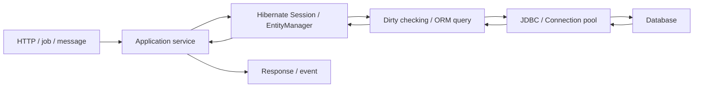
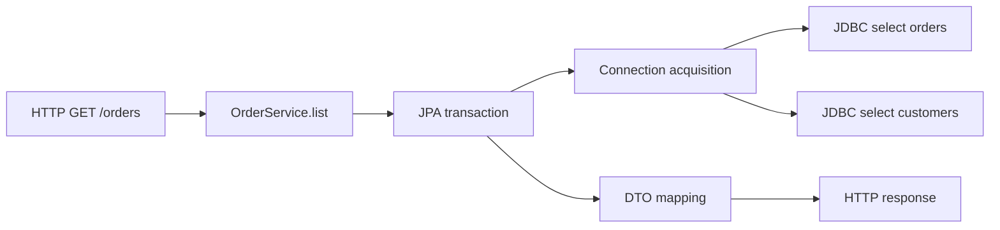

# Bật đo đạc theo mục đích và kiểm soát chi phí quan sát trong Hibernate

Một ứng dụng Java dùng Hibernate gặp các tình huống rất quen thuộc:

- API tìm danh sách đơn hàng bỗng chậm từ vài chục lên vài trăm mili giây.
- Một endpoint trả 20 bản ghi nhưng lại phát hơn 100 câu SQL.
- Sau khi bật second-level cache, database vẫn chịu tải lớn.
- Connection pool thường xuyên cạn khi nhiều request đồng thời.
- Trên production, một lần bật DEBUG để điều tra khiến dung lượng log tăng đột biến và độ trễ request xấu đi.
- Dashboard thể hiện số lượng query thấp nhưng database vẫn có các câu SQL tốn hàng giây.
- Một người bật log tham số bind và vô tình đẩy email, token hoặc dữ liệu cá nhân vào hệ thống log tập trung.

Trong những tình huống này, phản ứng “bật mọi thứ để xem” có vẻ tiện, nhưng **observability cũng tiêu tốn CPU, bộ nhớ, I/O, network, storage, tiền và có thể làm lộ dữ liệu**. Hơn nữa, đo quá nhiều hoặc ở sai phạm vi có thể khiến ta rút ra kết luận sai.

**Bật đo đạc theo mục đích** nghĩa là bắt đầu từ một câu hỏi chẩn đoán, chọn tín hiệu có khả năng trả lời câu hỏi đó, xác định phạm vi và thời gian đo, đánh giá overhead, rồi tắt hoặc giảm độ chi tiết khi đã đủ thông tin.

Ví dụ:

- Muốn biết “API có phát N+1 SQL không?” → đo số SQL theo một request/test, xem query shapes, kết hợp Hibernate Statistics và truy vết có chọn lọc.
- Muốn biết “chậm do chờ connection hay do SQL chạy chậm?” → theo dõi pool wait/pending, JDBC timing, database execution plans và transaction duration.
- Muốn biết “cache giúp giảm tải database không?” → theo dõi query cache hit/miss, L2 hit/miss, số SQL, latency và bộ nhớ cache.
- Muốn biết “một query cụ thể chậm ở database?” → bật slow query logging theo ngưỡng, dùng tracing và `EXPLAIN` trên DBMS mục tiêu.
- Muốn biết “vì sao transaction treo lâu?” → kiểm tra transaction boundary, lock waits, connection hold time và DB metrics, không chỉ đọc Hibernate SQL log.

Bài học thuộc chương **Quan sát và chẩn đoán** của module Hibernate, giải thích các lớp đo đạc, cách chọn và bật chúng trong Spring Boot/Hibernate, chi phí thật của observability và một quy trình điều tra có thể lặp lại.

> **Phạm vi phiên bản:** ví dụ ưu tiên Hibernate ORM 6.x–7.x, Spring Boot/Micrometer hiện đại và Jakarta Persistence. Hibernate 5.x dùng một số tên logger và API khác. Cấu hình slow-query, JDBC bind logger, Statistics, Micrometer và OpenTelemetry phải được đối chiếu với Hibernate/Spring Boot/agent **đúng phiên bản đang chạy**. Những con số minh họa về latency và log volume không phải benchmark hay mặc định do Hibernate bảo đảm.

---

## 1. Quan sát không đồng nghĩa ghi càng nhiều log càng tốt

Ba nhóm tín hiệu thường được gọi là *three pillars*:

| Tín hiệu | Trả lời chủ yếu | Đơn vị dữ liệu điển hình | Chi phí nổi bật |
| --- | --- | --- | --- |
| **Metrics** | Hệ thống đang có xu hướng tốt/xấu thế nào? | Counter, gauge, histogram | Cardinality, time-series storage, aggregation |
| **Logs** | Một sự kiện hoặc thao tác cụ thể đã ghi gì? | Structured log record | CPU format, bytes, I/O, indexing, privacy |
| **Traces** | Một request đi qua những bước nào, mất thời gian ở đâu? | Span, trace, attributes | Instrumentation, context propagation, ingestion |
| **Profiles** | CPU/memory/allocations bị tiêu thụ ở đoạn code nào? | Stack samples, allocation samples | Sampling/recording overhead, lưu dữ liệu |
| **Database diagnostics** | DB đang scan/lock/wait/execute gì? | Query plan, slow SQL, waits, statistics | DB CPU, query log, kế hoạch thực thi |

Trong một sự cố, cần kết hợp tín hiệu, nhưng **không cần bật độ chi tiết tối đa của mọi lớp**.

### Ví dụ chọn sai công cụ

Muốn biết vì sao pool cạn nhưng chỉ bật SQL DEBUG. Bạn có thể thấy hàng nghìn SELECT, vẫn không biết:

- Bao nhiêu threads đang chờ connection?
- Connections có bị giữ lâu sau khi SQL chạy xong?
- Transaction có thực hiện network call trong khi giữ connection?
- Pool max size bao nhiêu và DB cho phép bao nhiêu connections?
- Một SQL đang chờ row lock hay đang thực thi?

Với vấn đề pool, **pool metrics và transaction/DB timings** thường là lớp đo đầu tiên. SQL logging chỉ là lớp bổ sung có mục tiêu.

## 2. Bắt đầu bằng một câu hỏi đo được

Trước khi thay cấu hình, ghi lại:

1. **Triệu chứng:** endpoint nào chậm, khi nào, tần suất bao nhiêu?
2. **Giả thuyết:** N+1, query plan, lock, cache miss, pool contention, GC hay downstream I/O?
3. **Tín hiệu cần:** metric, trace, SQL log, DB execution plan, profiler?
4. **Phạm vi:** môi trường test, một instance, một endpoint, một tenant hay toàn production?
5. **Độ chi tiết:** aggregate theo phút, trace sample hay full per-query details?
6. **Ngân sách:** CPU, memory, log MB/s, collector capacity, retention?
7. **Thời hạn bật:** mặc định thường trực hay chỉ trong một cửa sổ điều tra?
8. **Điều kiện kết luận/tắt:** số liệu nào đủ chứng minh hoặc bác bỏ giả thuyết?

Ví dụ một phiếu điều tra:

```text
Vấn đề:
  GET /api/orders có p95 ~650ms, trước đây ~120ms.

Giả thuyết:
  Áp DTO mới nhưng còn lazy fetch customer theo từng order.

Muốn đo:
  - Số JDBC statements cho một request điển hình.
  - Các SQL statement shapes.
  - Latency HTTP/DB.
  - Hibernate entity/collection fetch metrics.

Phạm vi:
  Staging có dữ liệu đại diện;
  nếu cần production thì chỉ một instance, 10 phút.

Ranh giới riêng tư:
  Không log bind values và raw response bodies.

Điều kiện kết luận:
  Query count tăng tuyến tính theo số Order
  => xác nhận N+1, sửa fetch plan/projection.
```

Mẫu này hạn chế việc để DEBUG chạy nhiều tuần chỉ vì quên tắt.

## 3. Nguyên tắc: đo điều có thể ra quyết định

Một metric chỉ có ích nếu hành động theo nó được định nghĩa rõ.

Ví dụ:

| Tín hiệu | Nếu bất thường, sẽ làm gì? |
| --- | --- |
| HTTP latency p95 tăng | Tách DB wait, execution và application time |
| JDBC statements/request tăng theo số row | Kiểm tra N+1, lazy association và query loop |
| Query cache hit ratio thấp | Xem parameter cardinality/invalidation, cân nhắc bỏ cache |
| L2 cache misses cao | Xem cacheability, capacity, eviction và query shape |
| Pool pending/wait tăng | Kiểm tra connection hold time, leak, concurrency, DB capacity |
| DB lock wait tăng | Xem transaction boundaries và conflicting writes |
| Session count/transaction duration tăng | Xem lifecycle, OSIV, long transactions, batch jobs |
| Log bytes/second tăng | Giảm logging detail/sampling, loại dữ liệu nhạy cảm |
| Trace spans/request tăng mạnh | Xem per-statement instrumentation và sampling budget |

Không có metric nào tự động chứng minh root cause. Ví dụ “prepare statement count tăng” là dấu hiệu cần điều tra, không trực tiếp chứng minh N+1 nếu request có nhiều nghiệp vụ hợp lệ.

## 4. Bốn phạm vi đo cần phân biệt

**Phạm vi đo** quan trọng ngang với giá trị đo.

| Phạm vi | Ví dụ | Rủi ro đọc sai |
| --- | --- | --- |
| Toàn application/node | `SessionFactory Statistics` | Nhiều requests đồng thời cộng dồn |
| Một Session/transaction | Session metrics/event listeners | Một request có thể mở nhiều Sessions |
| Một request/trace | HTTP span và JDBC child spans | Thiếu async/background work hoặc sampling |
| Một DB statement/query plan | Slow query và `EXPLAIN` | Chỉ thấy SQL, không biết ORM call site |

Ví dụ `Statistics.getPrepareStatementCount()` thường là counter tổng hợp của `SessionFactory`. Lấy giá trị đầu và cuối một HTTP request trên production đang có 1.000 requests đồng thời **không cho phép kết luận** toàn bộ độ tăng thuộc request ấy.

Tương tự, một HTTP request có thể gọi hai transactions, và một transaction có thể chạy nhiều Hibernate Sessions. Không đồng nhất các ranh giới mà không biết integration framework.

---

## 5. Đường đi của một thao tác Hibernate

Sơ đồ khái niệm:



Một request chậm có thể chậm tại:

- Application logic trước khi mở Session.
- Query construction/ORM materialization.
- Connection checkout từ pool.
- Chờ row/table lock.
- Database execution.
- JDBC result transfer.
- Hydrating hàng nghìn entities/collections.
- Dirty checking/flush.
- Serialization/lazy loading sau service method.
- Remote API chạy khi transaction còn mở.
- Waiting/GC bên ngoài DB.

**Chỉ xem SQL text không cho biết tất cả những thời gian này.** Cần chọn điểm đo đúng đường đi của request.

## 6. Hibernate SQL logger: thấy SQL Hibernate sinh

Trong Hibernate 6.x, logger phổ biến:

```properties
logging.level.org.hibernate.SQL=DEBUG
```

Một truy vấn entity:

```java
List<Order> orders = em.createQuery(
    "select o from Order o where o.status = :status",
    Order.class
)
.setParameter("status", OrderStatus.PAID)
.getResultList();
```

có thể tạo SQL dạng:

```sql
select
    o.id,
    o.status,
    o.customer_id
from orders o
where o.status=?
```

**SQL log cho biết dạng câu SQL**, không nhất thiết cho biết giá trị tham số hoặc thời gian database chạy.

### Khi nào bật?

- Muốn kiểm tra số câu SELECT/UPDATE/INSERT.
- Muốn biết JOIN có xuất hiện không.
- Muốn thấy một association lazy gây truy vấn riêng hay không.
- Muốn xác minh Hibernate dùng OFFSET/LIMIT, batching hoặc EXISTS như mong đợi.
- Muốn kiểm tra thứ tự SQL khi flush.
- Muốn đối chiếu HQL/Criteria với SQL thực tế.

### Khi nào không cần bật liên tục?

- Production có throughput cao.
- DB monitoring đã cung cấp query digest và timings đủ cho vấn đề đang xét.
- Log ingestion/retention có giới hạn ngân sách.
- Có nguy cơ log chứa dữ liệu nhạy cảm, SQL comments tự do hoặc literal do developer tạo.

SQL DEBUG là công cụ chẩn đoán, **không phải một log bắt buộc phải bật 24/7**.

## 7. Không dùng `hibernate.show_sql` làm cách log chính trong production

Một số ví dụ dùng:

```properties
spring.jpa.show-sql=true
```

hoặc:

```properties
spring.jpa.properties.hibernate.show_sql=true
```

Hibernate `show_sql` thường ghi SQL ra standard output, bỏ qua một phần cấu hình logging thông thường.

Các điểm bất lợi:

- Khó kiểm soát level theo logger/package.
- Không có đầy đủ khả năng routing/filtering/structured metadata của logging framework.
- Ghi quá nhiều có thể ảnh hưởng I/O và chi phí ship log.
- Có thể làm lẫn SQL với application logs.
- Không tự cung cấp elapsed time hoặc bind parameters đáng tin.

Ưu tiên logger `org.hibernate.SQL` qua SLF4J/logging framework trong các ca cần SQL logs.

### `format_sql` không phải metric

```properties
spring.jpa.properties.hibernate.format_sql=true
```

giúp SQL nhiều dòng dễ đọc, nhưng không đo hiệu năng. Nó có thể làm tăng số bytes/lines khi log được bật.

## 8. Log bind parameters: dùng cực kỳ thận trọng

Hibernate 6 có logger bind phổ biến:

```properties
logging.level.org.hibernate.orm.jdbc.bind=TRACE
```

Hibernate 5.x từng dùng những logger như:

```properties
logging.level.org.hibernate.type.descriptor.sql.BasicBinder=TRACE
```

Hai cách trên **không nên bật đồng thời một cách máy móc**. Cần xác minh version và logger categories hiện tại.

Bind logs có thể tiết lộ:

- Email, tên, địa chỉ, số điện thoại.
- Tenant identifier hoặc internal customer ID.
- Mã OTP, password hashes và authentication data nếu từng được bind.
- Personal health/financial information.
- Search text nhạy cảm.
- Token hoặc client-supplied payloads.
- Dữ liệu quy trình thanh toán/đơn hàng.

**Không bật JDBC bind TRACE trên production diện rộng** chỉ vì muốn “xem thử truy vấn”. Tài khoản log-reader có thể đông hơn người được quyền xem các bảng dữ liệu gốc, và log retention có thể dài hơn DB retention.

### Quy trình an toàn hơn

1. Tạo fixture dữ liệu giả trên local/staging.
2. Bật bind TRACE trong cửa sổ đo ngắn.
3. Kiểm tra một query cụ thể với parameters kiểm soát được.
4. Tắt ngay khi đủ bằng chứng.
5. Không copy nguyên log có PII vào ticket công khai.
6. Nếu phải dùng production, chỉ qua quy trình truy cập được phê duyệt, sampling/redaction đúng thiết kế.

Với lỗi SQL parameter type, có thể dùng targeted integration test và JDBC metadata thay vì trace toàn bộ values.

## 9. `org.hibernate.orm.jdbc.extract` cũng có rủi ro dữ liệu

Một số Hibernate 6.x versions có logging categories liên quan JDBC extracted values:

```properties
logging.level.org.hibernate.orm.jdbc.extract=TRACE
```

Đây không phải cách đo latency chung. Nó có thể ghi thông tin dữ liệu Hibernate đọc từ ResultSet, thậm chí rộng hơn nhu cầu điều tra bind values.

Nếu đang tìm N+1 hoặc query plan, **thường không cần extracted-value logs**. Hãy đo query shapes và counts trước.

## 10. Bật slow-query logging có ngưỡng

Hibernate có setting cho ngưỡng statement chậm, ví dụ trên những Hibernate 6.x versions hỗ trợ:

```properties
spring.jpa.properties.hibernate.log_slow_query=250
```

Giá trị minh họa là **250 milliseconds**. Đặt một ngưỡng có ý nghĩa dựa trên SLO và latency distribution, không dùng 250ms như mặc định cho mọi dịch vụ.

Tùy version/logger configuration, Hibernate phát slow SQL logs qua category như `org.hibernate.SQL_SLOW`.

```properties
logging.level.org.hibernate.SQL_SLOW=INFO
```

### Slow query logging có ích khi nào?

- Production chỉ có một số SQL chậm.
- Muốn tập trung log vào outliers thay vì mọi SQL.
- Muốn xác định query shape và điều tra execution plan.
- Muốn tương quan thời gian chạy SQL với thời điểm p95 tăng.

### Nó không đo đủ những gì?

Slow SQL threshold không tự bao gồm toàn bộ:

- Chờ connection checkout.
- Thời gian Java materialization.
- Tạo DTO và JSON serialization.
- Thời gian business service gọi remote API.
- Transaction lock wait ngoài statement được log nếu không phản ánh trong timing của query.
- N+1 có 100 query mỗi query chỉ vài ms nhưng tổng rất chậm.
- CPU/GC trong JVM.

**Một request 800ms có thể không có câu SQL riêng lẻ nào vượt 250ms.** Nguyên nhân có thể là nhiều câu SQL nhỏ hoặc pool wait.

### Để điều tra chính xác

Xem thêm slow query log ở DB server, `pg_stat_statements` (PostgreSQL) hoặc nguồn query digest tương đương, DB wait events và query plans. Các cách này có coverage khác với log Hibernate.

## 11. SQL comments để nhận biết nguồn gốc query

Hibernate có thể gắn SQL comments khi bật:

```properties
spring.jpa.properties.hibernate.use_sql_comments=true
```

Hibernate query API còn có:

```java
session.createQuery(
        "select o from Order o where o.status=:status",
        Order.class
    )
    .setParameter("status", OrderStatus.PAID)
    .setComment("orders.list-paid")
    .getResultList();
```

Comment **do developer kiểm soát** có thể giúp đối chiếu SQL shape với use case.

Những điều cần tránh:

- Không đưa raw user input, token, email hoặc secret vào SQL comment.
- Không dùng comment chứa request ID thay đổi ở mỗi request nếu database/query plan analysis bị phân mảnh bởi SQL text.
- Không lạm dụng comment khiến SQL logs quá lớn.
- Query plan/cache behavior liên quan comment có thể khác theo driver/DBMS.

Nhãn ổn định như `orders.list-paid` thường hữu ích hơn một chuỗi dữ liệu tùy ý.

## 12. `StatementInspector`: quan sát SQL ở một điểm chặn

Hibernate có SPI:

```java
import org.hibernate.resource.jdbc.spi.StatementInspector;

public final class QueryShapeInspector
        implements StatementInspector {

    @Override
    public String inspect(String sql) {
        // Có thể ghi nhận dạng query/correlation an toàn.
        // Trả null: không thay đổi SQL.
        return null;
    }
}
```

Cấu hình Hibernate bằng instance/class phù hợp:

```properties
spring.jpa.properties.hibernate.session_factory.statement_inspector=com.example.QueryShapeInspector
```

Một `StatementInspector` có thể được gọi khi Hibernate chuẩn bị SQL, và có thể trả chuỗi SQL đã sửa nếu có nhu cầu thật sự.

### Giới hạn quan trọng

- **Không tự đo database execution duration.**
- Không biết tất cả JDBC bind values.
- Không chạy cho raw SQL bên ngoài Hibernate Session, ví dụ `JdbcTemplate` độc lập.
- Nếu inspect method thực hiện regex nặng, JSON serialization hoặc network call, chi phí đó sẽ tác động lên từng statement.
- Không dùng để “tự sửa SQL bằng cách nối tenant WHERE” một cách không bảo đảm parser; đó không phải giải pháp bảo mật tổng quát.

Nếu chỉ muốn đếm SQL theo request, có thể dùng targeted test instrumentation hoặc JDBC proxy/tracing thay vì đặt logic đắt vào inspector cho toàn application.

---

## 13. Hibernate Statistics: bộ đếm và số liệu ORM

Hibernate có API:

```java
import org.hibernate.SessionFactory;
import org.hibernate.stat.Statistics;

SessionFactory sessionFactory =
    entityManagerFactory.unwrap(SessionFactory.class);

Statistics stats = sessionFactory.getStatistics();
```

Bật thu thập:

```properties
spring.jpa.properties.hibernate.generate_statistics=true
```

**Hãy coi đây là chế độ đo có chi phí.** Nó thêm counters, tracking và một số structures trong runtime Hibernate. Không tự động bật trên mọi production instance nếu chưa đánh giá overhead và mục tiêu.

### Một số số liệu phổ biến

```java
long prepared = stats.getPrepareStatementCount();
long entityLoads = stats.getEntityLoadCount();
long entityFetches = stats.getEntityFetchCount();

long collectionsLoaded = stats.getCollectionLoadCount();
long collectionsFetched = stats.getCollectionFetchCount();

long secondLevelHits =
    stats.getSecondLevelCacheHitCount();
long secondLevelMisses =
    stats.getSecondLevelCacheMissCount();

long queryCacheHits =
    stats.getQueryCacheHitCount();
long queryCacheMisses =
    stats.getQueryCacheMissCount();

long queries = stats.getQueryExecutionCount();
```

Tên API minh họa cho Hibernate ORM hiện đại; cần so sánh Javadocs của version dùng thực tế.

### Diễn giải đúng

| Counter | Gợi ý | Điều không thể suy ra trực tiếp |
| --- | --- | --- |
| Prepared statements | Khối lượng JDBC statements do Hibernate chuẩn bị | Số SQL do hệ thống khác/JdbcTemplate phát |
| Entity load | Entity state được load | Mọi entity fetch là N+1 |
| Entity fetch | Load/fetch ngoài primary entity load theo định nghĩa Hibernate | Mọi fetch đều chậm |
| Collection fetch | Collection retrieval | Số câu SQL chính xác cho từng API |
| L2 hit/miss | Mức sử dụng domain-data cache | Tốc độ request luôn tăng |
| Query cache hit/miss | Reuse cached query results | Cache hit đồng nghĩa không có SQL khác |
| Query execution count | Số query executions được thống kê | Tổng mọi JDBC statements trong app |

Một câu `SELECT` có thể trả 1.000 rows, nhưng statistic “entity load” và “SQL prepare” mô tả **những hoạt động khác nhau**.

## 14. `Statistics` thường là số liệu toàn SessionFactory

Ví dụ sai trong production đông request:

```java
long before =
    sessionFactory.getStatistics()
        .getPrepareStatementCount();

service.doSomeWork();

long after =
    sessionFactory.getStatistics()
        .getPrepareStatementCount();

System.out.println(
    "Request SQL count = " + (after - before)
);
```

Trong thời gian `service.doSomeWork()` chạy, những threads khác cũng đang dùng cùng SessionFactory và tăng counter. Độ chênh **không chỉ** thuộc request hiện tại.

Cách trên có thể hữu ích **trong test được cô lập và chạy tuần tự**, khi chắc chắn không có request/job đồng thời.

### Cách đo theo request

Có thể chọn:

- Tracing instrumented JDBC spans gắn vào trace context.
- DataSource proxy có request-scoped counters.
- Tùy biến Session event listener chỉ đếm statements trong Session, rồi ánh xạ đúng Session/transaction sang request.
- Test integration một request/transaction tại một thời điểm và clear Statistics trước test.

Không dán nhãn `SessionFactory` global counter thành metric “SQL per request” trong production.

## 15. Đọc chỉ số truy vấn theo query key

Hibernate `Statistics` có thể cung cấp thống kê từng query, tùy query type và version:

```java
import org.hibernate.stat.QueryStatistics;

String hql =
    "select o from Order o where o.status=:status";

QueryStatistics qs =
    stats.getQueryStatistics(hql);

long executions = qs.getExecutionCount();
long totalRows = qs.getExecutionRowCount();
long maxTime = qs.getExecutionMaxTime();
```

Cách query key được biểu diễn có thể khác nhau theo HQL/JPQL/native queries, Hibernate version và cách Hibernate chuẩn hóa query. Đừng mặc định mọi SQL được thống kê dưới đúng chuỗi HQL bạn tự viết.

### Rủi ro cardinality của query statistics

Nếu ứng dụng xây động hàng nghìn query strings khác nhau, theo dõi từng query có thể chiếm memory và tạo nhiều metric series khi export. Một query cho mỗi bộ filter/order không được chuẩn hóa có thể trở thành nhiều keys.

Hibernate có giới hạn/khoảng cấu hình cho số query statistics được giữ ở nhiều phiên bản. Khi cần per-query metrics trên production, hãy kiểm tra cơ chế limit/eviction và dùng **query fingerprints ổn định**, không tự thêm parameter values vào metric tags.

## 16. Không reset toàn bộ `Statistics` để đo request production

API có:

```java
stats.clear();
```

Trong một integration test cô lập, clear trước một kịch bản giúp assertion dễ hơn.

Nhưng trong production đa luồng, reset Statistics toàn SessionFactory sẽ:

- Xóa counter context của các requests khác.
- Làm dashboard delta/rate gián đoạn.
- Gây nhầm về xu hướng và alert.
- Không tạo được một “request-local counter” chính xác.

**Không gọi `clear()` trong controller/service production**. Nếu cần cửa sổ đo, lấy time-series delta từ monitoring system hoặc dùng request-scoped instrumentation.

## 17. Statistics có thể bật/tắt theo cơ chế phiên bản

Một số Hibernate versions cung cấp khả năng điều khiển thu thập statistics qua API `Statistics`/SessionFactory lúc runtime, ví dụ method:

```java
stats.setStatisticsEnabled(true);
```

Cần đối chiếu version, integration framework và chính sách vận hành. Đừng expose một HTTP endpoint công khai bật global diagnostics.

Nếu bật động trong production:

- Chỉ privileged operator được phép.
- Ghi audit sự kiện bật/tắt.
- Có thời hạn và auto-disable ở hệ thống quản trị/cấu hình.
- Theo dõi overhead trong thời gian bật.
- Không reset counters bừa bãi.
- Có rollback nhanh nếu throughput/latency xấu đi.

Bật/tắt statistics **không tự bật SQL bind TRACE**, và ngược lại. Các lớp đo là độc lập.

## 18. Session Metrics và per-session logging

Hibernate có cơ chế session event listeners và thống kê/logging theo Session. Ở những versions phù hợp, người dùng có thể thấy log:

```text
Session Metrics {
    ... nanoseconds spent acquiring JDBC connections;
    ... nanoseconds spent preparing JDBC statements;
    ... nanoseconds spent executing JDBC statements;
    ... nanoseconds spent executing JDBC batches;
    ... nanoseconds spent performing flushes;
}
```

Ví dụ text chỉ minh họa loại số liệu, không phải output được bảo đảm ở mọi version.

Có setting liên quan như:

```properties
spring.jpa.properties.hibernate.session.events.log=true
```

Trong một số versions, việc phát session metrics còn phụ thuộc `generate_statistics`, listener registration và logger configuration. Kiểm tra actual output trong môi trường mục tiêu.

### Ưu điểm

- Nhìn được thời gian JDBC acquire/prepare/execute/batch ở cấp Session.
- Có ích khi test một transaction.
- Có thể giải thích chi phí flush bất thường.

### Giới hạn

- Session không bằng request trong mọi ứng dụng.
- Nhiều Sessions cùng request cần correlation.
- Số liệu “JDBC execute nanoseconds” không bằng end-to-end DB/network/request latency.
- Logging một record cho **mỗi Session** có thể rất nhiều ở ứng dụng throughput cao.
- Một Session dài có thể gộp nhiều business operations.

Không bật session metrics logs diện rộng liên tục nếu chưa đo chi phí log/volume.

## 19. Thực hành: so sánh SQL count trong integration test

Ví dụ một repository cần trả 20 Orders kèm Customer name.

Kịch bản đo có thể viết:

```java
@Test
void orderListAvoidsNPlusOne() {
    Statistics stats =
        entityManagerFactory
            .unwrap(SessionFactory.class)
            .getStatistics();

    stats.clear();

    // Fixture đã được tạo trước; test chạy cô lập.
    List<OrderListDto> result =
        orderService.listWithCustomerNames(20);

    assertEquals(20, result.size());

    long statements = stats.getPrepareStatementCount();

    assertTrue(
        statements <= 3,
        "SQL count bất thường: " + statements
    );
}
```

Đây là ví dụ định hướng: số statements kỳ vọng phải dựa trên mapping/query/test fixture thực, có thể có count query, sequence, flush hoặc transaction initialization.

**Điều kiện để assertion có ý nghĩa:**

- Test chạy cô lập, không song song dùng cùng SessionFactory.
- Dữ liệu fixture tạo trước `stats.clear()`.
- L1 cache được loại khỏi ảnh hưởng bằng Session/transaction thích hợp.
- Môi trường database gần với production về mapping/dialect.
- Không có job khác làm tăng global counter.
- Cùng số rows/associations giữa các lần test.

Một assertion cứng “mọi endpoint chỉ được 1 SQL” có thể sai; mục tiêu là bảo vệ query count khỏi tăng không mong muốn.

## 20. Đo N+1: quan sát số SQL theo kích thước kết quả

Giả sử:

```java
List<Order> orders =
    em.createQuery(
        "from Order o order by o.id",
        Order.class
    )
    .setMaxResults(50)
    .getResultList();

for (Order order : orders) {
    System.out.println(
        order.getCustomer().getName()
    );
}
```

Nếu association lazy chưa được tải và mỗi Order có Customer khác nhau, ứng dụng có thể chạy:

```text
1 SELECT lấy 50 Orders
+ 50 SELECT lấy Customers
= 51 SQL statements
```

Đây là ví dụ **có thể**, không phải số bắt buộc: L1/L2 cache, batch fetching, trùng Customer IDs hoặc fetch plan có thể làm số SQL khác.

### Cách chẩn đoán thực tế

1. Tạo fixtures 5, 20, 50 rows với associations khác nhau.
2. Mở transaction/Session mới cho mỗi ca để hạn chế L1 cache.
3. Đo SQL count hoặc JDBC spans theo từng ca.
4. Quan sát quan hệ giữa **rows trả về** và **statements**.
5. Xem query shapes để biết secondary SELECT đến từ association nào.
6. Thử projection/`JOIN FETCH` to-one hoặc `@BatchSize`/EntityGraph khi phù hợp.
7. Đo lại SQL count, latency và transferred rows.

N+1 là **mẫu tăng theo cardinality**, không chỉ là “nhiều SQL hơn một”.

## 21. Sửa N+1 mà không làm phát sinh vấn đề mới

Với to-one:

```java
List<Order> orders = em.createQuery(
    """
    select o
    from Order o
    join fetch o.customer
    order by o.id
    """,
    Order.class
)
.setMaxResults(50)
.getResultList();
```

`JOIN FETCH` to-one thường an toàn hơn so với collection join fetch khi phân trang.

Nhưng:

- Không join fetch mọi association theo phản xạ.
- Với to-many, JOIN có thể nhân rows và làm pagination trong memory.
- EntityGraph có thể tải nhiều field/association ngoài nhu cầu.
- L2 cache có thể đã giải quyết một phần nhưng không chắc trong peak load.
- DTO projection có thể phù hợp hơn cho read API.

**Đo cả SQL count, rows returned, latency và memory.** Giảm từ 51 xuống 1 SQL nhưng đọc một Cartesian product khổng lồ không nhất thiết nhanh hơn.

## 22. Chuẩn bị statement và batching

Hibernate có thể batch nhiều INSERT/UPDATE qua JDBC, tùy ID strategy, driver và mapping.

Config minh họa:

```properties
spring.jpa.properties.hibernate.jdbc.batch_size=50
spring.jpa.properties.hibernate.order_inserts=true
spring.jpa.properties.hibernate.order_updates=true
```

Mục tiêu đo:

- Số statement prepares.
- Số JDBC batch executions.
- Số rows DML.
- Transaction duration.
- Database lock contention.
- Memory/dirty checking trong persistence context.
- Chi phí flush.

### Không kết luận batching đang hoạt động chỉ vì có `batch_size`

`GenerationType.IDENTITY`, SQL shapes khác nhau, driver config hoặc flush ordering có thể làm batching không như dự kiến.

Hãy kiểm tra Hibernate session metrics/JDBC proxy hoặc driver/DB-level measurements, thay vì chỉ nhìn property.

## 23. Quan sát flush và dirty checking

Khi transaction thay đổi nhiều entities:

```java
for (Order order : orders) {
    order.markProcessed();
}
entityManager.flush();
```

Hibernate phải quản lý persistence context và phát các SQL tương ứng.

Chi phí có thể nằm ở:

- Dirty checking nhiều managed entities.
- Cascade checks.
- Collection diff/association processing.
- JDBC prepares và batch execution.
- Database locks.
- Entity lifecycle callbacks.
- Audit listeners như Envers.

Một transaction giữ hàng trăm nghìn managed entities có thể chậm dù không có một query SELECT đặc biệt.

### Gợi ý cho batch processing

- Phân lô transaction.
- Kiểm soát flush/clear sau mỗi batch khi an toàn.
- Dùng StatelessSession hoặc bulk DML khi semantics cho phép.
- Theo dõi bộ nhớ JVM, GC, SQL count và lock waits.
- Không tối ưu bằng bulk DML nếu nghiệp vụ cần entity callbacks, Envers audit hoặc optimistic locking semantics không được bảo đảm.

Quan sát đúng cho bài toán batch không chỉ là “mỗi query mất bao lâu”.

## 24. Theo dõi connection pool: lớp thường bị bỏ quên

Ứng dụng Spring Boot thường dùng HikariCP hoặc một pool khác. Tên metrics tùy provider/instrumentation, với HikariCP/Micrometer thường gặp:

```text
hikaricp.connections.active
hikaricp.connections.idle
hikaricp.connections.pending
hikaricp.connections.max
hikaricp.connections.timeout
```

Điều cần quan sát:

- `active` gần `max` trong bao lâu?
- `pending` tăng có trùng latency p95 không?
- Có connection acquisition timeouts không?
- Connection hold time có tăng dù SQL executions ngắn?
- Database max connections còn đủ không?
- Transaction có giữ connection khi gọi API ngoài không?

### Dấu hiệu phân biệt

```text
Pool pending cao + SQL duration bình thường:
    nghi long transactions hoặc pool sizing/concurrency.

Pool pending cao + DB lock waits cao:
    nghi transaction contention.

Pool active thấp + API latency cao:
    nghi application CPU, downstream I/O hoặc serialization.

Pool active cao + DB CPU max:
    nghi DB saturation / workload queries.
```

Đây là **giả thuyết**, cần đối chiếu traces và DB monitoring.

## 25. Connection leak detection không phải công cụ chính luôn bật

HikariCP có cơ chế leak-detection threshold theo cấu hình tương ứng:

```properties
spring.datasource.hikari.leak-detection-threshold=20000
```

Ngưỡng minh họa **20 giây**; nó có thể cảnh báo connections giữ lâu, nhưng không phải kết luận chắc chắn về leak.

Một query/transaction hợp lệ mất trên 20 giây cũng có thể tạo warning. Cần so sánh với expected transaction durations.

Khi bật:

- Chọn threshold tránh gây báo động giả.
- Chỉ dùng trong giai đoạn điều tra hợp lý.
- Kiểm tra stack traces có dữ liệu nhạy cảm không.
- Đo overhead và log volume.
- Tắt/điều chỉnh sau khi giải quyết sự cố.

Không mặc định “cảnh báo leak = lập trình viên quên close Connection”; đôi khi chính là long-running transaction.

## 26. Phân biệt chờ pool với chờ database

Một request 700ms có thể gồm:

```text
Wait for pool connection:  400ms
Database SQL execution:    50ms
Entity materialization:    80ms
Business code:            120ms
Serialization:             50ms
Total:                    700ms
```

Nếu chỉ dùng Hibernate slow SQL threshold=200ms, có thể **không log SQL chậm nào**, mặc dù API rất chậm.

Một trace hoặc instrumentation ở các boundaries sẽ thể hiện rõ hơn.

### Đo connection acquisition time

Các pool metrics, Micrometer timers và session-level diagnostics có thể hỗ trợ. Không đo bằng cách đặt đồng hồ thủ công quanh `entityManager.find()` rồi gọi toàn bộ thời gian đó là “SQL duration”.

`find()` có thể bao gồm L1 hit (không phát SQL), L2 cache, connection checkout, SQL, hydration và callbacks.

---

## 27. Spring Boot Actuator và Micrometer

Khi dùng Spring Boot, có thể expose metrics qua Actuator/Micrometer theo dependency/configuration của phiên bản.

Ví dụ Gradle:

```kotlin
dependencies {
    implementation("org.springframework.boot:spring-boot-starter-actuator")
    implementation("io.micrometer:micrometer-registry-prometheus")
}
```

Đây là ví dụ dependency; version thường được quản lý qua Spring Boot BOM tương ứng.

Một cấu hình minh họa:

```properties
management.endpoints.web.exposure.include=health,info,prometheus
management.endpoint.prometheus.access=read-only
```

Property quyền truy cập Actuator **có thay đổi theo Spring Boot version**; cần đối chiếu documentation. Không copy đoạn expose endpoints lên internet công khai khi chưa có authentication/network policy.

### Hibernate metrics từ Micrometer

Micrometer có các tích hợp Hibernate Statistics, ví dụ binder `HibernateMetrics` trong các phiên bản tương ứng.

Một cách đăng ký explicit:

```java
import io.micrometer.core.instrument.MeterRegistry;
import io.micrometer.core.instrument.binder.jpa.HibernateMetrics;
import jakarta.persistence.EntityManagerFactory;
import org.hibernate.SessionFactory;

@Bean
MeterBinder hibernateMetrics(EntityManagerFactory emf) {
    SessionFactory sf = emf.unwrap(SessionFactory.class);

    return new HibernateMetrics(
        sf,
        "primary",
        Tags.empty()
    );
}
```

Ví dụ cho thấy ý định binder; import `MeterBinder` và `Tags` từ Micrometer và kiểm tra constructor phù hợp với Micrometer version. Một số Spring Boot versions có autoconfiguration Hibernate metrics, nên **không đăng ký thêm binder thứ hai** nếu framework đã cung cấp metric tương đương.

Điều kiện để Hibernate metrics có dữ liệu có ý nghĩa có thể gồm `hibernate.generate_statistics=true` và Hibernate Statistics hoạt động, tùy binder/auto-config.

### Không dựa chỉ vào một metric name

Tên series/tags có thể khác giữa Micrometer/Boot versions. Hãy kiểm tra `/actuator/metrics` hoặc Prometheus output trong staging và ghi lại **metric contract thực tế**, không tự đoán theo một bài hướng dẫn thuộc phiên bản khác.

## 28. Chọn metrics labels đúng: cardinality quan trọng

Một metric tốt:

```text
app_order_reads_total{
  outcome="success",
  operation="list"
}
```

Một metric nguy hiểm:

```text
app_order_reads_total{
  orderId="123456789",
  email="alice@example.com",
  requestId="req-123",
  rawSql="select ...",
  traceId="..."
}
```

Những giá trị thay đổi theo request/user/order tạo rất nhiều time series khác nhau.

### Low vs high cardinality

| Label | Mức cardinality thường gặp | Khuyến nghị |
| --- | --- | --- |
| `operation=listOrders` | Thấp | Phù hợp |
| `outcome=success/failed` | Thấp | Phù hợp |
| `http.status=200/404/500` | Thấp | Phù hợp |
| `db.system=postgresql` | Thấp | Phù hợp |
| `entity=Order/Customer` | Vừa/đã biết | Có thể phù hợp |
| `tenantId` | Có thể cao | Cần ngân sách/cardinality policy |
| `userId` | Cao | Tránh làm metrics label |
| `orderId` | Rất cao | Tránh |
| `requestId` / `traceId` | Gần như duy nhất | Không dùng metrics label |
| Raw SQL/bind values | Rất cao + nhạy cảm | Tránh |

Tenant-level observability có thể cần cho tính phí hoặc SLA của vài tenants lớn, nhưng nên dùng **aggregation/bounded labeling strategy** và privacy policy thay vì tự thêm mọi tenant ID vào Prometheus metrics.

## 29. Metrics cho workload database nên có mẫu tối thiểu

Để giám sát một dịch vụ Hibernate, bộ metric nền tảng có thể gồm:

1. HTTP/request latency distribution và request rate/error rate.
2. CPU, heap, GC và thread pool saturation.
3. JDBC pool active/idle/pending/timeout và connection acquisition.
4. DB CPU, locks, waits, connections và slow queries.
5. ORM entity load/fetch/collection/cache counters khi cần.
6. Transaction/connection holding time nếu ứng dụng có instrumentation.
7. Query cache/L2 hit-miss-put khi thực sự dùng caches.
8. Log/traces pipeline bytes/ingestion/errors để quản lý chi phí quan sát.

Không có nghĩa tất cả Hibernate counters phải được export mãi mãi. Một số chỉ cần bật khi điều tra.

## 30. Histograms và percentiles: nên nhìn p95/p99

Average latency có thể che long-tail:

```text
99 requests mất 20ms
1 request mất 2000ms

Average ≈ 40ms
p99/p100 rất cao
```

Khi API có SLA, cần các phân vị như p50/p95/p99 theo **cửa sổ mẫu đủ lớn**, kết hợp throughput/error rate.

### Cẩn thận histogram cost

- Nhiều bucket × nhiều labels = nhiều time series.
- Export p99 theo một instance nhỏ có ít mẫu dễ dao động.
- Prometheus summary và histogram có khả năng aggregate khác nhau.
- Đừng thêm raw SQL text hoặc request ID vào timer tags.
- Chọn SLA buckets và enable histograms có chủ đích theo những operations quan trọng.

### Không nhầm p95 DB với p95 API

P95 SQL duration và p95 API duration được tính trên hai tập quan sát khác nhau; không thể cộng chúng để suy ra p95 tổng request một cách trực tiếp. Cần trace/phân rã trong cùng request khi giải thích latency.

---

## 31. Distributed tracing giúp nối request với JDBC spans

Một request có thể đi qua:



OpenTelemetry hoặc APM có thể instrument HTTP, Spring service, JDBC và database calls tùy agent/libraries.

Một trace giúp trả lời:

- Request nào đang chậm?
- Có bao nhiêu JDBC spans?
- SQL spans xuất hiện tuần tự hay song song?
- Có secondary SELECT theo từng entity không?
- Service ngoài Hibernate có chiếm phần lớn thời gian không?
- Transaction span bao lâu, JDBC span bao lâu?

### Phân biệt “trace được JDBC” với “trace hiểu HQL”

Instrumentation JDBC có thể thấy SQL chuẩn bị/thực thi, nhưng **không tự biết chính xác HQL, entity property hoặc business method gây ra SQL**. Có thể cần app spans, SQL comments hoặc instrumentations bổ sung để nối bối cảnh.

### Không đặt raw bind values làm span attributes

Traces thường đi qua external collector. Nếu lưu SQL text cần:

- Redact/sanitize nếu SQL chứa literals/comments nhạy cảm.
- Không ghi params có PII/secrets.
- Giới hạn kích thước attribute.
- Tránh span attribute biến thành per-user unique data.
- Có retention và access policy riêng.

OpenTelemetry semantic conventions và agent features thay đổi theo phiên bản, nên kiểm tra schema/attributes thực tế của exporter.

## 32. Sampling tracing: kiểm soát chi phí

Nếu ứng dụng có 1.000 requests/second và mỗi request phát 20 JDBC spans, full tracing sẽ tạo lượng spans rất lớn.

Các cách chọn mẫu:

- **Head-based sampling:** quyết định sớm khi trace bắt đầu, thường rẻ hơn.
- **Tail-based sampling:** quyết định sau khi thấy latency/error, hữu ích cho slow requests nhưng cần collector buffer và resource.
- **Rate limiting:** giới hạn số traces/second theo service/route.
- **Error-focused sampling:** tăng tỷ lệ giữ traces có lỗi.
- **Endpoint-specific sampling:** tập trung vào endpoint đang điều tra.
- **On-demand diagnostic window:** tăng mức đo trong thời gian ngắn rồi giảm.

### Trade-off quan trọng

- Head sampling nhỏ có thể bỏ lỡ lỗi hiếm.
- Tail sampling có thêm memory và collector infrastructure cost.
- Sampling thay đổi số lượng traces thu được, không nhất thiết giảm mọi overhead instrumentation tại application.
- Metrics aggregated nên tiếp tục cung cấp xu hướng toàn hệ thống, kể cả khi traces được sample.
- Không dùng trace sample để kết luận chính xác tổng request counts nếu chưa hiểu sampling weights.

**Tăng sampling chỉ cho mục tiêu có chủ đích**, không giữ mức cao mãi sau khi sự cố kết thúc.

## 33. Log sampling cũng phải có nguyên tắc

Không phải loại log nào cũng nên sample.

**Có thể cân nhắc sampling:**

- DEBUG logs lặp lại từ một query bình thường.
- SQL shape logs trong giai đoạn điều tra.
- Tracing INFO quá chi tiết của hoạt động đã có metrics.
- Những warning đã được rate-limit theo pattern không ảnh hưởng bảo mật.

**Không tự ý sampling/bỏ:**

- Security/compliance audit events được policy yêu cầu ghi đầy đủ.
- Các lỗi mất dữ liệu hoặc integrity vi phạm.
- Transaction outcome bắt buộc theo hợp đồng chứng cứ.
- Alert quan trọng cần được điều tra đầy đủ.

Diagnostic logging và compliance audit logging là **hai mục tiêu khác nhau**. Muốn tiết kiệm chi phí quan sát không có nghĩa được phép bỏ những chứng cứ bắt buộc.

## 34. Chi phí thực tế của logging SQL

Giả sử hệ thống có:

```text
Requests/second:          200
SQL statements/request:    10
Average bytes/log record: 300
```

Một ước lượng đơn giản:

```text
200 × 10 × 300 = 600,000 bytes/second
≈ 51.8 GB/day (hệ thập phân)
```

Đây chỉ là **log SQL text**, chưa gồm:

- Bind value logs.
- Extracted-result logs.
- Stack traces.
- Trace spans.
- Indexing overhead của backend.
- Compression/replication.
- Metadata, request context.
- Retention nhiều ngày.

Nếu bind/extract TRACE làm tăng vài lần số records, chi phí có thể lớn hơn rất nhiều.

### Công thức chi phí

```text
bytes/day =
  requests/second
  × statements/request
  × log_records/statement
  × average_bytes/record
  × 86,400 seconds/day
```

Khi tính ngân sách, dùng số liệu **đo được** trên workload thật. Không dùng các con số giả định làm dự toán production cố định.

## 35. Logging có thể làm benchmark sai lệch

Một hệ thống khi bật DEBUG có thể:

- Tạo strings/objects để format SQL.
- Dùng logging appenders có lock/contention.
- Gửi nhiều bytes qua disk/network.
- Tăng allocations và GC.
- Gây backpressure của async log queue.
- Kéo dài JDBC/request execution path.

Nếu so hai chiến lược Hibernate:

```text
A: SQL DEBUG bật
B: SQL DEBUG tắt
```

rồi nói B nhanh hơn vì query plan tốt hơn là **sai phương pháp**: cấu hình quan sát khác nhau.

Benchmark cần:

1. Đo baseline với observability mức bình thường.
2. Bật một loại instrumentation tại một thời điểm.
3. Đo overhead của chính instrumentation.
4. So sánh A/B ở cùng cấu hình đo.
5. Chạy đủ warmup, với dữ liệu và concurrency đại diện.
6. Kiểm tra collector/backpressure.

### Tắt log không đồng nghĩa hết overhead

Một instrumentation agent có thể vẫn tạo spans/timers trước khi sampling/export. Kiểm tra Java agent settings và profiling để biết overhead còn lại.

## 36. Đo chi phí quan sát như một SLO riêng

Một bảng budget có thể đặt:

| Hạng mục | Chỉ tiêu cần đo | Ví dụ hành động khi vượt ngưỡng |
| --- | --- | --- |
| Application CPU | % tăng sau khi bật đo | Giảm detail/sampling |
| Request p95/p99 | Regression so với baseline | Tắt diagnostics không thiết yếu |
| Heap/GC | Allocation, GC pause, heap retained | Giảm stats cardinality/traces |
| Log ingestion | MB/s và bytes/day | Lọc SQL DEBUG, rút ngắn window |
| Trace ingestion | Spans/s, dropped spans | Giảm sampling/attributes |
| Monitoring storage | Series count/retention | Giảm high-cardinality tags |
| Collector queue | Pending/dropped/export errors | Backpressure plan |
| Privacy/security | PII incidents/access scope | Redaction và access controls |

Không cần cố định mọi budget theo một con số chung. Chọn theo workload, hạ tầng và SLO của ứng dụng.

## 37. SQL fingerprinting thay vì lưu từng SQL raw

Câu SQL:

```sql
SELECT * FROM orders WHERE id = 101;
SELECT * FROM orders WHERE id = 102;
```

khác literals nhưng có cùng **shape**:

```sql
SELECT * FROM orders WHERE id = ?;
```

Dùng normalized query fingerprints giúp:

- Giảm metric cardinality.
- Gom latency/throughput theo SQL shape.
- Tìm statement tốn tổng thời gian nhiều nhất.
- Ít cần lưu giá trị dữ liệu nhạy cảm.
- So sánh plans/cost theo pattern.

DB engine có thể cung cấp query digest/query ID hoặc statement statistics; APM có cơ chế normalization tùy nhà cung cấp.

### Đừng tự regex SQL một cách ngây thơ

SQL có strings, comments, quoted identifiers, IN lists, JSON functions, dialect syntax. Một regex replace số/chữ có thể làm hỏng fingerprint hoặc bỏ sót PII.

Nếu cần canonicalization ổn định, ưu tiên DB/APM tooling có parser/fingerprinting được hỗ trợ; không tự viết một parser bằng vài replaceAll regex trong `StatementInspector`.

## 38. Top query theo tổng thời gian khác top query theo max time

Giả sử:

| Query shape | Số lần | Average | Tổng thời gian |
| --- | ---: | ---: | ---: |
| A | 1.000 | 3ms | 3.000ms |
| B | 5 | 300ms | 1.500ms |
| C | 100 | 10ms | 1.000ms |

Query B có từng lần rất chậm, nhưng query A có tổng DB time lớn nhất trong cùng cửa sổ.

Các góc nhìn:

- **Max/p99:** tìm outliers ảnh hưởng trải nghiệm.
- **Total execution time:** tìm workload đốt nhiều tài nguyên.
- **Execution count:** phát hiện N+1/query chatter.
- **Rows scanned/returned:** phát hiện index/query plan kém.
- **Lock wait:** tìm contention, không chỉ CPU.
- **Affected endpoints:** quyết định ưu tiên tác động người dùng.

Không tối ưu chỉ “SQL lâu nhất một lần” nếu một SQL chạy hàng triệu lần mới là nguyên nhân hệ thống quá tải.

## 39. Query plan: Hibernate không thay thế database optimizer

Hibernate tạo SQL, nhưng DBMS quyết định plan thực thi.

Khi một SQL chậm:

1. Lấy SQL shape và bind patterns có kiểm soát.
2. Đo tần suất và latency thực.
3. Chạy `EXPLAIN` trên database tương đương production.
4. Kiểm tra indexes, row estimates, joins, sorts, spill, statistics, lock waits.
5. Đối chiếu plan với cardinality/parameter distributions.
6. Sửa SQL/index/mapping, rồi đo lại end-to-end.
7. Không dựa vào một plan khi production có parameter-sensitive plans.

### `EXPLAIN ANALYZE` có thể thực thi query

Trên một số DBMS, `EXPLAIN ANALYZE` thực sự chạy statement để lấy số liệu. Với DML, điều này có thể tạo side effects/locks nếu không kiểm soát transaction.

Không chạy `EXPLAIN ANALYZE UPDATE/DELETE` trên production một cách tùy tiện; sử dụng môi trường được phép hoặc kế hoạch rollback/transaction theo DBMS và quyền vận hành.

---

## 40. Đọc cache metrics đúng mục tiêu

Trong Hibernate có:

- L1 cache: Persistence Context của Session.
- L2 cache: entity/collection state dùng chung theo SessionFactory/provider.
- Query cache: kết quả cacheable queries với cache keys và invalidation.
- Query plan cache: metadata/plan của query, không chứa result rows.

Từng cơ chế đo khác nhau.

### L2 cache ratio

```java
long hits = stats.getSecondLevelCacheHitCount();
long misses = stats.getSecondLevelCacheMissCount();

double hitRatio =
    hits + misses == 0
        ? 0.0
        : (double) hits / (hits + misses);
```

Hit ratio có thể gây hiểu nhầm:

- 99% hit ở một region nhỏ, không đại diện cho toàn query workload.
- Một miss của entity lớn có thể đắt hơn nhiều hits của entity nhỏ.
- Query list vẫn chạy SQL tìm IDs dù entity states nằm L2.
- Cache có thể cập nhật stale nếu external SQL bypass invalidation.
- Cache có thể khiến tăng memory/GC/network.

**Chọn cache không dựa một mình vào hit ratio.**

## 41. Query cache hit không bảo đảm SQL bằng 0

Trong một số Hibernate versions/layouts, query cache chỉ giữ entity identifiers (SHALLOW). Khi L2 entity state thiếu, Hibernate có thể phải tải từng entity bằng SQL.

Vì vậy đo kết hợp:

```text
Query cache hits/misses
L2 entity/collection cache hits/misses
Prepared statements/DB executions
End-to-end request latency
Cache memory/eviction
```

Nếu query cache hit cao nhưng SQL count vẫn cao, kiểm tra L2 miss và những lazy associations chưa fetched.

Hibernate 6.5+ có `hibernate.cache.query_cache_layout` với lựa chọn AUTO/FULL/SHALLOW; không dùng thiết lập này trên Hibernate versions chưa hỗ trợ. Khi đổi layout cần benchmark memory và SQL count, không chỉ đặt giá trị theo cảm giác.

## 42. Cache miss spike sau deploy

Một thời điểm deploy có thể khiến:

- Query plans thay đổi.
- L2/query cache cold.
- Cache region được rotate.
- Tăng số entity types/fields.
- Nhiều requests đồng thời reload cùng data.
- Connection pool bị dồn bởi cache stampede.

### Cách điều tra

1. So sánh misses/puts trước và sau deploy.
2. Xem cache eviction và memory.
3. Xem JDBC statement rate và DB CPU.
4. Xem latency p95 của endpoints dùng cache.
5. Kiểm tra data update rate/invalidation.
6. Nếu cache warmup cần thiết, triển khai rate-limited warmup thay vì dồn toàn bộ vào thời điểm khởi động.

Không mặc định “cache hit ratio thấp sau restart” là bug; cold start là một trạng thái cần hoạch định SLO.

## 43. Không expose query strings như metric tag

Một query có:

```text
select o from Order o where o.note like :keyword
```

Có thể sinh nhiều patterns nếu ứng dụng build dynamic HQL dựa vào input. Nếu tag chứa full SQL hoặc user keywords, time-series sẽ bùng nổ.

Giải pháp:

- Dùng normalized query name/operation name.
- Giới hạn số business endpoints/SQL fingerprints được export.
- Giữ raw SQL trong diagnostics có kiểm soát, không làm metric label.
- Tách high-cardinality metadata vào trace/log với retention/access policy.
- Theo dõi metrics backend series count và query cardinality.

Cardinality cao vừa tăng chi phí vừa có thể làm backend monitoring không ổn định, khiến chính hệ thống quan sát trở thành điểm lỗi.

## 44. Structured logging và correlation ID

Một record hữu ích hơn log tự do:

```json
{
  "timestamp": "2026-11-15T07:15:00Z",
  "level": "WARN",
  "service": "order-api",
  "operation": "orders.list",
  "traceId": "example-trace-id",
  "durationMs": 680,
  "sqlStatements": 42,
  "outcome": "slow"
}
```

Đây là record minh họa; `sqlStatements=42` chỉ nên ghi khi đã có per-request instrumentation đáng tin. Không lấy global Statistics delta của production và gắn vào request log.

### Những metadata hữu ích

- Operation/route (templated route, không phải path chứa raw ID).
- Trace ID/correlation ID.
- Outcome/status.
- Duration.
- Error type được chuẩn hóa.
- Tenant tier/region khi cần và được phép.
- Query fingerprint hoặc named query label.
- Version/build/deployment environment.

### Tránh đưa vào log

- Raw SQL parameters với secrets/PII.
- Passwords/tokens/authorization headers.
- Request/response body đầy đủ trừ khi có quy trình an toàn.
- Entity serialized toàn bộ với lazy graph.
- High-cardinality labels trong metrics.

## 45. Open Session in View có thể làm quan sát bị sai phạm vi

Khi `Open Session in View` (OSIV) bật, Session có thể còn mở trong giai đoạn controller/serialization.

Ví dụ:

```text
Service.transaction:
  SELECT orders

JSON serialization:
  getCustomer().getName()
  -> Lazy SELECT customers
```

Nếu bạn chỉ đo SQL trong service method, có thể bỏ qua SELECT phát sinh trong serialization.

### Cách phát hiện

- Trace toàn HTTP request, không chỉ service transaction.
- Xem SQL log/statement spans trong serialization.
- Test response DTO/JSON của endpoint thật.
- Chạy với OSIV disabled trong môi trường phù hợp để phát hiện lazy access ngoài transaction.
- Không trả managed entities trực tiếp nếu API có thể dùng DTO.

Không dùng OSIV làm cách sửa N+1; nó có thể che lỗi kiến trúc và kéo dài Session lifetime.

## 46. Connection pool, ORM và database là ba tầng cần đối chiếu

Một dashboard chỉ có Hibernate Statistics có thể không thấy:

- JDBC từ `JdbcTemplate`.
- Queries của một ORM khác.
- ETL hoặc migration jobs.
- DB admin traffic.
- Connection usage từ ứng dụng khác.
- Database-level locks do external writers tạo.

Một dashboard chỉ có DB metrics lại có thể không biết endpoint/Java call site nào phát query.

Cần khả năng nối:

```text
HTTP operation
    -> Trace/requestId
    -> Hibernate/JDBC statement shape
    -> Pool instance
    -> DB query ID / trace markers
    -> DB plan/wait metrics
```

Liên kết này có thể không đầy đủ nếu SQL comments/tracing setup chưa hỗ trợ. Hãy thiết kế correlation dựa trên công cụ thực tế chứ không giả định mọi span tự khớp query ID của DB.

## 47. Chỉ đo production khi cần có production data

Không phải vấn đề nào cũng tái hiện trên H2 hoặc local fixtures, ví dụ:

- Index/selectivity khác dữ liệu thật.
- Transaction lock contention.
- Connection pool saturation.
- GC trên entity graphs lớn.
- JDBC driver/network latency.
- Replica lag.
- Cache cluster behavior.
- Query plan bị skew theo tenant/parameter.
- Batch insert throughput khi concurrency cao.

Nhưng điều đó không có nghĩa bật TRACE toàn production. Có thể:

1. Dùng aggregate production metrics làm baseline.
2. Bật slow SQL có threshold.
3. Tăng sampling traces cho endpoint có vấn đề.
4. Giới hạn ở một instance/canary nếu cần.
5. Tạo anonymized representative dataset cho staging.
6. Chạy targeted reproduction có kiểm soát.
7. Gỡ cấu hình diagnostics sau khi kết luận.

**Production observability nên tăng độ chi tiết theo bậc**, không chuyển từ “không gì” sang “toàn bộ raw dữ liệu”.

---

## 48. Phương pháp “đo theo bậc” từ rẻ đến đắt

Một thang đo tham khảo:

| Bậc | Tín hiệu | Ví dụ | Đặc điểm |
| --- | --- | --- | --- |
| 0 | Baseline low-cardinality metrics | HTTP latency, pool, DB health | Duy trì lâu dài |
| 1 | Aggregate ORM metrics có chủ đích | Hibernate Statistics/Micrometer | Kiểm tra overhead trước khi bật rộng |
| 2 | Slow-query / error logs | Ngưỡng SQL slow, exception classes | Giới hạn outliers |
| 3 | Sampled JDBC tracing | 1 phần requests, endpoint-specific | Nối request với SQL |
| 4 | Targeted SQL DEBUG | Một instance/cửa sổ ngắn | Log volume lớn |
| 5 | Bind/extract TRACE hoặc profiler sâu | Staging/redacted diagnostic session | Chi phí/riêng tư cao |

Đây không phải “độ đắt” tuyệt đối: một APM sampling 100% với 50 spans/request có thể đắt hơn SQL DEBUG có filter tốt; một stats collector có query key cardinality lớn cũng có thể tốn memory. Nhưng nguyên tắc **bắt đầu từ tín hiệu rẻ và tăng độ chi tiết khi có lý do** vẫn hữu ích.

### Điều kiện nâng bậc

Chỉ nâng khi lớp trước chưa trả lời được câu hỏi. Ví dụ:

- Chỉ số pool pending tăng → kiểm tra transactions và DB waits.
- SQL slow logs xác định query shape → chạy EXPLAIN, không cần bind TRACE.
- Chưa rõ call site → sampled traces/SQL comments.
- Chưa rõ parameter-dependent plan → targeted sanitized parameter reproduction.

## 49. Playbook: endpoint có dấu hiệu N+1

**Triệu chứng:** p95 tăng theo page size.

**Bước 1:** đo endpoint latency và rows returned.

**Bước 2:** trong test cô lập, bật Hibernate SQL DEBUG và/or Statistics.

**Bước 3:** chạy page sizes 5, 20, 50 và đếm SQL statements.

**Bước 4:** nhận diện secondary SELECT theo customer/order line ID.

**Bước 5:** sửa bằng DTO projection, FETCH JOIN to-one, EntityGraph hoặc batch fetching theo use case.

**Bước 6:** chạy lại với cùng dữ liệu/concurrency, so sánh SQL count, rows processed và p95.

**Bước 7:** tắt DEBUG, giữ regression test query count.

### Kết luận cần có

Không chỉ viết “N+1 fixed”. Ghi:

```text
Before:
  pageSize=50, 51 SQL, p95=...

After:
  pageSize=50, 2 SQL, p95=...

Regression protection:
  integration test query count + API latency dashboard
```

Các số đo thực tế phải tự đo, không lấy ví dụ làm kết quả.

## 50. Playbook: pool connection exhausted

**Triệu chứng:** request timeouts và pool pending tăng.

**Bước 1:** xem active/idle/pending/timeout và DB max connections.

**Bước 2:** xác định service route hoặc batch job có transactions dài.

**Bước 3:** xem traces: connection checkout time, SQL wait/execute và remote call duration.

**Bước 4:** kiểm tra DB locks và slow queries.

**Bước 5:** sửa transaction boundary, giảm giữ connection khi gọi remote service, tối ưu query/locks hoặc điều chỉnh pool theo DB capacity.

**Bước 6:** load test với concurrency đại diện.

### Chẩn đoán sai thường gặp

Tăng `maximumPoolSize` từ 20 lên 200 mà không xem DB capacity có thể chỉ chuyển bottleneck sang database và tăng contention.

Giải pháp phải dựa trên measurement về concurrency, connection hold time và throughput, không chỉ “pool hết thì tăng pool”.

## 51. Playbook: query chậm nhưng ORM statements ít

**Triệu chứng:** chỉ 2 SELECT/request nhưng DB time chiếm phần lớn.

**Bước 1:** bật slow-query threshold phù hợp hoặc dùng DB query digest.

**Bước 2:** lấy SQL shape và safe parameter distribution.

**Bước 3:** chạy EXPLAIN trên DBMS tương ứng.

**Bước 4:** xem missing index, wrong joins, sort, full scan, row estimates, parameter selectivity và lock waits.

**Bước 5:** cải thiện index/SQL/query projection hoặc schema.

**Bước 6:** benchmark trên dữ liệu thực tế, kiểm tra impact các queries khác.

Không bật bind/extract TRACE như bước đầu, vì vấn đề có thể xác định được bằng normalized SQL shape và DB plan.

## 52. Playbook: second-level cache hit thấp

**Triệu chứng:** DB load cao dù đã bật L2 cache.

**Bước 1:** xác nhận entity/collection nào thực sự cacheable.

**Bước 2:** xem L2 hit/miss/put theo region, eviction/capacity.

**Bước 3:** xem query có thật sự load theo ID hay vẫn chạy SQL tìm IDs.

**Bước 4:** kiểm tra write rate làm invalidate cache.

**Bước 5:** xem cluster/network và cache serialization cost.

**Bước 6:** so throughput/DB SQL/latency/memory khi có và không L2.

### Một kết quả hợp lệ

“Bỏ L2 cache cho entity X” có thể là quyết định đúng nếu entity thay đổi liên tục, hit thấp và cache overhead vượt lợi ích. Không ép mọi entity vào L2 chỉ để tăng cache coverage.

## 53. Playbook: Hibernate transaction dài

**Triệu chứng:** pool active cao, latency tăng, database locks kéo dài.

**Bước 1:** quan sát transaction duration, connection holding, DB lock waits.

**Bước 2:** phân tách thời gian ORM queries và business code.

**Bước 3:** tìm network calls hoặc chờ thread/blocking calls bên trong `@Transactional`.

**Bước 4:** xem flush/dirty checking với nhiều managed entities.

**Bước 5:** thu hẹp transaction boundary, batch processing hoặc đổi workflow theo business invariants.

**Bước 6:** thử fault/retry scenarios và concurrency tests.

Không chuyển một transaction thành nhiều transactions nhỏ tùy tiện nếu business yêu cầu atomicity; hãy thảo luận invariants và consistency.

## 54. Playbook: batch job đột ngột chậm

**Triệu chứng:** import 100.000 rows chậm hơn sau nâng cấp.

Xem:

- Hibernate/JDBC batch size.
- Identity vs sequence ID strategy.
- Số entity trong Persistence Context.
- Flush/clear cadence.
- Entity listeners/Envers overhead.
- Index/constraint/trigger cost.
- DB WAL/redo and lock contention.
- GC allocations.
- SQL logging/observability mới bật.

Đặc biệt, nếu thời gian tăng ngay sau khi bật bind TRACE, đừng quy cho Hibernate mapping mà chưa đo overhead logging.

## 55. Khi nào cần profiler?

Nếu DB execution time nhỏ nhưng API latency hoặc CPU cao:

- JFR/async profiler có thể chỉ ra CPU hotspots.
- Allocation profiling có thể thấy entity hydration/proxy/DTO serialization.
- Heap dump có thể thấy session/persistence context giữ quá nhiều managed entities.
- Thread dumps có thể chỉ ra contention hoặc blocked I/O.

Profiler có các mức overhead khác nhau. Ưu tiên sampling/profiling configurations được hỗ trợ và có kiểm soát trên production; heap dump có thể chứa toàn bộ dữ liệu nhạy cảm trong memory và phải được bảo vệ nghiêm ngặt.

### Đừng dùng SQL log để giải thích CPU-only slowdown

Một query lấy 100.000 rows có thể chạy DB nhanh nhưng Java object creation và JSON serialization rất đắt. Muốn hiểu vấn đề đó, cần profiling và rows/allocations metrics, không chỉ `EXPLAIN`.

---

## 56. Thử nghiệm A/B mức observability

Một thử nghiệm đo chi phí:

```text
Scenario A: default metrics only
Scenario B: + Hibernate Statistics
Scenario C: + slow SQL logging
Scenario D: + sampled JDBC tracing
Scenario E: + SQL DEBUG
```

Với cùng workload, đo:

| Chỉ tiêu | A | B | C | D | E |
| --- | --- | --- | --- | --- | --- |
| Throughput | Đo | Đo | Đo | Đo | Đo |
| Request p95 | Đo | Đo | Đo | Đo | Đo |
| CPU | Đo | Đo | Đo | Đo | Đo |
| Heap/GC | Đo | Đo | Đo | Đo | Đo |
| Log MB/s | Đo | Đo | Đo | Đo | Đo |
| Spans/s | Đo | Đo | Đo | Đo | Đo |
| Dropped telemetry | Đo | Đo | Đo | Đo | Đo |

Đây là thiết kế thí nghiệm, không tự đo trong bài học. Nếu thay đổi Hibernate version, DB schema hoặc request mix cùng lúc, sẽ khó quy kết overhead cho instrumentation.

### Kết luận nên dựa vào đường cong tải

Ở 50 requests/s, chi phí logging có thể chưa thấy; ở 2.000 requests/s, log shipper/collector có thể trở thành bottleneck. Vì vậy cần thử các mức concurrency đại diện, không chỉ đo local single-user.

## 57. Kế hoạch bật diagnostics an toàn trên production

Một runbook ngắn:

1. Xác nhận sự cố, thời điểm, endpoint/tenant tier và SLO ảnh hưởng.
2. Kiểm tra baseline metrics và DB health.
3. Chọn một giả thuyết ưu tiên.
4. Xác định loại telemetry tối thiểu đủ trả lời.
5. Kiểm tra có PII/bind values/secret nguy cơ bị ghi không.
6. Xin quyền theo chính sách vận hành nếu môi trường yêu cầu.
7. Giới hạn instance/endpoint/time window/sampling.
8. Đặt rollback/tắt config và người chịu trách nhiệm.
9. Bật, quan sát chính overhead instrumentation.
10. Thu số liệu, liên kết time ranges và request traces.
11. Tắt hoặc giảm mức instrumentation.
12. Ghi kết luận, bằng chứng đã redacted và action items.
13. Tạo regression test hoặc alert mức phù hợp.
14. Xóa/giảm retention diagnostic artifacts theo policy.

**Một chẩn đoán hoàn thành cần trạng thái “đã tắt lớp đo tạm thời”**, không chỉ có screenshot query chậm.

## 58. Tránh việc bật diagnostics bằng endpoint công khai

Ví dụ không nên:

```java
@GetMapping("/debug/enable-all-sql-logs")
public void enable() {
    // Bật global SQL/bind TRACE cho mọi user.
}
```

Vấn đề:

- Ai cũng có thể gây tăng tải.
- Lộ dữ liệu vào log.
- Không có audit/operator accountability.
- Không giới hạn thời gian.
- Bật toàn cluster không kiểm soát.
- Có thể trở thành cách tấn công làm tăng chi phí/DoS.

Nếu cần runtime toggle, dùng privileged configuration/operations interface, RBAC, time-bound settings, audit thay đổi và rollback. Ưu tiên bật từ deployment/configuration management có kiểm soát thay vì HTTP route public.

## 59. Redaction cần thực hiện trước khi dữ liệu nhạy cảm rời process

Có những chiến lược:

- Không collect bind values ngay từ đầu.
- Chỉ log query fingerprints.
- Allowlist stable attributes.
- Mask fields trong structured logs.
- Tokenize identifiers theo policy.
- Giới hạn quyền truy cập collector và retention.
- Bảo vệ traces/profiles/heap dumps như dữ liệu nội bộ nhạy cảm.

Cách yếu:

```text
Log tất cả dữ liệu rồi sau đó tìm cách xóa PII trong UI.
```

Khi dữ liệu đã đi qua shipper/queue/storage backups, redaction muộn có thể không thu hồi được toàn bộ copies.

**Data minimization ở nguồn tốt hơn masking sau ingestion**, đặc biệt với bind/extract TRACE.

## 60. Tránh đo sai vì caches/warmup

Khi benchmark một query:

- Lần đầu có thể warm JVM/JIT, connection pool, query plan cache, L1/L2 và DB buffer cache.
- Lần sau có thể hit L1 hoặc L2, không phát SQL giống lần đầu.
- Query cache có thể lưu result set.
- Database plan và statistics có thể thay đổi sau migration.
- Pool idle và warmed connections khác cold startup.

Một test đúng cần định nghĩa rõ:

```text
Cold cache or warm cache?
Same Session or new Session?
Same parameters?
Same result cardinality?
Same isolation/transaction context?
Same DB query plan/data distribution?
Same observability settings?
```

Không so “cold Hibernate 5” với “warm Hibernate 6” rồi kết luận vì version.

## 61. Session lifecycle và closed context

Một `EntityManager`/Session có thể được mở rộng bởi OSIV, background worker hoặc long-running transaction. Điều này ảnh hưởng số metrics và thời điểm log.

Ví dụ:

```text
HTTP request A
    -> Transaction 1 / Session S1
    -> Transaction 2 / Session S2

HTTP request B
    -> Session S3 spanning serialization
```

Nếu session metrics ghi khi Session đóng, record có thể xuất hiện **sau** thời điểm service method trả kết quả. Phải dùng requestId/traceId hoặc correlation thích hợp để nối đúng.

Không suy từ thứ tự log lines rằng SQL chắc chắn thuộc request ngay trước nó khi ứng dụng đa luồng.

## 62. Những giới hạn của instrumentation tự viết

Tự viết JDBC proxy/`StatementInspector`/interceptor có thể kiểm soát tốt, nhưng cần tính:

- Threads/concurrent requests.
- Transaction/Session vs request boundaries.
- Prepared statement lifecycle.
- Async/Reactive context propagation.
- Named queries/native SQL/Stored procedures coverage.
- Connection acquire vs execute timing.
- Bind value redaction.
- SQL normalization.
- Batching và generated keys.
- Resource cleanup và backpressure.

Nếu thư viện được hỗ trợ như Micrometer/OpenTelemetry/JDBC proxy đã đáp ứng, nên ưu tiên nó để giảm maintenance. Nếu cần custom instrumentation, hãy giữ chức năng nhỏ, đo overhead riêng và bảo đảm không thay SQL semantics.

## 63. Không nhầm observability với auditing

**Observability:**

- Tại sao API chậm?
- Bao nhiêu SQL?
- Pool pending bao nhiêu?
- Cache hit ratio ra sao?

**Audit/compliance:**

- Ai đã thay đổi một đơn hàng?
- Ai truy cập hồ sơ nhạy cảm?
- Hành động bị từ chối hay thành công?
- Bản ghi chứng cứ có bị sửa không?

Không được lấy sampled trace/log làm chứng cứ bắt buộc nếu policy yêu cầu đầy đủ, cũng không nên giữ DEBUG SQL logs nhiều năm như một compliance trail mặc định.

Có thể dùng correlation IDs để nối observability và audit, nhưng **retention, integrity và completeness requirements khác nhau**.

---

## 64. Các lỗi thường gặp khi đo Hibernate

### Lỗi 1: bật `show_sql` trên production vô thời hạn

Có thể gây log volume lớn và khó quản trị.

**Sửa:** dùng logger có level, thời hạn và phạm vi phù hợp.

### Lỗi 2: bật bind TRACE để tìm N+1

N+1 thường xác định được từ query shapes/counts, không cần values.

**Sửa:** đo statements và secondary SELECT trước.

### Lỗi 3: dùng extracted-value TRACE mà không đánh giá PII

Có nguy cơ lộ dữ liệu đọc từ DB.

**Sửa:** không collect trừ khi thật sự cần và đã bảo vệ dữ liệu.

### Lỗi 4: đọc `getPrepareStatementCount()` toàn cục thành SQL/request

Các requests khác cùng làm tăng counter.

**Sửa:** dùng per-request tracing hoặc isolated test.

### Lỗi 5: gọi `stats.clear()` từ controller production

Làm biến dạng metrics cho toàn SessionFactory.

**Sửa:** chỉ clear trong test cô lập hoặc dùng time-series delta.

### Lỗi 6: coi Hibernate Statistics đủ đo raw JDBC

`JdbcTemplate` và external tools không nhất thiết đi qua Statistics.

**Sửa:** kết hợp datasource/DB instrumentation.

### Lỗi 7: chỉ bật slow-query log nhưng bỏ qua N+1

Nhiều SQL nhỏ có thể cộng thành một request chậm.

**Sửa:** đo statement count và request trace.

### Lỗi 8: chỉ nhìn average latency

Che giấu long-tail và outliers.

**Sửa:** phân vị, error rate và throughput.

### Lỗi 9: kết luận L2 cache tốt chỉ từ hit ratio

Memory/GC/SQL và invalidation có thể vẫn đắt.

**Sửa:** đo tác động end-to-end.

### Lỗi 10: dùng full SQL text làm metric label

Tạo rất nhiều series và có nguy cơ PII.

**Sửa:** query fingerprint/operation name có cardinality giới hạn.

### Lỗi 11: dùng tenantId/userId/orderId làm tags vô điều kiện

Cardinality và quyền riêng tư không được kiểm soát.

**Sửa:** bounded dimensions, logs/traces với bảo vệ phù hợp.

### Lỗi 12: bật tracing 100% rồi nghĩ sampling miễn phí

Instrumentation/export/collector có chi phí.

**Sửa:** lấy baseline overhead và chọn sampling strategy.

### Lỗi 13: tail sampling không tính collector buffer

Collector có thể thiếu memory và drop spans.

**Sửa:** capacity plan và monitor dropped telemetry.

### Lỗi 14: đo query plan bằng H2 trong khi production là PostgreSQL

Dialect/index/planner khác.

**Sửa:** dùng DB engine và dữ liệu đại diện.

### Lỗi 15: chạy `EXPLAIN ANALYZE UPDATE` bừa bãi trên production

Có thể thực thi SQL và tạo locks/changes.

**Sửa:** test ở môi trường được phép.

### Lỗi 16: SQL DEBUG làm chậm app nhưng bị hiểu là Hibernate regression

Cấu hình đo giữa hai phép thử khác nhau.

**Sửa:** A/B cùng observability settings.

### Lỗi 17: quên OSIV/serialization phát SQL sau service

Đo service method có thể thiếu SELECT.

**Sửa:** theo dõi full HTTP request hoặc dùng DTO.

### Lỗi 18: log Session metrics liên tục mà không giới hạn volume

Mỗi Session có thể thêm một record lớn.

**Sửa:** target environment/time window.

### Lỗi 19: đo query chỉ trong một Session

L1 cache che JDBC, làm kết quả không đại diện.

**Sửa:** nêu rõ cold/warm Session.

### Lỗi 20: coi prepared statement count bằng query execution count

Các counters có ý nghĩa khác nhau.

**Sửa:** đọc semantics và phối hợp các số liệu.

### Lỗi 21: chỉ lấy max SQL time

Một query nhỏ chạy hàng triệu lần có thể đắt hơn.

**Sửa:** đo total time, count và percentile.

### Lỗi 22: tăng pool size trước khi đo transaction holding

Có thể chuyển bottleneck sang DB.

**Sửa:** xem pool wait, locks và concurrency.

### Lỗi 23: instrument bằng `StatementInspector` rồi coi nó đo execution duration

Nó thấy SQL khi chuẩn bị/inspect, không tự đo toàn JDBC execution.

**Sửa:** dùng JDBC timing/DB/trace.

### Lỗi 24: đưa user input vào SQL comment

Có thể lộ dữ liệu và làm query fingerprint phân mảnh.

**Sửa:** comment là nhãn developer-controlled ổn định.

### Lỗi 25: metric name được copy từ bài viết version khác

Binder/Boot/Agent có thể đổi name/tags.

**Sửa:** kiểm tra output thực tế của stack.

### Lỗi 26: quên index của monitoring backend

Một query thống kê ngược trên series quá nhiều có thể chậm/đắt.

**Sửa:** giới hạn cardinality và retention.

### Lỗi 27: giữ log/traces quá lâu sau sự cố

Tốn storage và kéo dài rủi ro PII.

**Sửa:** retention/cleanup theo policy.

### Lỗi 28: tắt hết logs khi tối ưu chi phí

Mất khả năng phát hiện sự cố và forensic evidence cần thiết.

**Sửa:** giữ baseline metrics/errors/security audit, chỉ giảm diagnostics không cần thiết.

### Lỗi 29: bật global diagnostics mà không có người chịu trách nhiệm tắt

Overhead kéo dài sau khi incident đã kết thúc.

**Sửa:** time-bound change và rollback owner.

### Lỗi 30: không biến kết quả điều tra thành regression guard

Cùng lỗi N+1 quay lại trong release sau.

**Sửa:** integration tests, bounded alerts và query/latency budgets.

---

## 65. Bài thực hành 1 — Đặt mục tiêu đo

Một endpoint có p95=600ms. Hãy viết ba giả thuyết độc lập:

- N+1.
- Pool connection contention.
- Một SQL bị full table scan.

Với mỗi giả thuyết, chọn loại telemetry tối thiểu và tiêu chí bác bỏ/xác nhận.

## 66. Bài thực hành 2 — Hibernate SQL DEBUG

Trong local/staging, bật:

```properties
logging.level.org.hibernate.SQL=DEBUG
```

Chạy query list Orders và ghi lại:

- Số statement shapes.
- Các JOIN.
- Có secondary SELECT cho Customer không?
- Query pagination có LIMIT/OFFSET không?

Tắt DEBUG sau bài thực hành.

## 67. Bài thực hành 3 — Thử bind TRACE an toàn

Dùng dữ liệu giả, bật `org.hibernate.orm.jdbc.bind=TRACE` trên Hibernate 6.x. Xem cách values được hiển thị và nhận diện nguy cơ privacy.

Lập quy định không được bật bind logging diện rộng trên production khi chưa có phép và controls.

## 68. Bài thực hành 4 — Dùng Hibernate Statistics

Bật:

```properties
spring.jpa.properties.hibernate.generate_statistics=true
```

Trong test cô lập, dùng `Statistics` đọc:

- Prepare statement count.
- Entity load/fetch count.
- Collection fetch count.
- Query cache/L2 cache hit/miss nếu cache đang dùng.

Phân biệt counter nào thuộc toàn SessionFactory và khi nào có thể dùng delta hợp lệ.

## 69. Bài thực hành 5 — N+1 theo ba page sizes

Dựng 5, 20 và 50 Orders với Customers khác nhau. Đếm SQL mỗi lần.

Nếu statements tăng gần với số rows, sửa fetch plan/projection và đo lại. Đừng thay đổi cache settings giữa hai lần đo.

## 70. Bài thực hành 6 — Slow query threshold

Trên staging, chọn một ngưỡng có ý nghĩa. Bật `hibernate.log_slow_query` và chạy:

- Một query thực sự chậm.
- Nhiều queries ngắn trong một request.

Giải thích vì sao tình huống thứ hai có thể không được slow-query logger phản ánh dù request tổng chậm.

## 71. Bài thực hành 7 — Đo pool pending

Tạo workload concurrent (an toàn trên staging) và quan sát Hikari metrics. So sánh:

- Pool wait time.
- SQL execution time.
- Transaction duration.
- Request latency.

Đề xuất thay đổi dựa trên bottleneck thật, không chỉ tăng pool max.

## 72. Bài thực hành 8 — Micrometer/Actuator

Nếu project dùng Spring Boot, expose metrics endpoint trong môi trường bảo vệ. Kiểm tra những series của Hikari, JVM, HTTP và Hibernate binder thực tế đang có.

Tránh tự thêm binder trùng với auto-config.

## 73. Bài thực hành 9 — Trace một request

Dùng OpenTelemetry/APM với sampling nhỏ để xem một request list Orders.

Ghi nhận số JDBC spans và vị trí của các SELECT theo Customer. Không export bind values/PII.

## 74. Bài thực hành 10 — Cardinality

So sánh số time series giữa:

```text
db.query{operation="orders.list",outcome="ok"}
```

và:

```text
db.query{requestId="unique-per-request"}
```

Giải thích vì sao cách thứ hai không bền vững trên metrics backend.

## 75. Bài thực hành 11 — Tính log budget

Giả sử 200 requests/s, 10 SQL/request, 300 bytes/record.

Tính bytes/day và cộng thêm chi phí bind/extract logs, metadata, compression và retention. Thiết kế mức sampling/time window hợp lý.

## 76. Bài thực hành 12 — Cache usefulness

Đo query cache hits/misses, L2 hits/misses, SQL count và p95 trước/sau bật cache.

Giải thích vì sao query cache hit vẫn có thể sinh SQL khi L2 miss.

## 77. Bài thực hành 13 — JFR hoặc allocation profiler

Dựng query trả nhiều entity fields/collections. So sánh DB execution time với CPU/allocations trong Java.

Tìm trường hợp DTO projection cải thiện performance dù số SQL không giảm.

## 78. Bài thực hành 14 — A/B observability

Với cùng workload, lần lượt bật:

- Baseline only.
- Statistics.
- Slow-query logging.
- Sampled JDBC tracing.
- SQL DEBUG.

Đo p95, CPU, GC và log MB/s để xác định chi phí từng lớp trên môi trường của bạn.

## 79. Bài thực hành 15 — Runbook tắt diagnostics

Viết runbook có:

- Owner.
- Mục tiêu/giả thuyết.
- Phạm vi instance/endpoint.
- Dữ liệu nhạy cảm cần loại.
- Time window.
- Metric overhead guard.
- Rollback/tắt.
- Evidence và kết luận.

Thực hành bật/tắt trong staging trước khi dùng production.

---

## 80. Câu hỏi tự kiểm tra

**1. “Bật đo theo mục đích” là gì?**

Chọn tín hiệu và mức chi tiết dựa trên câu hỏi chẩn đoán cụ thể, phạm vi, chi phí và tiêu chí kết luận.

**2. Metric khác log ở đâu?**

Metric biểu diễn xu hướng/counters/distributions; log lưu record của một sự kiện cụ thể với chi phí/độ chi tiết khác.

**3. Trace hữu ích khi nào?**

Khi cần biết một request đi qua những bước/span nào và thời gian ở đâu.

**4. Hibernate `org.hibernate.SQL` giúp gì?**

Cho thấy SQL shapes Hibernate sinh, hữu ích tìm JOIN/N+1.

**5. `show_sql` có nên dùng làm logging chính ở production không?**

Thường không; ưu tiên logging framework với level và policy.

**6. Hibernate 6 dùng logger bind nào phổ biến?**

`org.hibernate.orm.jdbc.bind` ở mức TRACE.

**7. Vì sao bind TRACE nhạy cảm?**

Nó có thể chứa PII, secrets và dữ liệu nghiệp vụ.

**8. Hibernate 5 có dùng cùng logger bind Hibernate 6 không?**

Không nhất thiết; Hibernate 5 từng dùng `BasicBinder` và tên categories khác.

**9. Slow-query threshold có bắt được N+1 nhiều SQL ngắn không?**

Không nhất thiết.

**10. `hibernate.generate_statistics` dùng làm gì?**

Bật thu thập thống kê Hibernate ở phạm vi SessionFactory/theo các cơ chế hỗ trợ.

**11. `getPrepareStatementCount()` có phải SQL count của một request không?**

Không trên production đồng thời; đó thường là global counter.

**12. Có nên gọi `stats.clear()` trong controller production không?**

Không; nó reset shared statistics.

**13. Vì sao N+1 cần đo theo row cardinality?**

Vì số secondary SELECT thường tăng theo số entity/association được truy cập.

**14. `StatementInspector` có đo database time trực tiếp không?**

Không, chủ yếu inspect SQL text khi chuẩn bị.

**15. `hibernate.use_sql_comments` dùng để làm gì?**

Thêm comments để giúp nhận biết nguồn SQL khi đã bật và cấu hình đúng.

**16. Vì sao SQL comment không nên chứa request ID hay email?**

Lộ dữ liệu và làm query fingerprints/monitoring phân mảnh.

**17. Vì sao p95 API không bằng p95 SQL?**

Chúng đo những population/boundaries khác nhau.

**18. Pool pending tăng có nghĩa SQL chắc chắn chậm không?**

Không. Có thể do long transactions hoặc pool sizing/concurrency.

**19. Tại sao tăng pool max không luôn giải quyết sự cố?**

DB capacity/lock/contention có thể là bottleneck thật.

**20. L2 cache hit cao có chứng minh API nhanh không?**

Không; vẫn có query SQL, materialization, network và overhead khác.

**21. Query cache hit có bảo đảm không chạy JDBC không?**

Không, nhất là khi cần L2 entity loads hoặc lazy associations.

**22. Điều gì gây metrics cardinality cao?**

Labels có nhiều giá trị như requestId, userId, SQL text hoặc IDs.

**23. Nên để traceId ở đâu?**

Trong traces/logs có quyền truy cập phù hợp; không dùng mỗi traceId làm một metric series.

**24. Head sampling và tail sampling khác nhau?**

Head quyết định trước khi trace hoàn thành; tail quyết định sau khi quan sát kết quả, cần collector buffer và chi phí khác.

**25. Sampling có bỏ được mọi overhead không?**

Không; instrumentation/aggregation vẫn có thể có chi phí trước khi quyết định export.

**26. Có được sample security audit bắt buộc không?**

Không tự ý; phải tuân thủ chính sách kiểm toán/tính đầy đủ.

**27. `EXPLAIN ANALYZE` có thể thực thi DML không?**

Trên nhiều DBMS, có; cần thận trọng với side effects.

**28. Vì sao cold/warm cache quan trọng trong benchmark?**

L1/L2/DB buffer/query plan/JVM warmup thay đổi số SQL và thời gian.

**29. Khi nào cần profiler thay vì SQL log?**

Khi DB time thấp nhưng CPU/allocations/GC hoặc Java materialization cao.

**30. Nên bật DEBUG trên toàn production mãi không?**

Không, trừ khi đã chứng minh lợi ích, kiểm soát chi phí và bảo vệ dữ liệu.

**31. Điều gì cần đo khi bật observability?**

Chính overhead CPU, p95, GC, log MB/s, spans/s và collector drops.

**32. Trước khi kết luận cache hiệu quả cần đo gì?**

Cache hit/miss, SQL count, latency, memory/GC và invalidation.

**33. Session metrics có bằng HTTP request metrics không?**

Không nhất thiết; một request có thể dùng nhiều Sessions và ngược lại.

**34. Vì sao raw SQL query string không nên là tag?**

Cardinality và nguy cơ dữ liệu nhạy cảm.

**35. Một investigation thành công cần sản phẩm đầu ra gì?**

Giả thuyết/measurement, root cause, thay đổi đã chứng minh hiệu quả, regression guard và diagnostics đã được tắt/giảm.

---

## 81. Checklist triển khai thực tế

Trước khi bật quan sát chi tiết trong một hệ thống Hibernate:

1. [ ] Có câu hỏi chẩn đoán rõ và một giả thuyết cần kiểm tra.
2. [ ] Biết các phiên bản Hibernate, Spring Boot, Micrometer/agent đang chạy.
3. [ ] Phân biệt SessionFactory counters với per-request/per-Session data.
4. [ ] Đã có baseline HTTP/DB/pool/JVM metrics.
5. [ ] Chọn tín hiệu rẻ nhất có thể trả lời câu hỏi.
6. [ ] Ưu tiên metrics/slow-query trước khi bật full SQL DEBUG khi phù hợp.
7. [ ] Không bật bind/extract TRACE chứa dữ liệu nhạy cảm một cách tùy tiện.
8. [ ] Có threshold/sampling và phạm vi instance/time window.
9. [ ] Tracing có trace IDs, spans và context propagation phù hợp.
10. [ ] Metrics labels có cardinality ngân sách và không chứa PII.
11. [ ] SQL comments/fingerprints không chứa raw input.
12. [ ] Cache stats và query counts được diễn giải theo version/layout.
13. [ ] Pool metrics được đo cùng DB waits/transaction duration.
14. [ ] Có cách xác định SQL ngoài Hibernate Statistics, nếu ứng dụng dùng.
15. [ ] Benchmark có cùng cache warmup/observability settings.
16. [ ] Đã đo overhead chính của instrumentation và collector.
17. [ ] Có alert khi log/traces backend bị nghẽn hoặc drop dữ liệu.
18. [ ] Có access control, redaction và retention cho logs/traces/profiles.
19. [ ] Có người chịu trách nhiệm và kế hoạch tắt diagnostics.
20. [ ] Kết luận được lưu dưới dạng bằng chứng có thể tái tạo.
21. [ ] Đã bổ sung test/alert ngăn lỗi hiệu năng quay trở lại.
22. [ ] Không sample audit/security evidence bắt buộc theo policy.
23. [ ] Không giả định mọi version dùng cùng logger names/metrics series.
24. [ ] Đã tắt hoặc giảm mức đo tạm thời sau điều tra.

## 82. Tổng kết

- **Đo đạc là một công cụ để đưa ra quyết định, không phải mục tiêu tự thân.**
- Bắt đầu từ **triệu chứng, giả thuyết, phạm vi và tín hiệu cần thiết** trước khi thay log level.
- **Hibernate SQL DEBUG** giúp thấy query shapes; bind/extract TRACE có rủi ro dữ liệu và chi phí lớn hơn.
- **Hibernate Statistics** cung cấp nhiều counters hữu ích nhưng thường ở phạm vi `SessionFactory`; không đọc global delta thành SQL count cho một request đang chạy đồng thời.
- **Slow-query logging** hữu ích cho SQL outliers, nhưng có thể bỏ qua N+1 gồm nhiều SQL ngắn.
- **Micrometer, pool metrics, distributed tracing và DB diagnostics** bổ sung nhau để phân rã latency request.
- **Cardinality và PII** là hai ranh giới phải bảo vệ khi xuất SQL/traces/metrics.
- **Sampling và time-boxed diagnostics** giúp kiểm soát chi phí, nhưng không tự xóa mọi instrumentation overhead.
- **Đo chính overhead observability** bằng CPU, p95, allocations/GC, bytes và collector drops.
- **Không tối ưu chỉ theo số SQL hoặc cache hit ratio**; kết quả cuối là request throughput, latency, DB load và correctness.
- **Luôn có kế hoạch tắt lớp đo tạm thời** và biến phát hiện thành regression tests/alerts.

**Ghi nhớ cuối cùng:** khi điều tra hiệu năng Hibernate, câu hỏi đúng không phải “Có thể bật thêm log gì?”, mà là **“Tín hiệu nhỏ nhất nào giúp chứng minh hoặc bác bỏ giả thuyết này với chi phí và rủi ro chấp nhận được?”**. Một chiến lược quan sát tốt đủ chi tiết để phát hiện nguyên nhân, đủ tiết kiệm để vận hành dài hạn và đủ an toàn để không biến công cụ chẩn đoán thành một nguồn rò rỉ dữ liệu hay bottleneck mới.

---

## Tài liệu tham khảo để đối chiếu theo phiên bản

1. [Hibernate ORM 6.6 User Guide — Statistics and SQL logging](https://docs.hibernate.org/orm/6.6/userguide/html_single/Hibernate_User_Guide.html#statistics): logging categories, thống kê SessionFactory và các cơ chế đo.
2. [Hibernate ORM 6.6 Javadocs — Statistics](https://docs.hibernate.org/orm/6.6/javadocs/org/hibernate/stat/Statistics.html): các bộ đếm, thao tác điều khiển và query statistics.
3. [Hibernate ORM 6.6 Javadocs — StatementInspector](https://docs.hibernate.org/orm/6.6/javadocs/org/hibernate/resource/jdbc/spi/StatementInspector.html): interception SQL trước prepare.
4. [Hibernate ORM 6.6 Javadocs — AvailableSettings](https://docs.hibernate.org/orm/6.6/javadocs/org/hibernate/cfg/AvailableSettings.html): các Hibernate settings, bao gồm query/statistics/SQL logging.
5. [Spring Boot Actuator Metrics Reference](https://docs.spring.io/spring-boot/reference/actuator/metrics.html): tích hợp Micrometer, HTTP/JVM/JDBC pool/Hibernate metrics theo phiên bản.
6. [Micrometer Reference](https://docs.micrometer.io/micrometer/reference/): các meter types, histograms, tags và instrumentation.
7. [OpenTelemetry Java Documentation](https://opentelemetry.io/docs/languages/java/): instrumentation, traces, sampling và context propagation.
8. [HikariCP Configuration](https://github.com/brettwooldridge/HikariCP): pool metrics, connection timeout và leak-detection settings.

Tài liệu chính thức là nguồn để xác minh tên properties/logger/API; lựa chọn mức đo và việc bật ở production vẫn phải dựa vào workload, quyền dữ liệu, ngân sách và hiệu quả đo thực tế.
