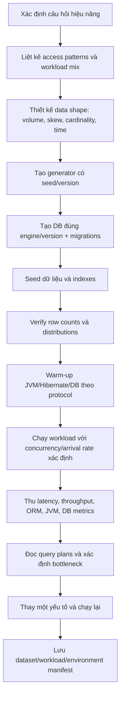

# Lập dữ liệu đo và mẫu truy cập đại diện cho tình huống thực tế

## 1. Vì sao benchmark Hibernate bằng vài chục bản ghi thường cho kết luận sai?

Một truy vấn trên database local có 20 customers và 50 orders có thể chạy trong vài mili giây. Nhưng khi ứng dụng phục vụ hàng triệu orders, hàng trăm tenants và nhiều request đồng thời, cùng truy vấn đó có thể:

- Chuyển từ index lookup sang scan lớn.
- Đọc hàng nghìn rows rồi mới lọc.
- Tạo N+1 queries khi duyệt associations.
- Giữ Persistence Context lớn và tiêu tốn heap.
- Tranh chấp connection pool, row locks hoặc index pages.
- Có latency p95/p99 tăng mạnh dù thời gian trung bình vẫn thấp.

Nguyên nhân là dữ liệu nhỏ thường không phản ánh **quy mô, phân bố, tương quan và mức độ cạnh tranh** của production. Mẫu truy cập cũng thường quá đơn giản: chỉ gọi `findById`, trong khi người dùng thực tế tìm kiếm, phân trang, tải quan hệ, cập nhật và xuất báo cáo.

Ví dụ:

```text
Local:
  20 customers
  50 orders
  1 user
  1 query pattern

Production-like test:
  100,000 customers
  2,000,000 orders
  100 tenants
  200 concurrent virtual users
  read + write + pagination + relation loading
```

Các con số trên chỉ minh họa. Dataset và tải đo phải dựa vào quy mô, hành vi và mục tiêu dịch vụ thực tế của hệ thống đang đánh giá.

**Bài học này giải thích cách tạo dữ liệu đo và workload đại diện để đánh giá Hibernate ORM một cách có ý nghĩa.** Trọng tâm gồm mô hình hóa dữ liệu, tạo seed có thể tái lập, mô phỏng đường truy cập thực tế, điều khiển concurrency, đo SQL/database/ORM và đọc kết quả mà không nhầm lẫn giữa benchmark, load test và kiểm thử chức năng.

## 2. Bắt đầu từ câu hỏi hiệu năng, không bắt đầu từ script seed

Trước khi tạo dữ liệu, xác định quyết định kỹ thuật mà phép đo cần hỗ trợ.

| Câu hỏi | Điều cần đo |
|---|---|
| Có cần index (tenant_id, created_at) không? | Query latency, rows scanned, execution plan |
| Có nên dùng DTO projection thay entity graph? | SQL count, bytes/rows đọc, heap allocation, latency |
| JOIN FETCH có cải thiện N+1 không? | Query count, result row multiplication, memory, p95 |
| Nên dùng offset hay keyset pagination? | Latency theo page depth, query plan |
| Batch size 25 hay 100 phù hợp hơn? | Throughput, round trips, memory, transaction duration |
| Connection pool 20 có đủ không? | Connection acquisition wait, active/pending, DB saturation |
| Có cần chia nhỏ transaction import? | Commit time, locks, rollback cost, memory |
| Một tenant lớn có ảnh hưởng tenant nhỏ không? | Per-tenant latency, queue wait, fairness |

Một benchmark tốt phải cho biết **quyết định nào sẽ được đưa ra dựa trên kết quả**. Nếu chưa biết câu hỏi, rất dễ tạo hàng triệu bản ghi nhưng đo một truy vấn không đại diện cho vấn đề.

## 3. Phân biệt các loại phép đo

Ba loại test thường bị gọi chung là performance test:

| Loại | Mục tiêu | Đặc điểm |
|---|---|---|
| Microbenchmark | So sánh một thao tác nhỏ | Kiểm soát chặt, ít thành phần, tránh đo nhầm overhead |
| Integration performance test | Đo một đường ứng dụng + Hibernate + DB | Có mapping, transaction, SQL, driver và dữ liệu thật |
| Load/stress test | Đo hệ thống dưới nhiều người dùng/tác vụ đồng thời | Có arrival rate, concurrency, think time, queue và saturation |

Ví dụ:

- So sánh hai cách map một DTO có thể là microbenchmark.
- Đo OrderService.searchOrders() với PostgreSQL và 2 triệu rows là integration performance test.
- Mô phỏng 300 người dùng tìm kiếm và cập nhật Orders trong 15 phút là load test.

Không dùng kết quả JMH trên collection trong memory để kết luận query Hibernate/SQL nhanh hơn trên production. Ngược lại, không dùng một load test end-to-end để kết luận chính xác chi phí của một getter Java.

## 4. Mô hình hóa workload thực tế

Workload là tập hợp các thao tác mà hệ thống thực hiện theo tỷ lệ, thứ tự và mức đồng thời nhất định.

Ví dụ một ứng dụng quản lý đơn hàng:

```text
45%: Tìm danh sách đơn theo tenant, trạng thái và thời gian
20%: Xem chi tiết đơn cùng customer và order lines
15%: Tạo đơn mới
10%: Cập nhật trạng thái/thanh toán
 5%: Tra cứu một đơn bằng ID
 5%: Báo cáo tổng hợp theo ngày
```

Tỷ lệ cần được tính trên request hoặc transaction một cách nhất quán. Khi có telemetry, dùng số liệu production đã được tổng hợp/anonymize để xác định phân bố thật.

Những thuộc tính cần ghi lại:

- Tỷ lệ read/write.
- Số thao tác trên mỗi request.
- Số entity/collection được nạp.
- Kích thước page và độ sâu page.
- Tỷ lệ cache hit/miss.
- Tỷ lệ tenant nhỏ/lớn.
- Số user đồng thời và tốc độ request đến.
- Tần suất thao tác hiếm nhưng nặng như export/import.
- Thời gian think time giữa các thao tác.
- Số lần retry, conflict và transaction rollback.

Đừng lấy “mỗi endpoint được gọi một lần” làm mô hình workload. Production có phân bố không đều và những luồng nóng xuất hiện thường xuyên hơn nhiều luồng khác.

## 5. Chọn các mẫu truy cập Hibernate đại diện

Trước hết liệt kê đường đi từ use case đến repository/EntityManager.

| Mẫu truy cập | Ví dụ | Điều cần quan sát |
|---|---|---|
| Primary-key lookup | find(Order.class, id) | Cache, index lookup, entity hydration |
| Unique-key lookup | Tìm theo order number | Unique index, query plan |
| Search/filter | Tenant + status + date range | Predicate selectivity, composite indexes |
| Pagination | Page 1, page 1000 | OFFSET cost, sort, keyset |
| To-one loading | Order → Customer | Lazy secondary select, join/fetch |
| To-many loading | Order → Lines | N+1, row multiplication, collection size |
| Aggregate/projection | Count/sum theo ngày | DB aggregation vs entity loading |
| Insert | Tạo Order và Lines | ID strategy, batching, cascade |
| Update | Đổi trạng thái | Dirty checking, optimistic locking |
| Bulk DML | Hết hạn nhiều records | SQL count, persistence-context synchronization |
| Batch import | Nhập hàng nghìn rows | Flush/clear, batch size, transaction size |
| Export | Đọc nhiều trang DTO | Streaming, memory, connection lifetime |

Chọn một số use case chi phối tải và một số use case có rủi ro cao. Không cần mô phỏng mọi method repository nếu chúng không tạo ra quyết định hiệu năng.

## 6. Dữ liệu đại diện không chỉ là “đủ nhiều rows”

Hai dataset cùng có một triệu rows vẫn có thể tạo hiệu năng rất khác nhau.

```text
Dataset A:
  1,000,000 orders
  mỗi customer có đúng 10 orders
  status phân bố đều
  created_at phân bố đều

Dataset B:
  1,000,000 orders
  5% customers tạo 70% orders
  80% orders thuộc 2 trạng thái phổ biến
  60% dữ liệu tập trung trong 30 ngày gần nhất
```

Dataset B thường phản ánh các hệ thống có hot customers, trạng thái phổ biến và dữ liệu mới tập trung hơn. Một truy vấn chạy tốt trên phân bố đều có thể chậm khi một số tenant/customer chiếm phần lớn dữ liệu.

### Những chiều cần mô hình hóa

**Volume:** ghi rõ số rows theo từng bảng, không chỉ tổng số:

| Bảng | Số rows mục tiêu (ví dụ) |
|---|---:|
| tenants | 100 |
| customers | 100,000 |
| products | 20,000 |
| orders | 2,000,000 |
| order_lines | 6,000,000 |
| payments | 1,800,000 |

**Cardinality và selectivity:** status có ít giá trị; email gần unique; tenant_id có cardinality tùy số tổ chức; created_at có nhiều giá trị. Query status phổ biến có thể trả nhiều rows hơn rất nhiều so với query ID.

**Skew/hot keys:** một số tenant lớn, customer có nhiều orders, sản phẩm bán chạy, hoặc một vài IDs được truy cập lặp lại. Đừng dùng random đều cho mọi foreign key.

**Tương quan:** Orders gần đây có thể chủ yếu ở trạng thái NEW/PROCESSING; tenant lớn có thể có tỷ lệ PAID cao hơn; customer mới có lịch sử ngắn. Nếu random độc lập từng cột, dataset có thể tạo những tổ hợp không có trong thực tế.

**Phân bố thời gian:** dữ liệu nhiều năm nhưng phần lớn query lấy 30 ngày gần nhất; tạo cả dữ liệu mới, cũ, giai đoạn cao điểm và khoảng ít giao dịch.

**NULL và giá trị biên:** nullable fields, chuỗi gần giới hạn, Unicode/diacritics, amount lớn/nhỏ, ngày đầu/cuối tháng, collection rỗng hoặc rất lớn.

## 7. Tạo dataset theo nhiều tầng kích thước

| Tier | Quy mô | Mục tiêu |
|---|---|---|
| Smoke | Vài trăm rows | Kiểm tra seed, mapping, query đúng |
| Small | Hàng nghìn đến chục nghìn | Debug SQL và chức năng |
| Medium | Hàng trăm nghìn | Thấy N+1, index và heap behavior |
| Large | Gần production hoặc lớn hơn | Đánh giá query plan, throughput, storage |

Không cần mọi developer chạy dataset lớn mỗi lần unit test. Nhưng kết luận về hiệu năng production phải dựa trên dataset đủ lớn để bộc lộ vấn đề đang cần đánh giá.

Có thể dùng projected scale để thử tăng trưởng 6–12 tháng, tenant lớn nhất, peak event, backfill hoặc báo cáo lịch sử. Ghi rõ dataset là current-scale hay projected-scale.

## 8. Tạo dữ liệu có thể tái lập

Một benchmark phải có thể chạy lại với cùng dữ liệu hoặc biết chính xác cách dữ liệu được tạo.

Lưu metadata của dataset trong report:

```text
dataset_version = orders-perf-v3
seed = 20261115
tenants = 100
customers = 100000
orders = 2000000
order_lines = 6000000
generator_version = git-sha-or-release
db_engine = PostgreSQL
db_version = ...
```

Nếu lần chạy A dùng customer hot keys khác lần chạy B, query có thể chọn plan hoặc chạm cache khác nhau. Khi so sánh hai cách truy cập, giữ nguyên dataset, indexes/schema, DB version/configuration, workload mix, warmup protocol và concurrency/arrival rate. Chỉ thay đổi một yếu tố chính mỗi lần.

Tránh random không kiểm soát. Dùng PRNG seed cố định hoặc công thức sinh ID/value xác định. Nếu generator thay đổi, tăng dataset version.

## 9. Dữ liệu production: anonymize trước khi dùng

Không copy nguyên dữ liệu cá nhân/nhạy cảm production vào máy developer hoặc môi trường benchmark không được phép.

Có thể dùng synthetic data, masking/tokenization, pseudonymization với mapping được kiểm soát, hoặc chỉ trích xuất thống kê aggregate.

Anonymization phải giữ đặc tính đo cần thiết:

- Nếu mọi email được thay thành cùng một chuỗi, unique index và selectivity không còn đại diện.
- Nếu mọi customer name đều ngắn, string storage/index behavior có thể khác production.
- Nếu masking làm mọi tenant có cùng số records, sẽ mất skew theo tenant.

Mục tiêu là giữ **hình dạng dữ liệu và quan hệ thống kê cần đo**, đồng thời loại bỏ thông tin nhận dạng theo chính sách bảo mật. Không lưu secret, access token, password hoặc thông tin thanh toán thật trong seed files/logs.

## 10. Ví dụ schema cho dataset Order

Một schema rút gọn:

```sql
CREATE TABLE customers (
    id BIGINT PRIMARY KEY,
    tenant_id VARCHAR(64) NOT NULL,
    display_name VARCHAR(160) NOT NULL,
    email VARCHAR(254) NOT NULL,
    created_at TIMESTAMP NOT NULL
);

CREATE TABLE orders (
    id BIGINT PRIMARY KEY,
    tenant_id VARCHAR(64) NOT NULL,
    customer_id BIGINT NOT NULL,
    status VARCHAR(24) NOT NULL,
    total_amount NUMERIC(18, 2) NOT NULL,
    created_at TIMESTAMP NOT NULL,
    updated_at TIMESTAMP NOT NULL,
    CONSTRAINT fk_orders_customer
        FOREIGN KEY (customer_id) REFERENCES customers(id)
);

CREATE TABLE order_lines (
    id BIGINT PRIMARY KEY,
    order_id BIGINT NOT NULL,
    product_id BIGINT NOT NULL,
    quantity INTEGER NOT NULL,
    unit_price NUMERIC(18, 2) NOT NULL,
    CONSTRAINT fk_lines_order
        FOREIGN KEY (order_id) REFERENCES orders(id)
);
```

Trong hệ thống tenant-isolated nghiêm ngặt, foreign key và unique key nên phản ánh tenant scope nếu domain/schema yêu cầu. Schema rút gọn trên chỉ phục vụ minh họa quan hệ.

## 11. Seed bằng SQL: nhanh và có thể sinh dữ liệu lớn

Với PostgreSQL, generate_series thuận tiện để tạo hàng loạt rows mà không phải khởi tạo hàng triệu Java entities.

Tạo customers:

```sql
INSERT INTO customers (
    id, tenant_id, display_name, email, created_at
)
SELECT
    n,
    'tenant-' || LPAD((1 + ((n - 1) % 100))::text, 3, '0'),
    'Customer ' || n,
    'customer-' || n || '@example.test',
    TIMESTAMP '2022-01-01'
        + ((n % 1400) * INTERVAL '1 day')
FROM generate_series(1, 100000) AS n;
```

Tạo orders:

```sql
INSERT INTO orders (
    id, tenant_id, customer_id, status,
    total_amount, created_at, updated_at
)
SELECT
    n,
    'tenant-' || LPAD((1 + ((n - 1) % 100))::text, 3, '0'),
    1 + ((n * 7919) % 100000),
    CASE
        WHEN n % 100 < 55 THEN 'PAID'
        WHEN n % 100 < 75 THEN 'NEW'
        WHEN n % 100 < 90 THEN 'SHIPPED'
        ELSE 'CANCELLED'
    END,
    ((1000 + ((n * 37) % 500000))::numeric / 100),
    TIMESTAMP '2024-01-01'
        + ((n % 730) * INTERVAL '1 day'),
    TIMESTAMP '2024-01-01'
        + ((n % 730) * INTERVAL '1 day')
        + INTERVAL '1 hour'
FROM generate_series(1, 2000000) AS n;
```

Ví dụ sinh dữ liệu xác định theo ID và có phân bố status/time đơn giản. Nó không mô phỏng hoàn hảo tương quan nghiệp vụ hoặc skew; cần điều chỉnh công thức cho domain thật.

### Tạo hot customers có chủ đích

Thay customer ID bằng công thức có skew:

```sql
CASE
    WHEN n % 10 < 7
        THEN 1 + ((n * 7919) % 5000)
    ELSE 1 + ((n * 7919) % 100000)
END
```

Khoảng 70% rows đi vào nhóm 5.000 customers đầu trong ví dụ. Đây là cách tạo nhóm hot keys đơn giản và tái lập; hãy xác định nhóm hot theo business facts nếu có thống kê.

### Tạo order lines

```sql
INSERT INTO order_lines (
    id, order_id, product_id, quantity, unit_price
)
SELECT
    (o.id - 1) * 3 + line_no,
    o.id,
    1 + ((o.id * 31 + line_no * 17) % 20000),
    1 + ((o.id + line_no) % 5),
    (1000 + ((o.id * 13 + line_no * 7) % 100000))::numeric / 100
FROM orders o
CROSS JOIN generate_series(1, 3) AS line_no;
```

Đoạn này tạo đúng ba lines cho mỗi Order. Nếu production có phân bố 1–20 lines/order với một số đơn rất lớn, hãy tạo phân bố đó thay vì cố định 3.

Sau bulk seed, chạy ANALYZE để cập nhật planner statistics:

```sql
ANALYZE customers;
ANALYZE orders;
ANALYZE order_lines;
```

Nếu tạo indexes sau bulk insert, có thể tiết kiệm chi phí seed; nhưng benchmark cuối phải có schema/indexes đúng như môi trường đo.

## 12. Seed bằng Java/Hibernate: khi cần đo chính đường ghi ORM

SQL seed phù hợp khi muốn tạo dữ liệu nhanh. Nhưng nếu cần đánh giá entity listeners/cascade, ID generation, Hibernate batching, dirty checking, mapping và converters thì seed qua ORM có thể là một workload riêng.

Không nhất thiết dùng Hibernate để tạo mọi dataset performance. Hãy phân biệt **data preparation** với **operation being measured**.

Ví dụ batch seeder:

```java
@Service
public class CustomerSeedChunk {

    @PersistenceContext
    private EntityManager entityManager;

    @Transactional
    public void insertRange(long fromId, long toId) {
        for (long id = fromId; id < toId; id++) {
            Customer customer = new Customer(
                id,
                tenantFor(id),
                "Customer " + id,
                "customer-" + id + "@example.test"
            );
            entityManager.persist(customer);

            if ((id - fromId + 1) % 500 == 0) {
                entityManager.flush();
                entityManager.clear();
            }
        }

        entityManager.flush();
        entityManager.clear();
    }

    private String tenantFor(long id) {
        return "tenant-" + (1 + ((id - 1) % 100));
    }
}
```

Coordinator:

```java
@Component
public class DatasetSeeder implements CommandLineRunner {

    private final CustomerSeedChunk chunk;

    public DatasetSeeder(CustomerSeedChunk chunk) {
        this.chunk = chunk;
    }

    @Override
    public void run(String... args) {
        long total = 100_000;
        long chunkSize = 5_000;

        for (long start = 1; start <= total; start += chunkSize) {
            chunk.insertRange(
                start,
                Math.min(total + 1, start + chunkSize)
            );
        }
    }
}
```

Đây là ví dụ khung: constructor của Customer phải khớp model thực tế; ID strategy phải cho phép gán ID như trên; tenant format cần thống nhất. CustomerSeedChunk là Spring bean riêng để lời gọi qua proxy mở transaction cho mỗi chunk.

### Vì sao flush và clear?

- flush() đẩy pending inserts/updates xuống DB trong transaction hiện tại.
- clear() detach các managed entities khỏi Persistence Context, hạn chế giữ hàng trăm nghìn objects trong heap.
- Chunk transaction giới hạn thời gian giữ locks và chi phí rollback.

clear() không commit. Transaction vẫn kết thúc theo boundary của method insertRange.

### Batching JDBC

Với Hibernate, có thể cấu hình:

```properties
hibernate.jdbc.batch_size=50
hibernate.order_inserts=true
hibernate.order_updates=true
```

Khả năng batch thực tế còn phụ thuộc ID generation, dialect, driver và SQL shape. Ví dụ IDENTITY có thể hạn chế insert batching so với sequence/table strategies. Hãy đo SQL/round trips thay vì chỉ nhìn property đã đặt.

## 13. Dùng deterministic generator thay vì hardcode vài records

Một Java generator có thể dùng SplittableRandom với seed cố định:

```java
SplittableRandom random = new SplittableRandom(20261115L);

int statusBucket = random.nextInt(100);
String status =
    statusBucket < 55 ? "PAID" :
    statusBucket < 75 ? "NEW" :
    statusBucket < 90 ? "SHIPPED" :
    "CANCELLED";
```

Nếu generator chạy song song hoặc chia chunk, hãy derive seed cho mỗi chunk từ base seed + chunk ID để thứ tự chạy không làm thay đổi toàn bộ dataset.

Tránh generator thiếu thực tế: mọi record cùng timestamp; mọi foreign key phân bố đều; tất cả orders cùng số lines; mọi tenant cùng quy mô; không có NULL/trạng thái biên; không có dữ liệu cũ.

Một generator tốt mô tả **quy tắc phân bố** chứ không chỉ sinh một dãy IDs.

## 14. Xác minh dataset sau khi seed

Đừng bắt đầu benchmark ngay sau khi script kết thúc. Kiểm tra dataset có đúng shape đã định.

```sql
SELECT COUNT(*) FROM customers;
SELECT COUNT(*) FROM orders;
SELECT COUNT(*) FROM order_lines;

SELECT status, COUNT(*)
FROM orders
GROUP BY status
ORDER BY status;

SELECT tenant_id, COUNT(*)
FROM orders
GROUP BY tenant_id
ORDER BY COUNT(*) DESC;

SELECT customer_id, COUNT(*) AS order_count
FROM orders
GROUP BY customer_id
ORDER BY order_count DESC
LIMIT 20;

SELECT MIN(created_at), MAX(created_at)
FROM orders;
```

Các thống kê này xác nhận tổng rows, tỷ lệ trạng thái, skew theo tenant, hot customers và phạm vi thời gian. Nếu dữ liệu không khớp giả định, benchmark có thể hợp lệ về kỹ thuật nhưng không trả lời câu hỏi cần đo.

## 15. Chuẩn bị indexes giống workload

Index ảnh hưởng trực tiếp query plan. Dataset benchmark phải được tạo với indexes tương ứng production hoặc phương án đang so sánh.

```sql
CREATE INDEX ix_orders_tenant_status_created
ON orders(tenant_id, status, created_at DESC, id DESC);

CREATE INDEX ix_orders_customer_created
ON orders(customer_id, created_at DESC);

CREATE INDEX ix_order_lines_order
ON order_lines(order_id);
```

Không thêm tất cả indexes chỉ vì muốn benchmark nhanh. Mỗi index tốn storage, tăng chi phí INSERT/UPDATE/DELETE và có thể không được optimizer chọn.

Hãy so sánh schema/index candidates trên cùng dataset và workload, ghi lại migration và DDL cụ thể.

## 16. Access pattern: tìm theo primary key

```java
@Transactional(readOnly = true)
public OrderView getOrder(long orderId) {
    PurchaseOrder order = entityManager.find(
        PurchaseOrder.class,
        orderId
    );
    return toView(order);
}
```

Đo nhiều tình huống:

- ID tồn tại/không tồn tại.
- L1 Persistence Context hit.
- L2 cache hit/miss nếu bật.
- Database buffer cache warm/cold.
- Tenant nhỏ/tenant lớn.
- Entity có to-one/collection associations.

Nếu benchmark gọi find() lặp lại cùng ID trên cùng EntityManager, những lần sau có thể chỉ trả object trong first-level cache, không gửi SQL. Muốn đo database lookup, dùng Persistence Context mới cho mỗi unit of work hoặc truy vấn nhiều IDs theo phân bố phù hợp. Muốn đo cache hit, đó phải là kịch bản riêng.

## 17. Access pattern: search theo điều kiện thường dùng

```java
public interface OrderRepository
        extends JpaRepository<PurchaseOrder, Long> {

    Page<PurchaseOrder> findByTenantIdAndStatusAndCreatedAtBetween(
        String tenantId,
        OrderStatus status,
        Instant from,
        Instant to,
        Pageable pageable
    );
}
```

Query đại diện:

```sql
SELECT *
FROM orders
WHERE tenant_id = ?
  AND status = ?
  AND created_at >= ?
  AND created_at < ?
ORDER BY created_at DESC, id DESC
LIMIT 50;
```

Dataset cần có tenant ít rows và tenant rất nhiều rows, status phổ biến và hiếm, khoảng ngày ngắn và dài. Nếu chỉ test một tenant/status có 10 rows, không đánh giá được query plan khi predicate trả hàng trăm nghìn rows.

## 18. Access pattern: pagination và độ sâu trang

Offset pagination:

```sql
SELECT *
FROM orders
WHERE tenant_id = ?
ORDER BY created_at DESC, id DESC
LIMIT 50 OFFSET 0;
```

Trang sâu:

```sql
SELECT *
FROM orders
WHERE tenant_id = ?
ORDER BY created_at DESC, id DESC
LIMIT 50 OFFSET 500000;
```

DB có thể phải duyệt/bỏ qua lượng rows lớn trước khi trả page.

| Page | Offset nếu size 50 |
|---:|---:|
| 1 | 0 |
| 10 | 450 |
| 100 | 4,950 |
| 1,000 | 49,950 |
| 10,000 | 499,950 |

Không chỉ đo trang đầu rồi kết luận pagination scale tốt.

Keyset pagination:

```sql
SELECT *
FROM orders
WHERE tenant_id = :tenantId
  AND (
      created_at < :lastCreatedAt
      OR (
          created_at = :lastCreatedAt
          AND id < :lastId
      )
  )
ORDER BY created_at DESC, id DESC
LIMIT 50;
```

Keyset cần cursor ổn định và index phù hợp. Dataset phải có nhiều rows cùng timestamp để test tie-breaker bằng ID. Giữ nguyên tenant, filter, order và page size khi so sánh offset với keyset.

## 19. Access pattern: tải entity graph và đo N+1

```java
@Entity
public class PurchaseOrder {
    @ManyToOne(fetch = FetchType.LAZY)
    private Customer customer;

    @OneToMany(mappedBy = "order", fetch = FetchType.LAZY)
    private List<OrderLine> lines;
}
```

```java
List<PurchaseOrder> orders = repository.findRecentOrders(...);

for (PurchaseOrder order : orders) {
    order.getCustomer().getDisplayName();
    order.getLines().size();
}
```

Nếu mỗi Order kích hoạt thêm query cho Customer và Lines, số statement có thể tăng nhanh.

Dataset cần nhiều orders trong một page, customer dùng chung giữa nhiều orders, số lines khác nhau và một số orders có collection lớn. Nếu tất cả Orders chỉ có một line và một customer duy nhất, N+1 và row multiplication khó hiện rõ.

So sánh riêng:

1. Lazy loading như code ban đầu.
2. JOIN FETCH cho to-one.
3. EntityGraph.
4. Batch fetching.
5. DTO projection cho màn hình chỉ cần một số fields.

Đừng chỉ so query count. Join fetch collection có thể giảm số query nhưng nhân số rows do Cartesian multiplication, tăng bytes và heap hydration.

## 20. Access pattern: DTO projection thay entity graph

Nếu màn hình danh sách chỉ cần ID, order number, customer name và total:

```java
public record OrderListRow(
    Long id,
    String orderNumber,
    String customerName,
    BigDecimal totalAmount,
    Instant createdAt
) {}
```

```java
@Query("""
    select new com.example.orders.OrderListRow(
        o.id,
        o.orderNumber,
        c.displayName,
        o.totalAmount,
        o.createdAt
    )
    from PurchaseOrder o
    join o.customer c
    where o.tenantId = :tenantId
      and o.status = :status
    order by o.createdAt desc, o.id desc
    """)
Page<OrderListRow> searchRows(
    String tenantId,
    OrderStatus status,
    Pageable pageable
);
```

DTO projection thường tránh hydrate toàn bộ entity graph và không cần dirty checking cho dữ liệu chỉ đọc. Nhưng query vẫn cần index, pagination và join plan phù hợp.

Đo DB query time, số rows/columns trả về, entity hydration count, heap allocation/GC và tổng latency service. Không giả định projection luôn nhanh hơn; đo trên dataset và use case tương ứng.

## 21. Access pattern: aggregate trong database hay Java?

```sql
SELECT status, COUNT(*), SUM(total_amount)
FROM orders
WHERE tenant_id = ?
  AND created_at >= ?
GROUP BY status;
```

So sánh với cách load tất cả Orders rồi tính trong Java. Với dữ liệu lớn, aggregate ở DB thường tránh chuyển hàng nghìn/hàng triệu entity về JVM.

Dataset cần đủ lớn và có phân bố status/tenant/date thực tế. Đo cả DB CPU và application heap, không chỉ thời gian method.

## 22. Access pattern: insert và write transactions

```java
@Transactional
public long createOrder(CreateOrderCommand command) {
    PurchaseOrder order = new PurchaseOrder(...);

    for (CreateOrderLine line : command.lines()) {
        order.addLine(new OrderLine(...));
    }

    entityManager.persist(order);
    return order.getId();
}
```

Đo ID generation strategy, số inserts/transaction, JDBC batch size, cascade behavior, flush/commit duration, index/FK write cost và contention trên hot rows.

Tạo workload có kích thước request khác nhau: một số đơn có 1 line, đa số 2–5, một số đơn có 50–100 lines. Nếu mọi đơn đều có 3 lines, benchmark không phản ánh tail cases.

## 23. Access pattern: update và optimistic locking

Một workload có thể gồm update các rows khác nhau, nhiều users cập nhật cùng một Order, update status/timestamp và update counters hoặc inventory hot rows.

Nếu entity có `@Version`, tạo conflict có chủ đích:

```java
@Version
private long version;
```

Đo optimistic locking failures, retry count, transaction duration, lock waits và tỷ lệ request thành công. Không chỉ chạy updates trên IDs hoàn toàn riêng biệt nếu production thường có nhiều người cùng cập nhật một số tài nguyên nóng.

## 24. Access pattern: batch import và flush/clear

```java
@Transactional
public void insertChunk(List<ImportRow> rows) {
    int count = 0;

    for (ImportRow row : rows) {
        entityManager.persist(map(row));

        if (++count % 500 == 0) {
            entityManager.flush();
            entityManager.clear();
        }
    }
}
```

So sánh chunk size 100, 500, 1.000 và JDBC batch size phù hợp. Đo rows/second, transaction duration, heap/GC, DB WAL/redo, connection occupancy, lock contention và failure/rollback cost.

Không chỉ đo tổng thời gian import; một transaction khổng lồ có thể nhanh trong dataset nhỏ nhưng gây vấn đề về rollback và recovery khi dữ liệu lớn.

## 25. Access pattern: bulk DML

```java
int updated = entityManager.createQuery("""
    update PurchaseOrder o
    set o.status = :expired
    where o.tenantId = :tenantId
      and o.status = :new
      and o.createdAt < :cutoff
    """)
    .setParameter("expired", OrderStatus.EXPIRED)
    .setParameter("new", OrderStatus.NEW)
    .setParameter("tenantId", tenantId)
    .setParameter("cutoff", cutoff)
    .executeUpdate();
```

Bulk DML có thể hiệu quả vì không hydrate từng entity, nhưng:

- Bypass per-entity lifecycle callbacks/cascade.
- Persistence Context có thể chứa state cũ.
- Cần clear/refresh có chủ đích sau DML.
- Tenant predicate phải rõ ràng.
- Envers/entity listeners không nhất thiết ghi từng row như managed updates.

Benchmark phải đo cả semantics cần giữ, không so một bulk query bỏ qua validation/audit với managed update đầy đủ rồi kết luận cách nhanh hơn luôn thay thế được.

## 26. Mô phỏng tỷ lệ read/write

Giả sử workload:

```text
70% read:
  30% search page
  20% detail with associations
  10% lookup by ID
  10% report aggregate

30% write:
  15% create order
  10% update status
   5% import/update batch
```

Tỷ lệ cần được tính trên request hoặc transaction một cách nhất quán. Một request search có thể phát nhiều SQL statements; không nhầm 70% read requests với 70% SQL statements.

Read-heavy có thể bị giới hạn bởi cache/DB reads. Write-heavy có thể bị giới hạn bởi WAL, indexes, locks và commit. Mixed workload tạo cạnh tranh giữa reads và writes. Chạy riêng từng nhóm để tìm giới hạn, sau đó chạy mixed workload để xem tương tác.

## 27. Concurrency và arrival rate

Hai cách mô tả tải:

- **Concurrency:** số virtual users/operations đang hoạt động cùng lúc.
- **Arrival rate:** số requests bắt đầu mỗi giây.

Một hệ thống có thể giữ 100 users đồng thời nhưng arrival rate khác nhau tùy response time và think time.

Kịch bản ví dụ:

```text
Warm-up:      2 phút
Load 1:       20 users trong 3 phút
Load 2:       50 users trong 5 phút
Load 3:      100 users trong 5 phút
Load 4:      200 users trong 5 phút
Soak:        100 users trong 30 phút
```

Đây là ví dụ kế hoạch. Số users và thời gian phải dựa vào traffic mục tiêu, SLA và khả năng môi trường.

Quan sát saturation khi throughput không tăng dù concurrency tăng, p95/p99 tăng nhanh, connection wait tăng, DB CPU/IO đạt giới hạn, queue backlog tăng liên tục hoặc error/timeout tăng.

## 28. Think time và trình tự user journey

Một người dùng thật không gửi 100 request/giây không nghỉ. Họ mở trang danh sách, chờ kết quả, mở Order detail, xem Customer/Lines, cập nhật trạng thái rồi chuyển trang.

Mô phỏng một user journey với think time giúp tạo workload gần thực tế hơn.

Để kiểm tra capacity ở arrival rate xác định, có thể dùng open workload model (tần suất bắt đầu requests độc lập với latency) để tránh coordinated omission. Closed workload model mô phỏng số users cố định chờ response rồi nghĩ/submit tiếp, phù hợp user journey.

Không có model nào luôn đúng. Capacity planning thường cần arrival rate; user experience simulation có thể cần closed journeys. Ghi rõ load model và dùng tool có hỗ trợ histogram/latency correction khi phù hợp.

## 29. Warm-up: JVM, Hibernate và database cache

Lần chạy đầu thường khác các lần sau vì:

- JVM JIT chưa tối ưu code.
- Class loading/metadata initialization.
- Hibernate query plan/cache initialization.
- Connection pool chưa được lấp đầy.
- Database buffer cache chưa nóng.
- Filesystem cache và index pages chưa được đọc.

Chia phase:

```text
1. Prepare:
   seed dataset, build indexes, ANALYZE

2. Warm-up:
   chạy workload nhưng không ghi vào số đo chính

3. Measurement:
   chạy đủ lâu và ghi metrics

4. Cooldown:
   kết thúc, thu logs và trạng thái DB
```

Không xóa cache giữa mọi lần chạy nếu production cũng có cache nóng. Nếu đo cold-start/cold-cache, tạo kịch bản riêng và có cách reset được kiểm soát.

Phân biệt Hibernate first-level cache (Session), second-level cache, query cache, database buffer cache, OS filesystem cache và application cache/Redis/CDN. Report phải nói rõ cache nào bật và trạng thái nào được đo.

## 30. Không đo việc seed dữ liệu trong benchmark query

Một benchmark tìm Orders không nên bao gồm khởi tạo 2 triệu rows, tạo indexes, chạy ANALYZE, khởi động Spring context hoặc chờ Hikari pool startup, trừ khi câu hỏi thực sự là hiệu năng provisioning/migration.

```text
Provision DB
  -> Run migrations
  -> Seed dataset
  -> Verify dataset
  -> Warm-up
  -> Measure access workload
```

Nếu seed trong mỗi vòng đo, kết quả không còn là latency của access pattern đang quan tâm.

## 31. Chọn database giống môi trường mục tiêu

H2 có ích cho nhiều unit/integration tests, nhưng không thay thế DB production khi benchmark:

- Query optimizer khác.
- Index types và expression indexes khác.
- SQL dialect khác.
- Locking/MVCC khác.
- Transaction behavior khác.
- JSON, arrays, sequences và pagination syntax khác.
- JDBC driver và connection behavior khác.

Nếu production dùng PostgreSQL 16, benchmark query plan trên PostgreSQL cùng major version và cấu hình gần mục tiêu. Nếu production dùng MySQL/Oracle/SQL Server, dùng đúng engine/version tương ứng.

Testcontainers có thể giúp khởi tạo DB vendor thật cho test tự động, nhưng container resources vẫn phải được cấu hình đủ và so sánh với production có ghi chú.

## 32. Đo Hibernate statistics

Hibernate có Statistics API để quan sát hoạt động ORM.

Cấu hình:

```properties
hibernate.generate_statistics=true
```

Lấy statistics:

```java
SessionFactory sessionFactory =
    entityManagerFactory.unwrap(SessionFactory.class);

Statistics statistics = sessionFactory.getStatistics();
statistics.setStatisticsEnabled(true);

statistics.clear();

// Chạy một workload đã xác định.

long statements = statistics.getPrepareStatementCount();
long entityLoads = statistics.getEntityLoadCount();
long entityFetches = statistics.getEntityFetchCount();
long collectionFetches = statistics.getCollectionFetchCount();
long flushes = statistics.getFlushCount();
```

Imports:

```java
import org.hibernate.SessionFactory;
import org.hibernate.stat.Statistics;
```

Các counters khác có thể hữu ích tùy version: entity insert/update/delete, collection load/recreate/remove/update, query execution count/time, second-level cache hit/miss/put và optimistic failure count.

Statistics thường là counters ở cấp SessionFactory và có thể chịu ảnh hưởng của nhiều threads. Khi đo workload riêng, reset lúc không có workload khác, dùng test environment cô lập, lấy snapshot trước/sau và không tính seed/warmup vào số đo.

Statistics hỗ trợ chẩn đoán ORM, nhưng không thay thế DB metrics.

## 33. Đếm SQL statements và phát hiện N+1

Ví dụ:

```text
Load page of 50 Orders:
  1 query for Orders
  50 queries for Customer
  50 queries for OrderLines
Total ~101 statements
```

Đây là dạng N+1 có thể xảy ra khi mỗi Order tải lazy to-one và collection riêng.

Nếu dùng fetch plan phù hợp, có thể giảm số statements. Nhưng query join nhiều collections có thể nhân rows:

```text
50 Orders × average 5 lines × average 2 adjustments
= up to 500 joined row combinations
```

Đây chỉ là minh họa multiplicative effect. Tùy mapping, hai collection fetch đồng thời còn có thể bị Hibernate từ chối hoặc tạo Cartesian product rất lớn.

Không chỉ đếm số query. Một SQL duy nhất có thể đọc 1 triệu rows và chậm hơn 20 queries index lookup nhỏ. Cần đo statement count, DB execution time, rows returned/rows scanned, network bytes, entity/collection hydration và heap/GC.

## 34. Đo database query plan

Trên PostgreSQL:

```sql
EXPLAIN (ANALYZE, BUFFERS)
SELECT id, status, total_amount, created_at
FROM orders
WHERE tenant_id = 'tenant-001'
  AND status = 'PAID'
  AND created_at >= TIMESTAMP '2026-01-01'
ORDER BY created_at DESC, id DESC
LIMIT 50;
```

Quan sát Seq Scan hay Index Scan, estimated rows so với actual rows, Sort/Incremental Sort, Rows Removed by Filter, shared hit/read buffers và execution time.

`EXPLAIN ANALYZE` **thực thi query**. Với SELECT, nó vẫn tạo tải và có thể làm nóng cache; không chạy tùy tiện trên production. Với DML, câu lệnh được thực thi thật và có side effects, nên cần transaction rollback hoặc môi trường test riêng nếu muốn phân tích.

Nếu optimizer ước lượng 100 rows nhưng thực tế 500.000, plan có thể chọn join strategy/index không phù hợp. Chạy ANALYZE sau seed và xem statistics/column correlations khi cần.

## 35. Dùng dataset để kiểm tra index candidates

Giả sử query:

```sql
WHERE tenant_id = ?
  AND status = ?
  AND created_at >= ?
ORDER BY created_at DESC, id DESC
```

Thử các index:

```sql
-- Candidate A
CREATE INDEX ix_orders_tenant
ON orders(tenant_id);

-- Candidate B
CREATE INDEX ix_orders_tenant_status_date
ON orders(tenant_id, status, created_at DESC, id DESC);

-- Candidate C
CREATE INDEX ix_orders_tenant_date
ON orders(tenant_id, created_at DESC, id DESC);
```

So sánh query plan, latency theo selectivity, index size, insert/update throughput, write amplification và cache footprint.

Không chọn index chỉ vì nó làm một query đọc nhanh nhất; hệ thống còn có writes và nhiều query patterns khác.

## 36. Đo connection pool và transaction behavior

Với HikariCP, theo dõi active/idle/pending connections, connection acquisition time, connection usage/hold time và timeout count.

Ví dụ:

```text
HTTP requests: 100 concurrent
Worker jobs:   20 concurrent
Hikari max:    30

Nếu request/worker cùng giữ connection lâu:
  pending threads tăng
  latency tăng
```

Một endpoint có tổng latency 900 ms có thể gồm:

```text
Connection acquisition: 500 ms
SQL execution:           100 ms
Entity hydration:        150 ms
Business logic/response: 150 ms
```

Tối ưu SQL không giải quyết được 500 ms chờ connection. Phân rã latency theo các thành phần trước khi chọn cách sửa.

Transaction dài có thể giữ JDBC connection, row/table locks, MVCC snapshots và Persistence Context với nhiều managed entities. Trong benchmark write, đo thời gian begin đến commit, lock wait/deadlocks, hot rows và rollback duration.

## 37. Metrics cần thu thập

| Nhóm | Metrics |
|---|---|
| User experience | p50, p90, p95, p99 latency; error rate |
| Throughput | requests/sec, transactions/sec, rows/sec |
| Hibernate | statement count, entity/collection fetches, flushes, cache hits |
| JVM | heap, allocation rate, GC pause, CPU, threads |
| Connection pool | active/idle/pending, acquisition wait, usage time |
| Database | CPU, memory, I/O, buffer hit, query plan, locks, deadlocks |
| Storage/logging | table/index size, WAL/redo, replication lag |
| Multi-tenant | latency/error/backlog theo tenant, hot-tenant share |

Average 40 ms có thể che một nhóm request mất 2 giây. Với UI/API, tail latency ảnh hưởng trải nghiệm và timeout nhiều hơn giá trị trung bình. Báo cáo tối thiểu nên có p50/p95/p99, throughput và error rate trong cùng một khoảng đo.

## 38. Không dùng query execution time làm toàn bộ endpoint latency

Một request Hibernate có thể gồm:

```text
HTTP routing/authentication
  -> connection acquisition
  -> SQL execution
  -> result transfer
  -> entity hydration
  -> lazy association loading
  -> business logic
  -> JSON serialization
```

Một SQL nhanh không bảo đảm endpoint nhanh nếu có N+1, hydrate entity graph quá lớn, serializer kích hoạt lazy loading, GC chạy lâu, thread chờ connection hoặc lock wait.

Đo cả service-level latency và các lớp thấp hơn để tìm bottleneck.

## 39. Warm/cold cache phải được đặt tên rõ

| Kịch bản | L1 | L2 | DB buffer cache | Ý nghĩa |
|---|---|---|---|---|
| Fresh Session, warm DB | Miss | Tùy cấu hình | Warm | Query thường sau khi DB đã hoạt động |
| Same Session repeat | Hit | Không quan trọng | Không nhất thiết query | First-level cache behavior |
| New Session, L2 hit | Miss | Hit | Có thể không đọc DB | ORM second-level cache |
| New Session, L2 disabled, cold DB | Miss | Off | Cold/controlled | Cold database read |
| New Session, L2 disabled, warm DB | Miss | Off | Warm | Database cache path |

Không gọi tất cả các lần chạy lặp lại là cold benchmark. Nếu buffer cache còn nóng, đó là warm DB.

## 40. So sánh Hibernate paths một cách công bằng

Giả sử so sánh A: entity + lazy associations; B: JOIN FETCH; C: DTO projection.

Giữ nguyên:

1. Dataset/version/indexes.
2. Tenant/status/date filters.
3. Page size và sort.
4. Cache policy.
5. User concurrency/arrival rate.
6. Warmup và measurement duration.
7. DB/JVM resource limits.

Ghi riêng mỗi path: statement_count, rows_returned, p95_latency, heap_delta. Nếu path B trả 10 lần số joined rows nhưng ít statements hơn, chỉ nhìn query count sẽ kết luận sai.

## 41. So sánh trước/sau bằng nhiều lần chạy

Một lượt benchmark có thể bị ảnh hưởng bởi background DB maintenance, JVM JIT/GC, cache warmup, container CPU throttling hoặc workloads khác.

Nên chạy warm-up riêng, thực hiện nhiều measurement runs, ghi distribution và variation phù hợp, so sánh median và tail latency, giữ môi trường ổn định. Không loại bỏ outliers nếu không có lý do và bằng chứng.

Nếu một lần chạy tốt hơn 5% nhưng độ dao động tự nhiên 15%, chưa có bằng chứng chắc chắn rằng thay đổi thực sự cải thiện.

## 42. Đo seed và provisioning riêng nếu đó là mục tiêu

Một số use case thực sự cần đo tạo tenant mới, migration schema, import ban đầu, rebuild indexes hoặc backfill.

```text
Measure provisioning:
  DB creation
  migrations
  initial seed
  index build
  analyze

Measure runtime access:
  warmup
  read/write workload
  latency/throughput
```

Không gộp hai kết quả thành một con số app performance.

## 43. Tránh coordinated omission khi tạo tải

Một load generator chỉ gửi request tiếp theo sau khi request trước hoàn tất có thể giảm tốc độ gửi khi server chậm. Khi đó nó ít tạo requests trong giai đoạn hệ thống tệ nhất và có thể báo latency lạc quan.

Open workload model phát request theo arrival rate đã định, giúp kiểm tra hệ thống dưới áp lực đến độc lập với response time. Closed workload model mô phỏng số users cố định chờ response rồi nghĩ/submit tiếp.

Không có model nào luôn đúng: capacity planning thường cần arrival rate; user experience simulation có thể cần closed journeys. Ghi rõ load model và dùng tool có hỗ trợ histogram/latency correction khi phù hợp.

## 44. Đo hot-tenant và fairness

Nếu 100 tenants đều có đúng 1.000 orders, hệ thống có thể trông cân bằng giả tạo.

```text
10 tenants lớn: 60% tổng orders
30 tenants vừa: 30% tổng orders
60 tenants nhỏ: 10% tổng orders
```

Đo p95 latency theo tenant tier, queue wait, DB query time, connection usage và hot index/row contention. Nếu tenant lớn làm tenant nhỏ tăng latency, cần xem fairness, partitioning, workload isolation hoặc quota.

## 45. Test dữ liệu mới và dữ liệu lịch sử

Một bảng có thể gồm:

```text
2022: archived/historical records
2023: moderate activity
2024: moderate activity
2025: high activity
2026: current hot range
```

Query màn hình thường chỉ đọc 30 ngày gần nhất, nhưng báo cáo có thể đọc toàn bộ 4 năm. Hãy có recent operational query, historical range query, archive lookup nếu ứng dụng hỗ trợ và data retention/partition pruning.

Nếu chỉ seed một tuần dữ liệu, không thể đánh giá query lịch sử nhiều năm.

## 46. Test nulls, missing associations và data skew

Một số trường hợp ảnh hưởng query và ORM behavior:

- To-one optional có thể null.
- Collection có thể rỗng hoặc rất lớn.
- Child rows có thể bị soft-delete.
- Một số status hiếm.
- Timestamp có thể trùng.
- Một số values có độ dài lớn.

Những trường hợp này ảnh hưởng join cardinality, fetch strategy, serialization, index selectivity và query planner estimates. Đừng seed dữ liệu quá sạch rồi kỳ vọng production có cùng latency.

## 47. Chạy benchmark trên Testcontainers hoặc database tương đương

Testcontainers có thể tạo database cùng vendor cho integration tests:

```java
@Testcontainers
class OrderPerformanceIT {

    @Container
    static PostgreSQLContainer<?> postgres =
        new PostgreSQLContainer<>("postgres:16");

    // Configure datasource, run migrations, seed and measure.
}
```

Đây là ví dụ khung; cần dependency Testcontainers và cấu hình datasource phù hợp.

Giới hạn container benchmark:

- Container CPU/memory limits có thể khác production.
- Storage layer và I/O khác.
- Database config có thể chưa giống production.
- Một container local không mô phỏng network latency/replication.

Testcontainers tốt để tái lập DB semantics và regression performance ở mức kiểm soát. Capacity planning cuối cùng cần môi trường gần production.

## 48. Ghi lại environment để so sánh có ý nghĩa

Mỗi report nên ghi:

```text
Application:
  git commit / build version
  Java version
  Hibernate version
  Spring version
  JVM flags / heap

Database:
  engine and exact version
  CPU / RAM
  storage class
  connection pool settings
  indexes / schema migration version
  cache settings

Dataset:
  generator version
  seed
  row counts
  cardinality/skew summary

Workload:
  read/write mix
  arrival rate / virtual users
  think time
  warmup / measurement duration
  cache state
```

Thiếu thông tin môi trường khiến một con số latency khó được tái lập hoặc so sánh giữa các ngày.

## 49. Ví dụ báo cáo benchmark

Giả sử đo ba cách tải trang 50 Orders:

| Chỉ số | Lazy associations | Join fetch | DTO projection |
|---|---:|---:|---:|
| SQL statements/request | 101 | 1 | 1 |
| Result rows từ DB | 350 | 250 | 50 |
| p50 (ms) | 42 | 35 | 24 |
| p95 (ms) | 110 | 96 | 61 |
| Heap allocation (KB/request) | 480 | 720 | 120 |

Các số liệu trên **hoàn toàn minh họa**, không phải kết quả Hibernate benchmark phổ quát.

Diễn giải:

- Join fetch giảm statements nhưng có thể tăng rows/hydration.
- DTO projection trả đúng số rows cần cho danh sách, giảm entity allocation.
- Lazy loading tạo nhiều round trips.
- Cần kiểm tra thêm behavior ở page khác, cache state và write paths.

Không chọn DTO chỉ dựa vào một bảng minh họa; hãy thay bằng kết quả đo của ứng dụng.

## 50. Đọc kết quả khi p95 tốt hơn nhưng throughput thấp hơn

Có thể một phương án giới hạn concurrency nhiều hơn, giữ connection lâu hơn, giảm throughput nhưng phục vụ ít request hơn, hoặc trả kết quả nhanh cho một phần request nhưng queue phần còn lại.

Do đó không xem p95 riêng lẻ. Đánh giá throughput đạt được, latency distribution, error/timeout rate, resource utilization, queue/backlog growth và fairness theo tenant/operation.

Một hệ thống ổn định phải duy trì throughput và latency ở tải mục tiêu, không chỉ tạo một vài request nhanh.

## 51. Dataset benchmark phải có lifecycle và reset strategy

Write workload thay đổi dữ liệu. Nếu lần chạy sau dùng cùng DB, Orders có thể đã chuyển từ NEW sang PAID, jobs đã hoàn tất, stock đã giảm, unique keys đã tồn tại và cache state khác.

Các cách reset:

- Recreate database từ migrations + seed.
- Restore snapshot.
- Dùng schema/database riêng cho mỗi run.
- Tạo partition/tenant namespace riêng nếu phù hợp.
- Reset state bằng script idempotent được kiểm soát.

Ghi rõ reset time nằm ngoài hay trong measurement window. Nếu reset rất tốn thời gian nhưng không phải mục tiêu, đừng tính nó vào latency của request.

## 52. Tách dữ liệu seed khỏi dữ liệu đang đo

Seed runner có thể làm nóng DB cache, chiếm connection pool, tạo WAL/redo, cạnh tranh I/O hoặc làm planner statistics stale nếu chưa analyze.

Sau seed:

1. Đợi hoạt động seed kết thúc.
2. Commit toàn bộ seed transactions.
3. Tạo/rebuild indexes nếu kế hoạch yêu cầu.
4. Chạy analyze/statistics update.
5. Xác minh row counts/distributions.
6. Đóng seed connections.
7. Bắt đầu warmup/measurement theo protocol.

Không chạy seeder song song với load generator trừ khi đang đo chính xác workload ingest + read contention.

## 53. Những lỗi thường gặp khi chuẩn bị phép đo

| Lỗi | Hậu quả |
|---|---|
| Dataset quá nhỏ | Optimizer chọn plan khác; index/N+1 chưa lộ |
| Dữ liệu phân bố đều giả tạo | Không mô phỏng hot keys, tenant skew |
| Chỉ benchmark findById | Bỏ qua search, association, pagination, aggregate và writes |
| Đo trên H2 nhưng production dùng PostgreSQL/MySQL | Dialect, planner, locks và indexes khác |
| Dùng cùng EntityManager trong mọi vòng lặp | L1 cache khiến nhiều lần không query DB |
| Không seed dữ liệu lịch sử | Không thấy range/partition/index behavior |
| Mọi entity có cùng số child rows | Không mô phỏng tail cases |
| Không tách warmup | Trộn cold start với steady state |
| Chỉ báo average latency | Che p95/p99 và request chậm |
| Chỉ đếm SQL statements | Một query có thể scan hàng triệu rows |
| Seed bằng ORM rồi tính seed vào endpoint benchmark | Trộn provisioning và runtime access |
| Dùng random không cố định | Dataset khác nhau giữa các lần chạy |
| Chỉ đo tổng latency nhiều tenants | Không phát hiện hot tenant ảnh hưởng tenant nhỏ |
| Không reset write state | Lần chạy sau không cùng initial conditions |
| Bỏ qua query plan | Không biết thời gian nằm ở scan, sort, join, lock hay network |
| Load generator bị giới hạn CPU | Server trông nhàn vì generator không gửi đủ tải |
| Không phân biệt closed/open workload | Coordinated omission làm report lạc quan |
| Copy dữ liệu thật chưa anonymize | Rủi ro bảo mật và tuân thủ |

## 54. Quy trình thực hiện một benchmark có thể tái lập



Quy trình này giúp kết quả có thể được nhóm khác tái lập và giải thích.

## 55. Bài thực hành 1: tạo dataset có skew

Tạo schema Customers/Orders với:

- 100 tenants.
- 100.000 customers.
- 2 triệu orders.
- 5 trạng thái.
- Dữ liệu trong 2 năm.
- 70% orders tập trung vào 5% customers.
- Một số tenants có dữ liệu nhiều hơn hẳn.

Yêu cầu:

1. Viết SQL seed xác định bằng công thức hoặc seed cố định.
2. Tạo indexes candidate.
3. Chạy ANALYZE.
4. Query GROUP BY tenant_id, status, customer_id.
5. So sánh phân bố thực tế với mục tiêu.
6. Lưu dataset version và generator seed.

## 56. Bài thực hành 2: so sánh N+1 với fetch/projection

Tạo 50 Orders trong một page, mỗi Order có Customer và số Lines khác nhau.

1. Load Orders rồi lazy access Customer/Lines.
2. Dùng EntityGraph cho to-one.
3. Dùng JOIN FETCH phù hợp.
4. Dùng DTO projection.
5. Đo statement count, result rows, p95 và heap allocation.
6. Kiểm tra page size 20, 50, 100.
7. Kiểm tra một Order có 100 lines.

Giải thích vì sao query count thấp nhất không luôn đồng nghĩa tổng chi phí thấp nhất.

## 57. Bài thực hành 3: offset so với keyset

Seed ít nhất 1 triệu Orders có nhiều rows trùng created_at.

1. Đo page 1, 100, 1.000 và 10.000 bằng offset.
2. Đo keyset pagination với cursor (created_at, id).
3. Dùng cùng tenant/status/filter/order.
4. Xem EXPLAIN (ANALYZE, BUFFERS).
5. So sánh index candidates.
6. Kiểm tra không duplicate/skip rows khi chuyển page theo cursor.

## 58. Bài thực hành 4: read/write mixed load

```text
70% read:
  search, detail, lookup, aggregate

30% write:
  create, update status, import chunks
```

1. Chạy từng nhóm riêng để có baseline.
2. Chạy mixed workload ở 20/50/100/200 virtual users.
3. Ghi p50/p95/p99, throughput, errors.
4. Theo dõi Hikari pending/active.
5. Theo dõi DB CPU, I/O, locks và WAL.
6. Tìm điểm saturation.
7. Chạy soak test 30 phút và quan sát backlog/GC.

## 59. Bài thực hành 5: warm/cold cache và Hibernate statistics

1. Bật Hibernate statistics.
2. Chạy find nhiều lần trong cùng EntityManager.
3. Chạy cùng ID trong EntityManager mới.
4. Bật/tắt L2 cache.
5. Chạy warm DB và cold DB theo môi trường có thể kiểm soát.
6. Đo statement count, entity loads, cache hits/misses.
7. Phân biệt lần nào thực sự phát SQL.

## 60. Bài thực hành 6: batch write và transaction size

Seed/import 100.000 rows:

1. Batch size 25/50/100.
2. Chunk transaction 100/500/1.000/5.000.
3. Flush/clear định kỳ.
4. So sánh IDENTITY và SEQUENCE nếu mapping cho phép.
5. Đo rows/sec, transaction duration, heap/GC, DB log volume.
6. Tạo một lỗi ở giữa chunk và đo rollback/retry.

Không chỉ đo tổng elapsed time; kiểm tra khả năng recovery và connection usage.

## 61. Bài thực hành 7: tenant skew và fairness

Tạo 10 tenants lớn chiếm 60% dữ liệu, 30 tenants vừa chiếm 30%, 60 tenants nhỏ chiếm 10%.

1. Chạy workload mix đồng thời cho mọi tier.
2. Đo latency theo tenant.
3. Đo queue wait và connection acquisition.
4. Tăng tải ở một tenant lớn.
5. Quan sát tenant nhỏ có bị ảnh hưởng không.
6. Thử per-tenant quotas hoặc queue partitioning.

## 62. Câu hỏi tự kiểm tra

1. Vì sao dataset nhỏ có thể làm query plan khác production?
2. Cardinality và selectivity ảnh hưởng gì đến optimizer?
3. Vì sao dữ liệu skew/hot keys quan trọng?
4. Tại sao tương quan giữa status và created_at nên được mô phỏng?
5. Vì sao deterministic seed giúp so sánh hai cách truy cập công bằng?
6. Tại sao anonymization phải giữ phân bố dữ liệu?
7. Khi nào seed bằng SQL nhanh hơn seed bằng Hibernate?
8. Khi nào cần seed qua ORM?
9. Vì sao flush() khác commit()?
10. Vì sao cần clear() khi seed hàng trăm nghìn entities?
11. N+1 cần dataset có đặc điểm nào để bộc lộ?
12. Vì sao JOIN FETCH collection có thể tăng số rows trả về?
13. Offset pagination thường chậm ở page sâu vì sao?
14. Keyset pagination cần cursor ổn định như thế nào?
15. Vì sao aggregate trong DB có thể giảm chi phí hydration?
16. Vì sao bulk DML không tương đương managed entity updates?
17. Warm-up cần tách khỏi measurement vì sao?
18. First-level cache khác second-level cache thế nào?
19. Vì sao H2 không đủ để kết luận hiệu năng PostgreSQL?
20. p95/p99 bổ sung thông tin gì so với average?
21. Connection acquisition wait khác SQL execution time thế nào?
22. Vì sao cần đo workload mix thay vì từng endpoint riêng?
23. Closed workload model và open workload model khác nhau ra sao?
24. Coordinated omission có thể làm latency report sai thế nào?
25. Vì sao phải reset write state giữa các lần chạy?
26. Vì sao benchmark một hot tenant và tenant nhỏ cùng lúc?
27. EXPLAIN ANALYZE có thực thi query không?
28. Vì sao chỉ đếm SQL statements không đủ?
29. Khi nào cần đo provisioning/migration riêng?
30. Dataset manifest nên lưu những thông tin nào?

**Gợi ý:** (1) index/scan/selectivity khác; (2) ước lượng rows và plan; (3) phản ánh traffic lệch; (4) tránh dữ liệu không thực; (5) giữ cùng input; (6) giữ shape nhưng bảo vệ PII; (7) bulk rows nhanh; (8) cần đo ORM lifecycle/batching; (9) flush đẩy SQL, commit kết thúc transaction; (10) giảm Persistence Context; (11) nhiều parents và associations; (12) join nhân rows; (13) DB bỏ qua nhiều rows; (14) có unique tie-breaker; (15) tránh load entity; (16) bypass lifecycle/dirty checking; (17) loại JIT/cache initialization; (18) scope Session vs cross-session cache; (19) engine semantics khác; (20) tail latency; (21) chờ connection vs chạy SQL; (22) cạnh tranh và tỷ lệ; (23) fixed users vs fixed arrival rate; (24) không gửi đủ requests khi server chậm; (25) cùng initial conditions; (26) phát hiện fairness; (27) có; (28) query có thể scan hàng triệu rows; (29) khi provisioning là mục tiêu; (30) version/seed/row counts/DB/workload/cache/environment.

## 63. Nguyên tắc cần ghi nhớ

1. **Bắt đầu từ câu hỏi hiệu năng và access patterns**, rồi mới thiết kế dataset.
2. **Dữ liệu đại diện gồm volume, cardinality, skew, correlations, time distribution, NULLs và relationship sizes**, không chỉ tổng số rows.
3. **Dùng deterministic seed và dataset version** để tái lập, so sánh công bằng.
4. **Giữ phân bố và quan hệ khi anonymize**, không dùng dữ liệu nhạy cảm thật ngoài phạm vi được phép.
5. **Tách data preparation khỏi operation being measured.** Seed/migration/index build chỉ nằm trong phép đo khi đó là mục tiêu.
6. **Mô phỏng những đường truy cập thật:** ID lookup, search, pagination, to-one/to-many, aggregates, inserts, updates, bulk DML và batch jobs.
7. **Tạo skew/hot keys và tenant size khác nhau** để lộ contention và fairness problems.
8. **Đo nhiều page depths, cache states và collection sizes**, không chỉ happy path trang đầu.
9. **Giữ DB engine/version gần production**; H2 không thay thế benchmark của PostgreSQL/MySQL/Oracle.
10. **Kết hợp Hibernate statistics với JVM, connection pool và DB metrics**; statement count riêng lẻ không đủ.
11. **Ghi p50/p95/p99, throughput và error rate** cùng concurrency/arrival rate.
12. **Tách warm-up khỏi measurement và mô tả cache state.**
13. **Kiểm tra query plan, rows thực tế và buffers** để hiểu SQL làm gì.
14. **Reset dữ liệu và trạng thái write giữa các runs** để giữ initial conditions.
15. **Lưu environment, dataset manifest và workload profile** để nhóm khác tái lập kết quả.

Một phép đo Hibernate chỉ có ý nghĩa khi nó mô phỏng được cả **hình dạng dữ liệu** lẫn **cách ứng dụng thực sự sử dụng dữ liệu**. Dataset đủ lớn nhưng phân bố sai vẫn có thể đánh lừa; workload nhiều users nhưng chỉ gọi một query đơn giản cũng không phản ánh hệ thống. Hãy xây một bộ dữ liệu có thể tái lập, chọn các access patterns chi phối, giữ điều kiện đo ổn định và quan sát đồng thời ORM, JVM, connection pool và database. Khi đó kết quả mới giúp quyết định fetch strategy, indexes, batching, pagination hoặc transaction design một cách có căn cứ.

### Tài liệu tham khảo chính thức

- [Hibernate ORM User Guide — Batch processing](https://docs.hibernate.org/orm/current/userguide/html_single/#batch)
- [Hibernate ORM User Guide — Fetching](https://docs.hibernate.org/orm/current/userguide/html_single/#fetching)
- [Hibernate ORM Javadocs — Statistics](https://docs.hibernate.org/orm/current/javadocs/org/hibernate/stat/Statistics.html)
- [Hibernate ORM Javadocs — SessionFactory](https://docs.hibernate.org/orm/current/javadocs/org/hibernate/SessionFactory.html)
- [Jakarta Persistence Specification](https://jakarta.ee/specifications/persistence/)
- [PostgreSQL Documentation — EXPLAIN](https://www.postgresql.org/docs/current/using-explain.html)
- [PostgreSQL Documentation — ANALYZE](https://www.postgresql.org/docs/current/sql-analyze.html)
- [PostgreSQL Documentation — INSERT](https://www.postgresql.org/docs/current/sql-insert.html)
- [Spring Boot Reference — Testcontainers](https://docs.spring.io/spring-boot/reference/testing/testcontainers.html)
- [Testcontainers for Java](https://java.testcontainers.org/)
- [OpenJDK JMH](https://github.com/openjdk/jmh)
