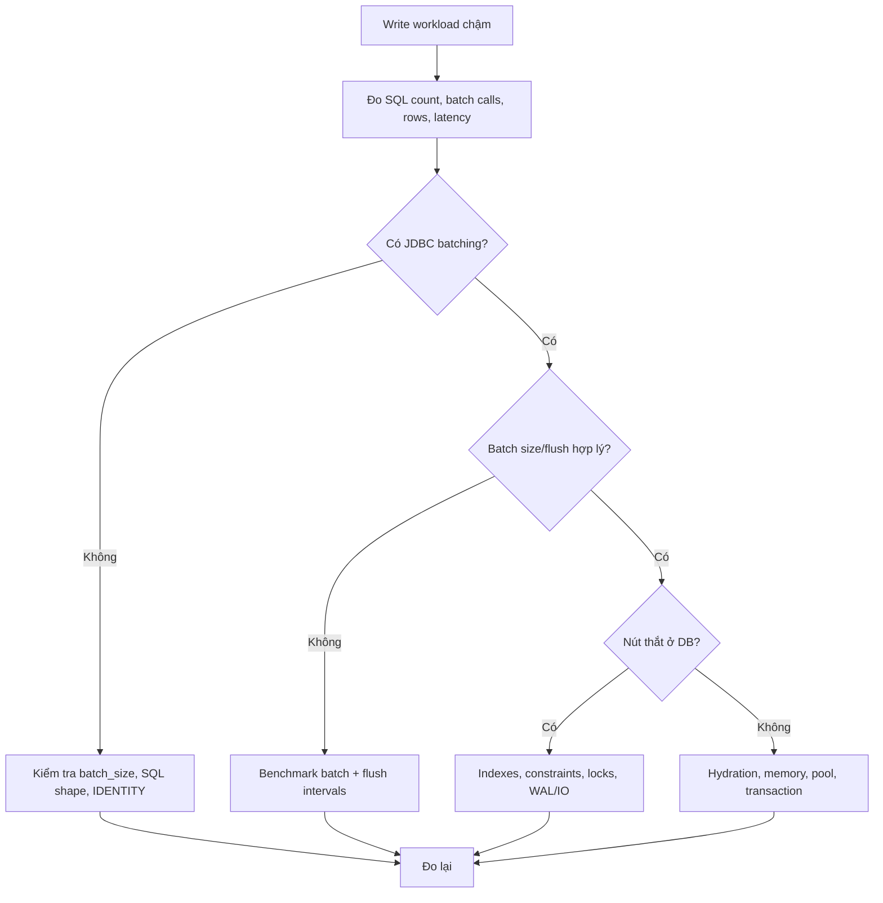

# Tối ưu thao tác ghi bằng batching, sequence và thứ tự câu lệnh

Một service nhập 1.000 đơn hàng có thể gọi `persist()` 1.000 lần. Nếu Hibernate gửi từng INSERT riêng, ứng dụng phải trả chi phí chuẩn bị statement, bind tham số, gửi yêu cầu qua mạng và chờ database phản hồi lặp đi lặp lại. Khi số bản ghi tăng lên hàng chục nghìn, overhead này có thể trở thành nút thắt lớn dù mỗi câu SQL riêng lẻ chạy khá nhanh.

Hibernate có ba cơ chế thường được phối hợp để tối ưu write workload:

- **JDBC batching** gom nhiều thao tác INSERT/UPDATE/DELETE có cùng SQL shape vào một batch execution.
- **Sequence allocation** cấp trước identifier để Hibernate có thể trì hoãn INSERT và tích lũy nhiều thao tác ghi.
- **Statement ordering** sắp xếp các thao tác ghi theo entity type/identifier nhằm tăng cơ hội batch và làm thứ tự khóa ổn định hơn trong một số workloads.

Chúng bổ trợ cho nhau nhưng giải quyết những vấn đề khác nhau. Sequence giúp biết ID trước khi INSERT; ordering tạo những nhóm statement tương thích; JDBC batching giảm số lần gọi execute ở tầng driver. **Bật một property không tự bảo đảm toàn bộ pipeline đã batch hiệu quả.**

Bài học giải thích cách phối hợp chúng trong Hibernate ORM và Spring Data JPA, lựa chọn identifier strategy, thiết kế transaction và batch loops, giới hạn của JDBC driver, cách đo trước/sau và các tình huống batching không phù hợp.

---

## 1. Vì sao thao tác ghi nhiều dòng có thể chậm?

Một vòng lặp đơn giản:

```java
@Transactional
public void importOrders(List<OrderInput> inputs) {
    for (OrderInput input : inputs) {
        PurchaseOrder order = new PurchaseOrder(
            input.code(),
            input.total()
        );
        entityManager.persist(order);
    }
}
```

Về mặt Java, vòng lặp chỉ gọi `persist()` nhiều lần. Khi Hibernate flush, nó phải:

1. Theo dõi các entity mới trong persistence context.
2. Xác định SQL INSERT tương ứng với mapping.
3. Lấy identifier nếu generator cần.
4. Chuẩn bị statement và bind parameters.
5. Gửi statement hoặc batch qua JDBC driver.
6. Database kiểm tra constraints, indexes, foreign keys và ghi dữ liệu.
7. Driver trả update counts/generated values.
8. Hibernate cập nhật trạng thái managed entities.

Nếu mỗi entity tạo một INSERT execution riêng, ứng dụng có thể tốn nhiều round-trips.

### 1.1. Mô hình không batching

Giả sử 1.000 rows, mỗi INSERT execution mất trung bình 4 ms round-trip:

```text
1.000 executions × 4 ms = 4.000 ms
```

Đây chỉ là ví dụ. Latency thực tế phụ thuộc network, driver, DB load, transaction, statement và payload. Tuy nhiên, nó cho thấy overhead của nhiều round-trips có thể lớn ngay cả khi database ghi từng row khá nhanh.

### 1.2. Mô hình batching

Với batch size 50:

```text
1.000 logical INSERT operations
        |
        v
20 JDBC executeBatch() calls (lý tưởng)
        |
        v
Driver / database
```

Driver có thể tối ưu protocol hoặc rewrite batch tùy DBMS và cấu hình. Không nên khẳng định 20 batch calls luôn tương đương chính xác 20 network packets; JDBC batching là abstraction, còn wire-level behavior phụ thuộc driver.

### 1.3. Các đại lượng phải phân biệt

| Đại lượng | Ví dụ với 1.000 entities |
|---|---:|
| Java persist calls | 1.000 |
| Logical INSERT operations | 1.000 |
| Prepared SQL shapes | Có thể 1 |
| PreparedStatement instances | Phụ thuộc Hibernate/driver |
| JDBC addBatch entries | Có thể 1.000 |
| JDBC executeBatch calls | Lý tưởng khoảng 20 nếu batch size 50 |
| Database rows inserted | 1.000 |
| Network round-trips | Phụ thuộc driver/protocol |

Một JDBC batch không có nghĩa database chỉ nhận một row, và cũng không nhất thiết được chuyển thành một câu SQL multi-values INSERT.

## 2. JDBC batching là gì?

JDBC cung cấp API batching:

```java
PreparedStatement ps = connection.prepareStatement(
    "INSERT INTO purchase_orders (id, order_code) VALUES (?, ?)"
);

for (OrderInput input : inputs) {
    ps.setLong(1, input.id());
    ps.setString(2, input.code());
    ps.addBatch();
}

int[] counts = ps.executeBatch();
```

Các lời gọi `addBatch()` thêm parameter sets vào batch. `executeBatch()` yêu cầu driver thực thi những thao tác đã tích lũy.

Hibernate sử dụng cơ chế này khi có nhiều DML statements tương thích và batching được bật.

### 2.1. Cấu hình batch size

Hibernate setting:

```properties
hibernate.jdbc.batch_size=50
```

Trong Spring Boot:

```properties
spring.jpa.properties.hibernate.jdbc.batch_size=50
```

Giá trị 50 có nghĩa Hibernate cố gắng gom tối đa khoảng 50 DML statements tương thích cho một batch trước khi execute/flush theo các điều kiện lifecycle. Đây không phải cam kết mỗi batch luôn có đúng 50 operations.

Batch có thể nhỏ hơn vì:

- Flush xảy ra trước khi đủ batch size.
- SQL shapes khác nhau xen kẽ.
- Identifier generation yêu cầu INSERT ngay.
- Statement cần generated values theo cách không batch được.
- Entity/collection operations có ordering/dependency khác.
- Transaction kết thúc hoặc persistence context flush.
- Driver/provider không hỗ trợ hoặc không sử dụng batching cho statement đó.

### 2.2. Batch size bằng 0

`hibernate.jdbc.batch_size=0` thường tắt JDBC batching. Không nên để cấu hình production vô tình là 0 nếu workload cần bulk writes, nhưng cũng không nên đặt một số rất lớn mà không benchmark.

### 2.3. Batch size không phải số rows của một SQL multi-values

JDBC batch có thể chứa 50 executions của cùng prepared statement:

```sql
INSERT INTO purchase_orders (id, order_code)
VALUES (?, ?)
```

Driver có thể gửi batch theo protocol tối ưu. Một số driver có tùy chọn rewrite INSERT batch thành SQL nhiều values, nhưng đó là behavior riêng của driver.

Vì vậy, khi xem SQL logs, có thể thấy một dòng SQL template lặp lại mà không thấy rõ batch boundaries. Dùng JDBC instrumentation/driver metrics nếu cần biết số `executeBatch()`.

### 2.4. Batch fetching là cơ chế khác

`hibernate.jdbc.batch_size` điều khiển DML batching (INSERT/UPDATE/DELETE).

Các setting:

```properties
hibernate.default_batch_fetch_size=32
```

và annotation:

```java
@BatchSize(size = 32)
```

liên quan batch fetching khi đọc lazy entities/collections. Chúng không phải JDBC write batching.

## 3. Cấu hình Hibernate batching trong Spring Boot

Một cấu hình minh họa:

```properties
spring.jpa.properties.hibernate.jdbc.batch_size=50
spring.jpa.properties.hibernate.order_inserts=true
spring.jpa.properties.hibernate.order_updates=true
spring.jpa.properties.hibernate.jdbc.batch_versioned_data=true
```

Ý nghĩa:

| Property | Tác dụng |
|---|---|
| `hibernate.jdbc.batch_size` | Số DML operations tối đa Hibernate cố gắng gom vào batch |
| `hibernate.order_inserts` | Sắp xếp INSERT actions để nhóm SQL shapes/entity types tương thích |
| `hibernate.order_updates` | Sắp xếp UPDATE actions để tăng batch opportunities và giảm một số deadlocks |
| `hibernate.jdbc.batch_versioned_data` | Cho phép batch DML có version khi driver trả update counts phù hợp |

Đây là điểm bắt đầu để benchmark, không phải bộ giá trị tối ưu cho mọi database.

### 3.1. YAML tương đương

```yaml
spring:
  jpa:
    properties:
      hibernate:
        jdbc:
          batch_size: 50
          batch_versioned_data: true
        order_inserts: true
        order_updates: true
```

### 3.2. Không nhầm với Spring Data saveAll

```java
repository.saveAll(orders);
```

`saveAll()` không có nghĩa Spring Data phát một SQL multi-row INSERT duy nhất. Trong implementation JPA thông thường, nó lặp qua entities và gọi thao tác save/persist/merge tương ứng. Hibernate mới là tầng có thể gom DML thành JDBC batches khi flush.

`saveAllAndFlush()` yêu cầu flush sau saveAll; nó cũng không tự biến nhiều inserts thành một SQL multi-values statement. Cần cấu hình Hibernate batching và generator phù hợp.

### 3.3. saveAll không tự chia chunks

Nếu list có 500.000 entities, `saveAll` có thể giữ nhiều objects trong persistence context và gây memory pressure. Cần service loop theo chunks, `flush()/clear()` hoặc Spring Batch chunk-oriented processing.

## 4. Tại sao sequence giúp INSERT batching?

Một vấn đề quan trọng là Hibernate cần biết ID của entity trước khi ghi hoặc trước khi hoàn tất persistence operation.

### 4.1. Sequence generator

```java
@Entity
@Table(name = "purchase_orders")
public class PurchaseOrder {

    @Id
    @GeneratedValue(
        strategy = GenerationType.SEQUENCE,
        generator = "purchase_order_seq_gen"
    )
    @SequenceGenerator(
        name = "purchase_order_seq_gen",
        sequenceName = "purchase_order_seq",
        allocationSize = 50
    )
    private Long id;

    private String orderCode;
}
```

Sequence là database object tạo ra các identifier. Với sequence optimizer phù hợp, Hibernate có thể lấy một giá trị đại diện cho một dải IDs, rồi cấp ID trong memory cho nhiều entities trước khi INSERT.

Vì Hibernate biết ID trước, nó có thể trì hoãn INSERT và gom nhiều rows vào batch.

### 4.2. Sequence DDL và allocation size

Một migration PostgreSQL minh họa cho chiến lược pooled có increment phù hợp:

```sql
CREATE SEQUENCE purchase_order_seq
    START WITH 1
    INCREMENT BY 50;
```

Mapping:

```java
@SequenceGenerator(
    name = "purchase_order_seq_gen",
    sequenceName = "purchase_order_seq",
    allocationSize = 50
)
```

Physical sequence increment và optimizer phải tương thích. Chi tiết semantics của `pooled` và `pooled-lo` khác nhau ở cách diễn giải sequence value, và Hibernate có thể chọn optimizer theo mapping/configuration/version.

**Không copy DDL increment 50 cho mọi generator mà không kiểm tra optimizer và schema validation.** Đọc Hibernate logs và cấu hình sequence mismatch strategy của release đang dùng.

### 4.3. Allocation size không phải batch size

| Setting | Mục đích |
|---|---|
| `@SequenceGenerator(allocationSize = 50)` | Cấp trước identifier values |
| `hibernate.jdbc.batch_size=50` | Gom DML JDBC operations |
| `hibernate.order_inserts=true` | Sắp xếp INSERT actions |
| `hibernate.default_batch_fetch_size=50` | Gom lazy SELECT fetching |

Dùng cùng con số 50 chỉ là lựa chọn cấu hình dễ so sánh, không phải yêu cầu các setting phải bằng nhau.

### 4.4. Sequence allocation giảm sequence round-trips

Nếu mỗi ID cần gọi `nextval` riêng, 1.000 entities có thể tạo nhiều sequence calls. Với allocation size 50, Hibernate có thể lấy một sequence value cho một block và cấp IDs trong JVM.

Điều này giảm sequence access overhead và giúp INSERTs được gom lại. Khi JVM restart hoặc transaction rollback, một phần IDs đã cấp có thể không được sử dụng; **sequence gaps là bình thường**.

### 4.5. Sequence IDs không liên tục

Không dùng primary key sequence làm số hóa đơn hoặc chứng từ cần liên tục tuyệt đối:

- Transaction rollback không hoàn lại sequence value.
- Pooled allocation có thể bỏ phần ID chưa dùng khi process dừng.
- Nhiều application instances cấp những blocks khác nhau.
- Sequence cache và failover có thể tạo gaps.

Nếu nghiệp vụ cần numbering riêng, hãy thiết kế bộ cấp số có locking/transaction policy rõ, độc lập với PK.

## 5. IDENTITY thường hạn chế INSERT batching

Ví dụ:

```java
@Id
@GeneratedValue(strategy = GenerationType.IDENTITY)
private Long id;
```

Với identity/autoincrement, database tạo ID khi INSERT được thực thi. Hibernate thường phải chạy INSERT để lấy generated key, nên không thể trì hoãn tất cả inserts theo cách sequence preallocation làm được.

Trong Hibernate, dùng IDENTITY thường **tắt JDBC insert batching cho entity đó**. Đây là khác biệt hiệu năng quan trọng khi ghi hàng loạt.

### 5.1. So sánh identifier strategies

| Strategy | Có ID trước INSERT? | Cơ hội JDBC insert batching |
|---|---|---|
| SEQUENCE + pooled optimizer | Có | Tốt |
| UUID generated trong application/provider | Có | Tốt |
| IDENTITY/AUTO_INCREMENT | Thường không | Bị hạn chế/không dùng insert batching thông thường |
| TABLE generator | Có thể | Có, nhưng có chi phí contention generator |
| Assigned ID | Có | Có nếu IDs được cấp an toàn |

### 5.2. UUID có thể hỗ trợ batching

```java
@Id
@GeneratedValue(strategy = GenerationType.UUID)
private UUID id;
```

Nếu UUID được sinh ở application/provider trước INSERT, Hibernate biết identifier sớm và có thể batch inserts. Nhưng UUID storage/index size và locality khác BIGINT sequence; cần cân nhắc DBMS và workload.

### 5.3. TABLE generator

TABLE generator lưu bộ đếm trong một bảng và cập nhật/lock row để cấp IDs. Nó có thể portable hơn sequence ở một số môi trường, nhưng contention trên generator table có thể thành bottleneck khi nhiều writers đồng thời.

### 5.4. AUTO không phải một strategy performance cố định

`GenerationType.AUTO` để provider lựa chọn. Strategy thực tế phụ thuộc Dialect, Hibernate version và DB capabilities. Khi tối ưu bulk writes, xác định generator thực tế trong mapping/runtime logs, không suy từ annotation AUTO.

## 6. Sequence optimizer và nhiều application instances

Trong hệ thống có nhiều replicas:

```text
Instance A lấy block IDs: 1..50
Instance B lấy block IDs: 51..100
Instance A cấp tiếp block: 101..150
```

Các blocks được cấp thông qua sequence database để không va chạm nếu cấu hình đúng.

### 6.1. Pooled và pooled-lo

Hibernate có các optimizer như:

- `none`: không pool identifiers.
- `pooled`: dùng sequence values và allocation blocks theo optimizer semantics.
- `pooled-lo`: diễn giải low boundary của block theo chiến lược riêng.

Optimizer được chọn từ mapping/configuration và allocation size. Không giả định chỉ nhìn `allocationSize` là biết chính xác mọi sequence values được dùng thế nào.

### 6.2. Sequence increment mismatch

Nếu database sequence có `INCREMENT BY 1` nhưng mapping/optimizer mong increment 50, Hibernate có thể báo mismatch hoặc áp dụng strategy cấu hình cho mismatch.

Kiểm tra:

1. Tên sequence thật.
2. Physical increment/start/current value.
3. `allocationSize` trong mapping.
4. Optimizer Hibernate chọn.
5. `hibernate.id.sequence.increment_size_mismatch_strategy` nếu release hỗ trợ.
6. Tình trạng nhiều application versions đang cùng ghi.

Không tắt validation chỉ để ứng dụng khởi động nếu chưa hiểu hệ quả.

### 6.3. Khi thay allocationSize

Đổi `allocationSize` từ 1 sang 50 là thay đổi generator behavior. Trước deploy:

- Xác định sequence hiện có và increment.
- Xác định các application versions cùng chạy.
- Tránh một phiên bản mong increment 1, phiên bản khác mong 50.
- Chọn migration/rollout an toàn.
- Kiểm tra uniqueness dưới concurrency.
- Chấp nhận gaps.

## 7. Thứ tự INSERT: order_inserts

Hibernate có thể sắp xếp insert actions để nhóm các statements cùng SQL shape.

Bật:

```properties
hibernate.order_inserts=true
```

Giả sử transaction tạo:

```text
Order A
OrderLine A1
Order B
Customer C
OrderLine B1
Customer D
```

Nếu các thao tác được xếp theo entity/table thích hợp, Hibernate có thể nhóm inserts theo SQL shape:

```text
INSERT Customer ...
INSERT Customer ...
INSERT Order ...
INSERT Order ...
INSERT OrderLine ...
INSERT OrderLine ...
```

Điều này tăng cơ hội gom các statements cùng loại vào JDBC batch.

### 7.1. Vì sao grouping hữu ích?

Một batch thường cần cùng SQL statement template. Nếu INSERT vào bảng A và B xen kẽ:

```text
INSERT A
INSERT B
INSERT A
INSERT B
```

Hibernate không thể đưa tất cả vào một batch cùng statement template. Sắp xếp có thể biến chúng thành:

```text
INSERT A
INSERT A
INSERT B
INSERT B
```

để hình thành các batch lớn hơn.

### 7.2. Ordering không thay dependency graph

Nếu OrderLine có FK tới Order, database yêu cầu Order tồn tại trước khi insert line (trừ các FK deferred phù hợp). Hibernate action queue phải tôn trọng dependencies của persistence model.

`hibernate.order_inserts` không phải lệnh “sắp theo tên bảng rồi bỏ qua FK”. Nó tối ưu thứ tự trong giới hạn action dependencies và SQL semantics.

### 7.3. Ordering có overhead

Hibernate phải tổ chức/sắp xếp actions, thường theo entity type và identifier. Với transaction nhỏ, ordering có thể không tạo lợi ích rõ ràng và thêm CPU overhead.

Benchmark với workload thật; không bật mọi ordering settings chỉ vì “nhiều insert thì luôn nhanh hơn”.

### 7.4. Không bảo đảm business order

Nếu ứng dụng cần một thứ tự business cụ thể, đừng dựa vào thứ tự INSERT nội bộ Hibernate. Database rows không có thứ tự tự nhiên; chỉ `ORDER BY` mới đảm bảo thứ tự khi đọc.

## 8. Thứ tự UPDATE: order_updates

Bật:

```properties
hibernate.order_updates=true
```

Ví dụ transaction cập nhật 100 orders và 100 customers xen kẽ. Sắp xếp actions theo entity type/identifier có thể:

- Gom UPDATE cùng SQL shape vào batch.
- Giảm switching giữa statement templates.
- Giảm khả năng một số transactions khóa rows theo thứ tự khác nhau, qua đó giảm deadlock risk trong một số workloads.

### 8.1. Ví dụ hai transactions

Không ordering:

```text
Transaction A: UPDATE Order#1 -> Order#2
Transaction B: UPDATE Order#2 -> Order#1
```

Nếu mỗi transaction khóa row thứ nhất rồi chờ row thứ hai, có thể tạo deadlock.

Nếu mọi transaction cập nhật theo thứ tự ID ổn định:

```text
Transaction A: Order#1 -> Order#2
Transaction B: Order#1 -> Order#2
```

thì loại deadlock do lock-order inversion có thể giảm.

Đây là minh họa; database lock behavior và business transaction shape quyết định kết quả. `order_updates` không bảo đảm loại bỏ tất cả deadlocks, đặc biệt khi transaction có nhiều bảng hoặc logic ngoài Hibernate.

### 8.2. Ordering không thay optimistic locking

Entity có:

```java
@Version
private long version;
```

Hibernate dùng version column để phát hiện lost updates. Batching và ordering không loại bỏ optimistic locking checks. Nếu batch update một row có version mismatch, driver update count/exception semantics cần được xử lý đúng.

## 9. Batch các UPDATE có @Version

Ví dụ:

```java
@Entity
public class InventoryItem {
    @Id
    private Long id;

    @Version
    private long version;

    private int quantity;
}
```

Mỗi UPDATE có thể tương tự:

```sql
UPDATE inventory_item
SET quantity = ?, version = ?
WHERE id = ? AND version = ?;
```

Hibernate cần biết update count để xác định row có bị concurrent modification hay không. JDBC driver phải trả update counts đáng tin cậy cho batch.

### 9.1. hibernate.jdbc.batch_versioned_data

```properties
hibernate.jdbc.batch_versioned_data=true
```

Setting này cho phép batching các DML operations của versioned data khi driver trả update counts đúng. Trong nhiều Hibernate releases hiện đại, default là true; phải kiểm tra đúng version/driver.

Nếu driver trả counts không đáng tin cậy cho batch, Hibernate có thể không phát hiện optimistic locking failures chính xác. Khi đó cần cân nhắc tắt setting và kiểm thử behavior với driver/DB thực tế.

### 9.2. Batch failure và optimistic lock

Nếu một batch có nhiều updates và một row version không khớp, driver có thể báo `BatchUpdateException` hoặc update count bất thường. Hibernate phải chuyển nó thành exception tương ứng tùy tình huống.

Transaction có thể cần rollback toàn bộ. Không tiếp tục commit một phần state chỉ vì một số batch entries đã thành công ở JDBC level.

### 9.3. Test version conflict

Chạy hai transactions đọc cùng InventoryItem version, mỗi transaction cập nhật, rồi commit cạnh tranh. Xác nhận một transaction bị conflict theo semantics. Lặp lại khi batching bật để bảo đảm driver counts đúng.

## 10. SQL shape: điều kiện quan trọng để batch hiệu quả

Batching hiệu quả khi các DML statements có **cùng cấu trúc SQL**.

Ví dụ:

```sql
INSERT INTO customers (id, name, email)
VALUES (?, ?, ?);
```

nhiều lần có thể batch với cùng PreparedStatement shape.

Nhưng:

```sql
INSERT INTO customers (id, name)
VALUES (?, ?);

INSERT INTO customers (id, name, email)
VALUES (?, ?, ?);
```

là hai SQL shapes khác nhau, nên không thể cùng một JDBC batch statement.

### 10.1. @DynamicInsert có thể làm batch fragmentation

```java
@Entity
@DynamicInsert
public class Customer {
    @Id
    private Long id;

    private String name;
    private String email;
    private String phone;
}
```

`@DynamicInsert` có thể tạo INSERT chỉ chứa các cột không null. Nếu mỗi entity có pattern null khác nhau, Hibernate có thể tạo nhiều SQL shapes:

```text
INSERT (id, name)
INSERT (id, name, email)
INSERT (id, name, phone)
INSERT (id, name, email, phone)
```

Điều đó làm batch nhỏ hoặc phân mảnh.

Không cấm dùng `@DynamicInsert`; nó có thể cần để database defaults hoạt động. Nhưng hãy cân nhắc giữa SQL shape stability và nhu cầu default/insert semantics.

### 10.2. @DynamicUpdate tương tự

`@DynamicUpdate` chỉ cập nhật các columns thay đổi. Nó có thể giảm dữ liệu ghi nhưng tạo nhiều UPDATE shapes tùy field changes, giảm khả năng batch grouping.

Chọn theo workload: nếu đa số updates có shape giống nhau, static UPDATE có thể batch tốt hơn; nếu updates sparse và rất khác nhau, dynamic SQL có thể tiết kiệm writes nhưng batch fragmentation cần đo.

### 10.3. Secondary tables và inheritance

Một entity map tới nhiều physical tables (secondary table/joined inheritance) có thể cần nhiều SQL statements cho một logical entity operation. Batching vẫn có thể xảy ra theo từng statement shape, nhưng không phải mỗi entity luôn tương ứng đúng một DML.

Đếm SQL ở JDBC layer để biết thực tế.

## 11. Flush và persistence context khi ghi dữ liệu lớn

JPA persistence context giữ managed entities để identity map và dirty checking. Nếu import 100.000 entities trong một transaction mà không flush/clear theo chunks, bộ nhớ và dirty checking cost có thể tăng đáng kể.

Ví dụ:

```java
@Transactional
public void importOrders(List<OrderInput> inputs) {
    int flushInterval = 50;

    for (int i = 0; i < inputs.size(); i++) {
        PurchaseOrder order = map(inputs.get(i));
        entityManager.persist(order);

        if ((i + 1) % flushInterval == 0) {
            entityManager.flush();
            entityManager.clear();
        }
    }

    entityManager.flush();
    entityManager.clear();
}
```

### 11.1. flush() làm gì?

`flush()` đồng bộ pending changes trong persistence context tới database. Nó có thể phát INSERT/UPDATE/DELETE và thực thi JDBC batches đang chờ.

**Flush không commit transaction.** Transaction vẫn có thể rollback sau flush. Flush chỉ đẩy SQL xuống DB trong transaction hiện tại.

### 11.2. clear() làm gì?

`clear()` detach tất cả managed entities trong persistence context. Nó giúp giảm memory usage và dirty checking overhead ở import lớn.

Sau `clear()`:

- Entity references cũ không còn managed.
- Lazy associations chưa load có thể không tiếp tục được khởi tạo khi Session đóng/context thay đổi.
- Thay đổi chưa flush sẽ không còn được quản lý theo cách thông thường.
- Code không nên tiếp tục sửa object cũ và mong Hibernate tự dirty-check.

Vì vậy phải flush trước clear để không mất pending changes.

### 11.3. Chọn chunk size

Chunk/flush interval có thể là 25, 50, 100 hoặc lớn hơn tùy:

- JDBC batch size.
- Memory budget.
- Entity graph/cascade.
- DB latency/lock duration.
- Transaction timeout.
- Retry/failure granularity.
- Driver packet limits.

Không cần luôn đặt flush interval bằng JDBC batch size. Một flush có thể execute nhiều batches; chunk size điều khiển số managed entities giữ trong context, còn batch size điều khiển DML group size.

### 11.4. Một transaction hay nhiều transactions?

Ví dụ trên vẫn có **một transaction lớn** dù flush/clear nhiều lần. Nếu import 1 triệu rows, một transaction lớn có thể giữ locks/log/undo resources lâu và rollback rất tốn.

Có thể chia thành transactions theo chunks, nhưng khi đó:

- Một số chunks có thể commit trước khi chunk sau fail.
- Cần idempotency/checkpoint/retry.
- Các chunks không còn atomic toàn bộ file import.
- Audit/revision behavior có thể là một revision per transaction thay vì một revision chung.
- Unique constraints/business invariants cần thiết kế xuyên chunk.

Không chia transaction chỉ để “tăng tốc” mà bỏ qua semantics nghiệp vụ.

## 12. Cẩn thận với cascade và quan hệ cha-con

Ví dụ:

```java
@Entity
public class PurchaseOrder {
    @Id
    @GeneratedValue(strategy = GenerationType.SEQUENCE,
                    generator = "order_seq")
    private Long id;

    @OneToMany(
        mappedBy = "order",
        cascade = CascadeType.PERSIST
    )
    private List<OrderLine> lines = new ArrayList<>();
}
```

Persist order có thể cascade persist các lines. Nếu order và lines cùng được tạo hàng loạt:

- Hibernate phải tạo parent/child actions.
- FK dependencies quyết định insert order trước line.
- Sequence giúp IDs có trước nhưng không xóa FK dependency.
- `order_inserts` có thể grouping trong giới hạn dependencies.
- Nhiều collections/join tables có thể tạo thêm DML.

### 12.1. Cập nhật hai phía association

Với bidirectional relationship, helper nên giữ hai phía đồng bộ:

```java
public void addLine(OrderLine line) {
    lines.add(line);
    line.setOrder(this);
}
```

Nếu chỉ thêm vào collection inverse mà không set owning side, FK có thể không được ghi như kỳ vọng.

### 12.2. Nhiều loại entity trong cùng transaction

Hibernate có thể sắp xếp action queue để tôn trọng FK dependencies và gom các SQL tương thích. Đừng tự đoán thứ tự statement chỉ dựa vào thứ tự gọi `persist()` trong Java.

Nếu business logic phụ thuộc side effect của DB triggers, generated columns hoặc external observers, phải hiểu flush/order semantics thực tế và kiểm thử.

## 13. Batching với Spring Data JPA

Repository:

```java
public interface PurchaseOrderRepository
        extends JpaRepository<PurchaseOrder, Long> {
}
```

Service:

```java
@Transactional
public void importOrders(List<PurchaseOrder> orders) {
    repository.saveAll(orders);
}
```

`saveAll()` thường gọi save cho từng entity và trả iterable/list. Hibernate batching xảy ra khi flush nếu:

- JDBC batch size > 0.
- ID strategy cho phép batch.
- SQL shapes tương thích.
- Transaction/session hoạt động.
- Driver hỗ trợ batching phù hợp.

### 13.1. saveAllAndFlush

`saveAllAndFlush()` save iterable rồi flush persistence context. Nó không tự clear và cũng không biến operation thành một câu SQL duy nhất.

Nếu mục tiêu là giới hạn memory, cần quản lý EntityManager rõ ràng.

### 13.2. Persist hay merge?

Spring Data JPA `save()` xác định entity mới hay cũ theo strategy (ví dụ version/id detection hoặc `Persistable`) rồi dùng `persist` hoặc `merge` phù hợp.

`merge` có thể tốn thêm reads/state copying và trả về managed instance khác với object input. Với bulk import entity mới, bảo đảm Spring Data nhận diện entity là new để tránh merge path không cần thiết.

### 13.3. Entity state sau clear

Không tiếp tục dùng các objects cũ sau `clear()` như thể chúng còn managed. Nếu chunk processor cần cập nhật lại, reload hoặc tạo entities mới theo ID/business key và transaction mới.

## 14. Bulk HQL UPDATE/DELETE khác JDBC batching

JDBC batch là nhiều DML statements có cùng SQL shape được gom lại. Bulk HQL là một câu lệnh set-based tác động nhiều rows.

Ví dụ bulk HQL:

```java
int affected = entityManager.createQuery(
    """
    update PurchaseOrder o
    set o.status = :newStatus
    where o.status = :oldStatus
    """
)
.setParameter("newStatus", OrderStatus.ARCHIVED)
.setParameter("oldStatus", OrderStatus.DONE)
.executeUpdate();
```

Đây là một bulk DML statement theo set condition, không phải 1.000 managed entity updates được JDBC batch.

### 14.1. Bulk HQL thường nhanh hơn khi update cùng một rule

Database xử lý set-based operation mà không cần hydrate từng entity. Nhưng nó bỏ qua entity-by-entity lifecycle/dirty checking, có persistence-context stale-state caveats và có thể bypass Envers/listeners/cascades.

### 14.2. Clear/synchronize sau bulk DML

Nếu persistence context đang giữ InventoryItems đã load trước đó, bulk UPDATE có thể không cập nhật các Java objects đang managed. Cần flush trước và clear/refresh sau theo transaction semantics, hoặc dùng query API synchronization phù hợp.

Không dùng bulk DML khi cần callbacks/validation/audit per entity mà chưa thiết kế cơ chế thay thế.

### 14.3. Batch updates theo entity giữ lifecycle semantics khác

Duyệt từng managed entity và thay field để Hibernate dirty-check, version-check và phát DML có thể được batch. Bulk DML giảm ORM overhead nhưng có semantics khác. Chọn theo yêu cầu domain, không chỉ theo tốc độ.

## 15. Statement ordering và deadlocks

Hai transactions cùng sửa nhiều rows có thể deadlock nếu lock acquisition order khác nhau.

Ví dụ:

```text
Transaction A:
  UPDATE account #10
  UPDATE account #20

Transaction B:
  UPDATE account #20
  UPDATE account #10
```

Một transaction giữ lock #10 và chờ #20; transaction kia giữ #20 và chờ #10.

Nếu các operations được sắp xếp theo cùng thứ tự:

```text
Transaction A:
  UPDATE account #10
  UPDATE account #20

Transaction B:
  UPDATE account #10
  UPDATE account #20
```

thì loại deadlock do đảo thứ tự có thể giảm.

### 15.1. order_updates

`hibernate.order_updates=true` giúp Hibernate sắp xếp update actions theo entity type/identifier theo strategy của nó. Điều này vừa tăng batch opportunities vừa có thể cải thiện lock ordering.

### 15.2. Không loại bỏ mọi deadlock

Deadlocks còn có thể đến từ:

- FK checks và indexes.
- Trigger cập nhật bảng khác.
- Transactions dùng native SQL theo thứ tự khác.
- Nhiều tables/lock modes.
- Concurrent DDL.
- DBMS-specific lock escalation.

Ứng dụng vẫn phải xử lý deadlock exceptions và retry transaction theo idempotency/backoff thích hợp.

### 15.3. Retry ở transaction boundary

Khi DB báo deadlock/serialization failure, transaction hiện tại thường không thể tiếp tục như chưa có gì. Retry nên thực hiện toàn bộ transactional operation qua proxy/new transaction, không bắt exception rồi chạy tiếp trong transaction rollback-only.

## 16. Flush và batch boundaries

Hibernate tự flush theo những thời điểm cần đồng bộ state, thường gồm:

- Trước transaction commit.
- Trước một số queries theo flush mode/overlap rules.
- Khi application gọi `flush()`.
- Theo lifecycle/transaction events phù hợp.

### 16.1. Flush sớm có thể làm batch nhỏ

Ví dụ:

```java
for (PurchaseOrder order : orders) {
    entityManager.persist(order);
    entityManager.flush();
}
```

Mỗi lần flush có thể đẩy pending actions xuống DB trước khi batch đầy, làm batching mất hiệu quả.

### 16.2. Query giữa vòng import

Nếu code chạy query giữa các lần persist, Hibernate có thể auto-flush trước query để query nhìn thấy state theo semantics. Điều này chia batch thành nhiều nhóm nhỏ.

Tránh interleave hàng loạt persist với queries không cần thiết. Nếu cần lookup dữ liệu, preload/reference map trước hoặc batch lookups phù hợp.

### 16.3. Flush mode COMMIT không phải cách tắt mọi flush

Đổi flush mode ảnh hưởng visibility/query semantics và có thể làm ứng dụng đọc state cũ hoặc gặp behavior khó hiểu. Đừng dùng `FlushMode.COMMIT` chỉ để tăng batch size nếu chưa hiểu JPA/Hibernate flush contract.

## 17. Bulk insert: chọn chiến lược phù hợp

| Cách | Ưu điểm | Hạn chế |
|---|---|---|
| EntityManager.persist + JDBC batch | Giữ ORM lifecycle/cascade/dirty checking | Entity hydration/state overhead |
| Spring Data saveAll + batch config | API repository tiện | Không tự chunk/clear; generator matters |
| HQL bulk DML | Set-based, ít hydrate | Bỏ qua lifecycle per entity |
| Hibernate StatelessSession | Ít persistence-context overhead | Không có normal L1/dirty checking/cascade semantics |
| Native multi-values INSERT | DB/driver tối ưu, có thể nhanh | SQL DB-specific, mapping/lifecycle tự quản |
| Database bulk loader/COPY | Rất nhanh cho data import lớn | Cần mapping/validation/staging workflow riêng |

### 17.1. StatelessSession

Hibernate `StatelessSession` cung cấp API ít state hơn Session thông thường. Nó không có persistence context/first-level cache và không cung cấp cùng semantics cascades/automatic dirty checking như Session thường.

Có thể phù hợp ETL/import lớn khi ứng dụng chủ động quản lý entity state và relationships. Nhưng đừng thay Session thường bằng StatelessSession mà không kiểm tra listeners, interceptors, cascades, optimistic locking và audit behavior của release đang dùng.

### 17.2. Native SQL multi-values

```sql
INSERT INTO inventory (id, sku, quantity)
VALUES
    (1, 'A', 10),
    (2, 'B', 20),
    (3, 'C', 30);
```

Có thể hiệu quả cho bulk loads, nhưng cần tự đảm bảo:

- IDs và sequence state.
- FK/unique/check constraints.
- Default/generated columns.
- Audit/outbox behavior.
- Persistence context/cache invalidation.
- DBMS-specific limits và parameter count.
- Transaction/retry semantics.

Sau native DML, clear/refresh persistence context và evict caches khi cần.

## 18. Batch size: chọn bằng benchmark, không bằng cảm giác

Batch size nhỏ:

- Ít memory/driver buffering.
- Nhiều executeBatch calls hơn.
- Có thể chưa amortize round-trip overhead tốt.

Batch size lớn:

- Ít batch executions hơn.
- Tăng parameter buffer/memory.
- Có thể vượt driver/database packet/parameter limits.
- Có thể làm transaction/lock duration lớn hơn.
- Có thể làm batch failure ảnh hưởng nhiều rows.

Một cách thử nghiệm:

```text
hibernate.jdbc.batch_size = 10
hibernate.jdbc.batch_size = 25
hibernate.jdbc.batch_size = 50
hibernate.jdbc.batch_size = 100
```

Giữ nguyên dataset, DB resources, driver và concurrency; đo throughput, p95/p99, rows/second, executeBatch counts, heap/GC và transaction duration.

### 18.1. Không tăng batch size để chữa pool saturation

Batching có thể giảm round-trips cho một transaction, nhưng batch quá lớn cũng có thể kéo dài transaction/locks và dùng buffer nhiều hơn. Pool saturation cần phân tích connection usage và concurrency.

### 18.2. Không batch vô hạn trong một transaction

Nếu import quá lớn, chia chunks/transactions theo semantics. Một transaction kéo dài có thể làm log/WAL/undo tăng, giữ locks và khiến rollback rất tốn.

## 19. Ví dụ Spring Boot: sequence, batching và flush/clear

Entity:

```java
@Entity
@Table(name = "inventory_items")
public class InventoryItem {

    @Id
    @GeneratedValue(
        strategy = GenerationType.SEQUENCE,
        generator = "inventory_seq_gen"
    )
    @SequenceGenerator(
        name = "inventory_seq_gen",
        sequenceName = "inventory_seq",
        allocationSize = 50
    )
    private Long id;

    @Column(nullable = false, length = 80)
    private String sku;

    @Column(nullable = false)
    private int quantity;

    protected InventoryItem() {}

    public InventoryItem(String sku, int quantity) {
        this.sku = sku;
        this.quantity = quantity;
    }
}
```

Migration PostgreSQL minh họa:

```sql
CREATE SEQUENCE inventory_seq
    START WITH 1
    INCREMENT BY 50;

CREATE TABLE inventory_items (
    id BIGINT PRIMARY KEY,
    sku VARCHAR(80) NOT NULL,
    quantity INTEGER NOT NULL
);
```

Properties:

```properties
spring.jpa.properties.hibernate.jdbc.batch_size=50
spring.jpa.properties.hibernate.order_inserts=true
spring.jpa.properties.hibernate.order_updates=true
spring.jpa.properties.hibernate.jdbc.batch_versioned_data=true
```

Service chunked persistence:

```java
@Service
public class InventoryImportService {

    private final EntityManager entityManager;

    public InventoryImportService(EntityManager entityManager) {
        this.entityManager = entityManager;
    }

    @Transactional
    public void importItems(List<InventoryInput> inputs) {
        int flushInterval = 50;

        for (int i = 0; i < inputs.size(); i++) {
            InventoryInput input = inputs.get(i);

            entityManager.persist(
                new InventoryItem(input.sku(), input.quantity())
            );

            if ((i + 1) % flushInterval == 0) {
                entityManager.flush();
                entityManager.clear();
            }
        }

        entityManager.flush();
        entityManager.clear();
    }
}
```

Đây là một transaction duy nhất có nhiều flush/clear intervals. Nếu cần transaction per chunk, cần chuyển từng chunk qua transactional bean/proxy call hoặc Spring Batch chunk processing; không chỉ thêm `REQUIRES_NEW` vào method tự gọi nội bộ cùng bean.

### 19.1. Kết quả mong đợi về mặt cơ chế

Với 1.000 entities, batch size 50 và SQL shape ổn định:

- Hibernate cấp ID qua sequence blocks.
- Entity INSERT actions được tích lũy.
- Hibernate gom các INSERT cùng shape.
- Có khoảng 20 JDBC batch executions trong một trường hợp lý tưởng.
- Flush/clear giới hạn số entities managed.
- Transaction commit xác nhận toàn bộ nếu không lỗi.

Số batch thực tế phụ thuộc action ordering, FK dependencies, driver, flush timing, sequence optimizer và mapping. Đo thực tế thay vì assert con số cố định trong production.

## 20. Thứ tự INSERT/UPDATE và dependencies phức tạp

Một transaction có:

```text
Tenant
Customer
PurchaseOrder
OrderLine
Payment
PaymentEvent
```

các FK có thể yêu cầu thứ tự:

```text
Tenant -> Customer -> PurchaseOrder -> OrderLine
                         |
                         +-> Payment -> PaymentEvent
```

Hibernate action queue tổ chức insert/update/delete actions để thỏa mapping dependencies. `order_inserts` có thể tối ưu grouping trong giới hạn đó.

### 20.1. Circular foreign keys

Nếu hai rows tham chiếu lẫn nhau bằng non-nullable FKs, insert ordering có thể không giải được vòng phụ thuộc. Có thể cần:

- Nullable FK + update sau.
- Database deferrable constraints nếu DBMS hỗ trợ.
- Thay đổi domain/schema design.
- Một insert phase rồi update phase.

Không kỳ vọng bật order_inserts sẽ tự giải quyết circular constraints.

### 20.2. Database triggers

Trigger có thể cập nhật bảng khác sau INSERT/UPDATE. Hibernate không biết toàn bộ side effects nếu chúng không được khai trong mapping. Batching vẫn có thể hoạt động nhưng trigger behavior, generated values và locking cần được kiểm thử.

### 20.3. Delete ordering

Xóa parent trước child có thể vi phạm FK. Hibernate action ordering/cascade phải đáp ứng mapping và DB constraints. Bulk DML/native SQL cần tự xử lý dependencies.

## 21. Generated columns, defaults và returned values

Một entity có database-generated field:

```java
@ColumnDefault("CURRENT_TIMESTAMP")
private Instant createdAt;
```

DDL default chỉ chạy khi cột bị bỏ khỏi INSERT theo semantics database. Nếu Hibernate gửi NULL, default có thể không chạy. `@DynamicInsert` hoặc generated-property mappings có thể thay đổi SQL shape và batch opportunities.

### 21.1. Generated keys có thể ảnh hưởng batch

Một số insert strategies yêu cầu lấy generated keys sau từng INSERT. IDENTITY là ví dụ phổ biến làm hạn chế batching. Các DBMS/driver có khả năng returning/batched generated values khác nhau; cần test theo Dialect/driver.

### 21.2. @ColumnDefault không tự điền field Java

DDL default chỉ định nghĩa behavior của database khi cột bị bỏ khỏi INSERT. Hibernate không nhất thiết đọc lại giá trị default vào entity ngay sau persist. Cần mapping generated values phù hợp hoặc refresh/re-read khi cần.

## 22. Batch và audit listeners/Envers

Nếu entity dùng `@Audited` (Hibernate Envers), entity lifecycle operations qua Hibernate thông thường có thể được audit. JDBC batching không đồng nghĩa audit bị bỏ qua; Envers tích hợp vào ORM events và revision handling.

Nhưng:

- Bulk HQL UPDATE/DELETE có thể bypass per-entity lifecycle/audit.
- Native SQL/JDBC direct writes không tự đi qua Envers.
- Một transaction batch có thể gom nhiều audited entity changes trong một revision.
- Chia import thành nhiều transactions có thể tạo nhiều revisions.
- Listener/validation custom có thể thêm overhead.

Nếu audit là yêu cầu, benchmark cùng Envers enabled và test rollback/commit semantics. Đừng dùng native bulk path mà quên audit contract.

## 23. Batch failures, rollback và retries

Một batch có thể fail một phần ở JDBC level. Driver có thể trả update counts cho một số operations trước khi báo exception, hoặc đánh dấu `SUCCESS_NO_INFO`/`EXECUTE_FAILED`.

### 23.1. Transaction rollback

Trong một transaction atomic, khi batch failure làm transaction rollback, các changes đã thực thi trong transaction thường rollback theo DB transaction semantics. Nhưng side effects bên ngoài DB (email, message đã gửi) không tự rollback.

Dùng outbox pattern hoặc after-commit hooks cho side effects cần nhất quán.

### 23.2. Retry toàn bộ unit of work

Khi gặp deadlock/serialization failure:

1. Transaction hiện tại có thể đã bị rollback-only/aborted.
2. Không tiếp tục dùng cùng persistence context như bình thường.
3. Retry qua một transaction mới.
4. Đảm bảo operation idempotent.
5. Giới hạn retry và có backoff/jitter.
6. Không retry constraint violations hoặc business validation failures như thể chúng là transient.

### 23.3. Batch size ảnh hưởng phạm vi lỗi

Một batch lớn có thể làm nhiều operations cùng một execute call fail khi một entry lỗi, nhưng transaction boundary mới quyết định commit/rollback. Nếu cần xác định row lỗi cụ thể, driver update counts và error details phải được xử lý cẩn thận.

## 24. Đo hiệu quả batching

Không dựa vào cảm giác “bật config thấy nhanh hơn”. Hãy đo:

- Số JDBC executeUpdate/executeBatch calls.
- Batch size distribution.
- Số prepared statement shapes.
- Rows inserted/updated/deleted.
- Database time/CPU/IO.
- Connection acquisition và usage.
- Transaction duration.
- Heap usage và GC.
- Error/rollback/deadlock rate.
- Throughput rows/second và p95/p99.

### 24.1. Hibernate Statistics

Bật:

```properties
spring.jpa.properties.hibernate.generate_statistics=true
```

Có thể quan sát:

```java
Statistics stats = entityManagerFactory
    .unwrap(SessionFactory.class)
    .getStatistics();

long prepared =
    stats.getPrepareStatementCount();

long inserts =
    stats.getEntityInsertCount();

long updates =
    stats.getEntityUpdateCount();
```

Statistics giúp quan sát ORM operations nhưng `getPrepareStatementCount()` không phải số JDBC batch calls hoặc network round-trips. Để biết batch boundaries, dùng JDBC datasource instrumentation/driver metrics.

### 24.2. SQL logging

```properties
logging.level.org.hibernate.SQL=DEBUG
```

SQL logs giúp thấy SQL shape nhưng không luôn cho biết `executeBatch()` chứa bao nhiêu parameter sets. Log nhiều có overhead và có thể lộ dữ liệu.

### 24.3. JDBC proxy/tracing

Một JDBC proxy có thể ghi:

```text
SQL fingerprint
prepare count
addBatch count
executeBatch count
batch entry count
execute duration
update counts
errors
```

Đây là nguồn tốt để chứng minh batching thực sự diễn ra. Instrumentation cũng có overhead; nên đo sampling hoặc test environment.

### 24.4. Database metrics

Dùng DB-side monitoring để biết:

- Rows affected.
- Lock waits/deadlocks.
- WAL/redo/undo volume.
- Index maintenance.
- Transaction duration.
- Buffer/cache hits.
- Disk IO.
- Slow statements.

JDBC batch giảm client/round-trip overhead nhưng không xóa chi phí ghi indexes, constraints, WAL hay triggers.

## 25. Benchmark có kiểm soát

Giả sử import 100.000 inventory rows. Thử các phương án:

| Scenario | ID strategy | Batch size | Ordering | Flush interval |
|---|---|---:|---|---:|
| A | IDENTITY | 0 | off | 100 |
| B | SEQUENCE allocation 50 | 0 | off | 100 |
| C | SEQUENCE allocation 50 | 50 | off | 100 |
| D | SEQUENCE allocation 50 | 50 | on | 100 |
| E | SEQUENCE allocation 50 | 50 | on | 500 |
| F | UUID app-generated | 50 | on | 500 |

Giữ cùng:

- Database version/instance.
- Schema/indexes/constraints.
- Driver version/config.
- JVM/heap/GC.
- Input dataset và data distribution.
- Transaction boundaries.
- Concurrent load.
- Cache state và DB warm-up.

Đo:

```text
Elapsed time
Rows per second
JDBC batch executions
Average/percentile batch size
Connection acquisition wait
Connection usage time
Transaction duration
Heap/GC
Database CPU/IO/WAL
Deadlocks/rollbacks
```

### 25.1. Benchmark cả write contention

Import đơn luồng có thể cho thấy sequence+batch rất nhanh. Khi nhiều application instances ghi cùng bảng, sequence contention, index hotspots, lock waits và DB capacity có thể thay đổi kết quả.

### 25.2. Không dùng H2 để kết luận batching production

Driver behavior, sequence support, identity semantics, batch rewriting và locking khác nhau. Dùng Testcontainers hoặc staging với DBMS/driver production-like cho kết luận cuối.

### 25.3. Warm-up và lặp lại

JVM JIT, connection pool startup và database caches ảnh hưởng lần chạy đầu. Chạy nhiều vòng, ghi distribution và tách warm-up khỏi measurements.

## 26. Những trường hợp batching không giúp nhiều

- Chỉ ghi 1–5 rows mỗi transaction.
- SQL shapes khác nhau liên tục.
- Mỗi INSERT cần generated identity ngay.
- Network latency rất thấp và DB bottleneck nằm ở index/IO.
- Constraints/triggers tốn phần lớn thời gian.
- Database bị lock contention.
- Batch size quá lớn làm memory/packet overhead tăng.
- Flush liên tục làm batch bị chia nhỏ.
- Application thực hiện remote calls trong transaction.
- Driver không hỗ trợ batch behavior mong muốn.

Batching là một công cụ tối ưu, không phải mặc định làm mọi write workload nhanh hơn.

## 27. Các lỗi thường gặp

### 27.1. “hibernate.jdbc.batch_size=50 nghĩa một SQL insert 50 rows”

Không. Nó cấu hình JDBC batch grouping. Driver có thể rewrite nhưng không có cam kết một multi-values SQL statement.

### 27.2. “Spring Data saveAll tự động phát một bulk INSERT”

Không. `saveAll` thường lặp save operations; Hibernate JDBC batching mới gom DML khi flush nếu đủ điều kiện.

### 27.3. “IDENTITY và SEQUENCE có hiệu năng ghi giống nhau”

Không. IDENTITY cần INSERT để lấy generated ID và thường hạn chế insert batching; sequence có thể cấp IDs trước.

### 27.4. “allocationSize và batch_size là cùng một setting”

Không. Một cái cấp ID blocks, một cái gom DML executions.

### 27.5. “Sequence IDs không có gaps”

Sai. Rollbacks, pooled blocks, restarts và cache có thể tạo gaps.

### 27.6. “order_inserts bảo đảm thứ tự theo persist()”

Không. Nó sắp xếp actions để tối ưu grouping theo ORM strategy, trong giới hạn dependencies.

### 27.7. “order_updates loại bỏ mọi deadlock”

Không. Nó có thể giảm lock-order inversion trong một số workloads; triggers, FK, native SQL và nhiều bảng vẫn có thể deadlock.

### 27.8. “flush() commit transaction”

Không. Flush đồng bộ pending state xuống DB trong transaction hiện tại; commit vẫn là bước riêng.

### 27.9. “clear() chỉ xóa cache”

Không. Nó detach managed entities trong persistence context. Object references cũ không còn dirty-check như trước.

### 27.10. “flush mỗi entity là an toàn và tối ưu”

Không. Nó thường làm batch nhỏ hoặc không có batching.

### 27.11. “@DynamicInsert luôn giúp insert nhanh hơn”

Không. Nhiều SQL shapes có thể phân mảnh batches; cần cân nhắc DB defaults.

### 27.12. “Bulk HQL update tương đương JDBC batching”

Không. Bulk DML là set-based SQL, bỏ qua nhiều entity lifecycle semantics; JDBC batching gom nhiều DML statements.

### 27.13. “Bật batching không cần test versioned entities”

Sai. Driver update counts cần đủ tin cậy để Hibernate phát hiện optimistic locking failures.

### 27.14. “Một transaction import lớn nhất luôn nhanh nhất”

Không. Transaction dài có thể tăng locks, log, rollback cost và memory. Chunk transactions có trade-off atomicity.

### 27.15. “Tăng batch size càng lớn càng tốt”

Không. Có giới hạn packet/parameter/memory và lock duration; benchmark.

### 27.16. “Đếm SQL log là biết batch calls”

Không. Dùng JDBC instrumentation/driver metrics để quan sát addBatch và executeBatch.

### 27.17. “Native SQL bulk insert vẫn được Envers audit tự động”

Không. Native SQL không tự đi qua Hibernate entity events/Envers.

### 27.18. “UUID luôn chậm hơn BIGINT”

Không thể kết luận chung. UUID có storage/index locality trade-offs, còn generation và batching có thể thuận lợi. Benchmark DBMS/workload thực.

## 28. Checklist triển khai cho một write workload

### Mapping và identifiers

- Chọn ID strategy dựa trên DBMS và insert throughput.
- Nếu dùng sequence, xác định optimizer, allocationSize và physical increment.
- Đảm bảo ID generation không ép INSERT sớm không cần thiết.
- Xem xét `@DynamicInsert`/`@DynamicUpdate` có tạo SQL shapes phân mảnh không.
- Kiểm tra relationships/FK dependencies.

### Hibernate configuration

- Cấu hình `hibernate.jdbc.batch_size` có chủ đích.
- Benchmark `hibernate.order_inserts`.
- Benchmark `hibernate.order_updates`.
- Kiểm tra `hibernate.jdbc.batch_versioned_data` với driver.
- Tránh flush quá thường xuyên.
- Chọn flush/clear interval theo memory/transaction requirements.

### Spring/service design

- Transaction boundary rõ.
- Không remote I/O lâu trong transaction ghi nếu tránh được.
- Không nhầm `saveAll` với one-statement bulk insert.
- Chia chunks khi import lớn, thiết kế retry/idempotency.
- Kiểm soát native/bulk DML và cache/audit side effects.

### Measurement/testing

- Đo JDBC batch executions và entry counts.
- Đo rows/second, latency, pool usage và DB load.
- Test với production DBMS/driver.
- Test optimistic version conflicts.
- Test FK/unique violations giữa batch.
- Test rollback và retry.
- Test Envers/listeners nếu bật audit.
- Kiểm tra heap/GC và connection pool dưới concurrency.

## 29. Quy trình tối ưu từ đơn giản tới nâng cao



Thứ tự thực hành:

1. **Baseline:** đo thời gian import, rows/second, JDBC statements, connection usage và DB load.
2. **Xác định SQL shape:** nhóm INSERT/UPDATE theo bảng và columns.
3. **Kiểm tra identifier strategy:** nếu dùng IDENTITY, đánh giá sequence/UUID theo DBMS.
4. **Bật batch size nhỏ-vừa:** thử 25/50, giữ transaction/mapping như cũ.
5. **Bật ordering riêng từng setting:** đo `order_inserts` và `order_updates`.
6. **Thêm flush/clear:** nếu persistence context lớn, chọn interval độc lập batch size.
7. **Kiểm tra driver:** xác nhận executeBatch calls và update counts.
8. **Benchmark concurrency:** nhiều transactions/instances, optimistic locking và deadlocks.
9. **Kiểm chứng side effects:** Envers, cascades, triggers, caches, generated values.
10. **Chọn cấu hình:** theo throughput, tail latency, memory và correctness, không chỉ elapsed time một lần.

## 30. Kết luận

Tối ưu thao tác ghi trong Hibernate hiệu quả khi phối hợp đúng ba cơ chế:

- **Sequence/identifier allocation** giúp biết ID trước khi INSERT, giảm sequence calls và tạo điều kiện cho JDBC insert batching. IDENTITY thường hạn chế insert batching vì cần INSERT để lấy generated key.
- **JDBC batching** gom nhiều DML statements tương thích thành batch executions. `hibernate.jdbc.batch_size` điều khiển kích thước batch; nó không đồng nghĩa một SQL multi-values insert hoặc một network packet.
- **Statement ordering** với `hibernate.order_inserts` và `hibernate.order_updates` sắp xếp actions để tăng batch opportunities và có thể giảm một số lock-order deadlocks, nhưng không thay dependency constraints hay transaction design.
- **Flush/clear** giới hạn persistence-context memory trong imports lớn. Flush không commit; clear detach entities, vì vậy phải flush trước và không tiếp tục dùng object cũ như managed.
- **Driver và DBMS** quyết định nhiều chi tiết: batch rewrite, generated keys, update counts, packet limits và lock behavior. Test trên đúng driver/database production-like.
- **Transaction boundaries** quyết định atomicity, rollback và revision/audit behavior. Chia chunks làm tăng retry granularity nhưng thay đổi semantics từ một transaction sang nhiều commits.

Hãy bắt đầu từ phép đo: **bao nhiêu logical writes, bao nhiêu JDBC batch executions, mỗi batch có bao nhiêu entries, bao nhiêu rows được ghi và connection/transaction bị giữ bao lâu?** Khi biết các đại lượng này, nhóm phát triển có thể chọn sequence, batch size, ordering và flush interval phù hợp thay vì bật tất cả cấu hình theo cảm tính.

### Tài liệu tham khảo

- [Hibernate ORM User Guide — JDBC batching](https://docs.hibernate.org/orm/6.6/userguide/html_single/#batch) — JDBC batch size, ordering và batch processing.
- [Hibernate ORM User Guide — Identifiers](https://docs.hibernate.org/orm/6.6/userguide/html_single/#identifiers) — sequence, identity và identifier optimizers.
- [Hibernate ORM User Guide — Batch processing](https://docs.hibernate.org/orm/6.6/userguide/html_single/#batch-session-batch) — flush/clear và xử lý nhiều entities.
- [Hibernate ORM Javadocs — AvailableSettings](https://docs.hibernate.org/orm/6.6/javadocs/org/hibernate/cfg/AvailableSettings.html) — Hibernate configuration settings theo release.
- [Hibernate ORM Javadocs — SequenceStyleGenerator](https://docs.hibernate.org/orm/6.6/javadocs/org/hibernate/id/enhanced/SequenceStyleGenerator.html) — sequence/table-backed generator.
- [Jakarta Persistence Specification](https://jakarta.ee/specifications/persistence/) — EntityManager persist/flush/clear, `@SequenceGenerator` và transaction semantics.
- [JDBC Tutorial — Batch Updates](https://docs.oracle.com/javase/tutorial/jdbc/basics/batch.html) — `addBatch()` và `executeBatch()`.
- [HikariCP Documentation](https://github.com/brettwooldridge/HikariCP) — connection pooling và resource usage.
- [PostgreSQL Documentation — CREATE SEQUENCE](https://www.postgresql.org/docs/current/sql-createsequence.html) — sequence increment/cache semantics.
- [Spring Data JPA Reference](https://docs.spring.io/spring-data/jpa/reference/) — repository save/saveAll behavior và transaction integration.

Tên settings, optimizer defaults, generated-key support và batching behavior có thể khác theo **Hibernate ORM version, Dialect, JDBC driver, database version và Spring Boot configuration**. Hãy đối chiếu đúng release đang chạy, kiểm tra schema sequence thực tế và benchmark trên workload đại diện trước khi triển khai.
