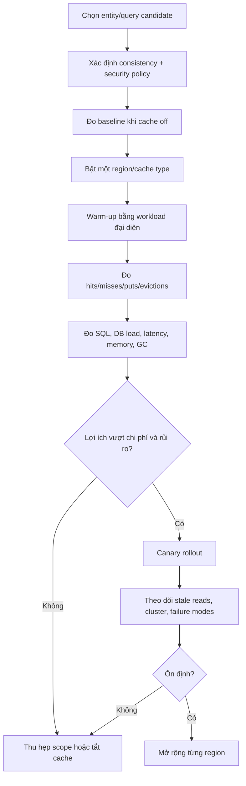

# Đo hiệu quả bộ nhớ đệm trước khi bật rộng

Bật cache trong Hibernate có thể làm một số thao tác đọc nhanh hơn, nhưng **cache được bật không đồng nghĩa ứng dụng đã nhanh hơn**. Một region có hit ratio 95% vẫn có thể lãng phí RAM, tăng GC, tạo chi phí đồng bộ giữa các node hoặc trả dữ liệu cũ. Ngược lại, hit ratio 40% vẫn có thể đáng dùng nếu những lần hit loại bỏ truy vấn database rất đắt.

Trước khi bật cache cho toàn bộ entity hoặc query, cần đo bằng workload đại diện:

- Cache hit có thực sự tránh được database round trip không?
- p50, p95, p99 latency và throughput thay đổi ra sao?
- Từng region có bao nhiêu hit, miss, put, eviction và expiration?
- Heap, off-heap, allocation rate và GC pause tăng bao nhiêu?
- Write frequency và invalidation có khiến cache liên tục bị xóa?
- Các application nodes có nhìn thấy thay đổi đúng consistency policy không?
- Tenant hoặc user có thể nhìn thấy dữ liệu của nhau qua cache không?
- Chi phí cache lookup, serialization và network có lớn hơn lợi ích không?
- Khi cache cold, node restart hoặc provider mất kết nối, ứng dụng có tiếp tục an toàn không?

**Cách làm đáng tin cậy là đo baseline khi cache tắt, bật một cache region có phạm vi nhỏ, chạy cùng workload và so sánh kết quả.** Bài này tập trung vào Hibernate second-level cache và query cache, đồng thời phân biệt chúng với first-level cache của persistence context và cache ở database.

## 1. Bốn lớp cache thường bị nhầm lẫn

Một ứng dụng Hibernate có thể sử dụng nhiều lớp cache:

| Lớp | Phạm vi | Lưu gì? | Tránh được gì? |
|---|---|---|---|
| First-level cache (L1) | Một Session/EntityManager | Entity instances và persistence context state | Load lại cùng identity trong context |
| Second-level cache (L2) | Dùng chung qua SessionFactory | Entity, collection và natural-id state | Một số SELECT và hydration từ DB |
| Query cache | Dùng chung theo query regions | Kết quả query, thường là IDs/scalar values cùng metadata | Thực thi lại một số SELECT |
| Database/OS buffer cache | Phía database/OS | Data và index pages | Một phần physical disk I/O |

```text
Application request
       |
       v
EntityManager / Hibernate Session
       |
       +--> L1 persistence context
       |      (identity map, luôn hiện diện)
       |
       +--> Query cache (nếu query được cache)
       |      |
       |      +--> query result keys/values
       |      +--> timestamp/invalidation metadata
       |
       +--> L2 cache
       |      |
       |      +--> entity regions
       |      +--> collection regions
       |      +--> natural-id regions
       |
       v
JDBC / Database
       |
       +--> database buffer cache
       +--> storage
```

Một query có thể không phát SQL vì L1 đã có entity, vì query cache trả kết quả, hoặc vì L2 có entity state. Những trường hợp đó có ý nghĩa khác nhau khi đo.

**Không kết luận L2 cache có hiệu quả chỉ từ một test chạy nhiều lần trên cùng EntityManager.** Lần thứ hai có thể chỉ là L1 hit, trong khi L2 không được sử dụng.

## 2. First-level cache là baseline phải kiểm soát

Hibernate Session/EntityManager luôn có persistence context:

```java
PurchaseOrder first =
    entityManager.find(PurchaseOrder.class, 10L);

PurchaseOrder second =
    entityManager.find(PurchaseOrder.class, 10L);

assert first == second;
```

Trong cùng persistence context, Hibernate thường trả lại cùng managed instance cho cùng entity identity. Lần `find` thứ hai có thể không cần SELECT, ngay cả khi L2 cache đã tắt.

Để đo L2, tạo **Session/EntityManager mới** cho mỗi lượt đọc hoặc clear persistence context:

```java
entityManager.clear();

PurchaseOrder order =
    entityManager.find(PurchaseOrder.class, 10L);
```

`clear()` xóa L1 managed state, nhưng **không xóa L2 cache**. Đây là điểm hữu ích để kiểm tra liệu L2 có phục vụ request tiếp theo hay không.

### Vì sao không chỉ gọi find hai lần?

Nếu cả hai lần nằm trong cùng transaction và cùng EntityManager, bạn đang đo identity map của L1. Một benchmark như vậy không chứng minh L2 có giá trị giữa các requests độc lập.

## 3. Second-level cache là gì?

L2 cache giữ state của entities/collections đã được cấu hình cho cache, với phạm vi rộng hơn một Session. Những Session khác nhau có thể tái sử dụng state đó.

```text
Session A:
  find Customer#42
    -> L2 miss
    -> SELECT database
    -> put Customer#42 into L2

Session B:
  find Customer#42
    -> L1 miss
    -> L2 hit
    -> không cần SELECT entity
```

L2 cache có thể đặt trong heap, off-heap hoặc remote/distributed cache tùy provider. Hibernate định nghĩa integration contracts và cache regions; provider chịu trách nhiệm lưu trữ, eviction, expiry, clustering và một số consistency semantics.

L2 cache **không phải bản sao database đầy đủ tự động**. Chỉ entity/collection được cấu hình phù hợp mới tham gia, và mapping/cache strategy phải tương thích workload.

## 4. Query cache khác L2 entity cache

Query cache lưu kết quả của một query được đánh dấu cacheable. Với entity queries, kết quả thường chứa identifiers và các thông tin cần thiết; Hibernate vẫn cần entity state từ L1/L2 hoặc database để materialize entity objects.

```text
Query cache hit:
  Query "orders by status=PAID"
       |
       v
  Cached result IDs: [10, 11, 15, 18]
       |
       +--> L2 has entities -> reuse entity state
       |
       +--> L2 misses -> fetch missing entity state from DB
```

Do đó, **query-cache hit không nhất thiết đồng nghĩa không có database access**. Nếu entity state không có trong L2, Hibernate có thể cần SELECT để load chúng.

Query cache còn theo dõi query spaces/tables liên quan để invalidation khi dữ liệu thay đổi. Query có kết quả biến động liên tục có thể bị invalidation thường xuyên và ít mang lại lợi ích.

## 5. Cache ở database không phải Hibernate L2 cache

Database thường có buffer cache riêng. Một query có thể vẫn gửi SQL qua JDBC nhưng database đọc page từ memory thay vì storage.

| Tình huống | Hibernate gửi SQL? | DB thực thi query? | Có thể tránh disk I/O? |
|---|---:|---:|---:|
| L1 hit | Thường không | Không | Không liên quan |
| L2 entity hit | Có thể không cần SELECT entity | Có thể không | Có thể tránh DB round trip |
| Query cache hit + L2 entity hit | Có thể không cần SELECT chính | Có thể không | Có thể tránh DB work |
| Query cache hit + L2 miss | Có thể có SELECT entity | Có | Có thể dùng DB buffer cache |
| Không có ORM cache nhưng DB buffer warm | Có | Có | Có thể tránh physical disk I/O |

Nếu chỉ đo database CPU hoặc physical reads, bạn có thể bỏ sót lợi ích L2 là giảm JDBC round trips và Hibernate hydration. Ngược lại, nếu chỉ đo ORM cache hit ratio, bạn có thể bỏ qua DB buffer cache vốn đã khiến SELECT rất rẻ.

## 6. Chọn dữ liệu đáng cân nhắc cache

Cache thường có ích với dữ liệu:

- Đọc nhiều hơn ghi.
- Được nhiều requests truy cập lặp lại.
- Có kích thước và cardinality kiểm soát được.
- Có thể chấp nhận consistency semantics của cache strategy.
- Có invalidation rõ ràng khi thay đổi.
- Không chứa dữ liệu nhạy cảm hoặc có isolation phức tạp.
- Có chi phí database load đáng kể khi đọc.

| Dữ liệu | Mức độ phù hợp ban đầu | Vì sao |
|---|---|---|
| Danh mục quốc gia/tỉnh thành ít đổi | Cao | Read-heavy, ít invalidation |
| Product category/reference data | Có thể cao | Nhiều requests đọc cùng IDs |
| Cấu hình tenant ít thay đổi | Có thể cao | Repeated lookups, cần tenant isolation |
| User profile thay đổi thường xuyên | Cần đo | Invalidation và privacy phức tạp |
| Shopping cart cập nhật liên tục | Thường thấp cho L2 mặc định | Write-heavy, consistency quan trọng |
| Inventory/stock real-time | Thận trọng | Stale value có thể gây lỗi nghiệp vụ |
| Audit history lớn | Phụ thuộc query | Retention và access control phức tạp |
| Random one-time records | Thường thấp | Ít tái sử dụng, chiếm dung lượng |

Đây là giả thuyết ban đầu. Quyết định cuối cùng phải dựa trên hit/miss, latency, memory, update rate và consistency requirements.

## 7. Cấu hình entity tham gia L2 cache

Hibernate cần được cấu hình second-level cache và entity phải được đánh dấu/cache mapping phù hợp.

Ví dụ Hibernate annotation:

```java
import jakarta.persistence.*;
import org.hibernate.annotations.Cache;
import org.hibernate.annotations.CacheConcurrencyStrategy;

@Entity
@Table(name = "product_categories")
@Cache(
    usage = CacheConcurrencyStrategy.READ_ONLY,
    region = "reference.product-category"
)
public class ProductCategory {

    @Id
    private Long id;

    @Column(nullable = false)
    private String name;

    protected ProductCategory() {}
}
```

`READ_ONLY` phù hợp khi dữ liệu gần như immutable trong suốt vòng đời cache. Nếu ứng dụng cần update entity này, hãy chọn strategy khác hoặc bỏ cache.

Có thể kết hợp JPA `@Cacheable` theo cấu hình shared cache mode, nhưng annotation Hibernate `@Cache` thường được dùng để chọn concurrency strategy và region cụ thể. Không nhầm `jakarta.persistence.Cacheable` với `org.hibernate.annotations.Cache`.

### Cấu hình L2 ở cấp SessionFactory

Một property phổ biến:

```properties
hibernate.cache.use_second_level_cache=true
```

Cần thêm cache region factory/provider phù hợp. Hibernate ORM core không tự động cung cấp một distributed cache production-ready; provider integration và dependency tương thích version phải được cài đặt riêng.

## 8. Cấu hình cache provider

Hibernate dùng `RegionFactory` để tích hợp với cache provider. Những lựa chọn trong hệ sinh thái có thể gồm JCache integration, Infinispan hoặc provider phù hợp version.

Ví dụ cấu hình khái niệm:

```properties
hibernate.cache.use_second_level_cache=true
hibernate.cache.region.factory_class=<provider-region-factory-class>
```

Tên class cụ thể phụ thuộc Hibernate version và provider artifact. Ví dụ JCache integration ở một số dòng Hibernate sử dụng class tương tự `org.hibernate.cache.jcache.internal.JCacheRegionFactory`; cần kiểm tra đúng module/version và provider thực tế.

Đối với Spring Boot:

```properties
spring.jpa.properties.hibernate.cache.use_second_level_cache=true
spring.jpa.properties.hibernate.cache.region.factory_class=<provider-class>
```

Không copy provider class name từ tài liệu Hibernate 5 vào ứng dụng Hibernate 6/7 mà chưa xác nhận compatibility. Kiểm tra startup logs để chắc Hibernate thực sự khởi tạo đúng RegionFactory và regions.

## 9. Bật Hibernate Statistics để đo

Để thu thập số liệu ORM:

```properties
hibernate.generate_statistics=true
```

Trong Spring Boot:

```properties
spring.jpa.properties.hibernate.generate_statistics=true
```

Lấy Statistics:

```java
import org.hibernate.SessionFactory;
import org.hibernate.stat.Statistics;

SessionFactory sessionFactory =
    entityManagerFactory.unwrap(SessionFactory.class);

Statistics statistics =
    sessionFactory.getStatistics();

statistics.setStatisticsEnabled(true);
```

Nếu config đã bật lúc bootstrap, không nhất thiết gọi `setStatisticsEnabled(true)` lại. API và khả năng bật/tắt runtime cần kiểm tra theo Hibernate version.

Statistics thường là **counters tổng hợp ở phạm vi SessionFactory**, không mặc nhiên phân tách theo một request. Nếu nhiều requests chạy đồng thời, chênh lệch counters trong khoảng đo có thể chứa hoạt động của requests khác.

## 10. Các counters quan trọng của L2 cache

Những counters thường được quan sát:

```java
long hits = statistics.getSecondLevelCacheHitCount();
long misses = statistics.getSecondLevelCacheMissCount();
long puts = statistics.getSecondLevelCachePutCount();
```

Ý nghĩa:

- **Hit:** ORM tìm được entry trong second-level cache theo thao tác được thống kê.
- **Miss:** lookup không tìm được entry phù hợp.
- **Put:** state được đưa vào L2 theo cơ chế cache.

Hit/miss/put là counters hữu ích, nhưng semantics chi tiết có thể khác theo loại cache access, provider và Hibernate version. Đọc Javadocs đúng phiên bản khi so sánh số liệu giữa môi trường.

### Hit ratio cơ bản

\[
\text{Hit Ratio} =
\frac{\text{Hits}}{\text{Hits}+\text{Misses}}
\times 100\%
\]

Ví dụ Hits = 8.000, Misses = 2.000 thì hit ratio = 80%. Không tính ratio nếu mẫu số bằng 0. Không gộp query cache hits vào L2 entity hits rồi gọi chung là “L2 hit ratio”.

### Vì sao hit ratio không đủ?

- Một hit có thể phục vụ lookup vốn đã rẻ.
- Một miss có thể dẫn tới query rất đắt.
- Query-cache hit có thể vẫn cần SELECT entity state.
- Hit ratio cao có thể đi cùng eviction/invalidation lớn.
- Một region nóng có thể che lấp region lạnh.
- Global ratio không cho biết region nào nên bật.

## 11. Đo query-cache counters riêng

Hibernate Statistics thường có các counters:

```java
long queryHits = statistics.getQueryCacheHitCount();
long queryMisses = statistics.getQueryCacheMissCount();
long queryPuts = statistics.getQueryCachePutCount();
```

Đây là số liệu **query cache**, tách với L2 entity/collection cache.

Một query cache hit chỉ cho biết kết quả query cache được sử dụng theo semantics provider. Nếu kết quả chứa entity identifiers và L2 thiếu một số entities, database vẫn có thể được truy vấn để materialize state.

Theo dõi cả query cache hits/misses/puts, L2 hits/misses/puts, JDBC statement count, database query count, entity load/fetch count và latency. Nếu query cache hit tăng nhưng database SELECT count gần như không giảm, có thể entity state vẫn phải load hoặc query cache không phải bottleneck chính.

## 12. Statistics theo region

L2 cache được chia thành regions:

```text
reference.product-category
reference.country
entity.Customer
entity.PurchaseOrder
collection.PurchaseOrder.lines
natural-id.Customer
```

Hibernate Statistics API ở các versions hiện đại có thể cung cấp thông tin region-specific, ví dụ qua API như `getDomainDataRegionStatistics(regionName)` hoặc các statistics interfaces tương ứng.

Ví dụ minh họa:

```java
var regionStats =
    statistics.getDomainDataRegionStatistics(
        "reference.product-category"
    );

long regionHits = regionStats.getHitCount();
long regionMisses = regionStats.getMissCount();
long regionPuts = regionStats.getPutCount();
```

Tên method, region API và metric availability phụ thuộc Hibernate major/minor version. Một số providers còn cung cấp metrics riêng về size, eviction, expiry, off-heap và network operations.

### Vì sao region-level quan trọng?

| Region | Hits | Misses | Hit ratio |
|---|---:|---:|---:|
| ProductCategory | 90.000 | 10.000 | 90% |
| CustomerProfile | 2.000 | 18.000 | 10% |
| PurchaseOrder | 15.000 | 5.000 | 75% |

Global ratio có thể nhìn khá tốt, nhưng CustomerProfile đang miss nhiều. Có thể region này không đáng cache, hoặc cần điều chỉnh capacity/TTL/invalidation.

Không bật cache rộng chỉ vì global hit ratio đạt một ngưỡng đẹp.

## 13. Thu thập metrics từ cache provider

Hibernate Statistics không nhất thiết cung cấp mọi metric cần thiết. Cache provider có thể đo:

- Entries hiện có.
- Heap/off-heap/disk usage.
- Evictions.
- Expirations.
- Load time và load failures.
- Put/update/remove latency.
- Serialization/deserialization time.
- Network traffic.
- Cluster replication/invalidation delay.
- Lock contention.
- Queue/backlog trong distributed cache.

| Nhóm | Metric | Câu hỏi |
|---|---|---|
| Utilization | Entries/size | Cache có vừa RAM không? |
| Effectiveness | Hit/miss | Có tái sử dụng dữ liệu không? |
| Churn | Put/eviction/expiry | Có liên tục thay entry không? |
| Latency | Get/put time | Cache nhanh hơn DB không? |
| Reliability | Errors/timeouts | Provider có gây request failures? |
| Cluster | Replication/invalidation delay | Node khác có thấy thay đổi kịp? |
| JVM | Heap, allocation, GC pause | Cache có gây memory pressure? |

Tên metric và API cụ thể phụ thuộc provider. Kết nối provider metrics vào monitoring theo region và instance để có thể tìm ra vùng nào tạo chi phí.

## 14. Lấy snapshot counters trước và sau workload

Ví dụ test đo counters:

```java
record CacheSnapshot(
    long l2Hits,
    long l2Misses,
    long l2Puts,
    long queryHits,
    long queryMisses,
    long statements,
    long entityLoads
) {}

static CacheSnapshot snapshot(Statistics s) {
    return new CacheSnapshot(
        s.getSecondLevelCacheHitCount(),
        s.getSecondLevelCacheMissCount(),
        s.getSecondLevelCachePutCount(),
        s.getQueryCacheHitCount(),
        s.getQueryCacheMissCount(),
        s.getPrepareStatementCount(),
        s.getEntityLoadCount()
    );
}
```

Đo chênh lệch:

```java
Statistics stats = sessionFactory.getStatistics();

CacheSnapshot before = snapshot(stats);

runRepresentativeWorkload();

CacheSnapshot after = snapshot(stats);

long l2HitsDelta = after.l2Hits() - before.l2Hits();
long l2MissesDelta = after.l2Misses() - before.l2Misses();
long statementsDelta =
    after.statements() - before.statements();
```

Đây là ví dụ dùng records/Statistics APIs có thể cần điều chỉnh theo Java/Hibernate version.

**Không gọi `statistics.clear()` giữa traffic production** chỉ để lấy counters cho một request. Statistics là aggregate; reset có thể làm mất dữ liệu giám sát của requests khác. Trong benchmark cô lập, reset trước mỗi run có thể phù hợp.

## 15. Vì sao cần đo SQL count cùng cache hits?

Một test có 10.000 L2 hits và 1.000 misses trông rất tốt. Nhưng nếu query vẫn phát 2.000 statements, cache có thể chỉ giúp một số entity lookups, trong khi queries khác vẫn chạy.

Đo cùng lúc:

- `prepareStatementCount` delta.
- Database-side statement count hoặc query logs.
- Query execution count.
- Entity loads/fetches.
- Latency theo query shape.
- End-to-end request latency.

Ví dụ số liệu giả định:

| Trường hợp | L2 hits | JDBC statements | p95 latency |
|---|---:|---:|---:|
| Không L2 | 0 | 1.200 | 480 ms |
| Có L2 | 9.000 | 250 | 180 ms |

Đây là kết quả minh họa, không phải benchmark thực tế. Nó cho thấy cache hit đi cùng giảm statements và latency, nhưng vẫn phải xác nhận workload, concurrency và data freshness.

Nếu hit tăng mà statements/latency không đổi, cần xem cache hit thuộc region nào, query nào và chi phí thực tế đã được tránh chưa.

## 16. Đo cold cache và warm cache riêng

Cache có hai trạng thái vận hành:

- **Cold:** node mới khởi động, cache trống hoặc phần lớn entries chưa được load.
- **Warm:** workload đã truy cập dữ liệu đủ để cache chứa working set.

Benchmark chỉ chạy warm cache có thể che giấu chi phí cold-start. Benchmark chỉ chạy cold cache không cho thấy lợi ích steady-state.

```text
Run A: cold cache
  -> clear isolated test cache / restart test provider
  -> execute workload
  -> record misses, puts, latency, DB load

Run B: warm cache
  -> run warm-up workload
  -> execute same workload again
  -> record hits, statements, latency, memory

Run C: steady-state mixed workload
  -> reads + writes + concurrency
  -> observe invalidations, evictions, tail latency
```

Không clear cache trên production để dựng cold run. Dùng environment/cluster thử nghiệm riêng hoặc test dataset cô lập.

## 17. Kiểm soát L1 trong benchmark

Mỗi lượt benchmark L2 nên mở persistence context mới:

```java
PurchaseOrder loadInFreshSession(Long id) {
    try (Session session = sessionFactory.openSession()) {
        Transaction tx = session.beginTransaction();

        try {
            PurchaseOrder order =
                session.find(PurchaseOrder.class, id);

            tx.commit();
            return order;
        } catch (RuntimeException e) {
            tx.rollback();
            throw e;
        }
    }
}
```

Đây là pseudocode minh họa vòng đời; trả entity ra ngoài session có thể khiến lazy associations không còn dùng được. Benchmark nên đọc scalar/DTO hoặc lấy metrics bên trong session thay vì serialize detached graph.

Với mỗi lượt đọc:

- Session mới để tránh L1 hit.
- L2 vẫn được giữ để đo reuse giữa sessions.
- Không vô tình query cache nếu mục tiêu đang đo entity L2 riêng.
- Ghi nhận DB statements và region counters.
- Đảm bảo transaction/connection setup giống production.

## 18. Bật query cache riêng

L2 entity cache và query cache là hai tính năng khác nhau. Một property phổ biến:

```properties
hibernate.cache.use_query_cache=true
```

Sau đó query phải được đánh dấu cacheable.

Ví dụ Hibernate Query API:

```java
List<PurchaseOrder> orders = session
    .createSelectionQuery(
        "from PurchaseOrder o where o.status = :status",
        PurchaseOrder.class
    )
    .setParameter("status", OrderStatus.PAID)
    .setCacheable(true)
    .setCacheRegion("query.orders-by-status")
    .getResultList();
```

`createSelectionQuery` phù hợp một số Hibernate 6 versions; version khác có thể dùng `createQuery`. JPA query cũng có thể dùng Hibernate-specific hint:

```java
query.setHint("org.hibernate.cacheable", true);
```

Tên hint và overload cần kiểm tra theo version. Chỉ bật global query cache chưa có nghĩa mọi query tự động cache; query phải được cấu hình cacheable.

## 19. Đo query cache độc lập với entity L2 cache

Nếu mục tiêu là xem query cache có tránh SQL hay không, thiết kế test phân biệt:

1. Tắt L2 entity cache hoặc dùng entity type không cache để cô lập query-cache behavior nếu phù hợp.
2. Bật query cache.
3. Chạy query lần đầu để tạo result cache.
4. Chạy lại query trong Session mới.
5. Quan sát query cache hit/miss và database statement count.
6. Lặp lại với entity state đã/không có trong L2.
7. Cập nhật một query space liên quan và kiểm tra invalidation.

Query cache có thể hit nhưng entity loads vẫn xảy ra nếu L2 không có entity state. Đừng gộp các counters rồi tuyên bố query cache đã loại bỏ database access.

## 20. Query cache không phù hợp với mọi truy vấn

Ứng viên tốt thường là query:

- Được gọi lặp lại với cùng parameters.
- Kết quả thay đổi tương đối ít.
- Query spaces ít bị update.
- Result set nhỏ, có giới hạn.
- Có chi phí DB đủ lớn để đáng cache.
- Có invalidation semantics dễ hiểu.

Ứng viên kém thường là:

- Query có timestamp hiện tại hoặc random parameters.
- Query trả hàng trăm nghìn IDs.
- Query bị update liên tục.
- Query chỉ gọi một lần.
- Query có parameter cardinality rất cao.
- Query phụ thuộc user permissions nhưng cache key/security context không được thiết kế phù hợp.

Một query có hit ratio cao nhưng cache result khổng lồ vẫn có thể tốn nhiều memory và serialization time.

## 21. Query cache invalidation và timestamp region

Envers/ORM query cache cần biết query spaces/tables đã thay đổi để không trả kết quả cũ. Hibernate sử dụng metadata timestamps/invalidation region cho cơ chế query cache.

Khi bảng liên quan được ghi, query result cache entries có thể bị coi là stale/invalidate. Nếu một bảng thay đổi liên tục, query cache cho những queries phụ thuộc bảng đó có thể bị vô hiệu hóa thường xuyên.

Cần đo:

- Query cache puts/hits/misses.
- Invalidations/evictions từ provider nếu quan sát được.
- Write rate của query spaces.
- Tỷ lệ entry sống đủ lâu để được hit lại.
- Chi phí update timestamp/invalidation metadata.
- Cluster replication/invalidation latency.

Không chỉ nhìn hit ratio; cần hiểu **cache entry tồn tại bao lâu trước khi bị invalidated**.

## 22. Cache concurrency strategies

Hibernate hỗ trợ các concurrency strategies phổ biến qua `CacheConcurrencyStrategy`:

| Strategy | Ý tưởng | Khi phù hợp |
|---|---|---|
| `READ_ONLY` | Dữ liệu immutable/không update qua ORM | Reference data ít hoặc không đổi |
| `READ_WRITE` | Đồng bộ updates với cache qua cơ chế khóa/soft-lock phù hợp provider | Mutable data cần consistency mạnh hơn |
| `NONSTRICT_READ_WRITE` | Cho phép một khoảng thời gian stale ngắn | Dữ liệu chấp nhận stale theo policy |
| `TRANSACTIONAL` | Cache transactional với provider/hạ tầng phù hợp | Cần semantics transaction mạnh và provider hỗ trợ |

Đây không phải lựa chọn hiệu năng đơn thuần. Strategy ảnh hưởng correctness, invalidation và khả năng đồng bộ nhiều nodes. Chi tiết guarantees phụ thuộc Hibernate version, cache provider và transaction integration.

### Không chọn NONSTRICT chỉ vì nó nhanh hơn

Nếu giá trị là tồn kho, hạn mức tín dụng hoặc trạng thái thanh toán, stale data có thể gây hậu quả nghiệp vụ. Cache không nên làm suy yếu consistency contract mà business yêu cầu.

## 23. READ_ONLY cho reference data

Ví dụ:

```java
@Entity
@Cache(
    usage = CacheConcurrencyStrategy.READ_ONLY,
    region = "reference.country"
)
public class Country {
    @Id
    private String code;

    private String displayName;
}
```

Nếu danh mục quốc gia chỉ được cập nhật qua deployment/migration có kiểm soát, READ_ONLY có thể hợp lý.

Nếu application vẫn cho phép đổi `displayName`, strategy này có thể khiến update behavior không phù hợp hoặc lỗi theo contract provider. Không dùng READ_ONLY chỉ vì “ít khi đổi”; cần xác định ai được phép ghi và quy trình invalidation.

## 24. READ_WRITE cho dữ liệu mutable

Ví dụ:

```java
@Entity
@Cache(
    usage = CacheConcurrencyStrategy.READ_WRITE,
    region = "entity.customer-profile"
)
public class CustomerProfile {
    @Id
    private Long id;

    private String displayName;

    @Version
    private long version;
}
```

READ_WRITE thường phù hợp hơn khi entity được cập nhật qua Hibernate và cần mức consistency phù hợp cache provider. Nhưng nó vẫn có chi phí lock/soft-lock, cache coordination và invalidation.

Phải test:

- Hai transactions update cùng entity.
- Đọc đồng thời khi update đang commit.
- Rollback sau khi cache entry đã được đánh dấu.
- Nhiều application nodes.
- External SQL update ngoài Hibernate.
- Provider restart/network partition.

Không coi READ_WRITE là distributed serializable database. Hãy đọc guarantees cụ thể của provider.

## 25. NONSTRICT_READ_WRITE và stale window

NONSTRICT_READ_WRITE có thể phù hợp dữ liệu mà một khoảng stale nhỏ được chấp nhận, chẳng hạn nội dung giới thiệu hoặc thông tin hiển thị không ảnh hưởng quyết định giao dịch quan trọng.

Viết rõ policy:

- Tối đa stale bao lâu?
- Invalidation xảy ra lúc nào?
- Có cross-node replication không?
- Read-after-write có cần thấy giá trị mới ngay?
- Nếu cache provider lỗi, fallback database có an toàn không?

Nếu không trả lời được, chưa nên bật strategy cho dữ liệu mutable.

## 26. Cache collection khác cache entity

Một entity có thể có collection:

```java
@OneToMany(mappedBy = "order")
private Set<OrderLine> lines;
```

Collection cache có thể lưu membership/state của collection riêng:

```java
@Cache(
    usage = CacheConcurrencyStrategy.READ_WRITE,
    region = "collection.order-lines"
)
@OneToMany(mappedBy = "order")
private Set<OrderLine> lines;
```

Collection cache thường lưu thông tin về các phần tử liên quan; entity state của từng OrderLine có thể cần entity L2 cache riêng nếu muốn tránh loads.

Đo riêng collection region hits/misses, child entity region hits/misses, SELECT để load collection, SELECT để load child states, kích thước entries và invalidation khi thêm/xóa line.

Một collection có hàng nghìn members và thay đổi thường xuyên có thể không đáng cache dù parent entity rất hot.

## 27. Natural-id cache

Nếu lookup entity bằng business key ổn định:

```java
@Entity
@NaturalIdCache
public class Currency {

    @Id
    private Long id;

    @NaturalId
    @Column(unique = true)
    private String code;
}
```

Hibernate có thể cache mapping từ natural ID sang entity identifier thông qua natural-id cache theo cấu hình/version phù hợp.

Ví dụ:

```java
Currency currency = session
    .byNaturalId(Currency.class)
    .using("code", "USD")
    .load();
```

Natural-id cache hữu ích khi key lookup lặp lại và key ít đổi. Đo region metrics riêng; đừng giả định entity cache hit ratio phản ánh natural-id lookup performance.

## 28. Chọn region names để quan sát và vận hành

Có thể tách regions theo domain/usage:

```java
@Cache(
    usage = CacheConcurrencyStrategy.READ_ONLY,
    region = "reference.product-category"
)
```

```java
@Cache(
    usage = CacheConcurrencyStrategy.READ_WRITE,
    region = "entity.customer-profile"
)
```

```java
@Cache(
    usage = CacheConcurrencyStrategy.READ_WRITE,
    region = "collection.purchase-order-lines"
)
```

Region names rõ giúp đo hit/miss theo loại dữ liệu, đặt capacity/TTL khác nhau nếu provider hỗ trợ, evict một vùng cụ thể, giới hạn blast radius và tách dashboards.

Không tạo hàng nghìn regions chỉ vì mỗi tenant có một ID riêng nếu provider không được thiết kế cho cardinality đó.

## 29. Cache size và eviction

Hit ratio thấp có thể do:

- Capacity quá nhỏ so với working set.
- TTL quá ngắn.
- Entry quá lớn.
- Nhiều keys không được truy cập lại.
- Write/invalidation rate cao.
- Workload phân phối theo long tail.
- Nhiều regions tranh cùng memory pool.

Metrics cần có: current entries, configured max entries, heap/off-heap bytes, eviction count/rate, expiration count, average entry size nếu provider hỗ trợ, load/put latency, memory pressure và GC pauses.

### Tăng capacity không phải luôn tốt

Tăng cache từ 1 GB lên 8 GB có thể tăng hit ratio nhưng heap GC pause cũng tăng, làm p99 xấu hơn. Nếu provider dùng off-heap, serialization/deserialization và allocation vẫn có chi phí.

Hãy đo latency, memory và GC cùng lúc.

## 30. Đo hit ratio theo thời gian

Một hit ratio tổng 90% sau 24 giờ có thể che giấu 20% hit trong giờ peak, cache cold sau deploy, eviction tăng sau batch import hoặc một region nóng làm đẹp số liệu.

Ví dụ time windows:

```text
Time window   Hits   Misses   Evictions   p95
10:00-10:05    900      100        2       35ms
10:05-10:10    500      500      250       90ms
10:10-10:15    850      150       20       40ms
```

Các con số chỉ minh họa. Dùng delta counters theo cửa sổ thời gian thay vì chỉ cumulative counters từ lúc JVM khởi động.

## 31. So sánh baseline và cache-enabled

Một thí nghiệm tối thiểu có hai cấu hình:

**A — Baseline:** L2/query cache tắt, cùng DB và schema.

**B — Candidate:** bật đúng một loại cache/region cần thử, với provider và capacity dự kiến production.

Giữ nguyên:

- Database version và data volume.
- Hibernate version, Dialect, JDBC driver.
- SQL/mapping/query shape.
- Connection pool size.
- Request mix và concurrency.
- Bind parameters/selectivity.
- JVM heap/CPU.
- DB statistics/indexes.
- Transaction isolation và read/write ratios.

Không thay cùng lúc cache, index, fetch plan và query logic. Nếu thay nhiều yếu tố, không xác định được cache đóng góp bao nhiêu.

## 32. Workload phải giống thực tế

Giả sử production có 70% reads, 20% updates, 10% inserts/deletes; 60% traffic tập trung vào 5% entity IDs, còn lại phân bố dài.

Một benchmark chỉ lặp lại cùng một ID 10.000 lần sẽ làm cache trông rất tốt nhưng không đại diện workload.

Tạo workload gồm:

1. Hot keys được truy cập lặp.
2. Cold/long-tail keys.
3. Read-after-write.
4. Concurrent reads và writes cùng entity.
5. Bulk update/import nếu hệ thống có.
6. Tenant nhỏ và tenant lớn.
7. Query parameters phổ biến và hiếm.
8. Cache warm-up sau deploy.
9. Node restart/cache provider reconnect.

**Phân phối truy cập quan trọng ngang tổng số requests.**

## 33. Cold-start và warm-up sau deployment

Cache trống sau restart có thể tạo database load tăng đột biến:

```text
Deploy/restart
   |
Cache cold
   |
Many requests miss
   |
DB load spike
   |
Entries warm gradually
   |
Hit ratio stabilizes
```

Các lựa chọn:

- Chấp nhận warm-up tự nhiên nếu DB đủ capacity.
- Preload một tập reference data có giới hạn.
- Stagger application nodes khi rollout.
- Dùng cache provider persistence nếu phù hợp.
- Giới hạn concurrency trong giai đoạn warm-up.
- Theo dõi miss rate và DB load sau deploy.

Không preload toàn bộ database nếu working set nhỏ hoặc dataset quá lớn. Warm-up cũng phải tuân thủ tenant/security boundaries.

## 34. Đo latency ở nhiều tầng

Một request có thể tốn:

```text
HTTP/request handling
  + service/domain logic
  + EntityManager/Session work
  + JDBC connection acquisition
  + DB execution
  + row transfer
  + Hibernate hydration
  + mapping/serialization
  + network response
```

L2 cache có thể giảm DB round trips và hydration, nhưng cache provider network latency có thể thêm chi phí ở tầng ORM.

| Metric | Vì sao cần |
|---|---|
| p50 latency | Trải nghiệm điển hình |
| p95/p99 latency | Tail latency khi contention/eviction |
| Throughput | Requests/transactions mỗi giây |
| DB statements/request | Cache có giảm SQL không? |
| DB CPU/IO | Có giảm tải database không? |
| Cache get/put latency | Cache layer có nhanh không? |
| Hit/miss/eviction | Reuse và churn |
| JVM heap/off-heap | Chi phí bộ nhớ |
| GC pause/allocation | Tác động lên application latency |
| Error/timeout rate | Reliability |

Một cache có thể giảm mean latency nhưng tăng p99 do remote cache timeouts. Không chỉ xem average.

## 35. Ví dụ benchmark bằng workload thực tế

JMH phù hợp microbenchmarks có kiểm soát cho một phần logic, nhưng database/cache integration thường cần môi trường gần production hơn. Với request path, dùng integration/load test tool phù hợp.

Pseudo-workload:

```java
for (int i = 0; i < iterations; i++) {
    Long id = keyDistribution.nextId();

    try (Session session = sessionFactory.openSession()) {
        Transaction tx = session.beginTransaction();

        ProductCategory category =
            session.find(ProductCategory.class, id);

        consume(category.getName());

        tx.commit();
    }
}
```

`keyDistribution` và `consume` là helpers của benchmark. Không tạo transaction/session cho từng item nếu production xử lý một transaction nhiều operations; mô phỏng đúng transaction boundary của workload thật.

Benchmark cần tiêu thụ kết quả một cách có ý nghĩa, không thêm logic nặng khác vào critical section.

## 36. So sánh số liệu minh họa

Giả sử test cùng workload 10 phút:

| Metric | L2 off | L2 on | Thay đổi |
|---|---:|---:|---:|
| Requests/sec | 1.000 | 1.250 | +25% |
| p50 | 42 ms | 31 ms | -26% |
| p95 | 140 ms | 88 ms | -37% |
| DB SELECT/sec | 8.000 | 3.100 | -61% |
| L2 hit ratio | — | 82% | — |
| Heap used | 2,1 GB | 2,8 GB | +0,7 GB |
| GC pause p99 | 12 ms | 16 ms | +4 ms |
| Evictions/min | — | 120 | Cần điều tra |

Đây là **số liệu giả định để minh họa**, không phải benchmark thực tế.

Kết luận hợp lý chưa phải “bật toàn bộ”. Cần hỏi:

- Throughput và p95 cải thiện có đạt mục tiêu không?
- Heap còn đủ headroom không?
- GC tăng có ảnh hưởng p99 không?
- Eviction rate có ổn định hay tăng theo traffic?
- Region nào chiếm phần lớn memory nhưng ít hits?
- Update workload có bị chậm đi không?
- Cross-node consistency đã được kiểm thử chưa?

## 37. Hit ratio cao nhưng latency không giảm

Một số nguyên nhân:

1. Hit xảy ra ở entity nhỏ, SELECT gốc vốn rất nhanh.
2. Request vẫn chạy nhiều SQL khác.
3. Query cache hit nhưng L2 entity misses.
4. Cache provider là remote service và mỗi get chậm.
5. Entity hydration/DTO serialization vẫn là chi phí chính.
6. Database query đã được phục vụ từ buffer cache.
7. Connection pool hoặc thread pool là bottleneck.
8. Cache invalidation tạo lock/contention.
9. Hit ratio global che lấp region quan trọng.
10. Benchmark bị L1 hits làm sai attribution.

Đừng tăng cache capacity ngay. Trước tiên đo cost avoided per hit và xác định bottleneck thực tế.

## 38. Hit ratio thấp nhưng cache vẫn có thể đáng dùng

Ví dụ misses chiếm 90% nhưng mỗi miss là query đắt 300 ms; 10% hits tập trung vào endpoint có latency cao nhất; hoặc cache hit giảm connection pool contention và cải thiện p99.

Một metric thực dụng là **DB cost avoided**:

```text
Estimated DB time avoided
  ~= cache hits that avoided DB load
     × representative DB lookup cost
```

Đây chỉ là approximation. Không nhân hit count với một average query latency nếu hits đến từ nhiều query types/regions khác nhau. Cần đo theo query/region và xác nhận statement count thực tế.

## 39. Cache invalidation và write-heavy workloads

Một Product được update 100 lần/phút trong khi cache TTL là 30 phút có thể liên tục bị invalidated và put lại, ít khi được tái sử dụng lâu.

Metrics:

- Put rate.
- Remove/eviction/expiry rate.
- Update frequency.
- Read-after-write frequency.
- Cross-node invalidation latency.
- Cache lock/contention.
- DB statement count.
- Stale reads.

Một entity read-heavy toàn hệ thống nhưng write-heavy ở một tenant có thể có hiệu quả khác nhau theo tenant. Đánh giá theo workload partition phù hợp.

## 40. Multi-node cache và consistency

Với hai application nodes:

```text
Node A ---- Cache cluster ---- Node B
  |                              |
  +---- Database ----------------+
```

Một update ở Node A cần đảm bảo Node B không tiếp tục dùng entry stale vượt quá policy. Cơ chế có thể là invalidation, replication, transactional integration hoặc provider-specific protocol.

Kiểm thử:

1. Node A load entity và warm cache.
2. Node B update entity, commit.
3. Node A đọc lại trong Session mới.
4. Xác định Node A thấy giá trị mới trong bao lâu.
5. Lặp với rollback và provider network partition.
6. Restart một node rồi đọc lại.
7. Kiểm tra cache eviction khi node rời cluster.

Local in-memory cache trên từng JVM không tự đồng bộ với node khác. Nếu dùng local provider, hiểu cách Hibernate/provider xử lý invalidation cross-node hoặc chỉ bật cache cho immutable/reference data.

## 41. Transaction rollback và cache state

Một update có thể đi qua:

```text
Transaction:
  modify Product
  flush
  database UPDATE attempted
  cache entry may be locked/invalidated
  exception
  rollback
```

Cache concurrency strategy và provider phải xử lý transaction outcomes đúng contract. Không tự thao tác cache provider từ business code trước khi transaction commit rồi giả định rollback sẽ phục hồi mọi thứ.

Nếu dùng native SQL hoặc external writers, Hibernate có thể không biết cache entries cần invalidation. Có thể cần explicit eviction hoặc tránh L2 cache cho entities bị ghi ngoài ORM.

**Cache correctness phải được test với rollback, concurrent updates và out-of-band writes**, không chỉ happy-path commit.

## 42. Đo entity cache qua hai Sessions

Một test có thể:

1. Bật L2.
2. Clear Statistics trong test cô lập.
3. Mở Session A, load entity ID 10, commit/close.
4. Chụp L2 puts/misses.
5. Mở Session B mới, load cùng ID 10.
6. Chụp L2 hits và JDBC statement delta.
7. Xác minh kết quả state.
8. Tắt L2 và chạy lại baseline.

Ví dụ:

```java
Statistics stats = sessionFactory.getStatistics();
stats.clear();

try (Session first = sessionFactory.openSession()) {
    Transaction tx = first.beginTransaction();
    first.find(ProductCategory.class, 10L);
    tx.commit();
}

long missesAfterFirst =
    stats.getSecondLevelCacheMissCount();

long statementsAfterFirst =
    stats.getPrepareStatementCount();

try (Session second = sessionFactory.openSession()) {
    Transaction tx = second.beginTransaction();
    second.find(ProductCategory.class, 10L);
    tx.commit();
}

long hitsAfterSecond =
    stats.getSecondLevelCacheHitCount();

long statementsAfterSecond =
    stats.getPrepareStatementCount();
```

Đây là test outline. Một lần find đầu tiên có thể tạo L2 entry, nhưng cache put timing/provider behavior cần xác nhận sau transaction/commit. Nên ghi snapshot counters sau mỗi phase và kiểm tra DB statement logs để xác nhận phase hai không phát SELECT.

## 43. CacheMode và kiểm soát cache trong benchmark

Hibernate Session có cache modes như NORMAL, GET, PUT, REFRESH, IGNORE theo API/version. Chúng cho phép kiểm soát hành vi get/put trong một số workflows.

Ví dụ:

```java
session.setCacheMode(CacheMode.GET);
```

Có thể hữu ích cho:

- Đọc cache mà không đưa mọi record import vào cache.
- Warm cache có kiểm soát.
- Bỏ qua cache cho batch scan.
- Refresh dữ liệu sau thao tác đặc biệt.

Không dùng CacheMode để “sửa” consistency bug hoặc thay cho cache concurrency strategy. Xác nhận API và semantics trong Hibernate version của dự án.

## 44. Evict cache đúng phạm vi khi test

Hibernate có Cache API qua SessionFactory:

```java
SessionFactory sessionFactory = ...;

sessionFactory.getCache().evictEntityData(
    ProductCategory.class,
    10L
);
```

Các thao tác eviction khác có thể gồm entity region, collection region, natural-id region và query region tùy API version.

Trong benchmark cô lập, evict có thể tạo cold-cache run. Nhưng:

- Đừng evict toàn bộ cache production để đo.
- Eviction có thể tác động requests khác.
- Evict L2 không nhất thiết reset database buffer cache.
- Query cache và entity cache cần xử lý riêng.
- Provider có thể mất thời gian đồng bộ invalidation trong cluster.

Ghi rõ test cold cache đã evict những gì.

## 45. Không cache entity quá lớn hoặc graph không giới hạn

Một entity có hàng chục fields, nhiều blob/text hoặc collection lớn có thể tạo cache entry nặng.

Đánh giá serialized size/heap size, fields thực sự được đọc lại, association/collection cache riêng, eviction cost, memory duplication, GC pressure và network transfer giữa nodes.

Không cache BLOB lớn, file contents hoặc toàn bộ graph chỉ vì entity được truy cập thường xuyên. Có thể cache reference/metadata DTO nhỏ hơn hoặc dùng cache chuyên biệt.

## 46. Cache và DTO/query result size

Một query cache result chứa hàng trăm nghìn IDs có thể lớn và khó invalidation. Nếu query có pagination, mỗi page/parameter set có thể tạo entry riêng.

Đo:

- Số distinct query keys.
- Entry count và average result size.
- Query cache put rate.
- Evictions/expirations.
- Hit ratio theo region.
- Time spent serializing/deserializing.
- Invalidation rate của query spaces.

Query cache thường hợp với query results nhỏ, lặp lại, ít thay đổi. Một query search linh hoạt với nhiều text terms và filter combinations có thể có cardinality rất lớn, không phù hợp cache toàn bộ kết quả.

## 47. Natural ID và cache lookup paths

Lookup:

```java
Currency currency = session.byNaturalId(Currency.class)
    .using("code", "USD")
    .load();
```

có thể liên quan natural-id cache và entity cache. Khi đo, phân biệt natural-id cache hit/miss, L2 entity state hit/miss, SQL lookup theo natural key và entity hydration.

Một natural-id hit có thể trả entity ID, nhưng entity state vẫn cần lấy từ L2 hoặc DB. Đừng coi một loại hit đồng nghĩa toàn bộ lookup đã tránh SQL.

## 48. Cache isolation trong multi-tenancy

Nếu hai tenants có cùng entity ID:

```text
Tenant A: Product#10 = "Tea"
Tenant B: Product#10 = "Coffee"
```

Cache key phải phân biệt tenant identity. Hibernate có hỗ trợ tenant-aware cache behavior trong multi-tenancy configurations phù hợp, nhưng cần kiểm chứng theo Hibernate version, cache provider và custom cache integration.

Test:

1. Đọc ID 10 ở tenant A.
2. Đọc ID 10 ở tenant B.
3. Đọc lại A và B qua Sessions mới.
4. Bật L2/query cache.
5. Kiểm tra kết quả không bị trộn.
6. Test invalidation/update ở A không làm sai state B.
7. Kiểm tra native SQL và custom cache keys.

Nếu application tự xây cache ngoài Hibernate, key tối thiểu thường cần tenant ID cùng entity identity:

```java
record TenantEntityKey(
    String tenantId,
    String entityName,
    Object id
) {}
```

Cache không tenant-aware là rủi ro data leakage nghiêm trọng.

## 49. Cache và security/authorization context

Một entity có thể được nhìn thấy khác nhau theo user permissions hoặc data masking policy. Nếu cache DTO đã lọc theo quyền nhưng key không chứa security context, user A có thể nhận response được tạo cho user B.

Phân biệt:

- Cache entity state theo identity.
- Cache query result theo predicates/parameters.
- Cache DTO/API response theo user/tenant/authorization scope.

Đừng cache kết quả đã áp dụng quyền ở application layer bằng key chỉ có entity ID. Nếu quyền thay đổi, cached results có thể tiếp tục lộ dữ liệu.

Với dữ liệu nhạy cảm, cân nhắc không dùng shared cache hoặc định nghĩa key/eviction/security boundaries rõ ràng.

## 50. External SQL writers và invalidation

Nếu DBA script hoặc ETL update `product_categories` trực tiếp, Hibernate L2 cache có thể không nhận event tương ứng.

```text
Hibernate L2:
  ProductCategory#10 = "Old Name"

External SQL:
  UPDATE product_categories SET name='New Name'

Next Hibernate Session:
  L2 hit -> "Old Name"
```

Giải pháp:

- Mọi writes đi qua Hibernate hoặc service có eviction contract.
- Explicitly evict affected regions/entities sau external update.
- Dùng provider/database integration có invalidation phù hợp.
- Không cache entities bị external writes thường xuyên.
- Chọn TTL/staleness policy phù hợp nếu không thể đồng bộ tức thời.

TTL chỉ giới hạn thời gian stale, không đảm bảo read-after-write ngay lập tức.

## 51. Cache eviction và operational control

Production cần biết cách evict một entity theo ID, evict một region, evict query cache region, clear cache toàn cục có kiểm soát và theo dõi eviction rate/lý do.

Hibernate Cache API có thể cung cấp methods như:

```java
sessionFactory.getCache()
    .evictEntityData(ProductCategory.class, 10L);

sessionFactory.getCache()
    .evictEntityData(ProductCategory.class);

sessionFactory.getCache()
    .evictQueryRegion("query.orders-by-status");
```

Tên methods có thể khác giữa Hibernate versions. Không expose endpoint public cho phép bất kỳ tenant/user nào evict toàn bộ cache; đây là administrative capability cần authorization, audit và rate limit.

## 52. Dashboard cho thử nghiệm cache

Một dashboard hữu ích có các panel:

**Hiệu quả ORM**
- L2 hits/misses/puts theo region.
- Query cache hits/misses/puts theo query region.
- Entity load/fetch counts.
- Prepared statements/request.

**Hiệu quả database**
- SELECT/sec.
- DB CPU.
- Buffer/cache hit.
- I/O reads.
- Lock waits.
- Connection pool active/pending.

**Chi phí cache**
- Entries/size theo region.
- Evictions/expirations.
- Get/put latency.
- Provider errors/timeouts.
- Cluster invalidation/replication.

**Chi phí JVM**
- Heap used/committed.
- Off-heap nếu có.
- Allocation rate.
- GC pause p95/p99.
- Thread count.
- Request p50/p95/p99.

Tránh gắn raw tenant IDs làm label cho hàng chục nghìn tenants vì metrics cardinality có thể tăng quá mức. Có thể aggregate theo tier/cluster và dùng logs/correlation IDs cho truy vết chi tiết.

## 53. A/B hoặc canary rollout

Sau khi benchmark staging đạt mục tiêu, không nhất thiết bật cache toàn bộ production ngay.

1. Chọn một region/entity ít rủi ro.
2. Bật ở staging với production-like workload.
3. Bật cho một canary node hoặc nhóm traffic có kiểm soát.
4. So sánh canary và baseline nodes.
5. Theo dõi DB load, p95/p99, memory, GC, cache errors và staleness.
6. Tăng phạm vi từng bước.
7. Dừng/rollback nếu có regression hoặc correctness issue.

Nếu provider cache là distributed cluster, canary cần hiểu cluster semantics. Một node bật mapping/cache trong khi node khác không có cùng config có thể tạo behavior không đồng nhất. Cấu hình Hibernate mappings/provider thường cần đồng nhất giữa nodes trong cùng deployment group.

## 54. Rollback khi cache gây sự cố

Một cache rollout nên có đường tắt an toàn:

- Tắt query cache/entity cache theo config có thể rollout.
- Giữ database là nguồn dữ liệu authoritative.
- Không để application phụ thuộc cache entry như dữ liệu duy nhất.
- Có capacity DB để chịu load khi cache bypass.
- Biết cách drain/evict regions.
- Không xóa cache cluster nếu việc đó tạo stampede.
- Theo dõi connection pool và DB CPU khi cache off.
- Có rollback plan theo region nếu kiến trúc hỗ trợ.

**Cache phải là optimization, không phải nơi duy nhất chứa dữ liệu có giá trị.** Nếu mất cache làm mất dữ liệu nghiệp vụ, thiết kế đã sai vai trò của cache.

## 55. Cache stampede và thundering herd

Một key hot hết TTL hoặc bị evict có thể khiến nhiều requests cùng miss và query database:

```text
Hot key expires
     |
100 requests arrive
     |
100 cache misses
     |
100 database SELECTs
```

Giải pháp tùy provider/application:

- TTL jitter để tránh nhiều entries hết hạn cùng lúc.
- Per-key request coalescing/single-flight ở tầng cache phù hợp.
- Pre-warm hot keys có giới hạn.
- Stale-while-revalidate nếu consistency policy cho phép.
- Giới hạn concurrency cho expensive loads.
- DB connection capacity và rate limiting.

Không tự triển khai cache stampede lock bên ngoài Hibernate mà bỏ qua transaction/cache concurrency semantics. Provider có thể đã có cơ chế riêng; đo trước khi thêm lớp custom.

## 56. Cache provider failure và fallback

Remote cache có thể timeout, node mất kết nối hoặc cluster partition. Cần quyết định:

- Request fail hay fallback DB?
- Fallback có thể gây DB overload không?
- Cache exception có bị nuốt hay truyền ra?
- Entry stale có được phục vụ không?
- Khi provider phục hồi, cache được warm lại thế nào?
- Cache region có thể disable độc lập không?

Fallback “mọi cache error đều query DB” có thể làm hệ thống sập dây chuyền khi cache cluster chết và toàn bộ traffic đổ vào database. Hãy load-test failure mode, có concurrency/rate control và database headroom.

## 57. Khác biệt theo Hibernate version

Các chi tiết cần xác nhận khi upgrade:

- Cache provider integration và RegionFactory class.
- Hibernate 5/6/7 package/API changes.
- JCache module/provider compatibility.
- Query cache implementation và timestamp region behavior.
- Statistics API và region metrics.
- Multi-tenancy cache key semantics.
- Soft delete, natural-id, collection cache behavior.
- Default region naming và implicit cache region behavior.
- Query cache invalidation với native SQL/query spaces.
- Second-level cache defaults và provider startup settings.

Không dựa vào một bài blog cũ để copy nguyên provider config vào major version mới. Kiểm tra migration guide, Javadocs và integration test.

## 58. Bảng quyết định bật cache

| Kết quả đo | Diễn giải | Hành động gợi ý |
|---|---|---|
| Hit cao, SQL giảm, p95 giảm, memory ổn | Lợi ích rõ | Mở rộng từng bước |
| Hit cao nhưng SQL/latency không giảm | Hit chưa tránh bottleneck chính | Xem N+1, hydration, remote cache latency |
| Hit thấp, eviction cao | Working set không vừa hoặc churn | Giảm scope, chỉnh capacity/TTL hoặc bỏ region |
| Hit thấp nhưng misses rất đắt | Có thể vẫn có lợi | Đo DB cost avoided theo query/region |
| p50 tốt, p99 xấu | Contention, network, GC hoặc stampede | Điều tra tail latency/failure modes |
| DB load giảm nhưng GC tăng mạnh | Chi phí chuyển từ DB sang JVM | Đo heap/off-heap, serialization, region size |
| Stale reads xuất hiện | Consistency strategy không phù hợp | Tắt region/đổi strategy/invalidation |
| Cross-tenant mismatch | Cache isolation lỗi | Rollback ngay, xử lý key/tenant boundary |
| External updates làm stale | Invalidation thiếu | Thêm eviction/CDC hoặc không cache |
| Cold-start DB spike | Warm-up/rollout chưa kiểm soát | Stagger, prewarm giới hạn, rate control |

Không đặt một ngưỡng hit ratio universal như “trên 80% thì bật”. Mục tiêu phải xuất phát từ latency, DB capacity, memory budget và correctness.

## 59. Quy trình đo trước khi bật rộng



Mỗi bước phải có evidence. Nếu không biết entity có thể stale bao lâu, chưa thể quyết định concurrency strategy chỉ bằng benchmark.

## 60. Mẫu báo cáo thử nghiệm

Một báo cáo cho từng cache region có thể theo cấu trúc:

```text
Region:
  reference.product-category

Data:
  25,000 entries
  90% reads / 10% updates
  hot-key + long-tail distribution

Configuration:
  provider:
  concurrency strategy:
  capacity:
  TTL/expiry:
  cluster mode:

Baseline (L2 off):
  throughput:
  p50 / p95 / p99:
  DB statements:
  DB CPU / I/O:

Candidate (L2 on):
  hits / misses / puts:
  evictions / expirations:
  cache get latency:
  throughput:
  p50 / p95 / p99:
  DB statements:
  heap / off-heap:
  GC pauses:

Correctness:
  read-after-write:
  rollback:
  concurrent update:
  multi-node invalidation:
  tenant isolation:
  external SQL write:

Decision:
  enable / narrow / reject
  rollout scope:
  rollback condition:
```

Báo cáo này giúp reviewer biết cache đã giảm loại chi phí nào và tradeoff nào được chấp nhận.

## 61. Checklist trước khi bật rộng

### Correctness và consistency

- Entity/query thực sự có khả năng tái sử dụng?
- Đã chọn concurrency strategy đúng?
- Read-after-write có cần tức thời không?
- Rollback và concurrent update đã test?
- External SQL writers có invalidation?
- Cross-node behavior đã kiểm tra?
- Tenant/security cache keys đúng?
- PII/retention policy phù hợp?

### Hiệu năng

- Baseline và candidate cùng workload/data/DBMS?
- L1 được loại khỏi phép đo L2?
- Cold và warm cache đều đo?
- Region-level hit/miss/put/eviction?
- JDBC statements và DB-side queries giảm?
- p50/p95/p99 và throughput cải thiện?
- Cache get/put latency thấp hơn chi phí tránh được?
- Query cache hit có thực sự giảm SQL?
- Collection/entity regions đã đo riêng?

### Tài nguyên và vận hành

- Heap/off-heap capacity đủ?
- GC pause/allocation không regression?
- Cache provider error/timeout metrics có?
- Cluster invalidation/replication có?
- Warm-up sau deploy có kế hoạch?
- Cache stampede và provider outage đã test?
- Có thể disable/evict có kiểm soát?
- Dashboard/alerts theo region?
- Có rollback plan?

### Triển khai

- Hibernate/provider versions tương thích?
- Cấu hình đồng nhất giữa nodes?
- Canary được giới hạn?
- Không bật tất cả entities/query chỉ vì annotation dễ thêm?
- Có tiêu chí mở rộng/thu hẹp dựa trên metrics?
- Cache không trở thành nguồn dữ liệu authoritative duy nhất?

## 62. Tổng kết: chỉ mở rộng cache khi số liệu chứng minh lợi ích

Đo cache trong Hibernate cần tách rõ L1, L2, query cache và database buffer cache. L1 nằm trong một persistence context; L2 chia sẻ qua SessionFactory; query cache lưu kết quả query và có thể vẫn cần entity state từ L2/database; DB buffer cache chỉ ảnh hưởng chi phí đọc page phía database.

Để đo hiệu quả trước khi bật rộng:

1. **Thiết lập baseline không cache** trên DBMS và data distribution phù hợp.
2. **Tạo Session/EntityManager mới** để không nhầm L1 hits với L2 hits.
3. **Bật Hibernate Statistics** và thu counters L2/query cache riêng.
4. **Đo theo region** hits, misses, puts, evictions và expiry.
5. **Đo SQL/JDBC/database statements** để chứng minh cache hit thực sự tránh database work.
6. **So sánh p50/p95/p99, throughput và DB CPU/I/O**, không chỉ hit ratio.
7. **Đo heap/off-heap, allocation và GC**, vì cache chuyển chi phí từ database sang memory/provider.
8. **Chạy cold, warm và mixed read/write workloads** với hot keys và long-tail keys.
9. **Kiểm tra invalidation, rollback, cluster, tenant isolation và external writers**.
10. **Bật canary từng region**, có dashboard, tiêu chí dừng và đường rollback.
11. **Không áp một ngưỡng hit ratio chung cho mọi region**; quyết định dựa trên cost avoided, consistency và resource budget.
12. **Giữ database là nguồn dữ liệu authoritative**; cache chỉ là tối ưu có thể bỏ đi.

Một cache tốt không đơn giản là cache có nhiều hits. Nó là cache **giảm được công việc đắt ở đúng workload, giữ correctness theo business policy, có chi phí bộ nhớ chấp nhận được và không làm p95/p99 xấu đi**. Hãy chứng minh bốn điều đó bằng baseline và candidate measurements trước khi mở rộng cache ra toàn ứng dụng.
