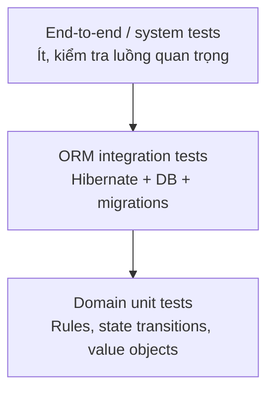
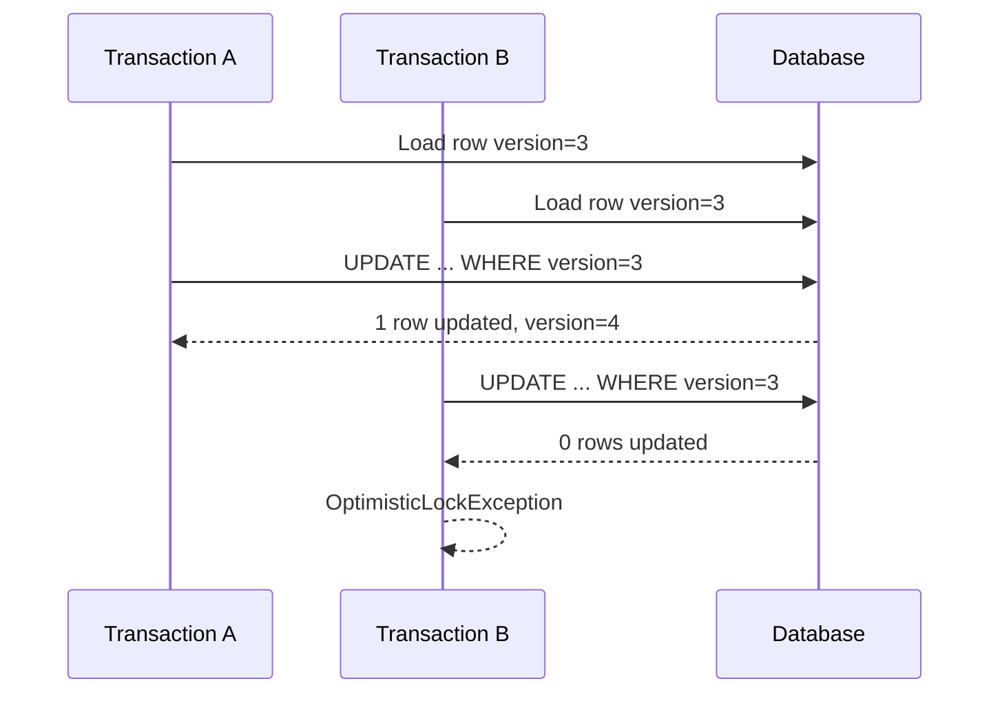

# Kiểm thử đơn vị quy tắc miền và kiểm thử tích hợp hành vi ORM

Một ứng dụng Hibernate có thể vượt qua nhiều unit tests nhưng vẫn lỗi với database thật: cột sai kiểu, cascade không lưu children, lazy association phát sinh truy vấn ngoài transaction, unique constraint chỉ được kiểm tra lúc flush, hoặc hai transaction ghi đè dữ liệu mà optimistic locking không phát hiện. Ngược lại, một dự án có nhiều integration tests vẫn có thể cho phép thanh toán đơn hàng đã hủy nếu domain rules không được kiểm tra.

Hai nhóm kiểm thử trả lời hai câu hỏi khác nhau:

- **Unit test quy tắc miền:** logic nghiệp vụ có đúng với trạng thái và hành động cụ thể không?
- **Integration test hành vi ORM:** Hibernate, mapping, transaction và database có phối hợp đúng để lưu, tải, truy vấn và bảo vệ dữ liệu theo contract không?

**Nguyên tắc:** kiểm thử quy tắc ở nơi quy tắc được thực thi; kiểm thử persistence bằng Hibernate và database. Mock repository không chứng minh query đúng, còn việc khởi động Spring context không thay unit tests cho domain logic.

> **Phạm vi phiên bản:** ví dụ dùng Java hiện đại, JUnit Jupiter 5, AssertJ, Jakarta Persistence và Hibernate ORM 6.x. Spring examples dùng `@DataJpaTest` và `TestEntityManager`. Hibernate 5.x dùng `javax.persistence` và có một số integration APIs khác. Đối chiếu version Hibernate, Spring Boot, JDBC driver và DB của dự án.

---

## 1. Hai loại test bảo vệ hai hợp đồng khác nhau

| Tiêu chí | Unit test quy tắc miền | Integration test ORM |
| --- | --- | --- |
| Đối tượng | Entity/domain service/value object | Hibernate + mapping + database |
| Database | Không cần | Thường cần DB thật hoặc engine tương đương |
| Spring context | Không cần | JPA slice hoặc context phù hợp |
| Tốc độ | Rất nhanh | Chậm hơn, cần setup/cleanup |
| Phát hiện tốt | Invariants, state transitions, calculations, validation | Mapping, SQL, constraints, cascade, lazy, transaction, dialect |
| Test doubles | Có thể mock gateway/clock | Thường không mock EntityManager/Hibernate |

Ví dụ yêu cầu “không thể thanh toán đơn hàng đã hủy”:

- Unit test gọi `order.markPaid()` trên Order CANCELLED và kiểm tra exception.
- Integration test tải Order CANCELLED từ database, gọi service, flush và xác nhận transaction không ghi thay đổi trái phép.

Một test bảo vệ domain invariant; test kia chứng minh invariant được áp dụng qua đường persistence.

## 2. Test pyramid cho ứng dụng Hibernate



Unit tests là lớp rộng và chạy thường xuyên. ORM integration tests tập trung vào mapping và behavior có rủi ro. End-to-end tests kiểm tra một số luồng xuyên nhiều thành phần. Đây không phải tỷ lệ cố định; mục tiêu là đặt test ở ranh giới phù hợp.

## 3. Xác định domain rules trước khi viết test

Giả sử ứng dụng quản lý đơn hàng có các quy tắc:

1. Order mới bắt đầu ở DRAFT.
2. Chỉ Order DRAFT mới được thêm dòng hàng.
3. Order phải có ít nhất một dòng hàng trước khi xác nhận.
4. Chỉ Order CONFIRMED mới được thanh toán.
5. Order CANCELLED không thể được thanh toán.
6. Số lượng mỗi dòng phải lớn hơn 0.
7. Các dòng trong một Order phải dùng cùng currency.
8. Tổng tiền bằng tổng thành tiền của các dòng.

| Rule | Trạng thái đầu vào | Hành động | Kết quả |
| --- | --- | --- | --- |
| Default state | Order mới | Constructor | DRAFT |
| Add line | DRAFT | Add quantity hợp lệ | Có dòng hàng |
| Add line invalid | DRAFT | Quantity = 0 | Rejected |
| Add after confirm | CONFIRMED | Add line | Rejected |
| Confirm empty | DRAFT, không có line | Confirm | Rejected |
| Confirm valid | DRAFT, có line | Confirm | CONFIRMED |
| Pay valid | CONFIRMED | Pay | PAID |
| Pay cancelled | CANCELLED | Pay | Rejected |
| Currency invariant | DRAFT, USD | Add EUR line | Rejected |
| Total | DRAFT, nhiều lines | Calculate | Sum chính xác |

Bảng này giúp test cases xuất phát từ domain contract thay vì cấu trúc bảng DB.

## 4. Viết domain model có thể kiểm thử độc lập

Một entity có thể vừa là JPA entity vừa chứa behavior nghiệp vụ. Unit test không cần khởi tạo Hibernate chỉ để gọi method thuần Java.

Value object:

```java
import java.math.BigDecimal;
import java.util.Currency;
import java.util.Objects;

public record Money(
        BigDecimal amount,
        Currency currency) {

    public Money {
        Objects.requireNonNull(amount);
        Objects.requireNonNull(currency);

        if (amount.scale() > 4) {
            throw new IllegalArgumentException(
                "Amount has too many decimal places"
            );
        }
    }

    public Money add(Money other) {
        requireSameCurrency(other);
        return new Money(amount.add(other.amount), currency);
    }

    public Money multiply(int quantity) {
        if (quantity <= 0) {
            throw new IllegalArgumentException(
                "Quantity must be positive"
            );
        }
        return new Money(
            amount.multiply(BigDecimal.valueOf(quantity)),
            currency
        );
    }

    private void requireSameCurrency(Money other) {
        if (!currency.equals(other.currency)) {
            throw new IllegalArgumentException(
                "Currency mismatch"
            );
        }
    }
}
```

`Money` là immutable value object, không có database ID và không phụ thuộc Session. Giới hạn scale trong ví dụ là policy minh họa; hệ thống thực cần quyết định rounding/precision theo currency và quy tắc tài chính.

### Unit test cho Money

```java
import static org.assertj.core.api.Assertions.*;

import java.math.BigDecimal;
import java.util.Currency;
import org.junit.jupiter.api.Test;

class MoneyTest {

    private static final Currency USD =
        Currency.getInstance("USD");

    @Test
    void addsAmountsInSameCurrency() {
        Money first = new Money(
            new BigDecimal("10.25"), USD
        );
        Money second = new Money(
            new BigDecimal("4.75"), USD
        );

        Money total = first.add(second);

        assertThat(total.amount())
            .isEqualByComparingTo("15.00");
        assertThat(total.currency()).isEqualTo(USD);
    }

    @Test
    void rejectsDifferentCurrencies() {
        Money usd = new Money(
            new BigDecimal("10.00"),
            Currency.getInstance("USD")
        );
        Money eur = new Money(
            new BigDecimal("10.00"),
            Currency.getInstance("EUR")
        );

        assertThatThrownBy(() -> usd.add(eur))
            .isInstanceOf(IllegalArgumentException.class)
            .hasMessageContaining("Currency mismatch");
    }

    @Test
    void rejectsNonPositiveQuantity() {
        Money price = new Money(
            new BigDecimal("12.50"), USD
        );

        assertThatThrownBy(() -> price.multiply(0))
            .isInstanceOf(IllegalArgumentException.class);
    }
}
```

`isEqualByComparingTo` phù hợp với `BigDecimal` khi scale khác nhau nhưng giá trị số bằng nhau. `BigDecimal.equals` so cả scale, nên `15.0` và `15.00` không bằng nhau theo `equals`.

## 5. Unit test state transitions của aggregate

Một Order có thể kiểm soát trạng thái bằng các method nghiệp vụ:

```java
import java.util.ArrayList;
import java.util.Collections;
import java.util.List;
import java.util.Objects;
import java.util.Currency;

public class Order {

    public enum Status {
        DRAFT, CONFIRMED, PAID, CANCELLED
    }

    public record Line(
            String productCode,
            int quantity,
            Money unitPrice) {

        public Line {
            Objects.requireNonNull(productCode);
            Objects.requireNonNull(unitPrice);

            if (productCode.isBlank()) {
                throw new IllegalArgumentException(
                    "Product code is required"
                );
            }
            if (quantity <= 0) {
                throw new IllegalArgumentException(
                    "Quantity must be positive"
                );
            }
        }

        public Money subtotal() {
            return unitPrice.multiply(quantity);
        }
    }

    private Status status = Status.DRAFT;
    private final List<Line> lines = new ArrayList<>();

    public Status status() {
        return status;
    }

    public List<Line> lines() {
        return Collections.unmodifiableList(lines);
    }

    public void addLine(Line line) {
        requireStatus(Status.DRAFT);
        Objects.requireNonNull(line);

        if (!lines.isEmpty()) {
            Currency expected =
                lines.get(0).unitPrice().currency();

            if (!expected.equals(
                    line.unitPrice().currency())) {
                throw new IllegalArgumentException(
                    "All lines must use one currency"
                );
            }
        }
        lines.add(line);
    }

    public Money total() {
        if (lines.isEmpty()) {
            throw new IllegalStateException(
                "An empty order has no total"
            );
        }

        Money result = lines.get(0).subtotal();
        for (int i = 1; i < lines.size(); i++) {
            result = result.add(lines.get(i).subtotal());
        }
        return result;
    }

    public void confirm() {
        requireStatus(Status.DRAFT);
        if (lines.isEmpty()) {
            throw new IllegalStateException(
                "Cannot confirm an empty order"
            );
        }
        total();
        status = Status.CONFIRMED;
    }

    public void markPaid() {
        requireStatus(Status.CONFIRMED);
        status = Status.PAID;
    }

    public void cancel() {
        if (status == Status.PAID) {
            throw new IllegalStateException(
                "A paid order requires a refund workflow"
            );
        }
        if (status == Status.CANCELLED) {
            throw new IllegalStateException(
                "Order is already cancelled"
            );
        }
        status = Status.CANCELLED;
    }

    private void requireStatus(Status expected) {
        if (status != expected) {
            throw new IllegalStateException(
                "Expected " + expected + " but was " + status
            );
        }
    }
}
```

Ví dụ dùng `List.get(0)` để tương thích Java 17+. Một số API collection mới hơn có thể dùng `getFirst()` nếu dự án chạy Java 21+.

### Unit test cho transitions

```java
import static org.assertj.core.api.Assertions.*;

import java.math.BigDecimal;
import java.util.Currency;
import org.junit.jupiter.api.Test;

class OrderTest {

    private final Currency usd =
        Currency.getInstance("USD");

    private Money money(String amount) {
        return new Money(new BigDecimal(amount), usd);
    }

    private Order orderWithOneLine() {
        Order order = new Order();
        order.addLine(
            new Order.Line("SKU-1", 2, money("12.50"))
        );
        return order;
    }

    @Test
    void startsAsDraft() {
        assertThat(new Order().status())
            .isEqualTo(Order.Status.DRAFT);
    }

    @Test
    void confirmsOrderWithLines() {
        Order order = orderWithOneLine();
        order.confirm();

        assertThat(order.status())
            .isEqualTo(Order.Status.CONFIRMED);
    }

    @Test
    void rejectsConfirmingEmptyOrder() {
        Order order = new Order();

        assertThatThrownBy(order::confirm)
            .isInstanceOf(IllegalStateException.class)
            .hasMessageContaining("empty order");
    }

    @Test
    void rejectsAddingLineAfterConfirmation() {
        Order order = orderWithOneLine();
        order.confirm();

        assertThatThrownBy(() ->
            order.addLine(
                new Order.Line("SKU-2", 1, money("3.00"))
            )
        ).isInstanceOf(IllegalStateException.class);
    }

    @Test
    void onlyConfirmedOrderCanBePaid() {
        Order order = new Order();

        assertThatThrownBy(order::markPaid)
            .isInstanceOf(IllegalStateException.class);

        order.addLine(
            new Order.Line("SKU-1", 1, money("5.00"))
        );
        order.confirm();
        order.markPaid();

        assertThat(order.status())
            .isEqualTo(Order.Status.PAID);
    }

    @Test
    void computesTotalFromAllLines() {
        Order order = new Order();
        order.addLine(
            new Order.Line("SKU-1", 2, money("12.50"))
        );
        order.addLine(
            new Order.Line("SKU-2", 3, money("4.00"))
        );

        assertThat(order.total().amount())
            .isEqualByComparingTo("37.00");
    }
}
```

Những tests này chạy nhanh và không cần database. Nếu `confirm()` bị sửa sai, test chỉ ra lỗi ngay tại domain boundary.

## 6. Kiểm tra invariant bằng nhiều input

Các quy tắc số lượng, tiền, trạng thái và giới hạn thường có nhiều biên:

- Quantity: âm, 0, 1, giá trị lớn.
- Amount: âm, 0, scale lớn, giá trị cực lớn.
- Currency: cùng currency, khác currency, null.
- Status: mọi trạng thái hợp lệ và không hợp lệ cho mỗi command.
- Collection: rỗng, một phần tử, nhiều phần tử.
- Text: null, blank, whitespace, Unicode, length vượt giới hạn.

JUnit parameterized tests:

```java
import static org.assertj.core.api.Assertions.*;

import java.math.BigDecimal;
import java.util.Currency;
import java.util.stream.Stream;
import org.junit.jupiter.params.ParameterizedTest;
import org.junit.jupiter.params.provider.MethodSource;

class OrderLineTest {

    static Stream<Integer> invalidQuantities() {
        return Stream.of(-10, -1, 0);
    }

    @ParameterizedTest
    @MethodSource("invalidQuantities")
    void rejectsInvalidQuantity(int quantity) {
        assertThatThrownBy(() ->
            new Order.Line(
                "SKU-1",
                quantity,
                new Money(
                    new BigDecimal("1.00"),
                    Currency.getInstance("USD")
                )
            )
        ).isInstanceOf(IllegalArgumentException.class);
    }
}
```

Dùng parameterized tests cho những input tương đương về rule. Không tạo hàng trăm cases trùng nhau chỉ để tăng số test.

## 7. Unit test không cần mock mọi dependency

Một anti-pattern phổ biến:

```java
@Mock
Order order;

when(order.getStatus()).thenReturn(Order.Status.DRAFT);
```

Test này không kiểm tra logic của Order thật. Nó chỉ kiểm tra hành vi mock.

Đối với domain objects và value objects:

- Tạo instance thật.
- Gọi method thật.
- Kiểm tra state/result/exception.
- Dùng clock hoặc ID generator abstraction nếu cần tính xác định.
- Mock các boundary bên ngoài như payment gateway, email sender hoặc external pricing service.

Ví dụ application service:

```java
class CapturePaymentService {

    private final OrderRepository orders;
    private final PaymentGateway gateway;

    CapturePaymentService(
            OrderRepository orders,
            PaymentGateway gateway) {
        this.orders = orders;
        this.gateway = gateway;
    }

    void capture(long orderId) {
        Order order = orders.getRequired(orderId);
        order.confirm();
        gateway.capture(order.total());
        order.markPaid();
        orders.save(order);
    }
}
```

Unit test service có thể mock repository/gateway để kiểm tra orchestration, nhưng unit test domain Order vẫn phải test invariants độc lập. Payment workflow thực tế cần xử lý authorization, idempotency, timeout, compensation và transaction boundary; không gọi external gateway trong DB transaction một cách tùy tiện.

## 8. Inject Clock để test thời gian xác định

Không nên để domain service gọi trực tiếp `Instant.now()` nếu logic phụ thuộc thời gian và cần test ranh giới chính xác.

```java
public class SubscriptionPolicy {

    private final Clock clock;

    public SubscriptionPolicy(Clock clock) {
        this.clock = clock;
    }

    public boolean isExpired(Instant expiresAt) {
        return !clock.instant().isBefore(expiresAt);
    }
}
```

```java
@Test
void expiresAtBoundaryIsExpired() {
    Instant boundary =
        Instant.parse("2026-01-01T00:00:00Z");

    Clock clock = Clock.fixed(
        boundary,
        ZoneOffset.UTC
    );

    SubscriptionPolicy policy =
        new SubscriptionPolicy(clock);

    assertThat(policy.isExpired(boundary)).isTrue();
}
```

Không dùng `Thread.sleep` để test thời gian nếu có thể điều khiển Clock. Sleep làm test chậm và flaky do scheduler/CI load.

## 9. Inject ID generator khi domain cần ID xác định

Nếu domain service cần tạo ID trước khi lưu, có thể inject abstraction:

```java
public interface IdGenerator {
    UUID nextId();
}
```

Trong unit test, dùng deterministic implementation:

```java
final class FixedIdGenerator implements IdGenerator {

    private final UUID id;

    FixedIdGenerator(UUID id) {
        this.id = id;
    }

    @Override
    public UUID nextId() {
        return id;
    }
}
```

Không cần mock static `UUID.randomUUID()` trên mọi test. Một abstraction nhỏ làm rõ ai sở hữu việc cấp ID.

Nếu Hibernate là bên tạo ID bằng `@GeneratedValue`, domain unit test không cần kiểm tra DB ID generation; việc đó thuộc ORM integration test.

## 10. Test domain events bằng state và facts

Nếu aggregate phát domain events, unit test nên xác nhận command hợp lệ tạo event đúng, command không hợp lệ không tạo event thành công, payload và thứ tự events phù hợp, replay/apply không thực hiện side effects ngoài domain.

```java
@Test
void paymentCaptureProducesDomainEvent() {
    Order order = confirmedOrder();

    order.markPaid();

    assertThat(order.domainEvents())
        .singleElement()
        .isInstanceOf(PaymentCaptured.class);
}
```

`domainEvents()` là API minh họa do aggregate cung cấp. Không giả định Hibernate Envers hoặc JPA lifecycle callbacks tự sinh domain events đúng nghĩa.

Unit test không kiểm tra outbox transaction. Chỉ integration test với transaction/database mới chứng minh entity update và outbox row được commit hoặc rollback cùng nhau.

---

## 11. Khi nào cần integration test với Hibernate?

Bất cứ khi nào kết quả phụ thuộc mapping/provider/database, cần test trên persistence stack thật.

| Nhóm hành vi | Điều cần chứng minh |
| --- | --- |
| Entity mapping | Cột, kiểu dữ liệu, nullability, enum, converter |
| Identifier | IDENTITY/SEQUENCE/UUID được sinh đúng |
| Associations | FK, owning side, join columns, composite keys |
| Cascade/orphan removal | Entity graph được persist/remove đúng |
| Lazy loading | Fetch behavior và Session boundary |
| Queries | HQL/JPQL/Criteria/native SQL và pagination |
| Constraints | NOT NULL, UNIQUE, FK, CHECK |
| Transactions | Commit, rollback, isolation |
| Optimistic locking | Version conflict được phát hiện |
| Generated values | Default, trigger, generated columns được hydrate |
| Auditing | Envers callbacks/revisions nếu dự án sử dụng |
| Schema migrations | Migration tạo schema tương thích với mapping |

Không cần một integration test cho mọi getter/setter. Tập trung vào behavior phụ thuộc persistence.

## 12. Vì sao mock EntityManager không phải integration test ORM?

```java
@Mock
EntityManager entityManager;

when(entityManager.find(Order.class, 10L))
    .thenReturn(order);
```

Mock này không chạy Hibernate mapping metadata, SQL generation, JDBC driver, database constraints, transaction synchronization, flush/dirty checking, cascade/lazy behavior, entity listeners hoặc dialect-specific SQL.

Nó hữu ích cho unit test application service nếu service phụ thuộc trực tiếp EntityManager, nhưng không thể chứng minh persistence behavior.

**Một test chỉ mock repository không chứng minh repository query đúng.** Muốn kiểm tra query, cần database.

## 13. Dùng JUnit Jupiter và Spring Data JPA slice test

Nếu dự án Spring Boot, `@DataJpaTest` tạo một test slice tập trung vào JPA components.

```java
import static org.assertj.core.api.Assertions.*;

import org.junit.jupiter.api.Test;
import org.springframework.beans.factory.annotation.Autowired;
import org.springframework.boot.test.autoconfigure.orm.jpa.DataJpaTest;
import org.springframework.boot.test.autoconfigure.orm.jpa.TestEntityManager;

@DataJpaTest
class PurchaseOrderRepositoryTest {

    @Autowired
    TestEntityManager entityManager;

    @Autowired
    PurchaseOrderRepository repository;

    @Test
    void savesAndFindsOrder() {
        PurchaseOrder order =
            new PurchaseOrder("SO-001", new BigDecimal("25.00"));

        entityManager.persist(order);
        entityManager.flush();
        entityManager.clear();

        PurchaseOrder loaded =
            repository.findById(order.getId()).orElseThrow();

        assertThat(loaded.getOrderNumber())
            .isEqualTo("SO-001");
    }
}
```

Đây là ví dụ minh họa. Constructor và getters cần tồn tại trên entity thật của project.

### Vì sao gọi `flush()`?

`persist()` thường chỉ đưa entity vào persistence context. Hibernate có thể trì hoãn SQL đến flush/commit. `flush()` buộc Hibernate đồng bộ pending changes xuống database, nhờ đó test có thể phát hiện constraint violations, SQL type/mapping errors, invalid associations và generated SQL failures.

### Vì sao gọi `clear()`?

`clear()` detach toàn bộ entities khỏi persistence context hiện tại. Khi repository đọc lại, Hibernate phải tải dữ liệu từ database thay vì trả cùng managed instance từ L1 cache.

Không có `clear()`, test có thể pass vì object còn trong memory dù row trong DB chưa được đọc lại.

## 14. Flush và reload: pattern rất quan trọng

```java
entityManager.persist(entity);
entityManager.flush();
entityManager.clear();

Entity loaded = entityManager.find(
    Entity.class,
    entity.getId()
);

assertThat(loaded.getValue()).isEqualTo(expected);
```

Ba bước có ý nghĩa:

1. Persist: yêu cầu ORM quản lý entity.
2. Flush: gửi SQL tới DB và surface lỗi.
3. Clear/reload: xác nhận mapping có thể đọc dữ liệu đã lưu.

Nếu chỉ assert trên object gốc ngay sau `persist`, test có thể không kiểm tra database state.

### Khi cần test commit thật?

`@DataJpaTest` thường chạy test trong transaction và rollback sau mỗi test. Flush + clear vẫn kiểm tra SQL và reload trong transaction đó, nhưng không chứng minh mọi behavior sau commit.

Các trường hợp cần transaction commit thật: `afterCommit` event listeners, transactional outbox relay chỉ đọc committed rows, transaction synchronization, isolation giữa hai transactions, visibility từ connection/session khác, deferred constraints hoặc DB-specific commit triggers.

Dùng test riêng quản lý transactions rõ ràng, không dựa vào default rollback semantics.

## 15. Test constraint bằng cách flush

Ví dụ database có unique constraint:

```java
@Entity
@Table(
    name = "customers",
    uniqueConstraints = @UniqueConstraint(
        name = "uk_customer_email",
        columnNames = "email"
    )
)
public class Customer {

    @Id
    @GeneratedValue(strategy = GenerationType.IDENTITY)
    private Long id;

    @Column(nullable = false)
    private String email;

    protected Customer() {}

    public Customer(String email) {
        this.email = email;
    }
}
```

Integration test:

```java
@Test
void databaseRejectsDuplicateEmail() {
    entityManager.persist(new Customer("a@example.test"));
    entityManager.flush();

    entityManager.persist(new Customer("a@example.test"));

    assertThatThrownBy(entityManager::flush)
        .isInstanceOf(PersistenceException.class);
}
```

Exception wrapper cụ thể có thể là Hibernate/JPA/Spring exception khác nhau tùy stack. Test có thể assert root cause/SQL state nếu cần, nhưng tránh phụ thuộc message text của DB driver nếu không phải contract.

`@NotNull` hoặc validation annotations có thể bắt lỗi ở application/provider layer. Chúng không thay database NOT NULL constraint, vì external writers vẫn có thể bypass validation. Nếu toàn vẹn dữ liệu quan trọng, cần schema constraints và integration tests xác nhận.

## 16. Kiểm thử mapping enum, converter và embeddable

Ví dụ enum mapping:

```java
@Enumerated(EnumType.STRING)
@Column(nullable = false)
private OrderStatus status;
```

Integration test nên persist entity, flush, clear, reload và xác nhận enum được đọc đúng. Dùng `EnumType.STRING` tránh phụ thuộc vị trí ordinal khi enum được reorder, nhưng đổi tên enum constant vẫn có thể ảnh hưởng dữ liệu đã lưu; cần migration nếu contract database thay đổi.

### AttributeConverter

```java
@Converter
public class CurrencyConverter
        implements AttributeConverter<Currency, String> {

    @Override
    public String convertToDatabaseColumn(Currency value) {
        return value == null ? null : value.getCurrencyCode();
    }

    @Override
    public Currency convertToEntityAttribute(String value) {
        return value == null ? null : Currency.getInstance(value);
    }
}
```

Test converter thuần Java có thể kiểm tra encode/decode. Integration test cần chứng minh Hibernate áp converter trên đúng field, column type và query parameter.

### Embedded value object

```java
@Embeddable
public class Address {

    private String street;
    private String city;
    private String postalCode;

    protected Address() {}

    public Address(
            String street,
            String city,
            String postalCode) {
        this.street = street;
        this.city = city;
        this.postalCode = postalCode;
    }
}
```

Test mapping để xác nhận fields nằm đúng columns, null semantics và overrides nếu dùng `@AttributeOverride`.

## 17. Test cascade và orphan removal bằng DB thật

Ví dụ Order chứa OrderLines:

```java
@OneToMany(
    mappedBy = "order",
    cascade = CascadeType.ALL,
    orphanRemoval = true
)
private List<OrderLine> lines = new ArrayList<>();
```

Một unit test có thể xác nhận method `removeLine` thay đổi collection theo domain rule. Nhưng chỉ integration test chứng minh Hibernate thực hiện DELETE orphan như dự kiến.

```java
@Test
void removingLineDeletesOrphanRow() {
    PurchaseOrder order = createOrderWithTwoLines();

    entityManager.persist(order);
    entityManager.flush();

    Long orderId = order.getId();
    Long removedLineId = order.getLines().get(0).getId();

    order.removeLine(removedLineId);

    entityManager.flush();
    entityManager.clear();

    PurchaseOrder loaded =
        entityManager.find(PurchaseOrder.class, orderId);

    assertThat(loaded.getLines()).hasSize(1);
    assertThat(entityManager.find(
        OrderLine.class,
        removedLineId
    )).isNull();
}
```

Helper `createOrderWithTwoLines` cần tạo association hai chiều đúng, ví dụ `line.setOrder(order)` nếu mapping cần owning side.

Trong bidirectional association, JPA dựa vào owning side để ghi FK. Nếu chỉ thêm line vào inverse collection mà không set owning side, collection trong memory có thể đúng nhưng FK không được lưu.

```java
public void addLine(OrderLine line) {
    lines.add(line);
    line.setOrder(this);
}
```

Integration test phải flush/clear/reload để phát hiện lỗi này.

## 18. Test lazy loading đúng ranh giới Session

Ví dụ:

```java
@ManyToOne(fetch = FetchType.LAZY)
private Customer customer;
```

Test trong transaction:

```java
@Test
void loadsCustomerWhenAssociationIsAccessed() {
    PurchaseOrder order = createAndPersistOrder();
    entityManager.flush();
    entityManager.clear();

    PurchaseOrder loaded =
        entityManager.find(PurchaseOrder.class, order.getId());

    assertThat(loaded.getCustomer().getName())
        .isEqualTo("Alpha Ltd");
}
```

Test này chỉ chứng minh association có thể được tải trong persistence context hiện tại. Nó không chứng minh API serialization an toàn sau khi Session đóng.

Để test lazy boundary sau detach, cần đảm bảo transaction/EntityManager thật sự đã đóng hoặc entity đã detach và association chưa được khởi tạo. Truy cập association sau đó có thể ném `LazyInitializationException`. Không truy cập association trước khi đóng Session.

Trong production, thường map DTO trong transaction thay vì trả detached entity để JSON serializer tự truy cập lazy fields.

## 19. Test repository query với database

Một repository query:

```java
@Query("""
    select o
    from PurchaseOrder o
    where o.status = :status
      and o.createdAt >= :from
    order by o.createdAt desc, o.id desc
    """)
List<PurchaseOrder> findRecent(
    OrderStatus status,
    Instant from
);
```

Integration test nên tạo dữ liệu phân biệt được: đơn có status khác, đơn trước mốc thời gian, đơn đúng mốc biên, hai đơn cùng timestamp để test tie-break sort và một số rows không liên quan.

Sau đó assert IDs/thứ tự chính xác. Không chỉ assert số lượng bằng hai nếu query có thể trả nhầm hai rows khác.

## 20. Test pagination và count query

Một repository trả `Page<T>` thường thực hiện query nội dung và có thể query count.

```java
Page<PurchaseOrder> page =
    repository.findByStatus(
        OrderStatus.PAID,
        PageRequest.of(
            1,
            10,
            Sort.by("createdAt").descending()
                .and(Sort.by("id").descending())
        )
    );

assertThat(page.getContent()).hasSize(10);
assertThat(page.getTotalElements()).isEqualTo(expectedTotal);
assertThat(page.getTotalPages()).isEqualTo(expectedPages);
```

Dữ liệu fixture phải đủ lớn để test page boundary. Nếu dùng sort field không unique, thứ tự giữa rows có thể không ổn định; thêm tie-breaker unique như ID.

Với DTO projection, kiểm tra constructor/property binding, null handling, enum/converter, aliases của native projection, count query và việc Hibernate không hydrate toàn bộ entity graph ngoài nhu cầu.

## 21. Test native SQL và dialect

Native query có thể phụ thuộc tên bảng/cột, SQL dialect, JSON functions, window functions, CTE, RETURNING/generated keys, pagination syntax, collation và timezone behavior.

Một native query chạy trên H2 không đảm bảo chạy trên PostgreSQL/MySQL/Oracle production. Nếu native SQL quan trọng, integration test nên chạy đúng DB engine/version tương thích hoặc engine được hỗ trợ có semantics đủ gần. H2 vẫn hữu ích cho logic đơn giản nhưng không phải oracle của mọi dialect.

## 22. Test generated IDs và database defaults

ID generation có thể phụ thuộc database: `IDENTITY`, `SEQUENCE`, UUID, custom generator hoặc database trigger/default.

```java
@Test
void generatesSequenceId() {
    PurchaseOrder order = new PurchaseOrder("SO-100");

    entityManager.persist(order);
    entityManager.flush();

    assertThat(order.getId()).isNotNull();
}
```

Nếu ID strategy lấy giá trị trước INSERT, ID có thể sẵn sàng sớm hơn flush. Với identity strategy, Hibernate có thể cần thực hiện INSERT để lấy generated key. Đừng viết unit test domain giả định mọi strategy đều cấp ID cùng thời điểm.

Nếu cột có `DEFAULT CURRENT_TIMESTAMP`, test không set field từ Java, flush và kiểm tra giá trị DB đã sinh được Hibernate đồng bộ theo mapping. Chạy trên DBMS mục tiêu vì generated-value retrieval khác nhau theo dialect/driver.

## 23. Test transaction rollback

Ví dụ resource-local transaction:

```java
EntityManager em =
    entityManagerFactory.createEntityManager();
Long id = null;

try {
    em.getTransaction().begin();

    PurchaseOrder order =
        new PurchaseOrder("SO-ROLLBACK");

    em.persist(order);
    em.flush();
    id = order.getId();

    em.getTransaction().rollback();
} finally {
    em.close();
}

EntityManager verifier =
    entityManagerFactory.createEntityManager();
try {
    assertThat(verifier.find(PurchaseOrder.class, id))
        .isNull();
} finally {
    verifier.close();
}
```

Không dùng `getTransaction()` với container-managed Spring EntityManager.

Trong Spring Boot test, `@DataJpaTest` thường tự mở transaction và rollback sau test. Để kiểm tra rollback ở giữa test, có thể dùng `TestTransaction` hoặc `TransactionTemplate` tùy test framework.

Xác nhận trạng thái bằng transaction/Session mới, tránh L1 cache còn giữ entity đã rollback.

## 24. Test optimistic locking bằng hai persistence contexts

Entity:

```java
@Version
private long version;
```

Mục tiêu: hai transactions cùng load version 3; transaction A commit update, transaction B cố update stale version 3 và bị conflict.



Không test bằng hai references đến cùng managed entity trong một Session; cần hai EntityManagers/Sessions độc lập và transactions riêng.

Pseudocode:

```java
// Mỗi callback chạy với EntityManager/transaction độc lập.
PurchaseOrder first = transactionA(() ->
    entityManagerA.find(PurchaseOrder.class, orderId)
);

PurchaseOrder second = transactionB(() ->
    entityManagerB.find(PurchaseOrder.class, orderId)
);

transactionA(() -> {
    PurchaseOrder managed =
        entityManagerA.find(PurchaseOrder.class, orderId);
    managed.rename("A");
    entityManagerA.flush();
});

assertThatThrownBy(() ->
    transactionB(() -> {
        PurchaseOrder managed =
            entityManagerB.merge(second);
        managed.rename("B");
        entityManagerB.flush();
    })
).hasRootCauseInstanceOf(OptimisticLockException.class);
```

Đây là pseudocode cần điều chỉnh transaction/session lifecycle cụ thể: mỗi transaction có persistence context độc lập; entity detached từ B được merge vào B context; không dùng transaction đã đóng. Có thể viết integration test bằng hai EntityManagers mở thủ công để tránh Spring test transaction bao ngoài.

Dùng EntityManager thứ ba hoặc context mới để xác nhận giá trị A vẫn còn và version đã tăng. Không chỉ assert exception mà bỏ qua state cuối.

## 25. Test isolation và transaction semantics

Isolation level, locking và visibility có thể khác giữa DBMS. Những câu hỏi cần test:

- Transaction B có thấy uncommitted update của A không?
- Khi A commit, B đọc lại có thấy state mới không?
- Có lost update nếu không dùng `@Version`?
- Pessimistic lock có block hoặc timeout như mong muốn?
- Unique constraint được kiểm tra ngay hay deferred đến commit?
- Deadlock có được báo và retry ở boundary nào?
- Read-only transaction có thực sự chỉ đọc theo contract DB/provider không?

Không giả định behavior của H2 giống production database. Nếu semantics ảnh hưởng correctness, test trên engine mục tiêu.

---

## 26. Chọn database cho integration tests

| Môi trường | Ưu điểm | Giới hạn |
| --- | --- | --- |
| H2 in-memory | Setup nhanh, tiện cho test đơn giản | Khác dialect, types, locks, JSON, sequences và plans |
| Testcontainers với PostgreSQL/MySQL/... | Gần DB production, test migration/SQL thật | Chậm hơn, cần Docker/runtime phù hợp |
| Embedded database cùng engine family | Có thể đơn giản hóa setup | Không phải DBMS nào cũng có embedded mode tương đương |
| Shared test DB | Có thể kiểm thử hạ tầng gần thật | Cần isolation, cleanup và tránh tests đụng dữ liệu nhau |

**Chọn database theo rủi ro cần kiểm tra.** Một test converter thuần Java không cần Testcontainers; một native query PostgreSQL-specific nên chạy PostgreSQL thật.

### Vì sao H2 có thể tạo cảm giác an toàn giả?

H2 có thể chấp nhận cú pháp mà production DB từ chối hoặc ngược lại; type conversion/timestamp precision, JSON/array/collation, locking/isolation, identity/sequence, query optimizer và constraint deferral cũng khác.

Nếu project production chạy PostgreSQL, dùng PostgreSQL container cho các test mapping/query/constraint quan trọng.

## 27. Ví dụ Testcontainers với PostgreSQL

Dependency minh họa, version được quản lý bằng BOM phù hợp:

```kotlin
dependencies {
    testImplementation("org.testcontainers:junit-jupiter")
    testImplementation("org.testcontainers:postgresql")
    testRuntimeOnly("org.postgresql:postgresql")
}
```

Test:

```java
@Testcontainers
@DataJpaTest
@AutoConfigureTestDatabase(
    replace = AutoConfigureTestDatabase.Replace.NONE
)
class PurchaseOrderPostgresTest {

    @Container
    static PostgreSQLContainer<?> postgres =
        new PostgreSQLContainer<>("postgres:16-alpine")
            .withDatabaseName("app_test")
            .withUsername("test")
            .withPassword("test");

    @DynamicPropertySource
    static void databaseProperties(
            DynamicPropertyRegistry registry) {
        registry.add(
            "spring.datasource.url",
            postgres::getJdbcUrl
        );
        registry.add(
            "spring.datasource.username",
            postgres::getUsername
        );
        registry.add(
            "spring.datasource.password",
            postgres::getPassword
        );
    }

    @Autowired
    TestEntityManager entityManager;

    @Test
    void persistsOrderOnPostgres() {
        PurchaseOrder order =
            new PurchaseOrder("SO-POSTGRES");

        entityManager.persist(order);
        entityManager.flush();
        entityManager.clear();

        PurchaseOrder loaded =
            entityManager.find(
                PurchaseOrder.class,
                order.getId()
            );

        assertThat(loaded).isNotNull();
        assertThat(loaded.getOrderNumber())
            .isEqualTo("SO-POSTGRES");
    }
}
```

Imports của JUnit/Testcontainers/Spring Boot cần theo version project. `@DynamicPropertySource` là Spring Test support. Image tag nên được pin theo policy CI/security; không mặc định dùng `latest`.

Nếu build dùng Flyway/Liquibase, cấu hình test để chạy migrations thật và tránh schema auto-generation xung đột. Đừng để Hibernate tự tạo schema khác với migration production rồi kết luận mapping đã được kiểm chứng.

## 28. Test migrations, không chỉ Hibernate DDL

Trong production, schema thường được quản lý bởi Flyway hoặc Liquibase. Integration tests nên xác nhận migration tạo đúng schema mà Hibernate mapping mong đợi.

1. Khởi tạo DB trống.
2. Chạy migrations từ đầu.
3. Khởi động Hibernate validate mapping.
4. Persist/load một số entity quan trọng.
5. Kiểm tra constraints/indexes cần thiết.
6. Nếu có upgrade path, tạo schema ở version cũ, seed legacy data, chạy migration mới.
7. Kiểm tra dữ liệu cũ vẫn đọc được và invariants mới được enforce.

```properties
spring.jpa.hibernate.ddl-auto=validate
spring.flyway.enabled=true
```

`validate` kiểm tra một số khác biệt mapping/schema mà Hibernate hỗ trợ; nó không chứng minh mọi index, trigger, RLS policy hoặc constraint nghiệp vụ đã có. Hãy kiểm tra chúng qua migration assertions/DB catalog queries nếu quan trọng.

## 29. Test repository bằng database có dữ liệu xác định

Fixture nên có tên và IDs phân biệt, không dựa vào thứ tự INSERT.

```java
@BeforeEach
void setUp() {
    entityManager.persist(
        new PurchaseOrder("SO-001", OrderStatus.DRAFT)
    );
    entityManager.persist(
        new PurchaseOrder("SO-002", OrderStatus.PAID)
    );
    entityManager.persist(
        new PurchaseOrder("SO-003", OrderStatus.PAID)
    );

    entityManager.flush();
    entityManager.clear();
}
```

```java
@Test
void findsOnlyPaidOrders() {
    List<PurchaseOrder> result =
        repository.findByStatus(OrderStatus.PAID);

    assertThat(result)
        .extracting(PurchaseOrder::getOrderNumber)
        .containsExactlyInAnyOrder("SO-002", "SO-003");
}
```

Không assert một thứ tự nếu query không có ORDER BY. SQL row order không được đảm bảo nếu không yêu cầu.

Fixture cần độc lập theo test, không phụ thuộc ID sequence bắt đầu từ 1, execution order, cache warm từ test khác hoặc một shared DB row không cleanup.

## 30. Test associations và foreign keys

```java
@ManyToOne(fetch = FetchType.LAZY, optional = false)
@JoinColumn(name = "customer_id", nullable = false)
private Customer customer;
```

Test Order không có Customer có bị từ chối không, FK thực tế có được tạo chưa, xóa Customer đang được tham chiếu bị chặn hay cascade theo policy, association reload có đúng Customer không, owning side được set đúng không và có N+1 khi đọc danh sách Order/Customer không.

Không dựa chỉ vào object graph trong memory. Flush/clear/reload mới chứng minh FK và association mapping.

Với `@OneToMany`, test cascade persist/remove, orphan removal, owning side và collection ordering. Không dùng `CascadeType.ALL` chỉ để test pass; cascade phải phản ánh aggregate ownership.

## 31. Test optimistic/pessimistic locking

`@Version` nên được kiểm thử với hai transaction độc lập. Assertions cần xác nhận version tăng, stale update bị từ chối, application translate conflict đúng và retry không thực hiện side effects hai lần.

Nếu dùng `@Lock(LockModeType.PESSIMISTIC_WRITE)`, test cần hai transactions và timeout có kiểm soát. Kiểm tra DBMS hỗ trợ lock semantics tương ứng; timeout exception/SQL state có thể khác.

Không dùng `Thread.sleep()` làm đồng bộ chính giữa transactions; dùng latches/barriers và giới hạn timeout. Chỉ test locking khi ứng dụng thật sự dựa vào nó để bảo vệ invariant.

## 32. Test transaction boundaries của service

Một `@Transactional` service có thể có semantics quan trọng: nhiều repository calls cùng transaction, rollback khi exception, `REQUIRES_NEW`, `readOnly=true`, after-commit listeners, outbox row cùng commit với entity và lazy loading trong transaction.

Một unit test mock repository không chứng minh những điều này. Dùng Spring integration test hoặc `TransactionTemplate` để kiểm tra DB state qua transaction mới sau commit/rollback.

### Test outbox atomicity

Trong một transaction:

```java
orderRepository.save(order);
outboxRepository.save(event);
```

Test hai trường hợp:

1. Commit: Order và Outbox row cùng tồn tại.
2. Rollback: cả hai không tồn tại.

Đây là integration test cho transaction atomicity. Consumer delivery/idempotency cần test riêng ở messaging layer.

## 33. Test Envers nếu ứng dụng bật auditing

Nếu entity có `@Audited`, integration tests nên chứng minh revision được tạo khi entity thay đổi qua ORM, revision type phù hợp ADD/MOD/DEL, actor metadata được gắn đúng, rollback không để lại revision cho thay đổi chưa commit, history query trả snapshot mong đợi và migration audit tables tương thích.

```java
@Test
void recordsEntityRevision() {
    PurchaseOrder order =
        new PurchaseOrder("SO-AUDIT");

    entityManager.persist(order);
    entityManager.flush();

    Long id = order.getId();

    order.confirm();
    entityManager.flush();

    entityManager.clear();

    AuditReader reader =
        AuditReaderFactory.get(entityManager);

    List<Number> revisions =
        reader.getRevisions(PurchaseOrder.class, id);

    assertThat(revisions).hasSizeGreaterThanOrEqualTo(2);
}
```

Cần đảm bảo entity đã được `@Audited`, Envers dependency đúng version và transaction/session semantics phù hợp. Không phụ thuộc revision numbers tuyệt đối nếu fixture/bootstrapping có thể tạo revisions khác.

## 34. Test tenant isolation bằng hai tenant

Với Hibernate `@TenantId`, integration test nên có ít nhất hai tenants và dữ liệu dễ va chạm.

```text
tenant alpha:
  Order SO-001, id=101

tenant beta:
  Order SO-001, id=102
```

Test riêng Session alpha và beta, xác nhận mapped HQL/`find` chỉ thấy đúng phạm vi theo contract version. Bổ sung negative tests cho native SQL, tenant mismatch, composite FK, application cache key và background jobs.

Không chỉ test resolver trả đúng string; phải test database result thực tế.

## 35. Test generated values và triggers

Nếu dùng DB default/trigger/generated column:

1. Chạy migration tạo default/trigger.
2. Persist entity không set generated field.
3. Flush.
4. Xác nhận Hibernate đồng bộ generated value hoặc reload theo mapping.
5. Mở Session khác để kiểm tra persisted value.
6. Test UPDATE event nếu trigger chạy khi update.
7. Chạy trên DBMS mục tiêu.

H2 có thể không mô phỏng đúng trigger, RETURNING, precision hoặc generated keys của production engine.

## 36. Test entity equality và collections

Entity equality có thể phụ thuộc ID được sinh sau persist:

```java
Set<PurchaseOrder> orders = new HashSet<>();
PurchaseOrder order = new PurchaseOrder(...);

orders.add(order);
entityManager.persist(order);

assertThat(orders.contains(order)).isTrue();
```

Nếu `hashCode()` dựa trên ID và ID thay đổi sau khi entity đã được đưa vào HashSet, lookup có thể thất bại.

Không áp dụng một implementation `equals/hashCode` chung cho mọi entity. Xác định identity semantics, test transient/persistent, proxy/concrete class, same DB identity trong hai persistence contexts, HashSet trước/sau persist, composite IDs và detached/merged instances.

## 37. Phân biệt test slice và full application integration test

| Loại test | Thành phần khởi động | Dùng khi |
| --- | --- | --- |
| Pure unit | Domain class/service | Quy tắc nghiệp vụ |
| `@DataJpaTest` | JPA repositories, Hibernate, test DB | Mapping/query/ORM |
| `@JdbcTest` | JDBC layer | SQL/JdbcTemplate |
| `@SpringBootTest` | Gần toàn bộ application context | Transaction/security/event integration xuyên nhiều beans |
| End-to-end | App + external dependencies/test environment | Luồng người dùng xuyên hệ thống |

Không dùng `@SpringBootTest` cho mọi repository query nếu `@DataJpaTest` đủ. Startup context dài làm feedback loop chậm và test khó cô lập.

Ngược lại, `@DataJpaTest` không chứng minh security filter thiết lập tenant context trước transaction; behavior ấy cần test với integration boundary rộng hơn.

## 38. Test configuration không nên vô tình khác production

Những khác biệt nguy hiểm:

- Production PostgreSQL nhưng test H2.
- Production Flyway migrations nhưng test `ddl-auto=create-drop`.
- Production `open-in-view=false` nhưng test giữ Session mở.
- Production L2 cache bật nhưng test không có provider.
- Production timezone UTC nhưng test dùng local timezone.
- Production isolation level khác test.
- Production naming strategy/dialect khác test.
- Production Envers/RLS/tenant resolver không được bật trong test.

Unit tests không cần Spring properties. ORM integration tests dùng DB engine tương thích và migrations thật khi cần. Một số tests có thể dùng H2 nếu behavior portable. Không cần clone toàn bộ production infrastructure cho mỗi unit test.

## 39. Transactional test mặc định rollback: lợi ích và giới hạn

Spring `@DataJpaTest` thường chạy mỗi test trong transaction và rollback sau đó.

Ưu điểm: test isolation dễ, không cần cleanup thủ công trong nhiều trường hợp, chạy nhanh hơn drop/create DB mỗi test.

Giới hạn:

- Không kiểm tra commit callbacks như transaction đã commit thật.
- Có thể không thấy dữ liệu từ connection/transaction khác như production.
- Deferred constraints có thể chỉ được kiểm tra khi commit.
- Async consumer không tự thấy dữ liệu chưa commit.
- Thread khác không tự tham gia test transaction.

Khi test cần commit thật, thiết kế transaction boundary tường minh và cleanup riêng. Đừng mặc định `@Transactional` trên test method luôn mô phỏng application transaction.

## 40. Test cleanup và parallel execution

Các cách cô lập:

- Transaction rollback per test.
- Database/container riêng cho test suite.
- Schema riêng cho worker/test.
- Unique namespace cho test data.
- Truncate/delete theo dependency order nếu dùng shared DB.
- Testcontainers lifecycle phù hợp.
- Không để test song song cùng ghi một row dùng chung.

Nếu tests chạy parallel, một `Statistics.clear()` hoặc reset shared DB/cache có thể ảnh hưởng tests khác. Hãy kiểm tra shared resources, không chỉ test source.

## 41. Test migrations với dữ liệu legacy

Migration có thể thành công trên database rỗng nhưng thất bại với dữ liệu thật.

1. Tạo schema ở version cũ.
2. Insert dữ liệu đại diện, gồm edge cases/nulls/duplicate candidates.
3. Chạy migration lên version mới.
4. Kiểm tra row counts và transformed values.
5. Kiểm tra unique/FK/not-null constraints.
6. Boot Hibernate validate mapping.
7. Load entities cũ và thực hiện một write mới.
8. Xác nhận không có dữ liệu bị gán sai tenant/currency/status.

Đây là integration test quan trọng khi thay đổi entity columns, enum values, ID type hoặc tenant model.

## 42. Không assert SQL text quá chi tiết nếu không phải contract

Một test so sánh toàn bộ SQL string dễ vỡ khi Hibernate đổi alias, whitespace, parameter ordering hoặc dialect.

Nên assert behavior: query trả đúng rows, constraint được enforce, số statements không vượt budget trong test phù hợp, query plan/index có kiểm tra riêng nếu performance contract yêu cầu, SQL shape/fingerprint chỉ assert khi có lý do rõ.

Nếu native SQL là contract do ứng dụng tự sở hữu, test SQL behavior trên DB mục tiêu mà không phụ thuộc formatting không quan trọng.

## 43. Kiểm thử query count: tránh brittle tests

Một test đếm SQL có thể hữu ích để ngăn N+1:

```java
long before = statistics.getPrepareStatementCount();

List<OrderDto> result = service.listOrders();

entityManager.flush();

long delta =
    statistics.getPrepareStatementCount() - before;
```

`Statistics` thường là shared `SessionFactory` counter. Trong test cô lập, tuần tự, fixture/setup xong trước khi đọc `before`, delta có ý nghĩa hơn. Trong production concurrency, không dùng cách này để đo per-request.

Có thể assert “không quá 3 SQL cho page size 20” nếu query ổn định và test cô lập. Tránh assert chính xác 1 statement nếu Hibernate/provider có thể thêm count/sequence/metadata statements hợp lệ. Assert query count theo kích thước page để phát hiện tuyến tính N+1; số SQL thấp không tự bảo đảm query nhanh.

## 44. Test timeouts và tránh flaky tests

Không dùng sleep để chờ DB lock hoặc async job nếu có synchronization primitive tốt hơn.

Dùng `CountDownLatch` hoặc `CyclicBarrier` để đồng bộ threads, Awaitility/polling có timeout, transaction/lock timeout của DB, container health checks, Clock fixed và unique fixtures.

Luôn có timeout tổng cho concurrency tests để CI không treo vô hạn. Không assert query phải dưới 5ms trên runner dùng chung; latency test cần môi trường ổn định và ngưỡng thực tế.

## 45. Test exception translation

Hibernate/JDBC exceptions có thể được Spring translate thành `DataIntegrityViolationException`, `OptimisticLockingFailureException` hoặc exception khác tùy call path.

Nên test hai lớp:

- ORM/database integration test chứng minh constraint/conflict thật xảy ra.
- Application service test chứng minh lỗi được chuyển thành domain/API response phù hợp.

Không buộc domain model phụ thuộc Hibernate exception types. Domain exception mô tả business meaning; persistence exception được xử lý tại repository/application boundary.

## 46. Test security và tenant resolver ở đúng lớp

Một `@DataJpaTest` có thể mở Session tenant thủ công và test `@TenantId` query scoping. Nhưng nó không tự kiểm tra HTTP header, principal membership, filter ordering, ThreadLocal cleanup, async propagation hoặc unauthorized tenant switch.

Tách rõ:

- ORM test: Session tenant A chỉ thấy dữ liệu A.
- Security integration test: user không có membership A không thể tạo Session/request cho A.
- Database security test: RLS/DB role không đọc được tenant khác nếu policy yêu cầu.

## 47. Kiểm thử timezone và precision

Các trường thời gian dễ khác nhau giữa JVM, JDBC và database: `Instant`, `OffsetDateTime`, `LocalDateTime`, timestamp with/without time zone, database precision, JVM timezone, DST và driver conversion.

Integration test nên set timezone rõ, dùng values có offset/precision xác định và so sánh theo contract thực tế. Một DB chỉ lưu microseconds có thể truncate nanoseconds; không assert round-trip giữ 9 chữ số nếu schema không thể làm vậy.

## 48. Kiểm thử decimal và numeric precision

Với `BigDecimal`:

- `precision`/`scale` mapping phải phù hợp.
- Rounding mode được quyết định ở domain/application, không phó mặc DB.
- Test giá trị biên lớn nhất và scale tối đa.
- Kiểm tra overflow/constraint behavior.
- So sánh numeric bằng `isEqualByComparingTo` khi scale không phải contract.

```java
@Column(precision = 19, scale = 2)
private BigDecimal amount;
```

Nếu database column thật có scale khác, round-trip có thể đổi giá trị. Integration test trên DB mục tiêu sẽ phát hiện.

## 49. Kiểm thử batch behavior và persistence context size

Một batch job xử lý hàng nghìn entities cần test SQL batching, flush/clear correctness, association sau detach, optimistic version, memory/GC, transaction atomicity và failure giữa batch.

Không cần test performance tuyệt đối trong mọi CI run. Có thể dùng integration correctness tests và benchmark suite riêng với dữ liệu lớn.

## 50. Kiểm thử callback, listeners và lifecycle

Nếu dùng `@PrePersist` / `@PreUpdate`, Hibernate interceptors, event listeners, Envers revision listeners hoặc custom generators:

- Unit test có thể test helper logic thuần Java.
- Integration test phải chứng minh callback thực sự được Hibernate gọi trong lifecycle phù hợp.
- Kiểm tra thứ tự mong muốn và rollback semantics.
- Không chỉ gọi `listener.onEvent(...)` trực tiếp rồi kết luận Hibernate wiring đúng; đó chỉ là unit test listener.

## 51. Kiểm thử merge và detached entities

`merge()` có semantics khác `persist()`: entity truyền vào có thể detached; Hibernate copy state sang managed instance khác; caller object không nhất thiết trở thành managed; associations/cascade merge có thể ảnh hưởng graph; version conflict có thể phát sinh.

Integration test:

1. Persist entity.
2. Flush/clear để detach.
3. Sửa detached instance theo use case.
4. Merge trong transaction mới.
5. Flush/clear/reload.
6. Assert state và version.
7. Test stale version hoặc association invalid.

Không chỉ assert object truyền vào `merge()` có field đúng; phải kiểm tra managed result và DB state.

## 52. Kiểm thử delete semantics

Phân biệt `EntityManager.remove(entity)`, JPQL/HQL bulk delete, native SQL DELETE, database `ON DELETE CASCADE` và Hibernate `@OnDelete`/soft-delete mapping nếu dùng.

Các đường này không có cùng callbacks, cascades, Envers behavior, cache invalidation hoặc version semantics. Test đúng đường application sử dụng. Nếu có nhiều đường, mỗi đường có contract riêng.

## 53. Kiểm thử cache behavior và SQL ngoài ORM

Nếu dùng L2/query cache, test cache hit/miss theo Session mới, invalidation khi update/delete, association cache, external SQL writers và multi-tenant isolation. Không dựa vào counter chính xác nếu provider/version có thể phát thêm lookups; tập trung vào behavior.

Nếu application dùng `JdbcTemplate`, stored procedure hoặc CDC, test SQL predicates/tenant filters, constraints, transaction sharing, cache invalidation, rollback và idempotency. JPA slice test có thể cấu hình JDBC template cùng transaction manager, nhưng phải xác nhận chúng dùng cùng resource semantics theo stack.

## 54. Test data builders và Object Mother

Fixtures dài làm test khó đọc:

```java
PurchaseOrder order = new PurchaseOrder(
    "SO-001",
    OrderStatus.CONFIRMED,
    customer,
    address,
    paymentMethod,
    currency,
    createdAt
);
```

Builder có thể giúp:

```java
PurchaseOrder order = anOrder()
    .withNumber("SO-001")
    .forCustomer(customer)
    .withStatus(OrderStatus.CONFIRMED)
    .withTotal(money("100.00", "USD"))
    .build();
```

Defaults phải hợp lệ theo domain; override chỉ những field liên quan test; không che behavior quan trọng; có thể tạo invalid fixtures tường minh; không tái sử dụng mutable entity giữa tests.

## 55. Dùng test names mô tả hành vi và Arrange–Act–Assert

Tên rõ:

```java
@Test
void rejectsPaymentWhenOrderIsCancelled() {}
```

```java
@Test
void reloadsOrderLinesAfterCascadePersistAndFlush() {}
```

Một unit test dễ đọc thường có ba phần:

```java
@Test
void cannotAddLineAfterConfirmation() {
    // Arrange
    Order order = confirmedOrder();

    // Act + Assert
    assertThatThrownBy(() ->
        order.addLine(validLine())
    ).isInstanceOf(IllegalStateException.class);
}
```

Integration test cũng theo cấu trúc ấy, nhưng Arrange có thể gồm fixture persistence và flush; Act chạy repository/service; Assert thường clear/reload hoặc kiểm tra DB.

## 56. Một test nên kiểm tra một behavior chính

Không phải chỉ một assertion. Một test có thể xác nhận nhiều field của cùng behavior. Ví dụ `savesOrderWithLines` có thể kiểm tra order, lines và foreign keys sau reload.

Không ghép cascade persist, optimistic lock, Envers, pagination, rollback và tenant switching vào một test duy nhất. Khi fail, nguyên nhân khó định vị và setup phụ thuộc lẫn nhau.

## 57. Tránh test phụ thuộc thứ tự chạy

Anti-pattern:

- Test A tạo singleton static data mà test B dùng.
- ID sequence phải bắt đầu từ 1.
- Test B giả định cache đã warm từ test A.
- Dùng shared DB rows không cleanup.
- Test gọi `Statistics.clear()` trong khi test khác đang chạy.
- Cố định thứ tự method để “sửa” race.

Mỗi test nên tự chuẩn bị state và có thể chạy độc lập. Nếu cần shared fixture lớn, quản lý lifecycle ở suite và bảo đảm tests không mutate state chung.

## 58. Test performance nên tách khỏi correctness suite

Không nên để assertion latency cực chặt chạy trên CI runner chia sẻ CPU:

```java
assertThat(duration.toMillis()).isLessThan(10);
```

Thời gian phụ thuộc JVM warmup, CPU scheduling, container startup, disk/network và DB load.

Tách unit correctness, ORM integration correctness, performance benchmarks với môi trường/seed/concurrency được kiểm soát, load tests và regression guards như query count. Một test query count có thể bắt N+1 ổn định hơn test “API dưới 20ms”.

## 59. Test failure modes của database

Tùy mức độ quan trọng, có thể kiểm tra connection bị mất, query timeout, deadlock, constraint violation, serialization failure, database unavailable lúc startup, pool exhausted, rollback, replica lag và migration failure.

Không cần giả lập mọi lỗi trong mỗi repository test. Tạo failure-injection/integration suite riêng cho resilience và transaction policy.

## 60. Đánh giá mức test coverage đúng cách

Code coverage cao không chứng minh behavior đúng. Một unit test có thể đi qua mọi dòng `markPaid()` nhưng không assert state/exception phù hợp. Một integration test có thể chạy query nhưng fixture không phân biệt cases.

Ưu tiên coverage theo business invariants, boundary cases, persistence mapping risks, transaction/concurrency, external SQL paths, migrations và security/tenant boundaries. Coverage tool là tín hiệu tìm code chưa chạy, không thay assertions có ý nghĩa.

## 61. Khi nào nên dùng property-based và mutation testing?

Với domain calculations/state machine có nhiều input, property-based testing (ví dụ jqwik) có thể tìm edge cases. Property cho Money có thể gồm: cộng cùng currency giữ currency; cộng zero giữ giá trị; tính kết hợp phù hợp precision/rounding; currency mismatch luôn bị từ chối. Dùng `BigDecimal` và định nghĩa scale/rounding rõ.

Mutation testing thay đổi nhỏ code, ví dụ bỏ một validation condition, để xem tests có fail không. Nếu xóa kiểm tra “chỉ CONFIRMED mới được PAID” mà tests vẫn pass, có thể thiếu unit test cho invariant. Dùng mutation testing cho domain rules quan trọng; không nhất thiết cho toàn integration suite.

## 62. Một cấu trúc thư mục test dễ hiểu

```text
src/
  main/java/
    domain/
      Order.java
      Money.java
    application/
      CapturePaymentService.java
    persistence/
      PurchaseOrderEntity.java
      PurchaseOrderRepository.java

  test/java/
    domain/
      OrderTest.java
      MoneyTest.java
    application/
      CapturePaymentServiceTest.java
    persistence/
      PurchaseOrderRepositoryTest.java
      PurchaseOrderMappingTest.java
      OrderConcurrencyTest.java
    migration/
      SchemaMigrationTest.java
```

Tên package tùy dự án. Điều quan trọng là tách test theo hành vi cần bảo vệ, không nhất thiết mirror từng file production.

---

## 63. Các lỗi kiểm thử thường gặp

1. **Mock domain entity để kiểm tra rule:** mock không chạy logic thật. Tạo domain object thật.
2. **Chỉ test repository bằng mock:** không chạy Hibernate/SQL/database. Bổ sung integration tests.
3. **Chỉ assert entity sau persist:** object có thể chỉ nằm trong L1 cache. Flush, clear và reload.
4. **Không flush:** constraint có thể chưa phát sinh. Flush tại điểm muốn kiểm tra lỗi DB.
5. **Không clear trước reload:** có thể chỉ đọc managed object. Clear hoặc mở EntityManager mới.
6. **Nghĩ DataJpaTest chứng minh commit:** test transaction thường rollback cuối test. Test commit/after-commit riêng.
7. **Dùng H2 để kết luận native SQL production đúng:** dialect/locking/types khác. Dùng Testcontainers với DB mục tiêu.
8. **Dùng ddl-auto=create-drop thay migrations:** schema test khác production. Chạy Flyway/Liquibase và validate mapping.
9. **Test lazy association khi Session vẫn mở:** không kiểm tra detached/serialization boundary. Test DTO mapping và lazy access sau close khi cần.
10. **Chỉ set inverse side của bidirectional relation:** FK owning side có thể không được lưu. Duy trì cả hai phía và flush/reload.
11. **Nghĩ cascade ALL luôn đúng:** có thể xóa nhầm entities dùng chung. Test lifecycle ownership.
12. **Test optimistic locking trong cùng persistence context:** không có stale concurrent state. Dùng hai EntityManagers/transactions.
13. **Dùng Thread.sleep để test locking:** flaky và chậm. Dùng barriers/latches và timeout.
14. **Test ID luôn bằng 1:** sequence/container/test order có thể khác. Assert non-null/uniqueness.
15. **Test BigDecimal bằng equals khi scale không phải contract:** 10.0 khác 10.00 theo equals. Dùng numeric comparison.
16. **Test thời gian bằng sleep:** phụ thuộc scheduler. Inject Clock.fixed.
17. **Mock static UUID khắp nơi:** coupling và phức tạp. Inject IdGenerator khi domain cần.
18. **Unit test service bị biến thành test Hibernate:** mock sai tầng hoặc boot context quá rộng. Tách orchestration và ORM behavior.
19. **DataJpaTest không kiểm tra security filters:** test security/tenant resolver ở request boundary.
20. **Shared mutable fixtures:** tests phụ thuộc thứ tự. Setup/rollback/isolation độc lập.
21. **Chỉ assert result size:** query có thể trả sai rows cùng số lượng. Assert IDs/fields.
22. **Pagination không có tie-break sort:** thứ tự không ổn định. Thêm unique sort key.
23. **Assert SQL string quá chi tiết:** Hibernate đổi aliases/whitespace. Assert DB behavior/query contract.
24. **Không test migrations với legacy data:** seed dữ liệu cũ và upgrade thật.
25. **Không test database-generated values:** chạy trên engine mục tiêu.
26. **Test Envers chỉ gọi listener trực tiếp:** persist/update thật và query AuditReader.
27. **Native SQL quên tenant predicate:** test SQL/RLS/constraints theo policy.
28. **Performance assertion quá chặt trong CI:** benchmark riêng, dùng query-count guards.
29. **Reset Statistics khi tests chạy song song:** cô lập shared resources.
30. **Coverage cao nhưng không assert kết quả:** assertions phải gắn business/persistence contracts.

---

## 64. Bài thực hành

1. **Unit test Money:** cộng cùng currency, từ chối mismatch, quantity âm/0 và scale/rounding policy.
2. **Unit test Order state machine:** DRAFT, CONFIRMED, PAID, CANCELLED; test mọi transition hợp lệ và invalid.
3. **Inject Clock:** test expiration trước, đúng và sau boundary; không dùng sleep.
4. **Inject ID generator:** fake deterministic implementation, không phụ thuộc UUID randomness.
5. **Cascade persist:** tạo Order và hai OrderLines, persist parent, flush, clear, reload.
6. **Orphan removal:** remove một line, flush, clear, xác nhận row đã xóa.
7. **Lazy loading:** test association trong Session và sau detach; thiết kế DTO trước khi Session đóng.
8. **Constraints:** duplicate business key và invalid FK; flush để chứng minh DB constraint.
9. **Pagination:** seed status/time trùng nhau; test sort ổn định, page boundaries, count và projection.
10. **Optimistic locking:** hai EntityManagers/transactions cùng load version; commit một bên, bên kia bị stale.
11. **Rollback:** persist entity và outbox trong transaction rồi rollback; context mới xác nhận cả hai không tồn tại.
12. **Migration upgrade:** tạo schema cũ, seed legacy data, chạy migrations và validate mapping.
13. **Native query:** dùng Testcontainers PostgreSQL, test CTE/window function/JSON operator.
14. **Envers:** persist/update/delete audited entity, dùng AuditReader kiểm tra revisions và rollback.
15. **Phân loại suite:** xác định unit/integration/end-to-end cho domain invariant, FK, pagination, concurrency, tenant security, outbox atomicity và API serialization.

---

## 65. Câu hỏi tự kiểm tra

**1. Unit test domain trả lời câu hỏi gì?**  
Quy tắc nghiệp vụ và state transitions có đúng với input/state cụ thể không.

**2. ORM integration test trả lời câu hỏi gì?**  
Hibernate mapping, SQL, transaction và database có thực hiện đúng persistence contract không.

**3. Có cần boot Spring/Hibernate để test Money không?**  
Không.

**4. Mock repository có chứng minh query SQL đúng không?**  
Không.

**5. Vì sao flush quan trọng?**  
Buộc Hibernate đồng bộ pending changes xuống DB và phát hiện lỗi SQL/constraint sớm.

**6. Vì sao clear trước reload?**  
Loại managed entity khỏi L1 persistence context để xác nhận dữ liệu có thể đọc lại từ DB.

**7. Persist luôn thực thi INSERT ngay không?**  
Không; SQL có thể bị trì hoãn đến flush/commit tùy strategy.

**8. DataJpaTest thường rollback sau test không?**  
Có, mặc định Spring Boot JPA slice thường chạy test trong transaction và rollback.

**9. Vì sao cần test commit thật?**  
Để kiểm tra after-commit callbacks, visibility từ transaction khác, deferred constraints và outbox relay.

**10. H2 có thay PostgreSQL trong mọi integration test được không?**  
Không; dialect, types, locking và query behavior khác.

**11. Khi nào nên dùng Testcontainers?**  
Khi correctness phụ thuộc DB engine/version/driver, migrations, native SQL hoặc concurrency semantics.

**12. Unit test entity có cần Hibernate annotations hoạt động không?**  
Không, nếu chỉ test logic thuần Java.

**13. Vì sao không mock domain entity trong unit test rule?**  
Mock bỏ qua implementation thật đang cần kiểm tra.

**14. Clock.fixed giúp gì?**  
Tạo thời gian deterministic, tránh sleep/flaky boundary tests.

**15. Khi nào inject ID generator?**  
Khi domain/application logic cần ID và cần deterministic values trong test.

**16. Integration test cascade nên kiểm tra gì?**  
Persist/remove/orphan semantics và FK rows sau flush/clear/reload.

**17. Owning side quan trọng vì sao?**  
Nó quyết định mapping nào ghi FK vào database.

**18. Làm sao test lazy loading?**  
Đảm bảo association chưa được khởi tạo, truy cập trong/ngoài Session theo behavior mong muốn.

**19. Vì sao cần hai EntityManagers cho optimistic lock test?**  
Để có hai persistence contexts và stale versions độc lập.

**20. Test optimistic locking cần kiểm tra gì ngoài exception?**  
State/version cuối trong DB qua context mới.

**21. Unique constraint chỉ test bằng Bean Validation đã đủ chưa?**  
Không; database constraint cần integration test.

**22. Vì sao không assert ID luôn bắt đầu từ 1?**  
Sequence/identity và test environment không bảo đảm giá trị cố định.

**23. BigDecimal nên so sánh thế nào khi scale không phải contract?**  
So sánh numeric value, ví dụ AssertJ `isEqualByComparingTo`.

**24. Test native SQL nên chạy trên DB nào?**  
DBMS/dialect mục tiêu hoặc engine tương đương được xác nhận.

**25. Test migration nên bắt đầu từ đâu?**  
Schema version cũ cùng dữ liệu legacy đại diện, sau đó chạy upgrade thật.

**26. Merge có làm object đầu vào thành managed không?**  
Không nhất thiết; nó trả về managed instance nhận state copy.

**27. Bulk delete có cùng callback/cascade semantics với remove(entity) không?**  
Không; bulk DML bypass entity lifecycle theo cách khác.

**28. Vì sao test query count có thể flaky?**  
Global Statistics, concurrent tests, sequence/setup SQL và provider/version khác nhau.

**29. Test performance có nên dùng ngưỡng 5ms trong CI dùng chung không?**  
Thường không; latency bị ảnh hưởng bởi môi trường. Tách benchmark riêng.

**30. Code coverage cao có bảo đảm rule đúng không?**  
Không; cần assertions có ý nghĩa và test cases đúng boundary.

**31. Property-based testing phù hợp khi nào?**  
Khi có nhiều input combinations/invariants có thể biểu đạt thành properties.

**32. Mutation testing giúp gì?**  
Kiểm tra liệu test suite có phát hiện khi logic bị thay đổi sai hay không.

**33. Test security tenant resolver có thể chỉ dùng DataJpaTest không?**  
Không nếu cần kiểm tra HTTP/auth filters; cần test boundary rộng hơn.

**34. Vì sao không dùng Thread.sleep để đồng bộ concurrency tests?**  
Nó phụ thuộc scheduler và dễ flaky; dùng latches/barriers/timeouts.

**35. Một integration test tốt nên kiểm tra điều gì?**  
Behavior persistence thật qua Hibernate và DB, với fixture cô lập, flush/reload và assertions theo contract.

---

## 66. Checklist xây dựng test suite Hibernate

### Unit tests cho domain

1. [ ] Test invariants và state transitions quan trọng.
2. [ ] Dùng domain objects thật, không mock logic cần kiểm tra.
3. [ ] Test input boundaries: null, blank, zero, negative, maximum.
4. [ ] Test calculations/rounding/currency semantics.
5. [ ] Inject Clock/ID generator khi cần deterministic behavior.
6. [ ] Mock external gateways tại application boundary.
7. [ ] Không khởi động Hibernate/DB nếu không cần.
8. [ ] Dùng test names mô tả hành vi.
9. [ ] Cô lập fixtures, không chia sẻ mutable objects.
10. [ ] Thêm parameterized/property tests khi hữu ích.

### Integration tests cho ORM

11. [ ] Dùng Hibernate và database thật hoặc engine tương thích với rủi ro cần kiểm tra.
12. [ ] Test migrations/schema thực tế khi project dùng migration tool.
13. [ ] Persist, flush, clear và reload cho behavior quan trọng.
14. [ ] Test generated IDs, enum, converter, embeddable và column precision.
15. [ ] Test PK/FK/UNIQUE/CHECK/NOT NULL constraints.
16. [ ] Test cascade, owning side và orphan removal.
17. [ ] Test lazy boundaries và DTO mapping.
18. [ ] Test repository queries, sorting, pagination và projections.
19. [ ] Test transaction rollback/commit theo semantics cần thiết.
20. [ ] Test optimistic/pessimistic locking khi ứng dụng dựa vào chúng.
21. [ ] Test DB-generated values/triggers trên DB mục tiêu.
22. [ ] Test native SQL/JDBC paths riêng.
23. [ ] Test Envers/tenant/cache behavior nếu ứng dụng sử dụng.
24. [ ] Test legacy migrations với dữ liệu cũ.
25. [ ] Không mock EntityManager rồi gọi đó là ORM integration.

### Test suite và vận hành

26. [ ] Tách unit, ORM integration, system và performance suites.
27. [ ] Không phụ thuộc test order hoặc sequence IDs cố định.
28. [ ] Cô lập database/cache/Statistics khi chạy parallel.
29. [ ] Dùng timeout/synchronization cho concurrency tests.
30. [ ] Tránh assertion latency quá chặt trong CI dùng chung.
31. [ ] Giữ test data không chứa secrets/PII thật.
32. [ ] Ghi rõ DB engine/version và migration state trong test setup.
33. [ ] Dọn Testcontainers/resources đúng lifecycle.
34. [ ] Tạo regression tests cho các lỗi đã từng xảy ra.
35. [ ] Review test coverage theo risk, không chỉ phần trăm dòng code.

## 67. Tổng kết

- **Unit tests** bảo vệ domain rules: invariants, calculations, state transitions và validation.
- **ORM integration tests** bảo vệ behavior cần Hibernate/database: mapping, SQL, constraints, associations, flush, transaction, lazy loading và concurrency.
- **Mock repository/EntityManager không kiểm tra Hibernate thật.**
- **Flush + clear + reload** là pattern quan trọng để tránh chỉ assert state trong L1 cache.
- **`@DataJpaTest`** hữu ích cho repository/JPA slice, nhưng mặc định transaction rollback và không bao phủ toàn bộ security/request lifecycle.
- **Testcontainers** phù hợp khi DB dialect, migrations, constraints, native SQL hoặc locking ảnh hưởng correctness.
- **Hai EntityManagers và transactions độc lập** cần thiết để kiểm tra optimistic locking thực tế.
- **Unit test nhanh không thay integration test**, và integration test rộng không thay unit tests cho từng business invariant.
- Test phải cô lập, deterministic, kiểm tra behavior thay vì implementation details không ổn định.
- Test performance, security và migration có ranh giới riêng; không ép tất cả vào một repository test.

**Ghi nhớ cuối cùng:** hãy dùng unit test để chứng minh “quy tắc miền không cho phép điều sai”, và dùng integration test để chứng minh “Hibernate cùng database thực hiện đúng điều ứng dụng yêu cầu”. Khi hai lớp test cùng bảo vệ một contract từ hai phía, lỗi nghiệp vụ và lỗi persistence được phát hiện ở nơi dễ hiểu và dễ sửa nhất.

---

## Tài liệu tham khảo

1. [Hibernate ORM User Guide](https://docs.hibernate.org/orm/6.6/userguide/html_single/Hibernate_User_Guide.html): mapping, persistence context, flushing, transactions, locking và SQL behavior.
2. [Jakarta Persistence Specification](https://jakarta.ee/specifications/persistence/): semantics của EntityManager, persist/merge, relationships, transactions và optimistic locking.
3. [Spring Boot Reference — Testing](https://docs.spring.io/spring-boot/reference/testing/index.html): test slices, `@DataJpaTest`, `@SpringBootTest` và test database configuration.
4. [Spring Boot Data JPA Test API](https://docs.spring.io/spring-boot/api/java/org/springframework/boot/test/autoconfigure/orm/jpa/DataJpaTest.html): phạm vi JPA slice test.
5. [Testcontainers for Java](https://java.testcontainers.org/): chạy database services cô lập trong integration tests.
6. [JUnit 5 User Guide](https://junit.org/junit5/docs/current/user-guide/): lifecycle, parameterized tests, assertions và test execution.
7. [AssertJ Core](https://assertj.github.io/doc/): fluent assertions cho Java tests.
8. [Flyway Documentation](https://documentation.red-gate.com/flyway): quản lý schema migrations.
9. [Liquibase Documentation](https://docs.liquibase.com/): change logs và database migrations.

Các ví dụ là mẫu học tập; hãy điều chỉnh imports, constructors, transaction management và test configuration theo Java/Hibernate/Spring Boot/DB versions của dự án. Integration test chỉ chứng minh những đường thực thi mà nó thật sự chạy; hãy lập danh sách writers và database behaviors quan trọng để tránh bỏ sót các đường đi ngoài ORM.
