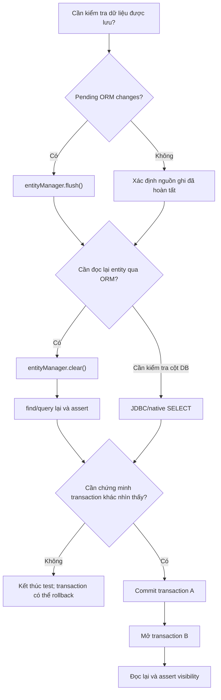

# Flush rồi clear có chủ đích để buộc kiểm chứng dữ liệu đã lưu

## 1. Vì sao save rồi find có thể đang tự kiểm tra chính object trong bộ nhớ?

Một test repository thường có dạng:

```java
PurchaseOrder order = new PurchaseOrder("NEW", new BigDecimal("250.00"));
repository.save(order);

PurchaseOrder found = repository.findById(order.getId()).orElseThrow();
assertThat(found.getStatus()).isEqualTo("NEW");
```

Test có thể pass, nhưng chưa chắc nó đã chứng minh database thực sự chứa trạng thái mong đợi. Hibernate quản lý entity trong **Persistence Context** (first-level cache). Nếu entity đã được nạp hoặc vẫn đang managed, một lần tìm lại có thể trả về chính Java object đó mà không cần SELECT mới.

Điều này dễ xảy ra khi:

- Test chạy trong một transaction duy nhất.
- Entity được persist/save rồi truy vấn lại ngay.
- find() tìm thấy entity trong first-level cache.
- Test chỉ assert trên object vừa set field.
- SQL chưa được flush xuống database tại thời điểm assertion.

Một cách kiểm chứng rõ ràng hơn:

1. Tạo hoặc sửa entity.
2. Gọi **flush()** để buộc Hibernate đồng bộ thay đổi pending xuống database trong transaction hiện tại.
3. Gọi **clear()** để detach toàn bộ managed entities khỏi Persistence Context.
4. Tải lại entity bằng ID hoặc query.
5. Assert giá trị được đọc lại từ database.

```text
Managed object
   |
   | persist/update
   v
Persistence Context (pending changes)
   |
   | flush()
   v
SQL INSERT / UPDATE / DELETE trong transaction
   |
   | clear()
   v
Persistence Context rỗng; object cũ detached
   |
   | find/query lại
   v
SELECT từ database -> object mới
   |
   v
assert persisted state
```

Đây là kỹ thuật kiểm thử quan trọng với Hibernate ORM: **flush rồi clear có chủ đích để buộc kiểm chứng dữ liệu đã lưu**. Bài học phân biệt flush, commit, clear và detach; chỉ ra cách áp dụng trong Spring Data JPA; đồng thời giải thích giới hạn của phép kiểm chứng trong transaction rollback của test.

## 2. Persistence Context giữ gì?

Persistence Context là vùng quản lý entity instances trong một unit of work. Với cùng entity type và primary key trong một context, Hibernate duy trì identity: ứng dụng thường làm việc với cùng một managed instance.

Ví dụ:

```java
PurchaseOrder first = entityManager.find(PurchaseOrder.class, 10L);
PurchaseOrder second = entityManager.find(PurchaseOrder.class, 10L);

assert first == second;
```

Sau lần đầu, lần thứ hai thường không cần SELECT mới nếu entity vẫn managed trong context.

### Dirty checking và write-behind

Hibernate theo dõi trạng thái managed entity. Khi field thay đổi:

```java
PurchaseOrder order = entityManager.find(PurchaseOrder.class, 10L);
order.setStatus("PAID");
```

Hibernate có thể ghi nhận dirty state và sinh UPDATE khi flush. Việc gọi setter không có nghĩa SQL UPDATE đã chạy ngay tại dòng đó.

Hibernate thường trì hoãn SQL cho đến thời điểm flush. Nó gom các thay đổi trong Persistence Context và đồng bộ chúng theo thứ tự phù hợp với mapping, cascade và constraints.

Vì vậy:

```java
order.setStatus("PAID");
assertThat(order.getStatus()).isEqualTo("PAID");
```

chỉ chứng minh Java object có giá trị PAID. Nó chưa chứng minh DB row đã nhận giá trị đó.

## 3. Flush là gì?

flush() yêu cầu persistence provider đồng bộ các thay đổi pending trong Persistence Context với database.

```java
entityManager.flush();
```

Trong Hibernate, thao tác này có thể phát:

- INSERT cho entity mới.
- UPDATE cho entity dirty.
- DELETE cho entity bị remove.
- SQL cho association/collection tables.
- Những statement cần thiết để đồng bộ mapping.

Flush thường xảy ra tự động ở một số thời điểm, chẳng hạn trước commit hoặc trước query cần đảm bảo kết quả phản ánh thay đổi pending theo flush mode. Trong test, explicit flush làm mốc kiểm chứng dễ hiểu và ít phụ thuộc timing hơn.

### Flush không phải commit

| Thao tác | Ý nghĩa |
|---|---|
| persist() | Đưa entity mới vào trạng thái managed; SQL có thể chưa chạy |
| Thay đổi managed entity | Dirty state được ghi nhận |
| flush() | Phát SQL đồng bộ pending changes trong transaction |
| commit() | Kết thúc transaction thành công; thay đổi được commit theo database semantics |
| rollback() | Hủy các thay đổi chưa commit trong transaction |

Sau flush, SQL có thể đã chạy nhưng transaction vẫn chưa commit. Một transaction khác thường chưa nhìn thấy dữ liệu chưa commit, tùy isolation/database.

### Flush không bảo đảm mọi constraint đã được kiểm tra

Nhiều constraints được database kiểm tra ngay khi INSERT/UPDATE thực thi, nên lỗi xuất hiện tại flush. Tuy nhiên, constraint được khai báo deferred có thể chỉ được kiểm tra khi commit. Flush giúp phát hiện nhiều lỗi persistence sớm hơn nhưng không thay thế kiểm tra commit cho semantics deferred.

## 4. Clear là gì?

entityManager.clear() detach **tất cả** managed entities khỏi Persistence Context hiện tại.

```java
entityManager.clear();
```

Sau clear:

- Những entity instances trước đó không còn managed.
- Dirty checking không còn theo dõi object cũ.
- Những object Java vẫn tồn tại nếu biến local còn giữ reference, nhưng chúng là detached.
- Một lần find() sau đó phải lấy entity vào context lại nếu không có cache/path khác đáp ứng.

Ví dụ:

```java
PurchaseOrder original = entityManager.find(PurchaseOrder.class, 10L);
entityManager.clear();

assertThat(entityManager.contains(original)).isFalse();

PurchaseOrder reloaded = entityManager.find(PurchaseOrder.class, 10L);
assertThat(entityManager.contains(reloaded)).isTrue();
assertThat(reloaded).isNotSameAs(original);
```

clear() không xóa rows trong database. Nó chỉ xóa các managed references khỏi Persistence Context.

### Clear không tự flush

Nếu có pending changes mà gọi clear trước flush, các entities bị detach và những thay đổi chưa được gửi xuống DB có thể không được lưu:

```java
PurchaseOrder order = new PurchaseOrder("NEW", amount);
entityManager.persist(order);

entityManager.clear(); // Pending state bị detach trước khi đồng bộ.
```

Khi mục tiêu là xác nhận dữ liệu được lưu, thứ tự cần là **flush trước, clear sau**.

## 5. Vì sao phải gọi cả flush và clear?

Hai thao tác giải quyết hai vấn đề khác nhau:

| Thao tác | Vấn đề được giải quyết |
|---|---|
| flush() | Bắt Hibernate phát SQL cho pending changes |
| clear() | Loại object managed khỏi first-level cache để lần đọc tiếp theo không dựa vào instance cũ |

Nếu chỉ flush mà không clear:

```java
entityManager.persist(order);
entityManager.flush();

PurchaseOrder found = entityManager.find(PurchaseOrder.class, order.getId());
```

find() vẫn có thể trả về cùng order trong Persistence Context. SQL INSERT đã chạy, nhưng assertion chưa nhất thiết đọc lại row bằng SELECT.

Nếu chỉ clear mà không flush:

```java
entityManager.persist(order);
entityManager.clear();

PurchaseOrder found = entityManager.find(PurchaseOrder.class, order.getId());
```

Entity mới có thể đã bị detach trước khi INSERT được phát. Test có thể nhận null hoặc kết quả phụ thuộc ID generation/SQL đã phát trước đó. Đây không phải mẫu kiểm chứng đáng tin.

Mẫu rõ ràng:

```java
entityManager.persist(order);
entityManager.flush();
entityManager.clear();

PurchaseOrder reloaded =
    entityManager.find(PurchaseOrder.class, order.getId());
```

## 6. Mẫu kiểm thử cơ bản với JPA EntityManager

Giả sử entity:

```java
@Entity
@Table(name = "purchase_orders")
public class PurchaseOrder {

    @Id
    @GeneratedValue(strategy = GenerationType.IDENTITY)
    private Long id;

    @Column(nullable = false)
    private String status;

    @Column(name = "total_amount", nullable = false,
            precision = 18, scale = 2)
    private BigDecimal totalAmount;

    protected PurchaseOrder() {}

    public PurchaseOrder(String status, BigDecimal totalAmount) {
        this.status = status;
        this.totalAmount = totalAmount;
    }

    public Long getId() { return id; }
    public String getStatus() { return status; }
    public BigDecimal getTotalAmount() { return totalAmount; }

    public void setStatus(String status) {
        this.status = status;
    }
}
```

Test:

```java
@DataJpaTest
class PurchaseOrderPersistenceTest {

    @Autowired
    private TestEntityManager entityManager;

    @Test
    void reloadsInsertedStateAfterFlushAndClear() {
        PurchaseOrder order = new PurchaseOrder(
            "NEW",
            new BigDecimal("250.00")
        );

        entityManager.persist(order);
        entityManager.flush();

        Long id = order.getId();
        assertThat(id).isNotNull();

        entityManager.clear();

        PurchaseOrder reloaded =
            entityManager.find(PurchaseOrder.class, id);

        assertThat(reloaded).isNotNull();
        assertThat(reloaded).isNotSameAs(order);
        assertThat(reloaded.getStatus()).isEqualTo("NEW");
        assertThat(reloaded.getTotalAmount())
            .isEqualByComparingTo("250.00");
    }
}
```

TestEntityManager là tiện ích của Spring Boot/Spring Test cho JPA slice tests. Nó cung cấp các thao tác như persist, flush, clear và find, giúp test thể hiện rõ Persistence Context lifecycle.

## 7. Kiểm chứng một UPDATE, không chỉ INSERT

Một test thường cần xác nhận dirty checking phát UPDATE và giá trị mới đọc lại từ database.

```java
@Test
void reloadsUpdatedStateAfterFlushAndClear() {
    PurchaseOrder order = new PurchaseOrder(
        "NEW",
        new BigDecimal("250.00")
    );

    entityManager.persist(order);
    entityManager.flush();

    Long id = order.getId();

    order.setStatus("PAID");
    entityManager.flush();

    entityManager.clear();

    PurchaseOrder reloaded =
        entityManager.find(PurchaseOrder.class, id);

    assertThat(reloaded).isNotSameAs(order);
    assertThat(reloaded.getStatus()).isEqualTo("PAID");
}
```

Đoạn này xác minh:

1. Entity được insert.
2. Entity chuyển từ managed state sang dirty state.
3. Flush đồng bộ UPDATE.
4. Clear detach object cũ.
5. Find nạp state lại.

Nếu bỏ clear, assertion có thể đọc chính object đã gọi setter, không buộc Hibernate phải SELECT.

## 8. Kiểm tra SQL thực tế bằng JdbcTemplate

Đôi khi mục tiêu test không chỉ là đọc lại entity mà là xác nhận **giá trị cột vật lý** trong database.

Có thể dùng JDBC trong cùng transaction sau flush:

```java
@DataJpaTest
class PurchaseOrderColumnTest {

    @Autowired
    private TestEntityManager entityManager;

    @Autowired
    private JdbcTemplate jdbcTemplate;

    @Test
    void verifiesStoredColumnValue() {
        PurchaseOrder order = new PurchaseOrder(
            "PAID",
            new BigDecimal("125.50")
        );

        entityManager.persist(order);
        entityManager.flush();

        String storedStatus = jdbcTemplate.queryForObject(
            "select status from purchase_orders where id = ?",
            String.class,
            order.getId()
        );

        assertThat(storedStatus).isEqualTo("PAID");
    }
}
```

JDBC query đọc trực tiếp cột DB, tránh dựa vào entity getter. Nhưng:

- JDBC vẫn chạy trong transaction hiện tại nếu dùng cùng transaction-managed DataSource.
- Transaction có thể chưa commit.
- Transaction đó nhìn thấy writes của chính nó.
- JDBC không chứng minh một transaction khác đã nhìn thấy dữ liệu.

Nếu mục tiêu là kiểm tra SQL mapping, column type, converter hoặc trigger, direct JDBC assertion hữu ích. Nếu mục tiêu là cross-transaction visibility sau commit, cần test commit và transaction mới.

## 9. detach(), clear() và refresh() khác nhau thế nào?

JPA có:

```java
entityManager.detach(order);
```

detach(order) chỉ detach một entity instance cụ thể. clear() detach tất cả managed entities.

| API | Phạm vi |
|---|---|
| detach(entity) | Một entity |
| clear() | Toàn bộ Persistence Context |
| refresh(entity) | Tải lại state của một managed entity từ DB, ghi đè state hiện tại của nó |

### Vì sao test thường chọn clear?

Test thường muốn chắc chắn mọi entity cũ, bao gồm associations được nạp trước đó, không thể làm sai kết quả. clear() tạo ranh giới dễ hiểu: context hiện tại không còn managed entities.

### Khi nào dùng detach?

Nếu chỉ cần buộc một entity được tải lại mà vẫn muốn các entity khác trong context tiếp tục managed, có thể detach entity đó:

```java
entityManager.flush();
entityManager.detach(order);

PurchaseOrder reloaded = entityManager.find(PurchaseOrder.class, id);
```

Với test persistence đơn giản, flush(); clear(); thường dễ đọc hơn.

### Refresh khác clear rồi find

refresh() tải lại state từ database vào **cùng entity instance đang managed**:

```java
PurchaseOrder order = entityManager.find(PurchaseOrder.class, id);
order.setStatus("UNSAVED-LOCAL-CHANGE");

entityManager.refresh(order);
assertThat(order.getStatus()).isEqualTo("PAID");
```

Refresh có thể ghi đè những thay đổi chưa flush trên entity. Vì vậy không gọi refresh tùy tiện sau khi chỉnh sửa.

| Kỹ thuật | Kết quả |
|---|---|
| flush(); clear(); find() | Đồng bộ pending state, detach toàn bộ, rồi tạo/load entity instance mới |
| flush(); detach(entity); find() | Đồng bộ, detach một entity, rồi load lại entity đó |
| refresh(entity) | Nạp lại state vào cùng managed instance; có thể ghi đè local changes |

## 10. Vì sao save() của Spring Data JPA chưa đủ để chứng minh SQL đã chạy?

JpaRepository.save(entity) thường gọi persist() cho entity mới hoặc merge() cho entity detached theo cách Spring Data xác định.

```java
PurchaseOrder saved = repository.save(order);
```

Method return không nhất thiết có nghĩa SQL INSERT/UPDATE đã được phát. Flush có thể diễn ra sau đó khi transaction commit, explicit flush hoặc query khiến provider auto-flush theo flush mode.

Spring Data có saveAndFlush():

```java
PurchaseOrder saved = repository.saveAndFlush(order);
```

Nó yêu cầu flush sau save, nhưng **không clear Persistence Context**. Nếu mục tiêu là buộc reload:

```java
PurchaseOrder saved = repository.saveAndFlush(order);
Long id = saved.getId();

entityManager.clear();

PurchaseOrder reloaded = repository.findById(id).orElseThrow();
```

Không nhầm saveAndFlush() với commit.

## 11. TestEntityManager trong @DataJpaTest

Spring Boot @DataJpaTest thường:

- Tạo application context tập trung vào JPA components.
- Cấu hình database test theo auto-configuration.
- Cấu hình transaction cho mỗi test và mặc định rollback khi kết thúc.
- Có thể dùng embedded database nếu dependency/configuration phù hợp.

Ví dụ:

```java
@DataJpaTest
class OrderRepositoryTest {

    @Autowired
    TestEntityManager entityManager;

    @Autowired
    OrderRepository repository;

    @Test
    void filtersAndReloadsPersistedOrders() {
        PurchaseOrder order = new PurchaseOrder(
            "NEW",
            new BigDecimal("99.00")
        );

        entityManager.persist(order);
        entityManager.flush();
        Long id = order.getId();

        entityManager.clear();

        PurchaseOrder actual = repository.findById(id).orElseThrow();
        assertThat(actual.getStatus()).isEqualTo("NEW");
    }
}
```

Nếu muốn dùng DB vendor thật, cấu hình Testcontainers hoặc datasource tương ứng. Không giả định mọi @DataJpaTest đều chạy trên cùng loại database như production.

## 12. Test transaction rollback: dữ liệu đã flush vẫn có thể biến mất

@DataJpaTest thường chạy test trong transaction và rollback khi test kết thúc.

```java
entityManager.persist(order);
entityManager.flush();
entityManager.clear();

PurchaseOrder reloaded =
    entityManager.find(PurchaseOrder.class, id);

assertThat(reloaded).isNotNull();
```

Assertion có thể pass vì transaction hiện tại nhìn thấy writes của chính nó. Nhưng khi test kết thúc và transaction rollback, row không còn được commit.

Vì vậy cần phân biệt:

**Đã flush và có thể đọc lại trong cùng transaction** không đồng nghĩa **đã commit và tồn tại sau transaction**.

Flush-clear đủ khi kiểm tra Hibernate đã phát INSERT/UPDATE, mapping cột, entity có thể đọc lại trong transaction, converter hoặc constraint immediate.

Cần commit thật khi kiểm tra dữ liệu được transaction khác nhìn thấy, commit callbacks, deferred constraints hoặc behavior phụ thuộc transaction completion.

## 13. Kiểm tra cross-transaction visibility

Có thể dùng TransactionTemplate để chủ động tạo hai transactions trong test không có outer test transaction.

```java
@SpringBootTest
class CommittedOrderVisibilityTest {

    @Autowired
    PlatformTransactionManager transactionManager;

    @Autowired
    EntityManager entityManager;

    @Test
    void committedRowIsVisibleInANewTransaction() {
        TransactionTemplate tx =
            new TransactionTemplate(transactionManager);

        Long id = tx.execute(status -> {
            PurchaseOrder order = new PurchaseOrder(
                "PAID",
                new BigDecimal("125.00")
            );
            entityManager.persist(order);
            entityManager.flush();
            return order.getId();
        });

        PurchaseOrder reloaded = tx.execute(status ->
            entityManager.find(PurchaseOrder.class, id)
        );

        assertThat(reloaded).isNotNull();
        assertThat(reloaded.getStatus()).isEqualTo("PAID");
    }
}
```

TransactionTemplate.execute() commit transaction nếu callback hoàn tất bình thường; lần execute() tiếp theo chạy transaction mới. Đây là cách chứng minh cross-transaction visibility.

### Cẩn trọng với test data

Test này không có outer @Transactional rollback tự động bao trùm transaction đầu. Row được commit thật và cần được dọn bằng test schema/database riêng, cleanup transaction hoặc dataset isolation. Đừng để committed test data làm các lần chạy sau bị trùng unique keys.

## 14. Dùng TestTransaction để chủ động commit trong test transaction

Với Spring Test, một test có thể dùng TestTransaction để kết thúc transaction hiện tại và bắt đầu transaction khác:

```java
@DataJpaTest
class OrderCommitTest {

    @Autowired
    TestEntityManager entityManager;

    @Test
    void committedDataCanBeReadInNextTestTransaction() {
        PurchaseOrder order = new PurchaseOrder(
            "PAID",
            new BigDecimal("80.00")
        );

        entityManager.persist(order);
        entityManager.flush();
        Long id = order.getId();

        TestTransaction.flagForCommit();
        TestTransaction.end();

        TestTransaction.start();

        PurchaseOrder reloaded =
            entityManager.find(PurchaseOrder.class, id);

        assertThat(reloaded).isNotNull();
        assertThat(reloaded.getStatus()).isEqualTo("PAID");
    }
}
```

Transaction thứ hai vẫn được test framework quản lý và thường rollback ở cuối test. Transaction đầu đã commit thật, vì vậy test cần cô lập dữ liệu/cleanup phù hợp.

Không dùng TestTransaction chỉ để thay cho flush(); clear(); trong mọi test. Chọn mức kiểm chứng phù hợp với câu hỏi.

## 15. Kiểm tra DB defaults và trigger

Một lý do hữu ích để flush rồi clear là xác minh giá trị do database tạo hoặc biến đổi.

Ví dụ:

```sql
CREATE TABLE audit_records (
    id BIGINT PRIMARY KEY,
    event_type VARCHAR(40) NOT NULL,
    created_at TIMESTAMP NOT NULL DEFAULT CURRENT_TIMESTAMP
);
```

Nếu mapping để database tự tạo created_at, test cần:

1. Insert row.
2. Flush để INSERT chạy.
3. Clear Persistence Context.
4. Reload row.
5. Assert created_at có giá trị hợp lệ.

Ví dụ mapping:

```java
@Column(
    name = "created_at",
    insertable = false,
    updatable = false
)
private Instant createdAt;
```

Với database-generated properties, mapping Hibernate có thể cần annotation/cấu hình generated-value phù hợp để provider biết khi nào phải đọc lại giá trị. clear() rồi query lại là cách kiểm chứng giá trị persisted mà không phụ thuộc object cũ.

### Trigger sửa cột

Một trigger có thể chuẩn hóa giá trị hoặc cập nhật timestamp khi INSERT/UPDATE. Nếu entity trong Persistence Context chưa được refresh, Java object có thể không phản ánh giá trị sau trigger.

```java
entityManager.persist(record);
entityManager.flush();
entityManager.clear();

AuditRecord reloaded =
    entityManager.find(AuditRecord.class, recordId);

assertThat(reloaded.getCreatedAt()).isNotNull();
assertThat(reloaded.getNormalizedCode()).isEqualTo("ABC-123");
```

Khi trigger/default phụ thuộc DB vendor, hãy chạy test trên database cùng vendor. Embedded database có thể không mô phỏng đúng trigger/DDL production.

## 16. Kiểm tra AttributeConverter và kiểu dữ liệu

Một AttributeConverter có thể biến Java value thành DB representation:

```java
@Converter
public class OrderStatusConverter
        implements AttributeConverter<OrderStatus, String> {

    @Override
    public String convertToDatabaseColumn(OrderStatus status) {
        return status == null ? null : status.getCode();
    }

    @Override
    public OrderStatus convertToEntityAttribute(String code) {
        return code == null ? null : OrderStatus.fromCode(code);
    }
}
```

Test chỉ gọi getter trên object vừa persist chưa đủ để xác nhận round-trip converter.

```java
entityManager.persist(order);
entityManager.flush();
entityManager.clear();

PurchaseOrder reloaded =
    entityManager.find(PurchaseOrder.class, id);

assertThat(reloaded.getStatus()).isEqualTo(OrderStatus.PAID);
```

Đây là round-trip test: Java → DB representation → Java. Có thể thêm JDBC assertion để kiểm tra literal code thực sự trong column.

## 17. Kiểm tra generated ID và INSERT timing

Một số ID generation strategies có thể cần INSERT sớm để lấy ID; một số khác có thể cấp ID từ sequence trước khi INSERT.

Vì vậy:

```java
entityManager.persist(order);
Long id = order.getId();
```

không chứng minh INSERT đã chạy. ID có thể đã được cấp nhưng SQL còn pending.

Gọi flush() để yêu cầu đồng bộ INSERT. Sau đó clear và reload để xác minh row.

Không viết test phụ thuộc một ID strategy cụ thể nếu test không có mục đích kiểm tra strategy đó. Nếu IDENTITY làm INSERT phát sớm hơn, explicit flush vẫn giữ ý nghĩa nhất quán.

## 18. Kiểm tra database constraints bằng flush

Ví dụ unique constraint:

```sql
ALTER TABLE customers
ADD CONSTRAINT uk_customers_email UNIQUE(email);
```

Test:

```java
entityManager.persist(new Customer("same@example.test"));
entityManager.flush();

entityManager.persist(new Customer("same@example.test"));

assertThatThrownBy(() -> entityManager.flush())
    .isInstanceOf(PersistenceException.class);
```

Trong test thực tế, exception có thể được bọc bởi Hibernate/Spring và transaction có thể đã ở trạng thái rollback-only. Không tiếp tục sử dụng Persistence Context sau một persistence exception như thể transaction vẫn khỏe mạnh.

Nếu constraint được cấu hình DEFERRABLE INITIALLY DEFERRED trên DB hỗ trợ, vi phạm có thể chỉ xuất hiện khi commit. Đừng assert rằng mọi lỗi database đều nhất thiết xuất hiện ở flush().

## 19. Flush mode ảnh hưởng thời điểm SQL

JPA có các flush modes, trong đó AUTO thường là mặc định:

```java
entityManager.setFlushMode(FlushModeType.AUTO);
```

Ở AUTO, provider có thể flush trước query nếu cần đảm bảo query nhìn thấy changes phù hợp. Với COMMIT, provider có thể trì hoãn flush đến commit theo semantics của API/provider.

Trong Hibernate còn có các modes và behavior cụ thể hơn. Khi test muốn biết chính xác SQL đã chạy trước assertion, **gọi explicit flush** thay vì phụ thuộc auto-flush.

Không đổi flush mode toàn test suite chỉ để làm một test pass. Flush mode là một phần semantics persistence và có thể ảnh hưởng kết quả query.

## 20. JPQL/HQL bulk DML: flush-clear có ý nghĩa đặc biệt

Bulk UPDATE/DELETE tác động trực tiếp database rows, không cập nhật từng managed entity trong Persistence Context.

```java
PurchaseOrder order = entityManager.find(PurchaseOrder.class, id);

entityManager.createQuery("""
    update PurchaseOrder o
    set o.status = :status
    where o.id = :id
    """)
    .setParameter("status", "EXPIRED")
    .setParameter("id", id)
    .executeUpdate();

// order có thể vẫn chứa state cũ trong Persistence Context.
```

Sau bulk DML, entity order đã managed có thể stale. Mẫu test:

```java
entityManager.flush();

int changed = entityManager.createQuery("""
    update PurchaseOrder o
    set o.status = :status
    where o.id = :id
    """)
    .setParameter("status", "EXPIRED")
    .setParameter("id", id)
    .executeUpdate();

assertThat(changed).isEqualTo(1);

entityManager.clear();

PurchaseOrder reloaded =
    entityManager.find(PurchaseOrder.class, id);

assertThat(reloaded.getStatus()).isEqualTo("EXPIRED");
```

Flush trước bulk query giúp pending changes trong Persistence Context được đồng bộ trước khi bulk SQL chạy. Clear sau bulk DML loại các managed entities stale. JPA bulk DML có semantics riêng về persistence context và lifecycle callbacks; không suy ra rằng bulk UPDATE chạy mọi entity listener, cascade hoặc Envers audit giống managed entity updates.

## 21. Native SQL và JDBC cũng nên được kiểm chứng bằng reload

Native query:

```java
entityManager.createNativeQuery("""
    update purchase_orders
    set status = 'CANCELLED'
    where id = :id
    """)
    .setParameter("id", id)
    .executeUpdate();
```

Entity đã managed trước đó có thể vẫn giữ PAID. Test cần:

```java
entityManager.flush();
// native UPDATE
entityManager.clear();

PurchaseOrder actual =
    entityManager.find(PurchaseOrder.class, id);

assertThat(actual.getStatus()).isEqualTo("CANCELLED");
```

Native DML cần được viết rõ transaction/tenant predicate và đồng bộ persistence context. Với nhiều database connections/transactions, cần kiểm tra đúng visibility boundary.

## 22. Cascade và orphan removal

Một aggregate:

```java
PurchaseOrder order = new PurchaseOrder(...);
order.addLine(new OrderLine(...));
entityManager.persist(order);
entityManager.flush();
entityManager.clear();

PurchaseOrder reloaded =
    entityManager.find(PurchaseOrder.class, order.getId());

assertThat(reloaded.getLines()).hasSize(1);
```

Test này kiểm tra cascade persist, owning side/foreign key và collection được load lại từ DB.

Với orphan removal:

```java
PurchaseOrder order = entityManager.find(PurchaseOrder.class, id);
order.removeLine(lineId);

entityManager.flush();
entityManager.clear();

PurchaseOrder reloaded = entityManager.find(PurchaseOrder.class, id);
assertThat(reloaded.getLines())
    .noneMatch(line -> line.getId().equals(lineId));
```

Điều này kiểm chứng child không còn trong collection được truy vấn lại. Nếu muốn xác nhận row child đã bị DELETE thật, thêm JDBC query:

```sql
SELECT COUNT(*)
FROM order_lines
WHERE id = ?;
```

Kỳ vọng count bằng 0 trong transaction hiện tại.

## 23. Quan hệ lazy: đừng vô tình assert trên object graph cũ

Nếu muốn xác nhận foreign key/association mapping sau persistence:

```java
entityManager.flush();
entityManager.clear();

PurchaseOrder reloaded =
    entityManager.find(PurchaseOrder.class, id);

assertThat(reloaded.getCustomer().getId())
    .isEqualTo(expectedCustomerId);
```

Nếu relation lazy, gọi getter có thể phát SELECT; test phải còn trong transaction mở. Nếu session đã đóng, có thể gặp LazyInitializationException, đây là vấn đề fetch/lifecycle khác.

Tách rõ kiểm tra foreign key đã lưu, association có thể initialize, số queries và behavior ngoài transaction. Không gộp mọi mục tiêu vào một assertion khiến test khó chẩn đoán.

## 24. Spring Data save() và EntityManager được inject

```java
@DataJpaTest
class OrderRepositoryPersistenceTest {

    @Autowired
    OrderRepository repository;

    @Autowired
    TestEntityManager testEntityManager;

    @Test
    void saveFlushClearReload() {
        PurchaseOrder order = new PurchaseOrder(
            "NEW",
            new BigDecimal("100.00")
        );

        PurchaseOrder saved = repository.save(order);
        testEntityManager.flush();

        Long id = saved.getId();
        testEntityManager.clear();

        PurchaseOrder reloaded =
            repository.findById(id).orElseThrow();

        assertThat(reloaded.getStatus()).isEqualTo("NEW");
    }
}
```

Không inject một EntityManager thực tự tạo rồi giữ qua nhiều tests. Dùng Spring-managed proxy/TestEntityManager theo lifecycle của test context.

## 25. TestEntityManager helper có thay thế clear không?

TestEntityManager cung cấp các helper như persistFlushFind() trong các phiên bản Spring Boot có API đó. Helper có thể persist, flush và find entity theo quy trình định sẵn.

Tuy nhiên, khi mục tiêu bài học là **chủ động chứng minh Persistence Context không còn giữ entity cũ**, viết explicit:

```java
entityManager.persist(order);
entityManager.flush();
entityManager.clear();

PurchaseOrder actual =
    entityManager.find(PurchaseOrder.class, order.getId());
```

dễ đọc và dễ xác minh hơn. Đừng giả định helper tên persistFlushFind luôn clear toàn bộ context nếu contract API không nói vậy; xem Javadocs của phiên bản Spring Boot đang dùng.

## 26. Second-level cache có thể làm test reload khó diễn giải

clear() chỉ clear **first-level Persistence Context**. Nó không nhất thiết xóa Hibernate second-level cache hoặc query cache.

Nếu entity được cache cấp SessionFactory:

```text
flush()
clear()   -> L1 empty
find()    -> có thể nhận từ L2 cache tùy mapping/config
```

Test vẫn có thể nhận đúng giá trị nhưng chưa chắc phát SELECT DB.

Nếu cần chứng minh DB SELECT thật:

- Tắt L2 cache cho test entity/test profile; hoặc
- Evict entity/region khỏi L2 cache bằng API phù hợp; hoặc
- Dùng JDBC query trực tiếp sau flush; hoặc
- Bật SQL logging/statistics và assert statement thực tế theo cách ổn định.

Ví dụ:

```java
entityManagerFactory.getCache()
    .evict(PurchaseOrder.class, id);

entityManager.clear();
PurchaseOrder reloaded =
    entityManager.find(PurchaseOrder.class, id);
```

JPA Cache API eviction semantics phụ thuộc provider/cache implementation. Nếu muốn test cache behavior thì viết riêng một test. Không xóa toàn bộ cache production để làm một persistence test.

## 27. Query cache cũng là một tầng khác

Hibernate query cache có thể lưu kết quả truy vấn, thường phối hợp với second-level cache. clear() không đồng nghĩa query cache bị xóa.

Một persistence round-trip test cơ bản thường không cần query cache. Giữ cache disabled cho test profile giúp hành vi dễ hiểu hơn, nếu production cache behavior không phải mục tiêu.

## 28. Flush/clear và transaction isolation

Trong cùng transaction, sau flush rồi clear, transaction đó có thể đọc lại writes của chính nó. Đây là read-your-own-writes behavior thông thường.

```text
Transaction A:
  INSERT order
  FLUSH
  CLEAR
  SELECT order -> thấy row trong A

Transaction B:
  SELECT order -> chưa chắc thấy row trước khi A commit

Transaction A:
  COMMIT

Transaction B (new statement/transaction):
  SELECT order -> thấy row theo isolation semantics
```

Nếu đang dùng READ COMMITTED, mỗi statement của B sau commit thường có thể nhìn thấy dữ liệu mới. Với repeatable read/snapshot isolation, transaction B đã bắt đầu trước commit có thể tiếp tục dùng snapshot cũ.

Vì vậy test visibility giữa transactions phải kiểm soát thời điểm bắt đầu/commit và isolation level.

## 29. Không dùng sleep để đợi dữ liệu đã commit

Một cách test sai:

```java
service.saveOrder(order);
Thread.sleep(1000);
assertThat(repository.findById(id)).isPresent();
```

Sleep không bảo đảm transaction đã commit, message consumer đã xử lý hoặc connection khác đã thấy row. Nó chỉ làm test chậm và có thể vẫn flaky.

Hãy đợi Future/CompletionStage thực sự hoàn tất, dùng transaction boundary rõ, dùng latch/event có timeout nếu test asynchronous processing, hoặc poll với condition cụ thể khi đang test eventual consistency. Flush/clear chỉ giải quyết persistence-context visibility trong transaction hiện tại; nó không thay thế synchronization cho async workflows.

## 30. Thứ tự thao tác chuẩn cho các tình huống

### Insert

```java
entityManager.persist(entity);
entityManager.flush();
entityManager.clear();
Entity actual = entityManager.find(Entity.class, id);
```

### Update managed entity

```java
Entity entity = entityManager.find(Entity.class, id);
entity.changeValue(newValue);
entityManager.flush();
entityManager.clear();
Entity actual = entityManager.find(Entity.class, id);
```

### Remove

```java
Entity entity = entityManager.find(Entity.class, id);
entityManager.remove(entity);
entityManager.flush();
entityManager.clear();
assertThat(entityManager.find(Entity.class, id)).isNull();
```

### Bulk DML

```java
entityManager.flush();
int affected = query.executeUpdate();
entityManager.clear();
Entity actual = entityManager.find(Entity.class, id);
```

### Native SQL/JDBC

```java
entityManager.flush();
// Execute native/JDBC DML.
entityManager.clear();
Entity actual = entityManager.find(Entity.class, id);
```

### DB-generated values

```java
entityManager.persist(entity);
entityManager.flush();
entityManager.clear();
Entity actual = entityManager.find(Entity.class, id);
assertThat(actual.getDatabaseGeneratedValue()).isNotNull();
```

Mỗi mẫu cần được điều chỉnh theo mapping, transaction manager và DB cụ thể.

## 31. Những gì flush không làm

Flush không:

- Commit transaction.
- Bảo đảm dữ liệu đã được transaction khác nhìn thấy.
- Xóa managed objects khỏi Persistence Context.
- Refresh state của mọi entity từ DB trigger/default.
- Bảo đảm external messages/emails đã được gửi.
- Tự sửa stale entities sau bulk DML.
- Thay thế database backup hoặc durability policy.

Một số database-generated values cần refresh/generated-property mapping. External side effects cần outbox/after-commit workflow. Bulk DML cần clear/refresh có chủ đích.

## 32. Những gì clear không làm

Clear không:

- Phát SQL cho pending changes.
- Commit hoặc rollback transaction.
- Xóa rows khỏi database.
- Xóa L2/query cache.
- Đóng EntityManager hoặc JDBC connection.
- Xóa các Java references đang giữ trong local variables.
- Đổi tenant/schema của Session đã được tạo.

Nếu cần dọn một Persistence Context sau một batch, clear có thể phù hợp. Nếu cần đóng resource, phải kết thúc EntityManager/Session theo đúng lifecycle.

## 33. Test lỗi: flush ném exception thì làm gì?

Ví dụ duplicate key:

```java
entityManager.persist(duplicate);

assertThatThrownBy(entityManager::flush)
    .isInstanceOf(RuntimeException.class);
```

Sau persistence exception, transaction thường có thể bị đánh dấu rollback-only. Không tiếp tục query/save trong cùng context để xem có ổn không.

Mẫu an toàn:

- Test exception ở một test riêng.
- Để test transaction rollback.
- Hoặc bắt lỗi ở ngoài transaction boundary và xác nhận transaction đã rollback.
- Không dùng context lỗi để tiếp tục assertions về persistence bình thường.

Một số lỗi chỉ xuất hiện tại commit (deferred constraints, transaction completion callbacks). Test phải đặt assertion tại đúng boundary.

## 34. SQL logging và Hibernate statistics hỗ trợ điều gì?

Để xác nhận clear() đã làm phát SELECT, có thể bật SQL logging trong test profile hoặc lấy Hibernate statistics.

Ví dụ cấu hình:

```properties
logging.level.org.hibernate.SQL=DEBUG
logging.level.org.hibernate.orm.jdbc.bind=TRACE
```

Không bật bind parameter TRACE trên môi trường có dữ liệu nhạy cảm hoặc production nếu không có chính sách kiểm soát logs.

Statistics:

```java
SessionFactory sessionFactory =
    entityManagerFactory.unwrap(SessionFactory.class);
Statistics statistics = sessionFactory.getStatistics();

statistics.clear();

// Chạy workload đã xác định.
entityManager.persist(order);
entityManager.flush();
entityManager.clear();
entityManager.find(PurchaseOrder.class, id);

long statements = statistics.getPrepareStatementCount();
```

Statistics thường ở cấp SessionFactory và có thể chịu ảnh hưởng từ các tests/threads khác. Dùng test context cô lập hoặc đo delta trong điều kiện không có workload song song. SQL logging là bằng chứng chẩn đoán; assertion trên exact SQL string dễ phụ thuộc dialect/provider version.

## 35. Flush rồi clear trong test batch processing

Một test tạo nhiều entities:

```java
for (int i = 0; i < 1000; i++) {
    entityManager.persist(new Customer("Customer " + i));

    if ((i + 1) % 100 == 0) {
        entityManager.flush();
        entityManager.clear();
    }
}
```

Đây là mẫu vừa giảm Persistence Context growth vừa kiểm chứng các chunks đã đồng bộ SQL.

Nhưng nếu mục tiêu test là một transaction duy nhất:

- Các lần flush không commit.
- Các lần clear detach entities, nhưng transaction vẫn mở.
- Locks/log volume vẫn có thể tích lũy cho tới commit.

Nếu mục tiêu là transaction chunks độc lập, cần transaction boundary riêng cho từng chunk, không chỉ clear.

## 36. Kiểm tra dữ liệu sau clear có thể vẫn dùng L2 cache

Nếu bạn muốn kiểm tra DB thật bằng JDBC, query qua JdbcTemplate sau flush thường trực tiếp hơn:

```java
entityManager.flush();

String status = jdbcTemplate.queryForObject(
    "select status from purchase_orders where id = ?",
    String.class,
    id
);

assertThat(status).isEqualTo("PAID");
```

Nếu muốn kiểm tra ORM materialization, dùng clear rồi find. Hai assertion bổ sung cho nhau:

- JDBC kiểm tra giá trị vật lý.
- JPA reload kiểm tra mapping/round trip.

Không nhất thiết phải dùng cả hai trong mọi test; chọn theo mục tiêu để test không quá nặng.

## 37. Kiểm thử với database vendor thật

Một số khác biệt quan trọng:

- Constraint timing.
- Trigger/default behavior.
- Sequence/identity generation.
- Timestamp precision/time zone.
- Decimal precision/rounding.
- Locking/isolation.
- Native SQL và generated columns.

Nếu production dùng PostgreSQL, một @DataJpaTest chạy H2 có thể xác nhận mapping cơ bản nhưng chưa đủ cho behavior đặc thù PostgreSQL.

Testcontainers giúp khởi chạy database vendor thật trong integration tests. Giữ version phù hợp production và chạy migrations thật trước test.

Ví dụ khung:

```java
@DataJpaTest
@Testcontainers
class PurchaseOrderPostgresTest {

    @Container
    static PostgreSQLContainer<?> postgres =
        new PostgreSQLContainer<>("postgres:16");

    @DynamicPropertySource
    static void datasourceProperties(
            DynamicPropertyRegistry registry) {
        registry.add("spring.datasource.url", postgres::getJdbcUrl);
        registry.add("spring.datasource.username", postgres::getUsername);
        registry.add("spring.datasource.password", postgres::getPassword);
    }

    @Autowired
    TestEntityManager entityManager;

    @Test
    void reloadsFromPostgresAfterFlushAndClear() {
        PurchaseOrder order = new PurchaseOrder(
            "PAID",
            new BigDecimal("125.50")
        );

        entityManager.persist(order);
        entityManager.flush();
        Long id = order.getId();

        entityManager.clear();

        PurchaseOrder actual =
            entityManager.find(PurchaseOrder.class, id);

        assertThat(actual.getTotalAmount())
            .isEqualByComparingTo("125.50");
    }
}
```

Đây là ví dụ khung. Dự án cần dependencies Testcontainers/JUnit, cấu hình migrations và tránh để datasource embedded override properties của container. Với Spring Boot version mới, cách khai báo service connection có thể gọn hơn; dùng cơ chế phù hợp version dự án.

## 38. Test transaction boundaries không phụ thuộc vào test rollback

Một số behavior cần transaction thật: commit callback, deferred constraints, cross-transaction reads, isolation/snapshot visibility và transactional event listeners.

Một test method có @Transactional và mặc định rollback không tự kiểm chứng các behavior này. Hãy dùng transaction template hoặc Spring Test transaction controls để commit có chủ đích.

```text
Transaction A:
  persist
  flush
  commit

Transaction B:
  clear/new persistence context
  SELECT
  assert visible
```

Nếu muốn test consumer async, hãy chờ consumer hoàn thành và đọc bằng transaction mới. flush(); clear(); trong transaction A không chứng minh consumer B đã nhìn thấy row trước commit.

## 39. Phân biệt test persistence với test business behavior

Flush-clear test trả lời:

> Mapping và transaction hiện tại đã ghi dữ liệu thế nào, và ORM đọc lại có ra state đó không?

Nó không tự trả lời:

- User có quyền tạo Order không?
- Quy tắc chuyển NEW → PAID có đúng không?
- Email đã gửi chưa?
- Outbox dispatcher đã publish chưa?
- Transaction khác có commit thành công không?
- API có trả DTO đúng không?

Những câu hỏi đó cần service/security/integration tests tương ứng. Không nhồi toàn bộ behavior vào một test persistence.

## 40. Những lỗi thường gặp

| Lỗi | Hệ quả |
|---|---|
| Chỉ save rồi assert trên object cũ | Chỉ kiểm tra Java state |
| Chỉ flush mà không clear | Find có thể trả L1 managed instance |
| Clear trước flush | Pending changes có thể bị detach và không ghi |
| Nhầm flush với commit | Test tưởng dữ liệu đã bền vững |
| Dùng refresh thay clear mà không hiểu semantics | Local changes có thể bị ghi đè |
| Gọi clear rồi giữ object reference cũ | Object cũ vẫn tồn tại nhưng detached |
| Chỉ kiểm tra cùng transaction | Không chứng minh cross-transaction visibility |
| @DataJpaTest rollback mặc định | Không kiểm tra commit thật |
| Bỏ qua L2/query cache | Reload có thể không phát SELECT DB |
| Test trên H2 cho trigger PostgreSQL | Semantics khác production |
| Tiếp tục dùng context sau persistence exception | Transaction có thể rollback-only |
| Bulk DML không clear | Managed entities có thể stale |
| Native SQL không flush trước | Pending ORM changes có thể chưa được đồng bộ |
| Chỉ assert entity getter | Không xác minh physical column |
| Dùng sleep để đợi async commit | Test chậm và flaky |

## 41. Quy trình lựa chọn mức kiểm chứng



## 42. Bài thực hành 1: insert rồi reload

Tạo PurchaseOrder có ID, status và amount.

1. Persist entity.
2. Assert ID nếu generation strategy cấp sớm.
3. Flush.
4. Clear.
5. Assert entity cũ không còn managed.
6. Find theo ID.
7. Assert object mới khác object cũ.
8. Assert status/amount đúng.

Giải thích vì sao bỏ clear có thể khiến test chỉ kiểm tra first-level cache.

## 43. Bài thực hành 2: dirty checking và update

1. Persist Order trạng thái NEW.
2. Flush.
3. Tìm Order và đổi thành PAID.
4. Flush.
5. Clear.
6. Reload.
7. Assert PAID.
8. Thêm JDBC query đọc trực tiếp cột status.

Thử bỏ flush và quan sát thời điểm SQL chạy theo transaction/flush mode.

## 44. Bài thực hành 3: chứng minh clear trước flush làm mất pending state

Trong một test riêng:

1. Persist entity mới.
2. Ghi nhận ID nếu đã có.
3. Clear ngay, không flush.
4. Thử find lại trong cùng transaction.
5. Quan sát row có được insert hay không theo ID strategy/provider.
6. So sánh với persist → flush → clear → find.

Không viết assertion chung cho mọi ID strategy dựa trên timing INSERT; mục tiêu là chứng minh clear() không phải flush().

## 45. Bài thực hành 4: bulk UPDATE và stale Persistence Context

1. Load Order có status PAID.
2. Chạy JPQL bulk UPDATE thành EXPIRED.
3. Đọc getter từ object cũ.
4. Quan sát object có thể vẫn PAID.
5. Clear.
6. Reload và assert EXPIRED.
7. Thử flush trước bulk DML khi có pending managed changes.

Giải thích vì sao bulk DML không đồng bộ tự động mọi managed instances.

## 46. Bài thực hành 5: DB default và trigger

Trên DB vendor thật:

1. Tạo cột created_at DEFAULT CURRENT_TIMESTAMP.
2. Map cột theo hướng DB-generated.
3. Insert entity.
4. Flush rồi clear.
5. Reload.
6. Assert timestamp được DB tạo.
7. Đối chiếu JDBC SELECT.
8. Thử cùng test trên embedded DB và giải thích khác biệt nếu có.

## 47. Bài thực hành 6: commit và transaction mới

1. Tạo một test dùng TransactionTemplate.
2. Transaction A persist/flush/commit Order.
3. Transaction B query lại Order.
4. Assert state.
5. Thêm test @DataJpaTest mặc định rollback.
6. So sánh hai test và giải thích vì sao flush-clear trong test rollback không chứng minh commit durability.

## 48. Bài thực hành 7: L2 cache

1. Bật L2 cache cho Order.
2. Persist/flush.
3. Clear L1.
4. Reload và quan sát cache hit.
5. Evict entity hoặc disable L2 trong một test profile.
6. Reload và quan sát SQL.
7. Tách test persistence round-trip khỏi test cache behavior.

## 49. Câu hỏi tự kiểm tra

1. Persistence Context là gì?
2. Vì sao hai lần find cùng ID có thể trả cùng object?
3. Dirty checking hoạt động khi nào?
4. Flush làm gì?
5. Flush khác commit ở điểm nào?
6. Clear làm gì?
7. Clear có tự flush không?
8. Vì sao cần flush trước clear khi kiểm tra dữ liệu?
9. Vì sao flush mà không clear có thể chưa buộc SELECT?
10. Entity detached còn là Java object không?
11. detach(entity) khác clear() thế nào?
12. refresh(entity) khác clear rồi find thế nào?
13. saveAndFlush() có commit không?
14. @DataJpaTest mặc định kết thúc transaction thế nào?
15. Vì sao row sau flush vẫn có thể biến mất khi test kết thúc?
16. Vì sao cùng transaction có thể đọc own writes?
17. Khi nào cần transaction thứ hai?
18. TransactionTemplate giúp test commit ra sao?
19. TestTransaction.flagForCommit() có tác dụng gì?
20. Vì sao JDBC SELECT hữu ích bên cạnh ORM reload?
21. Vì sao L2 cache có thể khiến clear rồi find chưa chắc phát SELECT?
22. Bulk DML ảnh hưởng managed entities thế nào?
23. Vì sao cần flush trước native/bulk DML?
24. Vì sao cần clear sau bulk DML?
25. DB deferred constraint có thể chỉ fail khi nào?
26. Vì sao refresh có thể làm mất local changes?
27. Clear có đóng JDBC connection không?
28. Flush có gửi email hoặc publish message không?
29. Vì sao không dùng sleep để đợi commit?
30. Làm sao test DB-generated default/trigger?

**Gợi ý:** (1) vùng quản lý entities; (2) identity map; (3) khi flush đồng bộ dirty state; (4) phát SQL pending; (5) flush chưa kết thúc transaction; (6) detach toàn bộ managed entities; (7) không; (8) tránh detach pending changes; (9) L1 cache trả object cũ; (10) có nhưng detached; (11) một entity vs toàn context; (12) reload cùng instance vs context mới; (13) không; (14) thường rollback; (15) chưa commit; (16) read-your-own-writes; (17) cross-transaction visibility; (18) callback thành công dẫn tới commit; (19) yêu cầu commit test transaction; (20) đọc cột vật lý; (21) L2/query cache; (22) có thể stale; (23) thứ tự SQL; (24) bỏ stale managed state; (25) commit; (26) refresh ghi đè state; (27) không; (28) không; (29) không bảo đảm synchronization; (30) flush, clear, reload và/hoặc JDBC.

## 50. Nguyên tắc cần ghi nhớ

1. **Persist/save không đồng nghĩa SQL đã chạy.** Hibernate thường dùng write-behind và dirty checking.
2. **Flush đồng bộ pending changes xuống database trong transaction hiện tại.** Nó không commit.
3. **Clear detach toàn bộ managed entities.** Nó không flush, commit, rollback hay đóng connection.
4. **Thứ tự kiểm chứng cơ bản là flush → clear → reload → assert.** Đừng clear trước khi pending changes được đồng bộ.
5. **Clear giúp tránh first-level cache làm test đọc lại chính object cũ.** Object Java cũ vẫn tồn tại nhưng đã detached.
6. **Refresh khác clear rồi find.** Refresh ghi đè state trên cùng managed instance.
7. **saveAndFlush() vẫn không commit và không tự clear.**
8. **JDBC SELECT có thể xác minh physical column**, trong khi ORM reload xác minh mapping round-trip.
9. **@DataJpaTest thường rollback transaction cuối test.** Flush-clear trong cùng transaction không chứng minh transaction khác nhìn thấy dữ liệu đã commit.
10. **Muốn kiểm tra cross-transaction visibility, commit transaction ghi rồi đọc trong transaction mới.**
11. **L2/query cache là các tầng khác.** Clear L1 không nhất thiết buộc database SELECT.
12. **Bulk/native DML có thể làm managed entities stale.** Flush trước và clear/refresh sau theo semantics cần thiết.
13. **Database-generated defaults, triggers và deferred constraints cần test trên DB vendor phù hợp.**
14. **Sau persistence exception, không tiếp tục dùng transaction/context có thể đã rollback-only.**
15. **Flush-clear test kiểm tra persistence state; nó không thay thế business, security, async hoặc commit-boundary tests.**

Mục tiêu của kỹ thuật flush rồi clear không phải gọi thêm hai API theo thói quen. Mục tiêu là **tạo một ranh giới rõ giữa trạng thái Java đang được Hibernate quản lý và dữ liệu đã được đồng bộ xuống database**. Khi reload sau clear, test có thể kiểm tra mapping, dirty checking, cascade, bulk updates và database-generated values mà không bị first-level cache che khuất. Nếu câu hỏi còn liên quan đến commit hoặc transaction khác, hãy tạo transaction boundary thứ hai để kiểm chứng đúng điều cần chứng minh.

### Tài liệu tham khảo chính thức

- [Hibernate ORM User Guide — Flushing](https://docs.hibernate.org/orm/current/userguide/html_single/#flushing)
- [Hibernate ORM User Guide — Persistence Context](https://docs.hibernate.org/orm/current/userguide/html_single/#architecture)
- [Hibernate ORM Javadocs — Session](https://docs.hibernate.org/orm/current/javadocs/org/hibernate/Session.html)
- [Jakarta Persistence API — EntityManager](https://jakarta.ee/specifications/persistence/3.2/apidocs/jakarta.persistence/jakarta/persistence/entitymanager)
- [Jakarta Persistence Specification](https://jakarta.ee/specifications/persistence/)
- [Spring Boot Reference — Testing Spring Data JPA](https://docs.spring.io/spring-boot/reference/testing/spring-boot-applications.html)
- [Spring Framework Javadocs — TestTransaction](https://docs.spring.io/spring-framework/docs/current/javadoc-api/org/springframework/test/context/transaction/TestTransaction.html)
- [Spring Framework Javadocs — TransactionTemplate](https://docs.spring.io/spring-framework/docs/current/javadoc-api/org/springframework/transaction/support/TransactionTemplate.html)
- [Testcontainers for Java](https://java.testcontainers.org/)
