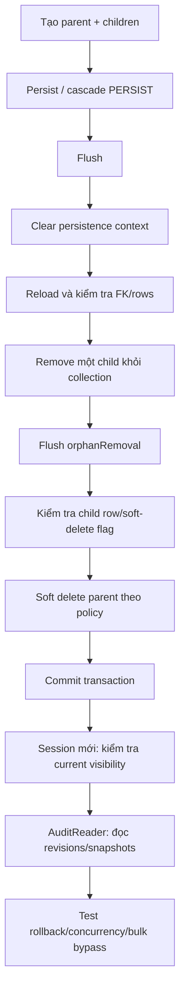

# Kiểm thử cascade, orphanRemoval, xóa mềm và dữ liệu lịch sử

Một entity có thể được lưu thành công trong unit test nhưng vẫn làm sai dữ liệu khi chạy thật: lưu Order mà không lưu OrderLine, xóa parent nhưng để lại child, bỏ một phần tử khỏi collection nhưng database không xóa orphan, soft delete làm bản ghi biến mất khỏi truy vấn hiện tại nhưng audit history không ghi đúng, hoặc rollback nghiệp vụ nhưng lịch sử vẫn còn revision không mong muốn.

Những lỗi này thường xuất hiện ở ranh giới giữa **mapping quan hệ, Hibernate persistence context, SQL thực thi, transaction và cơ chế lịch sử**. Vì vậy, chỉ gọi setter rồi assert trên object trong memory là chưa đủ. Cần kiểm tra kết quả sau flush, sau khi persistence context được làm mới, trong database thật và trong lịch sử audit nếu ứng dụng dùng Envers.

Bài học trình bày cách xây dựng kiểm thử cho bốn nhóm hành vi:

- **Cascade:** thao tác trên parent có lan sang associated entities theo cấu hình hay không?
- **orphanRemoval:** child bị loại khỏi quan hệ sở hữu có bị xóa khỏi database khi flush không?
- **Soft delete:** thao tác xóa có đánh dấu bản ghi, ẩn nó khỏi truy vấn hiện tại và giữ dữ liệu theo policy không?
- **Dữ liệu lịch sử:** các thay đổi được ghi lại đúng revision, đúng trạng thái và đúng loại thêm/sửa/xóa không?

Mục tiêu là kiểm thử cả hành vi mong muốn lẫn những đường dễ gây lỗi: thay đổi owning side, rollback, bulk DML, native SQL, concurrency, cache và migration. Ví dụ dùng Jakarta Persistence, Hibernate ORM, JUnit 5 và Spring Data JPA ở mức khái niệm; annotation/API soft delete và Envers cần khớp Hibernate version thực tế.

## 1. Phân biệt bốn khái niệm trước khi viết test

| Cơ chế | Câu hỏi nó trả lời | Hành vi cần kiểm thử |
|---|---|---|
| Cascade | Thao tác lifecycle trên entity này có truyền sang entity liên quan không? | persist, merge, remove, refresh, detach |
| orphanRemoval | Child bị bỏ khỏi quan hệ sở hữu có trở thành orphan và bị xóa không? | Collection diff, owning side, flush |
| Soft delete | Xóa logic được lưu và lọc như thế nào? | Flag update, visibility, uniqueness, restore |
| Audit/history | Những phiên bản đã commit được ghi lại ra sao? | Revision, before/after, ADD/MOD/DEL, rollback |

Chúng có thể cùng xuất hiện nhưng không thay thế nhau:

- Cascade REMOVE không đồng nghĩa orphanRemoval.
- orphanRemoval không đồng nghĩa soft delete.
- Soft delete không tự bảo đảm Envers ghi đủ lịch sử.
- Envers không tự biến bulk SQL thành entity lifecycle operations.
- Database ON DELETE CASCADE là một cơ chế khác với JPA cascade.

Một test suite tốt phải xác định chính xác mỗi behavior được giao cho tầng nào.

## 2. Ví dụ domain dùng trong bài

Giả sử hệ thống quản lý đơn hàng:

```text
PurchaseOrder (1) -------- (*) OrderLine
       |
       +---- Customer
       |
       +---- Audit revisions

OrderLine (*) -------- (1) Product
```

Một đơn hàng sở hữu các dòng hàng. Khi đơn hàng bị xóa theo nghiệp vụ, các dòng hàng cũng phải được xử lý theo policy. Khi người dùng bỏ một dòng khỏi đơn, dòng đó có thể trở thành orphan và bị xóa. Customer và Product là các entity được tham chiếu, không nhất thiết thuộc quyền sở hữu của Order.

Ví dụ entity:

```java
@Entity
@Table(name = "purchase_orders")
public class PurchaseOrder {

    @Id
    @GeneratedValue(strategy = GenerationType.IDENTITY)
    private Long id;

    @OneToMany(
        mappedBy = "order",
        cascade = CascadeType.ALL,
        orphanRemoval = true
    )
    private List<OrderLine> lines = new ArrayList<>();

    protected PurchaseOrder() {}

    public void addLine(OrderLine line) {
        lines.add(line);
        line.setOrder(this);
    }

    public void removeLine(OrderLine line) {
        lines.remove(line);
        line.setOrder(null);
    }

    public List<OrderLine> getLines() {
        return lines;
    }
}
```

```java
@Entity
@Table(name = "order_lines")
public class OrderLine {

    @Id
    @GeneratedValue(strategy = GenerationType.IDENTITY)
    private Long id;

    @ManyToOne(fetch = FetchType.LAZY, optional = false)
    @JoinColumn(name = "order_id", nullable = false)
    private PurchaseOrder order;

    @Column(nullable = false)
    private int quantity;

    protected OrderLine() {}

    public OrderLine(int quantity) {
        this.quantity = quantity;
    }

    void setOrder(PurchaseOrder order) {
        this.order = order;
    }

    public Long getId() { return id; }
    public int getQuantity() { return quantity; }
}
```

Ví dụ biểu diễn quan hệ one-to-many mà Order là aggregate owner theo nghiệp vụ. `mappedBy = "order"` cho biết `OrderLine.order` là owning side của quan hệ trong JPA mapping.

## 3. Cascade là gì?

Cascade cho phép một số thao tác lifecycle trên entity nguồn được truyền sang entity đích.

Các loại cascade JPA:

| Cascade type | Ý nghĩa |
|---|---|
| PERSIST | persist nguồn có thể persist target liên quan |
| MERGE | merge nguồn có thể merge target liên quan |
| REMOVE | remove nguồn có thể remove target liên quan |
| REFRESH | refresh nguồn có thể refresh target liên quan |
| DETACH | detach nguồn có thể detach target liên quan |
| ALL | Bao gồm các loại trên |

Ví dụ:

```java
@OneToMany(
    mappedBy = "order",
    cascade = CascadeType.PERSIST
)
private List<OrderLine> lines;
```

Khi gọi `entityManager.persist(order)`, Hibernate có thể persist các OrderLine được nối đúng quan hệ và được cascade PERSIST.

**Cascade là quy tắc truyền lifecycle operation trong ORM**, không phải tuyên bố rằng hai bảng có cùng vòng đời vật lý ở mọi đường SQL.

## 4. Cascade REMOVE khác orphanRemoval

Hai cấu hình sau không có cùng ý nghĩa:

```java
@OneToMany(
    mappedBy = "order",
    cascade = CascadeType.REMOVE
)
private List<OrderLine> lines;
```

```java
@OneToMany(
    mappedBy = "order",
    orphanRemoval = true
)
private List<OrderLine> lines;
```

- `cascade = REMOVE`: khi remove Order, thao tác remove có thể truyền tới OrderLine.
- `orphanRemoval = true`: khi OrderLine bị loại khỏi quan hệ sở hữu, child trở thành orphan và có thể bị xóa khi flush.
- Có thể dùng cả hai cùng với `CascadeType.ALL`, nhưng phải hiểu rõ ownership và lifecycle.
- orphanRemoval không phải một cascade type độc lập trong enum `CascadeType`.

Một test chỉ remove parent sẽ không chứng minh orphanRemoval hoạt động. Cần test riêng việc remove child khỏi collection trong khi parent vẫn tồn tại.

## 5. Owning side và inverse side

Trong mapping hai chiều:

```java
@OneToMany(mappedBy = "order")
private List<OrderLine> lines;
```

```java
@ManyToOne
@JoinColumn(name = "order_id")
private PurchaseOrder order;
```

`OrderLine.order` là owning side vì nó ánh xạ foreign key `order_id`. `PurchaseOrder.lines` là inverse side vì `mappedBy` trỏ về property owning side.

Một lỗi thường gặp:

```java
order.getLines().add(line);
// Quên line.setOrder(order)
```

Collection trong memory có thể hiển thị child, nhưng foreign key không được thiết lập đúng. Test chỉ assert `order.getLines().size()` trước flush có thể pass trong khi database không có quan hệ như mong muốn.

Dùng helper methods để cập nhật đồng thời hai phía:

```java
public void addLine(OrderLine line) {
    lines.add(line);
    line.setOrder(this);
}

public void removeLine(OrderLine line) {
    lines.remove(line);
    line.setOrder(null);
}
```

Test cần xác nhận cả hai phía và foreign key sau khi flush/reload.

## 6. Database cascade khác JPA cascade

Database có thể khai báo:

```sql
foreign key (order_id)
references purchase_orders(id)
on delete cascade
```

Đây là hành vi của DBMS khi xóa parent row. Trong khi đó:

```java
cascade = CascadeType.REMOVE
```

là hành vi ORM lifecycle.

Hai cơ chế có thể được dùng cùng nhau, nhưng semantics và quan sát khác nhau:

| Đặc điểm | JPA cascade REMOVE | DB ON DELETE CASCADE |
|---|---|---|
| ORM biết child lifecycle | Có thể biết và xử lý child entities | DB tự xóa child rows |
| Entity callbacks | Có thể được gọi theo lifecycle ORM | Không chạy JPA callbacks cho từng child bị DB xóa |
| Envers | Có thể ghi child changes qua Hibernate events | DB cascade trực tiếp có thể không tạo child audit entries |
| SQL | Có thể phát DELETE cho child và parent | DB có thể xóa child nội bộ khi parent DELETE |
| Native SQL | Không tự kích hoạt JPA cascade | DB constraint vẫn có thể áp dụng |

Không bật cả hai một cách vô thức. Hãy xác định audit/callback requirements rồi kiểm thử behavior thật trên DBMS.

## 7. Vì sao cần integration test với database thật?

Hành vi cascade/orphan removal phụ thuộc vào:

- Mapping metadata.
- Hibernate action queue và flush order.
- Foreign key constraints.
- Database dialect.
- ON DELETE behavior.
- Soft-delete implementation.
- Audit listeners.
- Transaction isolation.
- Cache provider.
- Migration schema.

H2 có thể hữu ích cho test nhanh, nhưng không chứng minh PostgreSQL, MySQL, Oracle hoặc SQL Server sẽ có cùng SQL, constraint semantics và trigger behavior.

Với logic xóa dữ liệu quan trọng, nên dùng Testcontainers hoặc database integration environment cùng loại với production.

## 8. Thiết lập integration test với JUnit và Testcontainers

Một dependency minh họa với Gradle:

```kotlin
dependencies {
    testImplementation("org.junit.jupiter:junit-jupiter")
    testImplementation("org.testcontainers:junit-jupiter")
    testImplementation("org.testcontainers:postgresql")
    testImplementation("org.springframework.boot:spring-boot-starter-test")
}
```

Version nên được quản lý bằng BOM/dependency management phù hợp dự án.

Ví dụ container:

```java
@Testcontainers
@SpringBootTest
class OrderLifecycleIntegrationTest {

    @Container
    static PostgreSQLContainer<?> postgres =
        new PostgreSQLContainer<>("postgres:16");

    // Configure datasource from container properties.
}
```

Đây là skeleton. Cần kết nối container properties vào Spring datasource, chạy migrations và bootstrap Hibernate trước khi test.

**Không coi test chỉ dùng create-drop là tương đương migrations production.** Nếu ứng dụng dùng Flyway/Liquibase, test nên chạy cùng migrations.

## 9. Vì sao test phải flush rồi clear?

Hibernate dùng persistence context để quản lý entities. Sau khi thay đổi object, dữ liệu có thể chỉ nằm trong memory và chưa được gửi SQL.

Ví dụ:

```java
order.addLine(new OrderLine(2));

assertEquals(1, order.getLines().size());
```

Assertion này chỉ xác nhận Java collection thay đổi. Nó không chứng minh cascade PERSIST đã chạy.

Mẫu kiểm thử:

```java
entityManager.persist(order);
entityManager.flush();
entityManager.clear();

PurchaseOrder reloaded =
    entityManager.find(PurchaseOrder.class, orderId);

assertEquals(1, reloaded.getLines().size());
```

- `flush()` buộc Hibernate đồng bộ pending changes xuống database.
- `clear()` xóa managed entities khỏi L1 persistence context.
- `find()` sau đó phải load state mới từ cache/database theo cấu hình.
- Nếu cần chứng minh database state, hãy kiểm tra SQL/JDBC hoặc query DB độc lập, đồng thời kiểm soát L2 cache.

Đây là một trong những mẫu quan trọng nhất khi kiểm thử ORM.

## 10. Test cascade PERSIST

Giả sử Order có hai OrderLines mới và mapping có `cascade = PERSIST` hoặc `ALL`.

```java
@Test
void persistOrderAlsoPersistsNewLines() {
    PurchaseOrder order = new PurchaseOrder();

    order.addLine(new OrderLine(2));
    order.addLine(new OrderLine(3));

    entityManager.persist(order);
    entityManager.flush();

    Long orderId = order.getId();

    entityManager.clear();

    PurchaseOrder loaded =
        entityManager.find(PurchaseOrder.class, orderId);

    assertNotNull(loaded);
    assertEquals(2, loaded.getLines().size());
}
```

Để test mạnh hơn, query số rows ở bảng `order_lines` bằng JDBC hoặc repository mới, thay vì chỉ nhìn collection vừa được Hibernate load theo cùng mapping.

Test case cần có:

- Parent mới với 0 children.
- Parent mới với 1 child.
- Parent mới với nhiều children.
- Child đã gắn với parent khác.
- Child thiếu owning side.
- Vi phạm NOT NULL/FK.
- Transaction rollback sau persist.

## 11. Test không có cascade PERSIST

Một test âm giúp xác nhận mapping không vô tình cascade:

```java
@Test
void persistParentWithoutCascadeDoesNotSilentlyPersistChild() {
    PurchaseOrder order = new PurchaseOrder();
    OrderLine line = new OrderLine(1);

    order.getLines().add(line);

    assertThrows(
        PersistenceException.class,
        () -> {
            entityManager.persist(order);
            entityManager.flush();
        }
    );
}
```

Kết quả cụ thể phụ thuộc mapping và cách owning side được cập nhật. Nếu child transient được tham chiếu qua association không cascade, Hibernate có thể báo transient object exception khi flush. Không hardcode exception class cụ thể nếu Hibernate version/wrapper có thể bọc exception; assert cause phù hợp.

Test này giúp phát hiện developer thêm child vào collection rồi kỳ vọng ORM tự lưu dù mapping không có cascade.

## 12. Test cascade MERGE

MERGE áp dụng với detached state. Ví dụ:

```java
@Test
void mergeDetachedOrderMergesCascadedLines() {
    PurchaseOrder order = createOrderWithLine();
    Long id = order.getId();

    entityManager.flush();
    entityManager.clear();

    PurchaseOrder detached =
        entityManager.find(PurchaseOrder.class, id);

    entityManager.detach(detached);

    detached.changeLineQuantity(0, 5);

    PurchaseOrder managed =
        entityManager.merge(detached);

    entityManager.flush();
    entityManager.clear();

    PurchaseOrder reloaded =
        entityManager.find(PurchaseOrder.class, id);

    assertEquals(5, reloaded.getLines().get(0).getQuantity());
    assertNotSame(detached, managed);
}
```

`changeLineQuantity` là domain helper minh họa cần định nghĩa trong entity. Điểm quan trọng:

- `merge()` copy state từ object detached sang managed instance.
- Object trả về từ `merge()` là managed instance.
- Không giả định object đầu vào trở thành managed.
- Cascade MERGE chỉ áp dụng theo mapping liên quan.
- Collections và orphan removal cần test riêng.

Không gọi `merge()` rồi tiếp tục sửa object detached và nghĩ những sửa đổi sau đó tự được lưu.

## 13. Test cascade REMOVE

Nếu mapping dùng `cascade = REMOVE` hoặc `ALL`:

```java
@Test
void removingOrderRemovesOwnedLines() {
    Long orderId = createOrderWithTwoLines();

    PurchaseOrder order =
        entityManager.find(PurchaseOrder.class, orderId);

    entityManager.remove(order);
    entityManager.flush();

    assertEquals(0, countOrderLinesFor(orderId));
    assertEquals(0, countOrdersById(orderId));
}
```

`countOrderLinesFor` và `countOrdersById` là helpers query database độc lập.

Cần xác định chính sách khi parent bị xóa:

- Child physical delete?
- Child soft delete?
- Child được giữ lại và detach khỏi parent?
- DB ON DELETE CASCADE?
- Có audit record cho từng child không?

Không chỉ assert parent biến mất; kiểm tra child rows, FK và history.

## 14. Test orphanRemoval khi bỏ child khỏi collection

Đây là test riêng với cascade REMOVE.

```java
@Test
void removingLineFromCollectionDeletesOrphan() {
    Long orderId = createOrderWithTwoLines();
    Long lineId = findFirstLineId(orderId);

    PurchaseOrder order =
        entityManager.find(PurchaseOrder.class, orderId);

    OrderLine line = order.getLines().stream()
        .filter(x -> x.getId().equals(lineId))
        .findFirst()
        .orElseThrow();

    order.removeLine(line);

    entityManager.flush();

    assertEquals(0, countLinesById(lineId));
    assertEquals(1, countOrderLinesFor(orderId));
}
```

Sau flush, child bị orphan được xử lý theo `orphanRemoval=true`. Kiểm tra bằng query database hoặc clear/reload để tránh chỉ assert collection trong memory.

### Đừng nhầm với set foreign key null

Nếu foreign key là NOT NULL, Hibernate không thể chỉ update `order_id=null` rồi giữ child. orphanRemoval biểu đạt child không còn được sở hữu và cần được remove theo semantics của JPA.

## 15. Test thay collection reference

Một lỗi có thể xảy ra khi developer thay toàn bộ collection:

```java
order.setLines(new ArrayList<>(newLines));
```

Hibernate theo dõi persistent collection wrapper; thay reference collection trong entity có orphanRemoval có thể gây lỗi hoặc semantics không như mong muốn tùy version/mapping.

Ưu tiên mutate collection đã được quản lý qua helper methods:

```java
order.removeLine(oldLine);
order.addLine(newLine);
```

Test cần xác nhận old child bị xử lý đúng và new child được persist đúng. Không chỉ assert collection size bằng nhau trước flush.

## 16. Test child bị chuyển từ parent này sang parent khác

Một child bị loại khỏi parent A và thêm vào parent B có thể có semantics nhạy cảm khi orphanRemoval được bật. Theo ownership model, child bị orphan khỏi A có thể bị đánh dấu xóa; tái gắn cùng child sang B trong cùng unit of work không nên được coi là hành vi an toàn mặc định.

Thiết kế domain nên làm rõ:

- OrderLine có thực sự được phép chuyển giữa Orders không?
- Có phải xóa line cũ rồi tạo line mới?
- Có giữ nguyên ID và lịch sử không?
- Có cần một thao tác reassign được hỗ trợ rõ ràng?

Nếu nghiệp vụ cho phép move, hãy viết integration test riêng trên Hibernate version thực tế. Không giả định remove khỏi collection A rồi add vào B sẽ tự triệt tiêu orphan removal theo ý muốn.

## 17. Cascade không nên lan qua mọi quan hệ

Một cấu hình nguy hiểm:

```java
@ManyToMany(cascade = CascadeType.ALL)
private Set<Product> products;
```

Khi xóa một Order, Product có thể bị remove dù Product được chia sẻ bởi nhiều Orders. Đối với many-to-many, thường không cascade REMOVE tới shared target entities; xóa association/join rows là đủ.

Test negative:

- Hai Orders tham chiếu cùng Product.
- Xóa một Order.
- Product vẫn tồn tại.
- Association của Order còn lại vẫn hợp lệ.
- Join row tương ứng chỉ bị xóa theo policy.

Cascade REMOVE chỉ nên áp dụng khi nguồn thật sự sở hữu vòng đời target.

## 18. Cascade và ManyToOne

Thông thường không đặt `CascadeType.REMOVE` từ OrderLine lên Product hoặc Customer nếu chúng là dữ liệu dùng chung.

Ví dụ:

```java
@ManyToOne(fetch = FetchType.LAZY)
private Product product;
```

Xóa OrderLine không nên xóa Product. Test phải xác nhận:

- OrderLine bị xóa.
- Product vẫn tồn tại.
- Các OrderLines khác vẫn tham chiếu Product.
- FK không bị phá.

Đây là test bảo vệ khỏi cascade overreach.

## 19. CascadeType.ALL không phải lựa chọn mặc định cho mọi association

`ALL` bao gồm persist, merge, remove, refresh và detach. Một số operations có thể không phù hợp cho target entity được chia sẻ.

Ví dụ, nếu Order tham chiếu Customer tồn tại độc lập, `CascadeType.ALL` có thể làm thao tác remove Order lan sang Customer. Điều này nguy hiểm hơn nhiều so với việc chỉ cascade PERSIST.

Khi review/test mapping, hãy liệt kê lifecycle owner cho từng relationship và kiểm thử operation cụ thể. Không dùng ALL chỉ để tránh lỗi transient child khi persist.

## 20. Flush ordering và constraint violations

Hibernate có action queue, nên SQL execution order có thể khác thứ tự gọi method trong Java. Khi orphan removal và insert/update cùng transaction, DB constraints có thể ảnh hưởng kết quả.

Ví dụ thay một line bằng line mới có cùng unique business key:

- Xóa line cũ.
- Insert line mới.
- Unique constraint có thể được kiểm tra tại thời điểm cụ thể.
- Hibernate có thể xếp SQL actions theo ordering khác mong đợi.

Test trên DBMS thật để xác nhận behavior. Nếu cần thứ tự cụ thể, có thể phải thiết kế operation/mapping/transaction rõ hơn, không phụ thuộc incidental SQL order.

Không viết test assert chính xác thứ tự mọi câu DELETE/INSERT nếu ordering đó không phải contract cần bảo vệ. Ưu tiên assert trạng thái database và constraints.

## 21. Soft delete là gì?

Soft delete đánh dấu một bản ghi không còn active mà vẫn giữ row trong database.

```sql
update purchase_orders
set deleted = true,
    deleted_at = current_timestamp
where id = ?;
```

Thay vì:

```sql
delete from purchase_orders
where id = ?;
```

Entity có thể có flag:

```java
@Column(name = "deleted", nullable = false)
private boolean deleted;
```

Soft delete hữu ích khi cần khôi phục dữ liệu, giữ reference lịch sử, tránh mất thông tin nghiệp vụ, hỗ trợ audit/retention và phân biệt inactive records với hard-deleted rows.

Nhưng soft delete tạo yêu cầu mới: mọi query hiện tại, unique constraints, associations, reports và background jobs phải hiểu deleted state.

## 22. Phân biệt soft delete ở application và Hibernate

Có nhiều cách triển khai:

1. Application gọi domain method `markDeleted()` và cập nhật flag.
2. Hibernate `@SoftDelete` trong các versions hỗ trợ.
3. Legacy/custom `@SQLDelete` kết hợp filter/restriction.
4. Database trigger hoặc stored procedure.
5. Soft delete ở service/repository với SQL tường minh.

Những cách này không tương đương về lifecycle và Envers.

- Application update flag có thể tạo UPDATE event và audit MOD.
- Hibernate `@SoftDelete` có semantics ORM/provider-specific, có thể được biểu diễn như logical remove.
- `@SQLDelete` thay SQL khi remove, nhưng mapping/filter vẫn cần thiết.
- Direct SQL/trigger có thể bypass Hibernate listeners và cache invalidation.

Test cần xác nhận đường xóa cụ thể của dự án, không chỉ kiểm tra cột deleted có tồn tại.

## 23. Test soft delete bằng domain flag

Một cách đơn giản:

```java
@Entity
@Table(name = "purchase_orders")
public class PurchaseOrder {

    @Id
    private Long id;

    @Column(nullable = false)
    private boolean deleted;

    private Instant deletedAt;

    public void markDeleted(Instant now) {
        this.deleted = true;
        this.deletedAt = now;
    }

    public boolean isDeleted() {
        return deleted;
    }
}
```

Test:

```java
@Test
void markingOrderDeletedKeepsPhysicalRow() {
    Long id = createOrder();

    PurchaseOrder order =
        entityManager.find(PurchaseOrder.class, id);

    order.markDeleted(clock.instant());
    entityManager.flush();
    entityManager.clear();

    PurchaseOrder reloaded =
        entityManager.find(PurchaseOrder.class, id);

    assertTrue(reloaded.isDeleted());
    assertEquals(1, countPhysicalRows(id));
}
```

Đây là test soft-delete state, nhưng chưa kiểm tra visibility filtering. Nếu `find` theo ID vẫn trả deleted row thì application phải đảm bảo API/repository không lộ bản ghi đã xóa khi không được phép.

## 24. Test query hiện tại ẩn soft-deleted rows

Nếu dùng filter/restriction hoặc repository predicate:

```java
List<PurchaseOrder> findByDeletedFalse();
```

Test:

```java
@Test
void activeOrderQueryExcludesSoftDeletedRows() {
    Long activeId = createOrder();
    Long deletedId = createOrder();

    markDeleted(deletedId);

    entityManager.flush();
    entityManager.clear();

    List<PurchaseOrder> active =
        repository.findByDeletedFalse();

    assertTrue(active.stream()
        .anyMatch(x -> x.getId().equals(activeId)));

    assertFalse(active.stream()
        .anyMatch(x -> x.getId().equals(deletedId)));
}
```

Đừng chỉ test một repository method. Cần kiểm tra các đường đọc khác:

- findAll.
- Query by example/specification.
- JPQL/Criteria.
- Entity associations.
- Count queries.
- Native SQL.
- Reporting/export jobs.
- Admin endpoints có quyền xem deleted rows.

Nếu filter chỉ được bật theo Session, test phải xác nhận mọi code path kích hoạt filter đúng.

## 25. Hibernate @SoftDelete

Các Hibernate versions mới có annotation `org.hibernate.annotations.SoftDelete` để biểu diễn soft-delete mapping ở ORM level. Tính năng này được giới thiệu trong các Hibernate releases hiện đại (thường từ dòng 6.4); status, package APIs và supported mappings cần kiểm tra theo version cụ thể.

Ví dụ khái niệm:

```java
@Entity
@SoftDelete
public class PurchaseOrder {

    @Id
    private Long id;

    private String orderCode;
}
```

Có thể tùy chỉnh strategy/column/converter theo API của version đang dùng. Không copy ví dụ từ version khác mà không đối chiếu Javadocs.

### Những điều phải test

- `remove()` tạo SQL UPDATE flag hay DELETE?
- `find()` theo ID có ẩn deleted entity không?
- JPQL/Criteria có tự loại deleted rows không?
- Associations và collection loads có lọc đúng không?
- Unique constraints xử lý deleted rows ra sao?
- Envers ghi loại revision nào?
- Bulk DML có đi qua soft-delete semantics không?
- Restore/undelete có được hỗ trợ bằng ORM mapping hay cần custom SQL?

Đừng coi annotation là thay thế cho integration tests.

## 26. Legacy @SQLDelete và filter/restriction

Một mapping legacy có thể định nghĩa custom SQL khi Hibernate remove:

```java
@SQLDelete(
    sql = "UPDATE purchase_orders SET deleted = true WHERE id = ?"
)
```

Sau đó cần filter/restriction để truy vấn bình thường bỏ qua deleted rows, ví dụ cơ chế Hibernate-specific tùy version.

Cần lưu ý:

- Số lượng/thứ tự JDBC placeholders phải khớp mapping và version.
- Entity có `@Version` có thể cần version column trong custom SQL.
- Row count expectation cần được xử lý đúng.
- Custom SQL chỉ thay statement của ORM remove; nó không tự đảm bảo mọi native query bị lọc.
- Cache và Envers cần được kiểm tra.
- Annotation `@Where` có thay đổi/deprecation status theo Hibernate versions; API mới có thể dùng `@SQLRestriction` hoặc filter tương ứng.

Đây là vùng dễ lỗi khi upgrade Hibernate. Test cần chạy với chính version production.

## 27. Test custom soft-delete SQL

Không chỉ assert entity không còn trong repository. Cần kiểm tra database:

```java
@Test
void removeUsesSoftDeleteSql() {
    Long id = createOrder();

    PurchaseOrder order =
        entityManager.find(PurchaseOrder.class, id);

    entityManager.remove(order);
    entityManager.flush();
    entityManager.clear();

    assertEquals(1, countPhysicalRows(id));
    assertTrue(readDeletedFlag(id));
}
```

Nếu mapping lọc deleted rows, `find()` có thể trả null sau clear. Đó là behavior mong muốn nếu contract của ứng dụng yêu cầu deleted rows không xuất hiện trong current view.

Ngoài ra, kiểm tra SQL log/proxy để xác nhận ORM phát UPDATE flag thay vì DELETE vật lý nếu đây là requirement của mapping.

## 28. Unique constraints với soft delete

Giả sử `order_code` unique:

```sql
create unique index uk_order_code
on purchase_orders(order_code);
```

Nếu soft delete giữ row, tạo đơn mới dùng cùng order_code vẫn có thể vi phạm unique constraint dù đơn cũ đã bị đánh dấu deleted.

Các policy có thể là:

- Mã đơn không bao giờ được tái sử dụng.
- Unique theo active rows bằng partial/filtered unique index nếu DBMS hỗ trợ.
- Thêm tenant + deleted state vào business key theo schema strategy.
- Tạo mã mới khi restore/recreate.
- Giữ deleted row trong namespace lịch sử riêng.

Ví dụ PostgreSQL partial unique index:

```sql
create unique index uk_active_order_code
on purchase_orders(order_code)
where deleted = false;
```

Test:

1. Tạo active row A100.
2. Soft delete A100.
3. Tạo active row mới cùng mã nếu policy cho phép.
4. Xác nhận DB constraint chấp nhận.
5. Restore row cũ và kiểm tra conflict policy.

Không chỉ test repository; DB constraint mới là nguồn bảo đảm uniqueness khi concurrent requests.

## 29. Soft delete parent và child: policy phải rõ

Khi Order bị soft delete, OrderLines nên được xử lý thế nào?

Các policy phổ biến:

- Soft delete parent và tất cả owned children.
- Soft delete parent, giữ child rows nhưng ẩn qua parent association.
- Soft delete parent và physical delete ephemeral children.
- Chỉ đánh dấu parent; child vẫn tồn tại cho báo cáo.
- Archive toàn aggregate sang schema/table lịch sử.

Không có một lựa chọn đúng cho mọi domain. Mapping và service code phải thực thi đúng policy.

| Hành động | Parent | Child rows | Current query | History |
|---|---|---|---|---|
| Soft delete Order | deleted=true | Theo policy | Ẩn Order | Ghi delete event/state |
| Remove one line | Active | Child xử lý theo orphan policy | Line biến mất | Ghi thay đổi line |
| Restore Order | deleted=false | Theo restore policy | Order hiện lại | Ghi revision mới |
| Hard purge | Row bị xóa | FK/cleanup theo policy | Không còn | Retention/audit policy riêng |

Đừng giả định `cascade=REMOVE` sẽ tự chuyển mọi child thành soft-deleted theo đúng ý nghiệp vụ. Phải test trên mapping và provider thực tế.

## 30. orphanRemoval kết hợp soft delete có phức tạp gì?

`orphanRemoval=true` có nghĩa child bị orphan sẽ được remove theo JPA lifecycle. Nhưng nếu child có soft-delete mapping, remove có thể được chuyển thành UPDATE flag thay vì physical DELETE.

Điều này phụ thuộc Hibernate version/mapping và cần integration test.

Một kịch bản:

1. Tạo Order có 2 Lines.
2. Bỏ Line A khỏi collection.
3. Flush.
4. Xác nhận Line A được soft-delete hoặc physical-delete đúng policy.
5. Xác nhận Line B còn active.
6. Query collection của Order.
7. Query physical child rows.
8. Kiểm tra Envers history cho Line A nếu audit bật.

Đừng chỉ assert collection còn một item; cần biết row cũ đã bị xóa vật lý hay vẫn tồn tại với deleted flag.

## 31. Restore soft-deleted entity

Restore có thể là domain operation:

```java
public void restore() {
    if (!deleted) {
        throw new IllegalStateException("Order is active");
    }
    deleted = false;
    deletedAt = null;
}
```

Test:

```java
@Test
void restoreMakesOrderVisibleAgain() {
    Long id = createOrder();
    markDeleted(id);

    entityManager.flush();
    entityManager.clear();

    assertFalse(repository.existsActiveById(id));

    restoreOrder(id);

    entityManager.flush();
    entityManager.clear();

    assertTrue(repository.existsActiveById(id));
}
```

Phải quyết định restore có khôi phục children hay không, có thể conflict unique key hay không và ai có quyền restore. Nếu soft delete dùng Hibernate `@SoftDelete` mà API không hỗ trợ đơn giản việc clear indicator, cần explicit strategy tương thích mapping/provider, không dùng native update tùy tiện mà bỏ qua cache/history.

## 32. Envers ghi lịch sử như thế nào?

Nếu entity được đánh dấu:

```java
@Entity
@Audited
public class PurchaseOrder {
    // persistent fields
}
```

Envers có thể ghi các phiên bản lịch sử vào bảng audit như `purchase_orders_AUD` và metadata revisions như `REVINFO` (tên/cấu trúc tùy cấu hình).

Các revision types:

| Type | Ý nghĩa |
|---|---|
| `RevisionType.ADD` | Entity được thêm |
| `RevisionType.MOD` | Entity được sửa |
| `RevisionType.DEL` | Entity được remove theo Envers semantics |

Một transaction có thể tạo một revision dùng chung cho nhiều audited entity changes. Revision number không phải số lần setter được gọi và không nhất thiết liên tiếp.

## 33. Test ADD/MOD/DEL history

Một test cần tách các hành động thành transactions đã commit:

1. Transaction A: persist Order.
2. Transaction B: sửa status.
3. Transaction C: remove/soft-delete theo mapping.
4. Transaction D: đọc Envers history.

Ví dụ query:

```java
AuditReader reader =
    AuditReaderFactory.get(entityManager);

List<?> rows = reader.createQuery()
    .forRevisionsOfEntity(
        PurchaseOrder.class,
        false,
        true
    )
    .add(AuditEntity.id().eq(orderId))
    .addOrder(AuditEntity.revisionNumber().asc())
    .getResultList();

List<RevisionType> types = rows.stream()
    .map(row -> (RevisionType) ((Object[]) row)[2])
    .toList();
```

Với đường hard delete thông thường, test có thể kỳ vọng ADD → MOD → DEL nếu mỗi operation nằm trong một committed transaction và Envers mapping hoạt động.

**Với soft delete, không mặc định event là DEL.** Hibernate `@SoftDelete`, custom `@SQLDelete`, explicit flag update và Envers integration có thể tạo audit semantics khác nhau theo version. Hãy ghi expectation dựa trên behavior đã xác nhận bằng test, không dựa trên tên method `remove()`.

## 34. Test historical snapshot trước và sau thay đổi

`AuditReader.find()` lấy state hiệu lực tại revision:

```java
PurchaseOrder atRevision =
    reader.find(
        PurchaseOrder.class,
        orderId,
        revisionNumber
    );
```

Test nên kiểm tra:

- Trước update, status có giá trị cũ.
- Tại revision update, status có giá trị mới.
- Ở revision khác không có thay đổi của Order, snapshot vẫn là state có hiệu lực trước đó.
- Sau deletion revision, entity có thể không còn snapshot.
- Với soft delete, state/visibility cần xác nhận theo Envers mapping.

Đừng nhầm as-of snapshot query với event query. `find()` không trả `RevisionType` và có thể trả entity ở revision mà entity không thay đổi.

## 35. Deletion audit row có thể không lưu toàn bộ fields

Với Envers, cấu hình phổ biến `store_data_at_delete=false` có thể khiến DEL audit row chỉ giữ identifier/revision metadata, các audited property values còn lại null.

Property thường gặp:

```properties
org.hibernate.envers.store_data_at_delete=true
```

Khi bật theo version/config, Envers có thể lưu state trước khi xóa trong DEL row.

Test cần xác định policy:

- Nếu DEL row phải có fields, bật cấu hình và assert dữ liệu.
- Nếu DEL row chỉ có ID, lấy previous snapshot để hiển thị state trước xóa.
- Với history cũ, không giả định bật config hôm nay backfill DEL rows trước đó.
- Không diễn giải null trong DEL row như một update đặt fields thành null.

## 36. Test rollback không để lại committed audit revision

Envers audit writes thường tham gia cùng transaction database. Nếu transaction rollback, audit records của transaction đó cũng rollback theo transactional semantics.

Ví dụ:

```java
@Test
void rolledBackUpdateDoesNotRemainInHistory() {
    Long id = createOrderAndCommit();

    int before = readRevisionCountInNewTransaction(id);

    assertThrows(RuntimeException.class, () ->
        transactionTemplate.executeWithoutResult(status -> {
            PurchaseOrder order =
                entityManager.find(PurchaseOrder.class, id);

            order.changeStatus(OrderStatus.PAID);
            entityManager.flush();

            throw new RuntimeException("force rollback");
        })
    );

    int after = readRevisionCountInNewTransaction(id);

    assertEquals(before, after);
}
```

Helper `readRevisionCountInNewTransaction` phải dùng transaction/persistence context mới sau rollback.

Revision ID sequence vẫn có thể có gaps do sequence allocation. Không assert revision numbers liên tiếp để suy ra rollback có/không xảy ra.

## 37. Test soft delete có tạo audit history không?

Đây là test rất quan trọng vì semantics có thể khác theo mapping/version.

Kịch bản:

1. Tạo entity audited.
2. Commit.
3. Gọi thao tác soft delete theo đường application/ORM đang dùng.
4. Commit.
5. Query bảng current và xác nhận deleted visibility.
6. Query Envers history.
7. Kiểm tra revision number và RevisionType.
8. Kiểm tra deleted flag/value ở historical snapshot.
9. Kiểm tra audit row có fields hay null.
10. Lặp với restore nếu hệ thống hỗ trợ.

Nếu soft delete thực hiện bằng native SQL hoặc trigger, Envers có thể không nhận event. Khi đó test phải ghi rõ history được tạo bởi cơ chế nào (trigger, CDC, outbox hoặc audit table riêng).

## 38. Test cascade và history của child entities

Nếu Order và OrderLine đều `@Audited`, remove parent có cascade tới children có thể tạo audit changes cho từng entity theo đường Hibernate lifecycle.

Test nên đọc lịch sử riêng cho:

- PurchaseOrder.
- Mỗi OrderLine.
- Có thể Customer/Product nếu mapping/cascade thực sự audit chúng.

Đừng chỉ query history của parent rồi kết luận child rows cũng được audit. Association/collection audit semantics và cascade mapping cần được xác minh riêng.

Nếu database `ON DELETE CASCADE` xóa child rows mà Hibernate không thực hiện child lifecycle, Envers có thể không ghi child DEL revisions.

## 39. Test collection changes với Envers

Một OrderLine được thêm/bỏ có thể ảnh hưởng:

- Audit row của OrderLine.
- Collection audit table nếu mapping collection được audit.
- Revision metadata.
- Parent entity audit row (tùy thay đổi persistent fields/version/mapping).

Không mặc định thay đổi collection luôn tạo parent MOD row. Test cần hỏi chính xác dữ liệu lịch sử nào là requirement:

- Có cần biết membership của collection ở revision cũ không?
- Có cần biết child entity state không?
- Có cần parent revision cho mỗi line addition/removal không?
- Có cần domain event như `OrderLineRemoved` không?

Envers là entity state auditing, không tự trở thành domain event stream chi tiết.

## 40. Test bulk JPQL DML và native SQL bypass

Ví dụ bulk delete:

```java
entityManager.createQuery("""
    delete from PurchaseOrder o
    where o.status = :status
    """)
    .setParameter("status", OrderStatus.CANCELLED)
    .executeUpdate();
```

Bulk JPQL/HQL DML không tải từng entity và không chạy cascade/orphanRemoval/callback theo cách `entityManager.remove(entity)` cho từng object. Native SQL/JDBC cũng có thể bypass ORM lifecycle và Envers event listeners.

Test negative:

1. Tạo parent và children.
2. Chạy bulk DELETE parent.
3. Kiểm tra FK/child rows theo DB constraint.
4. Kiểm tra soft-delete semantics có bị bỏ qua không.
5. Kiểm tra Envers có/không ghi revisions.
6. Kiểm tra L1/L2 cache stale sau bulk mutation.
7. Ghi rõ bulk path có được phép dùng trong domain đó không.

Nếu audit/cascade là bắt buộc, không dùng bulk DML như thể nó tương đương loop `remove()`.

## 41. Test database FK restrictions

FK constraints là lớp bảo vệ dữ liệu độc lập ORM.

Nếu child còn tồn tại mà parent bị hard delete:

- FK RESTRICT/NO ACTION có thể từ chối.
- ON DELETE CASCADE có thể xóa child.
- FK SET NULL có thể detach child nếu nullable.

Test nên chạy với constraints thật trong migration. Không tắt FK trong test chỉ để test pass.

Một test negative có thể cố xóa parent bằng native SQL khi child còn tồn tại và xác nhận database từ chối theo policy. Điều này chứng minh DB invariant vẫn bảo vệ dữ liệu ngay cả khi ORM bị bypass.

## 42. Test transaction boundary trong Spring Data JPA

`@DataJpaTest` thường chạy test trong transaction và rollback sau test. Điều này hữu ích để cô lập dữ liệu, nhưng có thể che giấu khác biệt commit behavior:

- Envers revision có thể được tạo khi flush, nhưng transaction cuối cùng rollback.
- After-commit listeners không chạy như một transaction commit thật.
- Cache state có thể bị ảnh hưởng bởi transaction rollback.
- Deferred constraints có thể chỉ được kiểm tra khi commit.

Với test cần chứng minh behavior **sau commit**, dùng TransactionTemplate/programmatic transactions hoặc test setup phù hợp để commit thật, sau đó mở EntityManager mới để đọc.

Không giả định `flush()` tương đương `commit()`.

## 43. Test rollback cascade

Kịch bản:

1. Tạo Order và hai Lines, commit.
2. Mở transaction mới.
3. Remove Order.
4. Flush để Hibernate phát DELETE/soft-delete statements.
5. Ném exception để rollback.
6. Mở transaction khác.
7. Xác nhận parent và children trở lại trạng thái ban đầu.
8. Xác nhận không có committed audit revision của thao tác rollback.

Test này phát hiện side effects ngoài DB không được rollback. Ví dụ entity listener gửi message/email trước commit sẽ không tự bị thu hồi khi transaction rollback.

Nếu cần publish event sau commit, dùng transactional outbox hoặc after-commit mechanism được kiểm thử riêng.

## 44. Test flush, clear và reload cho từng lifecycle

Một pattern:

```java
entityManager.flush();
entityManager.clear();

PurchaseOrder reloaded =
    entityManager.find(PurchaseOrder.class, orderId);
```

Dùng sau persist cascade, merge cascade, orphan removal, hard delete, soft delete, restore và update audited fields.

Nhưng `clear()` chỉ loại L1. Nếu L2 cache đang bật, entity có thể được lấy từ L2 thay vì database. Để chứng minh row-level DB state, có thể dùng JDBC query độc lập hoặc evict L2 trong test cô lập và kiểm tra DB.

Không xóa cache production để kiểm thử; các thao tác eviction chỉ dùng trong environment/test phạm vi kiểm soát.

## 45. Kiểm tra database bằng JDBC

Ví dụ helper:

```java
int countLinesForOrder(Long orderId) {
    return jdbcTemplate.queryForObject(
        """
        select count(*)
        from order_lines
        where order_id = ?
        """,
        Integer.class,
        orderId
    );
}
```

Với soft delete:

```java
boolean readDeletedFlag(Long id) {
    return jdbcTemplate.queryForObject(
        """
        select deleted
        from purchase_orders
        where id = ?
        """,
        Boolean.class,
        id
    );
}
```

JDBC assertion giúp kiểm tra physical database rows, không chỉ ORM-filtered view. Nhưng hãy dùng cùng transaction visibility có chủ đích: nếu cùng transaction chưa commit, JDBC connection khác có thể không thấy changes tùy isolation. Đối với post-commit assertions, mở transaction mới.

## 46. Capture SQL để xác nhận loại thao tác

Có thể dùng Hibernate SQL logging, `StatementInspector`, datasource-proxy hoặc P6Spy để quan sát SQL.

Một test có thể muốn xác nhận:

- Hard delete phát DELETE.
- Soft delete phát UPDATE flag.
- Orphan removal phát thao tác xóa child.
- Cascade persist phát INSERT cho parent/children.
- Bulk DML phát một statement set-based.
- Envers phát audit table writes.

Không nên assert toàn bộ SQL string byte-for-byte nếu alias/format/quoting có thể thay đổi theo Hibernate version. Ưu tiên assertions về statement category, table target, affected row count và database state.

SQL capture là công cụ quan sát, không thay thế kiểm tra correctness ở database.

## 47. Test entity callbacks và listeners

Nếu application dùng `@PreRemove`, `@PostRemove`, entity listeners hoặc auditing callbacks, cần kiểm tra:

- Callback có chạy trên ORM remove path không?
- Orphan removal có kích hoạt lifecycle callbacks cho child theo mapping/provider semantics không?
- Bulk JPQL/native SQL có bypass callbacks không?
- Callback có side effects không thể rollback không?
- Callback có thay đổi persistent state ở thời điểm không phù hợp không?

Ví dụ:

```java
@PreRemove
void beforeRemove() {
    // Chỉ thực hiện logic phù hợp với lifecycle callback.
}
```

Không gửi HTTP request, email hoặc message broker trực tiếp trong callback với giả định database transaction chắc chắn commit. Callback có thể chạy trước khi transaction hoàn tất.

Test rollback phải xác minh side effect policy riêng.

## 48. Test concurrent updates và delete

Hai transactions có thể cùng thao tác Order:

```text
T1: load Order#10
T2: load Order#10
T1: remove Line#20
T2: update Line#20
T1: commit
T2: flush/commit
```

Kết quả phụ thuộc optimistic locking, row locks, FK và transaction isolation. Nếu entity có `@Version`, test nên xác định transaction nào thất bại và dữ liệu cuối cùng ra sao.

Test concurrency cần:

- Dùng hai EntityManagers/transactions thật.
- Synchronize bằng latches/barriers thay vì sleep tùy tiện.
- Assert optimistic lock exception hoặc kết quả theo policy.
- Xác minh không còn orphan/child row ngoài ý muốn.
- Xác minh audit history chỉ chứa committed changes.
- Chạy trên DBMS production-equivalent.

Một test tuần tự không thể chứng minh race conditions đã được xử lý.

## 49. Test soft-delete visibility qua associations

Giả sử Customer có Orders:

```java
@OneToMany(mappedBy = "customer")
private List<PurchaseOrder> orders;
```

Khi một Order bị soft delete, test cần xác nhận:

- Query `Customer.orders` có loại Order deleted không?
- JPQL join có lọc deleted entity không?
- `size()` của collection có phản ánh active orders hay physical rows?
- Native report có lọc flag không?
- Count query có cùng semantics với content query không?

Nếu filter được áp dụng ở Session scope, test mở Session mới và test lazy loading sau khi filter enabled/disabled. Đừng giả định mọi association loads tự động áp cùng filter trong mọi cấu hình.

## 50. Test restore và lịch sử không bị viết đè

Restore không nên sửa audit rows cũ. Nó là một thay đổi mới của current state.

```text
REV 10: ADD, deleted=false
REV 14: MOD, status=PAID
REV 20: soft-delete state
REV 25: restore, deleted=false
```

Test cần xác nhận:

- Revision 20 vẫn tồn tại.
- Revision 25 được ghi mới.
- Snapshot ở 20 vẫn phản ánh deleted state.
- Snapshot ở 25 phản ánh restored state.
- Current query nhìn thấy entity theo policy.
- Không cập nhật/xóa historical audit records để giả vờ entity chưa từng bị xóa.

Với explicit flag update, Envers có thể ghi MOD thay vì DEL/ADD. Điều đó không sai nếu contract audit định nghĩa soft delete là một state transition. Điều quan trọng là semantics được document và test nhất quán.

## 51. Test unique key sau restore

Nếu deleted row cho phép tạo row mới cùng business key, restore row cũ có thể tạo conflict.

Ví dụ:

1. Tạo Order A100.
2. Soft delete A100.
3. Tạo Order mới A100.
4. Restore Order cũ.
5. Kiểm tra unique constraint/policy.

Ứng dụng phải chọn một hành vi:

- Từ chối restore vì key đã được sử dụng.
- Yêu cầu đổi mã.
- Không cho phép reuse key dù row deleted.
- Dùng unique partial index cho active rows và xử lý restore conflict.

Test DB constraint là bắt buộc; chỉ kiểm tra repository trước khi update có thể gặp race condition.

## 52. Test tenant isolation với cascade và history

Trong hệ thống multi-tenant, hai tenants có thể có cùng entity ID. Test:

- Tenant A có Order#10 và Lines A.
- Tenant B có Order#10 và Lines B.
- Xóa Order#10 ở A.
- Xác nhận B không thay đổi.
- Query Envers history ở A chỉ thấy lịch sử A.
- Query history ở B không thấy audit records A.
- Cache không trả state của tenant khác.
- Native SQL/bulk paths tuân thủ tenant boundary.

Nếu dùng schema/database per tenant, test đúng connection routing. Nếu dùng shared table, test tenant predicates/RLS.

Cascade và orphan removal không tự tạo tenant isolation; mapping và connection/query policy phải đúng.

## 53. Test với L2 cache bật và tắt

Cache có thể che giấu state stale sau native SQL, bulk DML hoặc soft delete custom.

Một test hữu ích chạy hai cấu hình:

- L2 off: kiểm tra semantics database/ORM cơ bản.
- L2 on: kiểm tra invalidation và read visibility.

Sau thao tác xóa/restore:

1. Warm cache bằng Session A.
2. Xóa/soft-delete bằng Session B.
3. Commit.
4. Đọc bằng Session C mới.
5. Xác nhận deleted entity không xuất hiện.
6. Nếu có native SQL, xác nhận cache eviction được thực hiện.
7. Lặp với query cache và associations.

Không chỉ test khi cache lạnh; production thường có entries đã được warm.

## 54. Test bulk delete khác explicit remove

So sánh hai đường:

**ORM lifecycle:**

```java
PurchaseOrder order =
    entityManager.find(PurchaseOrder.class, id);

entityManager.remove(order);
```

**Bulk DML:**

```java
entityManager.createQuery("""
    delete from PurchaseOrder o
    where o.id = :id
    """)
    .setParameter("id", id)
    .executeUpdate();
```

Hai đường có thể khác về cascade, orphanRemoval, entity callbacks, Envers, soft-delete mapping, L1 state, L2/query cache invalidation và DB FK cascade.

Sau bulk DML, persistence context có thể chứa stale managed entities. Cần clear/refresh đúng cách và cache eviction theo policy. Nếu application yêu cầu lifecycle/audit, không thay explicit remove bằng bulk query mà không thiết kế lại semantics.

## 55. Test soft delete với custom SQL row count

Custom `@SQLDelete` phải khớp số placeholder, identifier và version columns của mapping. Nếu câu UPDATE không ảnh hưởng row như Hibernate mong đợi, stale state hoặc row-count verification có thể phát hiện lỗi.

Test:

- Delete entity tồn tại.
- Delete entity đã bị xóa trước đó.
- Delete entity đồng thời bị update.
- Version column thay đổi.
- Wrong ID/tenant.
- DB constraint/trigger error.
- Transaction rollback.

Không chỉ kiểm tra flag cuối; xác nhận optimistic locking và affected row behavior theo mapping.

## 56. Test dữ liệu lịch sử khi cascade xóa aggregate

Một aggregate có thể tạo nhiều history rows khi parent/children bị remove.

```text
PurchaseOrder#10:
  ADD -> MOD -> DEL

OrderLine#20:
  ADD -> MOD -> DEL

OrderLine#21:
  ADD -> DEL
```

Test không nên chỉ assert số revisions tổng thể vì một transaction có thể dùng chung revision number cho nhiều entities. Thay vào đó, query lịch sử theo từng entity ID và kiểm tra:

- Revision numbers.
- RevisionType.
- Snapshot values.
- Revision metadata.
- Delete data policy.
- Transaction commit/rollback.

Nếu business yêu cầu một sự kiện aggregate OrderCancelled, Envers entity histories có thể chưa đủ để diễn đạt event đó; dùng domain event/outbox song song.

## 57. Test audit listener metadata

Nếu custom revision entity lưu actor:

```java
@RevisionEntity(ActorRevisionListener.class)
public class ActorRevisionEntity {
    // revision ID, timestamp, actor, correlation ID
}
```

Test nên:

1. Set actor context đã xác thực.
2. Tạo/cập nhật/xóa entity.
3. Commit.
4. Query revision metadata.
5. Assert actor/correlation ID.
6. Test background job actor.
7. Test không có context (phải fail hoặc dùng system identity theo policy).
8. Test context cleanup giữa hai requests.
9. Test rollback không tạo committed revision.
10. Test một transaction sửa nhiều entities có metadata đúng.

Không lấy actor từ input không đáng tin. Listener chạy khi revision được tạo, không phải after-commit.

## 58. Kiểm thử migration và schema constraints

Migrations phải tạo đúng:

- Parent/child tables.
- Foreign keys.
- Unique constraints.
- Soft-delete columns/defaults.
- Indexes và partial indexes nếu DBMS hỗ trợ.
- Audit tables và revision metadata.
- Version columns.
- Sequences/identity generators.
- Triggers/functions nếu có.

Integration test nên khởi tạo database rỗng, chạy migrations theo thứ tự thật, sau đó chạy cascade/orphan/soft-delete/history tests.

Không để Hibernate tự sửa schema trong test rồi bỏ qua migration bị thiếu ở production. Có thể dùng `ddl-auto=validate` sau migration để xác nhận mapping/schema tương thích.

## 59. Test data setup và cleanup

Dữ liệu test nên được tạo theo từng test hoặc fixture rõ ràng. Tránh dùng chung IDs cố định giữa tests nếu DB sequence/caching/parallel execution có thể tạo collision.

Một số nguyên tắc:

- Dùng factory/builder tạo parent và child hợp lệ.
- Tạo quan hệ qua helper methods cập nhật hai phía.
- Không dùng repository save lặp lại một cách mù quáng để làm cho test pass.
- Flush để phát hiện constraint violations sớm.
- Dọn dữ liệu theo FK order hoặc rollback transaction.
- Khi test commit thật, cleanup bằng transaction riêng.
- Với Envers, lưu ý cleanup data có thể tạo thêm audit history nếu đi qua ORM.
- Nếu dùng SQL truncate, test đó đang bypass ORM lifecycle; giữ rõ mục đích.

Test data phải đủ đa dạng để bắt lỗi unique/FK/orphan/soft-delete.

## 60. Không assert SQL string quá mong manh

SQL của Hibernate có thể đổi alias, whitespace, quoting và thứ tự columns giữa versions/Dialects.

Thay vì assert toàn bộ SQL string byte-for-byte, cân nhắc assert:

- Có statement nhắm đúng table.
- Statement category là DELETE hay UPDATE theo policy.
- Bind identifier đúng.
- Affected row count phù hợp.
- Database state cuối đúng.
- Audit revision đúng.

Nếu SQL shape là contract performance/locking quan trọng, có thể kiểm tra normalized SQL hoặc plan trên DBMS cụ thể, nhưng cần version-specific test và lý do rõ ràng.

## 61. Ma trận test gợi ý

| Nhóm | Kịch bản | Assertion chính |
|---|---|---|
| Cascade PERSIST | Persist parent + transient children | Child rows tồn tại, FK đúng |
| Cascade MERGE | Merge detached aggregate | Managed state và DB state đúng |
| Cascade REMOVE | Remove parent | Children xử lý theo policy |
| Orphan removal | Bỏ một child khỏi collection | Child bị remove/soft-delete |
| Owning side | Add child qua helper | FK trỏ đúng parent |
| Many-to-many | Remove parent dùng chung target | Target không bị xóa |
| Soft delete | Remove qua ORM | Flag/visibility đúng |
| Soft delete restore | Restore entity | Current query thấy lại, history mới |
| Unique key | Reuse key sau delete | DB constraint theo policy |
| Envers | ADD/MOD/DEL | RevisionType/snapshots đúng |
| Rollback | Flush rồi rollback | Không có committed state/history |
| Bulk DML | JPQL/native update/delete | Bypass semantics được nhận diện |
| Cache | Warm L2 rồi delete | No stale reads |
| Multi-tenant | Same ID ở A/B | Không lẫn rows/history |
| Concurrency | Update và remove song song | Optimistic lock/FK policy đúng |
| Migration | DB mới từ migrations | Schema và behavior hợp lệ |

Ma trận này là điểm xuất phát. Chỉ chọn tests liên quan đến mapping và business contract thật; không cần tạo mọi tổ hợp vô nghĩa.

## 62. Sơ đồ luồng kiểm thử lifecycle



Điểm quan trọng là không dừng ở bước persist khi object graph trông đúng trong memory. Những assertions quan trọng nằm sau flush, clear, commit và query bằng context mới.

## 63. Mẫu helper tạo aggregate cho test

Một factory đơn giản:

```java
private PurchaseOrder createOrderWithLines(int... quantities) {
    PurchaseOrder order = new PurchaseOrder();

    for (int quantity : quantities) {
        order.addLine(new OrderLine(quantity));
    }

    entityManager.persist(order);
    entityManager.flush();

    return order;
}
```

Nếu test cần commit thật, helper này phải được gọi trong transaction riêng hoặc dùng transaction template.

Tránh trả managed entity ra khỏi transaction rồi dùng như detached fixture mà không rõ state. Tốt hơn trả ID:

```java
Long createOrderAndCommit(int... quantities) {
    return transactionTemplate.execute(status -> {
        PurchaseOrder order = new PurchaseOrder();
        for (int q : quantities) {
            order.addLine(new OrderLine(q));
        }
        entityManager.persist(order);
        entityManager.flush();
        return order.getId();
    });
}
```

Sau đó test mở transaction mới để thao tác.

## 64. Test commit thật với TransactionTemplate

Spring `TransactionTemplate` cho phép điều khiển boundaries:

```java
Long id = transactionTemplate.execute(status -> {
    PurchaseOrder order = createAndPersistOrder();
    entityManager.flush();
    return order.getId();
});

// Transaction callback kết thúc bình thường => commit
```

Đọc ở transaction mới:

```java
transactionTemplate.executeWithoutResult(status -> {
    entityManager.clear();

    PurchaseOrder order =
        entityManager.find(PurchaseOrder.class, id);

    assertNotNull(order);
});
```

Nếu test cần chứng minh after-commit listener, hãy xác nhận transaction thật sự commit, không chỉ flush trong transaction test sẽ rollback ở cuối.

## 65. Test no-op và double delete

Một số edge cases:

- Remove child đã không còn trong collection.
- Gọi soft delete hai lần.
- Restore entity đang active.
- Remove parent không tồn tại.
- Xóa child đã bị soft-delete.
- Hai requests cùng xóa một entity.
- Orphan removal cùng explicit remove child.
- Delete parent khi child đã bị archive.

Domain có thể chọn idempotent behavior hoặc từ chối operation. Test cần assert đúng contract, không để behavior ngẫu nhiên theo persistence provider.

Với custom SQL, double delete có thể ảnh hưởng row-count checks và optimistic locking. Kiểm tra trên Hibernate version thật.

## 66. Test association loading sau soft delete

Soft-deleted child có thể vẫn physical tồn tại. Khi load parent collection, ORM có lọc nó ra không?

Test:

1. Tạo parent với 3 children.
2. Soft delete một child.
3. Clear Session.
4. Load parent.
5. Đọc collection.
6. Xác nhận chỉ children active xuất hiện.
7. Query physical child rows bằng JDBC để xác nhận deleted child vẫn tồn tại nếu policy yêu cầu.
8. Query historical snapshot nếu cần.

Nếu filter không được áp dụng cho collection load, có thể cần điều chỉnh mapping/filter hoặc repository query. Không chỉ test direct `find(Child.class,id)`.

## 67. Test Envers với bulk SQL và cache

Nếu application có bulk path để archive orders:

- Query current entities trước để warm L2.
- Chạy bulk update/delete.
- Clear L1.
- Đọc lại qua Session mới.
- Kiểm tra L2/query cache có stale không.
- Kiểm tra Envers history có ghi không.
- Kiểm tra database physical state.
- Kiểm tra audit alternative (trigger/outbox/CDC) nếu được thiết kế.

Bulk SQL có thể bỏ qua ORM lifecycle và Envers. Test này giúp tài liệu hóa khoảng trống audit để không có kỳ vọng sai từ developer.

## 68. Observability khi test lỗi lifecycle

Khi một test cascade/orphan/soft-delete fail, thu thập:

- Hibernate SQL logs.
- Bind parameter types/values đã được redact.
- Transaction boundary và commit/rollback outcome.
- Hibernate version và Dialect.
- Schema migration version.
- Database FK/unique constraints.
- Row counts trước/sau.
- Cache state và L2 metrics nếu bật.
- Envers revision rows và RevisionType.
- Correlation/test ID.

Không bật TRACE bind values toàn cục trong production vì có thể lộ PII/secrets. Trong test environment có dữ liệu synthetic, logging chi tiết hữu ích hơn.

## 69. Quy tắc khi viết test cho lifecycle ORM

- **Test behavior ở database**, không chỉ object graph trong memory.
- **Flush rồi clear/reload** để tránh L1 che giấu kết quả.
- **Tách cascade REMOVE và orphanRemoval** thành hai kịch bản.
- **Kiểm tra owning side và FK** ở cả add/remove.
- **Không cascade REMOVE tới shared entities** như Product/Customer nếu chúng không thuộc quyền sở hữu.
- **Test hard delete và soft delete riêng**; không coi chúng là cùng một SQL behavior.
- **Kiểm tra current visibility và physical rows** cho soft delete.
- **Đọc Envers history theo entity/revision** và xác định semantics DEL của mapping.
- **Tạo transaction commit thật** khi kiểm tra dữ liệu lịch sử đã commit.
- **Rollback phải được kiểm tra sau khi mở context mới**.
- **Bulk DML/native SQL là đường riêng** và có thể bypass cascade, callbacks, Envers, cache invalidation.
- **Dùng DBMS production-equivalent** cho FK, custom SQL, partial indexes và concurrency.
- **Test cache/tenant isolation** nếu ứng dụng có các tính năng đó.
- **Không assert incidental SQL formatting** nếu nó không phải contract.
- **Giữ migration schema đồng bộ** với mapping trong test.

## 70. Tổng kết

Kiểm thử cascade, orphanRemoval, xóa mềm và dữ liệu lịch sử cần bao phủ nhiều tầng của persistence:

1. **Cascade** kiểm tra việc persist/merge/remove/refresh/detach được truyền sang associations theo mapping.
2. **orphanRemoval** kiểm tra child bị loại khỏi quan hệ sở hữu có được remove khi flush, trong khi parent vẫn tồn tại.
3. **Owning side** kiểm tra foreign key thực sự được ghi đúng; thay đổi inverse collection trong memory chưa đủ.
4. **Database cascade** là cơ chế FK riêng và có thể bypass JPA callbacks/Envers cho child rows.
5. **Soft delete** kiểm tra flag/SQL, current visibility, association filtering, unique constraints, restore và physical row retention.
6. **Envers/history** kiểm tra revision types, snapshots, deletion data policy và metadata actor nếu có.
7. **Transaction tests** phân biệt flush với commit, xác nhận rollback không để lại committed history.
8. **Bulk/native paths** phải được test riêng vì có thể bypass cascade, orphanRemoval, lifecycle callbacks, Envers và cache invalidation.
9. **Cache và multi-tenancy** có thể che giấu stale state hoặc tạo rò rỉ dữ liệu; test cùng IDs ở nhiều tenants và L2 warm state.
10. **Production-equivalent DBMS và migrations** là cần thiết cho FK, custom SQL, soft-delete mapping, uniqueness và concurrency.

Một bài test ORM đáng tin cậy không kết thúc ở câu assert trên collection vừa được sửa. Nó chứng minh rằng sau khi transaction hoàn tất, database chứa đúng rows, foreign keys đúng, truy vấn hiện tại nhìn thấy đúng dữ liệu, các bản ghi đã xóa tuân thủ policy, và lịch sử phản ánh chính xác những thay đổi đã commit. Đó là nền tảng để thay đổi mapping hoặc Hibernate version mà không âm thầm làm hỏng vòng đời dữ liệu.
