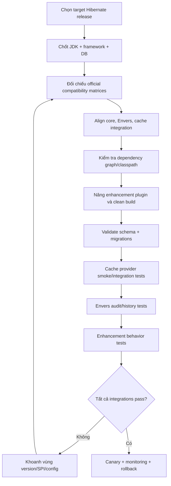

# Kiểm tra bộ cung cấp cache, Envers và công cụ enhancement tương thích

Một ứng dụng Hibernate có thể biên dịch thành công nhưng vẫn thất bại khi khởi động vì cache provider không còn tương thích với SPI của Hibernate. Envers có thể tạo revision ở môi trường phát triển nhưng lỗi khi deploy vì artifact lệch phiên bản với Hibernate core. Bytecode enhancement có thể chạy ở máy developer nhưng bị bỏ qua trong CI, khiến lazy attributes hoặc dirty tracking hoạt động khác nhau giữa các môi trường.

Những vấn đề này thường xuất hiện khi nâng Hibernate, JDK, Spring Boot, cache provider hoặc build plugin. Cần kiểm tra tương thích theo **toàn bộ chuỗi build-time và runtime**, không chỉ nhìn version của dependency chính.

Bài học tập trung vào ba nhóm integration:

- **Cache provider:** RegionFactory, cache SPI, JCache/provider module, concurrency strategy, serialization, clustering và invalidation.
- **Envers:** artifact version, Hibernate event integration, audit schema, revision metadata, transaction semantics và compatibility khi nâng cấp.
- **Bytecode enhancement:** công cụ build-time/runtime, plugin version, cấu hình enhancement, class output và behavior của lazy loading/dirty tracking/association management.

Mục tiêu là tạo quy trình kiểm tra có thể tái hiện: xác định phiên bản thực tế, đối chiếu ma trận hỗ trợ, kiểm tra dependency graph, build class đã enhance, khởi động SessionFactory, chạy smoke/integration tests và triển khai theo từng bước có khả năng rollback.

## 1. Tương thích không chỉ là một con số version

Một ứng dụng Hibernate có nhiều thành phần với hợp đồng tương thích riêng:

| Thành phần | Ví dụ | Rủi ro khi lệch |
|---|---|---|
| Hibernate ORM core | `hibernate-core` | SPI/API, mapping, SQL generation |
| Jakarta Persistence API | `jakarta.persistence-api` | Annotation/API namespace và version |
| JDK | Java runtime/compiler | Bytecode level, module/classloader |
| Spring Boot/framework | Spring ORM, Spring Data JPA | Version management, bootstrap |
| JDBC driver | PostgreSQL/MySQL/Oracle driver | SQL types, metadata, transaction |
| Database | PostgreSQL, Oracle, SQL Server | Dialect capabilities và schema |
| Cache integration | `hibernate-jcache`, provider integration | RegionFactory/SPI compatibility |
| Cache provider | Ehcache, Infinispan, provider khác | API, serialization, clustering |
| Envers | `hibernate-envers` | Hibernate event SPI, audit mappings |
| Enhancement tool | Gradle/Maven plugin hoặc agent | Build-time instrumentation |
| Build tool | Gradle/Maven | Plugin API, toolchain và task wiring |

Một cấu hình chỉ tương thích khi **các thành phần cần tích hợp hỗ trợ lẫn nhau trong cùng combination**.

Ví dụ, cache provider có thể hỗ trợ JCache API nhưng module Hibernate integration của provider lại chưa hỗ trợ Hibernate ORM major version đang dùng. Envers có thể cùng package `org.hibernate.envers` nhưng artifact version không tương thích với core. Gradle enhancement plugin có thể tải được nhưng chạy bằng JDK không được plugin hỗ trợ.

Vì vậy, không kết luận “tương thích” chỉ vì dependency resolve thành công.

## 2. Phân biệt build-time, bootstrap-time và runtime compatibility

```text
Build time
  |
  +-- JDK compiler / Gradle / Maven
  +-- Hibernate enhancement plugin
  +-- generated and enhanced class files
  |
Application packaging
  |
  +-- hibernate-core
  +-- hibernate-envers
  +-- cache integration module
  +-- cache provider
  +-- JDBC driver
  |
Bootstrap time
  |
  +-- SessionFactory / EntityManagerFactory
  +-- RegionFactory initialization
  +-- Envers listeners / audit metadata
  +-- Dialect and JDBC metadata
  |
Runtime
  |
  +-- cache get/put/invalidation
  +-- audit revisions and transactions
  +-- enhanced lazy loading / dirty tracking
```

Ba thời điểm cần kiểm tra riêng:

- **Build-time:** plugin có chạy không, class nào được enhance, compiler target có tương thích không?
- **Bootstrap-time:** Hibernate có load đúng RegionFactory, Envers và enhancement metadata không?
- **Runtime:** cache operations, audit writes, lazy loading và transaction behavior có hoạt động đúng dưới concurrency không?

Một test compile chỉ xác nhận một phần build-time. Một test tạo SessionFactory chỉ xác nhận một phần bootstrap. Cần runtime tests cho từng integration.

## 3. Xác định phiên bản Hibernate thực sự được dùng

Trong dự án có Spring Boot hoặc dependency management, version khai báo trực tiếp không phải lúc nào cũng là version runtime cuối cùng.

Ví dụ Gradle:

```kotlin
dependencies {
    implementation("org.hibernate.orm:hibernate-core")
}
```

Framework BOM hoặc dependency constraints có thể chọn version khác. Hãy xem dependency graph đã resolve.

Các lệnh kiểm tra tham khảo:

```bash
./gradlew dependencies --configuration runtimeClasspath

./gradlew dependencyInsight \
  --dependency hibernate-core \
  --configuration runtimeClasspath
```

Đối với từng integration:

```bash
./gradlew dependencyInsight \
  --dependency hibernate-envers \
  --configuration runtimeClasspath

./gradlew dependencyInsight \
  --dependency hibernate-jcache \
  --configuration runtimeClasspath
```

Tên configuration có thể khác nếu dự án dùng custom source sets. Chọn configuration thực sự đóng gói ứng dụng production, không chỉ test runtime.

Ghi lại:

- Hibernate core version.
- Envers version.
- Cache integration module version.
- Cache provider version.
- Jakarta Persistence API version.
- JDK dùng compile và runtime.
- Spring Boot/framework version.
- JDBC driver và database server version.
- Enhancement plugin version.

Đây là baseline để đối chiếu compatibility matrix.

## 4. Đọc dependency graph thay vì chỉ nhìn build file

Một dependency có thể xuất hiện nhiều lần qua transitive dependencies:

```text
application
  +-- spring-boot-starter-data-jpa
  |     +-- hibernate-core: version A
  |
  +-- hibernate-envers: version B
  |
  +-- cache-integration
        +-- hibernate-core: version C
```

Nếu A, B, C khác nhau, Gradle có thể chọn một version theo conflict resolution. Build vẫn có thể thành công nhưng runtime gặp NoSuchMethodError, ClassNotFoundException, AbstractMethodError hoặc behavior không tương thích.

Không chỉ kiểm tra có artifact hay không; kiểm tra **version đã chọn và lý do version đó được chọn**.

Các lệnh hữu ích:

```bash
./gradlew dependencyInsight \
  --dependency org.hibernate.orm:hibernate-core \
  --configuration runtimeClasspath

./gradlew dependencies \
  --configuration runtimeClasspath
```

Khi cần, xem cả compileClasspath, runtimeClasspath, testRuntimeClasspath và custom configuration dùng cho enhancement/build plugin. Plugin classpath không nhất thiết xuất hiện trong application runtime dependency graph.

## 5. Hibernate core và các module cùng hệ sinh thái

Những module tích hợp sâu với Hibernate thường cần version alignment với core, ví dụ:

- `hibernate-envers`
- `hibernate-jcache`
- Các provider-specific Hibernate integration artifacts
- Các extension dùng Hibernate internal SPI

Quy tắc thực hành an toàn là dùng **cùng release/version line được nhà cung cấp công bố tương thích**, trừ khi tài liệu chính thức chỉ rõ combination khác.

Ví dụ Gradle dùng một biến version duy nhất:

```kotlin
val hibernateVersion = "<hibernate-version>"

dependencies {
    implementation(
        "org.hibernate.orm:hibernate-core:$hibernateVersion"
    )
    implementation(
        "org.hibernate.orm:hibernate-envers:$hibernateVersion"
    )
    implementation(
        "org.hibernate.orm:hibernate-jcache:$hibernateVersion"
    )
}
```

Đây là mẫu quản lý version, không phải khuyến nghị dùng đồng thời JCache nếu ứng dụng không cần cache. Chỉ khai báo module thực sự sử dụng.

Nếu Spring Boot BOM quản lý Hibernate, ưu tiên version set do Spring Boot release tương ứng hỗ trợ. Override core, Envers và provider integration riêng lẻ có thể phá vỡ combination mà framework đã kiểm thử.

## 6. Jakarta Persistence và thay đổi namespace

Một ranh giới lớn khi nâng Hibernate là chuyển từ Java EE `javax.persistence` sang Jakarta `jakarta.persistence`.

Ví dụ:

```java
// Namespace Jakarta
import jakarta.persistence.Entity;
import jakarta.persistence.Id;
import jakarta.persistence.OneToMany;
```

Một module cũ có thể vẫn import:

```java
import javax.persistence.Entity;
import javax.persistence.Id;
```

Không trộn hai namespace trong cùng entity model. Annotation `javax.persistence.Entity` không phải cùng class với `jakarta.persistence.Entity`, dù tên đơn giản giống nhau.

Khi chuyển major version:

- Cập nhật imports trong source.
- Kiểm tra JPA API dependency.
- Kiểm tra framework version có dùng Jakarta namespace không.
- Kiểm tra custom converters, listeners và integrations.
- Kiểm tra test fixtures, generated sources và enhancement output.
- Kiểm tra persistence provider được bootstrap đúng.
- Không giữ đồng thời hai API artifacts với kỳ vọng Hibernate tự hiểu cả hai.

Một số thư viện legacy chỉ hỗ trợ `javax.persistence`; cần nâng thư viện hoặc giữ stack cũ có chủ đích. Chỉ đổi imports mà không đổi framework/provider dependencies là chưa đủ.

## 7. Dùng BOM hoặc dependency constraints có chủ đích

Nếu framework cung cấp BOM, BOM thường là nguồn version alignment chính. Nếu tự quản lý Hibernate, có thể dùng platform/BOM được phát hành cho release line tương ứng hoặc dependency constraints tập trung.

Ví dụ generic Gradle platform:

```kotlin
dependencies {
    implementation(
        platform("org.hibernate.orm:hibernate-platform:<version>")
    )

    implementation("org.hibernate.orm:hibernate-core")
    implementation("org.hibernate.orm:hibernate-envers")
}
```

Xác nhận artifact/BOM thực sự tồn tại và phù hợp release đang chọn trước khi dùng. Không tự giả định mọi Hibernate major/minor đều publish cùng BOM artifact hoặc mọi framework đều cho phép override.

Một cách khác là version catalog/constraints để giữ các module cùng version. Điều quan trọng là **một nơi có thẩm quyền quản lý version**, không để từng module tự chọn version riêng.

## 8. Không ép version bằng resolution strategy để che xung đột

Ví dụ dễ gây rủi ro:

```kotlin
configurations.all {
    resolutionStrategy.force(
        "org.hibernate.orm:hibernate-core:<some-version>"
    )
}
```

`force` có thể làm build resolve nhưng không chứng minh các integrations tương thích. Một cache module có thể compile với SPI version khác, Envers có thể gọi method không còn tồn tại, hoặc framework có thể dựa vào API cũ.

Nếu cần force để xử lý dependency conflict:

1. Xác định dependency nào kéo version cũ/mới.
2. Kiểm tra release notes và compatibility matrix.
3. Cập nhật module gây conflict.
4. Chạy dependency insight.
5. Chạy bootstrap và integration tests.
6. Ghi lại lý do/owner của override.
7. Đặt thời hạn loại bỏ override nếu chỉ là workaround.

Không dùng force như giải pháp mặc định cho Hibernate upgrades.

## 9. Ma trận kiểm tra cache provider

Cache integration gồm ít nhất hai lớp:

```text
Hibernate ORM
    |
    v
Hibernate cache integration module
    |
    v
Cache API / provider adapter
    |
    v
Cache implementation
    |
    v
Local heap / off-heap / remote cluster
```

Ví dụ với JCache:

- Hibernate integration module (ví dụ `hibernate-jcache`).
- JCache API.
- Provider thực thi JCache.
- Cấu hình cache manager và regions.

Với Infinispan hoặc provider tích hợp trực tiếp, dependency chain và supported versions có thể khác.

Phải kiểm tra cả **Hibernate integration artifact** và **cache engine/provider**. Chỉ có provider core jar trong runtime không chứng minh Hibernate có thể tạo RegionFactory phù hợp.

## 10. Kiểm tra RegionFactory và cache SPI

Hibernate cache integration sử dụng RegionFactory và các SPI liên quan để tạo regions và thực hiện cache operations.

Một cấu hình phổ biến có dạng:

```properties
hibernate.cache.use_second_level_cache=true
hibernate.cache.region.factory_class=<region-factory-class>
```

Với Spring Boot:

```properties
spring.jpa.properties.hibernate.cache.use_second_level_cache=true
spring.jpa.properties.hibernate.cache.region.factory_class=<region-factory-class>
```

Tên class chính xác là provider/version-specific. Không lấy một RegionFactory class từ tutorial cũ rồi dùng cho mọi Hibernate versions.

Các câu hỏi cần xác minh:

- Provider có công bố hỗ trợ Hibernate major/minor đang chạy không?
- RegionFactory có implement đúng SPI version không?
- Có dùng Hibernate internal classes không?
- Provider yêu cầu artifact riêng hay module nào?
- JDK/runtime version có nằm trong supported range không?
- Provider có hỗ trợ concurrency strategies ứng dụng cần không?
- Provider có hỗ trợ query cache/timestamps region không?

Một class có thể tồn tại trên classpath nhưng vẫn lỗi NoSuchMethodError khi Hibernate gọi SPI method khác signature.

## 11. Kiểm tra JCache integration

Nếu dùng JCache, dependency thường gồm Hibernate JCache integration module và provider implement JCache API.

Ví dụ cấu hình khái niệm:

```kotlin
dependencies {
    implementation(
        "org.hibernate.orm:hibernate-jcache:$hibernateVersion"
    )

    implementation("<jcache-api-coordinate>:<api-version>")
    runtimeOnly("<cache-provider-coordinate>:<provider-version>")
}
```

Coordinates cụ thể phụ thuộc JCache provider và version. JCache API namespace/package là hợp đồng riêng; không giả định đổi từ `javax.persistence` sang `jakarta.persistence` đồng nghĩa mọi JCache artifacts cũng đổi namespace theo.

Cần xác minh:

- Hibernate JCache module tương thích core.
- Provider implement đúng JCache API version.
- Provider được tìm thấy qua service loader/classpath.
- Cache manager được tạo theo URI/configuration mong muốn.
- Region names và expiry/capacity settings được áp dụng.
- Startup không silently fallback sang provider khác.
- Runtime logs xác nhận đúng provider class.

## 12. Ehcache, Infinispan và provider-specific modules

Không có một cấu hình cache provider dùng chung cho mọi engine.

Với mỗi provider, cần có một compatibility record:

| Mục | Cần ghi |
|---|---|
| Provider name/version | Release đang đóng gói |
| Hibernate integration artifact | Artifact và version |
| Supported Hibernate range | Theo tài liệu provider |
| JDK range | Compile/runtime support |
| API | JCache hay SPI trực tiếp |
| Clustering | Local, replicated, distributed |
| Serialization | Format và compatibility |
| Transactions | Transactional integration có/không |
| Expiry/eviction | Capacity, TTL, policy |
| Upgrade path | Rolling upgrade có được hỗ trợ? |

Ehcache có thể được dùng qua JCache integration trong một số cấu hình; Infinispan có các integration/release lines riêng. Không suy ra compatibility từ tên provider hoặc một ví dụ cấu hình trên mạng.

Nếu provider có compatibility matrix chính thức, ghi lại release line cụ thể. Nếu tài liệu chỉ hỗ trợ một số Hibernate minors, hãy chọn đúng combination được hỗ trợ thay vì đoán theo major number.

## 13. Cache provider startup smoke test

Một test bootstrap nhỏ nên tạo SessionFactory/EntityManagerFactory và xác nhận cache provider thực sự được khởi tạo.

Ví dụ khái niệm:

```java
@Test
void sessionFactoryStartsWithExpectedCacheProvider() {
    SessionFactory sessionFactory =
        entityManagerFactory.unwrap(SessionFactory.class);

    assertNotNull(sessionFactory);
    assertNotNull(sessionFactory.getCache());
}
```

Một smoke test đầy đủ hơn:

1. Khởi động SessionFactory.
2. Load một entity được đánh dấu cacheable.
3. Đóng Session.
4. Mở Session mới và load lại entity.
5. Kiểm tra L2 hit hoặc provider metrics.
6. Xác nhận database SELECT count giảm.
7. Evict entry/region trong test.
8. Load lại và xác nhận miss/put theo semantics.
9. Tắt SessionFactory và xác nhận provider lifecycle kết thúc đúng.

Startup thành công chưa chứng minh cache behavior. Cần thực hiện put/get/eviction thật.

## 14. Kiểm tra concurrency strategy của cache provider

Hibernate có các strategy phổ biến:

- `READ_ONLY`
- `READ_WRITE`
- `NONSTRICT_READ_WRITE`
- `TRANSACTIONAL`

Không phải provider nào cũng hỗ trợ mọi strategy với cùng guarantees.

Cần xác minh:

- READ_ONLY có bảo vệ immutable data theo mong muốn?
- READ_WRITE dùng soft locks hay cơ chế provider-specific nào?
- NONSTRICT_READ_WRITE stale window có phù hợp nghiệp vụ?
- TRANSACTIONAL có yêu cầu JTA/XA hoặc provider transaction integration?
- Rollback có để cache state nhất quán không?
- Concurrent updates từ nhiều nodes được xử lý thế nào?

Không chọn TRANSACTIONAL chỉ vì tên nghe an toàn hơn. Nếu provider/transaction manager không đáp ứng contract, startup hoặc runtime behavior có thể sai.

## 15. Cache serialization và rolling deployment

Distributed cache có thể serialize entries để gửi qua network hoặc lưu persistence tier.

Khi nâng Hibernate/entity model:

- Class name/package có thể thay đổi.
- Entity fields có thể đổi type.
- Serialization format có thể thay đổi.
- Hibernate cache entry format/internal metadata có thể thay đổi giữa major versions.
- Node mới có thể không đọc được entry do node cũ ghi.
- Node cũ có thể không đọc được entry mới.

Không giả định cache entries tương thích qua Hibernate major upgrade.

Chiến lược thường dùng:

- Evict/clear cache khi deployment nếu provider/architecture cho phép.
- Tạo region namespace/version mới.
- Tắt cache trong giai đoạn chuyển đổi.
- Tránh mixed-version nodes dùng chung region nếu provider không hỗ trợ.
- Warm cache sau khi deployment ổn định.
- Kiểm tra serialization/deserialization bằng đúng class versions.

Cache là dữ liệu có thể tái tạo; đừng để rolling deployment phụ thuộc vào serialized internal state không được cam kết tương thích.

## 16. Query cache và timestamps region

Nếu bật query cache, Hibernate còn cần quản lý query result regions và timestamps/invalidation metadata.

Kiểm tra:

- Provider tạo được query cache regions.
- Timestamps region có cấu hình phù hợp và không bị expiry quá sớm.
- Update query spaces invalidates kết quả đúng.
- Native SQL có khai báo query spaces/synchronized spaces nếu cần.
- Nhiều nodes có invalidation semantics đúng.
- Cache restart không làm kết quả cũ được phục vụ ngoài policy.

Một query cache provider startup thành công chưa chứng minh invalidation đúng. Hãy test read → cache hit → write → read lại qua Session khác và xác nhận kết quả mới.

## 17. Envers là module cùng release line với Hibernate ORM

Envers tích hợp sâu với Hibernate event system. Trong các phiên bản ORM hiện đại, dependency thường là:

```kotlin
dependencies {
    implementation(
        "org.hibernate.orm:hibernate-envers:$hibernateVersion"
    )
}
```

Đây là mẫu alignment. Dùng cùng release/version được công bố tương thích với `hibernate-core` đang chạy.

Tránh tình trạng:

```text
hibernate-core   6.x.y
hibernate-envers 5.x.z
```

hoặc core và Envers ở hai release lines khác nhau mà không có tài liệu hỗ trợ rõ ràng.

Các lỗi có thể xuất hiện dưới dạng NoSuchMethodError, ClassNotFoundException, listener registration failure, mapping metadata errors, audit query runtime errors hoặc revision entity instantiation failures.

Envers artifact resolve thành công không đủ; cần chạy audit persist/update/delete và đọc lịch sử.

## 18. Kiểm tra Envers module có thực sự nằm trong runtime

Chạy dependency inspection trên configuration production:

```bash
./gradlew dependencyInsight \
  --dependency hibernate-envers \
  --configuration runtimeClasspath
```

Sau đó xác nhận runtime classpath/package chứa module tương ứng. Nếu Envers chỉ được khai báo trong test configuration, integration tests có thể pass nhưng production packaging thiếu module.

Nếu ứng dụng deploy dạng executable jar/container, kiểm tra:

- Module Envers được đóng gói.
- Không có duplicate Hibernate core jars.
- Classloader/container không ưu tiên một Hibernate version khác.
- Framework dependency management không loại Envers module ngoài ý muốn.

## 19. Kiểm tra Jakarta/Java imports trong Envers code

Envers annotations/API nằm trong package `org.hibernate.envers`, ví dụ:

```java
import org.hibernate.envers.Audited;
import org.hibernate.envers.AuditReader;
import org.hibernate.envers.AuditReaderFactory;
```

Các entity vẫn dùng Jakarta Persistence annotations trên Hibernate/Jakarta stack tương ứng:

```java
import jakarta.persistence.Entity;
import jakarta.persistence.Id;
```

Khi nâng từ stack javax.persistence, hãy kiểm tra custom revision entity, revision listeners, converters, entity listeners và test utilities. Một custom listener compile với API cũ có thể không tương thích với Jakarta runtime mới.

## 20. Envers bootstrap và audit metadata

Một smoke test nên:

1. Khởi động EntityManagerFactory.
2. Persist một entity `@Audited`.
3. Commit transaction.
4. Mở transaction mới.
5. Dùng AuditReader lấy revisions.
6. Xác nhận ADD revision.
7. Update entity và commit.
8. Xác nhận MOD revision.
9. Remove entity theo hard-delete mapping và xác nhận DEL semantics.
10. Rollback một thay đổi và xác nhận không có committed audit record.

Ví dụ:

```java
AuditReader reader =
    AuditReaderFactory.get(entityManager);

List<Number> revisions =
    reader.getRevisions(ProductCategory.class, categoryId);

assertFalse(revisions.isEmpty());
```

Đây là API minh họa. Cần đọc bằng EntityManager thuộc Hibernate provider và transaction/context phù hợp.

## 21. Audit schema cũng là một phần compatibility

Envers có thể tạo audit tables và revision metadata table. Khi nâng Hibernate/Envers, kiểm tra:

- Tên audit tables.
- Revision table/sequence names.
- Column types.
- Identifier mappings.
- Foreign key behavior.
- Audit strategy đang dùng.
- Modified flags columns nếu bật.
- Custom revision entity schema.
- Naming strategy và default schema.
- Database dialect/version.

Không dùng `hbm2ddl.auto=update` như migration strategy cho audit schema production. Hãy version hóa DDL bằng Flyway/Liquibase hoặc quy trình migration có kiểm soát.

Nếu dùng `ddl-auto=validate`, kiểm tra nó xác minh đúng schema cần thiết cho Envers trong version đang chạy; validation không thay thế kiểm thử audit writes.

## 22. Audit strategy và migration giữa các phiên bản

Envers có các audit strategies, phổ biến gồm default strategy và validity strategy. Chúng có schema/query tradeoffs khác nhau.

Khi thay strategy hoặc nâng version:

- Kiểm tra yêu cầu thêm các cột revision end/validity.
- Kiểm tra index cho audit query patterns.
- Xác định migration cho dữ liệu audit cũ.
- Kiểm tra truy vấn as-of revision trước và sau migration.
- Kiểm tra deletion rows và store-data-at-delete policy.
- Kiểm tra revision numbers/timestamps không bị diễn giải sai.
- Benchmark audit queries trên bảng lớn.

Không chỉ đổi property strategy rồi deploy. Một số thay đổi đòi hỏi schema/data migration và có thể ảnh hưởng historical queries.

## 23. Custom RevisionEntity và RevisionListener

Ứng dụng có thể lưu actor, tenant, correlation ID hoặc metadata bổ sung trong revision entity.

Ví dụ khái niệm:

```java
@Entity
@RevisionEntity(ActorRevisionListener.class)
public class AuditRevision {

    @Id
    @GeneratedValue
    @RevisionNumber
    private int id;

    @RevisionTimestamp
    private long timestamp;

    private String actor;
}
```

Kiểm tra compatibility:

- Annotation imports đúng Envers version.
- Revision number type phù hợp API.
- Listener có constructor/lifecycle được Envers hỗ trợ.
- Listener context propagation hoạt động trong web và background jobs.
- Column lengths/nullability tương thích dữ liệu.
- Migrations đã tạo columns/indexes.
- Không phụ thuộc Spring injection trong listener nếu Envers khởi tạo theo cơ chế khác.
- Transaction rollback không để lại committed revision.

Một listener dùng ThreadLocal phải cleanup đúng, đặc biệt khi application dùng thread pools hoặc asynchronous execution.

## 24. Envers và cascade/soft delete

Khi nâng version, đừng chỉ test entity đơn lẻ. Kiểm tra aggregate:

- Parent được persist cùng child audited.
- Child bị bỏ khỏi collection với orphanRemoval.
- Parent hard delete với cascade.
- Parent soft delete qua `@SoftDelete` hoặc custom `@SQLDelete`.
- Native SQL/bulk DML.
- Rollback.
- Restore.
- Entity có relation đến target không audited.
- Collection audit mapping.

Soft delete không mặc định tương đương Envers DEL. Nếu mapping biểu diễn nó như update flag, audit event có thể là MOD tùy implementation/version. Test và document behavior thực tế.

Bulk JPQL/native SQL có thể bypass Envers listeners. Không dùng kết quả test explicit remove để suy ra bulk delete cũng tạo audit history.

## 25. Bytecode enhancement là gì?

Hibernate bytecode enhancement biến đổi class entity ở build time hoặc qua agent/runtime để thêm behavior mà ORM cần, chẳng hạn:

- Lazy loading cho basic attributes khi mapping và enhancement hỗ trợ.
- Inline dirty tracking.
- Association management.
- Field interception và state tracking.

Không phải mọi ứng dụng đều cần bật mọi enhancement option. Cần xác định feature đang được sử dụng và kiểm tra output class thực sự được biến đổi.

Một source có `@Basic(fetch = LAZY)` không chứng minh bytecode đã được enhance hoặc Hibernate có thể lazy-load field đó.

## 26. Build-time và runtime enhancement

Hai cách tiếp cận thường gặp:

**Build-time enhancement:** plugin chạy sau compilation hoặc trong build pipeline và biến đổi `.class` files trước khi đóng gói.

**Runtime enhancement/agent:** JVM agent hoặc cơ chế runtime instrumentation biến đổi class khi load, nếu được cấu hình và hỗ trợ.

Build-time thường dễ kiểm soát hơn trong CI/container vì artifact đã chứa class được enhance. Runtime agent cần kiểm soát startup flags, classloader và môi trường deploy.

Không bật cả hai cơ chế một cách tùy tiện. Xác định rõ một đường được hỗ trợ và kiểm tra artifact sau build.

## 27. Gradle Hibernate enhancement plugin

Hibernate cung cấp Gradle plugin trong các release lines hỗ trợ, thường được áp dụng qua plugin ID tương ứng của Hibernate ORM.

Ví dụ minh họa:

```kotlin
plugins {
    id("org.hibernate.orm") version "<hibernate-version>"
}

hibernate {
    enhancement {
        enableLazyInitialization = true
        enableDirtyTracking = true
        enableAssociationManagement = true
    }
}
```

DSL chính xác và option availability phụ thuộc plugin version. Đối chiếu documentation đi kèm đúng Hibernate release; không copy block này vào plugin version cũ mà chưa kiểm tra.

Điểm cần xác nhận:

- Plugin version phù hợp Hibernate ORM version.
- Gradle wrapper version được plugin hỗ trợ.
- JDK chạy Gradle được plugin hỗ trợ.
- Enhancement task được gắn vào build lifecycle.
- Main và test entity classes được xử lý theo mong muốn.
- Incremental build không bỏ sót class thay đổi.
- Clean build tạo cùng output trên developer và CI.

## 28. Maven enhancement plugin

Với Maven, Hibernate có enhancement plugin tương ứng trong release lines hỗ trợ.

Cấu hình có dạng khái niệm:

```xml
<plugin>
    <groupId>org.hibernate.orm.tooling</groupId>
    <artifactId>hibernate-enhance-maven-plugin</artifactId>
    <version>HIBERNATE_VERSION</version>
    <executions>
        <execution>
            <goals>
                <goal>enhance</goal>
            </goals>
        </execution>
    </executions>
</plugin>
```

Coordinates, goal, configuration options và lifecycle phase phải được xác nhận trong documentation của plugin version thực tế. Một số dự án dùng plugin management ở parent POM; cần kiểm tra effective POM và execution được kế thừa.

Không khai báo enhancement plugin trong Maven nhưng quên gắn execution vào phase build phù hợp.

## 29. Enhancement plugin phải đồng bộ với ORM release

Plugin enhancement thao tác trên Hibernate entity model và bytecode conventions. Ưu tiên plugin version cùng Hibernate ORM release line đang đóng gói.

Kiểm tra:

- Plugin artifact version.
- Core runtime version.
- Enhancement task implementation version.
- JDK target/class file version.
- Gradle/Maven version.
- Entity class output directory.
- Test fixtures và generated classes.

Nếu plugin cũ biến đổi bytecode theo convention khác runtime Hibernate mới, application có thể compile và boot nhưng lazy interception/dirty tracking không hoạt động như mong muốn.

Đừng giả định plugin là công cụ độc lập không liên quan Hibernate version.

## 30. Các enhancement options và tác động

| Option/feature | Tác dụng khái quát | Cần test |
|---|---|---|
| Lazy initialization | Hỗ trợ lazy interception cho attributes/associations phù hợp | Field chưa đọc không trigger load; đọc field trigger đúng |
| Dirty tracking | Theo dõi field changes hiệu quả hơn | Changed fields được flush |
| Association management | Hỗ trợ đồng bộ hai phía association trong một số mapping | Add/remove relation và owning side |
| Extended enhancement options | Tùy release/plugin | Chỉ bật khi có use case và test |

Tên option và khả năng hỗ trợ thay đổi theo plugin version. Kiểm tra đúng DSL/API.

Enhancement không thay thế mapping đúng. Dirty tracking không sửa được owning side thiết kế sai hoặc transaction không flush.

## 31. Kiểm tra lazy basic attributes

Ví dụ:

```java
@Entity
public class Document {

    @Id
    private Long id;

    private String title;

    @Basic(fetch = FetchType.LAZY)
    @LazyGroup("document-content")
    @Lob
    private byte[] content;
}
```

Lazy loading cho basic attributes thường cần bytecode enhancement và mapping/provider support phù hợp. Không chỉ dựa vào `FetchType.LAZY` trên basic field vì Jakarta Persistence có thể coi LAZY như một hint trong nhiều trường hợp nếu provider không hỗ trợ.

Test cần:

1. Load Document trong Session mới.
2. Không đọc content.
3. Quan sát SQL: content column có bị select ngay không?
4. Đọc content khi Session còn mở.
5. Quan sát secondary SELECT/interception.
6. Kiểm tra behavior khi Session đóng.
7. Kiểm tra serialization/JSON không vô tình trigger lazy field.
8. Kiểm tra cache interaction nếu entity được L2-cache.

`@LazyGroup` là Hibernate-specific và availability/semantics cần kiểm tra version. Dùng dữ liệu lớn synthetic để test, không dựa vào entity nhỏ không thể thấy khác biệt.

## 32. Kiểm tra lazy to-one và association enhancement

Một `@ManyToOne(fetch = LAZY)` có thể cần proxy hoặc bytecode enhancement tùy mapping, final classes/access strategy và Hibernate version.

Test:

- Load parent mà không truy cập association.
- Xác nhận association không gây query ngoài ý muốn.
- Truy cập association khi Session mở.
- Xác nhận query đúng số lượng.
- Thử nhiều associations và lazy groups.
- Thử `getReference()`/proxy behavior nếu ứng dụng dùng.
- Test serialization khi Session đã đóng.
- Kiểm tra equals/hashCode không vô tình dereference proxy.

Không assert class proxy nội bộ cụ thể nếu đó không phải public contract. Assert SQL count và behavior quan sát được.

## 33. Dirty tracking enhancement

Hibernate có thể dùng inline dirty tracking khi class đã được enhance. Test nên so sánh behavior với enhancement bật/tắt nếu ứng dụng phụ thuộc feature này.

Ví dụ:

```java
Document document =
    entityManager.find(Document.class, id);

document.rename("New title");

entityManager.flush();
```

Kiểm tra:

- UPDATE được phát.
- Giá trị database đổi sau reload.
- Transaction rollback phục hồi state.
- Thay đổi field không mapped không gây persistence update.
- Mutable values như collections/arrays có behavior được hỗ trợ.
- Reflection/direct field mutation có được nhận diện theo enhancement semantics không.

Không dùng internal dirty-tracking methods làm business API. Enhancement là implementation detail của ORM.

## 34. Association management enhancement

Một số enhancement options có thể hỗ trợ tự đồng bộ hai phía của association. Nhưng domain helper methods rõ ràng vẫn giúp biểu đạt invariants.

Ví dụ:

```java
order.getLines().add(line);
```

Có thể được enhancement xử lý khác tùy cấu hình/version, nhưng không nên giả định behavior khi enhancement chưa được xác nhận.

Test cùng mapping với:

- Enhancement enabled.
- Enhancement disabled nếu ứng dụng cần fallback.
- Entities được tạo bằng constructors/builders.
- Collections thay thế.
- Detached/merged entities.
- Owning/inverse side sau flush.

Nếu application dựa vào automatic association management, CI phải bảo đảm enhancement luôn chạy trước khi test.

## 35. Kiểm tra class output đã được enhance

Một build thành công chưa chứng minh plugin đã xử lý class.

Có thể kiểm tra bytecode bằng `javap`:

```bash
javap -p -classpath build/classes/java/main \
  com.example.Document
```

Tùy Hibernate version, class được enhance có thể implement interfaces hoặc chứa methods nội bộ phục vụ interception/dirty tracking. Tên và layout internal không nên được hardcode thành public compatibility contract.

Có thể dùng enhancement testing utilities/API của Hibernate nếu release line cung cấp, hoặc viết behavior tests để chứng minh lazy field và dirty tracking thực sự hoạt động.

Kiểm tra đúng output directory: plugin có thể biến đổi class trong `build/classes` nhưng packaging lại lấy artifact từ directory khác nếu custom Gradle task được cấu hình sai.

## 36. Clean build và incremental build

Bytecode enhancement thường chạy trên compiled class files. Incremental builds có thể che giấu vấn đề:

- Một class cũ đã enhance từ lần build trước.
- Plugin bị bỏ khỏi task graph nhưng artifact cũ vẫn còn.
- IDE compiler tạo output khác Gradle.
- CI cache khôi phục class files cũ.
- Main classes được enhance nhưng test entities thì không.

Quy trình kiểm tra tham khảo:

```bash
./gradlew clean classes
./gradlew test
./gradlew clean build
```

Đây là hướng dẫn chạy tại dự án, không phải kết quả xác nhận. Trong CI, kiểm tra enhancement task xuất hiện trong build graph và clean build cho output ổn định.

## 37. Enhancement và generated/proxy classes

Các class generated bởi annotation processors, Kotlin compiler, Lombok hoặc code generation có thể có lifecycle khác Java source bình thường.

Kiểm tra:

- Entity classes do Kotlin tạo có được plugin hỗ trợ?
- Final classes/methods có ảnh hưởng interception không?
- Lombok-generated accessors có tương thích access strategy?
- Generated sources được compile trước enhancement?
- Test fixtures có entity classes riêng không?
- Shaded/relocated jars có làm thay đổi metadata/class loading?
- Build plugin có xử lý module path/classpath đúng?

Nếu dùng Kotlin, kiểm tra plugin/all-open/no-arg configuration và Hibernate enhancement compatibility cụ thể. Không giả định plugin Java xử lý mọi class output của Kotlin giống Java.

## 38. Enhancement và final classes

Proxy-based lazy loading có thể bị giới hạn bởi final classes/methods hoặc constructors/access modifiers tùy proxy strategy. Bytecode enhancement có thể hỗ trợ một số lazy interception scenarios khác, nhưng không nên khái quát rằng final modifier không còn quan trọng.

Kiểm tra mapping, class shape và enhancement mode đang dùng. Test thực tế association lazy load thay vì suy luận chỉ từ annotation.

Nếu framework yêu cầu non-final entity classes hoặc no-arg constructor, giữ contract đó rõ ràng trong code style/build validation.

## 39. Java toolchain và bytecode level

Build plugin chạy trong một JDK; application có thể chạy trên JDK khác. Cần kiểm tra:

- JDK chạy Gradle/Maven.
- Java toolchain dùng compile.
- sourceCompatibility/targetCompatibility hoặc options.release.
- Runtime JDK production.
- Plugin minimum/maximum JDK.
- Bytecode class file version.
- Cache provider và framework runtime support.

Ví dụ Gradle toolchain:

```kotlin
java {
    toolchain {
        languageVersion = JavaLanguageVersion.of(21)
    }
}
```

Đây chỉ là ví dụ. Chọn JDK được Hibernate, framework, cache provider và build plugins hỗ trợ đồng thời. Một plugin có thể không chạy trên JDK mới dù application bytecode target cũ hơn.

## 40. Kiểm tra framework integration

Spring Boot, Quarkus, Micronaut hoặc Jakarta EE server có thể quản lý Hibernate bootstrap và dependency versions.

Với Spring Boot:

- Kiểm tra Boot release line quản lý Hibernate ORM nào.
- Kiểm tra starter data JPA dependency graph.
- Kiểm tra Envers/cache modules có version được align.
- Kiểm tra HibernatePropertiesCustomizer và provider bootstrap.
- Kiểm tra EntityManagerFactory startup trong application context.
- Kiểm tra test slices có vô tình dùng config khác production.

Nếu Boot BOM quản lý Hibernate, tránh override một module đơn lẻ mà không có lý do và integration tests.

Với application server, kiểm tra server-provided Hibernate/JPA modules và classloader delegation. Bundling một core version khác vào WAR có thể tạo duplicate classes/SPI conflicts.

## 41. Kiểm tra JDBC driver và Dialect sau upgrade

Cache/Envers/enhancement không hoạt động độc lập với database stack. Một Hibernate upgrade có thể thay SQL generation hoặc yêu cầu JDBC metadata/driver capabilities khác.

Kiểm tra:

- JDBC driver version được hỗ trợ bởi database server.
- Hibernate Dialect đúng release line.
- Database version nằm trong supported range.
- Identifier/sequence behavior.
- Timestamp/timezone mappings.
- JSON/LOB/array types.
- Batch statements and generated keys.
- DDL/migration compatibility.

Không dùng Hibernate version mới với driver cũ chỉ vì app vẫn kết nối được. Smoke test nên persist/update/delete entity, chạy audit query và cache lookup trên DBMS thực tế.

## 42. Startup logs là một nguồn bằng chứng

Khi khởi động, thu thập log có kiểm soát để xác nhận:

- Hibernate core version.
- Dialect/database version.
- RegionFactory implementation.
- Cache provider/cache manager.
- Envers listeners/audit metadata initialization nếu log có.
- Schema validation/migration outcome.
- Warning về missing cache regions hoặc unsupported configuration.

Không dựa vào một log line duy nhất. Provider có thể khởi tạo nhưng region config sai; Envers có thể được load nhưng audit table thiếu; enhancement plugin có thể chạy nhưng artifact packaging dùng class cũ.

## 43. Các lỗi tương thích thường gặp và cách phân loại

| Triệu chứng | Nhóm khả năng | Hướng kiểm tra |
|---|---|---|
| `NoSuchMethodError` trong cache package | SPI/module version mismatch | Dependency insight, provider matrix |
| `ClassNotFoundException` RegionFactory | Thiếu integration artifact hoặc class name sai | Runtime classpath, provider docs |
| `AbstractMethodError` khi cache access | Provider implement SPI cũ | Hibernate/provider release alignment |
| SessionFactory boot fail ở Envers | Envers/core lệch hoặc listener/mapping lỗi | Artifact versions, bootstrap logs |
| Audit table/column missing | Migration/schema drift | Envers DDL, Flyway/Liquibase |
| `@Audited` không có revision | Envers không được bootstrap hoặc path bypass | Runtime artifact, transaction, native/bulk path |
| Lazy basic field load ngay | Enhancement không chạy hoặc mapping unsupported | Build task/output, SQL capture |
| Dirty tracking behavior khác CI | Class output không được enhance nhất quán | Clean build, task graph, artifact |
| Chỉ lỗi trong container | JDK/classloader/provider config khác | Runtime image, service loader, module path |
| Cache stale giữa nodes | Cluster invalidation/serialization | Provider topology và consistency tests |
| ClassCastException trong JCache | Duplicate API/provider classloaders | Dependency graph, classloader |
| Mixed javax/jakarta types | Namespace mismatch | Imports, framework/API artifacts |

Phân loại trước khi sửa giúp tránh thêm exclusions hoặc version force làm vấn đề khó hơn.

## 44. Kiểm tra classpath và duplicate artifacts trong packaged app

Gradle runtimeClasspath là một nguồn quan trọng, nhưng artifact cuối có thể bị thay đổi bởi packaging/container.

Kiểm tra:

- Fat jar có một Hibernate core version duy nhất.
- Không có Envers cũ trong application server shared libs.
- Provider integration module không bị exclude.
- JCache API không bị đóng gói trùng classloader.
- Spring Boot nested jars chứa đúng versions.
- Container image không dùng thư viện từ shared directory.
- Native image/reflection configuration nếu dự án sử dụng native compilation.

Một dependency graph sạch trong Gradle không đảm bảo server runtime không nạp một jar khác từ parent classloader.

## 45. Compatibility test matrix cho cache provider

Một bộ test thực dụng:

| Test | Điều cần chứng minh |
|---|---|
| Bootstrap | RegionFactory/provider khởi tạo được |
| L2 put/hit | Session thứ hai đọc được cached entity |
| Eviction | Evict entity/region hoạt động |
| Read-only | Không có write path trái contract |
| Read-write | Concurrent update/rollback đúng |
| Query cache | Hit và invalidation theo query spaces |
| Timestamps region | Write làm query result stale |
| Cluster | Node B thấy invalidation từ Node A |
| Restart | Cache loss/recovery theo policy |
| Serialization | Entry tương thích class/model hiện tại |
| Failure | Provider timeout/outage không tạo cascade failure |
| Multi-tenant | Same IDs không lẫn tenant state |

Chạy tests với đúng provider, JDK, Hibernate và database versions của deployment target.

## 46. Compatibility test matrix cho Envers

| Test | Điều cần chứng minh |
|---|---|
| Bootstrap | Envers module được load |
| ADD | Persist tạo revision đúng |
| MOD | Update tạo snapshot mới |
| DEL | Hard delete tạo deletion revision theo policy |
| Soft delete | RevisionType/state đúng với mapping |
| Delete data | DEL row có/không có property values theo config |
| Rollback | Không có committed audit state |
| Relations | Parent/child/collection history đúng |
| Custom revision | Actor/tenant/correlation metadata đúng |
| Native/bulk | Bypass behavior được hiểu và kiểm soát |
| Schema migration | Audit tables/columns/sequence tương thích |
| Historical query | AuditReader trả state theo revision đúng |

Không chỉ test revision count; kiểm tra RevisionType, snapshot values, revision metadata và transaction outcome.

## 47. Compatibility test matrix cho enhancement

| Test | Điều cần chứng minh |
|---|---|
| Build task | Enhancement chạy trong CI |
| Clean build | Output tái tạo từ source sạch |
| Lazy basic | Field chưa đọc không tải ngoài ý muốn |
| Lazy to-one | Association được load đúng thời điểm |
| Dirty tracking | Changed state được flush |
| Rollback | Database state không bị sai |
| Association management | Hai phía relation đúng theo config |
| Serialization | Không trigger lazy load ngoài ý muốn |
| Packaging | Jar chứa class đã enhance |
| Runtime JDK | Class load và interception hoạt động |
| IDE vs CI | Không phụ thuộc stale output local |
| Upgrade | Class được build lại với plugin mới |

Behavior test quan trọng hơn assertion vào tên internal method của bytecode enhancer.

## 48. Một smoke test tổng hợp sau khi nâng Hibernate

Có thể xây một integration test nhỏ để chạy qua cả ba integrations:

1. Khởi động application context/SessionFactory.
2. Xác nhận cache provider được khởi tạo.
3. Persist một audited, cacheable entity.
4. Commit.
5. Mở Session mới, load lại entity và kiểm tra L2 hit.
6. Update entity và commit.
7. Query Envers revisions, xác nhận ADD/MOD.
8. Load entity có lazy basic field; kiểm tra SQL trước/sau khi truy cập field.
9. Xóa/soft-delete entity theo mapping.
10. Kiểm tra current visibility và audit semantics.
11. Rollback một update và xác nhận không có committed revision.
12. Đóng SessionFactory và xác nhận resource lifecycle.

Smoke test này không thay thế test matrix đầy đủ, nhưng bắt được nhiều incompatibility ở bootstrap và runtime.

## 49. Nâng Hibernate major version theo từng lớp

Khi nâng major version, tránh thay core, provider, Envers, enhancement, JDK và framework cùng lúc mà không có checkpoints.

Một thứ tự thực dụng:

1. Chốt target JDK/framework và Hibernate release line.
2. Đọc migration guide/release notes.
3. Align hibernate-core, Envers và integration modules.
4. Xác nhận cache provider hỗ trợ target SPI.
5. Nâng enhancement plugin và kiểm tra clean build.
6. Cập nhật namespace/API nếu major version yêu cầu.
7. Chạy schema validation và migrations trong test DB.
8. Chạy smoke/integration test từng integration.
9. Benchmark cache behavior và lazy loading.
10. Canary deployment và quan sát.
11. Chỉ sau đó mở rộng rollout.

Nếu một lớp fail, có thể xác định rõ compatibility boundary cần xử lý.

## 50. Cache cluster trong rolling upgrade

Rolling upgrade nhạy cảm khi nhiều application versions cùng dùng một distributed cache.

```text
Old application node (Hibernate version A)
            |
            v
      Shared cache region
            ^
            |
New application node (Hibernate version B)
```

Nếu serialized entry format hoặc provider integration khác nhau, node mới có thể không đọc được entry cũ. Ngược lại node cũ có thể không đọc được entry mới.

Các lựa chọn:

- Không cho mixed-version nodes dùng chung cache regions nếu chưa được hỗ trợ.
- Tắt/clear cache ở migration boundary.
- Tách region prefix theo application version.
- Rollout đồng bộ hoặc blue/green với cache riêng.
- Warm cache mới sau khi traffic chuyển.
- Xác nhận provider hỗ trợ rolling upgrades bằng tài liệu và integration tests.

Không dùng production cache làm nơi trao đổi internal Hibernate state giữa hai major versions nếu chưa có compatibility guarantee.

## 51. Envers schema migration và rolling deployment

Trong thời gian rollout, app versions cũ/mới có thể cùng ghi audit tables. Một migration không backward-compatible có thể làm version cũ fail.

Dùng chiến lược expand-and-contract khi cần:

1. Thêm columns/tables mới tương thích app cũ.
2. Deploy app version có thể đọc/ghi schema mở rộng.
3. Migrate historical data nếu cần.
4. Xác nhận mọi nodes đã nâng.
5. Chuyển behavior mới.
6. Chỉ loại bỏ schema cũ ở release sau.

Đối với audit data, bảo toàn lịch sử quan trọng hơn việc đơn giản hóa DDL. Không truncate hoặc rebuild audit tables để “sửa tương thích” nếu chưa có retention/export/restore plan.

## 52. Enhancement output và rolling deployment

Enhanced class files là một phần của application artifact. Không nên để node này chạy class đã enhance với plugin version A, node khác dùng plugin B mà không kiểm soát.

Trong CI:

- Build artifact immutable.
- Record Hibernate/plugin/JDK versions.
- Không enhance lại artifact đã được enhance.
- Không lấy compiled classes từ local developer cache.
- Kiểm tra checksum/artifact provenance.
- Deploy đúng cùng artifact đã được test.
- Khi nâng plugin, rebuild toàn bộ entities và test class outputs.

Nếu bytecode enhancement làm thay đổi class shape, không thay một phần class files trong running deployment.

## 53. Dependency locking và reproducible builds

Gradle dependency locking giúp tránh cùng build file nhưng resolve ra versions khác theo thời điểm hoặc repository metadata.

Ví dụ lệnh tham khảo:

```bash
./gradlew dependencies --write-locks
```

Cơ chế lock/configuration cụ thể phụ thuộc Gradle setup. Có thể kết hợp dependency verification/checksums và repository allowlists.

Ghi lại:

- Gradle wrapper version.
- JDK toolchain.
- Hibernate/provider versions.
- Plugin versions.
- Lockfiles.
- Dependency verification metadata.
- Container base image.
- Database migration version.

Reproducible build giúp phân biệt lỗi code với dependency drift.

## 54. Tránh duplicate class và classloader conflicts

Một số môi trường có classloader hierarchy:

```text
Application classloader
    |
    +-- packaged Hibernate core
    |
Server/shared classloader
    |
    +-- server Hibernate/JPA modules
```

Nếu cả hai cùng cung cấp `org.hibernate.*`, class identity có thể khác dù tên class giống nhau. Provider SPI cast hoặc service loading có thể thất bại.

Kiểm tra:

- Application server module exclusions/dependencies.
- Spring Boot executable jar classpath.
- JCache provider service loader.
- Thread context classloader khi bootstrap.
- Shaded jars.
- OSGi/module path nếu có.

Không giải quyết classloader issue bằng cách thêm cùng jar lần nữa. Xác định class được load từ location nào.

## 55. Quan sát class origin và provider class khi runtime

Trong môi trường chẩn đoán, có thể log code source của class:

```java
Class<?> type = org.hibernate.Version.class;

System.out.println(
    type.getProtectionDomain()
        .getCodeSource()
        .getLocation()
);
```

Với provider:

```java
System.out.println(
    regionFactory.getClass().getName()
);
```

Cách lấy RegionFactory cụ thể phụ thuộc bootstrap/API version; không cần truy cập internal service registry chỉ để log nếu có supported management/diagnostics API.

Mục tiêu là xác nhận jar thực sự được load, không chỉ artifact đã khai báo trong build file.

## 56. Các cảnh báo cần điều tra trước production

Không bỏ qua:

- Deprecated cache SPI/API.
- Unsupported region factory.
- Cache region creation warnings.
- Missing timestamps region.
- Envers audit schema validation warnings.
- Duplicate revision metadata mapping.
- Enhancement task skipped/up-to-date bất thường sau clean build.
- Class verification errors.
- Reflection/module access warnings.
- JDBC metadata/dialect warnings.
- Mixed Jakarta/Javax classes.
- Provider serialization exceptions.

Một số warning không làm startup fail nhưng có thể khiến feature fallback hoặc mất behavior dự kiến.

## 57. Kế hoạch rollback

Một upgrade cần rollback plan cho cả code và persistent state.

**Cache provider:**
- Có thể tắt cache hoặc chuyển region namespace không?
- Cache cluster cũ có còn chạy được với app cũ?
- Có cần clear serialized entries?
- Database có đủ capacity khi cache tắt?

**Envers:**
- Migration audit schema có backward-compatible không?
- App cũ có thể đọc schema mới không?
- Có cần backup/export audit data?
- Revision numbering/history có được bảo toàn?

**Enhancement:**
- Artifact cũ đã build có thể redeploy không?
- Có giữ immutable artifact trước upgrade?
- Có tránh dùng class files enhance dở dang?
- CI có thể tái tạo artifact cũ không?

Không rollback code rồi bỏ quên schema/cache state đã thay đổi. Test rollback trên staging trước deployment.

## 58. Mẫu compatibility record

Duy trì bảng được review cùng mỗi Hibernate upgrade:

| Thành phần | Version thực tế | Supported combination | Evidence |
|---|---|---|---|
| JDK | ... | ... | Vendor support matrix |
| Gradle/Maven | ... | ... | Plugin compatibility docs |
| Spring Boot/framework | ... | ... | Framework BOM/release notes |
| Hibernate core | ... | ... | Hibernate release notes |
| Jakarta Persistence | ... | ... | ORM compatibility docs |
| JDBC driver | ... | ... | Driver/database matrix |
| Database | ... | ... | ORM dialect support |
| Envers | ... | ... | Same supported ORM release |
| Cache integration | ... | ... | Provider matrix |
| Cache provider | ... | ... | Provider docs |
| Enhancement plugin | ... | ... | Plugin release docs |
| Runtime image | ... | ... | CI/deployment artifact |

Cột Evidence nên chứa link hoặc release note đã kiểm tra, ngày xác minh và người chịu trách nhiệm. Nếu chưa tìm thấy compatibility statement, ghi **unknown/unverified** thay vì tự suy ra “probably works”.

## 59. Quy trình xác nhận tương thích trước khi nâng cấp



Không đánh dấu tương thích chỉ vì compile/unit tests pass. Các integrations cần chạy với runtime classpath và DB/provider thực tế.

## 60. Checklist cache provider

- Hibernate core version được ghi nhận.
- Integration artifact version nằm trong supported matrix.
- Provider version/API được hỗ trợ.
- RegionFactory class đúng với release.
- Không có duplicate Hibernate/JCache classes.
- SessionFactory khởi động và tạo regions.
- L2 put/hit/miss/eviction hoạt động.
- Query cache và timestamps invalidation đúng nếu dùng.
- Concurrency strategies đáp ứng consistency requirements.
- Serialization và cluster invalidation đã test.
- Provider outage/restart behavior được xác định.
- Cache namespace/clear plan có cho rolling upgrade.
- Cache metrics và alert được cấu hình.

## 61. Checklist Envers

- `hibernate-envers` cùng release line tương thích với core.
- Module có mặt trong runtime artifact.
- Jakarta/Javax imports nhất quán.
- Envers bootstrap/listeners hoạt động.
- ADD/MOD/DEL behavior đã kiểm tra.
- Soft-delete semantics được xác nhận theo mapping.
- Custom revision entity/listener hoạt động.
- Audit schema được quản lý bằng migration.
- Historical queries trả đúng snapshots.
- Rollback không tạo committed history.
- Native/bulk DML bypass được kiểm soát.
- Parent/child/collection audit được kiểm thử.
- Rolling deployment không phá audit schema.
- Retention/backup policy bảo toàn lịch sử.

## 62. Checklist bytecode enhancement

- Enhancement plugin version được alignment với ORM release.
- Gradle/Maven/JDK được hỗ trợ.
- Plugin execution thực sự nằm trong build lifecycle.
- Clean CI build tạo enhanced classes.
- Artifact đóng gói chứa đúng class output.
- Lazy basic fields được test bằng SQL observation.
- Lazy to-one/association được test.
- Dirty tracking được test.
- Association management được test nếu bật.
- Test behavior với rollback/serialization.
- Kotlin/Lombok/generated classes được kiểm tra nếu có.
- Không enhance lặp hoặc dùng stale compiled output.
- Runtime classloader nạp đúng artifact.
- Deployment dùng immutable tested artifact.

## 63. Kết luận

Kiểm tra tương thích cache provider, Envers và công cụ enhancement cần nhìn Hibernate như một hệ sinh thái integration chứ không chỉ một dependency.

- **Cache provider** phải tương thích Hibernate cache SPI/RegionFactory, cache API, JDK, serialization và cluster topology. Startup thành công chưa đủ; cần chứng minh hit/miss, invalidation, transaction behavior và rolling-upgrade policy.
- **Envers** phải được align với Hibernate core release line và Jakarta Persistence stack. Audit tables, revision metadata, custom listeners, soft delete, rollback và historical queries cần được kiểm tra trên schema đã migrate.
- **Bytecode enhancement** phải chạy bằng plugin/tool tương thích, tạo class files đúng trong clean CI build và được đóng gói/deploy nhất quán. Test lazy loading, dirty tracking và association behavior thay vì chỉ tin task log.
- **Dependency graph và classpath** phải không có version conflicts, duplicate classes hoặc server-provided Hibernate modules ngoài dự kiến.
- **Framework, JDK, JDBC driver và database** đều là một phần của compatibility matrix. Không có một version Hibernate độc lập bảo đảm mọi integration sẽ hoạt động.

Quy tắc thực hành là ghi nhận version thực tế, đối chiếu tài liệu hỗ trợ chính thức, align các artifacts liên quan, kiểm tra runtime classpath, chạy smoke/integration tests cho từng integration và triển khai canary với rollback rõ ràng. Nếu một combination chưa có bằng chứng tương thích, hãy đánh dấu là chưa xác minh và xử lý trước khi bật rộng. Điều đó giúp nâng Hibernate có thể tái hiện, quan sát và kiểm soát thay vì dựa vào may mắn khi ứng dụng khởi động.
