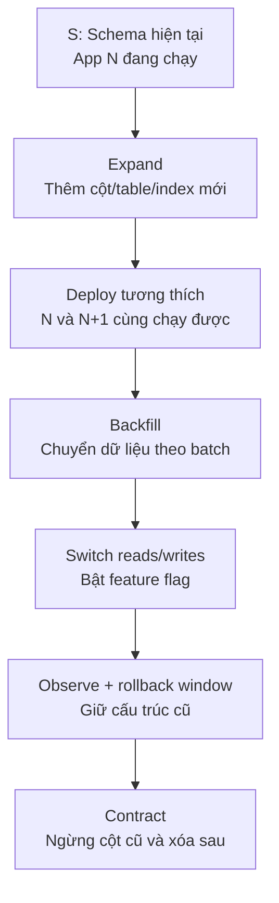
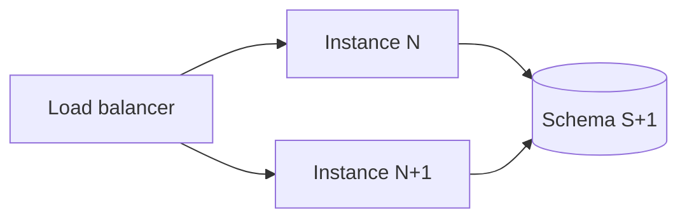
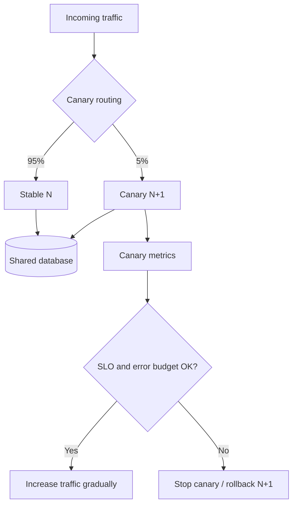
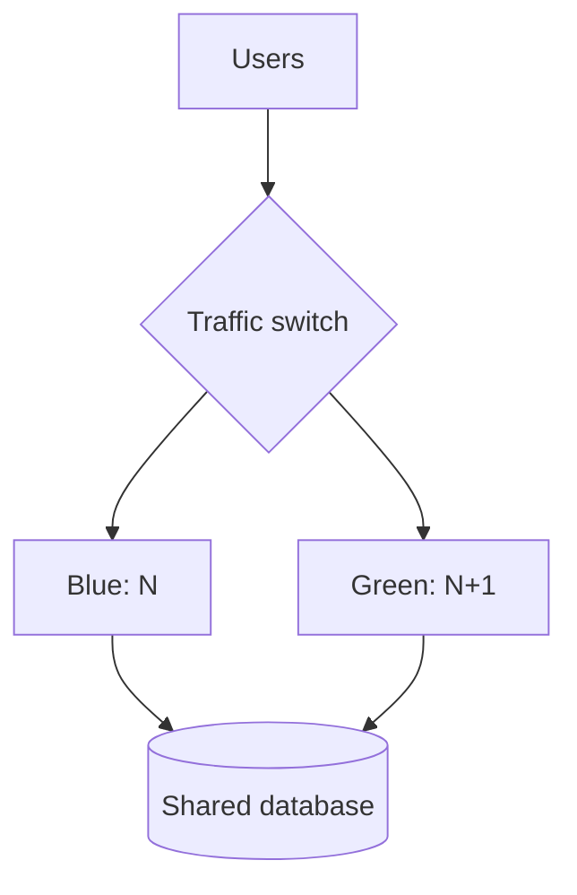
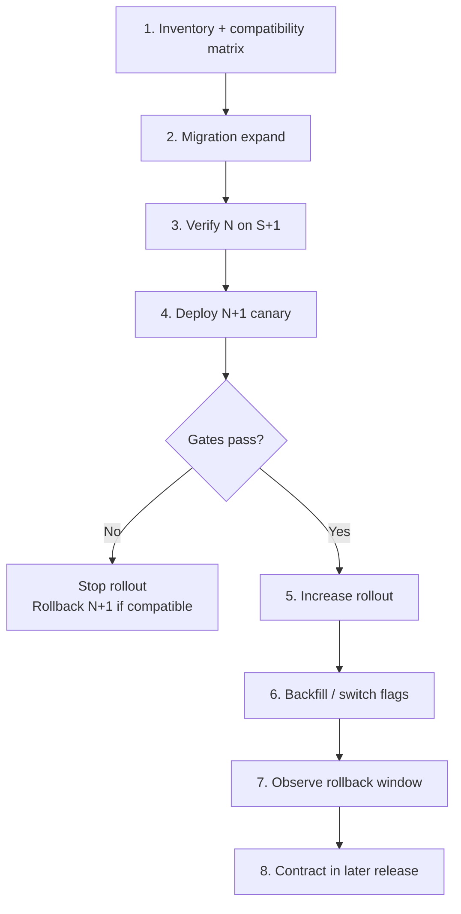

# Nâng cấp theo giai đoạn với khả năng quay về phiên bản đã kiểm chứng

Một bản phát hành Hibernate có thể chạy tốt trên staging nhưng lỗi ngay khi rollout production: phiên bản ứng dụng mới phát SQL khác, cột mới chưa có trên tất cả database, một batch job cũ vẫn ghi dữ liệu theo schema trước, hoặc migration đã xóa cột mà binary cũ cần khi phải rollback.

Một kế hoạch nâng cấp cần trả lời hai câu hỏi:

1. Làm sao đưa phiên bản mới vào production từng bước, quan sát được tác động và giới hạn phạm vi sự cố?
2. Nếu phát hiện lỗi, làm sao quay lại artifact đã được kiểm chứng mà không làm hỏng dữ liệu hoặc schema đã thay đổi?

**Nâng cấp theo giai đoạn** là triển khai có kiểm soát qua các bước tương thích. Mỗi bước giữ cho những phiên bản ứng dụng có thể cùng tồn tại trong thời gian rollout đều làm việc được với schema hiện tại. **Rollback** là khả năng được thiết kế và diễn tập trước, không phải thao tác đoán xem có thể chạy lại binary cũ hay không.

Trong hệ thống Hibernate, cần xem xét đồng thời application artifact, Hibernate/provider version, database schema và dữ liệu đang tồn tại. Rollback binary không tự động rollback schema hoặc dữ liệu. Nếu migration đã xóa cột cũ, phiên bản ứng dụng trước đó có thể không còn chạy được dù file JAR cũ vẫn nguyên vẹn.

Bài học thuộc chương **Nâng cấp và tương thích** của module Data Persistence Relational Access ORM Hibernate. Nội dung đi từ tương thích N/N+1, expand-contract migrations, rolling/canary/blue-green deployment đến nâng cấp Hibernate, kiểm thử rollback, theo dõi production và runbook khôi phục.

> **Phạm vi:** ví dụ tập trung vào Java, Hibernate ORM 6.x, Jakarta Persistence và công cụ migration như Flyway/Liquibase. Tên cấu hình, migration API, dialect behavior và tương thích giữa Hibernate/Spring Boot/JDK phải được xác nhận theo phiên bản cụ thể đang dùng.

---

## 1. Bốn thành phần phải cùng tương thích

Một ứng dụng Hibernate không chỉ là một binary. Có ít nhất bốn thành phần cùng thay đổi theo thời gian:

| Thành phần | Ví dụ thay đổi | Rủi ro khi rollback |
| --- | --- | --- |
| Application artifact | JAR/container image v42 thay v41 | Code mới ghi dữ liệu cũ không hiểu |
| Hibernate/provider | Hibernate 5.x lên 6.x | SQL, type mapping, query behavior hoặc API thay đổi |
| Database schema | Thêm/đổi/xóa columns, indexes, constraints | Binary cũ không đọc/ghi được schema mới |
| Persisted data | Backfill, normalize, chuyển enum/state | Code cũ không hiểu format/meaning mới |

Một release có thể chỉ thay code nhưng vẫn phụ thuộc schema migration. Một nâng cấp Hibernate có thể không đổi entity model nhưng vẫn đổi SQL hoặc cách mapping. Một data backfill có thể làm binary cũ không còn hiểu dữ liệu dù schema chưa đổi.

Release plan cần ghi rõ phiên bản nào tương thích với schema trước/sau migration, dữ liệu trước/sau backfill và các phiên bản ứng dụng cùng tồn tại trong rolling deployment.

## 2. Khái niệm N và N+1

Gọi:

- **N:** phiên bản production hiện tại, đã được kiểm chứng.
- **N+1:** phiên bản dự kiến phát hành.
- **S:** schema hiện tại.
- **S+1:** schema sau một migration mở rộng.

Trong rolling deployment, có thể có thời điểm:

```text
Instance A: application N
Instance B: application N+1
Database:   schema S+1
```

Cả N và N+1 có thể đồng thời đọc/ghi database. Nếu N không tương thích S+1, rollout có thể lỗi dù N+1 hoạt động tốt.

| Application | Schema S | Schema S+1 |
| --- | --- | --- |
| N | Đã kiểm chứng | Phải kiểm tra tương thích trước rollout |
| N+1 | Chỉ nếu thiết kế hỗ trợ | Mục tiêu chính |

Không mặc định binary cũ tương thích schema mới. Phải chứng minh điều đó bằng migration design và integration tests.

## 3. Phân biệt rollback application, schema và data

Ba thao tác thường bị gọi chung là rollback nhưng có hậu quả khác nhau.

**Application rollback**

- Đưa traffic về artifact đã được kiểm chứng.
- Có thể dùng lại container image/JAR trước đó.
- Chỉ an toàn nếu artifact cũ tương thích schema và dữ liệu hiện tại.

**Schema rollback**

- Đưa cấu trúc database về trạng thái cũ.
- Có thể cần drop column/table/index hoặc đổi type.
- Có thể làm mất dữ liệu đã ghi sau migration.
- Có thể không thực hiện được khi binary mới đã ghi dữ liệu theo format mới.

**Data rollback**

- Đảo ngược thay đổi trên rows đã backfill hoặc ghi mới.
- Cần biết chính xác mapping cũ/mới và khả năng phục hồi.
- Có thể không đảo ngược được nếu phép biến đổi mất thông tin.

Một rollback plan phải nêu rõ đang rollback lớp nào. Trong nhiều release, phương án an toàn là rollback application nhưng giữ schema mở rộng tương thích; không chạy migration down ngay lập tức.

## 4. Thiết kế release theo nguyên tắc tương thích trước

Trước khi triển khai N+1, xác định:

1. N+1 cần schema nào?
2. N có chạy được trên schema đó không?
3. N+1 có đọc được dữ liệu cũ chưa backfill không?
4. N+1 có ghi dữ liệu mà N hiểu được không?
5. Background workers, schedulers, consumers và admin tools nào vẫn chạy N?
6. Có thể quay lại N sau khi N+1 đã ghi dữ liệu không?
7. Khi nào mới được xóa schema cũ?
8. Có dữ liệu nào không thể phục hồi sau bước chuyển đổi không?

Tương thích phải bao phủ mọi writer, không chỉ HTTP application. Một consumer cũ, cron job, batch import hoặc dịch vụ khác có thể tiếp tục ghi vào cùng bảng.

---

## 5. Expand-contract: mô hình migration an toàn khi rolling deploy

Mô hình phổ biến để đổi schema có khả năng rollback là **expand-contract**.

- **Expand:** thêm cấu trúc mới mà code cũ vẫn hoạt động.
- **Migrate:** backfill/chuyển dữ liệu theo cách có thể chạy lại.
- **Switch:** chuyển ứng dụng sang đọc/ghi cấu trúc mới.
- **Contract:** chỉ xóa cấu trúc cũ sau khi không còn binary hoặc consumer nào cần nó và rollback window đã kết thúc.



Điểm cốt lõi: không gộp expand và contract vào một lần deploy nếu cần khả năng quay lại binary cũ.

## 6. Ví dụ đổi tên column bằng expand-contract

Giả sử schema cũ có:

```sql
create table customer (
    id bigint primary key,
    full_name varchar(200) not null
);
```

Ứng dụng muốn đổi field sang `display_name`.

Một migration phá vỡ tương thích:

```sql
alter table customer
    rename column full_name to display_name;
```

Ngay sau migration, binary N vẫn phát SQL tham chiếu `full_name` và có thể lỗi.

### Giai đoạn 1: expand

Thêm column mới nhưng giữ column cũ:

```sql
alter table customer
    add column display_name varchar(200);
```

Đây là migration additive. Binary N vẫn đọc/ghi `full_name`.

### Giai đoạn 2: deploy code tương thích hai cột

Một phiên bản trung gian có thể:

- Đọc `display_name` nếu đã có, fallback `full_name`.
- Khi ghi, cập nhật cả hai cột trong cùng transaction.
- Không xóa cột cũ.
- Không giả định mọi row đã được backfill.

Mapping tạm thời có thể map cả hai fields:

```java
@Column(name = "full_name")
private String legacyFullName;

@Column(name = "display_name")
private String displayName;
```

Đây là ví dụ về mapping hai cột; trong ứng dụng thực, cần tránh hai writable properties gây update không nhất quán. Có thể dùng một property read-only, lifecycle/service method hoặc custom mapping phù hợp, nhưng phải xác định rõ cột nào là source of truth.

### Giai đoạn 3: backfill dữ liệu cũ

```sql
update customer
set display_name = full_name
where display_name is null;
```

Với bảng lớn, chạy theo batch có giới hạn và checkpoint. Không chạy một UPDATE khổng lồ mà chưa đo lock, WAL/redo, replication lag và transaction duration.

Backfill phải idempotent: chạy lại không phá dữ liệu đã cập nhật hợp lệ. Predicate chỉ update rows chưa có giá trị mới là một ví dụ; cần bổ sung version/checkpoint nếu dữ liệu có thể thay đổi đồng thời.

### Giai đoạn 4: switch reads

Sau khi xác nhận rows có giá trị và mọi writer đã đồng bộ:

- Chuyển reads sang `display_name`.
- Giữ dual-write trong rollback window.
- Theo dõi nulls, mismatches và application errors.
- Có thể điều khiển read path bằng feature flag nếu logic chuyển đổi cần gradual rollout.

### Giai đoạn 5: contract

Chỉ sau khi không còn application N/worker cũ, không còn script/report/consumer tham chiếu column cũ, rollback window đã kết thúc, backup/PITR đã được xác nhận và không còn code fallback, mới xóa column cũ:

```sql
alter table customer
    alter column display_name set not null;

alter table customer
    drop column full_name;
```

Bước contract là một release riêng. Khi đã drop cột cũ, rollback về binary N có thể không còn khả thi.

## 7. Tương thích dữ liệu trong giai đoạn dual-write

Dual-write có vẻ đơn giản nhưng tạo ra hai nguồn dữ liệu có thể lệch nhau.

```text
full_name    = "An Nguyen"
display_name = "An Nguyen"
```

Nếu một writer chỉ cập nhật `full_name`, hai cột lệch nhau. Nếu một writer chỉ cập nhật `display_name`, binary cũ đọc dữ liệu stale.

Cần định nghĩa:

- Writer nào có quyền ghi?
- Hai field có cùng validation/normalization không?
- Update có nằm trong cùng DB transaction không?
- Có trigger hay generated column nào can thiệp?
- Backfill xử lý row đang được cập nhật đồng thời ra sao?
- Có metric để phát hiện mismatch không?
- Khi rollback, cột nào là nguồn chính để khôi phục?

Không dùng dual-write qua hai database độc lập như một thao tác nguyên tử nếu không có distributed transaction hoặc protocol consistency được thiết kế riêng.

## 8. Backfill dữ liệu theo batch và có thể tiếp tục

Một backfill production cần:

- **Idempotency:** chạy lại an toàn.
- **Checkpoint:** biết đã xử lý đến đâu.
- **Batch size:** giới hạn số rows/transaction.
- **Rate limit:** không làm database quá tải.
- **Progress metric:** rows processed, failed, remaining.
- **Retry:** xử lý lỗi tạm thời.
- **Consistency:** không ghi đè update mới hơn.
- **Audit:** biết migration job nào đã thay đổi dữ liệu.

Pseudo-code:

```java
while (true) {
    List<Long> ids = repository.findNextBatch(
        lastProcessedId,
        batchSize
    );

    if (ids.isEmpty()) {
        break;
    }

    transactionTemplate.executeWithoutResult(status -> {
        for (Long id : ids) {
            repository.backfillDisplayNameIfMissing(id);
        }
    });

    lastProcessedId = ids.get(ids.size() - 1);
}
```

Đây là khung minh họa; query lấy batch cần order ổn định và xử lý row bị xóa/cập nhật trong lúc chạy. Không giữ một transaction mở cho toàn bộ hàng triệu rows.

### Keyset pagination thay OFFSET cho backfill lớn

```sql
select id
from customer
where id > :last_id
order by id
limit :batch_size;
```

Keyset theo ID có thể tránh chi phí OFFSET tăng dần. Nếu ID không phản ánh thứ tự cập nhật, cần checkpoint phù hợp với tập rows và điều kiện backfill.

### Không backfill đồng thời một row theo cách ghi đè dữ liệu mới

Nếu row đã được người dùng cập nhật `display_name` sau khi job đọc giá trị cũ, job không được ghi lại dữ liệu cũ dựa trên snapshot stale. Có thể dùng predicate `display_name is null`, optimistic version, hoặc update có điều kiện và kiểm tra affected rows.

## 9. Migration transactional và migration history

Một số DDL statements được DBMS hỗ trợ trong transaction; một số khác có restrictions hoặc tự commit. Khả năng rollback phụ thuộc engine, statement và migration tool.

Cần xác định:

- DDL có transactional trên DBMS/version này không?
- Index creation có cần concurrent mode không?
- Constraint validation có lock bảng không?
- Migration tool có bao migration trong transaction không?
- Statement có thể chạy lại sau lỗi giữa chừng không?
- Migration có side effects ngoài database không?

Không mặc định một file Flyway/Liquibase luôn atomic trên mọi DBMS. Kiểm tra semantics cụ thể của engine.

Với Flyway, versioned migrations thường được áp dụng theo thứ tự và lưu checksum. Khi đã áp dụng vào môi trường dùng chung, sửa file migration cũ có thể tạo checksum mismatch hoặc làm lịch sử môi trường không nhất quán.

Nguyên tắc:

- Migration đã chạy ở shared environment nên được xem là immutable.
- Thêm migration mới để sửa schema.
- Không sửa lịch sử production để làm staging “đẹp” hơn.
- Kiểm tra trạng thái migration trước deploy.
- Dùng naming/version convention thống nhất.
- Review DDL và execution impact trước khi chạy migration nặng.

Với Liquibase, changeSet cũng có identity/checksum và tracking history. Cần tuân thủ chính sách immutable hoặc controlled changeset run phù hợp với tool/version.

Ví dụ Flyway:

```text
V042__add_customer_display_name.sql
V043__backfill_customer_display_name.sql
V044__make_display_name_not_null.sql
V045__drop_legacy_full_name.sql
```

Các migration này minh họa các bước khác nhau; thời điểm chạy V045 nên cách xa V042 và chỉ sau khi rollback window kết thúc.

## 10. Không dùng Hibernate schema auto-update làm release migration

Trong production, tránh dựa vào:

```properties
spring.jpa.hibernate.ddl-auto=update
```

để thay đổi schema mà không có migration được review.

Lý do:

- Không thể hiện đầy đủ ý định migration.
- Không quản lý tốt data backfill/transformations.
- Khó review locking/impact.
- Có thể khác nhau giữa environments.
- Không tạo được release sequence rõ ràng.
- Không đủ thông tin để lập kế hoạch rollback.

Ưu tiên Flyway/Liquibase hoặc migration mechanism được quản lý. Hibernate có thể validate mapping với schema:

```properties
spring.jpa.hibernate.ddl-auto=validate
```

`validate` là kiểm tra tương thích mapping/schema trong phạm vi Hibernate hỗ trợ; nó không chứng minh mọi index, trigger, RLS policy hoặc query behavior đều đúng.

---

## 11. Rolling deployment: nhiều phiên bản cùng chạy

Rolling deployment thay từng instance trong khi hệ thống tiếp tục phục vụ traffic.



Trong một khoảng thời gian, cả N và N+1 cùng kết nối DB. Điều này yêu cầu schema S+1 tương thích với cả hai.

Rủi ro phổ biến:

- Binary N không biết column mới có NOT NULL không có default.
- N+1 ghi enum/string mới mà N không parse được.
- Worker N cũ ghi dữ liệu theo format trước.
- N+1 đổi query semantics hoặc index assumption.
- Migration lock khiến instance mới khởi động chậm.
- N và N+1 cùng chạy scheduled job.
- Cache keys/serialized payloads không tương thích giữa versions.

Checklist rolling deployment:

1. Apply additive schema changes trước.
2. Xác nhận app N vẫn hoạt động với schema mới.
3. Deploy N+1 theo từng batch/instance.
4. Theo dõi health, DB errors, pool, latency và domain errors.
5. Không chạy destructive contract migration trong rolling window.
6. Khi tất cả instance đã là N+1, xác nhận workers/consumers cũng đã nâng.
7. Giữ khả năng rollback binary trong cửa sổ đã định.
8. Contract schema ở release sau.

## 12. Canary deployment: thử trên một phần traffic

Canary đưa N+1 tới một phần nhỏ instance/traffic trước khi mở rộng.



Tỷ lệ 95/5 chỉ là ví dụ, không phải giá trị mặc định.

Canary hữu ích để quan sát error rate, p95/p99 latency, SQL errors/slow queries, connection pool, CPU/heap/GC, lock waits, domain validation failures, message consumer lag và dead-letter queue.

### Canary có thể gây side effects trên database

Dù chỉ 5% traffic, N+1 vẫn ghi vào database dùng chung. Nếu N không hiểu dữ liệu N+1 vừa ghi, rollback traffic về N không đủ để khôi phục.

Trước canary, cần chứng minh write compatibility hoặc giới hạn canary ở read-only paths/feature flags phù hợp.

## 13. Blue-green deployment: chuyển traffic giữa hai môi trường

Blue-green duy trì hai deployment environments:

- Blue: stable N.
- Green: candidate N+1.



Ưu điểm: có thể chuyển traffic nhanh, warm-up và smoke test candidate trước switch, đồng thời giữ môi trường cũ để phục hồi traffic.

Nhưng nếu Blue và Green dùng chung database, schema/data vẫn là điểm tương thích chung. Blue-green không tự tạo rollback an toàn nếu Green đã ghi dữ liệu mà Blue không hiểu.

Nếu mỗi environment dùng database riêng, chuyển traffic có thể cần replication/cutover/data synchronization. Đây là bài toán migration khác, không chỉ đổi load balancer.

| Chiến lược | Điểm mạnh | Điều kiện/rủi ro |
| --- | --- | --- |
| Rolling | Ít tài nguyên hơn, deploy liên tục | N/N+1 phải tương thích khi cùng chạy |
| Canary | Giới hạn blast radius, tăng dần traffic | Phải quan sát được; writes vẫn có side effects |
| Blue-green | Switch traffic nhanh, warm-up candidate | Shared DB vẫn cần schema/data compatibility |
| Read-only shadow | So sánh kết quả mà không ghi | Cần bảo đảm shadow không gây side effects/DB load quá mức |
| Dark launch | Khởi động code path nhưng chưa bật chức năng | Background jobs/listeners có thể vẫn gây side effects |

Không có chiến lược nào thay thế expand-contract. Chúng kiểm soát traffic rollout; expand-contract kiểm soát schema/data compatibility.

## 14. Feature flags hỗ trợ rollback logic

Feature flag cho phép deploy code mới nhưng chưa bật hành vi mới:

```java
if (featureFlags.useNewCustomerName()) {
    return customer.getDisplayName();
}

return customer.getFullName();
```

Có thể dùng flag để bật reads mới cho canary, tăng tỷ lệ tenants/requests, tắt nhanh code path có lỗi, so sánh kết quả cũ/mới và tách deploy khỏi release chức năng.

### Feature flag không sửa được schema incompatibility

Nếu code mới đã drop cột cũ hoặc chỉ ghi format mà code cũ không đọc được, tắt flag có thể không phục hồi khả năng rollback.

Flag phải được thiết kế trước khi dữ liệu chuyển đổi không thể đảo ngược. Kiểm tra tất cả paths, gồm async consumers, caches và batch jobs.

Quy tắc quản lý flag:

- Có owner và mục đích.
- Có default an toàn.
- Có metric để biết flag đang bật ở đâu.
- Có quyền thay đổi được kiểm soát.
- Có thời hạn dọn flag.
- Không dùng flag để duy trì mã legacy vô thời hạn.
- Ghi lại dependency giữa flag và schema migration.

## 15. Read compatibility và write compatibility

Hai khái niệm cần tách riêng:

**Read compatibility:** binary có thể đọc dữ liệu được phiên bản khác ghi.

**Write compatibility:** dữ liệu do binary ghi vẫn được các phiên bản cần coexist/rollback hiểu.

Ví dụ enum:

```java
public enum OrderStatus {
    DRAFT,
    CONFIRMED,
    PAID,
    CANCELLED,
    REFUNDED
}
```

Nếu N không có enum REFUNDED, Hibernate/application N có thể ném lỗi khi đọc row đó. Một rollout N+1 ghi REFUNDED rồi rollback về N có thể khiến N không hoạt động.

Các phương án:

- Thêm khả năng đọc giá trị mới vào mọi phiên bản tương thích trước khi ghi.
- Lưu status dưới dạng code ổn định và có fallback có chủ đích.
- Chỉ bật trạng thái mới sau khi rollback về N không còn là yêu cầu.
- Giữ trạng thái workflow mới ở bảng/event riêng cho đến khi tất cả readers được nâng.

Không catch mọi exception và mặc định trạng thái không xác định thành DRAFT; điều đó có thể phá vỡ nghiệp vụ.

## 16. Thay đổi kiểu dữ liệu và association theo giai đoạn

Giả sử đổi cột amount từ integer cents sang decimal. Cách phá vỡ là đổi type ngay trong một migration khi binary cũ vẫn mong integer semantics.

Kế hoạch an toàn hơn:

1. Thêm `amount_decimal` nullable.
2. Deploy code đọc fallback và dual-write hai biểu diễn.
3. Backfill từ cents sang decimal bằng phép biến đổi đã định nghĩa.
4. So sánh giá trị cũ/mới, gồm rounding và overflow.
5. Chuyển reads sang decimal.
6. Giữ old field trong rollback window.
7. Dừng writes cũ và xóa column cũ ở release sau.

Phải xác định scale, rounding mode, currency minor units và giới hạn numeric trước khi backfill. Không mặc định mọi currency có hai chữ số thập phân.

Khi chuyển một quan hệ trực tiếp sang bảng association, tạo bảng/FK/index trước; deploy code đọc được dữ liệu cũ và mới; backfill association rows; dual-write; kiểm tra orphan/missing links; switch reads; chỉ xóa cột cũ sau rollback window.

Thay đổi primary key còn ảnh hưởng foreign keys, external APIs, event payloads, cache keys, URLs, ETL, Hibernate identity map và equals semantics. Thường cần thêm key mới, duy trì mapping old/new, chuyển từng reader/writer và chỉ retire key cũ sau khi mọi consumers đã nâng.

---

## 17. Nâng cấp Hibernate theo giai đoạn

Nâng Hibernate có thể gồm nhiều lớp thay đổi:

- Hibernate API/SPI.
- Jakarta Persistence version.
- Java/JDK baseline.
- Spring Boot integration.
- Dialect behavior.
- Type mappings.
- SQL generation.
- HQL/JPQL interpretation.
- Identifier generation.
- Caching and event listeners.
- JDBC driver compatibility.

Một bước nâng major cần có compatibility matrix trước khi đổi dependency.

| Thành phần | Hiện tại | Đích | Đã xác nhận? |
| --- | --- | --- | --- |
| Java runtime | JDK hiện tại | JDK hỗ trợ bản đích | Có/Không |
| Spring Boot | Boot hiện tại | Boot tương thích Hibernate | Có/Không |
| Hibernate ORM | ORM hiện tại | ORM đích | Có/Không |
| Jakarta Persistence | API hiện tại | API đích | Có/Không |
| JDBC driver | Driver hiện tại | Driver hỗ trợ DB/server | Có/Không |
| Database | DB hiện tại | DB version hỗ trợ | Có/Không |
| Cache provider | Provider hiện tại | Provider tương thích | Có/Không |
| Envers | Module hiện tại | Module cùng dòng version | Có/Không |

Không nâng riêng Hibernate vượt khỏi dependency management của Spring Boot mà chưa xác nhận support matrix.

## 18. Hibernate 5 lên 6: những vùng cần kiểm tra

Một số dự án nâng từ Hibernate 5.x lên 6.x phải xử lý thay đổi namespace từ Java Persistence sang Jakarta Persistence:

```java
// Trước đây
import javax.persistence.Entity;

// Jakarta Persistence
import jakarta.persistence.Entity;
```

Không phải mọi package javax.* đều được đổi; chỉ các API thuộc Jakarta EE/Jakarta Persistence tương ứng. Tránh replace toàn project một cách máy móc.

Các vùng cần rà soát:

- Imports và dependency Jakarta.
- Hibernate configuration properties đã đổi tên/semantics.
- Custom dialects và type contributions.
- UserType/BasicType và SPI integrations.
- HQL/JPQL query semantics.
- Native query result mappings.
- SQL aliases và generated SQL assumptions.
- Identifier/sequence behavior.
- JDBC type mappings.
- Custom interceptors/listeners.
- Second-level cache provider.
- Envers.
- Query hints và lock hints.
- Spring Boot integration compatibility.

Đây là danh sách khu vực kiểm tra, không phải khẳng định mọi ứng dụng đều phải sửa từng mục. Dùng migration guide đúng minor/major version và test các extension points ứng dụng đang dùng.

## 19. Không dựa vào SQL text cũ sau khi nâng Hibernate

Hibernate có thể thay đổi SQL formatting, aliases, join order, parameter typing hoặc chiến lược query mà vẫn giữ kết quả đúng. Test so sánh raw SQL string có thể fail dù behavior tương đương.

Ngược lại, query vẫn chạy nhưng semantics có thể thay đổi với null handling, pagination, grouping hoặc result type.

Sau nâng cấp, ưu tiên test result set, null/empty behavior, sorting/pagination, locking, generated IDs, flush order khi nghiệp vụ phụ thuộc constraint, query count/performance budgets và DB execution plans cho queries quan trọng.

Chỉ assert SQL cụ thể khi đó là contract có chủ ý, ví dụ native SQL hoặc requirement performance đặc thù.

## 20. Nâng cấp dependency trong một nhánh có thể kiểm soát

Quy trình đề xuất:

1. Tạo branch/release candidate riêng.
2. Pin phiên bản Java, Spring Boot, Hibernate, JDBC driver và cache provider.
3. Đọc migration guide/release notes của các version nằm giữa nếu nâng qua nhiều major.
4. Compile production/test sources.
5. Xử lý API deprecations/SPI changes.
6. Chạy unit tests.
7. Chạy ORM integration tests trên DB mục tiêu.
8. Chạy migrations từ schema cũ.
9. So sánh query outputs và performance baselines.
10. Đóng gói immutable artifact/container image.
11. Ghi rõ commit, dependency lock/SBOM và image digest.
12. Đưa artifact qua staging và canary.

Không build lại cùng một version tag cho từng environment nếu muốn biết chính xác binary nào đang chạy. Promote cùng artifact đã kiểm chứng.

### Schema validation khi nâng Hibernate

Trong test/staging, có thể dùng:

```properties
spring.jpa.hibernate.ddl-auto=validate
```

để phát hiện một số mapping/schema mismatches. Cần xác nhận migration đã chạy trước khi Hibernate startup validation.

Không dùng `ddl-auto=update` làm cách tự động sửa mọi khác biệt sau khi nâng. Hãy tạo migration rõ ràng, review DDL và kiểm tra DB catalog.

## 21. Tách nâng Hibernate khỏi thay đổi domain schema khi có thể

Nếu cùng một release vừa nâng Hibernate major, đổi entity mappings, thay primary keys, đổi enum values, thêm cache, viết lại queries và chạy data backfill thì khi canary lỗi rất khó biết thay đổi nào gây ra.

Có thể chia thành các releases:

- Release A: nâng Hibernate với schema và domain behavior gần như giữ nguyên.
- Release B: thay mapping/query theo yêu cầu.
- Release C: expand schema và deploy code tương thích.
- Release D: backfill/switch.
- Release E: contract/drop legacy.

Không phải lúc nào cũng tách được, nhưng giảm số biến thay đổi trong một lần release giúp điều tra và rollback dễ hơn.

---

## 22. Kiểm thử tương thích N/N+1 trước rollout

Một bộ integration matrix hữu ích:

| Test case | App | Schema | Dữ liệu | Kỳ vọng |
| --- | --- | --- | --- | --- |
| Baseline | N | S | Cũ | Pass |
| Expand compatibility | N | S+1 | Cũ | Pass |
| New version on expanded schema | N+1 | S+1 | Cũ | Pass |
| Backfilled data | N+1 | S+1 | Mới | Pass |
| Rollback candidate | N | S+1 | Dữ liệu đã ghi bởi N+1 | Pass nếu rollback được cam kết |
| Contract validation | N+1 | S+2 | Mới | Pass |
| Legacy removed | N | S+2 | Mới | Không còn được hỗ trợ |

Case quan trọng thường bị bỏ qua là **N chạy trên schema mở rộng và dữ liệu mà N+1 đã ghi**.

Nếu không thể pass case đó, rollback binary về N cần biện pháp khác: disable writes mới, reverse data transform, restore database theo RPO hoặc forward-fix trong N+1. Ghi rõ lựa chọn trước deploy.

## 23. Test rollback như một kịch bản thật

Không đủ khi chỉ biết cách chọn image cũ trong deployment tool.

Một rehearsal rollback cần:

1. Tạo database từ snapshot/fixture gần production.
2. Apply expand migration.
3. Deploy N+1.
4. Ghi một tập dữ liệu đại diện bằng N+1.
5. Chạy backfill/feature flag nếu release có.
6. Route traffic về N.
7. Chạy các API/worker critical trên N.
8. Kiểm tra data integrity và SQL errors.
9. Đo thời gian phục hồi.
10. Ghi điều kiện khiến rollback thất bại.

Rehearsal cần chạy với data formats thực tế, gồm enum/status mới, nullability, associations và values biên. Chỉ test rollback khi N+1 chưa ghi dữ liệu không chứng minh rollback sau release thực sự an toàn.

## 24. Phân loại migration theo khả năng đảo ngược

| Loại thay đổi | Khả năng rollback thường gặp | Cách tiếp cận |
| --- | --- | --- |
| Add nullable column | Dễ hơn | Giữ column khi rollback app |
| Add table/index | Thường dễ hơn | Có thể giữ cấu trúc mới |
| Add nullable FK | Có điều kiện | Kiểm tra data và writers |
| Backfill copy sang cột mới | Có thể | Giữ dữ liệu cũ và kiểm tra mismatch |
| Normalize/transform values | Có thể mất thông tin | Lưu mapping/original value nếu cần |
| Tighten NOT NULL/UNIQUE | Có điều kiện | Validate data trước, xem writer cũ |
| Change enum vocabulary | Khó | Expand readers trước khi write new values |
| Drop column/table | Khó | Chỉ contract sau rollback window |
| Change PK/FK graph | Rất phức tạp | Nhiều giai đoạn, dependency inventory |
| Delete/merge rows | Có thể không đảo ngược | Backup, audit mapping, compensating data |

Một migration tool có thể hỗ trợ down migration nhưng không có nghĩa phép biến đổi dữ liệu đảo ngược được về mặt nghiệp vụ.

## 25. Vì sao migration down không phải lúc nào cũng là rollback đúng?

Giả sử đã chuyển:

```text
full_name = "An Nguyen"
display_name = "An Nguyen"
```

Sau đó binary mới cho phép người dùng chỉnh `display_name` thành "An N." và column cũ vẫn giữ "An Nguyen".

Nếu chạy down migration copy `display_name` trở lại `full_name`, dữ liệu cũ bị thay đổi. Nếu copy ngược theo chiều khác, dữ liệu mới bị mất.

Trước khi viết down migration, hỏi:

- Có thể khôi phục chính xác giá trị cũ không?
- Có writers nào đang thay đổi dữ liệu trong lúc rollback?
- Có cần preserve original values/audit?
- Có thể reverse theo key/version?
- Có thể rollback bằng application compatibility mà giữ schema mới không?

Với thay đổi mất thông tin, forward-fix thường an toàn hơn một down migration giả định.

## 26. Forward-fix: sửa lỗi bằng migration tiến lên

Khi schema/data đã đi quá xa để rollback an toàn:

- Dừng rollout.
- Giữ hoặc quay lại binary tương thích nếu có thể.
- Tạo migration mới để sửa lỗi.
- Backfill/repair dữ liệu theo batch.
- Deploy artifact sửa lỗi.
- Xác minh integrity.
- Giữ audit/backup cần thiết.

Ví dụ migration đã đặt default sai. Thay vì sửa file migration đã chạy, tạo migration mới điều chỉnh default và sửa các rows bị ảnh hưởng.

Forward-fix không phải lý do bỏ rollback planning. Nó là nhánh phục hồi được xác định trước khi rollback data không an toàn.

## 27. Backup, snapshot và point-in-time recovery

Backup không phải nút Undo tức thời.

Trước migration rủi ro:

- Xác nhận backup hoàn tất và restore đã được diễn tập.
- Biết RPO/RTO.
- Kiểm tra PITR window và WAL/binlog retention.
- Ghi lại thời điểm migration.
- Xác định phạm vi database/schema/tenant.
- Biết cách phục hồi vào instance riêng để kiểm tra trước cutover.
- Có kế hoạch xử lý writes phát sinh sau snapshot.

Restore toàn database về thời điểm trước migration có thể xóa các giao dịch hợp lệ phát sinh sau đó. Trong hệ thống đang phục vụ traffic, cần quyết định freeze writes, replay events hoặc reconcile dữ liệu theo business process.

Không coi “đã có backup” là đủ nếu chưa biết restore mất bao lâu và mất những writes nào.

## 28. Quản lý migration locks và thời gian deploy

DDL có thể gây lock chặn application traffic. Trước khi chạy migration:

- Xem query/DDL execution plan nếu DBMS hỗ trợ.
- Xác định lock mode và duration.
- Chọn batch/backfill.
- Đặt statement/lock timeout phù hợp.
- Tránh giữ transaction dài.
- Kiểm tra replication lag.
- Xác định cách dừng migration giữa chừng.
- Chạy trên dữ liệu có kích thước đại diện.
- Chọn maintenance window nếu cần.

Ví dụ PostgreSQL tạo index lớn có thể dùng cơ chế concurrent index creation, nhưng có transaction restrictions riêng. Không sao chép option đó sang DBMS khác hoặc giả định migration tool tự chia transaction đúng cách.

## 29. Expand schema nhưng tránh lock dài

Một số thay đổi tưởng additive vẫn có thể gây lock hoặc rewrite bảng tùy DBMS/version, ví dụ thêm column với default, đổi type, validate constraint hoặc tạo index.

Không đánh giá migration chỉ bằng số dòng SQL. Hãy tìm hiểu table rewrite, lock mode, scan toàn bảng, online/concurrent index, constraint validation, batch strategy, disk/WAL/replication capacity.

Chạy migration rehearsal trên database có kích thước gần production và quan sát lock/replication metrics.

## 30. Rolling deploy và Hibernate SessionFactory startup

Khi một instance N+1 khởi động, Hibernate có thể scan entity metadata, validate schema, initialize connection pool, build query/metadata caches, initialize L2 cache provider và register event listeners.

Một canary có thể fail trước khi nhận traffic do mapping/schema mismatch hoặc DB permission. Đưa startup readiness vào rollout gate.

Readiness nên xác nhận application context started, connection pool hoạt động, schema compatibility validation thành công, required cache/provider initialized nếu bắt buộc và migration state đúng. Có thể chạy critical read-only query smoke test nếu phù hợp.

Không để readiness check chạy query nặng mỗi vài giây hoặc gây tải đáng kể lên database.

## 31. Background workers và message consumers phải được nâng cùng kế hoạch

Một hệ thống có thể có HTTP API, scheduled jobs, queue consumers, batch import/export, admin scripts, reporting services và data warehouse pipelines. Các thành phần này có thể đọc cùng schema.

Nếu chỉ rollout web instances, worker N vẫn có thể đọc enum/status hoặc columns mới và fail.

Tạo inventory theo database writers/readers, ghi owner, version và thời điểm nâng. Nếu message payload/schema cũng đổi, áp dụng versioned event contract và compatibility window tương tự database.

## 32. Cache và serialization khi rollback

Các nguồn state ngoài database có thể khiến rollback binary không đủ:

- Redis cache chứa object/JSON format mới.
- Hibernate L2 cache chứa entries từ mapping/version mới.
- Query cache invalidation khác nhau.
- Session replication chứa serialized classes.
- Distributed locks hoặc job metadata dùng format mới.
- Outbox/event payload đã phát ra ngoài.

Trước deploy, xác định cache namespace/versioning và cách invalidate an toàn. Không deserialize serialized Java objects giữa các phiên bản tùy tiện nếu không có compatibility contract.

Nếu cache là dữ liệu có thể tái tạo, invalidate có kiểm soát thường an toàn hơn giữ entries có schema không tương thích. Nhưng cache flush diện rộng có thể tạo cache stampede; cần warm-up/rate limiting.

## 33. Message/event contracts cũng cần expand-contract

Nếu N+1 ghi event mới mà consumer N không hiểu, rollback consumer có thể thất bại dù DB schema tương thích.

Các nguyên tắc:

- Thêm field optional trước.
- Consumer cũ bỏ qua field chưa biết nếu serialization contract cho phép.
- Không đổi ý nghĩa field cũ mà không version.
- Không phát enum value mới trước khi readers tương thích.
- Dùng schema registry/contract tests nếu hệ thống hỗ trợ.
- Theo dõi consumer lag và dead-letter queue.
- Có replay/reprocess plan.
- Không xóa event cũ trước khi retention/replay window kết thúc.

Database compatibility chỉ là một phần của release compatibility.

## 34. Observability phải được định nghĩa trước canary

Một rollout không thể kiểm soát nếu chỉ có tín hiệu “pod healthy”.

| Nhóm | Chỉ số |
| --- | --- |
| Application | Request rate, error rate, p95/p99 latency |
| Hibernate/JDBC | SQL exceptions, statement rate, slow query, batch behavior |
| Connection pool | Active, idle, pending, acquisition timeout |
| Database | CPU, locks, waits, connections, replication lag |
| JVM | CPU, heap, GC pause, thread saturation |
| Domain | Validation failures, transition rejects, duplicate operations |
| Messaging | Consumer lag, retries, dead letters |
| Migration | Rows processed, rows remaining, errors, duration |
| Data integrity | Null count, mismatch count, orphan rows, duplicate keys |

Không gắn raw SQL, user ID hay request ID thành metric labels có cardinality cao. Dùng operation names/fingerprints ổn định và trace/log correlation có kiểm soát.

## 35. Đặt rollout gates có thể hành động

Một gate nên định nghĩa metric, baseline, ngưỡng dừng, cửa sổ đánh giá, số requests tối thiểu, người có quyền quyết định, rollback trigger và cách xử lý nếu telemetry mất.

Ví dụ:

```text
Canary 5%:
  Continue if:
    - no new migration/schema errors
    - error rate within agreed threshold
    - p95/p99 within SLO
    - pool pending stable
    - no unexpected DB lock/replication regression
    - domain rejection rates unchanged

  Stop if:
    - sustained 5xx increase
    - critical persistence exceptions
    - data integrity mismatch
    - database saturation
```

Các ngưỡng phải lấy từ SLO/production baseline của ứng dụng, không dùng một con số chung cho mọi hệ thống.

## 36. Phân biệt lỗi deploy với lỗi migration

Khi canary lỗi, phân loại:

- **Application error:** null pointer, validation, serialization, API regression. Rollback binary/flag có thể đủ nếu schema tương thích.
- **Hibernate/ORM error:** mapping mismatch, query parser, SQL generation, type binding. Kiểm tra version/dialect/driver và SQL error.
- **Migration error:** column/index/constraint thiếu, lock timeout, checksum mismatch. Có thể cần dừng deploy, repair/forward migration.
- **Data compatibility error:** enum mới, null/format không được code cũ hiểu. Rollback binary có thể làm sự cố nặng hơn.
- **Infrastructure error:** pool, network, DB capacity, cache. Rollback code có thể không giải quyết nguyên nhân.

Runbook cần một bước phân loại trước khi thực hiện hành động có thể làm mất dữ liệu.

---

## 37. Quy trình release theo giai đoạn đề xuất



**Bước 1 — Inventory:** liệt kê instances, workers, readers/writers, schema versions, cache formats, event contracts và external consumers.

**Bước 2 — Expand migration:** thêm cấu trúc tương thích, chưa drop/rename phá vỡ. Rehearse lock và runtime.

**Bước 3 — Verify N on S+1:** chạy binary hiện tại trên schema mới với test suite và smoke tests.

**Bước 4 — Canary N+1:** dùng immutable artifact, traffic nhỏ, feature flags và monitoring. Không mở writes không tương thích.

**Bước 5 — Increase rollout:** tăng traffic theo gates. Xác nhận tất cả app/worker versions.

**Bước 6 — Backfill và switch:** chạy batch có checkpoint; validate dữ liệu; bật reads mới; giữ dual-write/fallback trong rollback window nếu cần.

**Bước 7 — Observe rollback window:** giữ schema cũ và artifact N sẵn sàng. Diễn tập rollback khi có thay đổi data semantics.

**Bước 8 — Contract:** drop legacy fields/indexes/tables trong release riêng khi không còn reader/writer nào cần chúng.

## 38. Rollback runbook: khi canary thất bại

Một runbook tối thiểu nên có các bước rõ:

1. **Stop rollout:** không tăng thêm traffic hoặc instance.
2. **Freeze risky migration/backfill:** dừng job theo checkpoint an toàn; không kill transaction tùy tiện.
3. **Classify failure:** application, ORM, schema, data, infrastructure hay downstream.
4. **Check compatibility:** N có đọc/ghi được schema và data hiện tại không?
5. **Disable new behavior:** tắt feature flag nếu đây là code path có thể tắt an toàn.
6. **Route traffic to N:** chỉ khi compatibility đã được chứng minh.
7. **Drain N+1:** dừng consumers/schedulers mới theo thứ tự để không mất message.
8. **Verify health:** API, workers, SQL errors, pool, DB locks và data integrity.
9. **Preserve evidence:** logs, traces, migration version, artifact digest, backfill checkpoint.
10. **Choose repair:** application rollback, forward-fix, data repair hoặc PITR theo RPO.
11. **Confirm recovery:** so sánh SLO/data metrics với baseline.
12. **Keep contract migration paused:** không xóa legacy structures cho đến khi incident được giải quyết.

Không chạy down migration theo phản xạ ngay sau khi rollback binary.

## 39. Ví dụ điều kiện quyết định rollback

| Tình huống | Hành động đầu tiên | Điều kiện |
| --- | --- | --- |
| N+1 tăng 5xx do code regression | Dừng canary, route về N | N tương thích schema/data |
| N+1 gặp mapping error khi startup | Dừng rollout | Xác định schema/config mismatch |
| Migration add column thành công, N+1 fail | Giữ schema mở rộng, rollback N+1 | N đã được kiểm tra trên S+1 |
| N+1 ghi enum mới, N không parse | Không route N mù quáng | Cần stop writes/repair/forward-fix |
| Backfill sai nhưng cột cũ còn nguyên | Dừng job, đánh giá dữ liệu | Có thể rebuild từ source cũ/audit |
| Column cũ đã drop | Không kỳ vọng N chạy trực tiếp | Restore/recreate compatibility/forward-fix |
| DB saturation trong migration | Dừng tăng rollout, kiểm soát migration | Theo dõi lock/replication và resume policy |

## 40. Dừng migration job an toàn

Backfill có thể đang ở giữa một batch. Khi dừng:

- Đợi transaction hiện tại commit/rollback theo policy.
- Lưu checkpoint đã commit.
- Xác nhận job có thể resume idempotently.
- Không đánh dấu toàn bộ migration complete khi còn rows chưa xử lý.
- Ghi lại rows failed và error reason.
- Kiểm tra có writer mới làm thay đổi predicate không.
- Không drop cột nguồn trước khi validation hoàn tất.

Nếu job dùng cursor/checkpoint, lưu checkpoint cùng transaction với batch progress khi có thể để tránh trạng thái “đã ghi data nhưng checkpoint chưa ghi” hoặc ngược lại.

## 41. Artifact rollback phải immutable và có thể tái tạo

Lưu giữ container image digest/JAR checksum, Git commit SHA, dependency lock/SBOM, build metadata, runtime configuration version, migration version trước/sau, feature flag state, image registry retention và deployment manifest/chart version.

Không chỉ giữ tag như `latest` hoặc `stable` có thể bị ghi đè. Rollback cần xác định đúng binary đã chạy tốt, không phải build lại từ branch cũ với dependency repos đã thay đổi.

## 42. Rollback configuration và database permissions

Application cũ có thể không hiểu config mới: property đổi tên, feature flag key, connection pool setting, Hibernate setting, cache region config, secret rotation hoặc TLS/driver options.

Lưu config version cùng artifact và kiểm tra compatibility. Nếu secret đã rotate, binary cũ phải dùng được credential mới hoặc có overlap window. Không khôi phục secret cũ đã bị thu hồi chỉ để rollback code.

Nâng cấp có thể thay đổi DB grants. Nếu rollback về N, role/permission cần vẫn đủ cho N. Không cấp quyền DDL cho application runtime chỉ để startup migration tiện hơn.

## 43. Blue-green với database migration: hai pha cutover

Nếu Blue và Green dùng chung DB:

- Expand schema trước khi Green start.
- Blue vẫn phải chạy được.
- Green chạy smoke tests.
- Switch traffic.
- Giữ Blue warm nhưng không để background jobs chạy trùng.
- Rollback traffic chỉ khi Blue hiểu dữ liệu Green ghi.
- Contract schema ở release sau.

Nếu mỗi màu có database riêng, cần replication/sync dữ liệu, xác định write leader, bảo đảm không mất writes và có reverse replication hoặc freeze/reconcile plan. Không để hai environments cùng ghi độc lập mà không có consistency protocol.

Blue-green application không tự giải quyết database cutover.

## 44. Nâng cấp cache provider, Envers và JDBC driver

Khi nâng Hibernate hoặc cache provider, kiểm tra provider/module version, serialization format, region naming, key structure, tenant isolation trong cache keys, eviction/invalidation, cluster topology, startup/warmup và cache entries từ version cũ.

Nếu format không tương thích, có thể version namespace hoặc clear cache có kiểm soát. Cần tính cache cold-start load để không làm DB quá tải sau deploy.

Nếu dùng Envers, kiểm tra Envers version cùng dòng Hibernate, audit table schema, revision entity, custom revision listeners, transaction rollback, migration audit tables và query history trước/sau nâng.

Khi nâng JDBC driver hoặc DB server, chạy integration tests trên version đích; kiểm tra timezone, UUID, JSON, arrays, numeric precision, generated IDs/defaults, batch updates, timeout/cancellation, exception translation và TLS/authentication. Mở được connection chưa đủ; cần chạy persistence operations đại diện.

## 45. Query behavior và indexes sau nâng cấp

Một Hibernate version mới có thể tạo SQL khác cho cùng HQL/Criteria. Sau nâng cấp, queries quan trọng cần đo lại:

- Query count.
- Result correctness.
- Execution plan.
- Rows scanned/returned.
- Index usage.
- Lock duration.
- p95/p99.
- Connection holding time.

Không thêm index mới theo phỏng đoán khi SQL chưa được xác nhận. Index có chi phí ghi và migration lock; hãy dựa trên plan và workload.

## 46. Contract tests cho schema và consumers

Một nhóm contract tests có thể xác nhận columns/constraints cần có, enum/string values được hỗ trợ, queries quan trọng chạy được, data formats được đọc bởi N và N+1, event schemas được consumers chấp nhận, migration từ version cũ tạo schema mong đợi và rollback compatibility còn tồn tại trong cửa sổ cam kết.

Có thể kiểm tra schema catalog hoặc chạy integration tests trên mỗi migration. Tránh viết contract test phụ thuộc internal aliases/SQL formatting không phải API.

---

## 47. Ví dụ rollout hoàn chỉnh: thêm trạng thái mới

Giả sử cần thêm trạng thái REFUNDED cho Order.

### Trạng thái ban đầu

- App N có enum DRAFT, CONFIRMED, PAID, CANCELLED.
- Database lưu enum dạng VARCHAR.
- App N deserialize mọi value thành Java enum.
- App N không biết REFUNDED.

### Kế hoạch nguy hiểm

1. Deploy N+1 có enum REFUNDED.
2. N+1 ghi REFUNDED.
3. Canary fail.
4. Rollback về N.
5. N đọc row REFUNDED và ném lỗi.

### Kế hoạch theo giai đoạn

1. **Expand readers:** deploy một phiên bản tương thích có thể đọc REFUNDED nhưng chưa tạo trạng thái này.
2. Xác nhận mọi API/worker/consumer cần rollback đều hiểu value.
3. Nếu dùng DB CHECK constraint, mở rộng constraint để chấp nhận REFUNDED trước khi ghi.
4. Deploy feature code tạo trạng thái nhưng giữ flag off.
5. Canary code mới với traffic hạn chế.
6. Bật flag theo cohort sau khi xác nhận.
7. Theo dõi transitions, refunds, audit và reports.
8. Giữ khả năng đọc/ghi tương thích trong rollback window.
9. Chỉ xóa compatibility code ở release sau khi N không còn là rollback target.

Nếu không thể nâng readers trước, cần thiết kế trạng thái/refund record theo cách binary N bỏ qua an toàn hoặc chọn forward-fix thay vì rollback N sau khi đã ghi value mới.

## 48. Ví dụ rollout Hibernate major upgrade

Giả sử nâng từ Hibernate 5.x lên 6.x:

**Preparation**

- Kiểm tra Java/Spring Boot/Jakarta compatibility.
- Đọc migration guide và release notes.
- Inventory custom UserTypes, dialects, listeners, native queries, cache và Envers.
- Pin dependency versions.

**Compatibility branch**

- Sửa imports Jakarta khi stack đích yêu cầu.
- Sửa API/SPI đã thay đổi.
- Chạy unit tests.
- Chạy ORM integration tests trên DB production engine.
- Validate migrations/schema.

**Staging**

- Chạy smoke tests.
- So sánh query outputs.
- Đo statement counts và latency.
- Kiểm tra batch, generated IDs, optimistic locks và caches.
- Rehearse rollback về binary Hibernate cũ trên schema mới.

**Production**

- Expand schema trước nếu cần.
- Deploy canary.
- Quan sát startup, SQL errors, DB load, p95/p99, lock waits.
- Tăng traffic theo gates.
- Giữ old artifact và schema compatibility window.
- Contract schema/clean old compatibility ở release sau.

Không cần đổi domain schema chỉ để chứng minh Hibernate major upgrade thành công.

## 49. Release evidence: ghi gì sau mỗi giai đoạn?

Một release record nên có:

```text
Release: order-api 42
Artifact digest: sha256:...
Git commit: ...
Java: ...
Spring Boot: ...
Hibernate ORM: ...
JDBC driver: ...
Database engine/version: ...

Schema before: V041
Schema after:  V043
Migration IDs applied: V042, V043

Deployment strategy: canary
Initial traffic: 5%
Rollback artifact: order-api 41 (digest ...)
Rollback compatibility: verified on schema V043
Data format changes: none / described
Feature flags: ...
Backfill checkpoint: ...
SLO gates: ...
Owner: ...
Rollback decision: ...
```

Record này giúp on-call biết chính xác đang chạy artifact nào và có thể quay lại đâu.

## 50. Diễn tập rollback định kỳ

Một rollback plan chưa được thử là một giả định.

Trong staging hoặc game day:

- Deploy N+1.
- Chạy migrations.
- Ghi dữ liệu theo code mới.
- Tạo lỗi có kiểm soát.
- Dừng rollout.
- Rollback binary.
- Xác minh DB/data/cache/event behavior.
- Đo thời gian phục hồi.
- Ghi điểm thất bại và cập nhật runbook.

Đừng chỉ diễn tập trường hợp N+1 chưa ghi gì. Cần ít nhất một kịch bản có writes mới, backfill một phần và worker đang xử lý.

## 51. Các lỗi phổ biến khi nâng cấp

1. **Rename/drop column ngay trong deploy:** binary cũ không còn chạy. Dùng expand-contract.
2. **Giả định rollback JAR sẽ rollback DB:** hai trạng thái độc lập. Giữ schema tương thích.
3. **Backfill một transaction khổng lồ:** lock/WAL/replication lag. Chia batch và checkpoint.
4. **Dual-write không có source of truth:** hai columns lệch nhau. Định nghĩa writer và consistency.
5. **Chỉ test N+1 trên schema mới:** bỏ qua binary N. Test N trên S+1.
6. **Không test N đọc dữ liệu do N+1 ghi:** rollback có thể fail. Rehearse write compatibility.
7. **Chạy contract migration quá sớm:** xóa đường quay lại. Chờ rollback window.
8. **Sửa migration đã áp dụng:** lịch sử/checksum lệch. Thêm migration mới.
9. **Dùng ddl-auto=update production:** schema drift khó kiểm soát. Dùng migrations.
10. **Dùng H2 để xác nhận native SQL:** dialect khác. Dùng DB mục tiêu.
11. **Nâng Hibernate và schema cùng lúc:** khó tìm root cause. Chia release khi có thể.
12. **Bỏ qua custom Hibernate SPI:** startup/runtime failure. Inventory extension points.
13. **Đổi enum rồi ghi value mới ngay:** binary cũ không parse. Expand readers trước.
14. **Chỉ canary reads, bỏ qua writes:** data mới có thể làm N fail. Kiểm tra write compatibility.
15. **Blue-green nhưng shared DB không tương thích:** old color không thể rollback. Expand schema.
16. **Quên worker cũ:** background jobs vẫn dùng schema cũ. Inventory mọi consumers.
17. **Không tính cache format:** rollback đọc cache entries sai. Version/invalidate cache.
18. **Không pin artifact:** rollback tag có thể trỏ binary khác. Dùng digest/checksum.
19. **Tin backup mà chưa restore thử:** RTO/RPO không rõ. Rehearse restore.
20. **Restore DB làm mất writes mới:** không reconcile transactions. Lập data recovery plan.
21. **Down migration mất thông tin:** dữ liệu không đảo ngược. Chọn forward-fix hoặc preserve originals.
22. **Không đặt rollout gates:** canary kéo dài dù lỗi. Định nghĩa thresholds/owners.
23. **Không quan sát migration lock:** deploy làm DB nghẽn. Rehearse trên data đại diện.
24. **Tắt flag nhưng data đã chuyển format:** binary cũ vẫn fail. Flag phải đi cùng compatibility.
25. **Không ghi migration checkpoint:** không biết backfill đến đâu. Lưu progress đáng tin.
26. **Không xác minh schema sau migration:** code chạy trên schema sai. Validate và smoke tests.
27. **Không có rollback owner:** incident mất thời gian quyết định. Gán owner và authority trước.
28. **Contract migration chung release với canary:** rollback mất đường cũ. Tách giai đoạn.
29. **Không test event/message schema:** consumers cũ lỗi. Version contract.
30. **Chỉ đo process health:** bỏ sót ORM/data regression. Theo dõi SLO và data integrity.

---

## 52. Bài thực hành

1. **Lập compatibility matrix:** chọn app N/N+1, schema S/S+1, data formats và workers; đánh dấu combinations cần hỗ trợ.
2. **Expand-contract đổi tên column:** tạo full_name/display_name, viết migration additive, dual-write, backfill idempotent, switch read path và contract riêng.
3. **Backfill theo batch:** dùng keyset pagination, checkpoint/rate limit; dừng sau vài batches rồi resume và xác nhận không ghi đè dữ liệu mới.
4. **Test old binary trên expanded schema:** khởi động artifact N với S+1, chạy API/query/worker critical và lưu evidence.
5. **Test rollback sau writes mới:** deploy N+1, ghi dữ liệu mới, route về N và xác nhận N đọc/ghi được.
6. **Canary rollout:** thiết lập gates cho 5xx, p95, SQL errors, pool pending, DB locks và data mismatch.
7. **Feature flag cho read path:** deploy code có cả read path cũ/mới, bật theo cohort, so sánh và tắt lại.
8. **Thêm enum value:** thêm REFUNDED; test old readers, CHECK constraints, event consumers và rollback.
9. **Rehearse Hibernate upgrade:** inventory SPI/custom types/dialect/queries, chạy integration suite trên DB mục tiêu.
10. **Test cache compatibility:** tạo cache entries từ version cũ, deploy version mới, kiểm tra read/invalidation.
11. **Migration lock rehearsal:** chạy DDL/backfill trên dataset đại diện, quan sát lock duration và replication lag.
12. **Backup restore drill:** tạo snapshot, restore vào môi trường riêng, kiểm tra integrity và đo RTO.
13. **Blue-green với shared DB:** xác minh schema compatibility, background jobs, cache và rollback traffic switch.
14. **Event contract compatibility:** thêm optional field, test consumer cũ/mới, retries, DLQ và replay.
15. **Viết rollback runbook:** ghi artifact digest, migration versions, flags, checkpoints, stop conditions, owners và verification queries.

---

## 53. Câu hỏi tự kiểm tra

**1. Vì sao rollback binary không tự rollback schema?**  
Binary và database schema là hai trạng thái độc lập; deployment tool chỉ đổi artifact.

**2. Expand-contract là gì?**  
Thêm cấu trúc tương thích, migrate/switch, rồi mới xóa cấu trúc cũ ở giai đoạn sau.

**3. N/N+1 nghĩa là gì?**  
Phiên bản ứng dụng hiện tại và phiên bản kế tiếp có thể cùng tồn tại trong rollout.

**4. Vì sao cần test N trên schema S+1?**  
Để chứng minh binary cũ còn hoạt động nếu phải rollback sau khi expand migration.

**5. Read compatibility khác write compatibility thế nào?**  
Read là khả năng hiểu dữ liệu đã có; write là khả năng ghi dữ liệu mà phiên bản cần coexist/rollback vẫn hiểu.

**6. Vì sao không rename column trực tiếp?**  
Binary cũ còn tham chiếu tên cột cũ và có thể lỗi.

**7. Backfill idempotent nghĩa là gì?**  
Chạy lại không tạo sai lệch hoặc phá dữ liệu đã xử lý hợp lệ.

**8. Vì sao backfill nên chia batch?**  
Giới hạn lock, transaction duration, WAL/redo, memory và replication lag.

**9. Khi nào mới contract schema?**  
Sau khi mọi readers/writers cũ đã ngừng và rollback window kết thúc.

**10. Canary có đảm bảo rollback an toàn không?**  
Không; canary giới hạn traffic nhưng vẫn có thể ghi dữ liệu không tương thích vào DB dùng chung.

**11. Blue-green có tự giải quyết schema compatibility không?**  
Không; nếu hai màu dùng chung DB, schema/data vẫn phải tương thích.

**12. Feature flag có sửa được destructive migration không?**  
Không; flag chỉ đổi code path, không khôi phục cột/dữ liệu đã xóa.

**13. Vì sao enum mới có thể phá rollback?**  
Binary cũ có thể không deserialize value mới.

**14. Có nên sửa migration đã chạy trên production không?**  
Thông thường không; thêm migration mới để sửa lịch sử schema nhất quán.

**15. Migration down có luôn đảo ngược dữ liệu không?**  
Không; một số phép biến đổi mất thông tin hoặc không có mapping ngược.

**16. Forward-fix là gì?**  
Sửa sự cố bằng migration/code tiến lên thay vì cố đưa schema/data về trạng thái cũ.

**17. Backup có đủ để rollback ngay không?**  
Không; cần restore rehearsal, RPO/RTO và kế hoạch reconcile writes sau snapshot.

**18. Vì sao cần inventory background workers?**  
Worker cũ có thể tiếp tục đọc/ghi schema và event formats trong lúc web app đã nâng.

**19. Hibernate major upgrade cần kiểm tra gì?**  
Jakarta APIs, SPI, dialect, types, SQL, queries, IDs, cache, Envers và integration compatibility.

**20. Hibernate 5 lên 6 có thể cần đổi namespace nào?**  
Persistence APIs chuyển từ javax.persistence sang jakarta.persistence trong stack Jakarta tương ứng.

**21. Có nên assert SQL string cũ sau nâng Hibernate?**  
Chỉ khi SQL text là contract; thường nên test result, constraints, query count và execution plan.

**22. ddl-auto=update có thay migration production được không?**  
Không nên; migration cần ý định, version và review rõ ràng.

**23. ddl-auto=validate chứng minh điều gì?**  
Một số mapping/schema compatibility mà Hibernate hỗ trợ, không phải toàn bộ database contract.

**24. Tại sao cần immutable artifact digest?**  
Đảm bảo rollback đúng binary đã kiểm chứng, không phụ thuộc tag có thể bị ghi đè.

**25. Khi nào dual-write nguy hiểm?**  
Khi nhiều writers cập nhật hai representations không đồng bộ hoặc không có source of truth.

**26. Vì sao cần test rollback sau khi N+1 đã ghi dữ liệu?**  
Đó là trạng thái thực tế của rollback; test trước khi có writes không phát hiện format incompatibility.

**27. Cache có ảnh hưởng rollback không?**  
Có; entries/serialization/key formats từ version mới có thể không tương thích với version cũ.

**28. Migration lock cần quan sát gì?**  
Lock mode/duration, blocked queries, replication lag, transaction timeout và khả năng resume.

**29. Vì sao event schema cũng cần expand-contract?**  
Consumer cũ có thể không hiểu payload/value mới dù database schema tương thích.

**30. Một rollback runbook cần có gì?**  
Stop conditions, artifact digest, migration state, compatibility evidence, owner, commands và verification steps.

**31. Khi nào nên dùng forward-fix thay down migration?**  
Khi dữ liệu đã biến đổi mất thông tin hoặc down migration có nguy cơ xóa writes hợp lệ.

**32. Tại sao không nên gộp Hibernate upgrade và domain schema redesign?**  
Nhiều biến thay đổi cùng lúc làm root cause khó xác định và rollback phức tạp.

**33. Read-only shadow có lợi ích gì?**  
So sánh behavior phiên bản mới mà hạn chế writes, nhưng vẫn cần kiểm soát DB load/side effects.

**34. Khi nào contract migration có thể chạy?**  
Sau khi xác nhận không còn binary, worker, report hoặc consumer nào cần cấu trúc cũ.

**35. Làm sao biết rollout đã phục hồi?**  
SLO, persistence errors, DB/pool health và data integrity trở lại baseline; critical workflows được xác minh.

---

## 54. Checklist trước khi nâng cấp và rollout

### Compatibility và thiết kế

1. [ ] Đã ghi artifact N/N+1, Hibernate, Spring Boot, JDK, JDBC driver và DB versions.
2. [ ] Đã inventory mọi readers/writers: API, jobs, consumers, scripts, reports.
3. [ ] Đã xác định schema/data compatibility cho rolling window.
4. [ ] Đã phân biệt application rollback, schema rollback và data rollback.
5. [ ] Đã chọn expand-contract cho breaking schema changes.
6. [ ] Đã xác định source of truth trong giai đoạn dual-write.
7. [ ] Đã kiểm tra enum/message/cache compatibility.
8. [ ] Đã xác định rollback window và thời điểm contract.

### Migration và dữ liệu

9. [ ] Migration additive đã được review và rehearsal.
10. [ ] Migration cũ đã áp dụng được giữ immutable theo policy.
11. [ ] Backfill idempotent, có batch/checkpoint/rate limit.
12. [ ] Có metrics rows processed/remaining/failures.
13. [ ] Có kiểm tra nulls, mismatches, duplicates và orphan rows.
14. [ ] Đã đánh giá DDL locks, table rewrites, indexes và replication lag.
15. [ ] Đã xác nhận DBMS hỗ trợ transactional behavior cần thiết.
16. [ ] Có backup/PITR và đã diễn tập restore.
17. [ ] Không chạy destructive contract migration quá sớm.

### Hibernate/application

18. [ ] Đã đọc migration guide đúng version.
19. [ ] Đã kiểm tra Jakarta imports và dependency alignment.
20. [ ] Đã inventory custom dialects, types, listeners, interceptors, Envers và cache.
21. [ ] Đã chạy unit và ORM integration tests trên DB mục tiêu.
22. [ ] Đã validate mapping/schema sau migration.
23. [ ] Đã test query results, pagination, IDs, locks và batch behavior quan trọng.
24. [ ] Đã test N trên S+1.
25. [ ] Đã test N đọc dữ liệu do N+1 ghi nếu rollback được cam kết.

### Rollout và rollback

26. [ ] Artifact/image digest bất biến và có thể truy xuất.
27. [ ] Có canary/rolling/blue-green strategy phù hợp.
28. [ ] Có rollout gates gắn với SLO và data integrity.
29. [ ] Feature flags có owner, default và cleanup plan.
30. [ ] Background workers/consumers có rollout plan.
31. [ ] Cache namespace/invalidation được xem xét.
32. [ ] Rollback commands và owner đã được xác định.
33. [ ] Đã diễn tập rollback sau khi N+1 ghi dữ liệu.
34. [ ] Đã định nghĩa khi nào dùng forward-fix/PITR.
35. [ ] Có cách dừng/resume backfill an toàn.
36. [ ] Có smoke tests và verification queries sau rollback.
37. [ ] Contract migration được tách thành giai đoạn riêng.
38. [ ] Release record lưu artifact, schema, flags và checkpoints.

## 55. Tổng kết

- Nâng cấp Hibernate là thay đổi phối hợp giữa application artifact, ORM/provider, schema và persisted data.
- **Rolling deployment đòi hỏi N và N+1 tương thích với schema chung trong thời gian coexist.**
- **Expand-contract** giúp thêm cấu trúc mới, backfill, switch behavior và chỉ xóa cấu trúc cũ sau rollback window.
- Rollback application không tự rollback database; cần phân biệt rollback code, schema và data.
- Canary/blue-green giới hạn hoặc chuyển traffic, nhưng không tự bảo vệ dữ liệu do phiên bản mới ghi.
- Feature flags hỗ trợ chuyển code path, nhưng không khôi phục schema/data đã bị thay đổi phá vỡ.
- Backfill cần idempotency, batch, checkpoint, rate limiting và data validation.
- Hibernate major upgrade cần kiểm tra API/SPI, Jakarta namespace, dialect, SQL, query, identifier, cache và Envers.
- Test rollback phải bao gồm dữ liệu đã được N+1 ghi, không chỉ một deployment chưa có traffic.
- Khi data transform không thể đảo ngược, forward-fix hoặc phục hồi theo backup/PITR có thể phù hợp hơn down migration.
- Chỉ chạy contract migration sau khi mọi readers/writers cũ đã rời hệ thống và rollback window kết thúc.

**Ghi nhớ cuối cùng:** một bản nâng cấp có thể quay về phiên bản đã kiểm chứng khi khả năng tương thích được thiết kế từ migration đầu tiên. Giữ schema cũ trong giai đoạn chuyển đổi, kiểm chứng binary cũ với dữ liệu mới, quan sát canary bằng các tín hiệu rõ ràng và chỉ contract khi không còn cần đường quay lại.

---

## Tài liệu tham khảo

1. [Hibernate ORM User Guide](https://docs.hibernate.org/orm/6.6/userguide/html_single/Hibernate_User_Guide.html): mapping, schema validation, SQL, transactions, locking và persistence behavior.
2. [Hibernate ORM Migration Guides](https://hibernate.org/orm/documentation/): hướng dẫn nâng cấp theo các major/minor versions.
3. [Jakarta Persistence Specification](https://jakarta.ee/specifications/persistence/): persistence APIs, entity lifecycle, relationships và transactions.
4. [Spring Boot Reference — Data Access](https://docs.spring.io/spring-boot/reference/data/sql.html): tích hợp datasource/JPA và cấu hình persistence.
5. [Flyway Documentation](https://documentation.red-gate.com/flyway): versioned migrations, validation và migration history.
6. [Liquibase Documentation](https://docs.liquibase.com/): changeSets, deployment và rollback behavior.
7. [PostgreSQL Documentation — ALTER TABLE](https://www.postgresql.org/docs/current/sql-altertable.html): lock và semantics của schema changes trên PostgreSQL.
8. [PostgreSQL Documentation — CREATE INDEX](https://www.postgresql.org/docs/current/sql-createindex.html): index creation và concurrent index operations.
9. [Testcontainers for Java](https://java.testcontainers.org/): database containers cho integration tests và migration rehearsal.

Các ví dụ SQL và cấu hình cần điều chỉnh theo DBMS, Hibernate, Spring Boot và migration-tool version cụ thể. Hãy xem tài liệu của đúng phiên bản và diễn tập trên dữ liệu đại diện trước khi áp dụng production.
