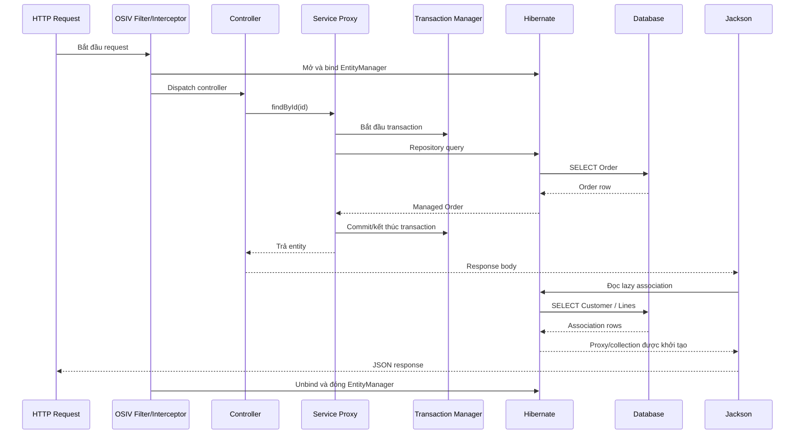
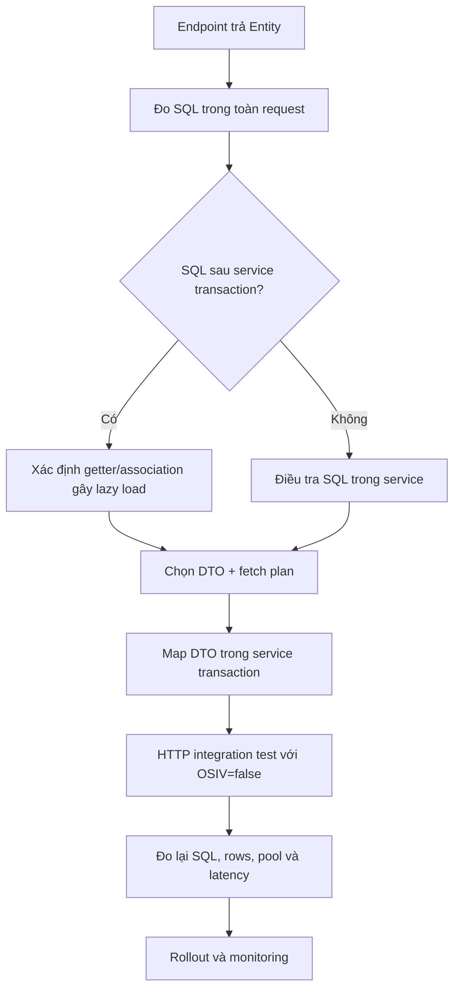

# Bật Open Session in View mà không kiểm soát truy vấn ngoài giao dịch nghiệp vụ

Một REST endpoint có thể chạy đúng khi cấu hình Open Session in View (OSIV), trả JSON đầy đủ và không ném `LazyInitializationException`. Nhưng trong lúc Jackson serialize response, Hibernate có thể phát thêm hàng chục câu SELECT để tải các association `LAZY`. Những câu SQL này chạy **sau khi transaction của service đã kết thúc**, nên không xuất hiện trong ranh giới đo transaction mà nhóm phát triển thường nghĩ là đã bao trùm toàn bộ thao tác database.

Đây là lỗi kiến trúc dễ bị bỏ qua vì ứng dụng vẫn trả HTTP 200. Service chỉ gọi một repository method, log SQL trong service trông có vẻ ít, nhưng request chậm dần theo số orders, customers hoặc child collections. Trong trường hợp khác, JSON serialization có thể đọc dữ liệu ở thời điểm muộn hơn, tạo response kết hợp state từ những transaction khác nhau.

Bài học tập trung vào failure mode **bật OSIV nhưng không kiểm soát truy vấn ngoài giao dịch nghiệp vụ**. Nội dung giải thích vì sao lazy loading vẫn hoạt động sau service transaction, SQL phát sinh ở giai đoạn nào, cách tìm nguồn truy vấn, các tác động tới performance/consistency/security, và cách đưa quyền tải dữ liệu về service/repository.

---

## 1. Biểu hiện: service chạy một query nhưng request phát nhiều SQL

Giả sử API trả chi tiết đơn hàng:

```java
@RestController
@RequestMapping("/api/orders")
public class OrderController {

    private final OrderService orderService;

    public OrderController(OrderService orderService) {
        this.orderService = orderService;
    }

    @GetMapping("/{id}")
    public PurchaseOrder getOrder(@PathVariable Long id) {
        return orderService.findById(id);
    }
}
```

Service:

```java
@Service
public class OrderService {

    private final PurchaseOrderRepository repository;

    public OrderService(PurchaseOrderRepository repository) {
        this.repository = repository;
    }

    @Transactional(readOnly = true)
    public PurchaseOrder findById(Long id) {
        return repository.findById(id)
            .orElseThrow(() -> new OrderNotFoundException(id));
    }
}
```

Entity:

```java
@Entity
@Table(name = "purchase_orders")
public class PurchaseOrder {

    @Id
    private Long id;

    private String orderCode;

    @ManyToOne(fetch = FetchType.LAZY)
    private Customer customer;

    @OneToMany(mappedBy = "order", fetch = FetchType.LAZY)
    private List<OrderLine> lines = new ArrayList<>();

    public Long getId() { return id; }
    public String getOrderCode() { return orderCode; }
    public Customer getCustomer() { return customer; }
    public List<OrderLine> getLines() { return lines; }
}
```

Nếu OSIV được bật, một request có thể diễn ra như sau:

1. Web infrastructure mở/bind một EntityManager cho request.
2. Controller gọi service.
3. Spring transaction interceptor bắt đầu transaction cho `findById()`.
4. Repository đọc PurchaseOrder.
5. Service transaction commit/kết thúc.
6. Controller trả entity.
7. Spring MVC dùng HttpMessageConverter/Jackson serialize entity thành JSON.
8. Jackson đọc `customer` và `lines`; Hibernate tải association nếu chúng chưa initialized.
9. Request kết thúc và EntityManager của OSIV mới được đóng.

Một service query ban đầu có thể chỉ tạo:

```sql
SELECT id, order_code, customer_id
FROM purchase_orders
WHERE id = ?;
```

Nhưng khi Jackson đọc các getter, có thể phát thêm:

```sql
SELECT id, display_name
FROM customers
WHERE id = ?;

SELECT id, order_id, sku, quantity
FROM order_lines
WHERE order_id = ?;
```

**SQL được kích hoạt bởi việc đọc entity trong lúc serialize response**, không phải bởi một repository call mới mà developer nhìn thấy trong service.

### 1.1. Vì sao endpoint vẫn trả 200?

OSIV giữ persistence context còn khả dụng trong phần view/render. Association lazy chưa khởi tạo vẫn có thể được Hibernate tải khi code truy cập.

Nếu các truy vấn đó thành công, Jackson nhận được giá trị và response có thể hoàn tất bình thường. Vì không có exception, việc truy vấn ngoài transaction dễ bị coi là hành vi bình thường.

### 1.2. Khi nào lỗi mới lộ ra?

Một endpoint có thể hoạt động vài tháng rồi mới gặp vấn đề khi:

- Danh sách tăng từ 10 lên 100 orders.
- Entity mới thêm association `LAZY`.
- Jackson configuration bắt đầu serialize thêm getter.
- Một DTO mapper được thay bằng entity serialization.
- DB connection pool bắt đầu chịu tải cao.
- Một transaction khác cập nhật dữ liệu giữa service query và lazy load.
- OSIV bị tắt ở một môi trường nhưng không được kiểm thử trước.

HTTP 200 không chứng minh data access boundary đã được thiết kế tốt.

## 2. OSIV giữ Session/EntityManager, không giữ transaction nghiệp vụ

Cần phân biệt ba khái niệm:

| Thành phần | Trách nhiệm | OSIV tác động thế nào? |
|---|---|---|
| Hibernate Session / JPA EntityManager | Persistence context, identity map, lazy proxies/collections | Có thể sống tới hết web request |
| Spring/JPA transaction | Commit/rollback, isolation và unit of work | Transaction của service thường kết thúc khi method transactional hoàn tất |
| JDBC Connection | Thực thi SQL trên database | Được acquire/release theo Hibernate/provider/pool configuration |

OSIV **kéo dài khả năng sử dụng persistence context**. Nó không tự kéo dài transaction service đến hết JSON serialization.

### 2.1. Vòng đời thông thường



Thời điểm quan trọng là service proxy đã hoàn tất transaction trước khi Spring MVC serialize response body trong luồng xử lý thông thường.

### 2.2. Session mở không có nghĩa transaction còn mở

Sau khi transaction service kết thúc, Session/EntityManager có thể vẫn mở do OSIV. Hibernate còn có thể thực hiện lazy loading từ persistence context đó.

Tuy nhiên, SQL phát sinh lúc này không mặc nhiên nằm trong transaction service trước đó. Tùy Hibernate version, connection handling mode, transaction manager, JDBC driver và database, câu SELECT ngoài transaction có thể dùng connection được acquire cho statement và thực thi theo autocommit hoặc một cơ chế khác.

Không được suy luận rằng:

```text
EntityManager đang mở
    = Transaction đang mở
    = JDBC connection luôn bị giữ
```

Ba trạng thái này độc lập về lifecycle.

### 2.3. JDBC connection có bị giữ suốt request không?

Không thể khẳng định OSIV luôn giữ một physical JDBC connection từ đầu tới cuối request. Hibernate có delayed connection acquisition và các connection release modes; connection có thể được lấy muộn và giải phóng sau transaction/statement tùy cấu hình.

Nhưng điều đó **không làm truy vấn ngoài transaction trở nên miễn phí**. Lazy SELECT vẫn dùng DB resources, network, CPU và connection pool khi nó chạy. Một số execution paths còn có thể giữ connection lâu hơn mong muốn.

Để biết connection được giữ bao lâu, đo HikariCP acquisition/usage metrics và JDBC spans trên cấu hình thật.

## 3. Tại sao JSON serialization có thể phát SQL?

Jackson serialize object bằng cách đọc properties/getters theo cấu hình. Nếu getter trả về Hibernate proxy hoặc persistent collection chưa initialized, việc đọc sâu vào association có thể kích hoạt database access.

Ví dụ:

```java
PurchaseOrder order = service.findById(id);

// Jackson có thể thực hiện logic tương đương:
order.getId();
order.getOrderCode();
order.getCustomer().getDisplayName();
order.getLines().stream()
    .map(OrderLine::getSku)
    .toList();
```

Hai getter đầu có thể chỉ đọc state đã tải. Hai phần sau có thể trigger SQL nếu association còn lazy.

### 3.1. Getter không đồng nghĩa luôn có SELECT

SQL chỉ phát sinh nếu association cần tải mà chưa initialized và Session còn khả năng thực hiện load. Nếu association đã được fetch, đã nằm trong persistence context, hoặc được cache phù hợp, Hibernate có thể trả dữ liệu mà không query.

Vấn đề là **serializer có thể đi sâu vào object graph mà service không chủ động chọn fetch plan**.

### 3.2. Quan hệ to-one

```java
@ManyToOne(fetch = FetchType.LAZY)
private Customer customer;
```

Một order có một customer. Khi serialize 100 orders và truy cập từng customer, Hibernate có thể phát tối đa khoảng 100 SELECT riêng nếu mỗi customer khác nhau và chưa được tải/cache.

Nếu nhiều orders cùng trỏ một customer, first-level cache có thể giảm số lần tải trong cùng persistence context. Nhưng không nên dựa vào trùng lặp ngẫu nhiên để coi N+1 đã được giải quyết.

### 3.3. Quan hệ collection

```java
@OneToMany(mappedBy = "order", fetch = FetchType.LAZY)
private List<OrderLine> lines;
```

Khi serializer duyệt từng collection, có thể có một SELECT cho mỗi order. Nếu mỗi order có nhiều lines, số SQL có thể không quá cao nhưng số rows và payload vẫn rất lớn.

### 3.4. Bidirectional relationships

Nếu Order trỏ tới Lines và mỗi Line lại trỏ về Order, serializer có thể đi theo chu trình:

```text
Order -> Lines -> Order -> Lines -> ...
```

Kết quả có thể là recursion, exception, payload lớn hoặc vô tình tải một graph sâu. Jackson annotations có thể cắt chu trình, nhưng không thay thế response model rõ ràng.

## 4. N+1 ẩn sau response serializer

Một ví dụ endpoint list:

```java
@GetMapping
public List<PurchaseOrder> recent() {
    return orderService.findRecent();
}
```

Service:

```java
@Transactional(readOnly = true)
public List<PurchaseOrder> findRecent() {
    return repository.findTop100ByOrderByCreatedAtDesc();
}
```

Nếu Jackson truy cập `customer.displayName` cho mỗi order, SQL pattern có thể là:

```text
1 SELECT purchase_orders
100 SELECT customers WHERE id = ?
-------------------------------
101 SELECT statements
```

Nếu Jackson cũng truy cập `lines`:

```text
1 SELECT purchase_orders
100 SELECT customers WHERE id = ?
100 SELECT order_lines WHERE order_id = ?
----------------------------------------
201 SELECT statements
```

Các con số minh họa trường hợp association chưa được tải và không được batch/cache. SQL thực tế tùy mapping, data distribution, Hibernate fetching và cache state.

### 4.1. Vì sao chỉ nhìn service log không đủ?

Developer có thể thấy:

```text
OrderService.findRecent()
  -> PurchaseOrderRepository.findTop100...
  -> return
```

và nghĩ chỉ có một query. Nhưng response body được serialize sau khi service return. Nếu trace chỉ đo repository hoặc service method, những SQL sau đó nằm ngoài span đang xem.

### 4.2. Vì sao slow-query log có thể không phát hiện?

Giả sử mỗi customer SELECT mất 2 ms. 100 câu lệnh cộng lại đã tốn đáng kể latency, nhưng không câu nào vượt threshold 100 ms.

Vì vậy cần đo **SQL executions per request** và tổng JDBC time, không chỉ từng slow statement.

### 4.3. OSIV không tự tạo N+1, nhưng có thể che giấu nó

N+1 xuất phát từ fetch plan và cách truy cập associations. OSIV làm lazy loading tiếp tục hoạt động ở view layer nên lỗi không lộ thành `LazyInitializationException`. Điều đó khiến SQL phát sinh ngoài service khó nhận biết hơn.

Khi tắt OSIV, exception có thể làm lộ chỗ thiếu fetch plan. Nhưng tắt OSIV tự nó cũng không tối ưu N+1 nếu vòng lặp lazy access vẫn nằm trong transaction service.

## 5. Truy vấn ngoài transaction có thể làm dữ liệu không nhất quán

Một transaction service đọc Order tại thời điểm T1, kết thúc, rồi Jackson mới đọc Lines tại T2.

Giả sử một transaction khác thay đổi lines giữa hai thời điểm:

```text
T1: Service đọc Order header
    status = CONFIRMED
    total  = 100

T2: Service transaction kết thúc

T3: Transaction khác thêm OrderLine mới
    total được cập nhật thành 130

T4: Jackson truy cập order.lines
    Hibernate phát SELECT mới

T5: Response chứa header đã đọc ở T1
    nhưng lines có thể phản ánh dữ liệu ở T4
```

Response có thể kết hợp state được đọc ở các thời điểm khác nhau.

### 5.1. Persistence context không phải database snapshot của cả request

Persistence context giữ identity map và state đã load. Nó không biến mọi lazy SELECT sau khi transaction trước kết thúc thành cùng một database snapshot.

Nếu database chạy READ COMMITTED, mỗi transaction/statement có thể nhìn thấy committed data theo isolation semantics tương ứng. Một lazy query ngoài transaction có thể thấy thay đổi mới hơn so với query service trước đó.

### 5.2. Ví dụ tổng tiền và chi tiết không khớp

Order header:

```text
totalAmount = 100.00
```

Lines được tải muộn:

```text
Line A = 60.00
Line B = 40.00
Line C = 30.00
Sum     = 130.00
```

Một response có thể hiển thị total 100 nhưng lines tổng 130 nếu dữ liệu thay đổi giữa các lần đọc và các fields không được reload đồng bộ.

### 5.3. Khi nào consistency quan trọng?

Đặc biệt cẩn trọng với:

- Invoice và báo cáo tài chính.
- Số dư tài khoản.
- Xác nhận thanh toán.
- Tồn kho và phân bổ hàng.
- Audit/reconciliation.
- Giá, thuế và tổng tiền.
- Quyết định nghiệp vụ dựa trên nhiều associations.

Nếu cần một snapshot nhất quán, service phải tải/đọc dữ liệu trong transaction/isolation phù hợp hoặc dùng read model/snapshot riêng. OSIV không phải chiến lược isolation.

## 6. Truy vấn ngoài transaction có thể gây latency khó dự đoán

Một endpoint có thể có timeline:

```text
Service transaction:
  SELECT Order             15 ms
  commit                    5 ms

Response serialization:
  SELECT Customer #1        4 ms
  SELECT Lines #1           7 ms
  SELECT Customer #2        3 ms
  SELECT Lines #2           8 ms
  ...
  SELECT Lines #100        11 ms
```

Nếu list có 100 items, latency tăng theo số associations serializer chạm tới.

### 6.1. Latency tăng theo payload

Khi API thêm một field nested như `customer.address.country.name`, serializer có thể khởi tạo thêm proxies. Một thay đổi response nhỏ có thể tạo nhiều SQL mới mà không có repository code change.

### 6.2. Network round-trips

Nhiều SELECT riêng lẻ tạo nhiều round-trips giữa application và DB. Dù từng query nhanh, tổng thời gian chờ vẫn tăng.

### 6.3. Connection pool pressure

Nếu nhiều requests cùng serialize các entity graphs và lazy load, chúng tạo thêm DB workload. Connection acquisition/usage có thể tăng, pool pending có thể tăng và request khác phải chờ.

Không nhất thiết mỗi request giữ connection liên tục suốt serialization; nhưng các lazy queries vẫn cần connection khi thực thi và làm tăng cạnh tranh tài nguyên.

### 6.4. CPU và heap

Hibernate phải hydrate entities/collections, quản lý identity map, giữ object graph và Jackson phải duyệt/serialize graph. Payload lớn tăng allocation, GC và network response time ngay cả khi SQL count đã thấp.

## 7. Truy vấn ngoài transaction có thể làm lỗi xuất hiện muộn

Nếu lazy SQL thất bại trong service transaction, exception thường xảy ra trước khi controller trả body. Application exception handling có thể chuyển thành response lỗi rõ ràng.

Nếu lazy SQL phát sinh trong quá trình serialize response, lỗi có thể xảy ra sau khi controller method đã return. Tùy buffering và web server, một phần response body có thể đã được ghi, làm việc tạo error response chuẩn khó hơn.

Các lỗi có thể gặp:

- Database connection timeout.
- Query timeout hoặc lock wait.
- `LazyInitializationException` nếu Session đã bị đóng ở một path khác.
- Serialization recursion.
- Hibernate proxy serialization error.
- JDBC exception khi tải association.
- Response bị ngắt giữa chừng.

Không nên dùng “serialize entity trong controller” như một cách trì hoãn database work đến sau business method.

## 8. Truy vấn ngoài transaction làm mờ trách nhiệm của service

Một service method nên thể hiện rõ dữ liệu cần cho use case và thực hiện việc tải đó trong unit of work thích hợp.

Nếu controller trả entity trực tiếp, tầng presentation vô tình quyết định:

- Association nào phải tải.
- Bao nhiêu collection được duyệt.
- SQL nào phát sinh.
- Thời điểm query chạy.
- Dữ liệu nhạy cảm nào được serialize.
- Response graph sâu đến đâu.

Những quyết định đó thay đổi theo Jackson annotations, getter additions, mixins, view configuration và DTO mapper.

### 8.1. Repository không còn mô tả đủ query workload

Repository có thể chỉ có `findById`, nhưng SQL thực tế của endpoint còn do Jackson tạo ra. Review repository method không còn đủ để dự đoán performance.

### 8.2. Controller trở thành data-access path gián tiếp

Controller không gọi repository trực tiếp, nhưng việc trả entity có thể kích hoạt Hibernate. Đây là data access gián tiếp khó phát hiện nếu team chỉ review explicit repository calls.

### 8.3. Test service method không mô phỏng HTTP serialization

Một unit test gọi `orderService.findById()` có thể pass vì không serialize entity. HTTP integration test mới đi qua HttpMessageConverter và phơi bày lazy loads.

Cần test ở đúng ranh giới response.

## 9. Rủi ro bảo mật và response contract

OSIV không tự gây authorization bypass. Rủi ro xuất hiện khi entity graph được serialize mà không có response contract/authorization kiểm soát rõ.

Ví dụ entity sau này thêm:

```java
private String internalFraudNote;

@ManyToOne(fetch = FetchType.LAZY)
private StaffMember approvedBy;
```

Nếu Jackson serialize entity theo getters, response có thể chứa fields hoặc nested objects ngoài ý muốn.

### 9.1. Authorization phải xảy ra trước khi dữ liệu được đưa vào response

Service cần kiểm tra:

- Người dùng có quyền xem Order này không?
- Có được xem Customer contact details không?
- Có được xem StaffMember/internal notes không?
- Tenant ownership của từng association có hợp lệ không?
- Một nested association có thuộc phạm vi truy cập của caller không?

Không giao việc chọn dữ liệu được phép cho serializer.

### 9.2. Lazy load không tự gọi lại business authorization

Hibernate biết mapping và persistence context; nó không tự chạy authorization policy của application cho mỗi getter. Nếu một entity association được map, việc truy cập có thể tải nó mà không qua service method chuyên trách.

### 9.3. Tenant boundaries

Nếu ứng dụng multi-tenant, không giả định OSIV tự kiểm tra mọi quy tắc tenant/business authorization. Cơ chế tenant filtering/connection routing cần được cấu hình đúng, và native SQL/custom queries có thể có giới hạn riêng.

### 9.4. API contract thay đổi âm thầm

Khi thêm association hoặc getter, JSON response có thể thay đổi về shape, size và data exposure. DTO response tách contract HTTP khỏi persistence mapping và cho phép review field-by-field.

## 10. Bật OSIV trong Spring Boot: điều gì thực sự xảy ra?

Trong Spring MVC + JPA, Spring thường dùng Open EntityManager in View (OEIV) infrastructure. Người phát triển thường gọi chung là OSIV.

Một property thường gặp:

```properties
spring.jpa.open-in-view=true
```

hoặc tắt:

```properties
spring.jpa.open-in-view=false
```

Trong một số Spring Boot versions/configurations dùng Servlet MVC và JPA, OEIV có thể được auto-configure mặc định nếu phù hợp. Default và warning behavior thay đổi theo version và application stack; **không giả định mọi dự án đều có cùng default**. Kiểm tra effective configuration và startup logs.

### 10.1. Filter và interceptor

Spring có các thành phần như:

- `OpenEntityManagerInViewFilter`.
- `OpenEntityManagerInViewInterceptor`.

Chúng mở/bind EntityManager cho request và đóng/unbind ở cuối lifecycle tương ứng. JPA OEIV và Hibernate native OpenSessionInView có thể dùng resource types khác nhau.

Với Spring Data JPA + `JpaTransactionManager`, OEIV là integration thường gặp. Không đăng ký nhiều filter/interceptor chồng lấp cùng request nếu chưa hiểu resource binding và ordering.

### 10.2. OSIV không phải transaction-per-request

Không suy rằng property `spring.jpa.open-in-view=true` biến toàn bộ request thành một transaction. Service `@Transactional` vẫn có transaction boundary riêng theo transaction manager/proxy.

### 10.3. Tắt OSIV không tự tạo fetch plan

Khi chuyển sang `spring.jpa.open-in-view=false`, EntityManager không còn được giữ mở đến view rendering theo cơ chế đó. Lazy associations chưa khởi tạo sau service transaction có thể gây `LazyInitializationException`.

Đó là lý do cần chuẩn bị fetch plan/DTO cho các endpoints trước hoặc trong cùng thay đổi cấu hình.

## 11. Vì sao @Transactional trên controller không giải quyết chắc chắn serialization?

Một nhầm lẫn phổ biến là thêm:

```java
@Transactional(readOnly = true)
@GetMapping("/{id}")
public PurchaseOrder getOrder(@PathVariable Long id) {
    return orderService.findById(id);
}
```

rồi nghĩ transaction sẽ bao trùm cả JSON serialization.

Trong Spring MVC thông thường, transaction interceptor bao quanh method invocation. Controller method trả entity, transaction advice hoàn tất khi method return. Sau đó framework xử lý response body bằng HttpMessageConverter/Jackson.

Vì thế transaction trên controller method **không mặc nhiên bao trùm serialization sau khi method trả về**.

Nếu cần dữ liệu cho response, service nên tải và map thành DTO trong transaction của nó. Đừng cố dùng controller transaction để che lazy loading ngoài boundary.

### 11.1. Self-invocation cũng cần lưu ý

Spring proxy-based transaction management có thể không intercept một method `@Transactional` khi method khác cùng bean gọi trực tiếp nó. Hãy bảo đảm transaction boundary thực sự được đi qua proxy và test bằng integration tests.

### 11.2. Async request không tự kế thừa transaction

`@Async`, thread pools và reactive execution có lifecycle khác. Một EntityManager request-bound hoặc ThreadLocal không tự trở thành context dùng chung mọi thread. Background work cần service transaction và tenant/security context propagation riêng.

## 12. Cách phát hiện SQL phát sinh trong serialization

Để chứng minh truy vấn đến từ response serialization, cần đối chiếu các giai đoạn của request.

### 12.1. Bật SQL logger có kiểm soát

Hibernate 6:

```properties
logging.level.org.hibernate.SQL=DEBUG
```

Nếu cần bind values:

```properties
logging.level.org.hibernate.orm.jdbc.bind=TRACE
```

Bind logging có thể lộ PII/secrets; không bật rộng production nếu không có redaction, sampling và quyền truy cập logs phù hợp.

### 12.2. Gắn log marker quanh service

Ví dụ chẩn đoán trong môi trường dev/test:

```java
log.info("Before service query");

PurchaseOrder order = orderService.findById(id);

log.info("After service returned entity");
return order;
```

Nếu SQL SELECT tiếp tục xuất hiện sau marker `After service returned entity`, đó là manh mối lazy loading trong response/render phase.

Marker đơn giản không phải tracing chính xác dưới concurrency. Dùng request correlation ID và timestamps/structured logs.

### 12.3. Quan sát JDBC spans

JDBC instrumentation có thể tạo spans quanh execute calls. Khi xem trace:

```text
HTTP GET /api/orders/42
  OrderController.getOrder
    OrderService.findById
      JDBC SELECT purchase_orders
  HTTP response serialization
    JDBC SELECT customers
    JDBC SELECT order_lines
```

Nếu các JDBC spans cuối xuất hiện sau service span nhưng vẫn thuộc HTTP request, nhiều khả năng serializer/view đã kích hoạt lazy SQL.

Tên span và cách framework tạo parent-child relationship phụ thuộc instrumentation. Một số instrumentation đặt JDBC spans dưới request span thay vì tạo span riêng cho serialization.

### 12.4. Hibernate Statistics

Có thể bật:

```properties
spring.jpa.properties.hibernate.generate_statistics=true
```

Và quan sát:

```java
SessionFactory sessionFactory = entityManagerFactory
    .unwrap(SessionFactory.class);

Statistics statistics = sessionFactory.getStatistics();

long prepared = statistics.getPrepareStatementCount();
long entityFetches = statistics.getEntityFetchCount();
long collectionFetches = statistics.getCollectionFetchCount();
```

Statistics cấp SessionFactory và có thể bị nhiễu bởi requests song song. Không lấy delta toàn cục trước/sau một HTTP request làm số liệu chính xác của request đó trong production.

### 12.5. JDBC datasource proxy

Datasource proxy/P6Spy hoặc JDBC tracing có thể đo execute calls, SQL fingerprints và thời gian. Để chứng minh SQL phát sinh trong serialization, kết hợp nó với HTTP trace/request ID.

### 12.6. Đo toàn request, không chỉ service

Nếu Timer chỉ bao quanh repository/service method, nó sẽ bỏ qua SQL chạy sau method return. Dùng HTTP server span, request-level JDBC spans hoặc instrumentation ở response writing phase để thấy toàn bộ workload.

## 13. Một ví dụ kiểm tra N+1 ở Jackson

Fixture:

- 50 orders.
- 50 customers khác nhau.
- Mỗi order có 5 lines.
- Các associations đều chưa initialized khi service trả entity.

Endpoint:

```java
@GetMapping("/recent")
public List<PurchaseOrder> recent() {
    return orderService.recent();
}
```

SQL có thể có shape:

```text
SELECT ... FROM purchase_orders ORDER BY created_at DESC LIMIT 50;
SELECT ... FROM customers WHERE id = ?;         -- lặp
SELECT ... FROM order_lines WHERE order_id = ?; -- lặp
```

Đếm bằng JDBC instrumentation sẽ cho thấy số SELECT thực thi. Hibernate Statistics có thể cho thêm tín hiệu entity/collection fetches.

### 13.1. Đừng chỉ kiểm tra một entity

Với một order có một customer và một line, endpoint có thể trông rất nhanh. N+1 chỉ lộ khi fixture đủ lớn và association cardinality đại diện.

### 13.2. So sánh cold/warm state

First-level cache có thể giảm SELECT khi entities trùng lặp trong cùng Session. L2/query cache cũng có thể thay đổi số SQL. Test nên xác định cache state rõ, không dựa vào một lần chạy đã warm.

## 14. Cách sửa ưu tiên: trả DTO hoàn chỉnh từ service

Thay vì trả entity:

```java
public record OrderLineDto(
    Long id,
    String sku,
    int quantity
) {}

public record OrderDetailsDto(
    Long id,
    String orderCode,
    String customerName,
    List<OrderLineDto> lines
) {}
```

Repository có fetch plan rõ:

```java
public interface PurchaseOrderRepository
        extends JpaRepository<PurchaseOrder, Long> {

    @Query("""
        select distinct o
        from PurchaseOrder o
        join fetch o.customer
        left join fetch o.lines
        where o.id = :id
        """)
    Optional<PurchaseOrder> findForDetails(
        @Param("id") Long id
    );
}
```

Service:

```java
@Service
public class OrderQueryService {

    private final PurchaseOrderRepository repository;

    public OrderQueryService(PurchaseOrderRepository repository) {
        this.repository = repository;
    }

    @Transactional(readOnly = true)
    public OrderDetailsDto getDetails(Long id) {
        PurchaseOrder order = repository.findForDetails(id)
            .orElseThrow(() -> new OrderNotFoundException(id));

        List<OrderLineDto> lines = order.getLines()
            .stream()
            .map(line -> new OrderLineDto(
                line.getId(),
                line.getSku(),
                line.getQuantity()
            ))
            .toList();

        return new OrderDetailsDto(
            order.getId(),
            order.getOrderCode(),
            order.getCustomer().getDisplayName(),
            List.copyOf(lines)
        );
    }
}
```

Controller:

```java
@GetMapping("/{id}")
public OrderDetailsDto getOrder(@PathVariable Long id) {
    return orderQueryService.getDetails(id);
}
```

Các associations cần thiết được tải và map khi transaction đang hoạt động. JSON serializer chỉ nhận record DTO chứa dữ liệu đã materialize.

### 14.1. DTO ngăn serializer đi theo entity graph

DTO không có Hibernate lazy proxies/collections. Jackson chỉ serialize các fields đã khai báo, không tự duyệt mọi associations trong domain model.

### 14.2. DTO là response contract

Service quyết định field nào được trả. Khi entity thêm field nội bộ hoặc association mới, response không tự thay đổi.

### 14.3. Không fetch toàn bộ collection vô điều kiện

Ví dụ detail endpoint trên phù hợp khi số lines của một order có giới hạn hợp lý. Nếu một order có hàng trăm nghìn lines, hãy phân trang lines hoặc dùng query riêng. DTO không có nghĩa là phải tải một object graph khổng lồ vào memory.

## 15. Các fetch strategies thay thế lazy loading ngoài service

### 15.1. DTO projection

Nếu chỉ cần vài cột, query projection trực tiếp:

```java
public record OrderSummary(
    Long id,
    String orderCode,
    String customerName,
    Instant createdAt
) {}
```

Repository:

```java
@Query("""
    select new com.example.orders.OrderSummary(
        o.id,
        o.orderCode,
        c.displayName,
        o.createdAt
    )
    from PurchaseOrder o
    join o.customer c
    where o.status = :status
    order by o.createdAt desc, o.id desc
    """)
List<OrderSummary> findSummaries(
    @Param("status") OrderStatus status,
    Pageable pageable
);
```

Projection chỉ tải fields cần thiết và không trả managed entity graph cho serializer.

### 15.2. EntityGraph

```java
@EntityGraph(attributePaths = {"customer", "lines"})
Optional<PurchaseOrder> findWithDetailsById(Long id);
```

EntityGraph biểu đạt associations cần được fetch cho use case. Nó không bảo đảm luôn có một SQL JOIN; provider có thể chọn query strategy khác. Hãy đo SQL thực tế.

### 15.3. JOIN FETCH cho to-one

```java
select o
from PurchaseOrder o
join fetch o.customer
where o.id = :id
```

To-one association thường phù hợp hơn collection join khi query cần association đó và pagination root.

### 15.4. Batch fetching

```java
@OneToMany(mappedBy = "order", fetch = FetchType.LAZY)
@BatchSize(size = 20)
private List<OrderLine> lines;
```

hoặc:

```properties
spring.jpa.properties.hibernate.default_batch_fetch_size=20
```

Batch fetching có thể giảm N+1 bằng cách tải nhiều proxies/collections trong một số SELECT có `IN (...)`. Nó vẫn cần được kích hoạt trong transaction/service có chủ đích; không dùng nó làm lý do để serializer tùy ý tải cả graph.

### 15.5. Aggregate query

Nếu UI chỉ cần số lines:

```java
public record OrderLineCount(Long orderId, long lineCount) {}

@Query("""
    select new com.example.orders.OrderLineCount(
        o.id,
        count(line)
    )
    from PurchaseOrder o
    left join o.lines line
    where o.id in :ids
    group by o.id
    """)
List<OrderLineCount> countLines(@Param("ids") Collection<Long> ids);
```

Không tải toàn bộ OrderLine entities chỉ để gọi `size()` hoặc đếm. Dùng aggregate khi nghiệp vụ chỉ cần aggregate.

## 16. Cẩn thận collection fetch join và pagination

Một lỗi sửa N+1 thường gặp là thêm collection fetch join cho list endpoint:

```java
select distinct o
from PurchaseOrder o
left join fetch o.lines
order by o.createdAt desc
```

Nếu query có 50 orders và mỗi order 100 lines, SQL có thể trả khoảng 5.000 joined rows. Hibernate có thể deduplicate root entities trong Java nhưng database/driver vẫn phải xử lý rows join.

### 16.1. Pagination root bị ảnh hưởng

SQL LIMIT áp lên joined rows, không tự đồng nghĩa với 50 distinct orders cùng toàn bộ lines. Hibernate có thể phải paginate trong memory, phát warning hoặc fail tùy version/configuration.

### 16.2. Page IDs rồi fetch details

Một chiến lược:

1. Query page IDs của root entities theo thứ tự ổn định.
2. Fetch associations cho đúng IDs.
3. Map DTO trong service transaction.
4. Khôi phục thứ tự theo danh sách IDs vì `IN (...)` không bảo đảm order.

Hoặc dùng DTO projection cho list screen và endpoint riêng cho details/lines.

### 16.3. Không fetch nhiều collections lớn trong một JOIN

Nhiều collection joins có thể tạo Cartesian multiplication hoặc `MultipleBagFetchException`. Tách query/batch hoặc projection thường rõ ràng hơn.

## 17. Tránh những cách “sửa” chỉ che triệu chứng

### 17.1. Đổi mọi association thành EAGER

`FetchType.EAGER` không bảo đảm một SQL JOIN. Hibernate có thể dùng secondary SELECT và gây N+1. EAGER còn khiến use cases không cần association vẫn tải thêm dữ liệu.

Chọn fetch plan theo query/use case thay vì đổi global mapping.

### 17.2. Gọi Hibernate.initialize trong controller

```java
Hibernate.initialize(order.getLines());
return order;
```

Nếu Session còn mở, nó có thể hoạt động, nhưng controller đang trực tiếp quyết định data access. Nếu gọi trong vòng lặp, vẫn có thể tạo N+1. Nếu cần khởi tạo, hãy làm trong service transaction và map DTO.

### 17.3. Gọi collection.size() để “chỉ lấy count”

```java
int count = order.getLines().size();
```

Với lazy collection, thao tác này có thể khởi tạo collection và tải tất cả rows tùy mapping/provider/query. Nếu chỉ cần count, viết aggregate query phù hợp.

### 17.4. Thêm Jackson annotations như giải pháp performance

`@JsonIgnore`, `@JsonManagedReference`, `@JsonBackReference` hoặc Hibernate Jackson modules có thể điều khiển serialization/recursion và một số proxy behaviors. Chúng không thay thế fetch plan, SQL budget hoặc response DTO.

### 17.5. Bật enable_lazy_load_no_trans

Hibernate có setting `hibernate.enable_lazy_load_no_trans` ở một số releases. Nó cho phép một số lazy initialization ngoài Session/transaction thông thường qua provider-specific behavior. Đây không phải giải pháp tổng quát: có thể tạo temporary sessions/SQL ngoài unit of work, làm N+1 và consistency khó kiểm soát hơn.

### 17.6. Đặt @Transactional trên getter/mapper

Transaction proxy không tự intercept mọi getter hoặc mapper invocation. Transaction cần được thiết kế ở application/service boundary. Đừng cố gắn transaction cho các property access do Jackson gọi.

## 18. Tắt OSIV như một bước làm rõ data access boundary

Với REST API, cấu hình thường được cân nhắc:

```properties
spring.jpa.open-in-view=false
```

Khi tắt OSIV, EntityManager không còn được giữ mở đến view rendering theo cơ chế đó. Lazy associations chưa khởi tạo sau service transaction có thể gây `LazyInitializationException`.

Đó là lý do cần chuẩn bị fetch plan/DTO cho các endpoints trước hoặc trong cùng thay đổi.

### 18.1. Không tắt trên production mà không kiểm kê endpoints

Một ứng dụng legacy có thể có hàng trăm endpoints/controllers trả entity. Tắt OSIV ngay có thể làm nhiều response lỗi.

Một lộ trình hợp lý:

1. Xác định effective OSIV configuration và versions.
2. Tìm endpoints trả entities/collections trực tiếp.
3. Quan sát SQL phát sinh sau service span.
4. Ưu tiên endpoints traffic cao/N+1/payload lớn.
5. Tạo DTO/projection/fetch plan.
6. Thêm integration tests với OSIV disabled.
7. Chạy staging/load tests.
8. Rollout theo phạm vi và theo dõi lỗi/latency.

### 18.2. OSIV có thể vẫn phù hợp cho một số MVC views

Một ứng dụng server-rendered HTML nhỏ có thể chọn OSIV có chủ đích. Nhưng view phải được kiểm soát, SQL count/latency được đo và cardinality collections có giới hạn.

Với REST APIs, DTO response thường tạo boundary rõ ràng hơn vì serialization là một phần public contract.

### 18.3. Tắt OSIV không tự chữa mọi N+1

Nếu service chạy vòng lặp lazy access trong `@Transactional`, N+1 vẫn diễn ra trước khi transaction kết thúc. Cần sửa query/fetch plan, không chỉ property.

## 19. Kiểm thử đúng ranh giới HTTP response

Một test gọi service method không đủ để phát hiện lazy SQL do Jackson. Cần test qua MVC pipeline.

Skeleton:

```java
@SpringBootTest(
    properties = "spring.jpa.open-in-view=false"
)
@AutoConfigureMockMvc
class OrderControllerIT {

    @Autowired
    MockMvc mockMvc;

    @Test
    void detailsReturnsResponseWithoutOsiv() throws Exception {
        mockMvc.perform(
                get("/api/orders/42")
                    .accept(MediaType.APPLICATION_JSON)
            )
            .andExpect(status().isOk())
            .andExpect(jsonPath("$.id").value(42))
            .andExpect(
                jsonPath("$.customerName").value("Alice")
            )
            .andExpect(
                jsonPath("$.lines.length()").value(2)
            );
    }
}
```

Đây là skeleton; cần seed fixture và DTO shape phù hợp ứng dụng thực tế.

### 19.1. Không để outer test transaction che lỗi

Nếu test method có `@Transactional`, EntityManager/test transaction có thể làm associations vẫn accessible trong quá trình request test hoặc giữ persistence context lâu hơn production.

Để test request boundary:

- Seed fixtures trong transaction riêng.
- Commit fixture trước request.
- Gọi endpoint qua MockMvc/HTTP.
- Để service transaction kết thúc theo proxy bình thường.
- Để Jackson serialize response.
- Xác nhận body hoàn chỉnh và status đúng.

### 19.2. Test với dữ liệu đủ lớn

Tạo 50–100 orders, nhiều customers và collections có 0/1/nhiều rows. Một entity duy nhất không phơi bày N+1.

### 19.3. Kiểm tra SQL count có kiểm soát

Trong integration test cô lập, có thể dùng Hibernate Statistics hoặc datasource proxy để đo SQL statements. Đặt budget theo endpoint và data fixture, không áp một ngưỡng chung cho toàn ứng dụng.

Statistics cấp SessionFactory có thể nhiễu khi tests chạy song song. Có thể serialize test execution hoặc dùng JDBC instrumentation gắn test/request context.

### 19.4. Test consistency khi dữ liệu thay đổi

Nếu endpoint cần snapshot consistency, tạo concurrency test:

1. Transaction A load root entity.
2. Transaction A kết thúc theo thiết kế cần kiểm tra.
3. Transaction B sửa association.
4. Request tiếp tục đọc/serialize.
5. Xác định response có thể kết hợp state từ nhiều thời điểm không.
6. Điều chỉnh transaction/isolation/read model nếu cần.

## 20. Quan sát production: tìm SQL ngoài transaction

Một trace hữu ích có thể thể hiện:

```text
HTTP GET /api/orders/recent      900 ms
  OrderController.recent         10 ms
    OrderService.recent          35 ms
      JDBC SELECT orders          20 ms
  Response serialization        800 ms
    JDBC SELECT customers         4 ms
    JDBC SELECT lines             7 ms
    JDBC SELECT customers         3 ms
    ...
```

Dấu hiệu đáng điều tra:

- Service span kết thúc nhưng JDBC spans vẫn xuất hiện trong request.
- SQL SELECT lặp lại với cùng fingerprint và bind IDs khác nhau.
- SQL count tăng tuyến tính theo page size.
- Hikari acquisition/usage tăng theo response size.
- HTTP p95 cao nhưng service query time thấp.
- JSON serialization time cao cùng entity/collection fetches.

### 20.1. Metric nên theo dõi

- JDBC executions per request/endpoint.
- Tổng JDBC execution/fetch time.
- SQL fingerprint frequency.
- Rows consumed nếu instrumentation hỗ trợ.
- Hibernate entity/collection fetch counters ở test/diagnostic.
- Hikari acquire/usage/pending/timeout.
- HTTP serialization/response time.
- Response size.
- p95/p99 latency.

Không gắn raw order IDs, request IDs hoặc full SQL text thành metric labels vì cardinality cao. Dùng traces/logs cho chi tiết từng request.

### 20.2. Phân biệt pool wait và SQL time

Một request có thể chậm vì chờ Hikari connection trước khi SQL bắt đầu. JDBC statement timing không nhất thiết bao gồm thời gian chờ pool. Hikari acquisition metrics và JDBC spans cần được xem cùng nhau.

### 20.3. Bind parameter logs

Bind TRACE có thể hỗ trợ xác định query pattern nhưng có thể ghi PII/secrets. Production diagnostics nên ưu tiên normalized SQL, trace IDs, sampled logs và DB query statistics đã được kiểm soát.

## 21. Connection lifetime, remote I/O và OSIV

Một vấn đề khác là logic web chậm xen giữa data access:

```java
@GetMapping("/{id}")
public OrderDetails get(@PathVariable Long id) {
    PurchaseOrder order = orderService.findById(id);

    externalClient.fetchMetadata(id);

    return mapper.toDetails(order);
}
```

Nếu mapper truy cập lazy association sau remote call, OSIV có thể cho phép SQL chạy sau khi external call hoàn tất.

Điều này tạo latency và consistency khó dự đoán. Tùy connection handling, connection có thể được acquire khi lazy query chạy và usage duration có thể kéo dài theo các bước khác.

### 21.1. Không giữ transaction xuyên network call nếu không cần

Service nên xác định data cần, tải/map DTO trong transaction, rồi thực hiện remote call ở boundary phù hợp. Nếu nghiệp vụ cần atomicity giữa DB và remote system, dùng outbox/saga/idempotency hoặc transaction protocol phù hợp thay vì giữ một DB transaction mở chờ network.

### 21.2. Không khẳng định OSIV luôn giữ connection suốt request

Session lifecycle và JDBC connection lifecycle khác nhau. Hãy đo Hikari usage và JDBC connection spans. Nếu connection được release sau transaction rồi acquire lại cho lazy SELECT, vẫn có DB cost và pool contention ở thời điểm serialize.

## 22. Async, streaming và background work

OSIV gắn với web request lifecycle. Không dựa vào nó cho:

- `@Async` thread pools.
- Scheduled jobs.
- Message consumers.
- Spring Batch.
- Long-running exports.
- Background email rendering.
- Reactive pipelines.

Một lazy proxy truyền sang worker thread không tự mang theo Session/transaction. Hibernate Session cũng không thread-safe.

### 22.1. Truyền IDs/DTO, không truyền lazy entities

Một request có thể gửi:

```java
asyncService.generateReport(order.getId());
```

Worker mở transaction/service context riêng, load dữ liệu cần và trả/ghi kết quả phù hợp. Không gửi nguyên `PurchaseOrder` proxy rồi mong worker lazy-load thành công.

### 22.2. Streaming response

Streaming JSON/CSV có thể kéo dài response writing. Nếu mỗi phần tử còn là entity với lazy relations, SQL có thể phát trong lúc stream, giữ request/resource lâu và tạo nhiều truy vấn.

Nên dùng query projection/streaming read model có transaction/resource lifecycle rõ ràng, đóng cursor/connection đúng lúc và giới hạn fetch size theo driver/DBMS.

## 23. Những trường hợp OSIV có thể được giữ lại

OSIV không mặc nhiên sai trong mọi ứng dụng. Một MVC server-rendered application có thể chọn nó để template đọc lazy associations.

Nếu giữ OSIV, cần có policy rõ:

- View/template nào được phép truy cập associations?
- SQL count/page và latency có được đo không?
- Collections có giới hạn cardinality không?
- Có query nào chạy sau remote I/O không?
- Consistency requirements có được đáp ứng không?
- Entity graph có chứa dữ liệu nhạy cảm không?
- Connection pool có đủ capacity?
- Khi thay mapping/view, test có phát hiện thêm SQL không?

### 23.1. View model vẫn dễ kiểm soát hơn

Controller có thể trả model đã được service chuẩn bị:

```java
@GetMapping("/orders/{id}")
public String details(
        @PathVariable Long id,
        Model model) {

    model.addAttribute(
        "order",
        orderQueryService.getDetails(id)
    );

    return "orders/details";
}
```

Template dùng DTO và không cần biết Hibernate proxy.

### 23.2. Nếu giữ OSIV cho legacy page

Có thể giữ OSIV ở phạm vi ứng dụng/page đã được kiểm soát trong giai đoạn migration, đồng thời đặt query budgets/monitoring. Nhưng cần biết chính xác SQL nào được phép chạy trong render phase và tại sao.

## 24. Quy trình chuyển đổi endpoint đang phụ thuộc OSIV

Giả sử endpoint trả entity và có nhiều lazy queries.

1. **Xác định response contract.** Liệt kê chính xác fields client cần, bao gồm nested associations.
2. **Đo baseline.** Ghi SQL fingerprints/count, JDBC total time, rows, Hikari acquisition/usage và HTTP p95/p99.
3. **Tìm trigger.** Dùng tracing/log markers để xác định SQL xuất hiện trong service hay sau service return.
4. **Thiết kế query.** Chọn projection, EntityGraph, JOIN FETCH to-one, batch fetch hoặc query riêng cho collections.
5. **Map DTO trong service transaction.** Không trả managed entities ra controller nếu serializer không nên quyết định data access.
6. **Kiểm thử OSIV disabled.** Chạy qua HTTP serialization với fixtures đại diện.
7. **Đo lại.** So sánh SQL count, raw rows, JDBC time, connection usage, response size và p95/p99.
8. **Rollout.** Tắt OSIV theo phạm vi phù hợp, theo dõi lazy exceptions, SQL regression và pool metrics.
9. **Mở rộng.** Tiếp tục các endpoints traffic cao hoặc có rủi ro security/consistency.



## 25. Checklist review code để ngăn tái diễn

### Controller/API

- Controller có trả JPA entity trực tiếp không?
- Response body có chứa Hibernate proxy/persistent collection không?
- Jackson có thể duyệt associations sâu hoặc vòng lặp không?
- Có fields/nested data cần authorization riêng không?
- API có pagination/limits rõ cho collections lớn không?

### Service/repository

- Service có `@Transactional` ở đúng proxy boundary không?
- Fetch plan có biểu đạt đúng data response cần không?
- DTO được map trước khi transaction kết thúc chưa?
- Có vòng lặp lazy access gây N+1 trong service không?
- Query projection có phù hợp list endpoints không?
- Bulk/aggregate query có thể thay tải full collection không?

### Configuration/runtime

- Effective `spring.jpa.open-in-view` là gì?
- Spring Boot version có default/auto-configuration nào?
- Có filter/interceptor OEIV trùng lặp không?
- JDBC connection acquire/release mode và pool metrics thế nào?
- Có SQL/JDBC spans sau service span không?
- Async/streaming paths có context/resource lifecycle riêng không?

### Tests/operations

- HTTP integration tests có chạy với OSIV disabled không?
- Test có seed/commit fixtures trước request không?
- Dataset đủ lớn để thấy N+1 không?
- SQL count và row budgets có hợp lý không?
- Có test collection pagination/response size không?
- Có test tenant/security boundaries không?
- Có theo dõi Hikari pending/acquire/usage và HTTP p95/p99 không?

## 26. Những cách hiểu sai thường gặp

### 26.1. “OSIV mở transaction đến hết request”

Sai. Nó giữ EntityManager/Session khả dụng trong request lifecycle; transaction service thường kết thúc trước serialization.

### 26.2. “Session mở nghĩa là JDBC connection luôn bị giữ”

Sai. Hibernate có connection acquisition/release strategies. Phải đo connection usage thật.

### 26.3. “OSIV bật nghĩa Jackson serialize entity không phát SQL”

Ngược lại, OSIV có thể cho phép Jackson kích hoạt lazy SQL khi đọc associations chưa initialized.

### 26.4. “Một repository call tương đương một SQL statement”

Sai. Lazy loads, secondary selects, cascades và flush có thể phát thêm SQL.

### 26.5. “HTTP 200 chứng minh fetch plan tốt”

Sai. Endpoint có thể thành công nhưng tạo N+1, overfetch và latency cao.

### 26.6. “Slow query log không có dòng nào nghĩa request không tốn DB”

Sai. Nhiều câu SQL nhỏ có thể cộng thành thời gian đáng kể; connection wait cũng là chi phí khác.

### 26.7. “Đặt @Transactional trên controller sẽ bao trùm Jackson”

Không mặc nhiên. Serialization trong Spring MVC thông thường diễn ra sau khi controller method/proxy invocation trả về.

### 26.8. “Tắt OSIV tự sửa N+1”

Sai. N+1 trong service transaction vẫn xảy ra. Phải sửa fetch plan.

### 26.9. “Đổi mọi relation sang EAGER sẽ hết lỗi”

Không. EAGER có thể tạo secondary SELECT/N+1 và overfetch.

### 26.10. “Hibernate.initialize trong controller là giải pháp lâu dài”

Không. Nó tiếp tục giao data access cho presentation layer và vẫn có thể gây N+1.

### 26.11. “Jackson @JsonIgnore giải quyết consistency”

Không. Nó có thể bỏ một field khỏi serialization nhưng không định nghĩa snapshot, transaction hoặc fetch plan.

### 26.12. “Một DTO đồng nghĩa query chỉ có một SQL”

Không. DTO có thể được tạo từ nhiều queries; điều quan trọng là chúng chạy trong transaction/service boundary được thiết kế và đo.

### 26.13. “OSIV tự kiểm tra authorization cho nested associations”

Không. Authorization thuộc application; ORM mapping không thay policy.

### 26.14. “ThreadLocal/request context tự truyền qua @Async”

Sai. Worker thread cần context propagation/setup riêng; Hibernate Session không thread-safe.

### 26.15. “Test service pass là endpoint serialization chắc chắn pass”

Sai. Cần HTTP integration test để đi qua message converter/serializer.

## 27. Kết luận

Bật Open Session in View mà không kiểm soát truy vấn ngoài giao dịch nghiệp vụ khiến persistence layer tiếp tục phát SQL trong lúc template hoặc JSON serializer đọc lazy associations. Endpoint có thể vẫn trả 200, nhưng SQL count, latency, connection usage, data consistency và response security trở nên khó dự đoán.

Các nguyên tắc cần giữ:

1. **Phân biệt EntityManager/Session với transaction và JDBC connection.** OSIV kéo dài persistence context, không tự kéo dài transaction service.
2. **Không trả entity graph cho serializer như một fetch plan ngầm.** Jackson có thể kích hoạt lazy SQL sau khi service return.
3. **Đo toàn request.** SQL count, JDBC spans, response serialization, Hikari acquire/usage và HTTP latency cần được liên kết.
4. **Map DTO trong service transaction.** Repository/fetch plan tải đúng associations hoặc scalar fields mà response cần.
5. **Không chữa bằng EAGER hàng loạt hoặc Hibernate.initialize() trong controller.** Chúng có thể che triệu chứng, tạo N+1 và overfetch.
6. **Kiểm tra consistency.** Lazy SELECT sau service transaction có thể đọc dữ liệu ở thời điểm khác.
7. **Kiểm soát authorization và tenant scope.** Entity graph không tự thực thi business authorization cho từng nested field.
8. **Tắt OSIV có kế hoạch.** Kiểm thử HTTP serialization với OSIV disabled và dữ liệu đủ lớn trước khi rollout.
9. **Nếu giữ OSIV cho MVC views, phải có giới hạn và monitoring.** Biết rõ view nào được phép query và chi phí nào được chấp nhận.

Một câu hỏi review hữu ích là:

> **Khi service transaction kết thúc, response đã chứa đủ dữ liệu cần thiết chưa, hay serializer vẫn có quyền khiến Hibernate truy cập database?**

Nếu câu trả lời thứ hai đúng, hãy kiểm tra fetch plan, DTO boundary và SQL trace trước khi coi endpoint đã hoàn thành.

### Tài liệu tham khảo

- [Spring Framework Reference — Open EntityManager in View](https://docs.spring.io/spring-framework/reference/data-access/orm/jpa.html) — JPA integration và request-bound EntityManager.
- [OpenEntityManagerInViewFilter Javadocs](https://docs.spring.io/spring-framework/docs/current/javadoc-api/org/springframework/orm/jpa/support/OpenEntityManagerInViewFilter.html) — filter lifecycle và lazy loading trong view.
- [OpenEntityManagerInViewInterceptor Javadocs](https://docs.spring.io/spring-framework/docs/current/javadoc-api/org/springframework/orm/jpa/support/OpenEntityManagerInViewInterceptor.html) — interceptor lifecycle.
- [Spring Boot Reference — Data Access](https://docs.spring.io/spring-boot/reference/data/sql.html) — `spring.jpa.open-in-view` và JPA auto-configuration.
- [Spring Framework Reference — Transaction Management](https://docs.spring.io/spring-framework/reference/data-access/transaction.html) — `@Transactional`, proxy boundaries và isolation.
- [Hibernate ORM User Guide — Fetching](https://docs.hibernate.org/orm/6.6/userguide/html_single/#fetching) — LAZY/EAGER, fetch joins và batch fetching.
- [Hibernate ORM User Guide — Statistics](https://docs.hibernate.org/orm/6.6/userguide/html_single/#statistics) — query/entity/collection statistics.
- [Hibernate ORM Javadocs — LazyInitializationException](https://docs.hibernate.org/orm/6.6/javadocs/org/hibernate/LazyInitializationException.html) — lỗi truy cập state chưa load khi không có Session phù hợp.
- [Spring Data JPA Reference](https://docs.spring.io/spring-data/jpa/reference/) — projections, EntityGraph và repository queries.
- [Jackson Databind Documentation](https://github.com/FasterXML/jackson-databind) — bean serialization và property access.
- [Micrometer Reference](https://docs.micrometer.io/micrometer/reference/) — timers, metrics và observability.
- [HikariCP Documentation](https://github.com/brettwooldridge/HikariCP) — connection acquisition/usage và pool metrics.

Default, filter/interceptor behavior, Hibernate connection handling và SQL generation phụ thuộc **Spring Boot, Spring Framework, Hibernate ORM, Jackson, JDBC driver và DBMS versions**. Hãy kiểm tra effective configuration và đo trên stack thực tế; không suy ra connection lifetime hay transaction scope chỉ từ việc EntityManager còn mở.
