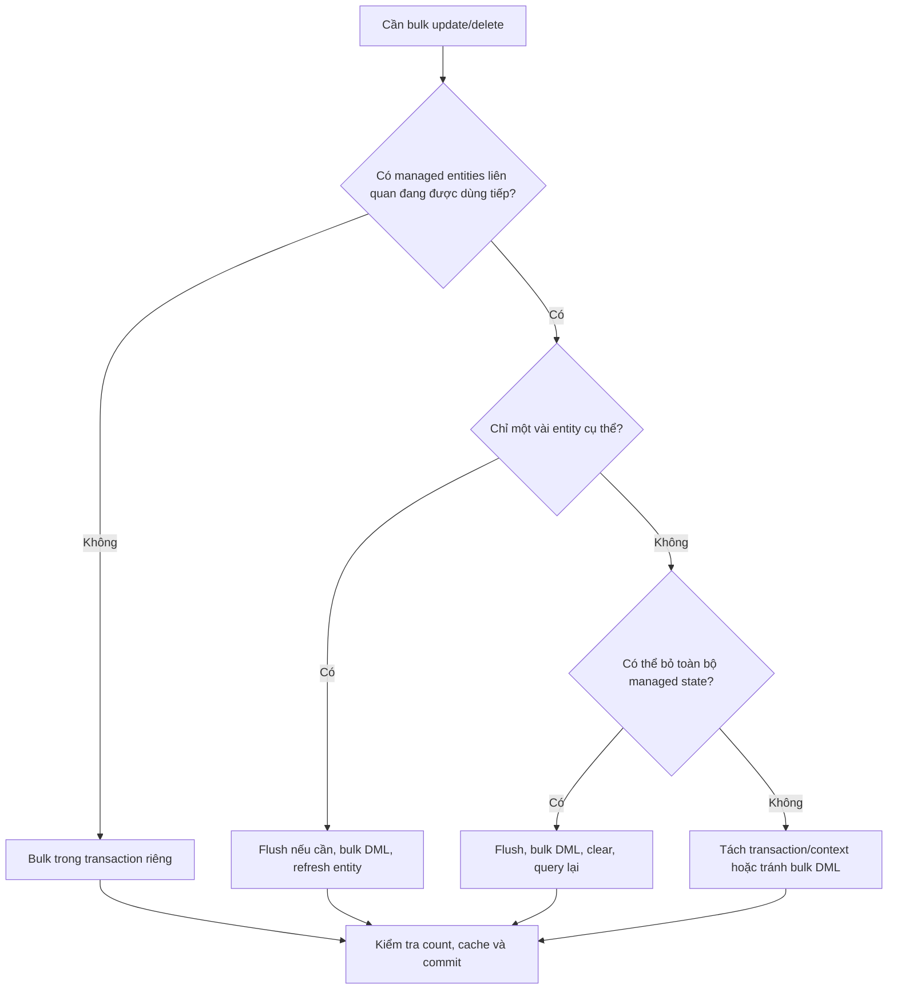

# Chạy bulk update rồi tiếp tục dùng context chưa được đồng bộ trong Hibernate

## 1. Tình huống lỗi: database đã đổi nhưng entity trong Java vẫn giữ giá trị cũ

Một service cần chuyển trạng thái nhiều đơn hàng từ `PENDING` sang `EXPIRED`. Thay vì tải từng entity rồi sửa, lập trình viên dùng bulk JPQL:

```java
int updated = entityManager.createQuery("""
    update PurchaseOrder o
    set o.status = :expired
    where o.status = :pending
      and o.expiresAt < :now
    """)
    .setParameter("expired", OrderStatus.EXPIRED)
    .setParameter("pending", OrderStatus.PENDING)
    .setParameter("now", now)
    .executeUpdate();
```

Database đã cập nhật các rows phù hợp. Nhưng trong cùng transaction, trước đó service đã tải một `PurchaseOrder`:

```java
PurchaseOrder order = entityManager.find(PurchaseOrder.class, orderId);

// Bulk update chạy ở đây.

System.out.println(order.getStatus());
```

Giá trị `order.getStatus()` có thể vẫn là `PENDING`, dù row trong database đã là `EXPIRED`.

Đây không phải lỗi đọc database. Đây là đặc tính quan trọng của bulk DML trong JPA/Hibernate: **bulk update/delete được thực thi trực tiếp trên database và không đồng bộ lại các entity đang được quản lý trong persistence context**.

Nếu code tiếp tục sử dụng entity/collection đã load, nó có thể đọc dữ liệu cũ, ghi đè kết quả bulk update hoặc đưa ra quyết định nghiệp vụ sai. Cách xử lý thường là thiết kế ranh giới transaction riêng, hoặc flush trước bulk DML rồi clear/refresh persistence context trước khi tiếp tục dùng dữ liệu.

### 1.1. Mục tiêu học tập

Sau bài học, bạn có thể:

1. Phân biệt entity update thông thường với JPQL/HQL bulk update/delete.
2. Giải thích vì sao database đã đổi nhưng managed entity vẫn cũ.
3. Hiểu vai trò của persistence context/first-level cache.
4. Sắp xếp đúng thứ tự `flush()`, `executeUpdate()` và `clear()`.
5. Chọn giữa `clear()`, `refresh()` và đọc lại trong transaction mới.
6. Cấu hình Spring Data JPA `@Modifying` an toàn.
7. Nhận diện ảnh hưởng đến `@Version`, callbacks, cascades, orphan removal và Envers.
8. Xử lý L2 cache/query cache và native SQL/JDBC updates.
9. Viết integration tests tái hiện stale state và xác nhận cách khắc phục.
10. Chọn bulk DML hay entity-by-entity updates theo yêu cầu nghiệp vụ.

## 2. Persistence context là gì?

Persistence context là vùng quản lý các entity instance trong một `EntityManager`/Hibernate `Session`. Với một entity identity, context thường duy trì một managed instance duy nhất trong phạm vi context đó.

Ví dụ:

```java
PurchaseOrder first = entityManager.find(PurchaseOrder.class, 42L);
PurchaseOrder second = entityManager.find(PurchaseOrder.class, 42L);

assert first == second;
```

Lần `find` thứ hai thường trả lại managed instance đã có trong first-level cache, không nhất thiết chạy SELECT mới.

Persistence context còn theo dõi thay đổi trên managed entities để Hibernate thực hiện dirty checking khi flush:

```java
PurchaseOrder order = entityManager.find(PurchaseOrder.class, 42L);
order.setStatus(OrderStatus.PAID);

// Hibernate ghi UPDATE khi flush/commit.
```

Khi sửa entity theo cách này, Hibernate biết state trong Java và database cần được đồng bộ khi flush.

### 2.1. Bulk DML đi theo một con đường khác

Bulk JPQL/HQL update/delete hoạt động ở mức câu lệnh:

```java
int count = entityManager.createQuery("""
    update PurchaseOrder o
    set o.status = :status
    where o.customer.id = :customerId
    """)
    .setParameter("status", OrderStatus.SUSPENDED)
    .setParameter("customerId", customerId)
    .executeUpdate();
```

Hibernate dịch query thành một hoặc nhiều thao tác SQL phù hợp dialect rồi thực thi trực tiếp. Nó không tải từng `PurchaseOrder`, gọi setter trên từng instance và chạy dirty checking cho mỗi entity.

Đây là lý do bulk DML có thể rất hiệu quả với hàng nghìn/hàng triệu rows, nhưng persistence context không tự biết mọi object Java liên quan đã thay đổi.

### 2.2. Mô hình hai trạng thái

```text
Persistence context (L1)          Database
------------------------          --------
PurchaseOrder#42                  row id=42
status = PENDING                   status = PENDING

             bulk UPDATE
                  |
                  v

Persistence context (L1)          Database
------------------------          --------
PurchaseOrder#42                  row id=42
status = PENDING  (cũ)             status = EXPIRED (mới)
```

Hai nơi có state khác nhau. Khi gọi `find()` lần nữa trong cùng context, Hibernate thường vẫn trả managed instance hiện tại. Đọc lại bằng `find()` không tự giải quyết stale state nếu entity đã được quản lý.

## 3. Bulk update/delete khác entity-by-entity update như thế nào?

| Đặc điểm | Managed entity update | Bulk JPQL/HQL DML |
|---|---|---|
| Tải entity vào persistence context | Có | Không cần |
| Dirty checking từng entity | Có | Không |
| Đồng bộ managed objects sau câu lệnh | Hibernate theo dõi state entity | Không tự đồng bộ |
| `@PreUpdate`/`@PreRemove` | Có thể được gọi theo lifecycle | Không chạy cho từng row |
| Cascade entity operations | Theo mapping và operation | Không tự cascade như entity operation |
| Optimistic locking tự động | Có với `@Version` | Không tự áp dụng như từng entity |
| Hiệu năng với số rows lớn | Có thể tốn memory/SQL | Thường hiệu quả hơn |
| Cập nhật tập rows trong một câu lệnh | Không theo cách thông thường | Có |
| Persistence context sau thao tác | Dirty checking quản lý state | Có thể chứa state cũ |

### 3.1. Entity-by-entity update

```java
List<PurchaseOrder> orders = entityManager.createQuery("""
    select o from PurchaseOrder o
    where o.status = :pending
      and o.expiresAt < :now
    """, PurchaseOrder.class)
    .setParameter("pending", OrderStatus.PENDING)
    .setParameter("now", now)
    .getResultList();

for (PurchaseOrder order : orders) {
    order.setStatus(OrderStatus.EXPIRED);
}
```

Khi flush, Hibernate dirty-check các entities. Cách này hỗ trợ lifecycle callbacks, entity listeners, Envers và optimistic locking theo entity, nhưng có thể tốn memory và phát nhiều DML statements (có thể được JDBC batching gom lại).

### 3.2. Bulk update

```java
int updated = entityManager.createQuery("""
    update PurchaseOrder o
    set o.status = :expired
    where o.status = :pending
      and o.expiresAt < :now
    """)
    .setParameter("expired", OrderStatus.EXPIRED)
    .setParameter("pending", OrderStatus.PENDING)
    .setParameter("now", now)
    .executeUpdate();
```

Database xử lý tập rows trực tiếp. Hibernate trả về affected count theo semantics của `executeUpdate()` và dialect/driver. Các entity instances đã load trong context không tự được cập nhật.

### 3.3. Bulk delete cũng có cùng vấn đề

```java
int deleted = entityManager.createQuery("""
    delete from PurchaseOrder o
    where o.status = :cancelled
      and o.createdAt < :cutoff
    """)
    .setParameter("cancelled", OrderStatus.CANCELLED)
    .setParameter("cutoff", cutoff)
    .executeUpdate();
```

Nếu một `PurchaseOrder` đã được load trước đó, object Java vẫn có thể còn trong persistence context dù row database đã bị xóa. Gọi `find()` cùng ID trong context đó có thể trả object managed đã tồn tại thay vì kiểm tra row mới ở database.

## 4. Ví dụ tái hiện stale entity

Giả sử Product:

```java
@Entity
@Table(name = "products")
public class Product {
    @Id
    private Long id;

    @Column(nullable = false)
    private String name;

    @Column(nullable = false, precision = 18, scale = 2)
    private BigDecimal price;

    protected Product() {}

    public Long getId() { return id; }
    public String getName() { return name; }
    public BigDecimal getPrice() { return price; }

    public void changePrice(BigDecimal value) {
        this.price = value;
    }
}
```

Trong một transaction:

```java
@Transactional
public void demonstrateStaleState(Long id) {
    Product product = entityManager.find(Product.class, id);

    entityManager.createQuery("""
        update Product p
        set p.price = :newPrice
        where p.id = :id
        """)
        .setParameter("newPrice", new BigDecimal("99.00"))
        .setParameter("id", id)
        .executeUpdate();

    // Object đã load vẫn có thể giữ price cũ.
    log.info("price={}", product.getPrice());

    // find cùng ID trong cùng persistence context
    // vẫn có thể trả đúng managed object cũ.
    Product again = entityManager.find(Product.class, id);
    log.info("same instance={}", product == again);
}
```

Nếu giá trước đó là `10.00`, log có thể vẫn hiển thị `10.00`, trong khi database row đã là `99.00`.

### 4.1. Vì sao SELECT lại bằng find() không giúp?

`EntityManager.find()` trước hết kiểm tra persistence context. Nếu entity cùng identity đã được quản lý, JPA trả managed instance đó. Nó không có nghĩa “luôn bỏ qua L1 và đọc lại database”.

Đây là lý do phải chủ động làm mới state bằng `refresh()` hoặc loại entity khỏi context bằng `clear()`/`detach()` rồi tải lại.

### 4.2. Stale state có thể dẫn đến ghi đè dữ liệu mới

Ví dụ:

1. Context tải Product với `price=10`.
2. Bulk update đổi database thành `price=99`.
3. Code tiếp tục sửa một thuộc tính khác trên object cũ.
4. Khi flush, dirty checking có thể phát UPDATE từ state managed cũ tùy mapping, dirty fields và provider behavior.

Không nên dựa vào việc Hibernate chỉ update cột nào đã dirty để bảo vệ mọi trường hợp. Một managed entity stale có thể gây ghi đè hoặc conflict khó dự đoán, đặc biệt khi versioning/custom SQL/merge logic tham gia.

**Quy tắc:** sau bulk DML, đừng tiếp tục mutate các managed instances có thể bị ảnh hưởng cho đến khi đã đồng bộ hoặc loại chúng khỏi persistence context.

## 5. Thứ tự an toàn: flush → bulk DML → clear

Một pattern thường dùng khi cần bulk update rồi tiếp tục truy vấn/đọc state:

```java
@Transactional
public int expireOrders(Instant now) {
    entityManager.flush();

    int updated = entityManager.createQuery("""
        update PurchaseOrder o
        set o.status = :expired
        where o.status = :pending
          and o.expiresAt < :now
        """)
        .setParameter("expired", OrderStatus.EXPIRED)
        .setParameter("pending", OrderStatus.PENDING)
        .setParameter("now", now)
        .executeUpdate();

    entityManager.clear();

    return updated;
}
```

Ba bước có mục đích khác nhau.

### 5.1. Bước 1: flush các thay đổi đang chờ

`flush()` đồng bộ những thay đổi của managed entities tới database trong transaction hiện tại.

Nếu có thay đổi pending trước bulk DML, explicit flush giúp xác định thứ tự:

1. Các entity changes hiện tại được gửi xuống database.
2. Bulk statement chạy trên state đã flush.
3. Context được clear sau bulk operation.

Nếu không flush, thứ tự SQL có thể phụ thuộc flush mode/provider và query spaces. Đặc biệt với `FlushModeType.COMMIT` hoặc native query, không nên dựa vào giả định mọi pending changes đều tự được flush đúng lúc.

### 5.2. Bước 2: executeUpdate()

`executeUpdate()` thực thi bulk DML. Nó yêu cầu transaction phù hợp; gọi ngoài transaction thường dẫn đến lỗi transaction-required.

Giá trị trả về cho biết affected count của câu lệnh theo query/provider/database semantics. Có thể dùng count để:

- Ghi nhận số đơn hàng vừa expire.
- Xác nhận conditional update có đúng một row.
- Phát hiện trạng thái đã thay đổi bởi transaction khác.
- Kiểm soát idempotency.

Không dùng count như bằng chứng mọi callback/audit đã chạy; bulk DML không đi qua lifecycle của từng entity.

### 5.3. Bước 3: clear persistence context

`entityManager.clear()` detach **tất cả** managed entities khỏi persistence context hiện tại.

Sau clear:

- Những object references đang giữ trong Java trở thành detached.
- `find()`/query tiếp theo có thể tải state mới từ database.
- Lazy associations trên detached objects có thể không truy cập được nếu chưa được khởi tạo.
- Các thay đổi chưa flush trên bất kỳ managed entity nào đều có thể bị mất khỏi context.

Vì vậy phải flush trước khi clear nếu cần giữ các thay đổi đang chờ.

### 5.4. Clear không commit transaction

`clear()` chỉ thay đổi trạng thái persistence context. Transaction vẫn mở, bulk DML vẫn chưa được commit. Nếu transaction rollback, database sẽ rollback bulk update dù context đã clear.

### 5.5. Clear là thao tác rộng

Nếu service đang quản lý nhiều entities không liên quan, `clear()` detach cả chúng. Những object references được giữ lại không còn managed. Nếu code tiếp tục dùng các references này để cập nhật, có thể gặp detached entity problems hoặc state không được persist.

Hãy gọi clear tại ranh giới được thiết kế rõ ràng, thường trong một service/repository operation riêng; sau đó query lại những gì cần dùng.

## 6. Dùng refresh() khi chỉ cần đồng bộ một entity

Nếu chỉ có một entity managed cần cập nhật lại, có thể dùng:

```java
entityManager.refresh(product);
```

`refresh()` đọc lại state từ database và ghi đè state của entity đang managed.

Ví dụ:

```java
@Transactional
public Product refreshAfterBulkPriceChange(Long id) {
    Product product = entityManager.find(Product.class, id);

    entityManager.createQuery("""
        update Product p
        set p.price = :price
        where p.id = :id
        """)
        .setParameter("price", new BigDecimal("99.00"))
        .setParameter("id", id)
        .executeUpdate();

    entityManager.refresh(product);

    return product;
}
```

Sau refresh, `product.getPrice()` phản ánh giá trị database mới.

### 6.1. Refresh ghi đè thay đổi chưa flush

Giả sử trước bulk update code đã thay đổi một field trên `product` nhưng chưa flush. Gọi `refresh(product)` có thể ghi đè state trong memory bằng state database, làm mất thay đổi chưa flush.

Nếu cần giữ thay đổi, flush trước refresh. Nếu thay đổi cũ không còn hợp lệ, có thể bỏ nó có chủ đích.

### 6.2. Refresh một entity không làm mới toàn bộ graph

Nếu Product có collections hoặc associations đã load, chỉ refresh root không nên được hiểu là tự đồng bộ toàn bộ object graph trong mọi mapping/provider configuration. JPA có `CascadeType.REFRESH` để lan truyền refresh đến associations được cấu hình cascade; nếu không, hãy tải lại những phần graph cần thiết hoặc clear rồi query lại.

### 6.3. Khi nào nên dùng refresh?

- Bulk DML ảnh hưởng một entity đã biết.
- Cần tiếp tục dùng chính managed object đó.
- Không muốn detach tất cả entities trong context.
- Có thể bảo đảm pending changes đã flush hoặc không cần giữ.

Với bulk update ảnh hưởng hàng nghìn entities/collections, gọi refresh từng entity thường không hiệu quả; clear và query lại là lựa chọn rõ ràng hơn.

## 7. Dùng detach() khi biết chính xác entity cần loại bỏ

`entityManager.detach(entity)` loại một managed entity khỏi persistence context:

```java
entityManager.detach(product);
Product reloaded = entityManager.find(Product.class, productId);
```

Cách này hẹp hơn `clear()`, nhưng cần nhớ:

- Chỉ detach instance được truyền vào.
- Các entity/collection liên quan có thể vẫn managed và stale.
- References trong code vẫn trỏ tới object detached cũ.
- Các thay đổi chưa flush trên entity đó sẽ không còn được dirty checking quản lý.

Nếu bulk update tác động nhiều entities, rất khó biết hết instance nào cần detach. `clear()` thường an toàn và dễ reasoning hơn tại một boundary được kiểm soát.

## 8. Spring Data JPA: @Modifying và hai tùy chọn flush/clear

Một repository method bulk update có thể khai báo:

```java
public interface PurchaseOrderRepository
        extends JpaRepository<PurchaseOrder, Long> {

    @Modifying(
        flushAutomatically = true,
        clearAutomatically = true
    )
    @Query("""
        update PurchaseOrder o
        set o.status = :expired
        where o.status = :pending
          and o.expiresAt < :now
        """)
    int expireOrders(
        @Param("expired") OrderStatus expired,
        @Param("pending") OrderStatus pending,
        @Param("now") Instant now
    );
}
```

Service:

```java
@Service
public class OrderMaintenanceService {

    private final PurchaseOrderRepository orders;

    public OrderMaintenanceService(PurchaseOrderRepository orders) {
        this.orders = orders;
    }

    @Transactional
    public int expireOrders(Instant now) {
        return orders.expireOrders(
            OrderStatus.EXPIRED,
            OrderStatus.PENDING,
            now
        );
    }
}
```

### 8.1. flushAutomatically=true

Spring Data JPA flush persistence context trước khi chạy modifying query. Điều này giúp các pending entity changes được gửi trước bulk statement.

### 8.2. clearAutomatically=true

Sau modifying query, Spring Data JPA clear persistence context để tránh managed entities giữ state cũ.

Mặc định hai thuộc tính này thường là `false`; `@Modifying` không tự động có nghĩa context sẽ được flush và clear.

### 8.3. Tại sao không phải lúc nào cũng bật clearAutomatically?

Vì `EntityManager.clear()` detach tất cả entities trong context. Nếu service sau repository call còn dùng các managed objects khác, chúng cũng đã detached.

Ví dụ nguy hiểm:

```java
@Transactional
public void updateOrderAndExpireOthers(Long id, Instant now) {
    PurchaseOrder current = entityManager.find(PurchaseOrder.class, id);

    repository.expireOrders(
        OrderStatus.EXPIRED, OrderStatus.PENDING, now
    ); // clearAutomatically=true

    current.setNote("Reviewed");
    // current đã detached; thay đổi này không còn tự được dirty-check.
}
```

Giải pháp là tách bulk operation thành boundary riêng, clear có chủ đích rồi tải lại entity cần sửa, hoặc không dùng auto-clear nếu service quản lý state khác cần tiếp tục dùng.

### 8.4. flushAutomatically và clearAutomatically phải được chọn cùng nhau theo state

- Nếu có pending changes cần giữ: flush trước clear.
- Nếu không có pending changes và muốn tránh stale state: clear sau bulk.
- Nếu repository method chạy trong context chỉ dành cho bulk operation: hai flags có thể hợp lý.
- Nếu context chứa nhiều state khác: cân nhắc tách transaction/service hoặc refresh entity cụ thể.

Không bật hai flags như một công thức máy móc mà không xét lifecycle của context và caller.

## 9. Bulk update bằng native SQL và JDBC cũng có thể tạo stale context

Ví dụ native query:

```java
int updated = entityManager.createNativeQuery("""
    update products
    set price = :price
    where category_id = :categoryId
    """)
    .setParameter("price", price)
    .setParameter("categoryId", categoryId)
    .executeUpdate();
```

Hoặc JDBC trực tiếp:

```java
jdbcTemplate.update("""
    update products
    set price = ?
    where category_id = ?
    """,
    price,
    categoryId
);
```

Cả hai thay đổi database ngoài dirty checking của các managed Product entities. Các object đã load trong EntityManager vẫn có thể stale.

### 9.1. Native query không tự hiểu toàn bộ mapping

Native SQL có thể bypass:

- HQL entity filters hoặc restrictions không được áp dụng tự động như query entity.
- Entity callbacks và cascade semantics.
- Soft-delete policies được thực thi ở tầng ORM.
- Optimistic locking tự động.
- Type conversion/mapping mà JPQL cung cấp.

Phải tự viết predicates, bind parameters và kiểm tra affected rows phù hợp.

### 9.2. Đồng bộ query spaces/cache với Hibernate

Hibernate có cơ chế đồng bộ query spaces cho native queries, ví dụ khai báo entity/query spaces khi unwrap native query:

```java
NativeQuery<?> query = entityManager
    .createNativeQuery("""
        update products
        set price = :price
        where category_id = :categoryId
        """)
    .unwrap(NativeQuery.class);

query.addSynchronizedEntityClass(Product.class);
query.setParameter("price", price);
query.setParameter("categoryId", categoryId);

int updated = query.executeUpdate();
```

Đây là Hibernate-specific API. Khai báo synchronized spaces giúp Hibernate biết những bảng/regions liên quan cho một số hoạt động auto-flush và cache invalidation. Nó **không làm mới managed entities trong L1 persistence context**. Vẫn phải clear/refresh nếu code tiếp tục dùng entities đã load.

Với `JdbcTemplate` hoặc một connection ngoài Hibernate, provider có thể không biết những bảng đã thay đổi. Khi đó cần chủ động quản lý cache invalidation và persistence context ở ranh giới tích hợp.

## 10. First-level cache và second-level cache là hai vấn đề riêng

### 10.1. First-level cache (L1)

L1 là persistence context của EntityManager/Session. Bulk DML không tự đồng bộ các managed objects trong context. `clear()`, `refresh()` hoặc transaction mới xử lý vấn đề này.

### 10.2. Second-level cache (L2)

L2 là cache chia sẻ giữa các persistence contexts. Đây là lớp khác với managed entity instances của L1.

Hibernate có cơ chế bulk-operation cleanup/invalidation cho HQL/JPQL mutations theo các query spaces liên quan. Tuy nhiên behavior cụ thể phụ thuộc Hibernate version, cache provider và loại query. Native SQL hoặc JDBC ngoài Hibernate có thể không cung cấp đủ thông tin để tự invalidation chính xác.

Nếu một writer ngoài Hibernate cập nhật Product, có thể cần evict region/entry:

```java
entityManagerFactory.getCache().evict(Product.class, productId);
```

Hoặc evict toàn bộ entity type:

```java
entityManagerFactory.getCache().evict(Product.class);
```

Hibernate-specific cache API có thêm thao tác evict entity/collection regions và query cache. Chỉ evict những regions liên quan theo chính sách cache; không giả định `EntityManager.clear()` cũng xóa L2 cache.

### 10.3. Query cache

Query cache lưu kết quả query theo cơ chế riêng. Hibernate thường dùng timestamps/query-space invalidation để tránh trả kết quả query cũ sau HQL mutations. Với native/external SQL, phải xác nhận synchronized spaces và cache invalidation phù hợp. Nếu không chắc, tắt query cache cho luồng đó hoặc evict vùng liên quan theo API provider.

### 10.4. Clear không phải cache eviction

| Thao tác | Tác động chính |
|---|---|
| `entityManager.clear()` | Detach mọi managed entities trong L1 hiện tại |
| `entityManager.refresh(entity)` | Reload state cho một managed entity |
| `entityManager.detach(entity)` | Detach một entity |
| `entityManagerFactory.getCache().evict(...)` | Evict dữ liệu shared cache theo JPA API |
| Hibernate query-cache eviction | Xóa query result cache theo vùng/provider |
| Commit transaction | Xác nhận transaction; không tự sửa stale Java references |

Đừng dùng `clear()` như một cách xóa tất cả cache của Hibernate.

## 11. Bulk DML và @Version: optimistic locking không tự chạy như entity update

Một entity:

```java
@Entity
public class Product {
    @Id
    private Long id;

    @Version
    private long version;

    private BigDecimal price;
}
```

Khi sửa managed entity, Hibernate tạo UPDATE có version predicate và tăng version. Nhưng bulk JPQL update không tự thực hiện optimistic-lock checks/increment giống entity-by-entity update theo JPA semantics.

Ví dụ bulk update:

```hql
update Product p
set p.price = :price
where p.category.id = :categoryId
```

Query này có thể cập nhật rows mà không kiểm tra từng expected version và không tự tăng version như dirty checking thông thường.

### 11.1. Nếu cần optimistic guard, viết predicate và version update rõ ràng

Với một Product:

```java
int changed = entityManager.createQuery("""
    update Product p
    set p.price = :price,
        p.version = p.version + 1
    where p.id = :id
      and p.version = :expectedVersion
    """)
    .setParameter("price", new BigDecimal("99.00"))
    .setParameter("id", productId)
    .setParameter("expectedVersion", expectedVersion)
    .executeUpdate();

if (changed != 1) {
    throw new OptimisticLockException(
        "Product was changed by another transaction"
    );
}
```

Điều kiện `version = :expectedVersion` kiểm tra version cũ; câu lệnh tăng version atomically. Nếu không có row phù hợp, count khác 1 và application xử lý conflict.

Đây là một chiến lược explicit cho bulk DML. Cần kiểm tra cách Spring exception translation/transaction rollback policy được áp dụng trong dự án.

### 11.2. Bulk update nhiều rows có version policy khác

Nếu cập nhật nhiều rows theo điều kiện, có thể chủ động tăng version:

```java
update Product p
set p.status = :inactive,
    p.version = p.version + 1
where p.lastSoldAt < :cutoff
```

Nhưng điều này không tương đương kiểm tra expected version cho từng client update. Nếu nghiệp vụ cần phát hiện conflict cho từng entity, hãy tải và cập nhật managed entities hoặc thiết kế conditional updates riêng theo từng ID/version.

### 11.3. Hibernate HQL có cú pháp versioned riêng

Hibernate cung cấp một số extension HQL cho versioned bulk updates ở các phiên bản phù hợp. Đây là Hibernate-specific behavior, không phải JPQL portable. Trước khi sử dụng, đọc HQL guide đúng version và vẫn xử lý persistence context stale state sau câu lệnh.

## 12. Bulk DML bypass callbacks, cascade và entity lifecycle

Đây là khác biệt nghiệp vụ quan trọng hơn stale fields.

### 12.1. Entity callbacks không chạy cho từng row

Với managed entity:

```java
@PreUpdate
void beforeUpdate() {
    updatedAt = Instant.now();
}
```

Bulk query:

```java
update Product p
set p.status = :inactive
where p.lastSoldAt < :cutoff
```

không tải từng Product và không gọi `@PreUpdate` cho mỗi row. Nếu `updatedAt` phải được cập nhật, hãy set rõ trong bulk statement:

```java
update Product p
set p.status = :inactive,
    p.updatedAt = :now
where p.lastSoldAt < :cutoff
```

Nếu callback làm nhiều logic nghiệp vụ, audit actor hoặc publish events, bulk DML có thể không phù hợp.

### 12.2. Cascade không giống remove từng entity

Bulk delete:

```java
delete from PurchaseOrder o
where o.status = :cancelled
```

không tự chạy `CascadeType.REMOVE`/`orphanRemoval` như khi gọi `entityManager.remove(order)` cho từng entity.

Nếu `OrderLine` có FK tới `PurchaseOrder` và database không có `ON DELETE CASCADE`, bulk delete có thể bị FK constraint violation; hoặc database cascade có thể xóa children theo constraint. Đó là database referential action, không phải JPA cascade callback.

### 12.3. Envers và audit listeners

Envers dựa trên Hibernate event/lifecycle path cho các entity operations thông thường. Bulk JPQL/native DML không đi qua event cho từng entity như dirty checking; do đó không nên kỳ vọng mỗi row tự có audit revision đầy đủ.

Nếu audit history là yêu cầu bắt buộc:

- Dùng entity-by-entity update cho số lượng phù hợp.
- Tạo audit record riêng trong cùng transaction theo thiết kế.
- Dùng database auditing/trigger nếu đó là kiến trúc đã chọn.
- Hoặc tạo một audit event mô tả bulk operation, gồm phạm vi và actor, theo policy.

Không tuyên bố audit đầy đủ chỉ vì bulk query commit thành công.

### 12.4. Spring Data auditing

Các listener như `@LastModifiedDate` hoặc `@LastModifiedBy` thường gắn với entity lifecycle. Bulk DML phải cập nhật các cột audit một cách explicit nếu cần:

```java
update Product p
set p.status = :status,
    p.lastModifiedAt = :now,
    p.lastModifiedBy = :actor
where p.category.id = :categoryId
```

Nếu actor/time là dữ liệu nhạy cảm hoặc có audit policy, bảo đảm nguồn giá trị đáng tin và được ghi đúng.

## 13. Bulk DML và collection/association state

Bulk DML có thể sửa foreign key hoặc rows của child table, làm stale không chỉ root entity mà cả collections đã load.

Ví dụ:

```java
List<OrderLine> lines = order.getLines();

// Bulk update OrderLine:
entityManager.createQuery("""
    update OrderLine l
    set l.quantity = 0
    where l.order.id = :orderId
    """)
    .setParameter("orderId", order.getId())
    .executeUpdate();
```

Các `OrderLine` managed đã load vẫn có thể giữ quantity cũ. Collection `order.getLines()` vẫn trỏ tới các object cũ.

Nếu bulk delete child rows, collection vẫn có thể chứa object đã bị xóa ở database. Nếu bulk update FK, association references ở hai phía có thể không còn phản ánh database.

**Đừng chỉ refresh root entity rồi giả định toàn bộ collection đã đúng.** Hãy refresh graph theo cascade được cấu hình, query lại children, hoặc clear context rồi tải lại aggregate.

### 13.1. Khi aggregate consistency quan trọng

Nếu domain logic cần invariants giữa parent và children, cân nhắc thực hiện operation qua aggregate methods/managed entities. Bulk DML phù hợp hơn với thao tác bảo trì hoặc chuyển trạng thái tập rows có quy tắc rõ và không cần từng entity lifecycle.

## 14. Bulk update và flush mode

JPA `FlushModeType.AUTO` yêu cầu provider bảo đảm những thay đổi có thể ảnh hưởng kết quả query được đồng bộ trước khi query được thực thi. `FlushModeType.COMMIT` trì hoãn flush đến commit, dù provider có thể flush sớm hơn.

Ví dụ:

```java
entityManager.setFlushMode(FlushModeType.COMMIT);

Product product = entityManager.find(Product.class, id);
product.changePrice(new BigDecimal("20.00"));

// Bulk statement có thể chạy trước pending state tùy flush mode/provider.
entityManager.createQuery("""
    update Product p
    set p.status = :status
    where p.price < :threshold
    """)
    .setParameter("status", ProductStatus.DISCOUNTED)
    .setParameter("threshold", new BigDecimal("25.00"))
    .executeUpdate();
```

Nếu pending changes ảnh hưởng điều kiện hoặc có thể bị bulk DML ghi đè, gọi `flush()` rõ ràng trước. Đừng dùng flush mode để né stale context; flush và clear giải quyết hai vấn đề khác nhau.

### 14.1. Flush trước không đồng bộ object sau

`flush()` gửi pending changes của entity xuống database. Nó không reload entity fields sau khi bulk statement cập nhật rows. Sau `flush(); executeUpdate();`, managed entity vẫn có thể cũ cho đến khi refresh/clear.

### 14.2. Auto flush không phải auto refresh

Đây là hai khái niệm khác nhau:

- **Flush:** Java managed state → database.
- **Refresh:** database state → một managed entity.
- **Clear:** bỏ toàn bộ managed state khỏi persistence context.

Bulk DML thường cần suy nghĩ cả chiều trước và sau statement.

## 15. Pattern 1 — Bulk operation trong transaction riêng

Nếu service chỉ cần chạy bulk maintenance rồi trả số lượng affected rows, tách operation thành transaction riêng là cách đơn giản:

```java
@Service
public class OrderExpirationService {

    private final PurchaseOrderRepository repository;

    public OrderExpirationService(PurchaseOrderRepository repository) {
        this.repository = repository;
    }

    @Transactional
    public int expireOrders(Instant now) {
        return repository.expireOrders(
            OrderStatus.EXPIRED,
            OrderStatus.PENDING,
            now
        );
    }
}
```

Caller không giữ managed `PurchaseOrder` instances trong persistence context của bulk operation. Sau khi method hoàn tất, transaction kết thúc; nếu cần đọc dữ liệu mới, caller thực hiện query trong persistence context/transaction mới.

### 15.1. Ưu điểm

- Context nhỏ, dễ hiểu.
- Không phải đồng bộ graph cũ trong caller.
- Bulk work có boundary rõ.
- Dễ đo affected row count và transaction duration.

### 15.2. Lưu ý propagation

Nếu method được gọi từ một method đã có transaction, `@Transactional` mặc định `REQUIRED` sẽ tham gia transaction hiện tại, không tự tạo transaction mới. Nếu cần transaction độc lập, `REQUIRES_NEW` là lựa chọn khác nhưng thay đổi atomicity và rollback semantics.

Không thêm `REQUIRES_NEW` chỉ để tránh stale state mà chưa xét business transaction. Tách transaction có thể khiến bulk operation commit dù transaction ngoài rollback.

## 16. Pattern 2 — Flush, bulk DML, clear, rồi query lại

Khi cần thực hiện bulk operation và tiếp tục làm việc trong cùng transaction:

```java
@Transactional
public List<ProductSummary> deactivateAndRead(Long categoryId) {
    entityManager.flush();

    entityManager.createQuery("""
        update Product p
        set p.status = :inactive,
            p.version = p.version + 1
        where p.category.id = :categoryId
          and p.status = :active
        """)
        .setParameter("inactive", ProductStatus.INACTIVE)
        .setParameter("active", ProductStatus.ACTIVE)
        .setParameter("categoryId", categoryId)
        .executeUpdate();

    entityManager.clear();

    return entityManager.createQuery("""
        select new com.example.ProductSummary(p.id, p.status)
        from Product p
        where p.category.id = :categoryId
        order by p.id
        """, ProductSummary.class)
        .setParameter("categoryId", categoryId)
        .getResultList();
}
```

Query sau clear tạo kết quả mới từ database. DTO projection cũng tránh đưa entity graph stale trở lại context.

### 16.1. Dùng khi nào?

- Bulk DML tác động nhiều entities.
- Không cần giữ managed instances đã tải.
- Sau operation cần query lại trạng thái.
- Có thể detach mọi managed entities trong context tại điểm đó.

### 16.2. Không dùng khi caller còn pending managed state

Nếu context chứa thay đổi chưa flush ở nhiều aggregates, `clear()` có thể làm mất chúng khỏi dirty checking. `flush()` trước clear bảo đảm chúng được gửi xuống transaction, nhưng phải cân nhắc nếu những thay đổi đó xung đột với bulk DML.

Nếu code còn giữ object references, cần tải lại entities cần tiếp tục thao tác.

## 17. Pattern 3 — Refresh một entity cụ thể

```java
@Transactional
public Product updatePriceAndContinue(Long id) {
    Product product = entityManager.find(Product.class, id);

    entityManager.flush();

    entityManager.createQuery("""
        update Product p
        set p.price = :price
        where p.id = :id
        """)
        .setParameter("price", new BigDecimal("99.00"))
        .setParameter("id", id)
        .executeUpdate();

    entityManager.refresh(product);

    product.setDescription("Price refreshed");

    return product;
}
```

Pattern này giữ entity managed sau refresh, phù hợp khi chỉ có một vài entities đã biết. Nếu bulk update ảnh hưởng collections hoặc nhiều related entities, cần xử lý các phần đó riêng.

### 17.1. Tránh refresh trước flush nếu muốn giữ pending edits

Refresh có thể bỏ state chưa flush. Nếu có pending changes cần lưu, flush trước. Nếu chúng không còn hợp lệ, bỏ chúng một cách chủ ý rồi refresh.

## 18. Pattern 4 — Chọn entity-by-entity khi lifecycle quan trọng

Không phải mọi operation nhiều rows đều nên dùng bulk DML. Nếu mỗi entity cần:

- `@PreUpdate` hoặc listener.
- Envers revision.
- Spring Data auditing.
- Domain validation.
- Cascade/orphan removal.
- Optimistic locking theo từng entity.
- Domain events/outbox cho từng thay đổi.

thì tải entities theo chunks và cập nhật managed instances có thể là lựa chọn đúng.

Ví dụ:

```java
@Transactional
public int expireOrdersWithLifecycle(Instant now) {
    List<PurchaseOrder> batch = repository
        .findNextPendingBatch(now, PageRequest.of(0, 100));

    for (PurchaseOrder order : batch) {
        order.expire(now);
    }

    entityManager.flush();
    return batch.size();
}
```

Với tập dữ liệu lớn, lặp theo batches, flush/clear theo từng chunk và bảo đảm mỗi chunk có transaction/retry semantics phù hợp. Cách này tốn nhiều work hơn bulk DML nhưng giữ entity lifecycle.

## 19. Bulk DML với Spring Data: các lỗi phổ biến

### 19.1. Quên @Modifying

```java
@Query("""
    update Product p
    set p.status = :status
    where p.category.id = :categoryId
    """)
int updateCategoryStatus(...);
```

Với Spring Data JPA, modifying query cần `@Modifying`; nếu thiếu, framework có thể xử lý như query đọc và báo lỗi vì không phải SELECT.

### 19.2. Thiếu transaction

Bulk update/delete cần transaction. Có thể đặt `@Transactional` trên service hoặc repository method theo design; thường service layer sở hữu transaction boundary.

### 19.3. Quên clear sau bulk

Nếu method tiếp tục dùng entities đã load, state có thể stale. Cân nhắc:

```java
@Modifying(flushAutomatically = true, clearAutomatically = true)
```

nhưng chỉ khi clear toàn context là an toàn.

### 19.4. Quên flush trước clear

Nếu dùng `clearAutomatically=true` nhưng không flush pending changes, những thay đổi chưa được đồng bộ có thể bị detach và mất khỏi dirty checking. Dùng `flushAutomatically=true` khi cần bảo toàn chúng.

### 19.5. Nghĩ @Modifying tự chạy callbacks

`@Modifying` chỉ đánh dấu query là modifying operation trong Spring Data. Nó không biến bulk DML thành entity-by-entity lifecycle processing.

### 19.6. Nghĩ int returned là số entity object đã cập nhật trong context

Giá trị trả về là affected count của câu lệnh. Nó không đồng nghĩa các managed instances đã được cập nhật hoặc callbacks đã chạy.

## 20. JPQL bulk delete và foreign key/cascade

Ví dụ:

```java
@Modifying
@Query("""
    delete from PurchaseOrder o
    where o.status = :cancelled
    """)
int deleteCancelled(@Param("cancelled") OrderStatus cancelled);
```

Nếu `OrderLine` có FK tới `PurchaseOrder` và database không có `ON DELETE CASCADE`, bulk delete có thể bị FK constraint violation. JPA cascade mapping không tự được áp dụng cho bulk delete.

### 20.1. Xóa children trước

Có thể dùng hai bulk statements trong cùng transaction:

```java
entityManager.flush();

entityManager.createQuery("""
    delete from OrderLine l
    where l.order.id in (
        select o.id from PurchaseOrder o
        where o.status = :status
    )
    """)
    .setParameter("status", OrderStatus.CANCELLED)
    .executeUpdate();

int parents = entityManager.createQuery("""
    delete from PurchaseOrder o
    where o.status = :status
    """)
    .setParameter("status", OrderStatus.CANCELLED)
    .executeUpdate();

entityManager.clear();
```

Cần kiểm tra dialect/HQL support cho subquery trong bulk delete và FK constraints. Nếu dùng native SQL, bảo đảm query spaces/cache invalidation được xử lý phù hợp.

### 20.2. Soft delete là một bài toán khác

Bulk `update` cột `deleted=true` có thể nhanh, nhưng không tự gọi `@PreRemove`, không tự cascade và không tự áp dụng behavior của `remove()`/custom delete mapping. Cần cập nhật đúng audit fields, version, filters và cache policy.

## 21. Bulk operation và transaction atomicity

Hai bulk statements trong cùng transaction có thể atomic: nếu statement thứ hai lỗi và transaction rollback, statement thứ nhất cũng rollback (với transactional tables/database phù hợp).

Nhưng nếu dùng `REQUIRES_NEW` hoặc JDBC connection khác, atomicity có thể thay đổi. Regression tests nên xác nhận:

- Tất cả statements commit cùng nhau khi thành công.
- Lỗi ở giữa làm rollback toàn bộ phần cần atomic.
- Retry không lặp side effects ngoài transaction.
- Affected count được kiểm tra.
- Context không được tiếp tục sử dụng sau rollback như thể state đã commit.

### 21.1. Rollback không tự phục hồi object references

Nếu đã gọi `clear()` rồi transaction rollback, database quay lại state cũ, nhưng các object references đã detach vẫn là objects cũ trong Java. Chúng không tự được attach lại. Cần tải lại entities trong persistence context phù hợp.

## 22. Bulk update trong hệ thống nhiều tenant

Nếu bảng có tenant key, bulk query phải chứa tenant scope:

```java
update Invoice i
set i.status = :expired
where i.tenantId = :tenantId
  and i.status = :pending
  and i.dueAt < :now
```

Không giả định tenant filters được áp dụng giống nhau cho mọi bulk HQL, native SQL hoặc JDBC path. Kiểm tra SQL thực tế và test rằng operation không tác động rows tenant khác.

Sau bulk operation, persistence context có thể chứa entities của nhiều tenant; clear tại boundary thích hợp để tránh stale state. Không log raw tenant secrets hoặc dữ liệu nhạy cảm để chẩn đoán.

## 23. Kiểm thử integration: tái hiện stale context

Seed Product đã commit trước test. Sau đó mở transaction mới, load entity, chạy bulk update, chứng minh object cũ stale rồi clear và đọc lại.

Ví dụ minh họa:

```java
@SpringBootTest
class BulkUpdateContextIT {

    @Autowired
    private TransactionTemplate transactionTemplate;

    @Autowired
    private EntityManager entityManager;

    @Test
    void bulkUpdateDoesNotRefreshManagedEntity() {
        Long id = seedCommittedProduct("10.00");

        transactionTemplate.executeWithoutResult(status -> {
            Product managed = entityManager.find(Product.class, id);
            assertThat(managed.getPrice())
                .isEqualByComparingTo("10.00");

            entityManager.createQuery("""
                update Product p
                set p.price = :price
                where p.id = :id
                """)
                .setParameter("price", new BigDecimal("99.00"))
                .setParameter("id", id)
                .executeUpdate();

            // Cùng managed instance vẫn có thể là state cũ.
            assertThat(managed.getPrice())
                .isEqualByComparingTo("10.00");

            entityManager.clear();

            Product reloaded = entityManager.find(Product.class, id);
            assertThat(reloaded.getPrice())
                .isEqualByComparingTo("99.00");
        });
    }
}
```

Đây là test mô tả behavior của persistence context. Helper `seedCommittedProduct` phải chạy transaction đã commit trước transaction đo. Nếu test method có outer `@Transactional`, cần đảm bảo context/transaction boundary đúng và tránh fixture đang managed trong cùng L1.

### 23.1. Test refresh

Một test khác xác nhận:

```java
Product managed = entityManager.find(Product.class, id);

// bulk update...

entityManager.refresh(managed);

assertThat(managed.getPrice())
    .isEqualByComparingTo("99.00");
```

Không assert refresh giữ lại pending modifications chưa flush; theo semantics refresh, database state được nạp lại và local unflushed changes có thể bị ghi đè.

### 23.2. Test bulk delete

- Load entity vào context.
- Chạy bulk delete.
- Xác nhận context cũ vẫn có managed object/reference.
- Clear context.
- Tìm lại ID và xác nhận không còn row.
- Kiểm tra child rows/FK behavior riêng.

### 23.3. Test Spring Data flags

Tạo hai repository methods:

- Một method với `flushAutomatically=true, clearAutomatically=true`.
- Một method không clear.

Xác nhận method thứ nhất flush pending state trước operation và detach managed entities sau operation. Test cũng cần chứng minh code caller không tiếp tục mutate detached references.

## 24. Test optimistic locking và version với bulk DML

Nếu entity có `@Version`, viết test:

1. Seed Product và lấy version hiện tại.
2. Chạy bulk update có predicate expected version.
3. Xác nhận affected count bằng 1.
4. Đọc lại trong context mới và xác nhận version tăng.
5. Chạy lại với version cũ.
6. Xác nhận affected count bằng 0.
7. Xác nhận application báo conflict theo policy.

Ví dụ:

```java
int updated = repository.changePriceIfVersionMatches(
    productId, expectedVersion, new BigDecimal("99.00")
);

assertThat(updated).isEqualTo(1);

int stale = repository.changePriceIfVersionMatches(
    productId, expectedVersion, new BigDecimal("120.00")
);

assertThat(stale).isZero();
```

Không dùng test này để giả định JPQL bulk update tự động áp dụng version semantics; chính predicate và increment được viết explicit.

## 25. Test callbacks, auditing và Envers

Nếu nghiệp vụ yêu cầu callbacks/audit:

- Tạo một entity managed rồi sửa, xác nhận listener/callback chạy.
- Chạy bulk update cùng field, xác nhận callback không được kỳ vọng chạy.
- Xác nhận audit fields được set explicit nếu bulk path vẫn được dùng.
- Kiểm tra Envers revision theo policy.
- Kiểm tra outbox/domain event có được tạo đúng không.

Nếu bắt buộc audit từng entity, bulk DML có thể không phù hợp. Đừng cố giả lập lifecycle bằng một callback sau khi bulk query nếu không có đầy đủ row-level old/new values.

## 26. Bulk update và query count/performance

Bulk DML thường giảm số round trips và tránh hydrate hàng nghìn entities. Nhưng phải đo:

- Statement count.
- Rows affected.
- Execution time.
- Lock duration.
- Transaction log/WAL volume.
- Index maintenance.
- Connection hold time.
- Replication lag nếu có.
- Cache invalidation cost.

### 26.1. Bulk không phải lúc nào cũng nhanh hơn

Một câu UPDATE trên bảng lớn có thể lock nhiều rows, tạo transaction log lớn và gây contention. Chia batches theo primary key/time range có thể giảm transaction duration nhưng thay đổi atomicity.

### 26.2. Chia batch có điều kiện ổn định

Ví dụ xử lý theo ID range:

```sql
UPDATE purchase_orders
SET status = 'EXPIRED'
WHERE id > ?
  AND id <= ?
  AND status = 'PENDING'
  AND expires_at < ?;
```

Mỗi batch có transaction riêng sẽ giảm lock duration, nhưng có thể để trạng thái chuyển tiếp giữa các batches. Thiết kế retry/idempotency và monitoring affected counts.

### 26.3. Query count ít không đồng nghĩa contention thấp

Một bulk statement duy nhất có thể khóa nhiều rows hơn hàng nghìn updates nhỏ. Đo lock waits/deadlocks và thời gian transaction trên database thật.

## 27. Các lỗi thường gặp và cách xử lý

| Triệu chứng | Nguyên nhân | Cách xử lý |
|---|---|---|
| Bulk update thành công nhưng getter trả giá trị cũ | Managed entity trong L1 chưa được đồng bộ | Clear rồi query lại hoặc refresh entity |
| `find()` lần hai vẫn trả dữ liệu cũ | Entity đã có trong persistence context | Clear/detach/refresh trước khi đọc |
| Sau `clearAutomatically`, thay đổi khác bị mất | Clear detach toàn context trước khi pending changes được flush | Dùng flushAutomatically hoặc tách context/transaction |
| Entity reference sau clear không được update | Object đã detached | Query lại và dùng managed instance mới |
| Refresh làm mất thay đổi trong Java | Refresh ghi đè state chưa flush | Flush trước hoặc bỏ local changes có chủ đích |
| Bulk delete lỗi FK | JPA cascade không chạy cho bulk DML | Xóa children explicit hoặc dùng DB cascade phù hợp |
| `@PreUpdate` không chạy | Bulk DML bypass entity lifecycle | Entity updates hoặc set audit fields explicit |
| Envers không ghi từng row | Bulk DML không đi qua entity event path | Dùng entity operations hoặc audit strategy riêng |
| Version không tăng/conflict không được phát hiện | Bulk DML không tự áp optimistic locking như managed update | Explicit version predicate và increment |
| Entity bị xóa vẫn còn trong Java | Persistence context chưa clear | Clear/detach và query lại |
| Collection vẫn có child đã xóa | Collection/child entities stale | Refresh graph phù hợp hoặc clear và tải lại |
| JDBC update xong Hibernate vẫn trả cache cũ | External writer bypass Hibernate | Clear L1 và evict shared cache liên quan |
| Native query không invalidation cache đúng | Hibernate không biết query spaces bị ảnh hưởng | Đăng ký synchronized spaces/evict regions |
| Bulk update không thấy pending entity changes | Flush mode/transaction boundary | Flush rõ ràng trước DML |
| Bulk query chạy ngoài transaction lỗi | `executeUpdate()` cần transaction | Gọi trong transaction |
| Count affected rows bằng 0 | Predicate không khớp hoặc version/state đã đổi | Xử lý idempotency/conflict theo nghiệp vụ |
| Query nhanh nhưng audit thiếu | Dùng bulk khi cần lifecycle | Chuyển entity-by-entity hoặc audit riêng |
| Clear xong lazy getter ném exception | Entity đã detached và association chưa load | Query DTO/graph mới trong context đang mở |
| Bulk operation tác động tenant khác | Thiếu tenant predicate hoặc filter không áp dụng | Thêm explicit tenant scope và integration test |
| Bulk update gây lock contention | Một statement tác động quá nhiều rows | Chia batch có kiểm soát và đo lock duration |

## 28. Quy trình chọn cách xử lý

Khi code cần chạy bulk DML rồi tiếp tục đọc/ghi:

1. Xác định những entities/collections nào đã được load trong persistence context.
2. Xác định bulk statement tác động bảng/entity nào và có thể ảnh hưởng graph nào.
3. Xác định pending changes nào phải được giữ.
4. Flush trước bulk DML nếu cần bảo toàn/thứ tự changes.
5. Chạy bulk statement và kiểm tra affected count.
6. Nếu không cần managed objects cũ nữa, clear context.
7. Nếu chỉ cần một entity cụ thể, refresh entity sau khi xử lý pending changes.
8. Nếu caller cần graph mới, query lại DTO/entity graph theo fetch plan.
9. Xác định L2/query cache và external writers có cần eviction không.
10. Xác nhận version, callbacks, cascade, audit và authorization semantics.
11. Kiểm tra transaction commit/rollback và concurrency.
12. Viết integration test để bảo vệ ranh giới này.

### 28.1. Cây quyết định



## 29. Khi nào không nên dùng bulk DML?

Tránh bulk DML hoặc đánh giá kỹ nếu:

- Mỗi entity cần validation riêng.
- Callbacks/listeners có business logic.
- Envers phải lưu revision cho từng entity.
- Cascade/orphan removal là bắt buộc.
- Optimistic locking từng record là contract.
- Domain events cần phát theo từng thay đổi.
- Managed graph đang được sử dụng rộng trong cùng transaction.
- Native SQL khó bảo đảm tenant/security predicates.
- Audit/compliance yêu cầu old/new values cho từng row.

Có thể dùng bulk DML khi thao tác là chuyển đổi tập rows có predicate rõ, không phụ thuộc entity lifecycle và đã có chính sách cho version, audit, cache, context và concurrency.

## 30. Bài tập thực hành

**Bài 1 — Tái hiện stale entity.** Load Product vào persistence context, chạy JPQL bulk update giá, đọc getter và so với state sau clear/reload.

**Bài 2 — So sánh find().** Gọi `find()` cùng ID sau bulk update. Giải thích vì sao L1 có thể trả cùng instance.

**Bài 3 — Flush trước DML.** Sửa managed entity rồi chạy bulk update có predicate liên quan field vừa sửa. So behavior khi flush rõ ràng và khi dùng flush mode COMMIT.

**Bài 4 — Clear sau DML.** Gọi `clear()` rồi query lại. Kiểm tra references cũ là detached và không còn dirty checking.

**Bài 5 — Refresh một entity.** Bulk update một Product và gọi `refresh()`. Thử có/không có pending local changes để quan sát state bị ghi đè.

**Bài 6 — Spring Data flags.** Dùng `@Modifying(flushAutomatically=true, clearAutomatically=true)`. Xác nhận pending changes được flush và toàn bộ context bị clear.

**Bài 7 — Clear quá sớm.** Có hai managed entities, sửa cả hai, bulk update một loại rồi clear mà không flush. Kiểm tra thay đổi chưa flush bị mất khỏi context.

**Bài 8 — Bulk delete và FK.** Tạo Order có Lines, thử bulk delete parent. Xử lý bằng child delete trước hoặc database cascade và test kết quả.

**Bài 9 — Version guard.** Viết bulk update có `where version = :expectedVersion` và `version = version + 1`; kiểm tra stale version affected count bằng 0.

**Bài 10 — Callback.** So `@PreUpdate` khi sửa managed entity với bulk JPQL. Xác nhận callback không chạy cho từng row bulk.

**Bài 11 — Envers.** So audit history của entity updates và bulk update; xác định policy phù hợp.

**Bài 12 — Collection stale state.** Load Order.lines, bulk update/delete OrderLine, kiểm tra collection cũ và reload aggregate.

**Bài 13 — Native SQL.** Chạy native update, clear L1 và kiểm tra L2/query cache behavior theo Hibernate/cache provider đang dùng.

**Bài 14 — JDBC writer.** Dùng JdbcTemplate cập nhật bảng mà Hibernate đã cache. Thiết kế eviction và test.

**Bài 15 — Tenant safety.** Bulk update theo tenant ID và xác nhận rows tenant khác không bị tác động.

**Bài 16 — Concurrency.** Hai transactions cùng chạy conditional bulk update trên một row; xác nhận chỉ một transaction nhận affected count bằng 1.

**Bài 17 — Performance.** So bulk update với entity-by-entity update trên 10, 1.000 và 100.000 rows; đo duration, memory, locks và audit overhead.

## 31. Câu hỏi tự kiểm tra

**1. Vì sao managed entity có thể cũ sau JPQL bulk update?**

Vì bulk DML chạy trực tiếp trên database và không đồng bộ lại entity instances trong persistence context.

**2. `find()` cùng ID có đảm bảo đọc lại database không?**

Không. Nếu entity đã managed trong L1, `find()` có thể trả instance hiện có.

**3. `flush()` làm gì?**

Đẩy pending changes từ persistence context xuống database trong transaction hiện tại.

**4. `clear()` làm gì?**

Detach toàn bộ managed entities khỏi persistence context hiện tại; không commit transaction và không tự evict L2 cache.

**5. `refresh()` khác `clear()` thế nào?**

Refresh reload một managed entity và ghi đè local state; clear detach toàn bộ context.

**6. Vì sao nên flush trước clear?**

Để không bỏ các pending changes chưa được đồng bộ khỏi dirty checking.

**7. `clearAutomatically=true` có thể gây lỗi gì?**

Nó detach mọi entity trong context, kể cả entities không liên quan mà caller định tiếp tục sửa.

**8. Bulk DML có gọi `@PreUpdate`/`@PreRemove` không?**

Không gọi lifecycle callbacks cho từng row như entity-by-entity operations.

**9. Bulk delete có chạy JPA cascade không?**

Không theo cascade entity lifecycle; phải dùng explicit DML hoặc database referential actions phù hợp.

**10. Bulk update có tự tăng `@Version` và kiểm tra stale version như managed update không?**

Không theo semantics optimistic locking tự động của entity update; phải thiết kế predicate/increment rõ nếu cần.

**11. Bulk DML có tự sửa collections đã load không?**

Không. Child entities và collections trong context có thể stale.

**12. L2 cache có giống persistence context không?**

Không. L2 là shared cache; clear L1 không đồng nghĩa evict L2/query cache.

**13. Khi nào nên dùng refresh thay vì clear?**

Khi chỉ có một vài managed entities cần đồng bộ và cần tiếp tục dùng chính các instance đó.

**14. Vì sao bulk DML có thể không phù hợp khi dùng Envers?**

Vì bulk operation không đi qua entity event path cho từng row như các entity updates thông thường.

**15. Bulk DML nên được đặt ở đâu?**

Trong transaction/service boundary có mục đích rõ, kiểm tra affected count và xử lý context/cache/version/audit trước khi caller dùng state mới.

## 32. Ghi nhớ

- Bulk JPQL/HQL/native DML thay đổi database trực tiếp; **managed entities và collections trong persistence context không tự được đồng bộ**.
- `find()` cùng ID trong cùng context có thể trả managed instance cũ vì L1 cache.
- Pattern thường dùng là **flush → bulk DML → clear → query lại** khi có thể bỏ toàn bộ managed state.
- `flush()` gửi pending changes xuống database; nó không refresh entity sau bulk statement.
- `clear()` detach mọi managed entity, không commit transaction và không evict L2/query cache.
- `refresh(entity)` reload một entity nhưng có thể ghi đè local changes chưa flush; không tự bảo đảm toàn graph được refresh.
- Spring Data `@Modifying` có `flushAutomatically` và `clearAutomatically`; chọn flags theo lifecycle của context và caller.
- Bulk DML không chạy entity callbacks/cascade/orphan removal như entity-by-entity operations; Envers/auditing cần policy riêng.
- Bulk update không tự áp optimistic locking/version semantics giống managed entity update; viết expected-version predicate và increment nếu cần.
- Native SQL/JDBC ngoài Hibernate có thể cần synchronized query spaces và explicit cache eviction; clear L1 vẫn cần thiết.
- Bulk DML hiệu quả cho tập rows lớn nhưng phải cân nhắc locks, transaction log, tenant predicates, audit và business invariants.
- Khi lifecycle từng entity là yêu cầu, dùng managed entity operations theo batches thay vì bulk DML.

### Tài liệu tham khảo

- [Jakarta Persistence 3.1 Specification — Bulk Update and Delete Operations](https://jakarta.ee/specifications/persistence/3.1/jakarta-persistence-spec-3.1)
- [Jakarta Persistence 3.1 Specification — Persistence Context and Synchronization](https://jakarta.ee/specifications/persistence/3.1/jakarta-persistence-spec-3.1)
- [Hibernate ORM 6.6 User Guide — HQL Mutation Queries](https://docs.hibernate.org/orm/6.6/userguide/html_single/Hibernate_User_Guide.html#hql-mutation-queries)
- [Hibernate ORM 6.6 User Guide — Native SQL Queries](https://docs.hibernate.org/orm/6.6/userguide/html_single/Hibernate_User_Guide.html#sql)
- [Hibernate ORM 6.6 User Guide — Second-level Cache](https://docs.hibernate.org/orm/6.6/userguide/html_single/Hibernate_User_Guide.html#caching)
- [Hibernate ORM 6.6 JavaDoc — NativeQuery](https://docs.hibernate.org/orm/6.6/javadocs/org/hibernate/query/NativeQuery.html)
- [Spring Data JPA Reference — Modifying Queries](https://docs.spring.io/spring-data/jpa/reference/jpa/query-methods.html)
- [Spring Framework Reference — Transaction Management](https://docs.spring.io/spring-framework/reference/data-access/transaction.html)

