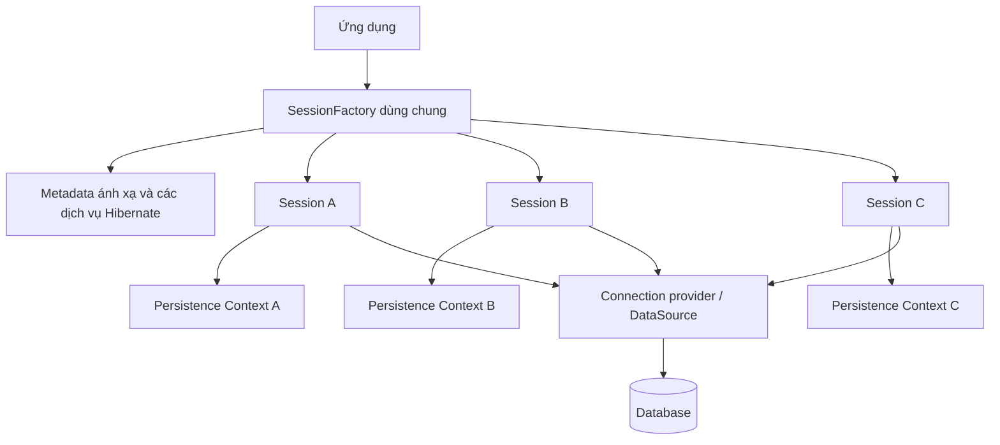
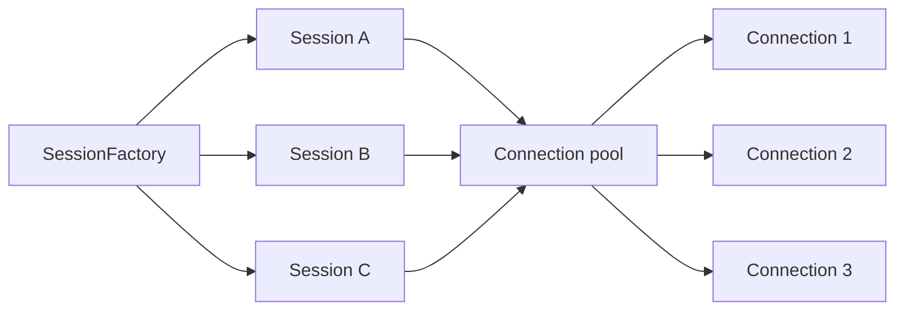

# Phạm vi sử dụng và khả năng chia sẻ SessionFactory trong Hibernate

Trong Hibernate, `SessionFactory` là **đối tượng hạ tầng dùng chung để tạo các phiên làm việc `Session`**. Một ứng dụng thường xây dựng `SessionFactory` lúc khởi động, chia sẻ nó cho nhiều service và nhiều luồng xử lý, rồi đóng khi ứng dụng kết thúc. Trái lại, mỗi `Session` giữ trạng thái của một đơn vị công việc và **không an toàn khi bị nhiều luồng sử dụng đồng thời**.

Phân biệt hai phạm vi này là nền tảng để dùng Hibernate đúng cách: tạo factory quá nhiều lần làm lãng phí tài nguyên, còn chia sẻ nhầm một `Session` giữa các request gây sai lệch dữ liệu, lỗi giao dịch và vấn đề đồng thời.

Bài học trình bày bản chất của `SessionFactory`, nơi có thể chia sẻ nó, cách tổ chức vòng đời factory/session/transaction, mối quan hệ với connection pool và cache, cùng các mẫu triển khai Java và Spring.

## 1. Đặt SessionFactory vào kiến trúc Hibernate

Hibernate làm việc giữa tầng đối tượng Java và cơ sở dữ liệu quan hệ. Các thành phần thường gặp có vai trò khác nhau:

| Thành phần | Trách nhiệm | Phạm vi sử dụng điển hình | Có thể dùng đồng thời giữa các luồng? |
| --- | --- | --- | --- |
| `SessionFactory` | Giữ cấu hình ánh xạ và dịch vụ Hibernate; tạo `Session` | Một lần cho một đơn vị cấu hình persistence trong vòng đời ứng dụng | **Có** |
| `Session` | Quản lý entity trong Persistence Context; điều phối truy vấn và thay đổi | Một đơn vị công việc/request/giao dịch, tùy thiết kế | **Không** |
| `Transaction` | Xác định ranh giới commit hoặc rollback | Một giao dịch nghiệp vụ | Không nên dùng chung qua các luồng |
| `DataSource` / connection pool | Cấp phát và tái sử dụng kết nối JDBC | Thường dùng chung ở phạm vi ứng dụng | Pool được thiết kế để cấp kết nối đồng thời |
| JDBC `Connection` | Kênh tương tác JDBC với database | Do Hibernate lấy và trả theo chiến lược kết nối | Không nên chia sẻ tùy ý qua nhiều luồng |

Sơ đồ tổng quát:



Cả ba `Session` do cùng factory tạo ra đều biết cách ánh xạ entity thành SQL, nhưng mỗi session giữ **Persistence Context của riêng nó**. Chúng có thể được dùng bởi ba request khác nhau mà không chia sẻ trực tiếp các entity đang được quản lý.

### Ví dụ thực tế

Một API có 200 request đồng thời cần truy vấn đơn hàng. Cách tổ chức thường là:

- Ứng dụng có **một `SessionFactory`** tương ứng cấu hình kết nối và ánh xạ cần thiết.
- Mỗi request hoặc transaction nhận **một `Session` riêng** theo cơ chế quản lý của framework.
- Những session ấy có thể nhận JDBC connection từ **cùng một connection pool**.
- Request kết thúc thì session được giải phóng; factory vẫn tồn tại để phục vụ request tiếp theo.

Không nên hình dung 200 request đồng thời cần 200 factory. Tạo nhiều factory không làm session an toàn hơn, mà thường nhân thêm metadata, cache, dịch vụ và đôi khi connection pool.

## 2. SessionFactory là gì và vì sao thường chỉ khởi tạo một lần?

`org.hibernate.SessionFactory` là giao diện trung tâm của Hibernate để mở session. Bên trong một factory triển khai đầy đủ thường có:

1. **Metamodel ánh xạ:** thông tin entity, thuộc tính, quan hệ, khóa chính, các kiểu dữ liệu và chiến lược ánh xạ.
2. **Cấu hình Hibernate:** dialect, quy tắc đặt tên, xử lý SQL, cơ chế tải dữ liệu, giới hạn và các dịch vụ liên quan.
3. **Dịch vụ truy cập dữ liệu:** connection provider, tích hợp transaction, các cấu phần JDBC và các dịch vụ của Hibernate.
4. **Hạ tầng dùng chung:** cache vùng cấp hai nếu được cấu hình, thông tin truy vấn đã chuẩn bị/phân tích, thống kê nếu kích hoạt và các dịch vụ runtime khác.

Xây dựng factory đòi hỏi Hibernate đọc cấu hình, xử lý mapping, chuẩn bị metadata và khởi tạo các dịch vụ. Việc đó **tốn kém hơn nhiều** so với tạo một `Session` từ factory có sẵn.

Vì vậy, pattern phổ biến là:

```text
Ứng dụng khởi động
    |
    +--> Xây dựng SessionFactory một lần
             |
             +--> Mở/đóng Session cho công việc 1
             +--> Mở/đóng Session cho công việc 2
             +--> Mở/đóng Session cho công việc 3
             |
Ứng dụng dừng
    |
    +--> Đóng SessionFactory
```

Đối tượng `SessionFactory` được thiết kế **thread-safe**: nhiều luồng có thể gọi `openSession()` hoặc dùng các API thích hợp trên cùng factory. Thread-safety này không có nghĩa mọi dữ liệu do factory tạo ra cũng thread-safe.

### Thread-safe ở đây có nghĩa gì?

Giả sử hai luồng cùng thực hiện:

```java
Session sessionA = sessionFactory.openSession(); // Luồng A
Session sessionB = sessionFactory.openSession(); // Luồng B
```

Hai lời gọi có thể diễn ra đồng thời trên cùng `sessionFactory`. Hibernate tạo hai session độc lập để mỗi luồng quản lý công việc của mình.

Ngược lại, mẫu sau nguy hiểm:

```java
public class UnsafeBookRepository {
    private final Session session;

    public UnsafeBookRepository(SessionFactory factory) {
        this.session = factory.openSession();
    }

    public Book find(Long id) {
        return session.find(Book.class, id); // Nhiều request dùng chung một Session.
    }
}
```

Nếu `UnsafeBookRepository` là singleton phục vụ nhiều request, các request sẽ sử dụng chung một Persistence Context và có thể tương tác đồng thời với cùng trạng thái nội bộ. Hibernate không bảo đảm việc này an toàn. **Trường được chia sẻ ở đây nên là `SessionFactory`, không phải `Session`.**

## 3. Phạm vi sở hữu và vòng đời SessionFactory

Vòng đời có ba giai đoạn:

### 3.1. Khởi tạo

Ứng dụng chọn bộ entity/mapping, thông số kết nối, cache, dialect và các dịch vụ cần thiết. Hibernate tạo `SessionFactory` từ cấu hình ấy.

Trong ứng dụng dùng dependency injection, container thường sở hữu factory hoặc đối tượng tương đương (`EntityManagerFactory` trong JPA) và cấp nó cho các thành phần cần truy cập dữ liệu.

### 3.2. Hoạt động

Các thread có thể gọi `openSession()` nhiều lần. Factory giữ hạ tầng dùng chung, còn từng `Session` có phạm vi quản lý entity riêng. Một số dữ liệu của factory có thể biến đổi trong quá trình chạy, ví dụ thống kê hoặc cache; do đó nên hiểu **cấu hình/metadata cơ bản được cố định cho factory**, không nên coi mọi phần của factory là một object bất biến tuyệt đối.

### 3.3. Đóng

Khi ứng dụng ngừng hoạt động hoặc persistence unit không còn được dùng, gọi `sessionFactory.close()` để Hibernate giải phóng các dịch vụ và tài nguyên mà factory sở hữu. Tài nguyên do container hoặc `DataSource` bên ngoài quản lý có thể có vòng đời riêng.

Không đóng factory ở cuối từng request; nếu làm vậy, những request khác sẽ không thể tiếp tục tạo session từ factory ấy.

## 4. Tạo SessionFactory một lần với Hibernate thuần

Một cách bootstrap theo API Hibernate là dùng `StandardServiceRegistryBuilder` và `MetadataSources`. Ví dụ sau giả định cấu hình được đặt trong `hibernate.cfg.xml` và entity `Book` đã có các annotation ánh xạ:

```java
import org.hibernate.SessionFactory;
import org.hibernate.boot.MetadataSources;
import org.hibernate.boot.registry.StandardServiceRegistry;
import org.hibernate.boot.registry.StandardServiceRegistryBuilder;

public final class HibernateBootstrap {
    private HibernateBootstrap() {}

    public static SessionFactory buildSessionFactory() {
        StandardServiceRegistry registry =
                new StandardServiceRegistryBuilder()
                        .configure("hibernate.cfg.xml")
                        .build();

        try {
            return new MetadataSources(registry)
                    .addAnnotatedClass(Book.class)
                    .buildMetadata()
                    .buildSessionFactory();
        } catch (RuntimeException failure) {
            // Factory chưa được xây dựng thành công;
            // dọn service registry được tạo trong quá trình bootstrap.
            StandardServiceRegistryBuilder.destroy(registry);
            throw failure;
        }
    }
}
```

Lớp `Book` có thể là:

```java
import jakarta.persistence.Entity;
import jakarta.persistence.GeneratedValue;
import jakarta.persistence.GenerationType;
import jakarta.persistence.Id;
import jakarta.persistence.Table;
import jakarta.persistence.Version;

@Entity
@Table(name = "books")
public class Book {
    @Id
    @GeneratedValue(strategy = GenerationType.IDENTITY)
    private Long id;

    private String title;

    @Version
    private Long version;

    protected Book() {}

    public Book(String title) {
        this.title = title;
    }

    public Long getId() { return id; }

    public String getTitle() { return title; }

    public void setTitle(String title) {
        this.title = title;
    }
}
```

Tại điểm khởi động ứng dụng:

```java
public final class Application {
    public static void main(String[] args) {
        try (SessionFactory sessionFactory =
                     HibernateBootstrap.buildSessionFactory()) {

            BookRepository repository =
                    new BookRepository(sessionFactory);

            repository.create("Hibernate Session");
            repository.create("Shared SessionFactory");

            // Các nghiệp vụ khác tái sử dụng đúng factory này.
        } // close() khi ứng dụng kết thúc phạm vi này.
    }
}
```

Trong một server thực, `try` bao quanh factory phải kéo dài **trọn thời gian server còn hoạt động**. Đoạn `main` minh họa quyền sở hữu vòng đời: tạo một lần, truyền cho nhiều thành phần, đóng đúng lúc shutdown. Nếu dùng Spring, Jakarta EE hoặc container khác, thông thường framework sẽ đảm nhận quá trình này.

**Không nên dùng một lệnh bootstrap trong mỗi phương thức repository**. Khi mọi lần gọi đều tạo và đóng `SessionFactory`, ứng dụng mất lợi ích tái sử dụng hạ tầng và có thể nhanh chóng gặp vấn đề hiệu năng/tài nguyên.

## 5. Chia sẻ SessionFactory nhưng mở Session riêng cho đơn vị công việc

Lớp repository sau **giữ factory ở field** và mở session trong mỗi phương thức. Ví dụ dùng giao dịch rõ ràng để quản lý rollback và commit:

```java
import java.util.NoSuchElementException;

import org.hibernate.Session;
import org.hibernate.SessionFactory;
import org.hibernate.Transaction;

public final class BookRepository {
    private final SessionFactory sessionFactory;

    public BookRepository(SessionFactory sessionFactory) {
        this.sessionFactory = sessionFactory;
    }

    public Long create(String title) {
        try (Session session = sessionFactory.openSession()) {
            Transaction tx = session.beginTransaction();

            try {
                Book book = new Book(title);
                session.persist(book);
                tx.commit();
                return book.getId();
            } catch (RuntimeException failure) {
                if (tx.isActive()) {
                    tx.rollback();
                }
                throw failure;
            }
        }
    }

    public void rename(Long id, String title) {
        try (Session session = sessionFactory.openSession()) {
            Transaction tx = session.beginTransaction();

            try {
                Book book = session.find(Book.class, id);
                if (book == null) {
                    throw new NoSuchElementException(
                            "Không tìm thấy Book với id=" + id);
                }

                book.setTitle(title);
                // Managed entity được Hibernate dirty-check khi flush.
                tx.commit();
            } catch (RuntimeException failure) {
                if (tx.isActive()) {
                    tx.rollback();
                }
                throw failure;
            }
        }
    }
}
```

Trong mẫu này:

- Mỗi phương thức `create` hoặc `rename` lấy **một session mới** từ cùng factory.
- `try-with-resources` bảo đảm `Session.close()` khi rời phạm vi, kể cả khi có lỗi.
- `Transaction` xác định khi nào commit/rollback. `commit()` sẽ đồng bộ các thay đổi cần thiết theo quy tắc flush.
- Nếu transaction thất bại, code cố gắng rollback rồi báo lỗi lên tầng trên; không tiếp tục sử dụng session hỏng cho nghiệp vụ khác.
- Lớp `BookRepository` có thể được chia sẻ cho nhiều thread vì nó chỉ giữ tham chiếu tới factory thread-safe, còn session nằm trong biến cục bộ mỗi lời gọi.

Ví dụ tạo entity dùng `IDENTITY`; Hibernate có thể thực thi `INSERT` sớm để lấy khóa ID. Không nên suy luận rằng tất cả câu SQL đều phải chờ đến đúng dòng `tx.commit()`.

### Có nên lưu Session thành biến instance của service?

Một service singleton thường tồn tại xuyên nhiều request. Giữ `Session` trong một field của singleton khiến nhiều lời gọi truy cập chung trạng thái:

```java
// Sai nếu đối tượng phục vụ đồng thời nhiều request:
private final Session sharedSession;

// Phù hợp hơn:
private final SessionFactory sessionFactory;
```

Nếu cần một session xuyên qua vài hàm repository trong **cùng một giao dịch**, hãy để tầng điều phối giao dịch quản lý, hoặc truyền session trong phạm vi một unit of work có kiểm soát. Không biến một session thành singleton toàn ứng dụng để cố duy trì cùng Persistence Context.

## 6. SessionFactory được chia sẻ qua nhiều thread như thế nào?

Giả sử một ứng dụng web nhận đồng thời ba request:

| Luồng | Session nhận từ factory | Persistence Context | Transaction |
| --- | --- | --- | --- |
| Request A | `Session A` | Context A | Transaction A |
| Request B | `Session B` | Context B | Transaction B |
| Request C | `Session C` | Context C | Transaction C |

Factory hỗ trợ tạo cả ba session; mỗi request thực hiện thay đổi trong transaction riêng. Nếu A và B cùng đọc `Book#42`, hai session có thể có **hai Java object khác nhau** cho bản ghi đó.

```java
Book bookInA;
Book bookInB;

try (Session a = sessionFactory.openSession();
     Session b = sessionFactory.openSession()) {

    bookInA = a.find(Book.class, 42L);
    bookInB = b.find(Book.class, 42L);

    // Nếu Book#42 tồn tại:
    System.out.println(bookInA == bookInB); // false trong trường hợp thông thường
}
```

Đoạn code trên mở hai session tuần tự để minh họa danh tính; kết luận cũng áp dụng khi các session được dùng ở hai thread độc lập. **Cùng `SessionFactory` không làm hai `Session` chia sẻ một Persistence Context.**

### Chia sẻ factory không đồng nghĩa với chia sẻ transaction

Request A commit không tự commit transaction B. Rollback của A không thay thế rollback của B. Hai transaction cùng sửa một hàng vẫn cần cơ chế xử lý đồng thời ở database, như:

- Isolation level của transaction;
- Optimistic locking bằng `@Version`;
- Pessimistic locking khi phù hợp;
- Quy tắc retry/xử lý xung đột nghiệp vụ.

Thread-safety của factory bảo đảm việc dùng chung **hạ tầng tạo session**, không bảo đảm các nghiệp vụ cập nhật đồng thời sẽ luôn có kết quả mong muốn.

## 7. SessionFactory và Persistence Context: phạm vi cache cấp một

Một trong các lỗi tư duy phổ biến là: “Tôi dùng chung `SessionFactory`, vậy tất cả session đều dùng chung cache entity”.

Trong Hibernate, **first-level cache (L1)** là phần của Persistence Context, thường gắn với **một `Session` stateful**, không gắn với `SessionFactory` theo kiểu dùng chung toàn ứng dụng.

Xét hai lần truy cập trong cùng session:

```java
try (Session session = sessionFactory.openSession()) {
    Book first = session.find(Book.class, 42L);
    Book second = session.find(Book.class, 42L);

    System.out.println(first == second); // true, nếu Book#42 tồn tại
}
```

Cùng ID trong cùng Context sẽ dùng lại managed entity hiện tại. Nhưng khi mở session mới, entity có thể được tái tạo thành Java object mới, dù factory vẫn là một:

```java
Book first;
try (Session s1 = sessionFactory.openSession()) {
    first = s1.find(Book.class, 42L);
}

Book second;
try (Session s2 = sessionFactory.openSession()) {
    second = s2.find(Book.class, 42L);
}

// Nếu đều tìm thấy Book#42:
System.out.println(first == second); // false, thường gặp
```

Về trạng thái, `first` đã detached sau khi `s1` đóng, còn `second` cũng detached khi `s2` đóng. Hai object có thể mang cùng khóa chính; chúng không phải cùng tham chiếu Java.

### Cache cấp hai có được dùng chung không?

Hibernate có thể cấu hình **second-level cache (L2)** ở phạm vi factory để tái sử dụng trạng thái entity/collection giữa các session. Nếu được bật và cấu hình đúng, session mới có thể lấy dữ liệu từ L2 thay vì gửi `SELECT`.

Tuy nhiên:

- L2 là cơ chế **tùy cấu hình**; không mặc định có cache L2 đầy đủ cho tất cả entity.
- L2 lưu trạng thái phục vụ nạp entity, không biến các session độc lập thành một Persistence Context.
- Mỗi session vẫn phải có managed instance của riêng nó; sử dụng chung L2 **không làm `bookInA == bookInB` trở thành `true`**.
- Query cache là cơ chế khác, liên quan kết quả truy vấn, và không thay thế identity map ở L1.

| Phạm vi | Lưu giữ | Mục tiêu |
| --- | --- | --- |
| Một `Session` | Managed entity và trạng thái Persistence Context | Giữ danh tính đối tượng và theo dõi thay đổi |
| Một `SessionFactory` | Mapping metadata và các dịch vụ; tùy cấu hình có L2 | Tái sử dụng hạ tầng và dữ liệu cache giữa nhiều session |
| Cơ sở dữ liệu | Dữ liệu đã commit theo quy tắc transaction | Nguồn lưu trữ bền vững |

## 8. Quan hệ giữa Session, Transaction và JDBC Connection

Cần tách ba khái niệm:

1. **`Session`:** phiên Hibernate và Persistence Context để thao tác với entity.
2. **`Transaction`:** phạm vi nhất quán có commit/rollback.
3. **JDBC `Connection`:** kết nối vật lý hoặc logical connection do Hibernate phối hợp lấy từ connection provider.

Không có quy tắc luôn đúng rằng “mở một Session lập tức chiếm một JDBC Connection và giữ nó đến lúc đóng”. Hibernate có thể **lấy connection khi cần** và **giải phóng theo chiến lược quản lý kết nối**, phụ thuộc cấu hình, transaction và môi trường. Dù vậy, session/transaction dài bất thường vẫn có thể giữ tài nguyên và ảnh hưởng pool.

### Connection pool làm việc độc lập với SessionFactory

Một connection pool giữ tập kết nối có thể tái sử dụng. Nhiều session trong nhiều thread có thể mượn connection từ cùng pool, rồi trả lại khi xong.



Số lượng `Session` đang tồn tại **không nhất thiết bằng** số connection vật lý đang mở. Pool có thể giới hạn số kết nối đồng thời; khi mọi connection đều bận, thread có thể phải chờ hoặc nhận lỗi timeout.

Do đó, hiệu năng cần xem xét ở hai tầng:

- **Factory:** nên tái sử dụng; tránh khởi tạo nhiều bộ Hibernate metadata/dịch vụ không cần thiết.
- **Session/transaction:** nên giữ ngắn gọn và đóng đúng lúc; tránh transaction treo, kết nối bị giữ quá lâu và Persistence Context quá lớn.

Factory không phải một vật thay thế cho pool. Tùy mô hình ứng dụng, pool có thể do HikariCP, application server hoặc Hibernate connection provider sở hữu. Việc đóng factory chỉ giải phóng tài nguyên thuộc quyền quản lý của nó; tài nguyên ngoại vi có vòng đời do thành phần tương ứng quản lý.

## 9. SessionFactory và EntityManagerFactory trong Jakarta Persistence

Hibernate hỗ trợ hai cách làm việc phổ biến:

| Hibernate native API | Jakarta Persistence (JPA) | Ý nghĩa |
| --- | --- | --- |
| `SessionFactory` | `EntityManagerFactory` | Factory dùng chung, tạo đối tượng thao tác persistence |
| `Session` | `EntityManager` | Persistence Context và các thao tác entity |
| `Transaction` | `EntityTransaction` hoặc transaction do container quản lý | Ranh giới commit/rollback |

Trong các phiên bản Hibernate hiện đại, `SessionFactory` cũng hiện thực giao diện `EntityManagerFactory`, còn `Session` tương thích với `EntityManager` theo thiết kế của provider. Về ý tưởng vòng đời:

- `EntityManagerFactory` an toàn để chia sẻ giữa các luồng theo quy định JPA.
- `EntityManager` không được dùng đồng thời bởi nhiều luồng.
- `EntityManagerFactory` thường tồn tại suốt thời gian persistence unit được dùng.
- `EntityManager` thường được tạo/lấy theo transaction hoặc đơn vị công việc.

Không cần chuyển toàn bộ ứng dụng sang native API chỉ để đạt khả năng chia sẻ factory; JPA đã cung cấp mô hình tương đương.

### Sử dụng với Spring Boot và `@Transactional`

Trong ứng dụng Spring JPA, cách phổ biến là để Spring quản lý `EntityManagerFactory`, transaction manager và phạm vi `EntityManager`:

```java
import jakarta.persistence.EntityManager;
import jakarta.persistence.PersistenceContext;
import org.springframework.stereotype.Service;
import org.springframework.transaction.annotation.Transactional;

@Service
public class BookService {
    @PersistenceContext
    private EntityManager entityManager;

    @Transactional
    public void rename(Long bookId, String newTitle) {
        Book book = entityManager.find(Book.class, bookId);
        if (book == null) {
            throw new IllegalArgumentException("Không tìm thấy Book");
        }
        book.setTitle(newTitle);
        // Spring hoàn tất transaction; Hibernate flush khi thích hợp.
    }

    @Transactional(readOnly = true)
    public String findTitle(Long bookId) {
        Book book = entityManager.find(Book.class, bookId);
        return book == null ? null : book.getTitle();
    }
}
```

`BookService` có thể là Spring singleton. Cần hiểu rằng đối tượng `EntityManager` được tiêm bằng `@PersistenceContext` trong mô hình Spring phổ biến là **proxy/handle định tuyến đến EntityManager gắn với transaction/ngữ cảnh hiện tại**, không phải lời khẳng định “một EntityManager thực được mọi thread dùng chung”.

Khi dùng `@Transactional`, framework lo mở/đóng hoặc gắn/unbind persistence context theo cấu hình, commit/rollback và quản lý connection. Tự mở thêm `Session` thủ công trong một service đã được Spring quản lý giao dịch có thể tạo session và transaction độc lập ngoài ý định.

### Khi nào dùng `getCurrentSession()`?

Hibernate có `SessionFactory.getCurrentSession()` để lấy session gắn với một **current-session context**. Nó khác `openSession()`:

| API | Ý nghĩa |
| --- | --- |
| `openSession()` | Mở session mới; code gọi chịu trách nhiệm đóng hoặc giao quyền sở hữu rõ ràng |
| `getCurrentSession()` | Lấy session hiện hành từ context đã cấu hình và gắn phù hợp |

`getCurrentSession()` **không tự động hoạt động trong mọi chương trình Java**. Nó cần cơ chế current-session context, ví dụ tích hợp quản lý transaction của framework hoặc cấu hình Hibernate phù hợp. Không nên dựa vào một session “toàn cục” tự xuất hiện ở mọi thread.

Ví dụ về ý tưởng trong môi trường đã cấu hình đúng current-session context:

```java
@Transactional
public void updateWithHibernateSession() {
    Session session = sessionFactory.getCurrentSession();
    Book book = session.find(Book.class, 42L);
    if (book != null) {
        book.setTitle("Cập nhật trong transaction");
    }
}
```

Ví dụ này chỉ áp dụng nếu Spring/Hibernate đã liên kết `SessionFactory` tương ứng với context và transaction; với ứng dụng dùng `EntityManager` do Spring JPA cấp, cách trực tiếp trong ví dụ `BookService` phía trên thường rõ ràng hơn.

## 10. Một ứng dụng nên có bao nhiêu SessionFactory?

Không có quy tắc cứng “luôn đúng một factory cho mọi ứng dụng”. Quy tắc thực dụng là **một factory cho mỗi bộ cấu hình persistence độc lập cần duy trì**.

Một số trường hợp:

| Tình huống | Phương án thường gặp |
| --- | --- |
| Một database, một bộ entity/mapping, một cấu hình Hibernate | Một `SessionFactory` dùng chung |
| Nhiều module trong cùng ứng dụng cùng truy cập một persistence unit | Dùng chung factory qua dependency injection |
| Hai database độc lập với cấu hình, credential hoặc mapping khác nhau | Có thể cần hai factory |
| Nhiều persistence unit JPA khác nhau | Mỗi persistence unit thường có một `EntityManagerFactory` |
| Ứng dụng multi-tenant | Có thể dùng một factory có hỗ trợ multi-tenancy, hoặc nhiều factory tùy kiến trúc |
| Một tác vụ batch đặc thù | Thường vẫn tái sử dụng factory; cân nhắc `StatelessSession` nếu mô hình thao tác cho phép |

### Multi-tenancy: không gộp nhầm phạm vi dữ liệu

Nếu Hibernate được cấu hình multi-tenancy, một `SessionFactory` có thể phục vụ nhiều tenant, trong khi **mỗi session được gắn ngữ cảnh tenant phù hợp**. Cách chọn tenant, routing connection và bảo đảm cách ly phụ thuộc chiến lược multi-tenancy đã triển khai.

Việc factory được chia sẻ **không cho phép bỏ qua tenant identifier**. Một session xử lý tenant A không được tùy tiện đưa cho tác vụ tenant B. Ngoài ra, nếu mỗi tenant có schema, mapping hoặc cấu hình khác biệt vượt khả năng chia sẻ chung, kiến trúc có thể cần các persistence unit/factory riêng.

### Vì sao không tạo factory cho từng tenant hoặc request một cách máy móc?

Mỗi factory bổ sung metadata, cache/dịch vụ và chi phí khởi tạo. Với số tenant lớn, nhân factory theo mỗi tenant có thể tăng bộ nhớ và số pool connection đáng kể. Trước khi dùng nhiều factory, cần biết sự khác biệt có thực sự đòi hỏi độc lập cấu hình hay có thể được giải quyết bằng cơ chế multi-tenancy chuẩn của Hibernate.

## 11. Vòng đời Session: ngắn gọn nhưng đủ cho unit of work

Một session thường nên sống trong phạm vi thao tác nghiệp vụ được thiết kế rõ, ví dụ:

```text
HTTP request -> Service -> Transaction
                          |
                          +-> Session / Persistence Context
                          |      +-> find(entity)
                          |      +-> thay đổi entity managed
                          |      +-> flush
                          |
                          +-> commit/rollback
                          +-> giải phóng Session
```

Đây là mô hình điển hình, không phải sự đồng nhất tuyệt đối. Trong một số hệ thống:

- Một request có thể chạy nhiều transaction độc lập.
- Một transaction có thể phối hợp nhiều thao tác repository trên cùng session/context.
- Session do ứng dụng tự quản lý có thể sống qua hơn một transaction, nhưng cần kiểm soát dữ liệu cũ và kích thước Context.
- Spring có thể cấu hình Open Session/EntityManager in View để giữ context trong phần còn lại của request web. Điều đó ảnh hưởng lazy loading và phạm vi truy cập database.

**Session không đồng nghĩa với transaction.** Mở session không mặc nhiên bắt đầu transaction; transaction có thể bắt đầu và kết thúc bên trong vòng đời một session. Nhưng trong CRUD thông thường, ranh giới session và transaction thường được phối hợp chặt để dễ hiểu và dễ giải phóng tài nguyên.

### Có nên giữ một Session xuyên nhiều màn hình?

Một số workflow dài có thể dùng extended Persistence Context hoặc session kéo dài qua nhiều bước. Điều này đòi hỏi xem xét:

- Entity được quản lý lâu sẽ làm Context lớn dần, chiếm bộ nhớ.
- Trạng thái đã tải có thể cũ so với database.
- Cần xác định rõ transaction boundaries; không giữ transaction database mở suốt thời gian người dùng suy nghĩ hoặc nhập liệu.
- Không dùng cùng một stateful session đồng thời ở hai thread.
- Cần chiến lược xử lý dữ liệu detached, merge và optimistic locking khi workflow kéo dài.

Với phần lớn API ngắn, lưu ID hoặc DTO giữa các request rồi tạo session/context cho giao dịch tiếp theo thường đơn giản và dễ kiểm soát hơn.

## 12. Quản lý tài nguyên và xử lý lỗi

### Đóng Session đúng nơi sở hữu

Nguyên tắc quan trọng nhất của code dùng Hibernate native:

```java
try (Session session = sessionFactory.openSession()) {
    // Truy vấn hoặc xử lý trong transaction.
} // session.close() tự động được gọi
```

Nếu repository tự gọi `openSession()`, repository hoặc unit-of-work bao ngoài phải có trách nhiệm đóng session. Nếu framework cấp session theo transaction, **để framework đóng**. Không tự đóng current session do container quản lý giữa chừng khi những thành phần khác trong cùng transaction còn cần dùng.

### Rollback khi giao dịch thất bại

```java
try (Session session = sessionFactory.openSession()) {
    Transaction tx = session.beginTransaction();

    try {
        // Các thao tác nghiệp vụ có thể ném lỗi.
        tx.commit();
    } catch (RuntimeException error) {
        if (tx.isActive()) {
            tx.rollback();
        }
        throw error;
    }
}
```

Sau lỗi liên quan Hibernate/JDBC, không nên giả định session và trạng thái managed vẫn nhất quán để tiếp tục xử lý nghiệp vụ khác. Hướng an toàn thường là rollback, giải phóng session và khởi tạo đơn vị công việc mới.

Trong hệ thống có transaction do framework quản lý, xử lý rollback theo quy định của framework (chẳng hạn `@Transactional` và quy tắc rollback trong Spring). Đừng gọi `commit()` hoặc `close()` thủ công trên các tài nguyên thuộc quyền quản lý của container mà không có lý do rõ.

### Đóng factory khi ứng dụng kết thúc

Ứng dụng native cần bảo đảm gọi:

```java
sessionFactory.close();
```

Tốt nhất là nơi sở hữu factory làm việc này trong tiến trình shutdown. Với Spring, nếu factory là bean do Spring quản lý, container có thể gọi hàm hủy thích hợp khi application context đóng.

Trong quá trình shutdown, cần phối hợp ngừng nhận công việc mới và để các công việc đang chạy hoàn tất theo chính sách ứng dụng trước khi giải phóng factory. Đóng factory khi còn thread đang sử dụng session có thể khiến thao tác đang chạy thất bại.

## 13. Những lỗi thiết kế thường gặp

### 13.1. Xây dựng factory trong mọi lời gọi truy vấn

```java
public Book find(Long id) {
    try (SessionFactory factory = HibernateBootstrap.buildSessionFactory();
         Session session = factory.openSession()) {
        return session.find(Book.class, id);
    }
}
```

Cách này lặp lại bootstrap mapping và dịch vụ rất tốn kém. Ngoài ra trả trực tiếp `Book` sau khi session đóng khiến nó thành detached; nếu có association lazy chưa tải, việc truy cập ngoài session có thể thất bại. Hãy xây factory theo vòng đời ứng dụng và xác định rõ dữ liệu trả về của repository/service.

### 13.2. Dùng một Session cho mọi request

```java
private static Session session; // Không nên chia sẻ theo cách này.
```

Một session chứa Persistence Context và trạng thái nội bộ, không dành cho truy cập đồng thời. Kể cả khi khóa đồng bộ để ép từng request lần lượt dùng, session sống lâu vẫn gây state stale, tăng bộ nhớ và lẫn ranh giới transaction. Thay bằng factory chia sẻ và session riêng theo đơn vị công việc.

### 13.3. Cho rằng factory dùng chung khiến entity object dùng chung

Cùng `SessionFactory` không có nghĩa các session sẽ cùng quản lý một object Java. Kết quả `sessionA.find(Book.class, 42L)` và `sessionB.find(Book.class, 42L)` thường không có `==`, dù cả hai object đại diện cùng bản ghi.

Nếu cần nhận diện một entity qua nhiều request, sử dụng **định danh ổn định** và nghiệp vụ phù hợp, không dựa vào Java object reference.

### 13.4. Mở Session nhưng không đóng

Lỗi có thể không xuất hiện ngay, nhưng dần gây phình Persistence Context và giữ các tài nguyên liên quan lâu hơn cần thiết. Trong ứng dụng dùng framework, dấu hiệu tương đương là tạo session thủ công rồi không quản lý vòng đời hoặc gắn transaction thiếu nhất quán.

### 13.5. Coi SessionFactory là “kết nối JDBC duy nhất”

Một factory thường phối hợp nhiều kết nối từ pool; mỗi session có thể dùng kết nối khác nhau theo thời điểm. Chia sẻ factory không buộc toàn bộ request chạy tuần tự qua một connection. Khả năng đồng thời thực tế còn phụ thuộc kích thước pool, DB và transaction.

### 13.6. Nhầm an toàn luồng với an toàn cập nhật đồng thời

Factory thread-safe nhưng hai transaction có thể cùng đọc version cũ và cùng định sửa một bản ghi. Dùng `@Version` hoặc locking phù hợp để tránh mất cập nhật, chứ đừng dựa vào việc hai request sử dụng cùng factory.

### 13.7. Tạo nhiều factory mà không quản lý tài nguyên đi kèm

Hai factory có thể tạo hai bộ dịch vụ, cache và thậm chí các pool riêng nếu được cấu hình như vậy. Trong container, nên kiểm tra ai sở hữu `DataSource`, pool và factory để đóng đúng chỗ, tránh kết nối tồn dư sau khi module bị tháo hoặc application context bị khởi tạo lại.

## 14. Kịch bản tổng hợp: ba request và một factory

Giả sử ứng dụng có singleton `BookService`, một `SessionFactory` dùng chung và các transaction riêng:

```text
T0: Ứng dụng khởi động
    -> tạo SessionFactory F

T1: Request A đến
    -> mở Session SA từ F
    -> lấy Book#10 trong Context A

T2: Request B đến
    -> mở Session SB từ F
    -> lấy Book#10 trong Context B
    -> đối tượng Book trong B khác đối tượng của A

T3: Request A sửa Book#10
    -> flush và commit Transaction A
    -> đóng SA

T4: Request B cũng định sửa Book#10
    -> tùy version/isolation và thay đổi, có thể xảy ra xung đột
    -> xử lý commit hoặc rollback Transaction B
    -> đóng SB

T5: Request C đến
    -> vẫn mở Session SC từ F
    -> SessionFactory F chưa bị đóng

T6: Ứng dụng shutdown
    -> đóng F
```

Rút ra các giới hạn chia sẻ:

- `F` an toàn khi cả A, B và C cùng gọi tạo session.
- `SA`, `SB`, `SC` là ba phiên độc lập và không được truyền cho nhau dùng đồng thời.
- Mỗi phiên có L1 cache, dirty checking và vòng đời quản lý entity riêng.
- Kết quả commit phụ thuộc transaction, database và cơ chế khóa; factory không tự đồng bộ toàn bộ Java object ở các session.
- Factory duy trì hạ tầng giữa các request và được đóng khi ứng dụng kết thúc.

## 15. Quy tắc triển khai thực tế

| Khi bạn cần… | Phương án phù hợp |
| --- | --- |
| Nhiều repository/service cùng thao tác một database | Inject và tái sử dụng một `SessionFactory` hoặc `EntityManagerFactory` |
| Xử lý nhiều request đồng thời | Mỗi unit of work dùng session/context riêng do framework hoặc ứng dụng cấp |
| Chia sẻ cùng transaction giữa các repository | Dùng transaction manager và current context hoặc truyền session theo phạm vi rõ ràng |
| Giảm chi phí kết nối database | Cấu hình `DataSource` và connection pool phù hợp |
| Tái sử dụng entity state giữa các session | Xem xét cấu hình L2 cache theo đặc tính dữ liệu |
| Tự động commit/rollback trong Spring | Dùng `@Transactional` và session/entity manager do Spring quản lý |
| Tránh rò rỉ tài nguyên Hibernate native | Dùng `try-with-resources` cho session; đóng factory ở shutdown |
| Truy cập nhiều database hoặc nhiều tenant | Thiết kế persistence unit/tenant routing phù hợp, xác định số factory theo cấu hình thực |

### Câu hỏi tự kiểm tra

**1. Một service Spring singleton có thể inject `SessionFactory` không?**  
Có. Factory được thiết kế để dùng chung giữa các luồng. Nếu service mở session cho mỗi công việc, nó phải phối hợp đúng transaction và đóng session tương ứng.

**2. Một service Spring singleton có thể giữ một `Session` thực trong field để mọi request cùng dùng không?**  
Không nên. `Session` stateful không thread-safe và chứa Persistence Context thuộc một đơn vị công việc cụ thể.

**3. Nếu hai session dùng chung factory và tải cùng `Book#42` thì `bookA == bookB` có đúng không?**  
Thông thường không. Mỗi session có managed instance riêng. Cache L2 nếu được bật cũng không thay đổi nguyên tắc này.

**4. Có cần `SessionFactory` mới cho mỗi transaction không?**  
Không. Thông thường mỗi transaction lấy một session/context phù hợp từ factory đang tồn tại.

**5. Mở Session có luôn lấy ngay một JDBC Connection không?**  
Không nhất thiết. Thời điểm lấy và trả connection phụ thuộc cấu hình và chiến lược connection handling của Hibernate.

**6. Có cần đúng một SessionFactory cho cả hệ thống không?**  
Không nhất thiết. Nếu có nhiều persistence unit hoặc cấu hình database/mapping độc lập, hệ thống có thể dùng nhiều factory. Quyết định dựa trên ranh giới cấu hình và tài nguyên, không dựa vào số lượng request.

## Kết luận

`SessionFactory` là **hạ tầng Hibernate có vòng đời dài, chi phí khởi tạo đáng kể và an toàn để chia sẻ** giữa nhiều thành phần, nhiều request và nhiều thread trong cùng cấu hình persistence. `Session` là **ngữ cảnh làm việc có trạng thái, cần phạm vi sử dụng rõ ràng và không được dùng chung đồng thời**. Transaction quyết định commit/rollback; connection pool quản lý kết nối JDBC; Persistence Context và bộ nhớ đệm cấp một thuộc về session chứ không được chia sẻ chỉ vì cùng factory.

Thiết kế thường phù hợp nhất là **tạo factory một lần theo vòng đời ứng dụng, tạo hoặc lấy session theo từng đơn vị công việc, hoàn tất transaction, đóng session đúng nơi sở hữu và đóng factory khi ứng dụng shutdown**.
