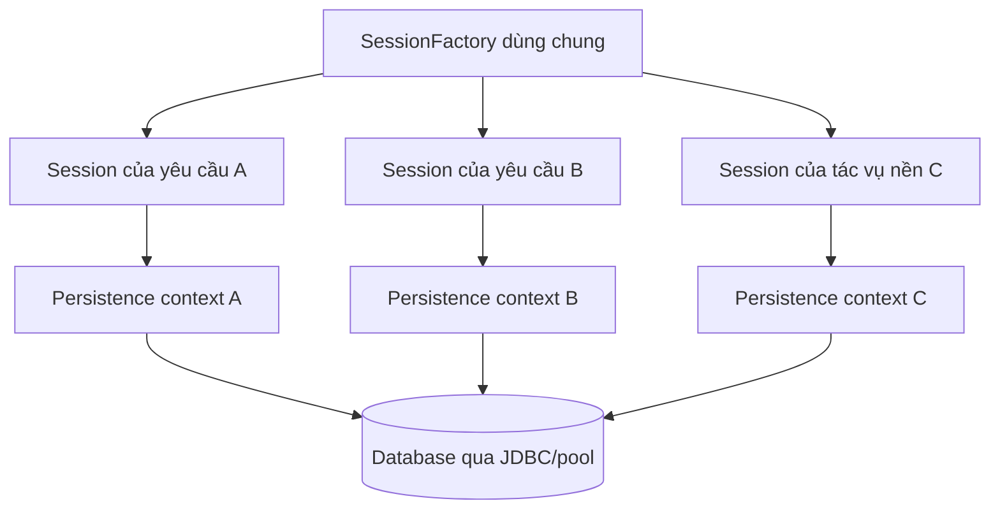
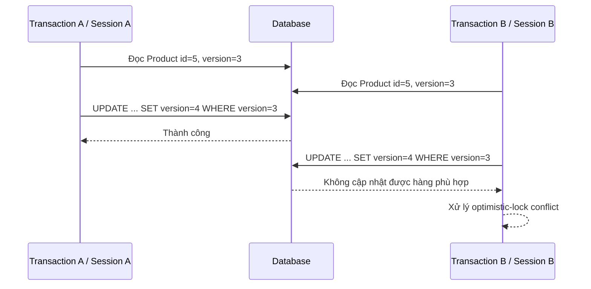

# Hibernate `Session` không an toàn để dùng đồng thời và cách chọn phạm vi tồn tại

Trong Hibernate ORM, `Session` là điểm vào để đọc, tạo, thay đổi và xóa các entity. Nó còn quản lý **persistence context** (bộ nhớ theo dõi entity), các thay đổi chờ đồng bộ và hoạt động JDBC liên quan. Vì vậy, vòng đời của `Session` phải đi cùng một **đơn vị công việc (unit of work)** có ranh giới rõ ràng. Lỗi thiết kế thường gặp là lưu một `Session` vào singleton, chia sẻ nó cho nhiều request hoặc truyền nó vào các tác vụ chạy song song.

Quy tắc nền tảng của bài này: **`Session` không thread-safe; một `Session` phải được sử dụng tuần tự trong phạm vi một đơn vị công việc được quản lý rõ ràng.** `SessionFactory` thì được thiết kế để tái sử dụng giữa các luồng. Tài liệu sử dụng thuật ngữ của Hibernate ORM 6.x; các khái niệm tương ứng áp dụng cho `jakarta.persistence.EntityManager`, nhưng cách framework quản lý tài nguyên có thể khác tùy tích hợp.

## 1. Phân biệt `SessionFactory`, `Session`, transaction và persistence context

| Khái niệm | Vai trò | Vòng đời điển hình | Dùng đồng thời giữa các luồng? |
| --- | --- | --- | --- |
| `SessionFactory` | Chứa cấu hình và mô hình ánh xạ đã biên dịch; tạo `Session`; quản lý dịch vụ dùng chung | Khởi tạo một lần cho một persistence unit/cấu hình, đóng khi ứng dụng dừng | **Có**; được thiết kế để chia sẻ |
| `Session` | Cung cấp các thao tác ORM, quản lý một persistence context và phối hợp đồng bộ với DB | Một unit of work, thường tương ứng một transaction nghiệp vụ | **Không**; không được dùng đồng thời |
| Persistence context | Giữ các entity đang managed, identity map, snapshot/trạng thái phục vụ dirty checking | Gắn với một `Session`/`EntityManager` cụ thể | **Không**; kế thừa ràng buộc của session |
| Transaction | Định ra ranh giới commit/rollback để các thao tác dữ liệu nhất quán | Một thao tác nghiệp vụ hoặc một phần của nó | Không được giả định có thể tự do chuyển qua nhiều thread |
| JDBC connection | Kết nối vật lý tới DB, thường do pool cung cấp; Hibernate lấy và trả theo chính sách sử dụng connection | Có thể ngắn hơn hoặc khác vòng đời `Session` | Không tự suy ra khả năng chia sẻ từ việc DB driver hỗ trợ kết nối |

Một `Session` có thể tồn tại qua nhiều transaction trong một vài mô hình chuyên biệt; ngược lại, mở `Session` **không tự động** bắt đầu transaction. Vì vậy không nên xem các khái niệm này là một. Trong ứng dụng web thông thường, **ràng buộc transaction nghiệp vụ làm ranh giới mặc định cho persistence context** là lựa chọn dễ hiểu và dễ bảo trì.



Sơ đồ thể hiện **ba `Session` độc lập**, dù cùng đến từ một `SessionFactory`. Session A và B có thể đọc cùng một hàng dữ liệu nhưng giữ **hai đối tượng managed và hai tập trạng thái theo dõi khác nhau**. Đồng bộ tính nhất quán giữa chúng là vấn đề transaction, isolation, optimistic/pessimistic locking của database và ORM; nó không biến một session thành công cụ phối hợp giữa các luồng.

## 2. Tại sao `Session` không thread-safe?

### 2.1. Session giữ trạng thái có thể thay đổi

`Session` không chỉ là lớp bọc `Connection` hay một đối tượng DAO stateless. Hibernate quản lý nhiều cấu trúc thay đổi trong quá trình sử dụng:

- **First-level cache/identity map:** trong cùng persistence context, cùng một entity key thường tương ứng cùng một đối tượng Java managed.
- **Entity entries và snapshots:** ghi nhận trạng thái cần thiết để thực hiện dirty checking, optimistic locking và cập nhật dữ liệu.
- **Action queue:** tập hợp/thứ tự các thao tác insert, update, delete được thực thi khi flush.
- **Collection state:** theo dõi collection được quản lý, lazy initialization và thay đổi của quan hệ.
- **Cơ chế truy vấn và tài nguyên JDBC:** tham gia tải dữ liệu, bind tham số, flush và điều phối công việc trong transaction.

Các cấu trúc trên được tối ưu cho quy trình **một luồng truy cập tại một thời điểm theo mô hình sử dụng tuần tự**, không có cam kết đồng bộ để hai luồng cùng thao tác.

Ví dụ, hai thread cùng lấy entity từ một `Session` và thay đổi các trường khác nhau không phải là hai transaction độc lập. Chúng đang tác động tới **cùng entity managed và cùng persistence context**. Hibernate có thể không nhìn thấy chuỗi thay đổi theo cách mà người viết chương trình mong đợi; việc flush hoặc tải lazy association có thể giao thoa với thay đổi của thread kia.

### 2.2. Những hậu quả dễ quan sát

Khi chia sẻ một `Session` giữa nhiều luồng, chương trình có thể gặp:

- Thao tác `flush()`/`clear()` ở một luồng ảnh hưởng entity đang được luồng khác xử lý.
- Entity và collection bị thay đổi trong lúc Hibernate duyệt trạng thái để đồng bộ xuống database.
- Cơ chế lazy loading hoặc JDBC statement xung đột về trạng thái tài nguyên.
- Một luồng `commit()`, `rollback()` hay `close()` khiến luồng khác thất bại giữa chừng.
- Kết quả nghiệp vụ khó dự đoán hoặc lỗi chỉ xảy ra dưới tải cao; không nhất thiết có exception báo rõ “Session used concurrently”.

**Không thể giải quyết bản chất bằng cách thêm `synchronized` lên vài lời gọi repository.** Dù khóa có thể tuần tự hóa một số thao tác, vòng đời transaction, ownership của entity, lazy loading, close và tài nguyên đi kèm vẫn khó quản lý. Giải pháp thực tế là **tách `Session`/transaction cho từng công việc độc lập**, và chỉ trao đổi dữ liệu đã được xác định ranh giới.

### 2.3. Chia sẻ entity cũng khác chia sẻ `Session`

Ngay cả khi mỗi thread dùng session riêng, việc nhiều thread cùng sửa **một đối tượng entity mutable** ngoài heap vẫn phải được kiểm soát như mọi object Java không thread-safe. Tốt nhất là mỗi công việc tải và quản lý entity trong persistence context riêng. Nếu cần truyền kết quả giữa luồng, hãy ưu tiên **ID, DTO bất biến, command/event** và để công việc nhận tự truy xuất dữ liệu trong transaction của nó.

## 3. Anti-pattern: giữ `Session` trong singleton

Ví dụ sai:

```java
import org.hibernate.Session;
import org.hibernate.SessionFactory;

public class OrderService {
    // SAI: một Session bị chia sẻ bởi tất cả request gọi service này.
    private final Session session;

    public OrderService(SessionFactory sessionFactory) {
        this.session = sessionFactory.openSession();
    }

    public PurchaseOrder find(Long id) {
        return session.get(PurchaseOrder.class, id);
    }
}
```

Trong ứng dụng có nhiều request, service thường được dùng chung. Từ đó nhiều thread có thể gọi `find()` đồng thời trên **cùng** session. Session còn có nguy cơ tồn tại quá lâu, tích lũy managed entities, giữ dữ liệu cũ và khó đóng tài nguyên đúng lúc.

Cách làm đúng với Hibernate native API là giữ **`SessionFactory` dùng chung**, nhưng tạo session trong ranh giới công việc:

```java
import org.hibernate.Session;
import org.hibernate.SessionFactory;
import org.hibernate.Transaction;

public final class OrderService {
    private final SessionFactory sessionFactory;

    public OrderService(SessionFactory sessionFactory) {
        this.sessionFactory = sessionFactory;
    }

    public PurchaseOrder find(Long id) {
        try (Session session = sessionFactory.openSession()) {
            Transaction transaction = session.beginTransaction();
            try {
                PurchaseOrder result = session.get(PurchaseOrder.class, id);
                transaction.commit();
                return result;
            } catch (RuntimeException ex) {
                if (transaction.isActive()) {
                    transaction.rollback();
                }
                throw ex;
            }
        }
    }
}
```

Ở đây mỗi lời gọi `find()` mở session và transaction riêng. Sau khi ra khỏi `try`, session đóng dù xử lý thành công hay thất bại. Phương thức trả về entity ở trạng thái **detached sau khi session đóng**; vì vậy caller không nên giả định có thể truy cập một association chưa được khởi tạo. Trong API thật, có thể trả DTO đã được dựng đầy đủ bên trong transaction để tránh rò rỉ trạng thái lazy loading ra ngoài service.

> Khi Hibernate phát sinh exception trong quá trình JDBC/ORM, nên rollback transaction và bỏ session hiện tại; không cố tiếp tục sử dụng session như thể persistence context vẫn ở trạng thái hợp lệ.

### 3.1. Transaction phải có chủ sở hữu rõ ràng

Nếu một ca sử dụng gồm nhiều thay đổi cần commit cùng nhau, transaction phải bao trùm **cả ca sử dụng**:

```java
public void confirmOrder(Long orderId) {
    try (Session session = sessionFactory.openSession()) {
        Transaction tx = session.beginTransaction();
        try {
            PurchaseOrder order = session.get(PurchaseOrder.class, orderId);
            if (order == null) {
                throw new IllegalArgumentException("Order not found: " + orderId);
            }

            order.confirm();            // Thay đổi trạng thái entity managed
            session.persist(new AuditEvent(orderId, "CONFIRMED"));
            tx.commit();                 // Flush/commit các thay đổi trong một transaction
        } catch (RuntimeException ex) {
            if (tx.isActive()) {
                tx.rollback();
            }
            throw ex;
        }
    }
}
```

`PurchaseOrder#confirm()` và `AuditEvent` ở đây là các thành phần domain **giả định** để minh họa transaction nghiệp vụ. Nếu thay bằng hai repository mà mỗi repository tự mở session rồi tự commit, ta dễ mất tính nguyên tử: bước đầu thành công, bước sau thất bại. Trong một ứng dụng có transaction manager, để lớp service quyết định ranh giới transaction; repository chỉ tham gia vào transaction đó.

## 4. Chọn phạm vi tồn tại của `Session` theo đơn vị công việc

### 4.1. Các lựa chọn phổ biến

| Phạm vi | Cách sử dụng | Phù hợp khi | Rủi ro / lưu ý |
| --- | --- | --- | --- |
| **Một transaction nghiệp vụ (mặc định nên chọn)** | Mở hoặc lấy session gắn với transaction; commit/rollback và kết thúc phạm vi | Web/API service, xử lý message, business command | Cần chuẩn bị dữ liệu trả về trước khi session đóng; tránh truy cập lazy ngoài transaction. |
| **Một request HTTP** | Session mở đầu request và đóng cuối request; có thể có transaction ngắn hơn | Một số mô hình ứng dụng web có lý do cụ thể | Dễ tạo phụ thuộc lazy loading vào tầng hiển thị; giữ persistence context lâu hơn transaction; khó nhìn thấy truy vấn ẩn. |
| **Một công việc nền / message** | Mỗi task hoặc message có session và transaction riêng | Worker, scheduler, queue consumer | Không chia sẻ session giữa worker; cân nhắc idempotency và retry. |
| **Một chunk của batch** | Xử lý N bản ghi trong session/transaction có giới hạn; flush/clear hoặc tách chunk | Import/export và cập nhật hàng loạt | Quản lý kích thước persistence context, lỗi từng chunk và tính nguyên tử toàn job. |
| **Một cuộc hội thoại nhiều bước (extended context)** | Giữ persistence context qua nhiều transaction theo thiết kế đặc thù | Stateful workflow thực sự cần theo dõi cùng tập entity qua nhiều bước | Stale state, bộ nhớ, concurrency, version conflict và giải phóng tài nguyên phức tạp. |
| **Một user session/websocket sống lâu** | Giữ một ORM session theo người dùng hoặc kết nối lâu dài | Thường **không phù hợp** | Request đồng thời, timeout, memory growth, dữ liệu cũ và resource leak. |

Sự lựa chọn chủ yếu dựa trên **ranh giới nhất quán của nghiệp vụ**: những thao tác nào phải thành công/thất bại cùng nhau, khi nào caller cần kết quả, và ai chịu trách nhiệm đóng tài nguyên. Không nên mở session chỉ vì ứng dụng “còn cần dữ liệu đâu đó” mà chưa biết khi nào đóng.

### 4.2. Mô hình mặc định: session/transaction per unit of work

```mermaid
sequenceDiagram
    participant C as Controller/Consumer
    participant S as Application Service
    participant H as Hibernate Session
    participant DB as Database
    C->>S: Xử lý một yêu cầu nghiệp vụ
    S->>H: Mở/lấy Session; begin transaction
    S->>H: Load và thay đổi entity
    H->>DB: SQL SELECT khi cần
    S->>H: Commit
    H->>DB: Flush DML; commit transaction
    S->>H: Đóng/kết thúc phạm vi Session
    S-->>C: DTO/kết quả
```

Trong mô hình này, một `Session` phục vụ một luồng thao tác có chủ sở hữu rõ ràng; **nhiều lời gọi repository có thể tham gia chung một session và transaction** nếu được điều phối đúng. “Session per transaction” là mô hình thường gặp, nhưng tên gọi không có nghĩa cứ gọi `openSession()` là một transaction đã được tạo.

### 4.3. Vì sao session per request cần cân nhắc kỹ?

Mô hình **Open Session in View (OSIV)** duy trì khả năng truy cập session trong quá trình render response, có thể cho phép lazy loading ở tầng controller/view. Nhưng nó tạo những hệ quả khó quan sát:

- Controller hoặc serializer có thể phát sinh thêm SQL khi duyệt quan hệ entity; nhiều lần tải lazy dễ dẫn tới **N+1 queries**.
- Khi transaction nghiệp vụ đã kết thúc, việc tải dữ liệu trong phần còn lại của request có thể diễn ra trong các điều kiện transaction/connection khác với ý định nghiệp vụ ban đầu.
- Persistence context sống lâu hơn, khiến việc trả response và tốc độ client ảnh hưởng thời gian lưu giữ trạng thái ORM; resource usage phụ thuộc cấu hình connection handling.
- Entity được serialize trực tiếp có thể làm lộ quá nhiều thuộc tính, dẫn đến vòng lặp quan hệ và truy vấn bất ngờ.

Ưu tiên thiết kế **fetch plan rõ ràng** (`join fetch`, entity graph, projection phù hợp) và tạo DTO bên trong transaction. OSIV không mặc định sai trong mọi hệ thống, nhưng cần là một lựa chọn có chủ đích, có đo lường truy vấn và ranh giới dữ liệu rõ ràng.

## 5. `openSession()`, `getCurrentSession()` và `EntityManager` trong framework

### 5.1. Tự quản lý qua native Hibernate

- `sessionFactory.openSession()` tạo một session mới và **caller chịu trách nhiệm đóng nó**.
- `sessionFactory.getCurrentSession()` lấy session gắn với **`CurrentSessionContext`** đã cấu hình; vòng đời và transaction binding phụ thuộc cơ chế như JTA, thread context hoặc framework integration. Không thể giả định phương thức này luôn hoạt động nếu chưa cấu hình context.
- Truy vấn HQL, Criteria và thao tác entity không tự thay thế việc xác lập transaction thích hợp.

Không nên kết hợp tùy tiện một session tự mở với một transaction manager đang quản lý một session khác. Điều đó có thể khiến các repository tưởng cùng một transaction nhưng thực tế không chia sẻ persistence context hoặc không được commit theo cùng cách.

### 5.2. Spring + JPA: transaction-scoped `EntityManager`

Trong ứng dụng Spring sử dụng JPA, cách phổ biến là để Spring quản lý transaction và cung cấp `EntityManager` gắn với phạm vi hiện tại:

```java
import jakarta.persistence.EntityManager;
import jakarta.persistence.PersistenceContext;
import org.springframework.stereotype.Service;
import org.springframework.transaction.annotation.Transactional;

@Service
public class OrderApplicationService {
    @PersistenceContext
    private EntityManager entityManager;

    @Transactional
    public OrderDto getOrder(long id) {
        PurchaseOrder order = entityManager.find(PurchaseOrder.class, id);
        if (order == null) {
            throw new IllegalArgumentException("Order not found: " + id);
        }
        return new OrderDto(order.getId(), order.getCode());
    }
}

public record OrderDto(Long id, String code) {}
```

Ví dụ giả định `PurchaseOrder` có các getter tương ứng. Khi dùng tích hợp Spring thông thường, `@PersistenceContext` tiêm vào singleton service một **đối tượng proxy giải quyết `EntityManager` theo transaction hiện hành**, chứ không có nghĩa mọi request cùng dùng một persistence context thực. Điều này giúp service có thể được Spring quản lý dưới dạng singleton. **`EntityManager` thực phía sau proxy vẫn không thread-safe.**

Lưu ý: `@Transactional` thường được thực thi qua Spring proxy, nên lời gọi nội bộ từ một phương thức tới một phương thức `@Transactional` khác trong chính cùng object có thể không đi qua interceptor. Cần thiết kế entry point đi qua bean được quản lý hoặc chọn cơ chế quản lý transaction rõ ràng.

Nếu dùng Hibernate native thay vì JPA, nguyên tắc vẫn giống nhau: tiêm `SessionFactory`, không tiêm một `Session` mở sẵn vào singleton trừ khi đó là một proxy scoped được framework quản lý theo hợp đồng rõ ràng.

## 6. Đừng truyền `Session` vào luồng mới

### 6.1. Ví dụ sai với `CompletableFuture`

```java
try (Session session = sessionFactory.openSession()) {
    CompletableFuture<PurchaseOrder> future =
            CompletableFuture.supplyAsync(
                    () -> session.get(PurchaseOrder.class, 42L)
            ); // SAI: Session được tạo ở luồng này bị dùng ở luồng khác.

    // Caller có thể đóng session trước khi future kết thúc.
}
```

Ở đây có **hai lỗi độc lập**: session bị chia sẻ không có ranh giới ownership an toàn, và lifetime của future không được bảo đảm nằm trong lifetime của session. Ngay cả khi dùng `future.join()` trước `close()`, việc dùng cùng session ở nhiều thread và kỳ vọng transaction context tự lan truyền vẫn là thiết kế không phù hợp.

### 6.2. Mỗi tác vụ sở hữu session/transaction của nó

```java
CompletableFuture<OrderDto> future = CompletableFuture.supplyAsync(() -> {
    try (Session session = sessionFactory.openSession()) {
        Transaction tx = session.beginTransaction();
        try {
            PurchaseOrder order = session.get(PurchaseOrder.class, 42L);
            if (order == null) {
                throw new IllegalArgumentException("Order not found");
            }

            OrderDto dto = new OrderDto(order.getId(), order.getCode());
            tx.commit();
            return dto;
        } catch (RuntimeException ex) {
            if (tx.isActive()) {
                tx.rollback();
            }
            throw ex;
        }
    }
}, executor); // executor là Executor được quản lý/cấp sẵn.
```

Mỗi task sử dụng session mới; kết quả trao qua luồng là DTO. Nếu task chạy dưới Spring, nên cho **một phương thức service được container gọi** mở transaction riêng qua `@Transactional`, thay vì mong transaction của luồng gửi tự động chuyển sang luồng xử lý. Context gắn với thread (transaction, security, request scope) chỉ lan truyền khi framework có hỗ trợ được cấu hình minh bạch; kể cả khi có context propagation, nó **không tự động làm Hibernate Session thread-safe**.

**Chạy song song N tác vụ không đồng nghĩa luôn cần N kết nối hoạt động cùng lúc**, do cơ chế lấy/trả connection của Hibernate; nhưng mức concurrency vẫn phải được giới hạn theo connection pool, tải database và đặc tính query. Một request có hàng chục tác vụ DB song song có thể làm cạn pool và tăng contention.

### 6.3. Parallel stream và entity managed

Tránh đưa một collection entity managed vào `.parallelStream()` rồi gọi getter kích hoạt lazy loading hoặc sửa thuộc tính qua nhiều thread. Entity trong collection vẫn gắn với persistence context ban đầu; các lazy association/collection có thể cần `Session` để tải và state của chúng có thể bị sửa trong quá trình đồng bộ.

Nếu phải xử lý CPU song song, trước hết chuyển dữ liệu cần thiết thành các DTO bất biến (đã hoàn tất truy vấn bên trong transaction), sau đó song song xử lý **phần thuần tính toán**. Với các thao tác ghi DB độc lập, chia thành các task sở hữu transaction riêng và thống nhất cách xử lý xung đột dữ liệu.

## 7. Ngắn và dài: lifetime ảnh hưởng dữ liệu như thế nào?

### 7.1. Persistence context không tự cập nhật khi DB đổi

Trong một session, `find()` lần hai cùng entity ID có thể trả về cùng instance đang managed từ first-level cache mà không đọc lại toàn bộ hàng dữ liệu từ database. Nếu transaction khác đã cập nhật hàng đó, session sống lâu có thể tiếp tục mang dữ liệu cũ. Tùy nhu cầu, cần thiết kế lại phạm vi hoặc chủ động `refresh()`, `clear()`, optimistic locking hay cơ chế đồng bộ thích hợp.

```java
try (Session session = sessionFactory.openSession()) {
    Transaction tx = session.beginTransaction();
    try {
        Product p1 = session.get(Product.class, 7L);
        Product p2 = session.get(Product.class, 7L);
        System.out.println(p1 == p2); // Thường true trong cùng persistence context.
        tx.commit();
    } catch (RuntimeException ex) {
        if (tx.isActive()) tx.rollback();
        throw ex;
    }
}
```

Ví dụ dùng entity `Product` giả định. Đây là tính chất **entity identity** của persistence context, không phải bộ nhớ cache toàn hệ thống và cũng không có nghĩa Hibernate luôn kiểm tra database mỗi lần `get()`.

### 7.2. Transaction dài không phải cách giữ màn hình “đang chỉnh sửa”

Giả sử người dùng mở form, suy nghĩ trong 10 phút rồi bấm Lưu. Giữ một DB transaction mở suốt 10 phút có thể giữ locks/connections, làm giảm throughput và tăng rủi ro timeout. Cách thường dùng:

1. Trong transaction ngắn, tải dữ liệu cần hiển thị thành DTO và trả cho client.
2. Đóng persistence context/transaction; người dùng chỉnh dữ liệu bên ngoài DB transaction.
3. Khi nhấn Lưu, mở transaction mới, đọc trạng thái hiện tại và áp dụng command theo ràng buộc nghiệp vụ.
4. Dùng `@Version` hoặc chiến lược concurrency thích hợp để phát hiện thay đổi xung đột giữa hai lần tương tác.

```java
@Entity
class Product {
    @Id
    Long id;

    @Version
    long version;

    String name;
}
```

Với optimistic locking, nếu hai transaction cập nhật cùng một entity dựa trên phiên bản cũ, transaction đến sau có thể gặp lỗi xung đột (thường biểu hiện qua `OptimisticLockException` hoặc exception Hibernate tương ứng). **`@Version` xử lý cạnh tranh cập nhật ở dữ liệu; nó không làm một `Session` trở nên an toàn cho đa luồng.** Muốn phát hiện việc ghi đè do client gửi dữ liệu form cũ, ứng dụng phải thiết kế cách mang và kiểm tra phiên bản client đã đọc, không chỉ mặc định rằng mọi request tự biết phiên bản trước đó.

### 7.3. Extended persistence context chỉ dành cho luồng công việc có kiểm soát

JPA có mô hình **extended persistence context** gắn với những luồng tương tác stateful được quản lý đặc biệt, có thể sống qua nhiều transaction. Mô hình này khác việc giữ một session mở cùng JDBC transaction kéo dài. Tuy nhiên persistence context vẫn có thể tích lũy entity và gặp stale data; nhiều thao tác đồng thời vẫn cần được tuần tự hóa ở cấp thiết kế, chứ không dựa vào tính thread-safe của `EntityManager`.

Với ứng dụng HTTP stateless hoặc nhiều phiên người dùng đồng thời, **DTO/command ngắn + transaction mới khi lưu** thường đơn giản và bền vững hơn một extended session dùng lâu dài.

## 8. Flush, clear, detach, close: không thể dùng thay nhau

| Thao tác | Tác dụng | Điều **không** xảy ra mặc nhiên |
| --- | --- | --- |
| `flush()` | Đồng bộ các thay đổi pending từ persistence context thành SQL trong transaction theo quy tắc flush | **Không** commit transaction; rollback vẫn có thể hủy thay đổi DB. |
| `clear()` | Detach tất cả entity khỏi persistence context và làm rỗng trạng thái quản lý | **Không** đóng session; thay đổi chưa flush có thể bị mất khỏi hàng đợi đồng bộ. |
| `detach(entity)` | Bỏ quản lý một entity cụ thể | **Không** xóa entity khỏi database. |
| `refresh(entity)` | Nạp lại trạng thái entity từ database theo ngữ nghĩa API | **Không** biến session thành công cụ quan sát cập nhật realtime; có thể ghi đè thay đổi local chưa flush. |
| `close()` | Kết thúc session, giải phóng tài nguyên thuộc quyền quản lý của nó và persistence context | **Không** đồng nghĩa commit; quản lý transaction vẫn phải chính xác. |
| `commit()` / `rollback()` | Kết thúc một transaction theo hướng xác nhận/hủy | **Không** bảo đảm session tự đóng nếu caller tự mở session native. |

Hai lỗi dễ gặp: gọi `clear()` để “làm session thread-safe” (không đúng), hoặc gọi `flush()` rồi tưởng thay đổi đã commit (cũng không đúng). Trong transaction thường, Hibernate có thể tự flush khi commit hoặc trước một số truy vấn tùy flush mode; không nên ép `flush()` sau mọi thay đổi chỉ để “chắc chắn đã lưu”.

### 8.1. Batch lớn: chia chunk và giới hạn persistence context

Nếu import 100.000 dòng trong một session và `persist()` liên tục, persistence context/action queue có thể tích lũy rất nhiều đối tượng. Với mô hình cần một transaction dài có chủ đích, có thể flush/clear theo batch để quản lý bộ nhớ:

```java
try (Session session = sessionFactory.openSession()) {
    Transaction tx = session.beginTransaction();
    try {
        int count = 0;
        for (ImportRow row : rows) {
            session.persist(mapToEntity(row));

            if (++count % 50 == 0) {
                session.flush(); // Đẩy SQL pending vào transaction
                session.clear(); // Bỏ entity đã được quản lý khỏi context
            }
        }
        tx.commit();
    } catch (RuntimeException ex) {
        if (tx.isActive()) tx.rollback();
        throw ex;
    }
}
```

`ImportRow`, `rows` và `mapToEntity` là các thành phần minh họa. Ví dụ này vẫn là **một transaction**; `flush()` định kỳ không tạo checkpoint commit. Với batch thực tế, thường nên chia công việc thành những chunk có transaction riêng nếu nghiệp vụ cho phép, để giới hạn rollback scope, lock duration và khả năng retry. Cũng cần chú ý chiến lược ID (ví dụ identity generation có thể ảnh hưởng JDBC batching), quan hệ phụ thuộc giữa entity và chính sách retry khi một chunk thất bại.

`StatelessSession` là API riêng có thể hữu ích cho một số tác vụ hàng loạt vì không cung cấp persistence context và dirty checking như `Session` thông thường. Nó có ngữ nghĩa khác về cascade, lifecycle và thao tác entity; **không phải** cách biến một phiên truy cập dữ liệu thành thread-safe, và không nên thay `Session` mà không hiểu sự khác biệt.

## 9. Khi session đóng: lazy loading và detached entity

### 9.1. `LazyInitializationException` nói gì về phạm vi?

```java
PurchaseOrder order;
try (Session session = sessionFactory.openSession()) {
    Transaction tx = session.beginTransaction();
    try {
        order = session.get(PurchaseOrder.class, 10L);
        tx.commit();
    } catch (RuntimeException ex) {
        if (tx.isActive()) tx.rollback();
        throw ex;
    }
}

// Nếu order.getItems() là collection LAZY chưa được tải,
// thao tác dưới đây có thể gây LazyInitializationException:
int itemCount = order.getItems().size();
```

Không nên sửa bằng cách kéo dài session ra mọi tầng hoặc bật eager fetching cho toàn bộ association. Thay vào đó, xác định chính xác dữ liệu caller cần và lấy chúng trong transaction, ví dụ qua JPQL `join fetch`, entity graph hoặc DTO projection. Nếu entity đã detached và cần cập nhật, thiết kế một transaction mới để tải entity managed hoặc áp dụng `merge()` thích hợp.

### 9.2. Detached và `merge()` không phải chuyển quyền sở hữu session

Entity ra khỏi persistence context trở thành **detached**; nó có thể mang dữ liệu cũ. Khi gọi `entityManager.merge(detached)`, JPA trả về **một đối tượng managed** chứa trạng thái đã được merge theo quy tắc mapping, trong khi tham số truyền vào **vẫn detached**. Đây không phải thao tác chuyển nguyên đối tượng đang managed từ session A sang session B hay cho phép hai session cùng quản lý một instance đồng thời.

```java
Product managed = entityManager.merge(detachedProduct);
// Tiếp tục xử lý 'managed' trong transaction hiện tại.
// 'detachedProduct' vẫn là đối tượng detached.
```

Merging dữ liệu từ client phải cân nhắc quyền cập nhật trường, quan hệ và xung đột phiên bản. Với API nhận dữ liệu từng phần, thường an toàn hơn khi **tải entity hiện tại trong transaction mới rồi áp dụng các trường được phép sửa** thay vì merge mù toàn bộ entity gửi từ client.

## 10. Đa luồng và đa transaction: hai loại nhất quán khác nhau

Một hệ thống có hai request cùng sửa một hàng sẽ cần giải quyết concurrency ở tầng database, ngay cả khi mỗi request có Session riêng và hoàn toàn không gặp lỗi thread safety.



Phân biệt rõ:

| Vấn đề | Nguyên nhân | Cách xử lý |
| --- | --- | --- |
| **Thread safety của `Session`** | Nhiều luồng chạm vào cùng persistence context mutable | Không chia sẻ session; mỗi đơn vị công việc có scope riêng. |
| **Lost update / concurrent write** | Nhiều transaction độc lập ghi cùng dữ liệu | `@Version`, điều kiện ghi, isolation/locking, conflict handling. |
| **Stale reads** | Dữ liệu đã thay đổi ở transaction khác nhưng context cũ còn managed state | Transaction scope ngắn, refresh khi phù hợp, cơ chế kiểm soát nhất quán. |
| **Deadlock / lock contention** | Nhiều transaction tranh chấp tài nguyên DB theo thứ tự khác nhau | Transaction ngắn, thứ tự cập nhật nhất quán, index và retry có kiểm soát. |
| **Resource exhaustion** | Quá nhiều session/transaction hoặc truy vấn song song sử dụng kết nối | Giới hạn concurrency, pool sizing, timeout và đo lường tải. |

Tách session giúp đúng ranh giới bộ nhớ ORM. Nó **không** tự giải quyết xung đột nghiệp vụ giữa hai transaction, và tạo mỗi session riêng cũng không thay thế chiến lược quản lý concurrency của database.

## 11. Hướng dẫn chọn scope cho các tình huống thực tế

### REST API đọc danh sách

Một phương thức service mở transaction chỉ đọc (nếu framework hỗ trợ), truy vấn projection/DTO, đóng context rồi trả danh sách. Nếu số lượng lớn, dùng pagination hoặc streaming theo cơ chế có quản lý tài nguyên; không trả entity có lazy association cần nạp ở bộ chuyển JSON. `@Transactional(readOnly = true)` trong Spring chủ yếu là một **gợi ý cho transaction manager/provider**; không nên xem nó là bảo đảm tuyệt đối database sẽ từ chối mọi lệnh ghi.

### REST API cập nhật đơn hàng

Mở một transaction cho toàn bộ business command; tải các entity cần thiết, kiểm tra invariant, cập nhật và commit. Controller không giữ session; service định nghĩa ranh giới transaction. Nếu có xử lý ngoại vi chậm (HTTP call, upload…), xem xét đặt nó ngoài transaction và dùng cơ chế outbox/saga theo yêu cầu nhất quán; tránh giữ DB transaction trong khi chờ mạng nếu không cần.

### Message consumer hoặc scheduler

Mỗi message/task là một đơn vị công việc có session và transaction riêng. Nếu xử lý song song, mỗi worker sở hữu state ORM riêng. Khi consumer retry, phải xác định message có thể chạy lại an toàn hay không, tránh ghi trùng bằng idempotency key/unique constraints hoặc cách xử lý phù hợp.

### Giao diện nhiều bước chỉnh sửa hồ sơ

Đọc thành DTO trong transaction ngắn, giữ trạng thái form phía client hoặc state layer phù hợp, rồi tạo transaction mới để validate và ghi. Sử dụng version/ETag nếu cần phát hiện chỉnh sửa chồng lấp. Không buộc người dùng vào một session giữ từ lúc mở form tới lúc submit.

### Import lớn hoặc xử lý định kỳ

Chia chunk theo yêu cầu nghiệp vụ, một worker/transaction/session cho mỗi chunk, tránh giữ hàng chục nghìn entity managed vô thời hạn. Chọn flush/clear/batching có kiểm soát, theo dõi memory và kích thước connection pool. Nếu job bắt buộc atomic toàn cục, phải đánh giá kỹ chi phí một transaction dài trước khi thiết kế.

## 12. Những nhầm lẫn nên tránh

1. **“`SessionFactory` thread-safe nên `Session` cũng thread-safe.”** Sai: chúng có vai trò và mức độ chia sẻ khác nhau. Tạo hoặc lấy session theo ranh giới công việc.
2. **“Một HTTP request luôn bằng một DB transaction.”** Không bắt buộc. Request có thể gọi nhiều use case hoặc bước không liên quan tới DB. Hãy xác định transaction từ yêu cầu nhất quán của nghiệp vụ.
3. **“Đóng `Session` tức là commit.”** Không đúng. Giao dịch phải được commit/rollback theo cơ chế quản lý của ứng dụng.
4. **“Có `@Transactional` là mang transaction đi qua `CompletableFuture` được.”** Không thể giả định. Transaction scope mặc định thường gắn với luồng và framework invocation hiện hành.
5. **“Thấy `LazyInitializationException` thì bật OSIV là xong.”** OSIV có trade-off về query, tài nguyên và data access boundary; chọn fetch plan/DTO trước.
6. **“`clear()` sẽ giúp một session chạy song song an toàn.”** `clear()` chỉ thay đổi persistence context và có thể làm mất thay đổi pending chưa flush.
7. **“Hai session thì không có xung đột dữ liệu.”** Hai transaction có thể ghi đè hoặc khóa nhau; cần chiến lược concurrency riêng.
8. **“`EntityManager` được tiêm vào Spring singleton nghĩa là dùng chung `EntityManager` thật.”** Trong cách tích hợp `@PersistenceContext` phổ biến, framework tiêm proxy giải quyết context theo phạm vi; không tự lưu một `EntityManager` thật vào field dùng toàn ứng dụng.
9. **“Dùng `StatelessSession` là cách chạy ORM đa luồng.”** `StatelessSession` đổi semantics persistence context; không tự cung cấp thread safety.
10. **“Giữ session càng lâu càng tiết kiệm tài nguyên.”** Vòng đời dài làm tăng managed state, rủi ro stale data và khó kiểm soát resource cleanup; tái sử dụng factory mới là cách chia sẻ đúng.

## 13. Nguyên tắc thiết kế cần ghi nhớ

**Dùng chung `SessionFactory`; giới hạn `Session` theo unit of work; giữ transaction ngắn và nhất quán; trả dữ liệu đã xác định rõ phạm vi; không đưa session hoặc entity managed qua các luồng xử lý song song.** Khi một tác vụ mới cần database, nó cần scope session và transaction của chính mình. Khi một tương tác người dùng kéo dài hơn vài giây, hãy chia thành nhiều transaction ngắn và giải quyết xung đột dữ liệu bằng cơ chế nghiệp vụ/optimistic locking, thay vì giữ ORM session hoặc JDBC transaction kéo dài.

Thiết kế đúng lifetime không chỉ ngăn lỗi cạnh tranh trạng thái trong `Session`. Nó còn giúp lý giải SQL phát sinh ở đâu, ai chịu trách nhiệm rollback/close, vì sao dữ liệu có thể stale, và nơi cần áp dụng transaction isolation, fetch plan, retry hoặc locking cho một hệ thống Hibernate vận hành ổn định.
