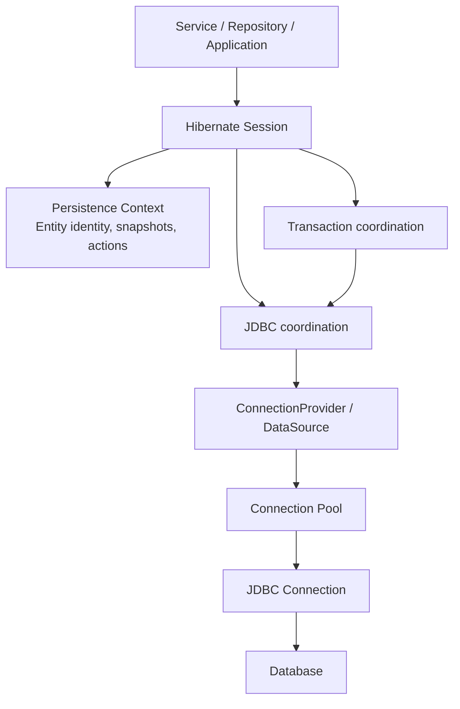
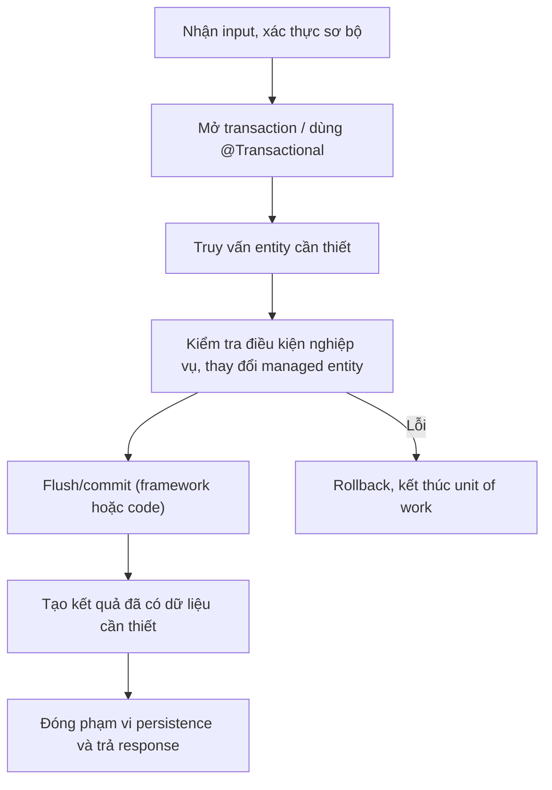

# Phân biệt vòng đời Session, giao dịch và kết nối JDBC

Khi làm việc với Hibernate ORM, lập trình viên thường nhìn thấy ba khái niệm xuất hiện cạnh nhau: **`Session`**, **giao dịch (transaction)** và **kết nối JDBC (`Connection`)**. Chúng có liên hệ chặt chẽ nhưng **không có cùng phạm vi sống** và **không cùng trách nhiệm**. Nhầm lẫn ba khái niệm này dẫn đến những lỗi phổ biến như giữ kết nối quá lâu, tưởng rằng `flush()` đã lưu dữ liệu vĩnh viễn, truy cập lazy association sau khi `Session` đóng, hoặc đóng nhầm một kết nối đang do Hibernate quản lý.

Trong hệ thống dùng Hibernate, hãy bắt đầu bằng ba câu hỏi độc lập:

1. **Session đang quản lý những thực thể Java nào?** Đây là câu hỏi về *persistence context* và vòng đời đối tượng.
2. **Các thao tác đọc/ghi hiện nằm trong giao dịch nào?** Đây là câu hỏi về *atomicity, commit, rollback, isolation* và ranh giới đơn vị công việc.
3. **Lệnh SQL được gửi qua kết nối JDBC nào, và kết nối đó đang do ai giữ?** Đây là câu hỏi về tài nguyên database, pool và cách Hibernate lấy/trả kết nối.

Một `Session` có thể sống lâu hơn một transaction; một transaction có thể cần kết nối JDBC trong một phần hoặc toàn bộ thời gian tồn tại; và một kết nối lấy từ pool có thể tiếp tục tồn tại vật lý sau khi Hibernate “đóng” hoặc trả nó về pool.

## 1. Ba khái niệm, ba trách nhiệm

| Thành phần | Bản chất | Nhiệm vụ chính | Ai thường quản lý? |
|---|---|---|---|
| **Hibernate `Session`** | Đối tượng API Hibernate và **persistence context** | Theo dõi entity, identity map, thay đổi trạng thái, lazy loading, phối hợp SQL | Ứng dụng, Hibernate, hoặc framework như Spring |
| **Transaction** | Ranh giới nhất quán của một đơn vị công việc | Commit/rollback, tính nguyên tử; tương tác với cơ chế cô lập của database | JDBC/resource-local, JTA, hoặc transaction manager |
| **JDBC `Connection`** | Kênh truy cập database qua driver JDBC | Tạo statement, bind tham số, thực thi SQL, nhận kết quả | Hibernate thông qua `ConnectionProvider`/`DataSource` và connection pool |

**Session không phải connection.** Session cung cấp API ORM và ngữ cảnh quản lý entity; nó dùng kết nối JDBC khi cần thực thi SQL.

**Session cũng không phải transaction.** Session có thể tồn tại lúc chưa bắt đầu transaction, lúc transaction đang diễn ra, và sau khi transaction đã commit. Tuy nhiên, thiết kế ứng dụng nên chọn ranh giới rõ ràng, thường **một đơn vị công việc nghiệp vụ tương ứng một transaction** và một persistence context phù hợp.

**Transaction không đồng nghĩa với một đối tượng `Connection` duy nhất theo mọi cấu hình.** Trong ứng dụng resource-local thông thường, một giao dịch database gắn với một kết nối JDBC tại một thời điểm. Với JTA, transaction do transaction manager điều phối, có thể bao gồm nhiều tài nguyên và các chi tiết gắn kết nối tùy môi trường. Cách Hibernate lấy/trả kết nối còn phụ thuộc connection handling mode và transaction coordination.

### Sơ đồ kiến trúc



Đây là sơ đồ **trách nhiệm**, không phải khẳng định Session giữ một đối tượng Connection vật lý xuyên suốt vòng đời. Các đối tượng thực thi nội bộ có thể khác nhau theo Hibernate ORM 6.x/7.x, framework tích hợp và cấu hình.

## 2. Hình dung bằng ba đường thời gian

Giả sử ứng dụng xử lý một HTTP request cập nhật lương nhân viên:

```text
Thời gian  ─────────────────────────────────────────────────────────────▶

Request   |---------------------- request đang xử lý ------------------|

Session       open ========================================== close
                          | Persistence context |

Transaction          begin -------------------- commit
                                | flush SQL |

Connection            (chưa chắc đã lấy)
                             acquire ========= release
                                 | JDBC |

Database                           UPDATE ...     COMMIT
```

Các dấu mốc có ý nghĩa:

- **`openSession()`** tạo một Session có persistence context. Điều này **không bảo đảm** Hibernate lập tức mượn kết nối JDBC từ pool.
- **`beginTransaction()`** bắt đầu công việc giao dịch. Tùy cấu hình và connection provider, Hibernate có thể phải lấy JDBC Connection ngay để chuẩn bị transaction, hoặc có thể trì hoãn cho tới lúc cần SQL.
- **`find()`, `getResultList()`, `flush()`** là những thao tác có thể tạo SQL và do đó cần JDBC.
- **`commit()`** kết thúc giao dịch thành công; Hibernate thường flush các thay đổi đang chờ trước khi commit. Việc kết nối được trả về pool ở mốc nào phụ thuộc cơ chế quản lý kết nối.
- **`close()`** kết thúc Session, giải phóng ngữ cảnh và tài nguyên còn do Session nắm giữ. Khi connection pool được dùng, “đóng” kết nối theo ngữ nghĩa pool thường là **trả về pool**, không nhất thiết đóng socket TCP đến database.

Lưu ý rằng sơ đồ trên minh họa **một luồng thông thường**, không quy định chính xác thời điểm acquire/release của mọi cấu hình. Có hệ thống lấy connection lúc mở Session; có hệ thống lấy lúc bắt đầu transaction; có hệ thống lấy lúc chạy lệnh SQL đầu tiên.

## 3. Vòng đời của Hibernate Session

### 3.1. Session được tạo như thế nào?

`SessionFactory` là đối tượng cấu hình và hạ tầng Hibernate có chi phí tạo lớn, thường được khởi tạo **một lần** và dùng chung trong thời gian ứng dụng hoạt động. `SessionFactory` là đối tượng được thiết kế cho sử dụng đồng thời giữa nhiều luồng.

Ngược lại, `Session` là **đơn vị làm việc có trạng thái**, được tạo cho một phạm vi công việc cụ thể:

```java
SessionFactory sessionFactory = /* hạ tầng khởi tạo sẵn */;

try (Session session = sessionFactory.openSession()) {
    // Session đang mở.
    // Có thể bắt đầu transaction và thao tác entity.
}
// AutoCloseable: Session được đóng ở cuối khối try.
```

Ở ứng dụng Spring/Jakarta EE, framework thường quản lý `Session` hoặc `EntityManager` theo transaction/request; lúc đó lập trình viên **không tự gọi `close()`** trên Session/EntityManager được container quản lý.

Session **không an toàn để sử dụng đồng thời**. Không chia sẻ một `Session` giữa các request, giữa các thread, hoặc lưu một Session làm trường singleton. Mỗi luồng/đơn vị công việc cần ngữ cảnh được quản lý đúng cách.

### 3.2. Persistence context là “bộ nhớ quản lý entity”

Một Session chứa **first-level cache** hay persistence context. Đây không chỉ là cache tăng tốc: nó còn duy trì identity của entity và phục vụ dirty checking, write-behind, association management.

Xét entity:

```java
import jakarta.persistence.*;

@Entity
@Table(name = "employees")
public class Employee {
    @Id
    private Long id;

    private String name;

    @Version
    private long version;

    protected Employee() {}

    public Long getId() { return id; }
    public String getName() { return name; }
    public void setName(String name) { this.name = name; }
}
```

Trong cùng persistence context:

```java
try (Session session = sessionFactory.openSession()) {
    Transaction tx = session.beginTransaction();

    Employee first = session.find(Employee.class, 10L);
    Employee again = session.find(Employee.class, 10L);

    System.out.println(first == again); // true nếu tìm thấy entity.
    tx.commit();
}
```

Hibernate duy trì **một object managed cho mỗi entity identity** trong một persistence context. Lần `find` sau thường được đáp ứng từ persistence context nếu entity đang được quản lý và đã được nạp, không nhất thiết phải chạy SELECT lần thứ hai.

**First-level cache thuộc về Session.** Đóng Session hoặc `clear()` sẽ kết thúc sự quản lý của các entity tương ứng; cache này không phải second-level cache của SessionFactory và không phải query result cache.

### 3.3. Entity state gắn với Session, không gắn trực tiếp với Connection

Các trạng thái thường gặp:

| Trạng thái | Ý nghĩa | Ví dụ |
|---|---|---|
| **Transient/new** | Object Java chưa được Session quản lý và chưa được persistent theo ngữ cảnh hiện tại | `new Employee()` |
| **Persistent/managed** | Object đang được persistence context theo dõi | Kết quả `session.find(...)` hoặc entity sau `persist(...)` |
| **Detached** | Entity từng được quản lý nhưng hiện không thuộc Session nào đang theo dõi nó | Sau `detach()`, `clear()` hoặc `close()` |
| **Removed** | Entity đã được đánh dấu xóa trong persistence context; SQL DELETE thực tế có thể chờ flush | `session.remove(employee)` |

Một managed entity **không cần giữ connection JDBC riêng** trong suốt thời gian nó được quản lý. Hibernate có thể giữ entity và snapshot trong bộ nhớ ngay cả khi chưa có kết nối hoặc sau khi đã trả kết nối về pool.

Ví dụ:

```java
Employee employee;

try (Session session = sessionFactory.openSession()) {
    Transaction tx = session.beginTransaction();

    employee = session.find(Employee.class, 10L);
    tx.commit();
}
// Session đã đóng; employee trở thành detached.

employee.setName("Tên mới"); // Thay đổi object Java.
                              // Không tự động được ghi vào DB lúc này.
```

Để lưu thay đổi của detached entity, cần một đơn vị công việc mới, ví dụ tải lại managed entity và chỉnh sửa, hoặc dùng `merge()` đúng ngữ nghĩa. `merge(detached)` trả về một **managed instance** trong Session nhận merge; đối tượng detached truyền vào không tự biến thành managed. Không đồng nhất việc còn reference Java với việc Session còn quản lý entity.

### 3.4. Đóng Session có tác động gì?

`Session.close()` kết thúc ngữ cảnh persistence, giải phóng các tài nguyên còn thuộc Session. Sau khi đóng:

- Không tiếp tục chạy HQL/Criteria hoặc các thao tác Session trên đối tượng Session đó.
- Những entity đã được tải vẫn là object Java và các giá trị **đã được khởi tạo** vẫn có thể đọc được.
- Lazy association/collection chưa khởi tạo không thể tùy tiện gọi SQL thông qua Session cũ; thường phát sinh `LazyInitializationException` nếu truy cập ngoài một Session phù hợp.
- Thay đổi trên detached entity không được tự động dirty-check và flush bởi Session đã đóng.

Đóng Session **không có nghĩa commit**. Nếu transaction còn dang dở, hành vi cleanup/rollback phụ thuộc môi trường, nhưng ứng dụng phải **chủ động commit hoặc rollback rõ ràng**. Không dựa vào `close()` để xác nhận giao dịch thành công.

## 4. Vòng đời của transaction

Transaction là ranh giới để một nhóm thao tác database được xử lý như **một đơn vị công việc nhất quán**. Với Hibernate resource-local thông thường:

```java
try (Session session = sessionFactory.openSession()) {
    Transaction tx = session.beginTransaction();

    try {
        Employee employee = session.find(Employee.class, 10L);
        employee.setName("Lan");

        tx.commit();
    } catch (RuntimeException ex) {
        if (tx.isActive()) {
            tx.rollback();
        }
        throw ex;
    }
}
```

Các thao tác chính:

1. **Begin**: xác lập ranh giới giao dịch, chuẩn bị cho thao tác đọc/ghi.
2. **Thực hiện nghiệp vụ**: đọc dữ liệu, sửa managed entities, gọi `persist()`, `remove()` hoặc query.
3. **Flush (khi cần)**: chuyển những thay đổi chưa gửi thành SQL và thực thi thông qua JDBC.
4. **Commit**: yêu cầu database xác nhận giao dịch. Sau commit thành công, dữ liệu được database chấp nhận theo cam kết của transaction.
5. **Rollback nếu lỗi**: hủy hiệu ứng database của các thay đổi trong transaction, trong phạm vi giao dịch đó.

`tx.isActive()` ở ví dụ là kiểm tra thực dụng; khi xử lý failure phức tạp, có thể cần xét thêm trạng thái transaction hoặc exception của transaction manager. Một khi một Hibernate Session/transaction gặp lỗi trong khi flush hay JDBC, **thường nên rollback, bỏ Session đó và tạo Session mới** cho lần công việc sau. Không kỳ vọng persistence context tự trở về trạng thái giống hệt database sau rollback.

### 4.1. Commit, flush và close khác nhau thế nào?

| Thao tác | Đối tượng thực hiện | Tác dụng trực tiếp | Có bảo đảm commit dữ liệu? |
|---|---|---|---|
| `session.flush()` | Session | Đồng bộ những thay đổi đang chờ từ persistence context xuống database bằng SQL | **Không** |
| `tx.commit()` | Transaction | Kết thúc transaction thành công, thường kích hoạt flush trước khi commit | **Có**, nếu commit thành công |
| `tx.rollback()` | Transaction | Yêu cầu database hủy thay đổi chưa commit trong transaction | Không, vì mục đích là hủy |
| `session.close()` | Session | Giải phóng persistence context và tài nguyên Session | **Không** |
| `connection.close()` qua pool | JDBC/Pool | Trả kết nối về pool khi connection do pool cấp | **Không** |

Câu “đã gọi `save/persist` nghĩa là INSERT đã commit” cũng không đúng về mặt tổng quát. Với nhiều identifier generation strategy, Hibernate trì hoãn DML đến flush; nhưng với IDENTITY hoặc những thao tác cần giá trị database ngay, INSERT có thể xảy ra sớm. **SQL đã chạy** và **transaction đã commit** vẫn là hai mốc khác nhau.

### 4.2. Flush không phải commit

Giả sử:

```java
try (Session session = sessionFactory.openSession()) {
    Transaction tx = session.beginTransaction();

    Employee employee = session.find(Employee.class, 10L);
    employee.setName("Tên thử nghiệm");

    session.flush(); // Có thể đã thực thi UPDATE vào database.
    tx.rollback();   // UPDATE bị rollback ở database.
}
```

Sau `flush()`, cơ sở dữ liệu có thể đã nhận và xử lý UPDATE trong giao dịch hiện tại, bao gồm kiểm tra constraint/lock. Những transaction khác có thấy thay đổi đó hay không phụ thuộc isolation level và DBMS; nhưng **chưa có commit**.

`flush()` có thể diễn ra:

- Trước `commit()`.
- Trước một số truy vấn để bảo đảm tính nhất quán với thay đổi đang chờ, tùy `FlushMode` và hoàn cảnh.
- Khi lập trình viên gọi trực tiếp `session.flush()`.
- Ở các mốc Hibernate cần đồng bộ theo chiến lược ID hoặc tác vụ liên quan.

Đừng coi flush mode là ranh giới transaction. Ví dụ `FlushMode.MANUAL` có thể khiến thay đổi chưa được flush tự động; cam kết “commit luôn flush mọi thay đổi” chỉ đúng với các cấu hình/thao tác thông thường cho phép auto flush.

### 4.3. Rollback của DB không tự phục hồi object Java

```java
Employee reference;

try (Session session = sessionFactory.openSession()) {
    Transaction tx = session.beginTransaction();

    reference = session.find(Employee.class, 10L);
    reference.setName("Tên tạm");

    tx.rollback();
}
// Database có thể vẫn chứa tên cũ.
// Object Java "reference" vẫn có thể mang chuỗi "Tên tạm".
```

Rollback tác động tới **giao dịch database**, không đi ngược thời gian để đảo mọi thao tác đặt giá trị trên object Java. Sau rollback, persistence context có thể không nhất quán với DB; lựa chọn an toàn phổ biến là kết thúc Session và bắt đầu unit of work mới.

### 4.4. Read transaction cũng có ý nghĩa

Một truy vấn `SELECT` có thể chạy ngay cả khi ứng dụng chưa gọi `beginTransaction()`, tùy Hibernate API, JDBC autocommit, cấu hình transaction manager và DBMS. Nhưng điều đó **không có nghĩa** nên bỏ transaction khỏi mọi thao tác đọc.

Với nhiều ứng dụng, các truy vấn đọc liên quan cùng một nghiệp vụ cần transaction để:

- Có ranh giới nhất quán rõ ràng cho các truy vấn liên tiếp.
- Áp dụng isolation level và hành vi lock dự kiến.
- Quản lý tuổi thọ tài nguyên hợp lý.
- Phù hợp contract của JPA/framework và transaction management đang dùng.

Một giao dịch **read-only** trong Spring hay Hibernate có thể cung cấp tối ưu hóa và chỉ dẫn cho framework/driver, nhưng **không nên được coi là cơ chế bảo mật ngăn ghi dữ liệu tuyệt đối** trong mọi môi trường.

## 5. Vòng đời kết nối JDBC

### 5.1. JDBC Connection là tài nguyên database

Một `java.sql.Connection` đại diện cho một phiên kết nối logic ở lớp JDBC tới DBMS. JDBC dùng connection để tạo `PreparedStatement`, thực thi SQL và đọc `ResultSet`:

```java
try (Connection connection = dataSource.getConnection();
     PreparedStatement ps = connection.prepareStatement(
         "select name from employees where id = ?")) {

    ps.setLong(1, 10L);

    try (ResultSet rs = ps.executeQuery()) {
        if (rs.next()) {
            System.out.println(rs.getString("name"));
        }
    }
}
```

Đoạn trên là **JDBC thuần**, ở đó ứng dụng trực tiếp sở hữu vòng đời connection mượn từ `DataSource`. Trong ứng dụng dùng Hibernate, **Hibernate thường là bên quản lý JDBC Connection** cho các thao tác ORM, nên cách sử dụng và trách nhiệm đóng khác đi.

Nếu `DataSource` sử dụng connection pool như HikariCP, lệnh `connection.close()` trên wrapper của pool thường **trả logical connection về pool**, không đóng socket vật lý. Kết nối vật lý sẽ được pool tái sử dụng hoặc loại bỏ theo tuổi thọ, tình trạng và chính sách pool.

### 5.2. Hibernate có thể lấy connection trễ

Khi gọi:

```java
Session session = sessionFactory.openSession();
```

Hibernate tạo Session, nhưng **không có quy tắc chung** rằng pool sẽ mất ngay một connection. Các chế độ quản lý connection hỗ trợ **delayed acquisition**: Hibernate chỉ mượn connection khi thật sự cần dùng JDBC.

Những thao tác có thể đòi connection gồm:

- Thực thi SELECT, UPDATE, INSERT hoặc DELETE.
- Lấy identity/key được database sinh ra.
- Truy vấn metadata hoặc một số thao tác JDBC khác.
- Thiết lập trạng thái transaction như autocommit, isolation hoặc yêu cầu transaction manager tham gia giao dịch, tùy driver/provider/cấu hình.

Vì vậy, câu “không chạy SQL thì chắc chắn chưa có connection” cũng quá tuyệt đối. Trong resource-local transaction, Hibernate có thể mượn connection ngay tại `beginTransaction()` nếu cần gọi JDBC để bảo đảm `autoCommit=false`. Nếu connection provider bảo đảm đã tắt autocommit và được cấu hình nhất quán, cơ chế trì hoãn có thể hoạt động khác.

### 5.3. Connection release phụ thuộc connection handling mode

Hibernate có các chế độ xử lý kết nối, ví dụ các giá trị trong `org.hibernate.resource.jdbc.spi.PhysicalConnectionHandlingMode`:

| Nhóm hành vi | Ý nghĩa |
|---|---|
| **Immediate acquisition** | Lấy kết nối sớm khi Session/JDBC coordinator được khởi tạo theo cấu hình |
| **Delayed acquisition** | Trì hoãn lấy kết nối đến khi cần JDBC |
| **Release after transaction** | Thường trả kết nối sau khi transaction hoàn tất |
| **Release after statement** | Có thể trả sau mỗi JDBC statement khi môi trường, transaction coordinator và tài nguyên còn mở cho phép |
| **Hold until Session close** | Có thể giữ connection tới khi đóng Session |

Các tên enum cụ thể của Hibernate hiện đại bao gồm `IMMEDIATE_ACQUISITION_AND_HOLD`, `DELAYED_ACQUISITION_AND_HOLD`, `DELAYED_ACQUISITION_AND_RELEASE_AFTER_TRANSACTION`, và `DELAYED_ACQUISITION_AND_RELEASE_AFTER_STATEMENT`. Hãy xem tài liệu đúng **phiên bản Hibernate và integration** đang chạy để biết chế độ mặc định và các hạn chế thực tế.

Một phần cấu hình liên quan là:

```properties
# Ví dụ minh họa; chỉ cấu hình khi hiểu transaction integration.
hibernate.connection.handling_mode=DELAYED_ACQUISITION_AND_RELEASE_AFTER_TRANSACTION
```

Đây là ví dụ về **một lựa chọn chế độ**, không phải khuyến nghị thay đổi mặc định cho mọi ứng dụng. Hệ thống dùng JTA, pool được container quản lý hoặc cơ chế thao tác resource-local có thể cần chế độ khác.

### 5.4. Một Session có thể dùng nhiều JDBC Connection theo thời gian

Hãy tưởng tượng Session được mở, đọc dữ liệu trong transaction thứ nhất, commit, rồi thực hiện transaction thứ hai:

```text
Session        |========================== cùng Session ==========================|

Transaction 1      [begin ------- SELECT ------- commit]

Connection A              [borrow -------- return]

Transaction 2                                      [begin ---- UPDATE --- commit]

Connection B                                            [borrow ----- return]
```

Tùy cấu hình, `Connection A` và `Connection B` có thể là:

- Cùng một physical connection được pool cho mượn lại.
- Hai physical connection khác nhau.
- Một wrapper logic khác nhau trên cùng một tài nguyên phía DB.

Do đó, **không được thiết kế nghiệp vụ dựa vào giả định “mở Session một lần thì có một connection cố định”**. Nếu ứng dụng cần trạng thái ở cấp connection như temporary table, session variables hay khóa advisory phụ thuộc connection, phải hiểu chính xác chế độ release/reacquire và transaction boundary.

### 5.5. Connection mượn từ pool không được giữ vô hạn

Pool có kích thước hữu hạn. Giả sử pool có 10 connection và 10 request cùng lúc giữ transaction/connection trong khi gọi HTTP đến dịch vụ khác mất vài giây. Request thứ 11 có thể phải chờ connection, dẫn đến timeout. Vấn đề nằm ở **thời gian giữ tài nguyên**, không chỉ số lượng HQL/SQL.

Một nguyên tắc thực dụng: **chỉ mở transaction cho phần công việc thật sự cần transaction, tránh IO mạng hoặc xử lý chậm không liên quan bên trong transaction**, và bảo đảm hoàn tất commit/rollback để pool có cơ hội nhận lại connection.

## 6. Một ví dụ toàn bộ ba vòng đời

Giả sử có entity `BankAccount`:

```java
import jakarta.persistence.*;
import java.math.BigDecimal;

@Entity
@Table(name = "bank_accounts")
public class BankAccount {
    @Id
    private Long id;

    @Column(nullable = false, precision = 19, scale = 2)
    private BigDecimal balance;

    @Version
    private long version;

    protected BankAccount() {}

    public BigDecimal getBalance() { return balance; }

    public void debit(BigDecimal amount) {
        balance = balance.subtract(amount);
    }

    public void credit(BigDecimal amount) {
        balance = balance.add(amount);
    }
}
```

Dịch vụ chuyển tiền tối giản:

```java
import org.hibernate.Session;
import org.hibernate.SessionFactory;
import org.hibernate.Transaction;

import java.math.BigDecimal;

public final class TransferService {
    private final SessionFactory sessionFactory;

    public TransferService(SessionFactory sessionFactory) {
        this.sessionFactory = sessionFactory;
    }

    public void transfer(Long fromId, Long toId, BigDecimal amount) {
        if (fromId.equals(toId)) {
            throw new IllegalArgumentException("Tài khoản nguồn và đích trùng nhau");
        }
        if (amount.signum() <= 0) {
            throw new IllegalArgumentException("Số tiền phải dương");
        }

        try (Session session = sessionFactory.openSession()) {
            Transaction tx = session.beginTransaction();

            try {
                BankAccount from = session.find(BankAccount.class, fromId);
                BankAccount to = session.find(BankAccount.class, toId);
                if (from == null || to == null) {
                    throw new IllegalArgumentException("Không tìm thấy tài khoản");
                }
                if (from.getBalance().compareTo(amount) < 0) {
                    throw new IllegalArgumentException("Số dư không đủ");
                }

                from.debit(amount);
                to.credit(amount);
                tx.commit();
            } catch (RuntimeException ex) {
                if (tx.isActive()) {
                    tx.rollback();
                }
                throw ex;
            }
        }
    }
}
```

Trong ví dụ:

- **Session** tồn tại từ `openSession()` đến cuối khối `try`; nó quản lý hai `BankAccount` và nhận diện các thay đổi ở thuộc tính `balance`.
- **Transaction** bắt đầu ở `beginTransaction()`. Hai thay đổi số dư cùng nằm trong một transaction; nếu commit thành công, cả hai cập nhật được chấp nhận. Nếu thất bại trước commit và rollback thành công, các thay đổi database chưa commit được hủy.
- **Connection** do Hibernate mượn từ provider/pool khi các thao tác JDBC cần đến. Hai SELECT và các UPDATE phát sinh lúc flush/commit được thực thi thông qua JDBC. Điểm mượn/trả cụ thể phụ thuộc cách quản lý connection.
- **`@Version`** cho phép optimistic locking nhằm phát hiện một số trường hợp cập nhật đồng thời xung đột; transaction isolation và các quy tắc nghiệp vụ còn cần thiết để bảo vệ những bất biến khác.

Ví dụ này nhằm làm rõ vòng đời, chưa phải triển khai ngân hàng đầy đủ: một hệ thống chuyển tiền thực tế phải xem xét đối soát, ledger, idempotency, khóa/đồng thời, tiền tệ, giới hạn giao dịch, retry và audit. Đặc biệt, nếu commit kết thúc bằng một lỗi kết nối gây **trạng thái kết quả không rõ** (không biết database đã commit hay chưa), không nên tự động retry chuyển tiền thiếu cơ chế idempotency.

### Một số thao tác diễn ra tại thời điểm nào?

| Dòng code | Persistence context | Transaction | JDBC Connection |
|---|---|---|---|
| `openSession()` | Mới được tạo | Chưa bắt đầu | Có thể chưa lấy |
| `beginTransaction()` | Sẵn sàng quản lý entity | Bắt đầu | Có thể phải lấy/chuẩn bị |
| `session.find(...)` | Entity trở thành managed | Đang hoạt động | Cần khi SELECT thực sự chạy |
| `from.debit(amount)` | Entity managed đổi trạng thái | Đang hoạt động | Có thể **chưa** phát SQL |
| `tx.commit()` | Flush thay đổi phù hợp | Yêu cầu commit | Dùng JDBC cho DML và commit |
| `session.close()` | Ngữ cảnh được giải phóng | Phải đã kết thúc rõ ràng | Trả tài nguyên còn giữ theo chế độ |

Cụm “có thể” trong cột JDBC là có chủ đích: Hibernate có nhiều chế độ quản lý connection và có thể không cần SELECT nếu entity đã có trong persistence context/cache; không thể suy ra mốc connection chính xác chỉ từ vài dòng Java.

## 7. Session có nhất thiết trùng một transaction?

**Không về mặt API**, nhưng việc kéo dài Session qua nhiều transaction cần được thiết kế thận trọng.

Ví dụ một Session hợp lệ về mặt hình thức có thể thực hiện nhiều transaction tuần tự:

```java
try (Session session = sessionFactory.openSession()) {
    Transaction tx1 = session.beginTransaction();
    Employee e = session.find(Employee.class, 10L);
    tx1.commit();

    // Session vẫn mở, e vẫn có thể là managed entity.

    Transaction tx2 = session.beginTransaction();
    e.setName("Tên tiếp theo");
    tx2.commit();
}
```

Ở đây `Session` sống qua `tx1` và `tx2`. **Persistence context có thể giữ dữ liệu đã đọc từ transaction thứ nhất** khi đi vào transaction thứ hai. Đó là lý do Session mở lâu có thể gặp dữ liệu cũ, tiêu tốn bộ nhớ và làm ranh giới nghiệp vụ khó suy luận.

Với request/command thông thường, mô hình **Session-per-unit-of-work** hoặc persistence context gắn với transaction là lựa chọn dễ kiểm soát. Nếu thực sự cần extended persistence context (ví dụ luồng tương tác nhiều bước), phải quản lý rõ các bản ghi detached/managed, stale data, bộ nhớ, conflict và transaction boundaries.

Mặt khác, một transaction trong môi trường JTA có thể chứa nhiều đơn vị truy cập dữ liệu và nhiều persistence context/tài nguyên được tham gia đúng cách. Đó là trách nhiệm của transaction manager; không nên tùy tiện tự tạo một `Session` mới rồi giả định nó đã tự động tham gia cùng giao dịch container.

## 8. Resource-local transaction và JTA khác nhau ở đâu?

Hibernate có thể hoạt động trong các môi trường quản lý transaction khác nhau.

### 8.1. Resource-local / JDBC transaction

Với resource-local, ứng dụng hoặc framework sử dụng transaction gắn với tài nguyên database, thường thông qua JDBC transaction coordinator.

```java
try (Session session = sessionFactory.openSession()) {
    Transaction tx = session.beginTransaction();
    try {
        // Thao tác ORM.
        tx.commit();
    } catch (RuntimeException ex) {
        if (tx.isActive()) {
            tx.rollback();
        }
        throw ex;
    }
}
```

Nếu Hibernate chủ động quản lý một JDBC connection trong transaction này, `begin` và `commit/rollback` được phối hợp với JDBC transaction lifecycle phù hợp. Trong JDBC nguyên bản, các thao tác tương ứng có thể là `setAutoCommit(false)`, `commit()` và `rollback()` trên `Connection`; Hibernate và provider quản lý phần đó thay cho ứng dụng.

### 8.2. JTA transaction

Trong môi trường Jakarta Transactions, **transaction manager** điều phối lifecycle giao dịch; các tài nguyên database có thể được enlist vào một transaction đang hoạt động. Hibernate tham gia qua JTA transaction coordinator thay vì trực tiếp tự sở hữu toàn bộ logic commit như một local transaction độc lập.

Ví dụ khái niệm trong môi trường container-managed:

```java
import jakarta.transaction.Transactional;

public class EmployeeService {
    @Transactional
    public void renameEmployee(Long id, String newName) {
        // EntityManager/Session được injection và quản lý theo container.
        // Thao tác entity; container quản lý commit/rollback.
    }
}
```

Môi trường thực tế cần cấu hình transaction manager và DI/container đúng chuẩn; annotation một mình không tạo transaction nếu không có runtime xử lý.

| Câu hỏi | Resource-local | JTA |
|---|---|---|
| Ai điều phối giao dịch? | Ứng dụng/Hibernate/framework cho resource-local | JTA transaction manager |
| Phạm vi thường gặp | Một tài nguyên database | Có thể phối hợp nhiều tài nguyên theo môi trường |
| Ai kết thúc giao dịch? | Code/framework quản lý transaction local | Container/transaction manager hoặc ranh giới JTA |
| Connection release | Theo JDBC coordination và handling mode | Theo tích hợp JTA/pool/transaction synchronization |
| Có tự mặc định phân tán transaction? | Không | Không mặc định; phụ thuộc tài nguyên và cấu hình XA/coordination |

Không giả định chỉ cần bật JTA là mọi hệ thống bên ngoài sẽ cùng rollback. Một HTTP call hay message publish không tự động trở thành một phần của distributed transaction chỉ vì method có `@Transactional`.

## 9. Trong Spring, `@Transactional` quản lý cái gì?

Khi ứng dụng dùng Spring Data JPA/Hibernate, Spring thường tạo hoặc dùng persistence context, bind EntityManager/Session và tài nguyên liên quan vào thread transaction theo integration. Ví dụ:

```java
import org.springframework.stereotype.Service;
import org.springframework.transaction.annotation.Transactional;

@Service
public class EmployeeService {
    private final EmployeeRepository repository;

    public EmployeeService(EmployeeRepository repository) {
        this.repository = repository;
    }

    @Transactional
    public void rename(Long id, String newName) {
        Employee employee = repository.findById(id)
            .orElseThrow(() -> new IllegalArgumentException("Không tìm thấy"));

        employee.setName(newName);
        // Dirty checking; flush vào DB trước/ở commit nếu phù hợp.
    }

    @Transactional(readOnly = true)
    public String readName(Long id) {
        return repository.findById(id)
            .map(Employee::getName)
            .orElseThrow(() -> new IllegalArgumentException("Không tìm thấy"));
    }
}
```

`EmployeeRepository` ở đây được hiểu là một Spring Data repository đã được khai báo trong dự án, ví dụ một interface kế thừa `JpaRepository<Employee, Long>`.

Trong cấu hình thông thường:

1. Một lời gọi đi **qua Spring proxy/interceptor** vào `rename(...)` mở hoặc tham gia transaction.
2. Repository truy cập EntityManager được Spring quản lý; Hibernate Session tương ứng theo dõi managed `Employee`.
3. Thay đổi `employee.setName(...)` được Hibernate ghi nhận trong persistence context.
4. Khi method hoàn tất thành công, transaction manager xử lý flush/commit; khi có exception phù hợp, rollback được kích hoạt theo quy tắc đã cấu hình.
5. Resource/session/connection được cleanup khi phạm vi tương ứng kết thúc.

Những điểm cần nhớ:

- Trong Spring proxy mode phổ biến, **self-invocation** (method cùng class tự gọi một method có `@Transactional`) có thể bỏ qua interceptor, vì lời gọi không đi qua proxy.
- Mặc định của Spring thường rollback khi xảy ra `RuntimeException` hoặc `Error`; checked exception không tự động gây rollback nếu không có cấu hình `rollbackFor` phù hợp. Quy tắc có thể tùy chỉnh.
- `@Transactional(propagation = ...)` điều chỉnh ranh giới transaction, **không tương đương với tạo một Hibernate Session mới** trong mọi trường hợp.
- `@Transactional(readOnly = true)` là chỉ dẫn về read-only/optimization; mức enforcement ở database có thể khác nhau.
- Không đóng thủ công EntityManager/Session do Spring đang quản lý transaction.

### `REQUIRES_NEW` có thể dùng thêm connection

Nếu method bên ngoài đang có transaction và giữ một connection, lời gọi sang method có `Propagation.REQUIRES_NEW` có thể suspend transaction ngoài và tạo transaction mới. Transaction mới có thể cần **thêm connection** trong lúc connection ngoài vẫn bị giữ. Khi tải đồng thời cao, pool có thể cạn nếu số lượng connection không đủ và nhiều lời gọi lồng nhau tranh tài nguyên.

```text
Outer @Transactional     [---------- TX-A ----------]
                                | suspended |
Inner REQUIRES_NEW             [--- TX-B ---]
                               ^ connection khác có thể được cần
```

Điều này là một ví dụ thực tế vì sao “một request chỉ cần một JDBC connection” không phải giả định an toàn.

## 10. Transaction isolation và Hibernate Session không thay thế nhau

Persistence context cung cấp identity và theo dõi object, nhưng **không phải cơ chế cách ly transaction của database**.

Các mức isolation chuẩn thường được nhắc đến:

| Isolation | Mô tả khái quát |
|---|---|
| `READ UNCOMMITTED` | Có thể cho phép quan sát dữ liệu chưa commit, tùy DBMS |
| `READ COMMITTED` | Tránh dirty reads theo chuẩn; các lần đọc trong cùng transaction có thể nhìn thấy giá trị khác nhau |
| `REPEATABLE READ` | Bổ sung đảm bảo cho việc đọc lại cùng hàng, nhưng chi tiết phantom/snapshot tùy DBMS |
| `SERIALIZABLE` | Mức cách ly mạnh, mục tiêu là tương đương một lịch thực thi tuần tự; có thể phát sinh serialization failure cần retry phù hợp |

Cần phân biệt:

- **Database isolation:** Điều gì các transaction đồng thời được phép quan sát và thay đổi?
- **Hibernate persistence context:** Một Session đang giữ object nào trong bộ nhớ và có trả lại cùng managed entity cho lần tìm kiếm tiếp không?

Ví dụ, transaction bên ngoài đã commit thay đổi tên `Employee`. Trong một Session lâu sống, lệnh `session.find(Employee.class, id)` có thể trả lại **managed instance đang có** mà không tự thực hiện SELECT để đọc tên mới. Đó là vấn đề persistence context/stale state, dù database đang dùng isolation phù hợp. Có thể dùng `refresh()`, `clear()` hoặc mở persistence context mới tùy yêu cầu.

### Optimistic locking và transaction

`@Version` giúp phát hiện xung đột khi hai transaction sửa cùng một entity dựa trên phiên bản đã đọc. Hibernate thường đưa version vào điều kiện UPDATE và kiểm tra số hàng được cập nhật; nếu version đã đổi, nó có thể ném optimistic locking exception.

```sql
-- SQL minh họa, không phải một chuỗi do Hibernate bảo đảm sinh nguyên văn.
update employees
set name = ?, version = ?
where id = ? and version = ?
```

Optimistic locking **không kéo dài tuổi thọ Session** hay giữ connection cố định. Nó là cơ chế đồng thời bổ sung cho transaction và mapping. Nếu gặp conflict, transaction phải xử lý rollback và retry ở một unit of work mới có chủ đích; không retry tùy tiện dựa trên entity state cũ.

## 11. Lazy loading và ranh giới Session

Một lỗi nổi tiếng trong Hibernate là `LazyInitializationException`. Nó thường xảy ra khi code muốn truy cập một association chưa được tải sau khi Session phù hợp đã đóng.

Ví dụ:

```java
Employee employee;

try (Session session = sessionFactory.openSession()) {
    Transaction tx = session.beginTransaction();
    employee = session.find(Employee.class, 10L);
    tx.commit();
}

// Session đã đóng.
String departmentName = employee.getDepartment().getName();
// Nếu department chưa được khởi tạo và cần database,
// thao tác này có thể ném LazyInitializationException.
```

Với mapping:

```java
@ManyToOne(fetch = FetchType.LAZY)
@JoinColumn(name = "department_id")
private Department department;
```

Vấn đề ở đây là **không còn một persistence context hợp lệ để xử lý lazy access**, chứ không đơn thuần là “connection đã đóng”. Không thể sửa đúng bằng cách giữ một Connection JDBC tùy ý và hy vọng proxy Hibernate dùng được.

Các cách thiết kế thường phù hợp:

**Fetch đúng dữ liệu trong transaction:**

```java
try (Session session = sessionFactory.openSession()) {
    Transaction tx = session.beginTransaction();

    Employee employee = session.createSelectionQuery("""
        select e from Employee e
        join fetch e.department
        where e.id = :id
        """, Employee.class)
        .setParameter("id", 10L)
        .getSingleResult();

    String departmentName = employee.getDepartment().getName();
    tx.commit();
}
```

**Trả DTO đầy đủ cho tầng giao diện:**

```java
public record EmployeeView(Long id, String name, String departmentName) {}

EmployeeView view = session.createSelectionQuery("""
    select new com.example.EmployeeView(e.id, e.name, d.name)
    from Employee e
    left join e.department d
    where e.id = :id
    """, EmployeeView.class)
    .setParameter("id", 10L)
    .getSingleResult();
```

**Dùng entity graph** để tải association theo use case, khi không muốn đặt fetch join trực tiếp trong mọi HQL.

Các kỹ thuật này thiết kế **dữ liệu cần lấy trước khi Session kết thúc**. Mở Session kéo dài chỉ để tránh lazy exception có thể kéo theo chi phí bộ nhớ, N+1 và khó kiểm soát giao dịch.

## 12. Vì sao Open Session in View có thể gây rủi ro?

**Open Session in View (OSIV)** hoặc **Open EntityManager in View** giữ persistence context mở đến giai đoạn render response. Ưu điểm là tầng view có thể truy cập lazy association nếu Session còn mở.

Tuy nhiên cần nhìn đủ ba vòng đời:

```text
HTTP request:       |-------------------------------------------|
Business transaction:    [---- begin ---- commit ----]
Persistence context: |============================== close =====|
Lazy access at view:                              [SELECT?]
Connection:         có thể acquire/release nhiều lần tùy cấu hình
```

Sau transaction nghiệp vụ commit, tầng view có thể khiến Hibernate chạy thêm SQL để lazy load. Tùy JDBC autocommit và transaction configuration, SQL đó có thể nằm ngoài transaction nghiệp vụ ban đầu. Điều này gây khó dự đoán số query, độ nhất quán dữ liệu và thời gian giữ connection.

OSIV **không nhất thiết luôn giữ JDBC connection trong toàn bộ HTTP request**; điều đó còn phụ thuộc connection handling mode và thời điểm thực thi SQL. Nhưng việc Session tiếp tục mở vẫn cho phép phát sinh truy vấn ở tầng render, nơi khó kiểm soát và đo lường.

Trong nhiều API trả JSON, thiết kế rõ transaction trong service và trả DTO/response model đầy đủ giúp giảm phụ thuộc vào OSIV. Việc bật/tắt OSIV phụ thuộc kiến trúc và framework; nếu tắt, cần bảo đảm mọi dữ liệu cần cho response đã được nạp trong transaction.

## 13. Dùng JDBC trực tiếp khi Session đang quản lý connection

Đôi khi ứng dụng cần một lệnh JDBC chuyên biệt không tiện biểu đạt bằng HQL. Hibernate `Session` cung cấp `doWork` hoặc `doReturningWork` để dùng connection do Hibernate đang phối hợp.

Ví dụ:

```java
try (Session session = sessionFactory.openSession()) {
    Transaction tx = session.beginTransaction();

    try {
        int count = session.doReturningWork(connection -> {
            String sql = "select count(*) from employees where department_id = ?";

            try (PreparedStatement ps = connection.prepareStatement(sql)) {
                ps.setLong(1, 7L);

                try (ResultSet rs = ps.executeQuery()) {
                    rs.next();
                    return rs.getInt(1);
                }
            }
        });

        System.out.println("Count: " + count);
        tx.commit();
    } catch (RuntimeException ex) {
        if (tx.isActive()) {
            tx.rollback();
        }
        throw ex;
    }
}
```

Trong callback:

- `connection` là JDBC Connection được Hibernate cung cấp trong ngữ cảnh hiện tại.
- Code **phải đóng Statement/ResultSet mà chính nó tạo** bằng try-with-resources.
- Code **không được tự ý `connection.close()`**, vì Hibernate/transaction manager sở hữu vòng đời connection này.
- Không tự thay đổi `autoCommit`, `commit()`, `rollback()`, isolation hoặc schema trên connection nếu việc đó phá vỡ transaction coordination.
- Nếu kết hợp thao tác ORM đang chờ flush và JDBC đọc cùng bảng, hãy xác định đúng thứ tự: cần thiết thì gọi `session.flush()` **trước** khi chạy JDBC để dữ liệu trong database phản ánh thay đổi ORM chưa đồng bộ.

### ORM write-behind làm lệch kỳ vọng khi trộn JDBC

```java
Employee e = session.find(Employee.class, 10L);
e.setName("Minh");

// Nếu không flush, UPDATE của Hibernate có thể vẫn nằm trong action queue.
session.doWork(conn -> {
    // SELECT bằng JDBC ở đây có thể vẫn đọc tên cũ,
    // tùy thời điểm Hibernate đã flush hay chưa.
});

session.flush(); // Gửi thay đổi ORM xuống database trong transaction.
```

Ngược lại, khi JDBC tự cập nhật một hàng đã được Hibernate nạp thành managed entity, persistence context **không tự biết** rằng SQL trực tiếp đã đổi hàng đó. Có thể cần `refresh()`, `clear()` hoặc thiết kế ranh giới truy cập khác để tránh stale state.

### Không nên lấy `Connection` từ pool riêng trong cùng nghiệp vụ rồi tự coi là cùng transaction

Ví dụ nguy hiểm về mặt giả định:

```java
// ORM đã hoạt động trong transaction A...
Connection other = dataSource.getConnection();
// Tự chạy SQL với "other" rồi nghĩ nó thuộc transaction A.
```

Nếu lấy connection khác không được transaction manager phối hợp, nó có thể chạy trong transaction khác hoặc autocommit độc lập. Khi ORM rollback, phần SQL trên connection riêng có thể vẫn đã commit. Trong ứng dụng Spring/JTA, muốn phối hợp JDBC với JPA phải sử dụng integration đúng, ví dụ JDBC utility có tham gia transaction manager của Spring và DataSource được cấu hình phù hợp.

## 14. Connection pool và các lỗi tài nguyên thường gặp

### 14.1. “Session leak” và “connection leak” khác nhau

- **Session leak:** Code không đóng một Session tự tạo hoặc giữ Session quá lâu, khiến persistence context và những tài nguyên liên quan tồn tại vượt đơn vị công việc.
- **Connection leak:** Connection đã mượn không được trả về pool trong thời gian mong đợi, làm giảm số connection khả dụng; nguyên nhân có thể là resource chưa đóng, transaction kéo dài hoặc code JDBC trực tiếp giữ connection.
- **Long-running transaction:** Transaction chưa commit/rollback trong khi đang chờ network, thao tác người dùng hoặc tác vụ chậm; có thể giữ connection, lock, snapshot và tài nguyên database.
- **Pool exhaustion:** Số request cần connection vượt số connection khả dụng trong thời gian chờ; có thể do load cao, SQL chậm, transaction giữ lâu hoặc leak thực sự.

Session leak có thể **dẫn đến** connection leak nhưng hai hiện tượng không hoàn toàn đồng nhất. Session vẫn mở có thể đã trả connection về pool, tùy handling mode. Ngược lại, có thể có connection leak từ JDBC thuần mà không hề có Hibernate Session.

### 14.2. Những dấu hiệu nên đo

| Triệu chứng | Khả năng liên quan | Nên quan sát |
|---|---|---|
| `LazyInitializationException` | Lazy access sau khi Session/persistence context đóng | Fetch plan, transaction/service boundary |
| Timeout chờ connection từ pool | Pool cạn hoặc giữ connection lâu | Active/idle/pending connection, thời gian transaction |
| Lock wait kéo dài | Transaction mở lâu hoặc contention | DB lock view, active transactions, SQL đang chạy |
| Gọi `flush()` nhưng sau đó dữ liệu “biến mất” | Transaction bị rollback | Commit/rollback logs, exception |
| SQL đọc thấy dữ liệu khác object managed | First-level cache hoặc ORM/JDBC không đồng bộ | `refresh`/`clear`, thứ tự flush, isolation |
| N+1 query khi serialize response | Lazy loading ngoài tầng service, OSIV | SQL log theo request, fetch plan, DTO |
| Detached entity sửa nhưng DB không đổi | Không còn được quản lý | Session boundary, merge/load-and-update |
| `TransactionRequiredException` | Thao tác đòi transaction nhưng chưa có transaction phù hợp | Service boundary và transaction manager |

Đối với pool như HikariCP, có thể quan sát metrics về active, idle, pending và timeout; với Hibernate, SQL logging và thống kê SessionFactory giúp đếm truy vấn và các thao tác entity. Với database, đo execution time, lock wait và transaction age. Cần ghép các số liệu theo cùng request/trace để thấy chỗ tài nguyên bị giữ lâu.

### 14.3. Đừng mở Session lâu cho batch lớn mà không quản lý persistence context

Ví dụ xử lý 100.000 entity trong một Session có thể khiến first-level cache theo dõi nhiều object và snapshot, tăng bộ nhớ.

Một cách tổ chức theo lô:

```java
try (Session session = sessionFactory.openSession()) {
    Transaction tx = session.beginTransaction();

    try {
        int processed = 0;
        for (Employee employee : employeesToUpdate) {
            session.merge(employee);
            processed++;

            if (processed % 50 == 0) {
                session.flush();
                session.clear();
            }
        }

        tx.commit();
    } catch (RuntimeException ex) {
        if (tx.isActive()) {
            tx.rollback();
        }
        throw ex;
    }
}
```

`flush()/clear()` định kỳ giúp giảm số entity managed nhưng **không tự chia transaction**. Toàn bộ ví dụ vẫn dùng một transaction, có thể kéo dài và giữ lock/connection lâu. Với batch rất lớn, nên cân nhắc chia thành các transaction nhỏ có checkpoint/idempotency phù hợp, hoặc dùng Hibernate `StatelessSession`/bulk operations theo mục tiêu; cần cân nhắc atomicity nghiệp vụ khi chia transaction.

## 15. Các phạm vi hoạt động nên chọn trong ứng dụng

### 15.1. Session-per-operation

Mỗi thao tác nhỏ tự mở Session, transaction, commit và đóng. Cách này đơn giản nhưng nếu nghiệp vụ gồm nhiều thao tác liên quan, việc chia thành các Session/transaction độc lập có thể phá tính nguyên tử.

Ví dụ sai về thiết kế chuyển tiền:

```java
debitInItsOwnTransaction(from, amount);
creditInItsOwnTransaction(to, amount);
```

Nếu debit commit nhưng credit thất bại, toàn bộ nghiệp vụ không được rollback cùng nhau.

### 15.2. Session-per-request / per-unit-of-work

Một request hoặc một use case nghiệp vụ sử dụng một Session thích hợp và transaction bao trùm toàn bộ các thao tác cần nguyên tử.

```text
Service method:    |-------------------------------|
Transaction:          [begin --------- commit]
Session:            [open ============= close]
Connection:             [borrow --- return]
```

Đây thường là cách thiết kế dễ suy luận trong ứng dụng đồng bộ. Tuy nhiên không nên kéo transaction qua xử lý bất đồng bộ, remote call hay tương tác người dùng nếu không thật cần thiết.

### 15.3. Extended persistence context

Một persistence context có thể được giữ xuyên nhiều giao dịch để hỗ trợ workflow nhiều bước. Cách này đòi hỏi kiểm soát rõ entity stale, memory pressure, transaction participation, concurrency và lifecycle của context. Đây là lựa chọn kiến trúc riêng, không nên ngầm biến Session thành singleton.

### 15.4. Kết nối database có thể được trả trước khi Session đóng

Đây là điểm thường bị bỏ qua trong Session-per-request: ứng dụng có thể đóng transaction, trả connection về pool, nhưng Session vẫn mở. Việc còn giữ persistence context không đồng nghĩa rằng có connection đang bị chiếm dụng. Khi truy vấn lazy mới xuất hiện ở giai đoạn sau, Hibernate có thể cần mượn connection lại; có được phép thực hiện theo API/transaction hiện tại hay không là vấn đề khác.

## 16. Thực hành thiết kế ranh giới tài nguyên

Một luồng service xử lý đơn vị công việc thường nên được thiết kế theo thứ tự:



Các tình huống cụ thể:

**Truy vấn một entity để cập nhật.** Mở transaction, load entity, sửa managed fields, commit, đóng Session. Nếu lỗi, rollback và tạo Session mới khi thử lại.

**Truy vấn danh sách để hiển thị.** Xác định trước các trường cần cho response; dùng DTO projection/entity graph/fetch join đúng mục tiêu; tránh tầng serialize tự phát sinh hàng chục truy vấn.

**Gọi dịch vụ bên ngoài.** Tách remote call khỏi transaction DB khi nghiệp vụ cho phép. Nếu cần phối hợp dữ liệu và message, cân nhắc transactional outbox hoặc cơ chế đảm bảo nhất quán phù hợp thay vì giữ một transaction SQL mở trong lúc chờ network.

**Xử lý batch.** Kiểm soát kích thước persistence context, số câu SQL, batch size, transaction duration và phục hồi khi lỗi; `flush()/clear()` chỉ giải quyết một phần.

**Trộn Hibernate và JDBC.** Dùng callback do Hibernate/framework cấp hoặc transaction-aware connection để giữ đúng transaction; không đóng connection thuộc quyền quản lý của Hibernate.

## 17. Những câu hỏi dễ nhầm và câu trả lời chính xác

### “Mở Session có mở kết nối database không?”

**Không nhất thiết.** Tùy connection handling mode, provider, autocommit và yêu cầu JDBC tại thời điểm đó. Một Session có thể đã mở nhưng chưa mượn connection.

### “Commit transaction có tự đóng Session không?”

Với `Session` được tạo bởi `sessionFactory.openSession()`, **`tx.commit()` không tương đương `session.close()`**. Trong ví dụ try-with-resources, Session được đóng khi ra khỏi khối `try`. Với Session/EntityManager do framework/container quản lý, lifecycle của context phụ thuộc phạm vi được cấu hình.

### “Đóng Session có tự commit không?”

**Không nên kỳ vọng và không dựa vào đó.** Ứng dụng phải hoàn tất transaction bằng commit hoặc rollback đúng quy tắc.

### “Một Session có nhiều transaction không?”

**Có thể**, nhưng trạng thái entity được giữ qua các transaction có thể cũ và làm unit of work khó quản lý. Không chia sẻ Session giữa các thread.

### “Một transaction có thể dùng nhiều Session không?”

Trong JTA hoặc framework orchestration, có thể có nhiều persistence context tham gia một transaction được quản lý chung. Nhưng việc mở Session riêng **không tự chứng minh** nó đã tham gia đúng transaction. Phải xem transaction coordinator và integration của môi trường.

### “`session.flush()` xong thì transaction khác thấy dữ liệu chưa?”

**Không thể suy ra như vậy.** Flush chỉ phát SQL trong transaction hiện tại. Khả năng quan sát phụ thuộc isolation của database; dữ liệu chưa commit có thể bị rollback.

### “Đóng JDBC Connection có đóng Session không?”

**Không.** Connection và Session có vòng đời khác nhau. Không tự đóng connection do Hibernate cung cấp trong `doWork` vì sẽ phá cơ chế phối hợp tài nguyên. Nếu connection do ứng dụng tự mở bằng JDBC thuần, ứng dụng phải đóng nó theo contract của DataSource.

### “`LazyInitializationException` nghĩa là pool hết connection?”

**Không.** Nó chủ yếu liên quan đến việc một lazy proxy/collection không còn Session phù hợp để khởi tạo; pool exhaustion là một lỗi tài nguyên khác.

### “SessionFactory, Session và Connection có thể cùng sống trong suốt một request?”

Có thể tình cờ như vậy theo một cấu hình cụ thể, nhưng chúng không có quan hệ 1:1 hay lifecycle buộc phải trùng nhau. `SessionFactory` thường sống theo ứng dụng, `Session` theo đơn vị công việc, còn connection theo nhu cầu JDBC và chính sách pool/transaction.

## 18. Một ca chẩn đoán kết hợp

Giả sử API `GET /employees/10` có tình trạng:

- Trong service, lệnh `find(Employee.class, 10L)` chạy nhanh.
- Service trả entity `Employee` cho JSON serializer.
- Tầng JSON truy cập `employee.getDepartment().getName()`.
- Thỉnh thoảng xuất hiện `LazyInitializationException`; trong môi trường bật OSIV, API không lỗi nhưng phát sinh thêm SQL sau khi service kết thúc.

Phân tích theo ba tầng:

**Session:** Nếu persistence context đã đóng trước khi serializer truy cập association, lazy loading không thể thực hiện. Nếu OSIV giữ context mở, Hibernate có thể tiếp tục truy vấn.

**Transaction:** Transaction service thường đã commit trước giai đoạn serialize. Query sinh từ serializer (nếu có) có thể nằm ngoài transaction nghiệp vụ mà service dự định.

**Connection:** Khi serializer yêu cầu lazy SQL, Hibernate có thể cần borrow connection để chạy SELECT, hoặc bị ngăn bởi trạng thái Session/transaction. Việc pool còn connection không tự giải quyết vấn đề transaction consistency hay fetch plan.

Cách điều chỉnh có định hướng là thay response bằng DTO hoặc fetch rõ association cần thiết **trong ranh giới truy vấn nghiệp vụ**:

```java
public record EmployeeResponse(Long id, String name, String department) {}

@Transactional(readOnly = true)
public EmployeeResponse findEmployee(Long id) {
    return entityManager.createQuery("""
        select new com.example.EmployeeResponse(e.id, e.name, d.name)
        from Employee e
        left join e.department d
        where e.id = :id
        """, EmployeeResponse.class)
        .setParameter("id", id)
        .getSingleResult();
}
```

Giả định `entityManager` đã được inject đúng cách và `EmployeeResponse` nằm trong package `com.example`. Response chứa các giá trị vô hướng cần thiết, nên tầng JSON không cần truy vấn lazy association. Điều này làm rõ ranh giới và giảm truy vấn bất ngờ.

## 19. Bảng ghi nhớ nhanh

| Hoạt động | Session | Transaction | JDBC Connection |
|---|---|---|---|
| Mở | `openSession()` hoặc framework cấp | `beginTransaction()` hoặc `@Transactional` | Hibernate/provider mượn khi cần |
| Đối tượng quản lý | Entity + persistence context | Thay đổi của một đơn vị công việc | Statement, SQL, ResultSet |
| Có thể tồn tại khi chưa có SQL? | Có | Có | Có thể chưa được mượn |
| Có thể còn sau commit? | Có | Không còn transaction đó | Có thể được trả, giữ hoặc tái sử dụng tùy mode |
| Chịu trách nhiệm dirty checking? | Có | Không trực tiếp | Không |
| Chịu trách nhiệm commit/rollback? | Phối hợp qua transaction API | Có | JDBC cung cấp thao tác mức thấp khi dùng local transaction |
| Có thể dùng đồng thời giữa threads? | Không | Không tùy tiện chia sẻ context | Không dùng concurrent trên cùng JDBC Connection nếu không có contract cho phép |
| Kết thúc | `close()`/container cleanup | `commit()` hoặc `rollback()` | Trả về pool/đóng theo quyền sở hữu |
| Triệu chứng khi quản lý sai | Lazy exception, stale entity, memory growth | Partial updates, lock timeout, rollback sai | Pool timeout, connection leak, tài nguyên cạn |

## Kết luận kiến trúc

Trong Hibernate ORM, **Session là phạm vi quản lý trạng thái đối tượng**, **Transaction là phạm vi nhất quán và xác nhận thay đổi của database**, còn **JDBC Connection là tài nguyên dùng để truyền SQL**. Ba phạm vi này cần phối hợp nhưng không phải một:

```text
Session     : "Những object nào tôi đang quản lý?"
Transaction : "Những thay đổi database nào sẽ cùng commit hoặc rollback?"
Connection  : "Tôi dùng tài nguyên JDBC nào để gửi SQL vào lúc này?"
```

Một thiết kế vững chắc thường giữ Session gắn với đơn vị công việc, mở transaction rõ ràng để bao trùm thao tác dữ liệu cần nguyên tử, và để Hibernate/transaction manager cùng connection pool quản lý việc mượn/trả JDBC Connection. Khi phát sinh lỗi, hãy xác định đúng tầng: **entity detached/lazy** là vấn đề persistence context, **flush/rollback/isolation** là vấn đề transaction, còn **pool exhaustion/leak** là vấn đề tài nguyên connection. Phân biệt đúng ba vòng đời này là nền tảng để sử dụng Hibernate an toàn và vận hành ứng dụng bền vững.
