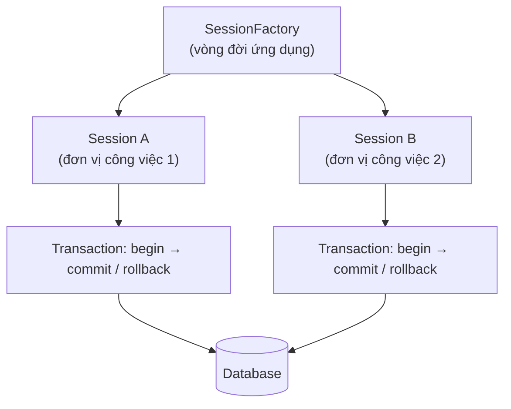
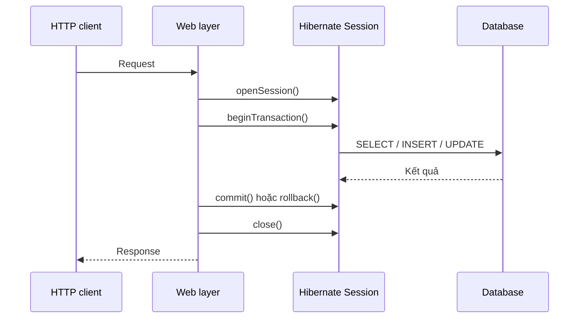
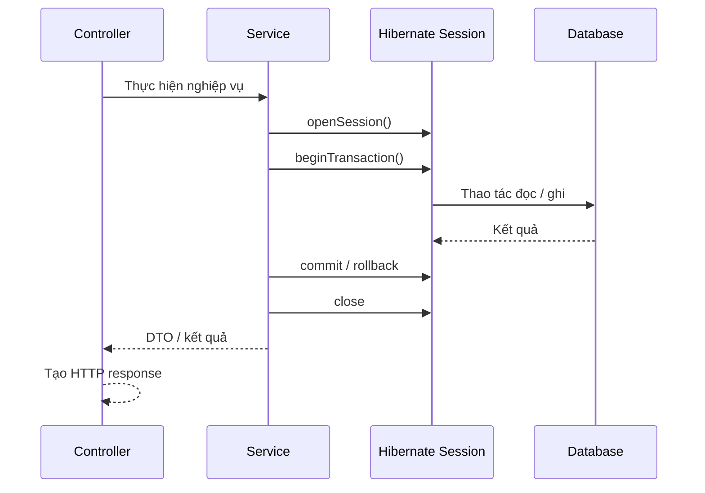
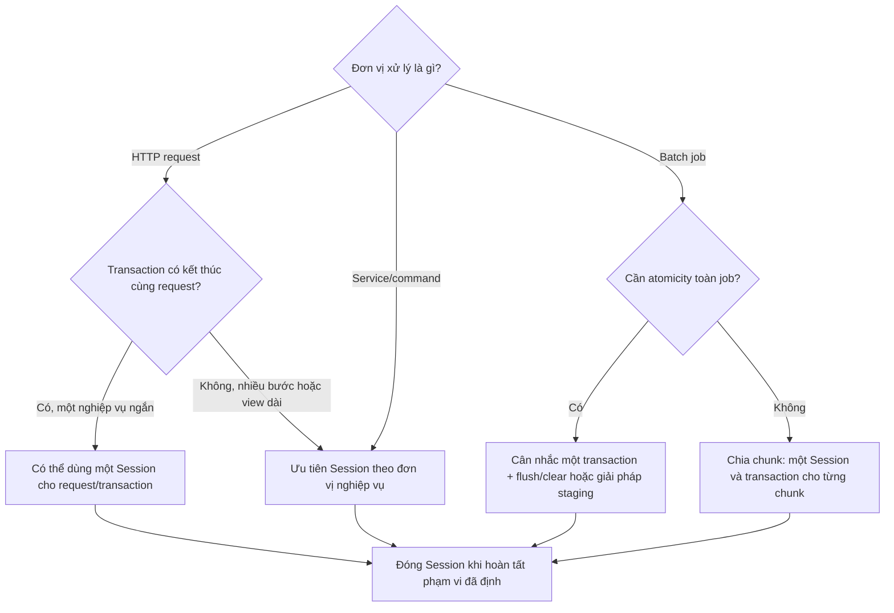

# Session theo yêu cầu, theo giao dịch hoặc theo tác vụ xử lý lô

## 1. Vì sao phải xác định phạm vi Session?

Trong Hibernate ORM, `Session` là giao diện làm việc với cơ sở dữ liệu quan hệ ở mức đối tượng. Từ một `SessionFactory` dùng chung, ứng dụng mở `Session` để tải entity, lưu dữ liệu, theo dõi thay đổi, thực hiện truy vấn và phối hợp transaction.

Quyết định **mở Session ở đâu, dùng trong bao lâu và đóng khi nào** ảnh hưởng trực tiếp đến:

- **Tính nhất quán dữ liệu:** các thao tác nào cùng nằm trong một transaction.
- **Vòng đời entity:** entity còn *managed* hay đã *detached*, có thể lazy load hay không.
- **Tài nguyên:** thời gian giữ persistence context, bộ nhớ, kết nối và các tài nguyên JDBC.
- **Khả năng chịu tải:** số lượng yêu cầu đồng thời và nguy cơ tạo transaction kéo dài.
- **Độ ổn định của công việc xử lý lô:** số entity tích lũy trong bộ nhớ, kích thước transaction và cách khôi phục khi lỗi.

Ba cách tổ chức thường gặp là **Session theo HTTP request**, **Session theo transaction/đơn vị nghiệp vụ**, và **Session theo tác vụ xử lý lô**. Đây là các **cách xác định phạm vi sử dụng Session**, không phải ba loại `Session` khác nhau.

### Phân biệt Session, transaction và kết nối

| Khái niệm | Chức năng chính | Có nên chia sẻ giữa các request/thread? |
|---|---|---|
| `SessionFactory` | Nắm mapping và dịch vụ runtime; tạo Session | Thường **có**: dùng chung, sống theo ứng dụng |
| `Session` | Persistence context, identity map, dirty checking, thao tác ORM | **Không** chia sẻ đồng thời: không thread-safe |
| `Transaction` | Ranh giới commit/rollback cho một nhóm thao tác | Gắn với phạm vi xử lý cụ thể |
| JDBC `Connection` | Kết nối vật lý hoặc logic đến database | Do connection provider/pool và Hibernate quản lý |

**Session không đồng nghĩa transaction.** Một Session có thể tồn tại qua nhiều transaction; một transaction nghiệp vụ có thể được thiết kế để dùng một Session. Chúng có quan hệ chặt chẽ nhưng không có quy tắc “một Session luôn bằng một transaction”. Việc lấy và trả connection còn phụ thuộc connection handling mode, connection pool và cấu hình ứng dụng.



## 2. Kiến thức nền về vòng đời Session

Một vòng đời cơ bản:

```java
try (Session session = sessionFactory.openSession()) {
    Transaction transaction = session.beginTransaction();
    try {
        // Đọc hoặc ghi dữ liệu trong đơn vị công việc.
        transaction.commit();
    } catch (RuntimeException ex) {
        if (transaction.isActive()) {
            transaction.rollback();
        }
        throw ex;
    }
} // Session được đóng tự động.
```

`sessionFactory` trong ví dụ đã được khởi tạo một lần từ cấu hình Hibernate; `Session` được mở cho một đơn vị xử lý cụ thể. Các import liên quan:

```java
import org.hibernate.Session;
import org.hibernate.SessionFactory;
import org.hibernate.Transaction;
```

Khi `Session` đang mở:

1. **Persistence context** theo dõi entity đang managed và bảo đảm hai lần tải cùng một thực thể theo khóa định danh trong cùng context thông thường trả về cùng instance Java.
2. **Dirty checking** có thể phát hiện thay đổi trên entity managed và phát SQL khi flush diễn ra.
3. **Lazy loading** có thể khởi tạo association chưa được tải khi Session còn khả dụng và hoàn cảnh truy cập cho phép.
4. **Flush** đồng bộ những thay đổi chờ ghi với database, nhưng **không đồng nghĩa commit**. Transaction có thể rollback sau flush.
5. **Close** kết thúc persistence context. Entity đã tải không còn managed bởi Session vừa đóng; thao tác yêu cầu lazy initialization có thể thất bại nếu dữ liệu chưa được khởi tạo.

### Session không thread-safe

Không lưu một `Session` làm singleton để nhiều request sử dụng đồng thời, không đặt một `Session` trong biến static, và không tự ý truyền Session sang các tác vụ bất đồng bộ chạy song song. Một Session có trạng thái thay đổi theo từng thao tác; các hoạt động đồng thời có thể làm hỏng giả định về persistence context, thứ tự flush và transaction.

## 3. Session theo yêu cầu HTTP (Session-per-request)

**Session-per-request** nghĩa là ứng dụng mở một `Session` tại đầu một HTTP request và đóng tại cuối request. Trong mô hình này, tất cả thành phần tham gia xử lý request có thể được thiết kế để sử dụng cùng Session, tùy cách ứng dụng tổ chức dependency và transaction.



### Khi nào phù hợp?

Mô hình này dễ hình dung trong ứng dụng web truyền thống, nơi mỗi request là một đơn vị xử lý tương đối ngắn và các thành phần xử lý đồng bộ trên cùng luồng hoặc cùng một cơ chế quản lý context rõ ràng.

Các đặc điểm:

- **Ưu điểm:** quy tắc mở/đóng gắn với lifecycle của HTTP request; nhiều tầng trong request có thể dùng chung persistence context.
- **Hạn chế:** nếu Session tồn tại qua các bước chậm như gọi mạng, render phức tạp hoặc chờ đầu vào, persistence context sống lâu hơn nhu cầu database thực tế.
- **Rủi ro thiết kế:** một request có thể thực hiện nhiều transaction hoặc giữ Session mở sau khi transaction đã kết thúc. Khi đó cần kiểm soát trạng thái entity, các lần truy vấn tiếp theo và việc lấy connection.

### Ví dụ ứng dụng với request ngắn

Đoạn mã sau mô tả handler trong ứng dụng web đồng bộ. `Book` là entity đã được ánh xạ; `BookResponse` là DTO dùng để tạo phản hồi HTTP.

```java
public BookResponse handleGetBook(long id) {
    try (Session session = sessionFactory.openSession()) {
        Transaction tx = session.beginTransaction();
        try {
            Book book = session.find(Book.class, id);
            if (book == null) {
                throw new BookNotFoundException(id);
            }

            // Lấy dữ liệu cần trả về khi session còn mở.
            BookResponse response =
                new BookResponse(book.getId(), book.getTitle());

            tx.commit();
            return response;
        } catch (RuntimeException ex) {
            if (tx.isActive()) {
                tx.rollback();
            }
            throw ex;
        }
    }
}
```

Trong ví dụ này, cả **request**, **Session** và **transaction** gần như cùng một phạm vi. Tuy nhiên, đó là **một lựa chọn thiết kế cụ thể**, không phải điều kiện bắt buộc của Session-per-request.

### Session-per-request và Open Session in View (OSIV)

Trong nhiều ứng dụng Java web, **Open Session in View** (thường còn gọi Open EntityManager in View khi dùng JPA) là biến thể giữ persistence context mở đến tầng view hoặc khi chuẩn bị response, để dữ liệu lazy có thể được tải muộn.

Ví dụ:

```text
HTTP request
    → mở Session
    → Service: transaction + lấy entity
    → commit transaction
    → Controller/View/Serializer: truy cập lazy association
    → đóng Session
    → gửi HTTP response
```

Điểm thuận tiện là tầng hiển thị có thể truy cập association chưa được tải trong tầng service. Nhưng nó cũng gây các vấn đề khó kiểm soát:

- Serializer hoặc template có thể phát sinh các câu `SELECT` không dự kiến; nguy cơ **N+1 query** tăng.
- Truy cập dữ liệu sau khi service transaction đã commit khiến ranh giới truy cập DB khó quan sát; hành vi transaction cho những lần đọc muộn phụ thuộc cấu hình.
- Thời gian Session mở phụ thuộc cả tầng HTTP/view, không chỉ thời gian nghiệp vụ cần database.

Một hướng thiết kế rõ ràng là **service truy vấn đúng tập dữ liệu cần dùng, ánh xạ sang DTO trong transaction và trả DTO cho controller**. Các kỹ thuật như `join fetch`, entity graph và projection giúp tải dữ liệu có chủ đích. OSIV không mặc nhiên sai trong mọi ứng dụng, nhưng cần hiểu chính xác thời điểm SQL có thể xảy ra.

## 4. Session theo giao dịch (Session-per-transaction)

**Session-per-transaction** mở Session khi bắt đầu một transaction hoặc một đơn vị nghiệp vụ cần truy cập database và đóng ngay sau khi transaction hoàn tất. Trong web application, một HTTP request có thể gọi **một hoặc nhiều** đơn vị nghiệp vụ; Session không bắt buộc kéo dài đến lúc HTTP response được tạo xong.



### Ưu điểm và giới hạn

- **Ưu điểm:** ranh giới tài nguyên phản ánh nghiệp vụ, transaction ngắn, thời điểm flush/commit rõ ràng, giảm việc để Session mở đến tận khâu render/serialize.
- **Ưu điểm:** dễ vận hành cùng cơ chế quản lý transaction ở service layer như `@Transactional` của Spring hoặc cơ chế Jakarta Transactions trong container phù hợp.
- **Giới hạn:** entity trả khỏi Session thường đã detached, nên code phía ngoài không được tự ý lazy load association chưa khởi tạo.
- **Lưu ý:** không mở transaction độc lập cho từng lệnh SQL nếu nghiệp vụ cần nhiều câu lệnh **commit hoặc rollback cùng nhau**.

### Ví dụ: cập nhật tên sách trong một transaction

```java
public void renameBook(long id, String newTitle) {
    try (Session session = sessionFactory.openSession()) {
        Transaction tx = session.beginTransaction();
        try {
            Book book = session.find(Book.class, id);
            if (book == null) {
                throw new BookNotFoundException(id);
            }

            book.setTitle(newTitle);
            // Dirty checking sẽ xử lý UPDATE khi flush phù hợp.
            tx.commit();
        } catch (RuntimeException ex) {
            if (tx.isActive()) {
                tx.rollback();
            }
            throw ex;
        }
    }
}
```

Ở đây, `Book` được tải và chỉnh sửa khi còn managed. Không nhất thiết phải gọi `session.update(...)` hay `session.merge(...)` chỉ để lưu một thay đổi trên entity đang managed.

### Một HTTP request có thể gồm hai transaction

Giả sử request thực hiện:

```text
POST /books/123/rename
  → transaction A: cập nhật tiêu đề sách
  → transaction B: lưu bản ghi audit độc lập
  → response
```

Nếu A và B được thiết kế là hai transaction độc lập, chúng có thể có **hai Session** khác nhau; A commit thành công nhưng B rollback thì thay đổi của A vẫn được giữ. Nếu yêu cầu nghiệp vụ là **cả hai cùng thành công hoặc cùng thất bại**, phải đặt chúng vào **cùng một ranh giới transaction** thích hợp. Không thể chỉ dựa vào việc chúng đến từ cùng một request để có tính nguyên tử.

Khi framework quản lý transaction, nên để framework cung cấp Session/EntityManager gắn với transaction hiện tại. Tự tạo `openSession()` bổ sung trong một service có transaction do framework quản lý có thể dẫn đến hai persistence context khác nhau và phá vỡ giả định chia sẻ transaction.

### Phân biệt Session-per-transaction với Session-per-operation

**Session-per-operation** thường chỉ cách mở rồi đóng Session cho từng truy vấn hoặc lệnh riêng lẻ. Nếu áp dụng máy móc trong một nghiệp vụ nhiều bước, nó dễ chia nhỏ transaction ngoài ý muốn:

```text
Không phù hợp cho thao tác chuyển tiền cần tính nguyên tử:
  Session A: trừ số dư tài khoản nguồn → commit
  Session B: cộng số dư tài khoản đích → lỗi/rollback
```

Nghiệp vụ chuyển tiền cần transaction bao trùm các cập nhật liên quan, cùng các biện pháp khóa/concurrency phù hợp. **Ranh giới nghiệp vụ** phải quyết định transaction trước; từ đó mới xác định phạm vi Session.

## 5. Session theo tác vụ xử lý lô (Session-per-batch / batch job)

Một batch job có thể nhập hàng chục nghìn bản ghi, cập nhật trạng thái dữ liệu hàng loạt hoặc chạy quy trình định kỳ. Nếu dùng một `Session` duy nhất, mặc định nó có **persistence context cấp một** (*first-level cache*) chứa các entity đã được quản lý. Khi số lượng entity tăng, bộ nhớ và chi phí dirty checking có thể tăng đáng kể.

Trong batch processing cần cân bằng giữa:

- **Kích thước transaction:** transaction quá lớn có thể giữ lock, log và tài nguyên lâu; chia nhỏ transaction thì mất tính nguyên tử toàn job.
- **Dung lượng persistence context:** nhiều entity managed cùng lúc tiêu thụ RAM.
- **Số lần round-trip SQL:** insert/update riêng lẻ có chi phí khác so với JDBC batching và bulk DML.
- **Khả năng tiếp tục khi lỗi:** một job dài có thể cần checkpoint, idempotency, retry và ghi nhận chunk đã hoàn thành.

**Session theo batch không phải một class mới.** Ta vẫn dùng `Session` bình thường nhưng điều chỉnh **độ dài session, số entity được giữ, cách flush/clear và phạm vi transaction** cho công việc số lượng lớn.

### 5.1. Vì sao không nên lưu tất cả entity trong một Session mà không clear?

```java
try (Session session = sessionFactory.openSession()) {
    Transaction tx = session.beginTransaction();
    try {
        for (String title : incomingTitles) {
            session.persist(new Book(title));
        }
        tx.commit();
    } catch (RuntimeException e) {
        if (tx.isActive()) {
            tx.rollback();
        }
        throw e;
    }
}
```

Vòng lặp này dễ hiểu và có thể dùng cho tập dữ liệu nhỏ. Nhưng với tập dữ liệu rất lớn, Session giữ nhiều `Book` managed tới tận cuối transaction. Dù có cấu hình JDBC batching, bản thân batching **không tự giải phóng persistence context**.

### 5.2. Chiến lược A: một transaction, flush và clear theo chu kỳ

Khi công việc yêu cầu tính nguyên tử trên toàn bộ dữ liệu và kích thước transaction vẫn chấp nhận được, bạn có thể định kỳ `flush()` rồi `clear()`:

```java
public void importBooksAtomically(List<String> titles) {
    final int flushInterval = 50;

    try (Session session = sessionFactory.openSession()) {
        Transaction tx = session.beginTransaction();
        try {
            for (int i = 0; i < titles.size(); i++) {
                session.persist(new Book(titles.get(i)));

                if ((i + 1) % flushInterval == 0) {
                    session.flush(); // Đẩy SQL đang chờ xuống JDBC.
                    session.clear(); // Tách entity khỏi persistence context.
                }
            }

            tx.commit(); // Flush các thay đổi còn lại rồi commit.
        } catch (RuntimeException ex) {
            if (tx.isActive()) {
                tx.rollback();
            }
            throw ex;
        }
    }
}
```

**Diễn giải:**

1. `persist(...)` đưa entity mới vào persistence context.
2. Mỗi 50 entity, `flush()` yêu cầu Hibernate đồng bộ các thay đổi đang chờ với database.
3. `clear()` xóa các entity managed khỏi persistence context của Session hiện tại; các tham chiếu entity đã giữ bên ngoài sẽ thành detached.
4. `commit()` hoàn thành transaction. Các lệnh đã được flush **vẫn có thể rollback** nếu transaction thất bại trước commit.

Vì dùng **một transaction duy nhất**, toàn job vẫn có rủi ro transaction kéo dài. Cách này hợp lý khi yêu cầu tính nguyên tử thực sự cần và khối lượng dữ liệu/nguồn lực cho phép. Không nên hiểu `flush()` là commit từng 50 bản ghi.

### 5.3. Chiến lược B: một Session và transaction cho mỗi chunk

Khi batch có thể chia thành các phần độc lập, cách thực dụng hơn thường là **mỗi chunk có Session và transaction riêng**:

```java
public int importBooksByChunk(List<String> titles) {
    final int chunkSize = 100;
    int imported = 0;

    for (int start = 0; start < titles.size(); start += chunkSize) {
        int end = Math.min(start + chunkSize, titles.size());

        try (Session session = sessionFactory.openSession()) {
            Transaction tx = session.beginTransaction();
            try {
                for (int i = start; i < end; i++) {
                    session.persist(new Book(titles.get(i)));
                }

                tx.commit(); // Commit riêng chunk hiện tại.
                imported += end - start;
            } catch (RuntimeException ex) {
                if (tx.isActive()) {
                    tx.rollback();
                }
                throw ex;
            }
        }
    }

    return imported;
}
```

Với thiết kế này:

- Persistence context tồn tại tối đa trong một chunk rồi được đóng.
- Các bản ghi của chunk đã commit không bị rollback nếu chunk sau thất bại.
- Job có thể ghi nhận tiến độ sau từng chunk và tiếp tục từ checkpoint, **nếu đã thiết kế idempotency hoặc cơ chế chống ghi trùng**.
- Kết quả là **transaction theo chunk**, không phải một transaction duy nhất cho toàn job.

Trong ví dụ trên, dữ liệu đầu vào đã ở dạng `List` trong bộ nhớ. Với file hàng triệu dòng hoặc nguồn streaming, nên đọc từng khối để không tải toàn bộ danh sách vào RAM ngay từ đầu.

### 5.4. SQL batching và phạm vi Session là hai điều khác nhau

Hibernate có thể gom nhiều thao tác DML thành JDBC batch khi được cấu hình. Ví dụ:

```properties
hibernate.jdbc.batch_size=50
hibernate.order_inserts=true
hibernate.order_updates=true
```

Ý nghĩa:

- `hibernate.jdbc.batch_size` đặt kích thước batch JDBC theo cấu hình Hibernate.
- `hibernate.order_inserts` và `hibernate.order_updates` có thể giúp nhóm các thao tác cùng dạng để tăng cơ hội batching; tác động thực tế phụ thuộc workload.
- Cơ chế sinh khóa `IDENTITY` thường ngăn Hibernate dùng JDBC insert batching cho entity tương ứng, vì phải nhận giá trị định danh khi insert. Nếu tối ưu insert hàng loạt là quan trọng, cân nhắc chiến lược sinh khóa phù hợp database và schema, chẳng hạn sequence allocation khi được hỗ trợ.

**Không được đồng nhất “100 entity trong một chunk” với “một lệnh SQL batch 100 entity”.** Session/transaction boundary quyết định vòng đời và tính nguyên tử; JDBC batching quyết định cách nhóm các lệnh SQL. Database driver, ID generation, loại statement và cấu hình Hibernate ảnh hưởng đến kết quả batching.

### 5.5. Cập nhật hàng loạt và StatelessSession

Với cập nhật số lượng lớn, lựa chọn không chỉ là lặp qua entity rồi dirty checking:

- **Bulk HQL/JPQL update/delete:** phù hợp khi nhiều dòng có thể được thay đổi bằng một câu lệnh có điều kiện, ví dụ cập nhật trạng thái theo ngày hết hạn. Bulk DML có ngữ nghĩa khác thao tác trên managed entity; cần chú ý sự nhất quán của persistence context hiện hành.
- **Scrollable results / đọc theo luồng:** hữu ích khi cần xử lý nhiều dòng mà không giữ toàn bộ tập kết quả; cần quản lý thời gian transaction, fetch size và tài nguyên cursor.
- **`StatelessSession`:** Hibernate cung cấp API khác, bỏ qua persistence context theo kiểu stateful Session và một số cơ chế như dirty checking tự động. Thích hợp cho một số thao tác bulk có kiểm soát; không phải thay thế tương đương `Session` trong mọi workflow, nhất là nơi cần cascading, identity map hay lifecycle events.

Việc chọn API phải xuất phát từ **yêu cầu cập nhật, nhất quán, số bản ghi và khả năng phục hồi**, không chỉ từ kích thước dữ liệu.

## 6. So sánh ba phạm vi Session

| Tiêu chí | Theo request | Theo transaction | Theo batch/job |
|---|---|---|---|
| Điểm bắt đầu | Khi request vào ứng dụng | Khi đơn vị nghiệp vụ/transaction bắt đầu | Khi chunk hoặc job bắt đầu |
| Điểm kết thúc | Khi xử lý request kết thúc | Khi transaction/đơn vị nghiệp vụ kết thúc | Khi chunk/job kết thúc |
| Phạm vi thường gặp | Một HTTP request | Một service operation | Import, export, migration, xử lý nền |
| Số transaction trong một Session | Có thể một hoặc nhiều | Thường một | Một transaction/job hoặc mỗi chunk một transaction |
| Rủi ro chính | Session sống quá lâu qua tầng web/view; lazy query không kiểm soát | Detached entity sau service; thao tác nhiều bước bị chia nhỏ transaction | Tăng RAM, transaction dài, lỗi một phần và retry |
| Cách xử lý phổ biến | DTO/projection, đóng Session đúng lifecycle | Ranh giới transaction ở service, tải đủ dữ liệu cần dùng | Chia chunk, `flush()/clear()`, JDBC batching, checkpoint |
| Mức khuyến nghị | Chọn có chủ đích theo kiến trúc web | Lựa chọn rõ ràng cho phần lớn service nghiệp vụ | Tùy yêu cầu atomicity và khối lượng |

Điểm quan trọng: **một request có thể chứa một hoặc nhiều transaction; một job có thể chia thành nhiều transaction; một Session có thể tồn tại qua nhiều transaction nhưng không phải lúc nào cũng nên làm thế.** Đây là ba trục phạm vi có thể khác nhau.

## 7. Chọn ranh giới theo tình huống

### Tình huống A — API đọc thông tin đơn hàng

**Mục tiêu:** `GET /orders/{id}` trả về mã đơn, các dòng hàng và tổng tiền.

Cách tổ chức:

1. Controller gọi service đọc đơn hàng.
2. Service mở transaction đọc theo cơ chế của framework hoặc Hibernate.
3. Tải các association cần trả về bằng fetch plan/projection phù hợp.
4. Ánh xạ sang DTO ngay trong phạm vi Session.
5. Đóng Session/transaction, controller trả DTO.

Đây là ví dụ điển hình của **Session theo transaction**. Nếu ứng dụng dùng OSIV, cần tránh để JSON serializer tự phát SQL không dự kiến khi đi qua entity graph.

### Tình huống B — Tạo đơn hàng và ghi các dòng hàng

**Mục tiêu:** hoặc tất cả thay đổi đơn hàng được lưu, hoặc không có thay đổi nào được commit.

Giữ một **transaction nghiệp vụ** bao trùm tạo `Order`, tạo `OrderLine` và cập nhật dữ liệu liên quan nếu chúng phải commit cùng nhau. Việc chia thành nhiều `Session` và commit từng dòng hàng có thể tạo trạng thái dữ liệu dở dang khi một phần thất bại.

### Tình huống C — Nhập 500.000 bản ghi từ CSV

**Mục tiêu:** xử lý khối lượng lớn và có khả năng chạy lại sau lỗi.

Thường cần:

- Đọc dữ liệu đầu vào theo stream/chunk.
- Mở Session và transaction cho từng chunk.
- Ghi nhận checkpoint hoặc mã định danh xử lý để retry an toàn.
- Đo thời gian commit, memory, database lock và throughput để điều chỉnh kích thước chunk/batch.

Nếu tính nguyên tử cho toàn bộ 500.000 bản ghi là yêu cầu bắt buộc, thiết kế transaction, staging table hoặc quy trình chuyển trạng thái cần được đánh giá riêng; chia chunk commit riêng không đáp ứng atomicity toàn job.

## 8. Entity managed, detached và lazy loading theo phạm vi

Giả sử entity `Order` có association `lines` được tải lazy.

```java
Order detachedOrder;

try (Session session = sessionFactory.openSession()) {
    Transaction tx = session.beginTransaction();
    try {
        detachedOrder = session.find(Order.class, orderId);
        tx.commit();
    } catch (RuntimeException e) {
        if (tx.isActive()) {
            tx.rollback();
        }
        throw e;
    }
}

// Session đã đóng. Nếu lines chưa được khởi tạo,
// truy cập sau đây có thể ném LazyInitializationException:
int count = detachedOrder.getLines().size();
```

Cách tiếp cận an toàn hơn là tải association trong transaction hoặc truy vấn thẳng dữ liệu DTO:

```java
public OrderSummary findSummary(long orderId) {
    try (Session session = sessionFactory.openSession()) {
        Transaction tx = session.beginTransaction();
        try {
            Order order = session.createQuery(
                "select distinct o from Order o " +
                "left join fetch o.lines " +
                "where o.id = :id",
                Order.class
            ).setParameter("id", orderId)
             .getSingleResult();

            OrderSummary dto = new OrderSummary(
                order.getId(),
                order.getLines().size()
            );

            tx.commit();
            return dto;
        } catch (RuntimeException e) {
            if (tx.isActive()) {
                tx.rollback();
            }
            throw e;
        }
    }
}
```

Ví dụ giả định các class `Order` và `OrderSummary` đã được định nghĩa đúng; `Order.lines` là collection association được ánh xạ. Khi viết truy vấn thực tế, cần cân nhắc số collection join fetch, phân trang và kích thước tập kết quả. Ý chính là dữ liệu cần dùng được chuẩn bị **trước khi Session đóng**.

### Không kéo dài Session chỉ để tránh lỗi lazy

Khi gặp `LazyInitializationException`, không nên mặc nhiên kéo dài Session đến mọi tầng của hệ thống. Trước tiên xác định **đầu ra nghiệp vụ cần những trường nào** và tải chúng trong transaction phù hợp. Kéo dài Session giải quyết việc truy cập lazy trước mắt nhưng có thể che khuất truy vấn N+1 và làm mờ ranh giới giao tiếp database.

## 9. Quản lý tài nguyên, lỗi và tính nhất quán

### Luôn đóng Session qua try-with-resources

`Session` hỗ trợ `AutoCloseable`; sử dụng `try (Session session = ...)` giúp đóng Session kể cả khi ném exception. Khi code nằm trong framework quản lý session/transaction, hãy sử dụng đúng lifecycle của framework thay vì đóng thủ công một Session mà framework đang sở hữu.

### Luôn xác định commit và rollback

Sau lỗi SQL/Hibernate trong transaction, thông thường **rollback và bỏ Session hiện tại**. Không cố “sửa lỗi rồi tiếp tục bình thường” trên một Session có trạng thái không còn đáng tin cậy sau exception persistence. Truyền lỗi để tầng gọi xử lý retry ở ranh giới transaction mới khi an toàn.

### Cẩn thận với transaction dài

Transaction dài có thể gây giữ lock, tăng transaction log/WAL, kéo dài thời gian giữ database resources và làm tăng nguy cơ xung đột. Đóng Session không thay thế cho commit/rollback có chủ đích. Ngược lại, chỉ gọi `flush()` không kết thúc transaction.

### Đừng đưa thao tác chờ không cần thiết vào transaction

Gọi HTTP service ngoài, đợi người dùng, xử lý file rất lớn hoặc tạo báo cáo lâu có thể kéo dài transaction mà không có ích. Nên thiết kế ranh giới sao cho chỉ chứa những bước cần tính nhất quán ở database, đồng thời xác định cách phối hợp thay đổi liên hệ đến hệ thống ngoài (ví dụ outbox, saga) nếu thực sự cần.

### Kiểm soát retry cho batch

Với commit theo chunk, có thể đã ghi thành công các chunk trước khi chunk sau ném lỗi. Khi chạy lại, phải tránh ghi trùng bằng khóa nghiệp vụ/unique constraint, upsert hoặc sổ ghi checkpoint phù hợp. Không retry mù toàn job nếu không biết phần nào đã commit.

## 10. Các nhầm lẫn phổ biến

**“Mỗi request bắt buộc phải có đúng một transaction.”**  
Không. Một request có thể chỉ đọc, hoặc chứa nhiều nghiệp vụ. Transaction phải được xác định theo tính nhất quán cần bảo đảm. Một request có thể có một transaction, nhiều transaction hoặc không truy cập database.

**“Đã commit thì Session tự đóng.”**  
Không. `commit()` kết thúc transaction; đóng Session là hành động/vòng đời riêng. Trong `try-with-resources`, Session đóng khi ra khỏi block. Một số framework điều phối điều này giúp bạn.

**“Đóng Session thì dữ liệu đã commit mất.”**  
Không. Commit quyết định thay đổi database; đóng Session giải phóng persistence context và tài nguyên liên quan. Entity Java vẫn tồn tại như đối tượng detached, nhưng không còn được Session cũ quản lý.

**“Flush giống commit.”**  
Không. Flush gửi các thao tác đang chờ tới database trong phạm vi transaction; commit xác nhận transaction. Flush rồi rollback vẫn có thể hủy các thay đổi đó.

**“Batch size bằng số entity trong Session.”**  
Không. JDBC batch size, kích thước chunk, số entity managed và transaction size là các biến khác nhau. Từng biến ảnh hưởng đến hiệu năng và tính nhất quán theo cách khác nhau.

**“Session là đối tượng thread-safe vì SessionFactory thread-safe.”**  
Không. `SessionFactory` được chia sẻ giữa các luồng, còn `Session` là stateful và phải được dùng theo phạm vi xử lý rõ ràng.

**“Muốn JSON serializer không lỗi lazy thì luôn bật OSIV.”**  
OSIV là một chiến lược, không phải yêu cầu bắt buộc. Tải dữ liệu và ánh xạ DTO trong transaction thường giúp nhìn thấy truy vấn và kiểm soát API response rõ hơn.

## 11. Hướng dẫn quyết định nhanh



Để lựa chọn sát thực tế, trả lời các câu hỏi sau:

1. **Đơn vị nghiệp vụ nào phải commit/rollback cùng nhau?** Đây là cơ sở xác định transaction.
2. **Entity cần còn managed trong bao lâu?** Đây là cơ sở xác định Session.
3. **Có dữ liệu lazy nào phải trả về sau transaction không?** Nếu có, xác định fetch plan và chuyển sang DTO đúng thời điểm.
4. **Khối lượng dữ liệu có khiến persistence context phình to không?** Nếu có, cần chunk, flush/clear hoặc API bulk phù hợp.
5. **Khi thao tác thất bại, phần nào được phép giữ lại?** Câu trả lời phân biệt transaction toàn job với transaction theo chunk.

## 12. Tổng kết nguyên tắc kỹ thuật

- **Session-per-request** đồng bộ vòng đời Session với vòng đời HTTP request; thuận tiện cho web layer nhưng cần quản lý tác dụng phụ của truy vấn lazy và thời gian sống của Session.
- **Session-per-transaction** gắn Session với đơn vị công việc cần commit/rollback; phù hợp để kiểm soát business transaction, tài nguyên và dữ liệu trả về service.
- **Session-per-batch** lựa chọn phạm vi Session/transaction theo chunk hoặc toàn job; cần chủ động kiểm soát persistence context bằng `flush()/clear()`, tối ưu JDBC batching và khả năng phục hồi.

Với ứng dụng Hibernate ORM thông thường, nên **bắt đầu từ ranh giới nghiệp vụ và transaction**, sau đó chọn phạm vi Session đủ ngắn để thực hiện công việc. Đối với batch, thêm yêu cầu về giới hạn bộ nhớ, kích thước transaction và xử lý lỗi một phần vào quyết định đó.

### Tài liệu tham khảo

- [Hibernate ORM — User Guide](https://docs.jboss.org/hibernate/orm/current/userguide/html_single/Hibernate_User_Guide.html)
- [Hibernate ORM — Transactions and concurrency](https://docs.jboss.org/hibernate/orm/current/userguide/html_single/Hibernate_User_Guide.html#transactions)
- [Hibernate ORM — Batching](https://docs.jboss.org/hibernate/orm/current/userguide/html_single/Hibernate_User_Guide.html#batch)
- [Hibernate ORM — Session Javadocs](https://docs.jboss.org/hibernate/orm/current/javadocs/org/hibernate/Session.html)
