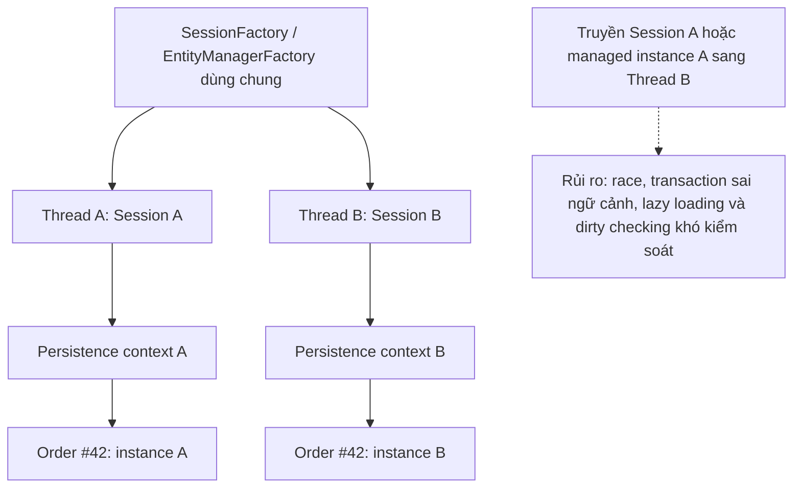
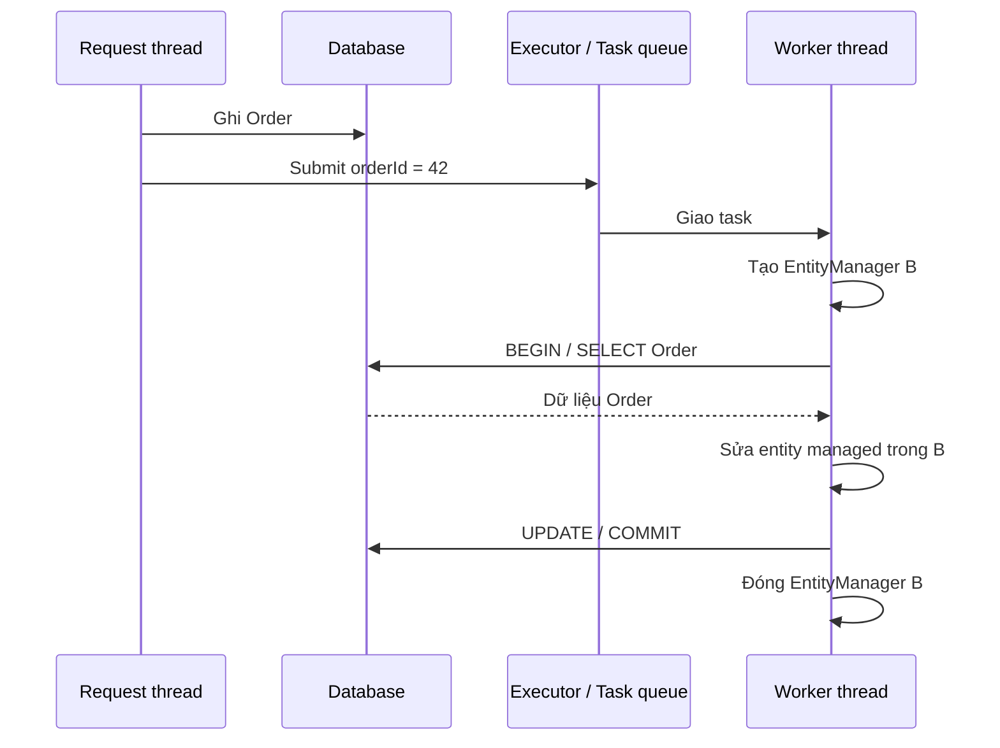
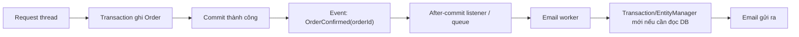

# Không truyền Session hoặc thực thể đang quản lý sang luồng khác tùy tiện

## 1. Vấn đề: một luồng khác không có nghĩa là một phiên Hibernate khác

Trong ứng dụng dùng Hibernate, xử lý song song giúp tránh chặn luồng yêu cầu, thực hiện tác vụ nền hoặc tận dụng nhiều lõi CPU. Tuy nhiên, việc chuyển đối tượng liên quan đến ORM từ luồng này sang luồng khác có những giới hạn đặc biệt.

Hai quy tắc cần ghi nhớ:

1. **Không sử dụng đồng thời cùng một `Session` / `EntityManager` từ nhiều luồng.** Chúng là đối tượng có trạng thái thay đổi trong quá trình làm việc với persistence context, transaction và tài nguyên cơ sở dữ liệu; chúng không được thiết kế để chia sẻ đồng thời.
2. **Không mặc nhiên truyền một entity đang được quản lý (*managed entity*) sang luồng khác để đọc, sửa hoặc tải lazy association.** Entity vẫn gắn với persistence context ban đầu. Việc đưa tham chiếu Java của nó vào một task không làm entity chuyển sang session của task đó.

Điều này áp dụng cho API native Hibernate (`org.hibernate.Session`) lẫn Jakarta Persistence (`jakarta.persistence.EntityManager`). Khi Hibernate là provider, `Session` mở rộng `EntityManager`; cả hai đều đại diện cho một phiên làm việc ORM.

Phân biệt với **`SessionFactory` / `EntityManagerFactory`**: factory được thiết kế để chia sẻ giữa các luồng và tạo các phiên độc lập. Cần chia sẻ factory, không chia sẻ session đang làm việc.



Cùng một hàng trong database có thể xuất hiện ở hai persistence context dưới hai instance Java khác nhau. Hai phiên có thể chạy trên hai thread khác nhau, nhưng mỗi phiên phải được sử dụng phù hợp với vòng đời và transaction của riêng nó.

## 2. Hiểu đúng vòng đời của Session và persistence context

Một `Session` (hoặc `EntityManager`) đại diện cho một **persistence context**. Trong đó, Hibernate duy trì:

- Các entity đang được quản lý, thường theo cặp loại entity và định danh (*first-level cache* / *identity map*).
- Trạng thái entity phục vụ **dirty checking**: phát hiện thay đổi thuộc tính cần cập nhật database.
- Các thao tác insert, update, delete đang chờ đồng bộ (*flush*).
- Thông tin và cơ chế phục vụ việc truy vấn, lazy loading và phối hợp transaction.
- Truy cập tài nguyên JDBC khi cần theo chiến lược quản lý kết nối tương ứng.

Ví dụ:

```java
EntityManager em = emf.createEntityManager();

try {
    Order a = em.find(Order.class, 42L);
    Order b = em.find(Order.class, 42L);

    System.out.println(a == b); // Thông thường true trong cùng context.
} finally {
    em.close();
}
```

Trong cùng persistence context, Hibernate bảo đảm tính đồng nhất identity cho một entity có cùng loại và khóa chính. Khi tạo `EntityManager` khác, identity map cũng khác:

```java
EntityManager emA = emf.createEntityManager();
EntityManager emB = emf.createEntityManager();

try {
    Order a = emA.find(Order.class, 42L);
    Order b = emB.find(Order.class, 42L);

    // a và b có thể cùng biểu diễn hàng Order #42,
    // nhưng không phải cùng một managed instance.
} finally {
    emB.close();
    emA.close();
}
```

### 2.1. Các trạng thái cơ bản của entity

| Trạng thái | Ý nghĩa | Có phải đối tượng tự động an toàn để chia sẻ giữa thread? |
|---|---|---|
| **New / transient** | Đối tượng Java mới tạo, chưa được persistence context quản lý. | Không tự động. Nếu là đối tượng mutable, cần quy tắc đồng bộ như mọi Java object khác. |
| **Managed / persistent** | Đang được một `EntityManager`/`Session` quản lý; thay đổi có thể được phát hiện bằng dirty checking. | **Không.** Cần giữ trong phạm vi phiên và transaction phù hợp. |
| **Detached** | Từng được quản lý nhưng không còn gắn với persistence context hiện tại. | Không tự động. Có thể còn proxy/lazy association và các field mutable. |
| **Removed** | Entity managed được đánh dấu để xóa trong context. | Không. Nó vẫn chịu sự quản lý của phiên cho tới khi trạng thái được xử lý. |

**Quan trọng:** *managed* là quan hệ giữa entity instance và persistence context, không phải một annotation đặt vào Java object hay thuộc tính “gắn với thread”. Gửi object qua hàng đợi hoặc trả nó từ `CompletableFuture` **không detach, không clone và không chuyển quyền quản lý**.

### 2.2. Thread, transaction và persistence context liên quan thế nào?

Đó là ba khái niệm khác nhau:

- **Thread:** nơi Java code được thực thi.
- **Transaction:** ranh giới nhất quán của các thao tác dữ liệu, có `commit` hoặc `rollback`.
- **Persistence context:** tập entity managed và trạng thái ORM bên trong `Session`/`EntityManager`.

Trong nhiều framework, transaction và persistence context thường được **gắn với ngữ cảnh thực thi hiện tại**, điển hình là thread đang xử lý request. Khi tạo thread mới bằng `ExecutorService`, `new Thread(...)`, `CompletableFuture.supplyAsync(...)` hoặc `@Async`, không được giả định transaction và entity manager của thread gọi sẽ tự động xuất hiện ở thread mới.

Ngay cả khi cấu hình cho phép một session tồn tại qua nhiều transaction, việc đó **không làm session trở thành thread-safe**.

## 3. Vì sao chia sẻ Session giữa các thread là sai?

`Session` giữ trạng thái mutable phục vụ ORM. Nhiều lời gọi có thể cùng tác động đến identity map, hàng đợi thao tác, trạng thái dirty checking, truy vấn đang thực hiện và lifecycle của session. Một thread có thể đang gọi `flush()` hoặc `close()` trong lúc thread khác gọi `persist()` hay `find()`.

Những kết quả có thể xảy ra gồm:

- Kết quả truy vấn hoặc trạng thái entity không nhất quán với giả định của code.
- Entity bị cập nhật trong lúc phiên đang flush, khiến dữ liệu ghi xuống không phản ánh ý định của ứng dụng.
- Lỗi khi một thread đóng session trong khi thread khác còn đang sử dụng.
- Lazy loading hoặc JDBC access xảy ra ngoài transaction/phiên dự kiến.
- Các exception nội bộ, race condition hoặc hành vi khó tái hiện; **không có một loại exception cố định** báo mọi trường hợp sai.

### 3.1. Ví dụ sai: truyền cùng Session vào thread pool

```java
import org.hibernate.Session;
import java.util.concurrent.ExecutorService;

void unsafe(Session session,
            ExecutorService executor,
            Long orderId) {

    executor.submit(() -> {
        // SAI: session có thể đang được sử dụng ở thread gọi.
        Order order = session.find(Order.class, orderId);
        order.setStatus("PROCESSED");
        session.flush();
    });
}
```

Ở đây, tham chiếu `session` vốn thuộc một đơn vị công việc lại được task bất đồng bộ sử dụng. Việc thread gọi cũng đang sử dụng hoặc kết thúc transaction/đóng session làm vấn đề nghiêm trọng hơn.

Không thể khắc phục đơn giản bằng `volatile Session` hay một biến `static`. `volatile` chỉ có tác dụng về visibility của tham chiếu Java, **không biến các thao tác Hibernate thành an toàn đồng thời**.

### 3.2. Một đoạn code còn nguy hiểm dù chỉ một thread dùng Session tại một thời điểm

```java
Session session = sessionFactory.openSession();
executor.submit(() -> session.find(Order.class, 42L));

// Thread hiện tại có thể đi tiếp và đóng session
// trước khi task kịp sử dụng.
session.close();
```

Ngay cả khi không có hai truy vấn chạy đúng cùng lúc, lịch chạy bất đồng bộ tạo ra **lỗi vòng đời**: task có thể sử dụng đối tượng đã đóng. Các điều kiện về transaction cũng không được bảo đảm.

Do đó, không nên xem việc khóa `synchronized(session)` như một kiến trúc chia sẻ session hợp lệ. Có khóa vẫn phải giải quyết ranh giới transaction, thứ tự đóng tài nguyên, lazy loading, lỗi và khả năng mở rộng. Cách đúng là tạo/nhận một session phù hợp trong mỗi đơn vị công việc.

## 4. Vì sao truyền managed entity sang thread khác cũng rủi ro?

Một entity Hibernate thông thường có vẻ chỉ là POJO:

```java
@Entity
public class Order {
    @Id
    private Long id;

    private String status;

    public void setStatus(String status) {
        this.status = status;
    }
}
```

Nhưng khi được tải bằng `em.find(Order.class, id)`, đối tượng này đang được quản lý bởi persistence context của `em`. Hibernate có thể theo dõi thay đổi của các field và điều phối các association tải muộn.

### 4.1. Sai: hai thread sửa cùng managed instance

```java
Order order = em.find(Order.class, orderId);

executor.submit(() -> order.setStatus("SHIPPED"));

// Trong lúc thread khác sửa cùng instance:
order.setStatus("CONFIRMED");
em.flush();
```

Đây là **data race của Java** trên `status` và đồng thời là lỗi thiết kế ranh giới Hibernate. Không có bảo đảm thread nào ghi cuối, thay đổi nào được thấy trước khi `flush()`, hoặc giá trị nào phản ánh ý định nghiệp vụ.

Kể cả entity có setter đơn giản, object đang managed không trở thành đối tượng chia sẻ an toàn. Dirty checking của Hibernate không có chức năng điều phối các thread cùng sửa object.

### 4.2. Sai: lấy lazy association sau khi session đóng

Giả sử `Order` có collection `items` tải muộn:

```java
@Entity
public class Order {
    @Id
    private Long id;

    @OneToMany(mappedBy = "order", fetch = FetchType.LAZY)
    private List<OrderItem> items = new ArrayList<>();

    public List<OrderItem> getItems() {
        return items;
    }
}
```

Đoạn code sau có thể lỗi:

```java
Order order = em.find(Order.class, orderId);

em.close();

executor.submit(() -> {
    // Nếu items chưa khởi tạo, truy cập có thể ném
    // org.hibernate.LazyInitializationException.
    int count = order.getItems().size();
    System.out.println(count);
});
```

Sau `close()`, entity thường trở thành detached. Khi collection lazy chưa được khởi tạo, nó không còn một persistence context mở phù hợp để tự tải dữ liệu. Nếu giữ session mở và cho thread phụ dùng lazy association, lại rơi vào vấn đề chia sẻ session xuyên luồng.

**Không nên bật lazy loading ngoài transaction hoặc kéo dài session chỉ để cho thread phụ đọc dữ liệu**. Thay vào đó, chủ động xác định dữ liệu mà task cần và truy vấn hoặc chuyển đổi dữ liệu trong ranh giới thích hợp.

### 4.3. Truyền entity qua thread không khiến nó trở thành detached

```java
Order managed = em.find(Order.class, orderId);

executor.submit(() -> consume(managed));
```

`managed` vẫn là cùng tham chiếu Java, và nếu `em` còn mở, nó vẫn thuộc persistence context ban đầu. `consume` không sở hữu entity manager mới chỉ vì được chạy ở thread khác. Nếu thread chính đóng `em`, entity trở thành detached theo vòng đời của context, chứ không phải vì đã được gửi vào executor.

### 4.4. Detached entity cũng chưa chắc thích hợp để chia sẻ

Có thể chủ động gọi `em.detach(entity)` hoặc đóng `EntityManager` để entity không còn managed, nhưng detached entity vẫn thường là **đối tượng mutable**, có thể chứa tham chiếu tới entity khác, collection do ORM quản lý hoặc proxy lazy chưa khởi tạo.

Detached chỉ có nghĩa Hibernate không còn tự dirty-check instance đó trong context cũ; nó **không bảo đảm bất biến, thread-safety hoặc eager loading mọi quan hệ**. Nếu cần dữ liệu truyền giữa các thread, dạng snapshot/DTO rõ ràng thường dễ kiểm soát hơn.

## 5. Cách 1: Truyền ID, mở EntityManager riêng ở thread nhận

Đây là lựa chọn phù hợp khi task nền **cần đọc hoặc cập nhật database**. Chỉ truyền giá trị định danh, sau đó truy vấn entity trong context của task.



### 5.1. Ví dụ Java SE dùng `EntityManagerFactory`

Giả sử đã có entity `Order` với `setStatus(String)` và persistence unit cấu hình transaction `RESOURCE_LOCAL`:

```java
import jakarta.persistence.EntityManager;
import jakarta.persistence.EntityManagerFactory;
import jakarta.persistence.EntityTransaction;

import java.util.concurrent.ExecutorService;
import java.util.concurrent.Executors;
import java.util.concurrent.Future;

public final class OrderJobService implements AutoCloseable {

    // Factory dùng chung an toàn giữa các thread.
    private final EntityManagerFactory emf;

    private final ExecutorService executor =
            Executors.newFixedThreadPool(2);

    public OrderJobService(EntityManagerFactory emf) {
        this.emf = emf;
    }

    public Future<Void> processAsync(Long orderId) {
        // Chỉ chuyển ID (giá trị bất biến), không chuyển Session/Entity.
        return executor.submit(() -> {
            EntityManager em = emf.createEntityManager();

            try {
                EntityTransaction tx = em.getTransaction();

                try {
                    tx.begin();

                    Order order = em.find(Order.class, orderId);
                    if (order == null) {
                        throw new IllegalArgumentException(
                                "Không tồn tại Order #" + orderId
                        );
                    }

                    order.setStatus("PROCESSED");

                    // Dirty checking và commit trong context của worker.
                    tx.commit();
                    return null;
                } catch (RuntimeException ex) {
                    if (tx.isActive()) {
                        tx.rollback();
                    }
                    throw ex;
                }
            } finally {
                em.close();
            }
        });
    }

    @Override
    public void close() {
        executor.shutdown();
        // Ứng dụng có thể chờ các task còn lại trước khi đóng emf.
    }
}
```

Sử dụng:

```java
// emf do ứng dụng khởi tạo và quản lý vòng đời.
OrderJobService jobs = new OrderJobService(emf);

try {
    // orderId này phải tham chiếu một bản ghi đã commit.
    Future<Void> result = jobs.processAsync(orderId);

    // Chờ kết quả nếu luồng gọi cần biết task đã thành công.
    result.get();
} finally {
    jobs.close();
}

// Chỉ đóng emf khi toàn bộ công việc cần dùng nó đã kết thúc.
```

Giải thích các ranh giới:

1. `emf` có thể được chia sẻ. Mỗi task gọi `emf.createEntityManager()` để sở hữu persistence context riêng.
2. `orderId` là dữ liệu đơn giản, độc lập với session và lazy association.
3. Worker tự bắt đầu và kết thúc transaction `RESOURCE_LOCAL`.
4. Entity `order` được tải và sửa **trong chính entity manager của worker**.
5. `em.close()` luôn chạy trong `finally`, kể cả khi task lỗi.

Mã minh họa dùng `Future.get()` để nhận lỗi task. Một hệ thống thực tế cần quyết định retry, timeout, backpressure, giám sát và cách dừng executor sao cho các task hoàn tất trước khi đóng factory. `shutdown()` ngừng nhận task mới nhưng không tự chờ mọi task đã chạy xong; cần phối hợp vòng đời tương ứng.

### 5.2. Điều kiện rất quan trọng: commit trước khi worker đọc

Không nên:

```java
tx.begin();
em.persist(order);

// Nếu worker đọc ngay, INSERT có thể chưa được commit.
jobs.processAsync(order.getId());

tx.commit();
```

Worker dùng transaction riêng và thông thường **không thể dựa vào dữ liệu chưa commit** của transaction phía caller. ID có thể đã được cấp nhưng bản ghi vẫn chưa visible với một transaction khác. Nếu transaction caller rollback, task nền thậm chí có thể xử lý một bản ghi không tồn tại.

Cách đơn giản là enqueue **sau khi commit thành công**:

```java
tx.begin();
em.persist(order);
tx.commit(); // Dữ liệu đã được commit.

jobs.processAsync(order.getId());
```

Trong ứng dụng cần bảo đảm task không bị mất nếu tiến trình dừng giữa lúc commit và enqueue, hãy xem xét **transactional outbox** hoặc cơ chế transaction/event integration phù hợp. Một lời gọi `executor.submit` sau `commit` đủ cho ví dụ đơn giản nhưng không bảo đảm giao tác nguyên tử giữa database và hệ thống task.

## 6. Cách 2: Tạo DTO snapshot nếu task chỉ cần dữ liệu

Nếu task chỉ gửi email, dựng báo cáo, tính toán hoặc ghi log dựa trên dữ liệu đã biết, worker không nhất thiết phải mở ORM session. Hãy chuyển entity thành **DTO độc lập với persistence context** trước khi rời phạm vi làm việc.

Ví dụ Java 17:

```java
import java.math.BigDecimal;

public record OrderSnapshot(
        Long id,
        String customerEmail,
        BigDecimal total,
        String status
) {
}
```

Đọc và chuyển đổi trong thread sở hữu `EntityManager`:

```java
Order order = em.find(Order.class, orderId);

if (order == null) {
    throw new IllegalArgumentException("Order not found");
}

// Nếu customer là LAZY, việc lấy email xảy ra khi em còn hợp lệ.
OrderSnapshot snapshot = new OrderSnapshot(
        order.getId(),
        order.getCustomer().getEmail(),
        order.getTotal(),
        order.getStatus()
);

executor.submit(() -> emailSender.sendConfirmation(snapshot));
```

Lợi ích:

- Worker không cần gọi `getCustomer()` qua lazy proxy khi session đã đóng.
- DTO không gắn với persistence context, không chịu dirty checking.
- `record` giúp biểu diễn dữ liệu rõ ràng và các field final; `String`, `Long` và `BigDecimal` là những loại phù hợp làm giá trị snapshot.
- Task không thể vô tình thay đổi entity managed của request qua một setter.

Cần tránh “DTO giả” như:

```java
// Không nên: DTO chứa lại managed entity gốc.
record OrderMessage(Order order) {}
```

Cũng không đưa một `List<OrderItem>` mutable/lazy proxy vào DTO rồi xem đó là snapshot. Hãy ánh xạ sang collection giá trị và sao chép có chủ đích:

```java
record ItemSnapshot(String sku, int quantity) {}

record OrderDetailSnapshot(
        Long orderId,
        List<ItemSnapshot> items
) {
    public OrderDetailSnapshot {
        items = List.copyOf(items);
    }
}
```

Khi tạo instance `OrderDetailSnapshot`, xây dựng `List<ItemSnapshot>` từ những dữ liệu đã tải trong context hợp lệ. `List.copyOf` giúp danh sách không bị thay đổi cấu trúc sau khi truyền; bản thân các phần tử cũng nên là value object bất biến.

DTO snapshot phản ánh **dữ liệu tại thời điểm chụp**. Nó không tự cập nhật khi database thay đổi và không tự được persist khi worker sửa dữ liệu. Nếu task cần trạng thái mới nhất hay cần ghi database, truyền ID rồi mở context mới phù hợp hơn.

## 7. Cách 3: Với Spring, dùng `@Async` và transaction riêng

Trong Spring, `@Transactional` thường phối hợp với transaction manager và persistence context gắn với ngữ cảnh thực thi hiện tại. Lời gọi `@Async` sẽ được xử lý bằng executor khác; **transaction của caller không tự động truyền sang method chạy bất đồng bộ**.

### 7.1. Mẫu rủi ro: truyền managed entity vào `@Async`

```java
@Service
public class OrderService {

    private final AsyncOrderWorker worker;

    @Transactional
    public void confirm(Long id) {
        Order order = entityManager.find(Order.class, id);
        order.setStatus("CONFIRMED");

        // Sai về ranh giới dữ liệu và transaction.
        worker.process(order);
    }
}

@Service
public class AsyncOrderWorker {

    @Async
    public void process(Order managedOrder) {
        // managedOrder thuộc context của thread gọi.
        System.out.println(managedOrder.getCustomer().getEmail());
    }
}
```

Nếu `customer` là lazy association, thread worker có thể truy cập context ngoài ranh giới hợp lệ hoặc nhận `LazyInitializationException`. Ngay cả khi dữ liệu đã được tải sẵn, việc cùng sửa object từ hai thread vẫn có nguy cơ race. Mặt khác, worker có thể chạy trước khi transaction trong `confirm` commit.

### 7.2. Mẫu an toàn hơn: event mang ID, xử lý sau commit

Ứng dụng có thể xuất bản sự kiện chứa giá trị đơn giản và dùng `@TransactionalEventListener` để kích hoạt worker **sau khi transaction thành công**:

```java
public record OrderConfirmedEvent(Long orderId) {}
```

Service ghi dữ liệu:

```java
import jakarta.persistence.EntityManager;
import jakarta.persistence.PersistenceContext;
import org.springframework.context.ApplicationEventPublisher;
import org.springframework.stereotype.Service;
import org.springframework.transaction.annotation.Transactional;

@Service
public class OrderService {

    @PersistenceContext
    private EntityManager em;

    private final ApplicationEventPublisher events;

    public OrderService(ApplicationEventPublisher events) {
        this.events = events;
    }

    @Transactional
    public void confirm(Long orderId) {
        Order order = em.find(Order.class, orderId);
        if (order == null) {
            throw new IllegalArgumentException("Order not found");
        }

        order.setStatus("CONFIRMED");

        // Event chỉ mang ID, không mang managed Order.
        events.publishEvent(new OrderConfirmedEvent(orderId));
    }
}
```

Listener gọi worker sau commit:

```java
import org.springframework.stereotype.Component;
import org.springframework.transaction.event.TransactionPhase;
import org.springframework.transaction.event.TransactionalEventListener;

@Component
public class OrderEventListener {

    private final AsyncOrderWorker worker;

    public OrderEventListener(AsyncOrderWorker worker) {
        this.worker = worker;
    }

    @TransactionalEventListener(phase = TransactionPhase.AFTER_COMMIT)
    public void onConfirmed(OrderConfirmedEvent event) {
        worker.process(event.orderId());
    }
}
```

Worker riêng biệt mở transaction của mình:

```java
import jakarta.persistence.EntityManager;
import jakarta.persistence.PersistenceContext;
import org.springframework.scheduling.annotation.Async;
import org.springframework.stereotype.Service;
import org.springframework.transaction.annotation.Transactional;

@Service
public class AsyncOrderWorker {

    @PersistenceContext
    private EntityManager em;

    @Async
    @Transactional
    public void process(Long orderId) {
        // Được thực thi bởi executor; transaction và context riêng.
        Order order = em.find(Order.class, orderId);
        if (order == null) {
            return;
        }

        // Ví dụ thao tác nghiệp vụ của worker.
        order.setStatus("PROCESSED");
    }
}
```

Cần bật xử lý bất đồng bộ bằng `@EnableAsync` trong cấu hình Spring và thiết lập executor phù hợp. Vì `@Async` và `@Transactional` thường được triển khai qua proxy, lời gọi tự gọi một method `@Async` trong **cùng class** có thể bỏ qua interceptor; việc gọi sang bean `AsyncOrderWorker` riêng giúp method được thực thi qua proxy.

Trong ví dụ trên, `@TransactionalEventListener(AFTER_COMMIT)` chỉ xử lý sự kiện khi tồn tại transaction Spring phù hợp đã commit. Đó là cơ chế **in-process**; nếu ứng dụng dừng giữa commit và xử lý worker, sự kiện có thể bị mất. Với yêu cầu giao hàng bảo đảm, dùng outbox/queue bền vững và chiến lược retry/idempotency.

**Lưu ý về trạng thái:** ví dụ worker đổi `CONFIRMED` thành `PROCESSED` chỉ để minh họa. Trong nghiệp vụ thực tế, quy tắc chuyển trạng thái và điều kiện chạy lại task phải được thiết kế rõ.

### 7.3. Đối với các task chỉ đọc dữ liệu

Nếu `@Async` chỉ cần gửi thông báo với giá trị tại thời điểm xác nhận, có thể phát sự kiện mang DTO immutable thay vì ID, tránh truy vấn lại database. DTO phải được xây dựng khi association cần thiết còn được tải an toàn và không được bọc tham chiếu entity managed.

## 8. Cập nhật đồng thời cùng một bản ghi: thread riêng vẫn có xung đột

Mỗi thread sở hữu một `EntityManager` riêng giải quyết vấn đề chia sẻ **persistence context**, nhưng chưa giải quyết mọi vấn đề **cạnh tranh dữ liệu**.

Ví dụ:

```text
Transaction A                     Transaction B
    SELECT Order #42                  SELECT Order #42
    status = "PAID"                   status = "PAID"
    setStatus("SHIPPED")              setStatus("CANCELLED")
    COMMIT                            COMMIT
```

Nếu không có cơ chế kiểm soát xung đột, một thay đổi có thể ghi đè thay đổi kia tùy mức isolation và cách cập nhật.

### 8.1. Sử dụng optimistic locking bằng `@Version`

```java
import jakarta.persistence.Entity;
import jakarta.persistence.Id;
import jakarta.persistence.Version;

@Entity
public class Order {

    @Id
    private Long id;

    private String status;

    @Version
    private Long version;

    // Constructors, getters và setters phù hợp.
}
```

Khi một transaction cập nhật cùng entity với phiên bản đã bị transaction khác thay đổi, Hibernate có thể phát hiện xung đột ở `flush` hoặc `commit` và báo lỗi optimistic locking (chẳng hạn qua `OptimisticLockException`). Ứng dụng sau đó cần có chính sách: báo xung đột, đọc lại trạng thái, retry có giới hạn hoặc từ chối thao tác theo quy tắc nghiệp vụ.

`@Version` **không** làm một `Session` đang bị chia sẻ giữa nhiều thread trở nên thread-safe. Nó bảo vệ tính nhất quán cập nhật giữa các transaction/context độc lập, tức là giải quyết một lớp vấn đề khác.

### 8.2. Các nguyên tắc bổ sung

- Chỉ retry khi thao tác thực sự có thể thực hiện lại an toàn; tránh gửi email, thanh toán hay tác động ngoài database lặp lần không mong muốn.
- Với task nền, lưu định danh công việc hoặc idempotency key để tránh áp dụng thao tác nhiều lần.
- Nếu workflow phụ thuộc trạng thái hiện tại, worker nên đọc lại trạng thái trong transaction của mình và kiểm tra điều kiện chuyển trạng thái.
- Nếu cần khóa bi quan (`PESSIMISTIC_WRITE`), đánh giá ảnh hưởng của lock, thời gian chờ và deadlock; khóa cũng không thay thế quy tắc không chia sẻ session.

## 9. Có thể dùng detached entity và `merge()` không?

Có, nhưng cần hiểu đúng ý nghĩa. `EntityManager.merge(detachedEntity)` sao chép trạng thái theo quy tắc của JPA sang một **managed instance trong context hiện tại** và trả về instance đó. Đối tượng detached truyền vào không tự trở thành managed.

```java
// Detached entity được tạo/lấy trước đó.
Order detached = ...;

EntityManager em = emf.createEntityManager();

try {
    EntityTransaction tx = em.getTransaction();
    tx.begin();

    try {
        Order managedHere = em.merge(detached);
        // managedHere là instance cần dùng trong context này.
        // detached vẫn là detached.

        tx.commit();
    } catch (RuntimeException ex) {
        if (tx.isActive()) {
            tx.rollback();
        }
        throw ex;
    }
} finally {
    em.close();
}
```

Điều này có thể hợp lý ở workflow biên tập entity detached hoặc ứng dụng nhiều tầng với contract rõ ràng. Tuy nhiên, truyền detached object nguyên trạng sang nhiều worker vẫn có rủi ro:

- Object mutable có thể bị sửa đồng thời.
- Association chưa tải có thể không có dữ liệu mà task cần.
- Giá trị detached có thể đã cũ so với database; `merge` cần phối hợp optimistic locking và quy tắc xung đột.
- Cascade merge qua đồ thị object phức tạp có thể gây cập nhật ngoài dự kiến nếu không kiểm soát.

Vì vậy, trong phần lớn xử lý bất đồng bộ, **truyền ID để tải lại hoặc truyền DTO snapshot** thường giúp ranh giới rõ hơn so với chuyển cả đồ thị entity.

## 10. Bảng quyết định: đối tượng nào có thể truyền sang thread khác?

| Đối tượng / dữ liệu | Khuyến nghị | Lý do |
|---|---|---|
| `SessionFactory` hoặc `EntityManagerFactory` | **Có thể chia sẻ** qua các thread | Factory được thiết kế để dùng chung và tạo session/context riêng. |
| `Session` hoặc `EntityManager` | **Không chia sẻ để dùng đồng thời** | Chứa trạng thái ORM mutable; ranh giới lifecycle và transaction riêng. |
| `Transaction` / `EntityTransaction` | **Không chuyển sang worker khác** | Gắn với transaction và session/manager tương ứng. |
| Managed entity, Hibernate proxy, collection lazy | **Tránh chuyển trực tiếp** | Context gốc, mutable state, lazy loading và dirty checking khó kiểm soát. |
| Detached entity | Chỉ chuyển nếu có hợp đồng rõ; thường ưu tiên DTO | Detached không bảo đảm immutable, loaded đầy đủ hoặc không bị xung đột dữ liệu. |
| Khóa chính `Long`, `UUID`, `String` | **Nên dùng** khi worker cần truy vấn | Nhỏ, độc lập với ORM; worker tải trong session mới. |
| DTO immutable / snapshot | **Nên dùng** cho xử lý dữ liệu không cần ORM | Tách khỏi persistence context, không có lazy proxy nếu ánh xạ đúng. |
| `DataSource` / connection pool | Có thể chia sẻ theo thiết kế của pool | Mỗi đơn vị công việc vẫn cần quản lý connection/transaction phù hợp. |
| JDBC `Connection` đang được sử dụng | Không chia sẻ tự do | Connection và transaction có trạng thái, dễ bị dùng đồng thời hoặc đóng sai vòng đời. |

Một quy tắc thực dụng: **đưa dữ liệu qua ranh giới thread; quản lý tài nguyên ORM bên trong thread sở hữu công việc**.

## 11. Các tình huống cần đặc biệt chú ý

### 11.1. `parallelStream()` và một persistence context

```java
List<Long> ids = List.of(1L, 2L, 3L);

ids.parallelStream().forEach(id -> {
    // SAI nếu em là EntityManager dùng chung từ luồng gọi.
    Order order = em.find(Order.class, id);
    process(order);
});
```

`parallelStream()` có thể thực hiện các lambda trên nhiều worker của ForkJoinPool. Nó không tự tạo persistence context hoặc transaction riêng. Nếu tác vụ cần database, có thể phân chia ID và sử dụng service được thiết kế để quản lý session/transaction trong mỗi task; đồng thời cân nhắc giới hạn concurrency phù hợp với kích thước connection pool.

### 11.2. `CompletableFuture`

```java
CompletableFuture.runAsync(() -> {
    // Không truy cập EntityManager/Session của request.
    processOrderById(orderId);
}, executor);
```

`processOrderById` phải có đường lấy entity manager/transaction của riêng task, hoặc dùng một service có transaction manager phù hợp. Chỉ thay `new Thread` bằng `CompletableFuture` không giải quyết vấn đề ORM.

### 11.3. Gửi event ra message broker

Consumer từ Kafka, RabbitMQ hoặc hệ thống hàng đợi thường chạy ở thread/process khác. Message nên chứa **ID hoặc DTO được serialize**; tuyệt đối không thiết kế dựa vào việc chuyển trực tiếp object Hibernate managed qua mạng. Consumer cần kiểm tra dữ liệu còn tồn tại, xử lý retry/idempotency và transaction riêng.

### 11.4. Virtual threads

Virtual thread làm thay đổi chi phí tạo và lịch chạy thread, nhưng **không thay đổi hợp đồng thread-safety của `Session`/`EntityManager`**. Một persistence context vẫn cần được sử dụng theo ranh giới công việc hợp lệ; không chia sẻ nó để nhiều virtual thread cùng thao tác.

### 11.5. Chỉ đọc có an toàn để chia sẻ không?

Không được suy luận rằng “chỉ gọi `find`, không sửa entity” thì một `Session` an toàn để chia sẻ. Ngay thao tác đọc cũng có thể nạp entity vào first-level cache, khởi tạo lazy association, ảnh hưởng trạng thái nội bộ hoặc sử dụng JDBC. Nếu cần nhiều task đọc song song, chúng vẫn cần context riêng hoặc một snapshot immutable đã lấy sẵn.

### 11.6. Mở session trong view (OSIV)

OSIV giữ persistence context mở lâu hơn, thường đến khi render response. Điều đó **không** cho phép truyền session cho nhiều task nền hoặc dùng proxy lazy qua nhiều thread. Không nên dựa vào OSIV để che giấu việc chưa xác định ranh giới transaction và dữ liệu mà async task thực sự cần.

## 12. Tình huống tổng hợp: xác nhận đơn hàng rồi gửi email

Yêu cầu:

1. Request xác nhận một đơn hàng.
2. Trạng thái đơn hàng được commit.
3. Một worker gửi email nền.
4. Worker không được đọc entity hoặc session của request.

Thiết kế phù hợp:



Nếu nội dung email chỉ cần vài giá trị đã được xác định và không cần phản ánh cập nhật tương lai, có thể dùng event mang `OrderSnapshot` immutable, không cần bước đọc lại từ database. Nếu worker cần trạng thái mới nhất hoặc nhiều dữ liệu có thể thay đổi, hãy truyền `orderId` và truy vấn trong transaction riêng.

Với tác vụ email quan trọng, cân nhắc transaction outbox: transaction đặt trạng thái đơn hàng và ghi một bản ghi outbox trong **cùng database transaction**; publisher/worker đọc outbox sau commit, gửi sự kiện và đánh dấu trạng thái xử lý. Cơ chế này giúp khắc phục khoảng hở giữa commit dữ liệu và submit task in-process, nhưng vẫn cần idempotency để tránh gửi trùng khi retry.

## 13. Tự kiểm tra

**Câu 1.** Có thể truyền `EntityManagerFactory` cho nhiều thread không?

**Có**, factory được thiết kế dùng chung. Mỗi thread/task có thể tạo `EntityManager` riêng từ đó.

**Câu 2.** Có thể đưa `EntityManager` vào `CompletableFuture.runAsync(...)` để cùng thực thi transaction với request không?

**Không nên.** Entity manager không thread-safe; transaction/context của thread gọi không tự truyền sang task. Worker cần transaction và persistence context phù hợp với công việc của mình.

**Câu 3.** Gửi managed `Order` sang thread khác có làm `Order` tự động detach không?

**Không.** Chuyển tham chiếu Java không làm thay đổi trạng thái ORM hay chuyển quyền quản lý của persistence context.

**Câu 4.** Gọi `em.detach(order)` rồi gửi entity có luôn an toàn không?

**Không.** Entity detached vẫn có thể mutable, có association chưa tải và trạng thái cũ. DTO bất biến hoặc ID thường là hợp đồng rõ ràng hơn.

**Câu 5.** Hai worker mỗi bên có entity manager riêng có tránh được mọi conflict không?

**Không.** Chúng tránh chia sẻ context, nhưng vẫn có thể cập nhật cạnh tranh cùng hàng dữ liệu. Cần transaction isolation và cơ chế như `@Version` tùy yêu cầu nghiệp vụ.

**Câu 6.** Vì sao nên kích hoạt task đọc database sau khi transaction tạo dữ liệu commit?

Vì worker chạy transaction khác và không thể giả định sẽ thấy dữ liệu chưa commit. Nếu transaction nguồn rollback, task sẽ dựa trên một sự kiện không tồn tại.

## 14. Kết luận

Trong Hibernate, `Session`/`EntityManager` là một **đơn vị quản lý trạng thái và tài nguyên**; không phải đối tượng dùng chung tự do giữa các thread. Entity đang managed cũng thuộc persistence context cụ thể, dù về mặt Java nó chỉ là một tham chiếu object. Chuyển tham chiếu đó sang thread khác không chuyển persistence context hoặc transaction theo.

Khi cần xử lý song song, hãy **truyền ID rồi tải entity trong session/transaction riêng** nếu worker cần thao tác database; hoặc **truyền DTO snapshot bất biến** nếu worker chỉ cần dữ liệu. Với công việc phụ thuộc một giao dịch vừa ghi, phối hợp thời điểm submit sau commit, xử lý xung đột bằng versioning khi cần và có cơ chế giao task bền vững cho tác vụ quan trọng.

### Tài liệu đọc thêm

- [Hibernate ORM User Guide — Persistence context và Session](https://docs.jboss.org/hibernate/orm/6.6/userguide/html_single/Hibernate_User_Guide.html)
- [Hibernate ORM JavaDoc — `Session`](https://docs.jboss.org/hibernate/orm/6.6/javadocs/org/hibernate/Session.html)
- [Jakarta Persistence Specification — EntityManager và persistence context](https://jakarta.ee/specifications/persistence/3.1/jakarta-persistence-spec-3.1)
- [Spring Framework Reference — Transaction management](https://docs.spring.io/spring-framework/reference/data-access/transaction.html)
- [Spring Framework Reference — Task execution and scheduling](https://docs.spring.io/spring-framework/reference/integration/scheduling.html)

