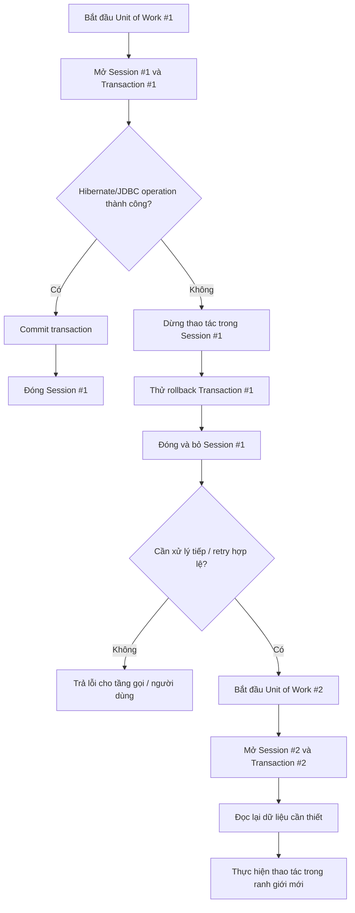

# Nguyên tắc bỏ `Session` đã lỗi và tạo ranh giới xử lý mới trong Hibernate

Trong Hibernate, `Session` là ngữ cảnh làm việc với dữ liệu (*persistence context*) và các thao tác SQL trong một đơn vị công việc. Khi thao tác ORM/JDBC thất bại, **không được giả định rằng `Session` vẫn còn ở trạng thái nhất quán để tiếp tục làm việc**. Cách xử lý an toàn đối với lỗi Hibernate/JPA phát sinh trong quá trình truy cập dữ liệu là **kết thúc transaction thất bại, bỏ ngữ cảnh `Session`/`EntityManager` đang dùng, rồi bắt đầu một đơn vị công việc mới bằng ngữ cảnh mới nếu cần xử lý tiếp**.

Quy tắc này không chỉ nhằm tránh một lỗi SQL thứ hai. Nó bảo vệ tính nhất quán giữa trạng thái entity trong bộ nhớ, hàng dữ liệu trong database và trạng thái transaction thực tế.

## 1. Hiểu `Session` đang quản lý những gì

`org.hibernate.Session` thường gắn với một *unit of work*, tức một nhóm thao tác dữ liệu cần được xử lý trong một ranh giới nghiệp vụ. Trong ngữ cảnh này, Hibernate theo dõi:

- Các entity đang được quản lý và danh tính của chúng (*first-level cache / identity map*).
- Trạng thái đã được đọc, các thay đổi trên thuộc tính và quá trình *dirty checking*.
- Các thao tác `INSERT`, `UPDATE`, `DELETE` được lên lịch nhưng có thể chưa được gửi tới database.
- Quan hệ, collection và snapshot cần để đồng bộ object graph.
- Việc `flush` các thay đổi và phối hợp với transaction/JDBC connection.

Ví dụ:

```java
try (Session session = sessionFactory.openSession()) {
    Transaction tx = session.beginTransaction();

    Customer customer = session.get(Customer.class, 42L);
    customer.setEmail("new@example.com");

    // Hibernate có thể gửi UPDATE khi flush/commit.
    tx.commit();
}
```

Sau `setEmail`, đối tượng trong bộ nhớ đã thay đổi; lệnh `UPDATE` có thể chưa được thực thi. Vì vậy, **trạng thái của entity trong `Session` không luôn giống trạng thái đã ghi thành công ở database**.

Khi xảy ra exception trong quá trình `flush` hoặc thực thi SQL, Hibernate có thể đã lên lịch các thay đổi, tác động một phần lên trạng thái của entity hoặc nhận phản hồi từ database ở giữa một loạt thao tác. Không thể chỉ nhìn exception rồi suy ra chính xác trạng thái bên trong `Session` còn thích hợp để dùng tiếp hay không.

## 2. Vì sao `Session` sau lỗi không nên được tái sử dụng?

Giả sử có hai thao tác:

1. Lưu `Invoice`.
2. Truy vấn danh sách `Invoice` theo khách hàng.

Nếu thao tác lưu thất bại do ràng buộc `UNIQUE`, Hibernate có thể đã đưa đối tượng vào persistence context, tạo identifier hoặc xếp một lệnh `INSERT` vào hàng đợi. Database từ chối thao tác, nhưng ngữ cảnh Java không tự quay về chính xác trạng thái ban đầu chỉ vì bạn bắt exception.

Các nguyên nhân khiến việc tiếp tục nguy hiểm:

| Vấn đề | Hệ quả |
|---|---|
| **Transaction đã lỗi hoặc bị đánh dấu rollback-only** | Lệnh tiếp theo có thể bị từ chối, hoặc `commit` cuối cùng không thể thành công. |
| **Action queue và snapshot trong persistence context** | Hibernate có thể vẫn giữ các thay đổi đã lên lịch hoặc trạng thái entity không còn đáng tin cậy để tiếp tục `flush`. |
| **Trạng thái database và bộ nhớ khác nhau** | Một thay đổi Java được nhìn thấy trong `Session` chưa chắc đã được database chấp nhận. |
| **Lỗi có thể xuất hiện muộn** | `persist` có thể thành công ở mức gọi hàm, nhưng `flush`/`commit` mới ném lỗi. |
| **Connection/JDBC statement có thể bị ảnh hưởng** | Lỗi mạng, timeout hay lỗi DBMS có thể khiến kết nối và transaction không còn sử dụng được. |

Ví dụ nguy hiểm:

```java
try (Session session = sessionFactory.openSession()) {
    Transaction tx = session.beginTransaction();

    try {
        session.persist(new Account("duplicate_username"));
        session.flush(); // DB báo vi phạm UNIQUE.
    } catch (RuntimeException error) {
        // SAI: Chỉ log lỗi rồi tiếp tục dùng Session cũ.
        System.err.println(error.getMessage());
    }

    // Không có cơ sở để tin rằng persistence context còn hợp lệ.
    Account account = session.get(Account.class, 10L);
    tx.commit(); // Có thể thất bại hoặc transaction đã rollback-only.
}
```

Cách hiểu đúng là: **exception đánh dấu ranh giới thất bại của đơn vị công việc**, không phải một lời nhắc để “thử lại câu lệnh tiếp theo” trên `Session` hiện tại.

> Quy tắc áp dụng cho lỗi thuộc quá trình làm việc với Hibernate/JPA, đặc biệt là các exception từ `Session`, `EntityManager`, SQL/JDBC, `flush` và transaction. Một lỗi kiểm tra dữ liệu nghiệp vụ phát sinh hoàn toàn trước khi chạm tới Hibernate không nhất thiết làm `Session` hỏng; cần phân loại nguồn lỗi cho đúng.

## 3. Ba bước xử lý khi Hibernate operation thất bại

Đối với transaction do ứng dụng tự quản lý, luồng xử lý thông thường gồm:

1. **Dừng đơn vị công việc hiện tại.** Không cố `persist`, `merge`, `get`, chạy HQL hoặc `flush` tiếp trên `Session` lỗi.
2. **Rollback transaction nếu vẫn có thể.** Nếu rollback cũng lỗi, ghi nhận thông tin lỗi đó; không làm mất exception ban đầu.
3. **Đóng và bỏ `Session`.** Nếu nghiệp vụ cần thực hiện lại hoặc xử lý thao tác tiếp theo, mở `Session`/transaction **mới**, đọc lại trạng thái cần thiết rồi thực hiện.



Điểm quan trọng: **rollback transaction và đóng `Session` là hai việc khác nhau**.

- `rollback()` cố đưa các thay đổi của transaction ở database về trạng thái trước transaction. Nó không được xem là cách “làm sạch hoàn toàn” persistence context Hibernate.
- `close()` kết thúc vòng đời `Session`, giải phóng những tài nguyên mà `Session` đang sở hữu theo cấu hình.
- `SessionFactory` là đối tượng có vòng đời dài và thường được chia sẻ cho nhiều đơn vị công việc; **không đóng `SessionFactory` chỉ vì một `Session` gặp lỗi**.

Trong hệ thống sử dụng connection pool, kết nối vật lý được trả về hoặc loại bỏ theo chính sách pool/driver. Ứng dụng không nên tự can thiệp vào cơ chế đó bằng cách giữ lại một `Connection` đã lỗi để dùng tiếp.

## 4. Mẫu xử lý với Hibernate `Session` và transaction tự quản lý

### 4.1. Mẫu cơ bản

```java
import org.hibernate.Session;
import org.hibernate.SessionFactory;
import org.hibernate.Transaction;

public void createCustomer(SessionFactory sessionFactory, Customer customer) {
    try (Session session = sessionFactory.openSession()) {
        Transaction transaction = session.beginTransaction();

        try {
            session.persist(customer);
            transaction.commit();
        } catch (RuntimeException originalError) {
            try {
                if (transaction.isActive()) {
                    transaction.rollback();
                }
            } catch (RuntimeException rollbackError) {
                // Không để lỗi rollback che mất lỗi gốc.
                originalError.addSuppressed(rollbackError);
            }

            // Thoát khỏi ranh giới; try-with-resources đóng Session.
            throw originalError;
        }
    }
}
```

Trong mẫu trên, `try-with-resources` bảo đảm đóng `Session` ở cuối khối. `catch` xử lý cả lỗi khi gọi `persist` và lỗi phát sinh muộn ở `commit`. `transaction.isActive()` chỉ giúp quyết định có thử rollback hay không; không nên diễn giải nó thành bằng chứng rằng transaction hoặc `Session` hoàn toàn khỏe mạnh.

Nếu `close()` cũng phát sinh exception khi thoát khỏi `try-with-resources`, Java sẽ giữ lỗi chính và gắn lỗi đóng tài nguyên vào danh sách suppressed exceptions. Điều này giúp tránh làm mất nguyên nhân ban đầu.

Đối với hệ thống thực tế, có thể tổ chức mã khởi tạo transaction theo framework đã chọn. Điểm cốt lõi là mỗi lần gọi được **một transaction và một `Session` có vòng đời rõ ràng**.

### 4.2. Lỗi ở `flush` hoặc `commit` mới là lỗi thật

`session.persist()` không cam kết rằng `INSERT` đã thành công. Hibernate có cơ chế *write-behind*: một số thao tác được trì hoãn đến `flush`. `flush` có thể xảy ra:

- Khi ứng dụng gọi `session.flush()`.
- Trước hoặc trong quá trình commit transaction.
- Trước một số truy vấn tùy flush mode và ngữ cảnh thực thi.
- Sớm hơn trong các trường hợp cần đồng bộ để lấy khóa sinh bởi database hoặc bảo đảm hành vi khác.

Do đó, không nên kết luận thao tác lưu thành công chỉ dựa trên việc `persist` trả về không có exception.

```java
Transaction tx = session.beginTransaction();
try {
    session.persist(invoice);

    // Tại đây có thể chưa có INSERT nào hoàn tất.
    session.flush(); // Có thể ném lỗi ràng buộc DB.
    tx.commit();
} catch (RuntimeException ex) {
    // Bỏ toàn bộ unit of work.
    // Rollback, đóng session, đưa lỗi về tầng gọi.
    throw ex;
}
```

Đoạn mã này chỉ minh họa **thời điểm lỗi có thể xuất hiện**; với transaction tự quản lý phải thực hiện rollback và đóng `Session` như mẫu ở mục 4.1.

## 5. “Tạo ranh giới xử lý mới” nghĩa là gì?

Một ranh giới xử lý mới không phải chỉ gọi lại phương thức trên cùng biến `session`.

Ở mức thao tác dữ liệu, một *unit of work* mới cần có:

- Một `Session` mới hoặc `EntityManager` mới được framework cấp cho transaction mới.
- Một transaction mới, không kế thừa trạng thái rollback-only của transaction thất bại.
- Dữ liệu entity cần thiết được nạp lại hoặc xây dựng lại theo trạng thái thực tế của database.
- Chính sách xử lý lỗi rõ ràng: trả lỗi, yêu cầu người dùng sửa dữ liệu, thực hiện nghiệp vụ bù trừ, hay retry khi nguyên nhân thực sự là tạm thời.

Ví dụ phân tách một lần thử:

```java
public void submitOnce(SessionFactory sessionFactory, long orderId) {
    try (Session session = sessionFactory.openSession()) {
        Transaction tx = session.beginTransaction();

        try {
            PurchaseOrder order =
                    session.get(PurchaseOrder.class, orderId);

            if (order == null) {
                throw new IllegalArgumentException("Order không tồn tại");
            }

            order.markSubmitted();
            tx.commit();
        } catch (RuntimeException ex) {
            try {
                if (tx.isActive()) {
                    tx.rollback();
                }
            } catch (RuntimeException rollbackError) {
                ex.addSuppressed(rollbackError);
            }
            throw ex;
        }
    }
}
```

Một lần gọi `submitOnce` tạo `Session`/transaction riêng. Nếu tầng gọi quyết định thử lại, **gọi lại `submitOnce` sẽ mở một `Session` mới và tải lại `PurchaseOrder` từ database**:

```java
try {
    submitOnce(sessionFactory, orderId);
} catch (RuntimeException ex) {
    // Tầng orchestration phân loại lỗi và quyết định:
    // trả lỗi / xử lý xung đột / thử lại theo chính sách riêng.
    throw ex;
}
```

Không tự viết retry vô hạn trong `catch`. Việc chạy lại một thao tác có ghi dữ liệu còn cần đánh giá nguyên nhân, khả năng lặp an toàn và trạng thái của hệ thống ngoài database.

### 5.1. Vì sao phải tải lại entity?

Sau khi transaction thất bại, đối tượng Java vẫn tồn tại. Nó có thể giữ những thay đổi chưa được commit hoặc một identifier đã được Hibernate gán. Ví dụ:

```java
PurchaseOrder order = ...;
order.setStatus("SUBMITTED");
// Transaction thất bại và rollback.
```

Sau rollback, `order.getStatus()` vẫn có thể trả `SUBMITTED` vì đó là trạng thái **trong bộ nhớ**, còn database có thể vẫn giữ trạng thái trước đó.

Khi bắt đầu transaction mới, hãy đọc lại đối tượng từ database trước khi áp dụng quyết định mới. Tránh coi toàn bộ object graph của unit of work thất bại là nguồn chân lý. `merge` một entity cũ vào session mới mà không kiểm tra có thể đưa các thay đổi chưa được chấp nhận trở lại database.

### 5.2. Transaction mới cũng không khắc phục mọi lỗi

Transaction mới giải quyết vấn đề ngữ cảnh xử lý. Nó **không tự sửa**:

- Vi phạm unique key vì dữ liệu đầu vào trùng.
- Thiếu khóa ngoại hoặc giá trị `NOT NULL`.
- Sai SQL, mapping hoặc schema.
- Lỗi xác thực, quyền hoặc cấu hình kết nối kéo dài.
- Xung đột nghiệp vụ cần người dùng hoặc hệ thống khác đưa ra quyết định.

Đối với các lỗi này, cách xử lý đúng thường là sửa dữ liệu/cấu hình hoặc trả thông tin lỗi có ý nghĩa; tạo session mới để lặp lại y nguyên sẽ chỉ gặp lại lỗi.

## 6. Những cách “phục hồi Session” dễ gây hiểu nhầm

| Thao tác | Tác dụng thực tế | Có dùng để tiếp tục `Session` đã lỗi được không? |
|---|---|---|
| `session.clear()` | Detach các entity khỏi persistence context, làm trống nhiều trạng thái quản lý entity | **Không**. Không biến transaction/connection lỗi thành hợp lệ. |
| `session.evict(entity)` | Ngừng quản lý một entity cụ thể | **Không**. Chỉ tác động đến một phần persistence context. |
| `session.refresh(entity)` | Nạp lại trạng thái một entity từ database khi có thể | **Không**. Cần `Session`/transaction đang hoạt động đúng. |
| `session.flush()` | Đồng bộ thay đổi đang chờ xuống database | **Không**. Có thể lặp lại chính lỗi đã xảy ra. |
| `session.isOpen()` | Cho biết `Session` chưa bị đóng | **Không**. “Chưa đóng” không có nghĩa “an toàn để tiếp tục”. |
| `transaction.rollback()` | Yêu cầu hoàn tác transaction | **Không**. Không phục hồi hoàn toàn nội trạng `Session`. |
| `session.close()` | Kết thúc vòng đời `Session` | **Có**, đây là bước giải phóng ngữ cảnh thất bại; sau đó mở một `Session` mới nếu cần. |

Không nên dựa vào mẹo `clear()` sau `ConstraintViolationException` rồi tiếp tục ghi dữ liệu để “cứu” một transaction. Khi database đã đánh dấu transaction thất bại, các câu SQL tiếp theo có thể còn bị từ chối cho đến khi rollback. Một số DBMS có cơ chế savepoint, nhưng khôi phục savepoint ở JDBC **không đồng nghĩa** với việc Hibernate khôi phục toàn bộ action queue, entity snapshot và trạng thái ORM sau exception. Không xem đây là lối thoát mặc định cho `Session` đã lỗi.

## 7. `Session`, `EntityManager` và ngữ cảnh Spring khác nhau ở chỗ nào?

Hibernate hỗ trợ cả API gốc `Session` và API JPA `jakarta.persistence.EntityManager`. Về nguyên tắc quản lý trạng thái, khi một thao tác persistence của JPA thất bại và transaction không thể tiếp tục, cũng cần kết thúc ngữ cảnh transaction thất bại rồi làm việc trong ngữ cảnh mới.

Với ứng dụng Spring Boot sử dụng Spring Data JPA, phần lớn service không tự gọi `sessionFactory.openSession()`. Spring quản lý `EntityManager` và transaction qua `@Transactional`.

### 7.1. Sai lầm: nuốt exception bên trong `@Transactional`

Ví dụ:

```java
@Service
public class RegistrationService {

    private final AccountRepository accounts;

    public RegistrationService(AccountRepository accounts) {
        this.accounts = accounts;
    }

    @Transactional
    public void register(RegistrationRequest request) {
        try {
            accounts.saveAndFlush(new Account(request.username()));
        } catch (DataIntegrityViolationException ex) {
            // NGUY HIỂM: Bắt lỗi nhưng vẫn chạy tiếp transaction này.
            log.warn("Tên tài khoản trùng", ex);
        }

        // Không được giả định transaction hoặc persistence context
        // sau lỗi là hợp lệ.
        accounts.save(new Account("another_user"));
    }
}
```

Giả sử `saveAndFlush` gây vi phạm ràng buộc database. Dù mã service đã bắt `DataIntegrityViolationException`, transaction vẫn có thể ở trạng thái rollback-only. Ngoại lệ có thể tiếp tục xuất hiện tại thao tác kế tiếp hoặc khi Spring cố commit; người gọi cũng có thể nhận `UnexpectedRollbackException`.

**Bắt exception không làm database transaction hay Hibernate persistence context tự trở lại trạng thái tốt.**

### 7.2. Tốt hơn: cho exception đi qua ranh giới transaction

Tách lớp thực hiện thao tác transaction và lớp quyết định xử lý thất bại:

```java
@Service
public class RegistrationAttemptService {

    private final AccountRepository accounts;

    public RegistrationAttemptService(AccountRepository accounts) {
        this.accounts = accounts;
    }

    @Transactional
    public void registerOnce(RegistrationRequest request) {
        accounts.saveAndFlush(new Account(request.username()));
    }
}
```

```java
@Service
public class RegistrationOrchestrator {

    private final RegistrationAttemptService attempts;

    public RegistrationOrchestrator(RegistrationAttemptService attempts) {
        this.attempts = attempts;
    }

    // Phương thức này không mở transaction bao trùm thao tác bên dưới.
    public RegistrationResult register(RegistrationRequest request) {
        try {
            attempts.registerOnce(request);
            return RegistrationResult.success();
        } catch (DataIntegrityViolationException ex) {
            return RegistrationResult.rejected(
                    "Dữ liệu không hợp lệ hoặc bị trùng");
        }
    }
}
```

Trong cách tổ chức này, exception thoát khỏi phương thức `@Transactional`. Transaction interceptor của Spring có cơ hội rollback và giải phóng ngữ cảnh transaction trước khi `RegistrationOrchestrator` quyết định phản hồi. Một lần xử lý tiếp theo có thể gọi một phương thức transaction mới.

Ví dụ dùng các kiểu dự án định nghĩa như `RegistrationRequest`, `Account` và `RegistrationResult`. Các lớp này cần được triển khai theo mô hình ứng dụng, nhưng ranh giới transaction vẫn là trọng tâm.

**Các điều kiện cần lưu ý:**

- Theo mặc định, Spring rollback với các `RuntimeException` và `Error` đi ra khỏi phương thức `@Transactional`; với checked exception cần xem cấu hình `rollbackFor` hoặc các rule khác.
- Ví dụ sử dụng **hai bean riêng** để lời gọi vào `registerOnce` đi qua Spring transaction proxy. Tự gọi `this.registerOnce()` trong cùng bean thường không kích hoạt interception trong cấu hình proxy mặc định.
- Nếu `RegistrationOrchestrator.register` bản thân nằm trong một transaction đang hoạt động, các phương thức `@Transactional` với propagation `REQUIRED` có thể tham gia cùng transaction đó. Khi ấy, việc bắt exception ở orchestrator chưa tạo được ranh giới độc lập. Hãy bố trí transaction boundary ở cấp phù hợp.

### 7.3. Có nên tự đóng `EntityManager` do Spring tiêm vào?

Trong mô hình `@PersistenceContext` hoặc Spring Data JPA, ứng dụng thường thao tác với một proxy/trình quản lý persistence context gắn với transaction. **Để Spring quản lý việc đóng entity manager và rollback**; không tự gọi `close()` trên shared proxy hay `unwrap(Session.class).close()` trong service để sửa lỗi.

Tương tự, nếu ứng dụng sử dụng mô hình *Open Session in View* (OSIV), vòng đời persistence context có thể kéo dài qua phần web request. Không sử dụng một persistence context đã trải qua lỗi để truy vấn tiếp chỉ vì HTTP request chưa kết thúc. Cách quản lý cụ thể phụ thuộc cấu hình Spring/Hibernate của dự án.

## 8. Rollback-only: khi lỗi đã được bắt mà commit vẫn thất bại

Một transaction có thể bị đánh dấu **rollback-only** khi framework hoặc resource manager xác định không thể commit an toàn. Trạng thái này có thể xuất hiện sau exception, ngay cả khi service bên ngoài đã bắt lỗi.

Ví dụ khái niệm:

```text
HTTP request
  -> Service A @Transactional
       -> Repository: INSERT vi phạm UNIQUE
       -> Lỗi bị bắt trong Service A
       -> Service A tiếp tục xử lý và trả kết quả "OK"
  -> Spring kết thúc transaction
       -> Không thể commit transaction rollback-only
       -> Rollback / báo lỗi ở ranh giới commit
```

Việc log “đã bắt lỗi” không bảo đảm transaction thành công. Đặc biệt, PostgreSQL thường đưa transaction vào trạng thái thất bại sau một lỗi SQL và từ chối các câu lệnh tiếp theo cho tới khi rollback, trừ những trường hợp xử lý bằng savepoint được thiết kế rõ ràng ở mức database.

Nếu phát hiện lỗi cần kết thúc unit of work, hãy để transaction rollback rồi rời ranh giới đó. Đừng trả “thành công” khi toàn bộ thay đổi đã hoặc sẽ bị rollback.

### 8.1. Lỗi phát sinh ở ranh giới commit

Lỗi không nhất thiết xuất hiện trong method repository. Nó có thể được ném khi:

- Hibernate tự `flush` trước commit.
- Database kiểm tra constraint tại thời điểm commit.
- Transaction manager thực hiện commit và nhận thông báo lỗi.
- Giao tiếp mạng bị gián đoạn ngay sau yêu cầu commit.

Trong tình huống mất kết nối ở gần thời điểm commit, **trạng thái kết quả có thể không chắc chắn với ứng dụng**. Không tự động kết luận “database chắc chắn đã rollback” chỉ vì client nhận exception. Cần thiết kế idempotency key, truy vấn xác nhận trạng thái theo nghiệp vụ hoặc cơ chế đối soát thích hợp trước khi gửi lại một thao tác có tác động bên ngoài.

## 9. Retry: chỉ thực hiện trong unit of work mới và khi nguyên nhân phù hợp

Một số lỗi có thể có tính chất tạm thời:

- Deadlock khiến DBMS chọn rollback một transaction.
- Xung đột serialization trong isolation level chặt.
- Sự cố kết nối tạm thời đã được hạ tầng phục hồi.
- Thời gian chờ lấy khóa hoặc tài nguyên xảy ra do tải tăng đột biến.

Ngược lại, retry y hệt thường không giúp giải quyết vi phạm unique constraint, dữ liệu không hợp lệ, thiếu bảng/cột hoặc sai quyền truy cập.

| Loại lỗi | Hướng xử lý chính | Retry? |
|---|---|---|
| Duplicate key / foreign key / `NOT NULL` | Sửa đầu vào, xử lý quy tắc nghiệp vụ | Thường **không** |
| Lỗi schema hoặc SQL syntax | Sửa mapping, migration, câu SQL | **Không** cho đến khi đã sửa |
| Optimistic locking conflict | Tải lại entity, xác định chiến lược giải quyết xung đột | Có thể, khi nghiệp vụ cho phép |
| Deadlock/serialization failure | Thực hiện lại **toàn bộ transaction** | Có thể, giới hạn số lần |
| Connection timeout do pool cạn | Tìm nguyên nhân giữ connection lâu/quá tải | Chỉ retry có kiểm soát, không thay thế sửa nguyên nhân |
| Network failure gần commit | Xác minh kết quả đã ghi hay chưa | Chỉ khi bảo đảm tính lặp an toàn |

### 9.1. Retry toàn bộ transaction, không retry riêng câu SQL cuối cùng

Sai về mặt đơn vị công việc:

```java
try {
    session.flush();
} catch (RuntimeException ex) {
    session.clear();
    session.flush(); // Không phải cách retry transaction an toàn.
}
```

Đúng về mặt kiến trúc:

```text
Lần 1:
  Session #1 + Transaction #1
  -> tải dữ liệu
  -> kiểm tra điều kiện nghiệp vụ
  -> thay đổi entity
  -> flush/commit thất bại
  -> rollback và đóng Session #1

Nếu có thể retry:
Lần 2:
  Session #2 + Transaction #2
  -> tải lại dữ liệu
  -> đánh giá lại điều kiện nghiệp vụ
  -> thay đổi entity
  -> flush/commit
  -> đóng Session #2
```

Nếu transaction phụ thuộc dữ liệu vừa đọc, **cần chạy lại cả bước đọc lẫn bước quyết định**, vì dữ liệu có thể đã thay đổi giữa hai lần thử.

### 9.2. Tính lặp an toàn và tác động ngoài database

Giả sử unit of work vừa ghi database vừa gửi email hoặc gọi cổng thanh toán. Nếu rollback database nhưng email hoặc yêu cầu thanh toán đã gửi, việc retry có thể làm phát sinh tác động kép.

Cần cân nhắc:

- Sử dụng idempotency key với thao tác có thể được gửi lại.
- Tách các tác động bên ngoài khỏi transaction DB theo thiết kế phù hợp.
- Xem xét transactional outbox khi cần phát sự kiện sau khi thay đổi database được commit.
- Giới hạn số lần retry, có trì hoãn khi thích hợp, và ghi log/metric để biết lỗi lặp lại.
- Không retry vô hạn trong cùng request hoặc khi lỗi hoàn toàn mang tính nghiệp vụ.

“Bỏ `Session` lỗi” là yêu cầu an toàn cho persistence context; “retry nghiệp vụ” là một quyết định cấp cao hơn và phải được thiết kế riêng.

## 10. Xử lý lỗi ứng dụng mà không làm hỏng `Session`

Không phải mọi exception ném trong một service đều chứng minh Hibernate/JDBC đã lỗi. Chẳng hạn, một kiểm tra nghiệp vụ có thể từ chối yêu cầu **trước khi truy cập persistence context**:

```java
public void changePrice(Product product, long requestedPrice) {
    if (requestedPrice < 0) {
        throw new IllegalArgumentException(
                "Giá sản phẩm phải không âm");
    }

    product.setPrice(requestedPrice);
}
```

Nếu `IllegalArgumentException` được ném trước khi thay đổi entity hoặc thực hiện thao tác Hibernate, không có cơ sở để nói một `Session` đã hỏng chỉ vì exception này. Tuy nhiên, khi chạy trong `@Transactional`, việc exception đi qua transaction interceptor có thể kích hoạt rollback theo rule của Spring. Vì vậy, cần tách hai câu hỏi:

1. **Persistence context/JDBC đã xảy ra lỗi làm mất tính nhất quán chưa?**
2. **Transaction đã bị đánh dấu rollback-only theo cơ chế framework hoặc bởi mã ứng dụng chưa?**

Đối với lỗi Hibernate/JPA/JDBC trong quá trình ghi, đồng bộ hoặc truy vấn dữ liệu, hãy áp dụng quy tắc dừng, rollback và bỏ ngữ cảnh lỗi. Đối với lỗi validation nghiệp vụ, nên xử lý sớm trước khi mở transaction khi có thể.

Không viết một `catch (Exception ex)` rộng rồi cố tiếp tục transaction hiện tại, vì nó dễ che giấu cả lỗi persistence lẫn lỗi lập trình.

## 11. Những ranh giới cần phân biệt

### 11.1. `Session` khác `SessionFactory`

`SessionFactory`:

- Được khởi tạo từ mapping, cấu hình kết nối và các dịch vụ Hibernate.
- Thường dùng lâu dài cho toàn ứng dụng hoặc một persistence unit.
- Được thiết kế để dùng đồng thời nhằm mở các `Session`.

`Session`:

- Tồn tại trong một unit of work hoặc phạm vi quản lý cụ thể.
- Chứa persistence context và trạng thái riêng.
- Không được thiết kế để chia sẻ đồng thời giữa nhiều luồng.
- Nên kết thúc sau khi hoàn thành hoặc thất bại theo chính sách vòng đời.

Khi một `Session` thất bại, **không phải khởi động lại toàn bộ `SessionFactory` hoặc ứng dụng** trong điều kiện bình thường. Mở `Session` mới từ factory hiện có sau khi xử lý lỗi thích hợp.

### 11.2. Session khác JDBC Connection

Hibernate có thể lấy `Connection` từ `DataSource` hoặc connection pool. Một `Session` không nhất thiết giữ một kết nối vật lý suốt toàn bộ vòng đời; thời điểm mượn/trả tùy cách quản lý transaction và connection handling mode.

Tuy vậy, **pool cấp connection mới không có nghĩa có thể giữ persistence context `Session` cũ**. Pool quản lý tài nguyên mạng; `Session` quản lý trạng thái entity và thao tác ORM đang chờ.

### 11.3. Exception và kết quả commit

| Tình huống | Diễn giải cẩn trọng |
|---|---|
| `persist` trả về bình thường | Entity được đăng ký trong persistence context; chưa đủ khẳng định đã commit |
| `flush` thành công | SQL tương ứng đã được đồng bộ ở thời điểm đó; transaction vẫn có thể rollback |
| `commit` thành công | Transaction hoàn tất theo kết quả thông báo tới ứng dụng |
| `flush` thất bại | Dừng unit of work, rollback, bỏ `Session` |
| `commit` ném exception | Không dùng `Session` tiếp; xử lý rollback/đóng và lưu ý trạng thái cuối cùng có thể cần xác minh |
| `rollback` cũng ném exception | Giữ lỗi gốc và ghi nhận thêm lỗi rollback; vẫn cố giải phóng tài nguyên theo thiết kế |

## 12. Quy trình xử lý sự cố trong ứng dụng

Khi quan sát lỗi Hibernate/JPA, nên kiểm tra theo thứ tự sau:

**Bước 1 — Tìm exception đầu tiên của unit of work.** Một exception xuất hiện ở `commit` hay query sau đó có thể chỉ là hệ quả. Xem stack trace và nguyên nhân gốc (*cause*) của lỗi đầu tiên; không lấy exception thứ ba để đoán toàn bộ sự cố.

**Bước 2 — Xác định transaction boundary.** Phân biệt transaction ứng dụng tự quản lý và transaction Spring/container quản lý. Kiểm tra xem exception có bị bắt bên trong `@Transactional` và có làm transaction rollback-only hay không.

**Bước 3 — Xác nhận cách giải phóng tài nguyên.** Với `Session` tự quản lý, bảo đảm luôn rollback/đóng; với Spring, đảm bảo exception đi qua ranh giới cần thiết để transaction interceptor thực hiện cleanup.

**Bước 4 — Chọn hành vi tiếp theo.** Trả lỗi nghiệp vụ, sửa đầu vào, thông báo xung đột, hoặc retry một transaction mới khi phù hợp. Không thực hiện bước tiếp theo trên `Session` thất bại.

**Bước 5 — Nếu cần retry, dùng trạng thái hiện tại.** Mở unit of work mới, tải lại entity, kiểm tra điều kiện nghiệp vụ rồi thực hiện. Không dựa vào các entity còn nằm trong bộ nhớ từ transaction đã rollback.

**Bước 6 — Theo dõi nguồn lực.** Xem số connection đang hoạt động/chờ, transaction kéo dài, exception rollback hoặc đóng resource, và dấu hiệu connection leak. Đừng mặc định rằng mọi sự cố `Session` đều xuất phát từ connection pool.

Một số lỗi thường gặp:

| Triệu chứng | Khả năng xảy ra | Cách tiếp cận |
|---|---|---|
| `UnexpectedRollbackException` ở cuối service | Transaction đã rollback-only dù exception gốc từng bị bắt | Tìm lỗi xuất hiện trước đó và ranh giới `@Transactional` |
| `Transaction is not active` | Mã đang làm việc với transaction đã kết thúc hoặc bị hủy | Bắt đầu unit of work mới, không tái sử dụng session lỗi |
| PostgreSQL báo `current transaction is aborted` | Một câu SQL trước đó làm transaction thất bại | Rollback transaction, tìm lỗi SQL đầu tiên |
| Lỗi constraint lặp lại khi `flush` | Trạng thái/pending action vẫn dẫn đến câu SQL không hợp lệ | Bỏ session cũ, sửa dữ liệu, chạy thao tác mới |
| Lỗi lazy loading sau khi đóng session | Đối tượng detached và truy cập quan hệ chưa tải | Thiết kế fetch và transaction boundary, không giữ session lỗi mở lâu hơn |
| Connection pool bị cạn sau nhiều exception | Không trả tài nguyên đúng cách hoặc transaction giữ lâu | Kiểm tra try-with-resources, transaction manager, metric pool |

Không nên bật log tham số SQL chứa mật khẩu, token hoặc dữ liệu riêng tư ở môi trường vận hành nếu không có biện pháp bảo vệ phù hợp.

## 13. Bài tập tình huống

### Tình huống A: Vi phạm ràng buộc rồi tiếp tục trong cùng transaction

Một service tạo người dùng mới, `flush` gây lỗi unique username. Service bắt exception và tiếp tục tạo một bản ghi audit bằng **cùng** `EntityManager`/transaction.

**Câu hỏi:** Điều gì sai và cần làm gì?

**Giải thích:** Việc bắt exception không khôi phục transaction hoặc persistence context. Service cần để ranh giới transaction thất bại được rollback, bỏ entity manager/session gắn với unit of work đó. Nếu cần ghi audit về lần đăng ký thất bại, hãy thiết kế một thao tác độc lập với transaction mới sau khi transaction cũ đã kết thúc, đồng thời xác định rõ hành vi nếu việc ghi audit cũng lỗi.

### Tình huống B: Xung đột phiên bản khi cập nhật đơn hàng

Hai request cùng đọc một đơn hàng có cột `@Version`. Request thứ hai commit trước; request thứ nhất gặp optimistic locking exception khi commit.

**Câu hỏi:** Có thể dùng `session.clear()` rồi `merge` đối tượng cũ để retry ngay không?

**Giải thích:** Không nên. Cần kết thúc transaction lỗi, đóng session, rồi mở transaction/session mới. Tải lại đơn hàng theo phiên bản hiện tại và áp dụng quy tắc nghiệp vụ: có thể cập nhật lại, yêu cầu người dùng xác nhận thay đổi hoặc trả lỗi xung đột. Việc `merge` ngay đối tượng cũ có nguy cơ ghi đè quyết định vừa được một request khác commit.

### Tình huống C: Gọi lại service `@Transactional` sau rollback

Một lớp orchestration **không nằm trong transaction** gọi bean khác có phương thức `@Transactional`. Lần đầu thất bại vì deadlock và exception đi qua interceptor. Orchestration đã phân loại lỗi là có thể retry và gọi lại method đó lần thứ hai.

**Câu hỏi:** Ranh giới thứ hai khác gì so với `session.flush()` lần nữa?

**Giải thích:** Method `@Transactional` được gọi lại qua proxy có thể nhận transaction/persistence context mới; nó có thể tải lại dữ liệu và tính toán lại quyết định. `flush` lại trên cùng `Session` thì không làm được điều đó. Tuy nhiên, việc retry vẫn phải có giới hạn và chỉ dành cho thao tác an toàn khi lặp lại.

## 14. Nguyên tắc cần ghi nhớ

1. **Khi gặp lỗi Hibernate/JPA/JDBC trong unit of work, dừng dùng `Session`/`EntityManager` liên quan.**
2. **Rollback transaction thất bại**, giữ nguyên thông tin exception gốc và ghi nhận lỗi rollback nếu có.
3. **Đóng/bỏ persistence context thất bại** theo đúng cơ chế sở hữu tài nguyên: ứng dụng tự đóng `Session` tự quản lý; Spring/container đóng ngữ cảnh do chúng quản lý.
4. **Không coi `clear()`, `evict()`, `refresh()` hay `isOpen()` là cơ chế phục hồi một `Session` sau lỗi.**
5. **Một lần xử lý tiếp theo cần transaction và persistence context mới**, cùng với việc tải lại dữ liệu và đánh giá lại điều kiện nghiệp vụ.
6. **Chỉ retry khi lỗi có tính tạm thời và thao tác lặp an toàn**; lỗi logic, schema hoặc ràng buộc dữ liệu cần được sửa tận gốc.
7. **Phân biệt `SessionFactory`, `Session`, transaction và JDBC connection** để không nhầm trách nhiệm giải phóng tài nguyên.

Quy tắc thực hành quan trọng nhất: **thất bại ở một đơn vị công việc Hibernate là điểm kết thúc của ngữ cảnh đang dùng; lần xử lý tiếp theo phải bắt đầu ở một ranh giới tin cậy mới**. Khi áp dụng nhất quán, nguyên tắc này làm rõ luồng lỗi, hạn chế dữ liệu trong bộ nhớ bị lệch với database và giúp transaction được quản lý an toàn hơn.
