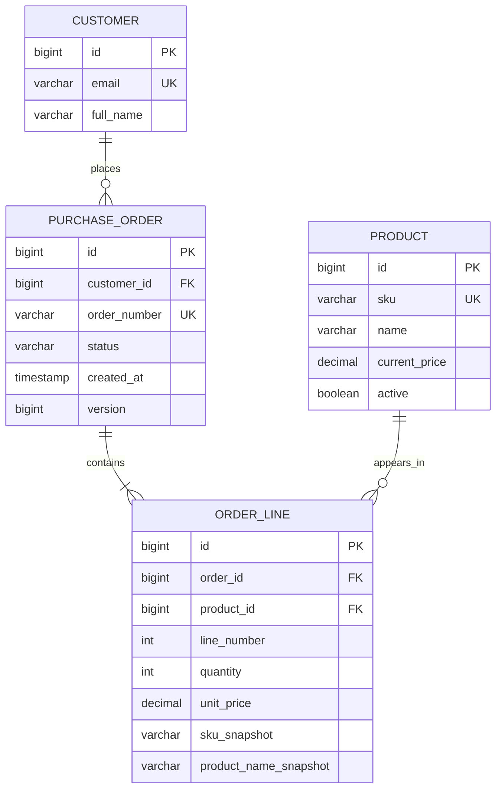
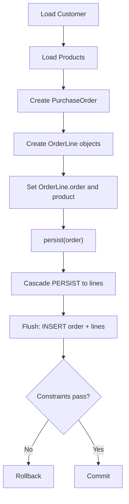

# Khởi tạo Hibernate với mô hình khách hàng, đơn hàng, dòng hàng và sản phẩm

Một ứng dụng bán hàng cần lưu khách hàng, đơn hàng, từng dòng hàng trong đơn và sản phẩm được bán. Đây là mô hình thực hành phù hợp để khởi tạo Hibernate vì nó có đủ những quan hệ phổ biến:

- Một khách hàng có thể có nhiều đơn hàng.
- Một đơn hàng có nhiều dòng hàng.
- Mỗi dòng hàng tham chiếu đến một sản phẩm.
- Một sản phẩm có thể xuất hiện trong nhiều dòng hàng thuộc nhiều đơn hàng.
- Dòng hàng cần giữ giá tại thời điểm mua, kể cả khi giá hiện tại của sản phẩm thay đổi.

Qua mô hình này, chúng ta thực hành cấu hình Hibernate, mapping entity/table, primary key và foreign key, quan hệ hai chiều, owning side, cascade, orphan removal, transaction, truy vấn, fetch plan, validation, migration và kiểm thử.

Mô hình gồm bốn entity:



`ORDER_LINE` là entity riêng, không chỉ là một bảng nối many-to-many. Nó lưu số lượng, giá bán tại thời điểm đặt hàng và snapshot thông tin sản phẩm. Đây là thiết kế quan trọng để lịch sử đơn hàng không thay đổi khi catalog được cập nhật.

---

## 1. Xác định nghiệp vụ trước khi viết mapping

Trước khi tạo annotation, hãy xác định trách nhiệm của từng entity.

| Entity | Vai trò | Dữ liệu chính |
|---|---|---|
| `Customer` | Người mua | Email, tên, trạng thái |
| `PurchaseOrder` | Đơn hàng của khách hàng | Mã đơn, trạng thái, thời điểm tạo, phiên bản |
| `OrderLine` | Một dòng hàng trong đơn | Sản phẩm, số lượng, giá snapshot, số thứ tự |
| `Product` | Sản phẩm trong catalog | SKU, tên, giá hiện tại, trạng thái |

### 1.1. Quan hệ và cardinality

- Một `Customer` có thể có 0 đến nhiều `PurchaseOrder`.
- Mỗi `PurchaseOrder` thuộc đúng một `Customer`.
- Một `PurchaseOrder` chứa một hoặc nhiều `OrderLine` khi đơn đã được xác nhận theo nghiệp vụ.
- Mỗi `OrderLine` thuộc đúng một `PurchaseOrder`.
- Mỗi `OrderLine` tham chiếu đúng một `Product`.
- Một `Product` có thể được tham chiếu bởi nhiều `OrderLine`.

Quan hệ many-to-many giữa đơn hàng và sản phẩm được triển khai thông qua `OrderLine`, bởi quan hệ này có thuộc tính riêng. Không nên dùng `@ManyToMany` đơn giản khi bảng liên kết cần lưu quantity, unit price, line number hoặc snapshot.

### 1.2. Giá sản phẩm và giá dòng hàng là hai khái niệm khác nhau

`Product.currentPrice` là giá hiện tại trong catalog. `OrderLine.unitPrice` là giá đã chốt tại thời điểm mua.

```text
Ngày 01/04:
  Product SKU-ABC currentPrice = 100.00
  Order #A-001 mua quantity 2
  OrderLine.unitPrice = 100.00

Ngày 15/04:
  Product SKU-ABC currentPrice = 120.00

Lịch sử Order #A-001:
  OrderLine.unitPrice vẫn là 100.00
  line total vẫn là 200.00
```

Nếu chỉ lưu `product_id` và khi hiển thị đơn hàng luôn đọc giá hiện tại từ `Product`, báo cáo lịch sử sẽ thay đổi theo catalog. Vì vậy cần snapshot giá bán, và thường cả SKU/tên sản phẩm tại thời điểm mua.

### 1.3. Khóa chính không phải mã nghiệp vụ

`PurchaseOrder.id` là surrogate primary key phục vụ quan hệ và persistence. `orderNumber` là mã đơn hàng mà người dùng nhìn thấy. Hai giá trị có mục đích khác nhau.

Không dùng sequence ID làm số hóa đơn liên tục tuyệt đối. Sequence có thể có gaps do rollback, cache, pooled allocation và nhiều instance.

## 2. Chuẩn bị dự án Java

Có thể dùng Hibernate trực tiếp hoặc Spring Boot + Spring Data JPA. Hai cách cùng dùng Hibernate làm persistence provider nhưng có bootstrap và transaction management khác nhau.

Trong phần thực hành, dùng Java hiện đại, Jakarta Persistence (`jakarta.persistence`) và Hibernate ORM 6.x. Nếu dự án đang dùng Hibernate 5, imports/API có thể thuộc namespace `javax.persistence`; không trộn hai thế hệ namespace.

### 2.1. Cấu trúc package gợi ý

```text
src/main/java/com/example/shop/
  ShopApplication.java
  config/
    HibernateBootstrap.java
  domain/
    Customer.java
    Product.java
    PurchaseOrder.java
    OrderLine.java
    OrderStatus.java
  repository/
    PurchaseOrderRepository.java
  service/
    OrderApplicationService.java
  web/
    OrderController.java
    dto/
      CreateOrderRequest.java
      OrderDetailsResponse.java

src/main/resources/
  application.properties
  db/migration/
    V1__create_shop_schema.sql
```

Giữ entity/domain model tách khỏi request/response DTO để HTTP contract không phụ thuộc trực tiếp vào Hibernate proxy và lazy collections.

### 2.2. Dependencies khi dùng Hibernate trực tiếp

Một project Hibernate thuần thường cần:

```xml
<dependencies>
    <dependency>
        <groupId>org.hibernate.orm</groupId>
        <artifactId>hibernate-core</artifactId>
        <version>6.6.x</version>
    </dependency>

    <dependency>
        <groupId>jakarta.persistence</groupId>
        <artifactId>jakarta.persistence-api</artifactId>
        <version>3.1.0</version>
    </dependency>

    <dependency>
        <groupId>org.postgresql</groupId>
        <artifactId>postgresql</artifactId>
        <version>42.x</version>
        <scope>runtime</scope>
    </dependency>
</dependencies>
```

Các version ở đây biểu thị version line minh họa. Chọn patch release tương thích theo Hibernate, Jakarta Persistence và JDBC driver đang dùng; không copy ký tự `x` thành version Maven thực tế. Nếu cần Bean Validation thực thi ở runtime, thêm Jakarta Validation API và provider tương thích như Hibernate Validator.

### 2.3. Dependencies với Spring Boot

Với Spring Boot, dependency thường đơn giản hơn:

```xml
<dependencies>
    <dependency>
        <groupId>org.springframework.boot</groupId>
        <artifactId>spring-boot-starter-data-jpa</artifactId>
    </dependency>

    <dependency>
        <groupId>org.springframework.boot</groupId>
        <artifactId>spring-boot-starter-validation</artifactId>
    </dependency>

    <dependency>
        <groupId>org.postgresql</groupId>
        <artifactId>postgresql</artifactId>
        <scope>runtime</scope>
    </dependency>

    <dependency>
        <groupId>org.flywaydb</groupId>
        <artifactId>flyway-core</artifactId>
    </dependency>
</dependencies>
```

Spring Boot dependency management chọn các version tương thích. Nếu override Hibernate version, cần kiểm tra compatibility với Boot release thay vì nâng riêng một dependency tùy ý.

## 3. Cấu hình database và Hibernate

Ví dụ dùng PostgreSQL. Database cần được tạo trước, credentials được cung cấp qua environment/secrets.

### 3.1. application.properties cho Spring Boot

```properties
spring.datasource.url=jdbc:postgresql://localhost:5432/shop
spring.datasource.username=shop_app
spring.datasource.password=change-me

spring.jpa.hibernate.ddl-auto=validate
spring.jpa.open-in-view=false
spring.jpa.show-sql=false

spring.jpa.properties.hibernate.jdbc.batch_size=50
spring.jpa.properties.hibernate.order_inserts=true
spring.jpa.properties.hibernate.order_updates=true

spring.flyway.enabled=true
```

Giá trị `change-me` chỉ là placeholder local, không được dùng như mật khẩu production. Production secrets phải đến từ secret manager/environment được quản lý.

### 3.2. Ý nghĩa các setting

| Setting | Vai trò |
|---|---|
| `spring.datasource.url` | JDBC URL của database |
| `spring.datasource.username/password` | Credentials kết nối |
| `hibernate.ddl-auto=validate` | Hibernate kiểm tra mapping với schema có sẵn |
| `spring.jpa.open-in-view=false` | Không giữ EntityManager mở đến view rendering |
| `hibernate.jdbc.batch_size` | Kích thước JDBC DML batch mục tiêu |
| `hibernate.order_inserts` | Gom INSERT actions có SQL shape tương thích |
| `hibernate.order_updates` | Gom UPDATE actions có SQL shape tương thích |
| `spring.flyway.enabled` | Chạy schema migrations qua Flyway |

### 3.3. Vì sao không dùng ddl-auto=create/update trong production?

`create` có thể tạo lại schema và làm mất dữ liệu khi cấu hình phù hợp; `update` không phải công cụ migration versioned đáng tin cậy cho các thay đổi phức tạp.

Production nên quản lý schema bằng Flyway/Liquibase hoặc migration tool tương đương. Hibernate `validate` giúp phát hiện một số sai khác mapping/schema khi startup, nhưng không thay migration.

### 3.4. Dialect

Hibernate thường có thể nhận diện Dialect từ JDBC metadata. Chỉ cấu hình `hibernate.dialect` khi cần hoặc khi metadata không đủ. Chọn Dialect phù hợp DBMS/version; không copy PostgreSQL Dialect cho database khác.

## 4. Thiết kế schema quan hệ

Một schema PostgreSQL minh họa:

```sql
CREATE SEQUENCE customer_seq
    START WITH 1 INCREMENT BY 50;

CREATE SEQUENCE product_seq
    START WITH 1 INCREMENT BY 50;

CREATE SEQUENCE purchase_order_seq
    START WITH 1 INCREMENT BY 50;

CREATE SEQUENCE order_line_seq
    START WITH 1 INCREMENT BY 50;

CREATE TABLE customers (
    id BIGINT PRIMARY KEY,
    email VARCHAR(254) NOT NULL UNIQUE,
    full_name VARCHAR(160) NOT NULL,
    active BOOLEAN NOT NULL DEFAULT TRUE
);

CREATE TABLE products (
    id BIGINT PRIMARY KEY,
    sku VARCHAR(64) NOT NULL UNIQUE,
    name VARCHAR(200) NOT NULL,
    current_price NUMERIC(19, 2) NOT NULL,
    active BOOLEAN NOT NULL DEFAULT TRUE,
    CONSTRAINT ck_products_price_nonnegative
        CHECK (current_price >= 0)
);

CREATE TABLE purchase_orders (
    id BIGINT PRIMARY KEY,
    customer_id BIGINT NOT NULL,
    order_number VARCHAR(40) NOT NULL UNIQUE,
    status VARCHAR(24) NOT NULL,
    created_at TIMESTAMP WITH TIME ZONE NOT NULL,
    version BIGINT NOT NULL DEFAULT 0,
    CONSTRAINT fk_orders_customer
        FOREIGN KEY (customer_id) REFERENCES customers(id)
);

CREATE INDEX ix_orders_customer_created
    ON purchase_orders(customer_id, created_at DESC);

CREATE TABLE order_lines (
    id BIGINT PRIMARY KEY,
    order_id BIGINT NOT NULL,
    product_id BIGINT NOT NULL,
    line_number INTEGER NOT NULL,
    quantity INTEGER NOT NULL,
    unit_price NUMERIC(19, 2) NOT NULL,
    sku_snapshot VARCHAR(64) NOT NULL,
    product_name_snapshot VARCHAR(200) NOT NULL,
    CONSTRAINT fk_lines_order
        FOREIGN KEY (order_id) REFERENCES purchase_orders(id),
    CONSTRAINT fk_lines_product
        FOREIGN KEY (product_id) REFERENCES products(id),
    CONSTRAINT uk_lines_order_number
        UNIQUE (order_id, line_number),
    CONSTRAINT ck_lines_quantity_positive
        CHECK (quantity > 0),
    CONSTRAINT ck_lines_unit_price_nonnegative
        CHECK (unit_price >= 0)
);

CREATE INDEX ix_order_lines_product
    ON order_lines(product_id);
```

### 4.1. Tại sao có các constraints?

- `UNIQUE customers.email`: không cho tạo hai khách hàng có cùng email nếu nghiệp vụ xác định email là unique toàn hệ thống.
- `UNIQUE products.sku`: mã SKU duy nhất trong catalog.
- `UNIQUE purchase_orders.order_number`: mã đơn không trùng.
- `UNIQUE (order_id, line_number)`: một đơn không có hai dòng cùng số thứ tự.
- `CHECK quantity > 0`: ngăn số lượng bằng 0 hoặc âm.
- Foreign keys: đảm bảo order tham chiếu customer tồn tại và line tham chiếu order/product tồn tại.

Các constraints database là lớp bảo vệ cuối cùng. Bean Validation trong Java cải thiện feedback nhưng không thay ràng buộc dữ liệu ở database.

### 4.2. Vì sao line lưu product_id và snapshot?

`product_id` giữ liên kết đến catalog hiện tại, phục vụ tra cứu sản phẩm. `sku_snapshot` và `product_name_snapshot` giữ thông tin đã bán để lịch sử đơn không bị thay đổi nếu product được đổi tên/SKU.

Nếu sản phẩm bị ngừng bán, thường nên đặt `active=false` thay vì xóa row đang được order line tham chiếu.

### 4.3. Giá trị tiền dùng NUMERIC/BigDecimal

Không dùng `float` hoặc `double` cho giá tiền. Dùng `BigDecimal` ở Java và `NUMERIC(19,2)` (hoặc precision/scale theo currency/business rule) ở database.

Rounding policy cần được xác định rõ: làm tròn theo từng line, theo tổng đơn, thuế hay currency. Ví dụ dưới đây dùng scale 2 cho đơn giản; hệ thống đa tiền tệ có thể cần currency-specific scale.

## 5. Mapping Customer

`Customer` là dữ liệu độc lập trong ví dụ này. Order giữ owning reference đến customer bằng `@ManyToOne`; không bắt buộc phải có collection `Customer.orders` nếu use cases không cần duyệt từ khách hàng sang toàn bộ đơn.

```java
package com.example.shop.domain;

import jakarta.persistence.*;
import jakarta.validation.constraints.Email;
import jakarta.validation.constraints.NotBlank;
import jakarta.validation.constraints.Size;

@Entity
@Table(
    name = "customers",
    uniqueConstraints = @UniqueConstraint(
        name = "uk_customers_email",
        columnNames = "email"
    )
)
public class Customer {

    @Id
    @GeneratedValue(
        strategy = GenerationType.SEQUENCE,
        generator = "customer_seq_gen"
    )
    @SequenceGenerator(
        name = "customer_seq_gen",
        sequenceName = "customer_seq",
        allocationSize = 50
    )
    private Long id;

    @Email
    @NotBlank
    @Size(max = 254)
    @Column(nullable = false, length = 254, unique = true)
    private String email;

    @NotBlank
    @Size(max = 160)
    @Column(name = "full_name", nullable = false, length = 160)
    private String fullName;

    @Column(nullable = false)
    private boolean active = true;

    protected Customer() {
        // Dành cho Hibernate.
    }

    public Customer(String email, String fullName) {
        this.email = email;
        this.fullName = fullName;
    }

    public Long getId() { return id; }
    public String getEmail() { return email; }
    public String getFullName() { return fullName; }
    public boolean isActive() { return active; }

    public void deactivate() {
        this.active = false;
    }
}
```

### 5.1. Vì sao constructor rỗng phải protected?

JPA cần constructor không tham số với visibility public hoặc protected. Đặt protected giúp Hibernate tạo entity trong khi hạn chế code application khởi tạo entity rỗng tùy tiện.

### 5.2. Không xóa customer theo cascade từ order

Một customer có thể có nhiều orders. Xóa customer không nên tự động xóa lịch sử mua hàng. Thông thường dùng soft deactivate, retention hoặc quy trình anonymization theo chính sách dữ liệu.

### 5.3. Email normalization

`@Email` kiểm tra định dạng cơ bản, không đảm bảo email canonical/unique theo quy tắc nghiệp vụ. Application có thể trim và normalize trước khi persist. Database unique constraint vẫn cần để bảo vệ race giữa hai requests đồng thời.

## 6. Mapping Product

Product chứa catalog data và giá hiện tại.

```java
package com.example.shop.domain;

import jakarta.persistence.*;
import jakarta.validation.constraints.DecimalMin;
import jakarta.validation.constraints.NotBlank;
import jakarta.validation.constraints.Size;
import java.math.BigDecimal;

@Entity
@Table(
    name = "products",
    uniqueConstraints = @UniqueConstraint(
        name = "uk_products_sku",
        columnNames = "sku"
    )
)
public class Product {

    @Id
    @GeneratedValue(
        strategy = GenerationType.SEQUENCE,
        generator = "product_seq_gen"
    )
    @SequenceGenerator(
        name = "product_seq_gen",
        sequenceName = "product_seq",
        allocationSize = 50
    )
    private Long id;

    @NotBlank
    @Size(max = 64)
    @Column(nullable = false, length = 64, unique = true)
    private String sku;

    @NotBlank
    @Size(max = 200)
    @Column(nullable = false, length = 200)
    private String name;

    @DecimalMin("0.00")
    @Column(
        name = "current_price",
        nullable = false,
        precision = 19,
        scale = 2
    )
    private BigDecimal currentPrice;

    @Column(nullable = false)
    private boolean active = true;

    protected Product() {}

    public Product(
            String sku,
            String name,
            BigDecimal currentPrice) {
        this.sku = sku;
        this.name = name;
        changePrice(currentPrice);
    }

    public Long getId() { return id; }
    public String getSku() { return sku; }
    public String getName() { return name; }
    public BigDecimal getCurrentPrice() { return currentPrice; }
    public boolean isActive() { return active; }

    public void changePrice(BigDecimal newPrice) {
        if (newPrice == null || newPrice.signum() < 0) {
            throw new IllegalArgumentException(
                "Product price must be non-negative"
            );
        }
        this.currentPrice = newPrice;
    }

    public void deactivate() {
        this.active = false;
    }
}
```

### 6.1. Không cascade persist/remove qua Product

OrderLine tham chiếu đến Product có sẵn. Persist một OrderLine không nên tạo lại Product, và xóa OrderLine không được xóa Product. Vì vậy `@ManyToOne` từ OrderLine sang Product không dùng `CascadeType.ALL`.

### 6.2. Không xóa sản phẩm đã có lịch sử

Foreign key từ order_lines bảo vệ lịch sử. Khi sản phẩm không còn bán, đặt `active=false`; nếu cần archive/anonymize, phải theo quy trình riêng.

## 7. Mapping PurchaseOrder

`PurchaseOrder` là aggregate root của các dòng hàng. Nó giữ customer reference, order number, status, creation timestamp và version.

```java
package com.example.shop.domain;

import jakarta.persistence.*;
import jakarta.validation.Valid;
import jakarta.validation.constraints.NotBlank;
import jakarta.validation.constraints.Size;
import java.math.BigDecimal;
import java.time.Instant;
import java.util.ArrayList;
import java.util.List;
import java.util.UUID;

@Entity
@Table(
    name = "purchase_orders",
    uniqueConstraints = @UniqueConstraint(
        name = "uk_purchase_orders_number",
        columnNames = "order_number"
    ),
    indexes = @Index(
        name = "ix_orders_customer_created",
        columnList = "customer_id, created_at"
    )
)
public class PurchaseOrder {

    @Id
    @GeneratedValue(
        strategy = GenerationType.SEQUENCE,
        generator = "purchase_order_seq_gen"
    )
    @SequenceGenerator(
        name = "purchase_order_seq_gen",
        sequenceName = "purchase_order_seq",
        allocationSize = 50
    )
    private Long id;

    @ManyToOne(fetch = FetchType.LAZY, optional = false)
    @JoinColumn(name = "customer_id", nullable = false)
    private Customer customer;

    @NotBlank
    @Size(max = 40)
    @Column(
        name = "order_number",
        nullable = false,
        unique = true,
        length = 40
    )
    private String orderNumber;

    @Enumerated(EnumType.STRING)
    @Column(nullable = false, length = 24)
    private OrderStatus status = OrderStatus.DRAFT;

    @Column(name = "created_at", nullable = false)
    private Instant createdAt;

    @Version
    @Column(nullable = false)
    private long version;

    @Valid
    @OneToMany(
        mappedBy = "order",
        cascade = CascadeType.ALL,
        orphanRemoval = true
    )
    @OrderBy("lineNumber ASC")
    private List<OrderLine> lines = new ArrayList<>();

    protected PurchaseOrder() {}

    public PurchaseOrder(Customer customer) {
        setCustomer(customer);
        this.orderNumber = "ORD-" + UUID.randomUUID();
    }

    public void setCustomer(Customer customer) {
        if (customer == null || !customer.isActive()) {
            throw new IllegalArgumentException(
                "An active customer is required"
            );
        }
        this.customer = customer;
    }

    public void addLine(Product product, int quantity) {
        if (status != OrderStatus.DRAFT) {
            throw new IllegalStateException(
                "Only a draft order can be edited"
            );
        }

        OrderLine line = new OrderLine(
            this,
            product,
            lines.size() + 1,
            quantity
        );
        lines.add(line);
    }

    public void removeLine(OrderLine line) {
        if (status != OrderStatus.DRAFT) {
            throw new IllegalStateException(
                "Only a draft order can be edited"
            );
        }

        if (lines.remove(line)) {
            line.detachFromOrder();
        }
    }

    public void confirm() {
        if (status != OrderStatus.DRAFT) {
            throw new IllegalStateException(
                "Only a draft order can be confirmed"
            );
        }
        if (lines.isEmpty()) {
            throw new IllegalStateException(
                "An order must contain at least one line"
            );
        }
        status = OrderStatus.CONFIRMED;
    }

    @PrePersist
    void onCreate() {
        if (createdAt == null) {
            createdAt = Instant.now();
        }
    }

    public Long getId() { return id; }
    public Customer getCustomer() { return customer; }
    public String getOrderNumber() { return orderNumber; }
    public OrderStatus getStatus() { return status; }
    public Instant getCreatedAt() { return createdAt; }
    public long getVersion() { return version; }

    public List<OrderLine> getLines() {
        return List.copyOf(lines);
    }

    public BigDecimal totalAmount() {
        return lines.stream()
            .map(OrderLine::lineTotal)
            .reduce(BigDecimal.ZERO, BigDecimal::add);
    }
}
```

### 7.1. Tại sao OrderLine là collection của PurchaseOrder?

Order sở hữu vòng đời các dòng hàng. Nếu xóa một dòng khỏi draft order, dòng đó không còn ý nghĩa độc lập nên `orphanRemoval=true` phù hợp với lifecycle này.

### 7.2. Tại sao Customer là ManyToOne LAZY?

Một order thuộc một customer. To-one associations trong JPA có thể mặc định EAGER, nên khai báo `LAZY` tường minh giúp tránh tải customer cho mọi use case không cần.

### 7.3. Tại sao dùng @Version?

`@Version` hỗ trợ optimistic locking. Nếu hai transactions cùng sửa một order, Hibernate dùng version column để phát hiện update dựa trên version cũ. Nó không thay thế business rules hay pessimistic locking khi nghiệp vụ cần.

### 7.4. getLines() trả bản copy

Không expose mutable collection cho code ngoài aggregate. Caller có thể đọc danh sách, nhưng thay đổi phải đi qua `addLine`/`removeLine` để duy trì invariants và owning side.

Trong ví dụ thực tế, `List.copyOf(lines)` sẽ duyệt collection và có thể khởi tạo lazy collection. Chỉ gọi trong transaction/service đã chủ động tải lines.

### 7.5. Tổng đơn có thể được tính từ lines

`totalAmount()` tính tổng line totals trong memory. Đây là lựa chọn đơn giản cho đơn hàng nhỏ. Nếu có discounts, taxes, shipping, currency conversion hoặc immutable totals, hãy mô hình hóa các thành phần đó và xác định rounding policy. Không dùng tổng này như một snapshot tài chính bất biến nếu business rules còn thay đổi.

## 8. Mapping OrderLine: association entity

```java
package com.example.shop.domain;

import jakarta.persistence.*;
import jakarta.validation.constraints.Min;
import jakarta.validation.constraints.NotBlank;
import jakarta.validation.constraints.NotNull;
import jakarta.validation.constraints.Size;
import java.math.BigDecimal;

@Entity
@Table(
    name = "order_lines",
    uniqueConstraints = @UniqueConstraint(
        name = "uk_lines_order_number",
        columnNames = {"order_id", "line_number"}
    ),
    indexes = @Index(
        name = "ix_order_lines_product",
        columnList = "product_id"
    )
)
public class OrderLine {

    @Id
    @GeneratedValue(
        strategy = GenerationType.SEQUENCE,
        generator = "order_line_seq_gen"
    )
    @SequenceGenerator(
        name = "order_line_seq_gen",
        sequenceName = "order_line_seq",
        allocationSize = 50
    )
    private Long id;

    @ManyToOne(fetch = FetchType.LAZY, optional = false)
    @JoinColumn(name = "order_id", nullable = false)
    private PurchaseOrder order;

    @ManyToOne(fetch = FetchType.LAZY, optional = false)
    @JoinColumn(name = "product_id", nullable = false)
    private Product product;

    @Min(1)
    @Column(name = "line_number", nullable = false)
    private int lineNumber;

    @Min(1)
    @Column(nullable = false)
    private int quantity;

    @NotNull
    @Column(
        name = "unit_price",
        nullable = false,
        precision = 19,
        scale = 2
    )
    private BigDecimal unitPrice;

    @NotBlank
    @Size(max = 64)
    @Column(name = "sku_snapshot", nullable = false, length = 64)
    private String skuSnapshot;

    @NotBlank
    @Size(max = 200)
    @Column(
        name = "product_name_snapshot",
        nullable = false,
        length = 200
    )
    private String productNameSnapshot;

    protected OrderLine() {}

    OrderLine(
            PurchaseOrder order,
            Product product,
            int lineNumber,
            int quantity) {
        if (order == null) {
            throw new IllegalArgumentException("Order is required");
        }
        if (product == null || !product.isActive()) {
            throw new IllegalArgumentException(
                "An active product is required"
            );
        }
        if (quantity <= 0) {
            throw new IllegalArgumentException(
                "Quantity must be positive"
            );
        }

        this.order = order;
        this.product = product;
        this.lineNumber = lineNumber;
        this.quantity = quantity;
        this.unitPrice = product.getCurrentPrice();
        this.skuSnapshot = product.getSku();
        this.productNameSnapshot = product.getName();
    }

    void detachFromOrder() {
        this.order = null;
    }

    public Long getId() { return id; }
    public Product getProduct() { return product; }
    public int getLineNumber() { return lineNumber; }
    public int getQuantity() { return quantity; }
    public BigDecimal getUnitPrice() { return unitPrice; }
    public String getSkuSnapshot() { return skuSnapshot; }
    public String getProductNameSnapshot() {
        return productNameSnapshot;
    }

    public BigDecimal lineTotal() {
        return unitPrice.multiply(BigDecimal.valueOf(quantity));
    }
}
```

### 8.1. Owning side của quan hệ Order–OrderLine

Trong mapping này:

- `PurchaseOrder.lines` dùng `mappedBy = "order"` nên là inverse side.
- `OrderLine.order` chứa `@JoinColumn(name = "order_id")` nên là owning side.
- Hibernate dùng owning side để ghi foreign key.

Khi thêm line, phải set `OrderLine.order` đúng. Chỉ thêm object vào `PurchaseOrder.lines` mà không cập nhật owning side có thể làm FK không được ghi như mong muốn.

### 8.2. Owning side của quan hệ OrderLine–Product

`OrderLine.product` là owning side vì nó chứa `product_id`. Không cần thêm collection `Product.orderLines` nếu use cases không cần duyệt ngược. Quan hệ trong database vẫn là một product được nhiều order lines tham chiếu.

### 8.3. Orphan removal chỉ áp dụng cho lifecycle con

`orphanRemoval=true` ở `PurchaseOrder.lines` nghĩa là một line bị loại khỏi collection có thể bị xóa khi persistence context flush. Không bật orphan removal ở Product hoặc Customer vì chúng có lịch sử và vòng đời độc lập.

### 8.4. Vì sao line giữ snapshot tên/SKU?

Một sản phẩm có thể đổi tên hoặc mã SKU. Order cũ cần hiển thị thông tin tại thời điểm bán. Snapshot không thay thế product FK; nó bổ sung dữ liệu lịch sử bất biến theo nghiệp vụ.

## 9. Enum và trạng thái đơn hàng

```java
package com.example.shop.domain;

public enum OrderStatus {
    DRAFT,
    CONFIRMED,
    PAID,
    SHIPPED,
    CANCELLED
}
```

Mapping:

```java
@Enumerated(EnumType.STRING)
@Column(nullable = false, length = 24)
private OrderStatus status;
```

Dùng `EnumType.STRING` để lưu tên trạng thái dễ đọc. Tránh `EnumType.ORDINAL` cho trạng thái nghiệp vụ vì thêm/sắp xếp enum constants có thể làm thay đổi ý nghĩa dữ liệu số đã lưu.

Nếu cần đổi tên enum constant trong tương lai, phải có migration dữ liệu và rollout compatibility. Giá trị enum lưu trong DB là một phần schema contract.

## 10. Quy tắc cascade và xóa dữ liệu

Một cấu hình hợp lý cho mô hình:

| Quan hệ | Cascade gợi ý | Lý do |
|---|---|---|
| PurchaseOrder → OrderLine | PERSIST/MERGE hoặc ALL theo aggregate ownership | Line sống cùng order |
| PurchaseOrder → Customer | Không cascade remove | Customer có vòng đời độc lập |
| OrderLine → Product | Không cascade | Product thuộc catalog |
| Customer → PurchaseOrder | Không cần collection/cascade trong mapping này | Tránh xóa lịch sử đơn |
| Product → OrderLine | Không cascade remove | Không xóa lịch sử mua |

### 10.1. Cascade không phải SQL JOIN

`CascadeType.PERSIST` nghĩa thao tác persist được lan truyền đến entity liên quan theo lifecycle rules. Nó không có nghĩa Hibernate luôn JOIN bảng đó khi đọc.

### 10.2. Cascade REMOVE nguy hiểm với ManyToOne

Nếu đặt `CascadeType.ALL` từ `OrderLine` sang `Product`, xóa line có thể lan tới Product. Điều này rất nguy hiểm vì Product có thể được nhiều orders tham chiếu.

### 10.3. CascadeType.ALL trong aggregate

`PurchaseOrder` sở hữu `OrderLine`, nên `ALL` có thể phù hợp nếu tất cả lines thực sự chỉ tồn tại trong vòng đời order. Nếu domain có line workflow độc lập, cần chọn cascade cụ thể.

## 11. Tạo order trong một transaction

Service là nơi kiểm tra nghiệp vụ, load Customer/Product và tạo aggregate.

Request DTO:

```java
package com.example.shop.web.dto;

import jakarta.validation.Valid;
import jakarta.validation.constraints.Min;
import jakarta.validation.constraints.NotEmpty;
import jakarta.validation.constraints.NotNull;
import java.util.List;

public record CreateOrderRequest(
    @NotNull Long customerId,
    @NotEmpty List<@Valid LineRequest> lines
) {
    public record LineRequest(
        @NotNull Long productId,
        @Min(1) int quantity
    ) {}
}
```

Service:

```java
package com.example.shop.service;

import com.example.shop.domain.*;
import jakarta.persistence.EntityManager;
import jakarta.persistence.EntityNotFoundException;
import org.springframework.stereotype.Service;
import org.springframework.transaction.annotation.Transactional;

@Service
public class OrderApplicationService {

    private final EntityManager entityManager;

    public OrderApplicationService(EntityManager entityManager) {
        this.entityManager = entityManager;
    }

    @Transactional
    public Long createOrder(CreateOrderRequest request) {
        Customer customer = entityManager.find(
            Customer.class,
            request.customerId()
        );

        if (customer == null || !customer.isActive()) {
            throw new EntityNotFoundException(
                "Active customer not found"
            );
        }

        PurchaseOrder order = new PurchaseOrder(customer);

        for (CreateOrderRequest.LineRequest lineRequest
                : request.lines()) {

            Product product = entityManager.find(
                Product.class,
                lineRequest.productId()
            );

            if (product == null || !product.isActive()) {
                throw new EntityNotFoundException(
                    "Active product not found: "
                        + lineRequest.productId()
                );
            }

            order.addLine(product, lineRequest.quantity());
        }

        entityManager.persist(order);

        // Sequence IDs thường được cấp trước INSERT.
        // Không cần flush chỉ để lấy ID trong trường hợp này.
        return order.getId();
    }
}
```

Đây là skeleton thực hành. Dự án thực tế có thể dùng repositories thay cho EntityManager trực tiếp, nhưng cần giữ transaction boundary và các quy tắc domain tương tự.

### 11.1. Tại sao load Product trong transaction?

Service kiểm tra sản phẩm tồn tại/active và lấy giá hiện tại tại thời điểm tạo line. Tất cả thao tác thuộc cùng unit of work.

Nếu cần bảo đảm giá không thay đổi giữa lúc đọc và chốt order dưới concurrency, phải xác định business rule và locking/version policy. Chỉ đọc current price rồi persist line không tự giải quyết mọi race conditions.

### 11.2. Tránh N+1 trong vòng lặp

Ví dụ trên gọi `entityManager.find(Product.class, productId)` cho từng line. First-level cache giúp reuse cùng product ID trong một persistence context, nhưng nhiều product IDs vẫn có thể tạo nhiều SELECT.

Với request chứa nhiều lines, có thể preload tất cả products trong một query `WHERE id IN :ids`, kiểm tra đầy đủ IDs và tạo map ID → Product. Điều này giảm số SELECT.

### 11.3. Không tin giá từ client

Request chỉ gửi `productId` và `quantity`. Không nhận `unitPrice` từ client làm giá authoritative. Server đọc giá catalog đã được xác thực và chụp vào `OrderLine.unitPrice`.

Nếu sản phẩm có giá theo customer contract, promotion hoặc currency, tính giá ở server-side pricing service rồi snapshot kết quả.

### 11.4. Không để client tự đặt status

Create request không cần cho client gửi `PAID` hoặc `SHIPPED`. Trạng thái phải thay đổi qua các use cases có authorization và transition rules riêng.

## 12. Tính tổng và xác nhận đơn hàng

Một order draft có thể cho phép thêm/bớt lines. Khi xác nhận, cần kiểm tra có ít nhất một line và áp dụng business rules.

Ví dụ:

```java
@Transactional
public void confirmOrder(Long orderId) {
    PurchaseOrder order = entityManager.find(
        PurchaseOrder.class,
        orderId
    );

    if (order == null) {
        throw new EntityNotFoundException(
            "Order not found: " + orderId
        );
    }

    order.confirm();
}
```

Hibernate dirty checking sẽ nhận ra `status` thay đổi và phát UPDATE khi flush/commit.

### 12.1. Optimistic locking

`@Version` ở PurchaseOrder giúp phát hiện hai requests đồng thời sửa cùng order. Nếu transaction A và B cùng đọc version 3, A commit version 4; B update với version 3 sẽ không match và Hibernate báo optimistic locking failure.

Application có thể trả HTTP 409 Conflict hoặc áp dụng retry theo nghiệp vụ.

### 12.2. Quantity và product availability

Mô hình hiện tại chỉ kiểm tra product active, chưa quản lý stock. Nếu thêm inventory, cần thiết kế reservation/decrement atomically, tránh đọc quantity rồi cập nhật không có locking/version hoặc conditional update.

### 12.3. Giá và rounding

`unitPrice × quantity` tạo line total. Nếu có discount/tax, quyết định lưu snapshot từng thành phần hay tính lại theo rule version. Không dùng floating point.

## 13. Query dữ liệu đơn hàng

### 13.1. Tìm order theo customer

HQL:

```java
List<PurchaseOrder> orders = entityManager.createQuery(
    """
    select o
    from PurchaseOrder o
    where o.customer.id = :customerId
    order by o.createdAt desc
    """,
    PurchaseOrder.class
)
.setParameter("customerId", customerId)
.getResultList();
```

Hibernate chuyển association path `o.customer.id` thành điều kiện trên foreign key phù hợp.

### 13.2. Tải order details

Một query có fetch plan cụ thể:

```java
PurchaseOrder order = entityManager.createQuery(
    """
    select distinct o
    from PurchaseOrder o
    join fetch o.customer
    left join fetch o.lines line
    left join fetch line.product
    where o.id = :id
    """,
    PurchaseOrder.class
)
.setParameter("id", orderId)
.getSingleResult();
```

Query này phù hợp một order detail có số lines giới hạn. Với list pagination, tránh collection fetch join lớn vì join rows có thể nhân lên và làm pagination sai/đắt.

### 13.3. DTO projection cho danh sách

```java
public record OrderListRow(
    Long id,
    String orderNumber,
    OrderStatus status,
    Instant createdAt,
    String customerName
) {}
```

Query:

```java
List<OrderListRow> rows = entityManager.createQuery(
    """
    select new com.example.shop.web.dto.OrderListRow(
        o.id,
        o.orderNumber,
        o.status,
        o.createdAt,
        c.fullName
    )
    from PurchaseOrder o
    join o.customer c
    where c.id = :customerId
    order by o.createdAt desc, o.id desc
    """,
    OrderListRow.class
)
.setParameter("customerId", customerId)
.setMaxResults(20)
.getResultList();
```

Projection chỉ lấy fields cần cho list, không cần load toàn bộ entity graph.

## 14. Repository với Spring Data JPA

Nếu dùng Spring Data JPA, có thể định nghĩa:

```java
public interface PurchaseOrderRepository
        extends JpaRepository<PurchaseOrder, Long> {

    Page<PurchaseOrder> findByCustomerIdOrderByCreatedAtDesc(
        Long customerId,
        Pageable pageable
    );

    @EntityGraph(attributePaths = {"customer", "lines", "lines.product"})
    Optional<PurchaseOrder> findWithDetailsById(Long id);
}
```

`@EntityGraph` mô tả associations cần fetch cho use case. Provider có thể dùng JOIN hoặc secondary SELECT tùy query/mapping/version; kiểm tra SQL thực tế thay vì giả định một query.

### 14.1. Không trả entity thẳng ra REST

Controller nên trả DTO:

```java
public record OrderDetailsResponse(
    Long id,
    String orderNumber,
    String customerName,
    OrderStatus status,
    BigDecimal total,
    List<OrderLineResponse> lines
) {
    public record OrderLineResponse(
        String sku,
        String productName,
        int quantity,
        BigDecimal unitPrice,
        BigDecimal lineTotal
    ) {}
}
```

Map DTO trong service transaction sau khi tải dữ liệu cần. Điều này tránh JSON serializer kích hoạt lazy loading ngoài transaction và giữ response contract độc lập với entity mapping.

### 14.2. Open Session in View

Với REST API, thường cấu hình:

```properties
spring.jpa.open-in-view=false
```

Khi tắt OSIV, lazy associations chưa tải phải được xử lý trong service transaction. Đây là cách làm rõ fetch plan và tránh truy vấn bất ngờ lúc serialize.

## 15. Bootstrap Hibernate trực tiếp bằng SessionFactory

Nếu không dùng Spring Boot, Hibernate có thể khởi tạo qua `StandardServiceRegistry` và `MetadataSources`.

Ví dụ:

```java
import org.hibernate.SessionFactory;
import org.hibernate.boot.MetadataSources;
import org.hibernate.boot.registry.StandardServiceRegistry;
import org.hibernate.boot.registry.StandardServiceRegistryBuilder;

public final class HibernateBootstrap {

    public static SessionFactory buildSessionFactory() {
        StandardServiceRegistry registry =
            new StandardServiceRegistryBuilder()
                .applySetting(
                    "hibernate.connection.driver_class",
                    "org.postgresql.Driver"
                )
                .applySetting(
                    "hibernate.connection.url",
                    System.getenv("DB_URL")
                )
                .applySetting(
                    "hibernate.connection.username",
                    System.getenv("DB_USERNAME")
                )
                .applySetting(
                    "hibernate.connection.password",
                    System.getenv("DB_PASSWORD")
                )
                .applySetting(
                    "hibernate.jdbc.batch_size",
                    "50"
                )
                .applySetting(
                    "hibernate.hbm2ddl.auto",
                    "validate"
                )
                .build();

        try {
            return new MetadataSources(registry)
                .addAnnotatedClass(Customer.class)
                .addAnnotatedClass(Product.class)
                .addAnnotatedClass(PurchaseOrder.class)
                .addAnnotatedClass(OrderLine.class)
                .buildMetadata()
                .buildSessionFactory();
        } catch (RuntimeException ex) {
            StandardServiceRegistryBuilder.destroy(registry);
            throw ex;
        }
    }
}
```

Ví dụ minh họa các setting cốt lõi. Production cần quản lý lifecycle `SessionFactory` như singleton dài hạn, không tạo mới cho mỗi request.

### 15.1. SessionFactory là heavyweight object

`SessionFactory` chứa metadata, mapping, services và thường cache infrastructure. Tạo một lần lúc ứng dụng khởi động, đóng lúc shutdown.

`Session` là unit of work ngắn hơn, thường gắn với một transaction hoặc use case. Không chia sẻ Session đồng thời giữa threads.

### 15.2. Dùng Session và transaction

```java
SessionFactory sessionFactory =
    HibernateBootstrap.buildSessionFactory();

try {
    try (Session session = sessionFactory.openSession()) {
        Transaction tx = session.beginTransaction();

        try {
            Customer customer = session.find(
                Customer.class,
                1L
            );

            // Thực hiện use case trong transaction.
            tx.commit();
        } catch (RuntimeException ex) {
            if (tx.isActive()) {
                tx.rollback();
            }
            throw ex;
        }
    }
} finally {
    sessionFactory.close();
}
```

Đây là ví dụ quản lý tài nguyên bằng try/finally. Một ứng dụng thật nên xây transaction boundary riêng và không đặt business logic vào bootstrap class.

### 15.3. Đăng ký annotated entities

Nếu quên `addAnnotatedClass(OrderLine.class)`, Hibernate có thể không nhận mapping của entity đó và startup/metadata validation sẽ thất bại khi mapping được tham chiếu. Với package scanning, cần cấu hình đúng classpath/package.

## 16. Bootstrap qua JPA EntityManagerFactory

Hibernate cũng có thể chạy như JPA provider thông qua `Persistence.createEntityManagerFactory`, thường cần `META-INF/persistence.xml`.

Ví dụ tối giản:

```xml
<persistence xmlns="https://jakarta.ee/xml/ns/persistence"
             version="3.1">
    <persistence-unit name="shop-unit">
        <provider>org.hibernate.jpa.HibernatePersistenceProvider</provider>

        <class>com.example.shop.domain.Customer</class>
        <class>com.example.shop.domain.Product</class>
        <class>com.example.shop.domain.PurchaseOrder</class>
        <class>com.example.shop.domain.OrderLine</class>

        <properties>
            <property name="jakarta.persistence.jdbc.driver"
                      value="org.postgresql.Driver"/>
            <property name="jakarta.persistence.jdbc.url"
                      value="jdbc:postgresql://localhost:5432/shop"/>
            <property name="hibernate.hbm2ddl.auto"
                      value="validate"/>
        </properties>
    </persistence-unit>
</persistence>
```

Credentials và JDBC URL thật nên được truyền từ deployment/container configuration, không hardcode secrets vào XML.

```java
EntityManagerFactory emf =
    Persistence.createEntityManagerFactory("shop-unit");

try {
    EntityManager em = emf.createEntityManager();
    try {
        em.getTransaction().begin();

        // JPA operations

        em.getTransaction().commit();
    } finally {
        if (em.getTransaction().isActive()) {
            em.getTransaction().rollback();
        }
        em.close();
    }
} finally {
    emf.close();
}
```

Trong ứng dụng Spring Boot, container quản lý EntityManagerFactory và transaction manager; không tự tạo/đóng factory trong mỗi service method.

## 17. Entity lifecycle trong use case tạo đơn

Khi chạy service:

1. `entityManager.find(Customer.class, id)` trả Customer managed trong persistence context.
2. Mỗi Product được tìm và trở thành managed.
3. `PurchaseOrder` là transient/new entity.
4. `order.addLine()` tạo các OrderLine mới và gắn owning sides.
5. `entityManager.persist(order)` làm Order managed và cascade persist đến lines.
6. Hibernate lên lịch INSERT actions.
7. Khi flush/commit, Hibernate phát SQL.
8. Database constraints kiểm tra FK/unique/check.
9. Transaction commit thành công, rows trở thành durable theo DB semantics.

Sơ đồ:



### 17.1. Transient, managed, detached, removed

- **Transient:** object mới chưa thuộc persistence context.
- **Managed:** Hibernate theo dõi state; thay đổi được dirty-check.
- **Detached:** object từng managed nhưng Session/EntityManager đã đóng/clear.
- **Removed:** entity được đánh dấu xóa khi flush/commit.

Hiểu lifecycle giúp tránh gọi `persist`/`merge` tùy tiện hoặc dùng entity detached như thể vẫn được theo dõi.

### 17.2. persist và merge

`persist()` dùng cho entity mới. `merge()` copy state của object detached/new vào một managed instance và trả managed instance đó. Không mặc định merge là cách update nhanh hơn hoặc object đầu vào trở thành managed.

### 17.3. Dirty checking

Với một PurchaseOrder managed:

```java
order.confirm();
```

Không cần gọi `save()` lại để Hibernate nhận biết thay đổi trong transaction đang hoạt động. Dirty checking sẽ phát hiện field status thay đổi và tạo UPDATE khi flush.

## 18. Transaction boundary và exception handling

Service method nên bao trùm toàn bộ use case tạo đơn:

```java
@Transactional
public Long createOrder(CreateOrderRequest request) {
    // Load customer/products
    // Validate
    // Build aggregate
    // Persist
    return order.getId();
}
```

Nếu một Product không tồn tại hoặc constraint bị vi phạm, transaction nên rollback toàn bộ order creation.

### 18.1. Không nuốt exception sau khi transaction đã fail

Một số database errors làm transaction ở trạng thái aborted/rollback-only. Bắt exception rồi tiếp tục ghi trong cùng transaction có thể gây lỗi thứ cấp hoặc commit thất bại.

### 18.2. Unique race condition

Hai requests có thể cùng kiểm tra email/order number chưa tồn tại rồi đồng thời insert. Application pre-check không đủ; database unique constraint là cơ chế chặn cuối. Bắt exception và chuyển thành conflict/business error phù hợp.

### 18.3. Read-only transaction

Các query service có thể dùng `@Transactional(readOnly = true)` để diễn đạt ý định và hỗ trợ tối ưu ở một số stack. Đây không phải cơ chế authorization hoặc đảm bảo database cấm mọi writes trong mọi provider/configuration.

## 19. Validation ở application và database

Bean Validation:

- `@NotBlank`: chuỗi không rỗng theo validator.
- `@Email`: kiểm tra email theo validator.
- `@Size`: giới hạn độ dài.
- `@Min(1)`: quantity dương.
- `@DecimalMin("0.00")`: giá không âm.
- `@NotNull`: giá trị bắt buộc.

Database constraints:

- `NOT NULL`.
- `UNIQUE`.
- `CHECK`.
- `FOREIGN KEY`.

Hai tầng có vai trò khác nhau:

| Tầng | Mục đích |
|---|---|
| Request validation | Trả lỗi thân thiện trước khi vào persistence |
| Domain validation | Bảo vệ invariants trong use case |
| Bean Validation/JPA lifecycle | Kiểm tra entity khi tích hợp validation |
| Database constraints | Bảo vệ dữ liệu trước concurrency và mọi writers |

Không chỉ dựa vào validation của request vì entity có thể được tạo từ batch, message consumer, admin job hoặc một service khác.

## 20. Concurrency và locking

### 20.1. Optimistic locking với @Version

`PurchaseOrder.version` được Hibernate tăng khi update entity. Nếu một transaction khác đã cập nhật version, UPDATE của transaction cũ không còn match.

Có thể bắt `OptimisticLockException`/Spring translated exception và trả HTTP 409 hoặc yêu cầu client reload.

### 20.2. Pessimistic locking

Khi cần khóa row trong một use case cụ thể:

```java
PurchaseOrder order = entityManager.find(
    PurchaseOrder.class,
    orderId,
    LockModeType.PESSIMISTIC_WRITE
);
```

Database sẽ áp lock phù hợp theo Dialect/DBMS. Cần đặt transaction timeout, thứ tự lock và xử lý deadlock. Không giữ pessimistic locks xuyên network calls.

### 20.3. Stock/inventory chưa được mô hình hóa

Bốn entity trong bài chưa có bảng tồn kho/reservation. Không thêm quantity tồn kho trực tiếp vào Product rồi cập nhật bằng read-modify-write không có concurrency control. Khi mở rộng, cần atomic update, optimistic/pessimistic lock hoặc inventory ledger/reservation model.

## 21. Fetching và tránh N+1

Mapping nên ưu tiên lazy cho associations không cần ở mọi use case. Fetch plan được chọn theo từng query.

### 21.1. Vấn đề N+1

Query 100 orders rồi đọc `order.customer.fullName` trong vòng lặp có thể tạo 1 SELECT orders + 100 SELECT customers.

### 21.2. Fetch join cho detail

Một order detail có thể fetch customer và lines/product trong một query khi cardinality nhỏ:

```java
select distinct o
from PurchaseOrder o
join fetch o.customer
left join fetch o.lines line
left join fetch line.product
where o.id = :id
```

### 21.3. Projection cho list

List endpoint thường chỉ cần order number, date, status và customer name. Dùng DTO projection thay vì load lines và Product entities.

### 21.4. Batch fetching

```properties
spring.jpa.properties.hibernate.default_batch_fetch_size=32
```

Có thể giảm số SELECT lazy khi tải nhiều associations cùng loại. Tuy nhiên, batch fetching không thay việc thiết kế response shape và pagination.

### 21.5. Không fetch nhiều collections lớn cùng lúc

Join nhiều collections có thể nhân rows hoặc gặp `MultipleBagFetchException`. Tách queries hoặc dùng projections phù hợp.

## 22. Indexes và query performance

Các index chính:

- `customers(email)` unique.
- `products(sku)` unique.
- `purchase_orders(order_number)` unique.
- `purchase_orders(customer_id, created_at)` cho lịch sử order theo customer.
- `order_lines(order_id, line_number)` unique và phục vụ load lines theo order.
- `order_lines(product_id)` phục vụ tìm lịch sử bán theo product.

Không tạo index cho mọi column. Index làm tăng chi phí INSERT/UPDATE và storage. Xem query patterns và execution plans để chọn composite index/column order.

### 22.1. Query lịch sử order của customer

```sql
SELECT id, order_number, status, created_at
FROM purchase_orders
WHERE customer_id = ?
ORDER BY created_at DESC
LIMIT 20;
```

Index `(customer_id, created_at)` hỗ trợ filter và sort trong nhiều DBMS/workloads. Thêm `id DESC` vào index nếu query ordering cần tie-breaker và plan có lợi; kiểm tra DBMS.

### 22.2. Query lines theo order

```sql
SELECT *
FROM order_lines
WHERE order_id = ?
ORDER BY line_number;
```

Unique index `(order_id, line_number)` có thể phục vụ lookup và order. Không cần index riêng `order_id` nếu composite index đã có leading column phù hợp, nhưng xác nhận plan và DBMS.

## 23. Batch writes và sequence allocation

Các entity dùng `GenerationType.SEQUENCE` với `allocationSize=50`, tạo điều kiện để Hibernate cấp trước IDs và batch INSERT.

Cấu hình:

```properties
spring.jpa.properties.hibernate.jdbc.batch_size=50
spring.jpa.properties.hibernate.order_inserts=true
spring.jpa.properties.hibernate.order_updates=true
```

### 23.1. Tại sao IDENTITY thường hạn chế insert batching?

Với IDENTITY, Hibernate cần thực hiện INSERT để lấy generated key. Sequence có thể cấp ID trước, cho phép gom inserts tới flush.

### 23.2. allocationSize và batch_size không phải một

- `allocationSize`: số IDs Hibernate cấp trong một block theo optimizer.
- `hibernate.jdbc.batch_size`: số DML operations cố gắng gom vào JDBC batch.
- Flush interval: số entities giữ trong persistence context trước khi flush/clear.

Có thể cùng bằng 50 trong ví dụ, nhưng mục đích khác nhau.

### 23.3. Kiểm tra sequence DDL

Khi dùng pooled optimizer, physical sequence increment phải tương thích allocation size/optimizer theo Hibernate version. DDL migration ở phần trước dùng `INCREMENT BY 50` làm ví dụ; kiểm tra runtime/schema validation trước production.

### 23.4. Flush/clear cho import

```java
@Transactional
public void importProducts(List<ProductInput> inputs) {
    int interval = 50;

    for (int i = 0; i < inputs.size(); i++) {
        ProductInput input = inputs.get(i);
        entityManager.persist(
            new Product(
                input.sku(),
                input.name(),
                input.price()
            )
        );

        if ((i + 1) % interval == 0) {
            entityManager.flush();
            entityManager.clear();
        }
    }
}
```

Flush đẩy pending SQL xuống database trong transaction; clear detach managed entities để giảm memory. Flush không commit. Ví dụ trên vẫn là một transaction lớn; import rất lớn có thể cần chunk transactions và checkpoint/retry.

## 24. Audit và lịch sử đơn hàng

Có thể bổ sung Envers hoặc audit table cho thay đổi Customer/Product/Order. Nhưng cần phân biệt:

- OrderLine snapshot là lịch sử nghiệp vụ của giao dịch mua.
- Envers là lịch sử thay đổi entity state.
- Application audit log là ai thực hiện hành động, vào lúc nào và qua use case nào.

Nếu order đã CONFIRMED, thường không nên cho phép sửa trực tiếp lines như draft. Nếu cần refund/correction, tạo adjustment/credit note hoặc domain event thay đổi có audit, không sửa lịch sử âm thầm.

Bulk HQL/native SQL có thể bỏ qua entity lifecycle events/Envers; cần tính tới khi mở rộng.

## 25. Kiểm thử mapping và use case

### 25.1. Test persist graph

Một integration test có thể:

1. Persist Customer.
2. Persist Product.
3. Tạo PurchaseOrder.
4. Thêm hai OrderLines.
5. Persist order.
6. Flush và clear.
7. Reload order cùng associations.
8. Kiểm tra FK, quantity, snapshot price và total.

Ví dụ skeleton:

```java
@Test
@Transactional
void createsOrderWithLines() {
    Customer customer =
        new Customer("alice@example.com", "Alice");

    Product product =
        new Product(
            "SKU-100",
            "Keyboard",
            new BigDecimal("50.00")
        );

    entityManager.persist(customer);
    entityManager.persist(product);
    entityManager.flush();

    PurchaseOrder order = new PurchaseOrder(customer);
    order.addLine(product, 2);
    entityManager.persist(order);

    entityManager.flush();
    Long orderId = order.getId();

    entityManager.clear();

    PurchaseOrder reloaded = entityManager.find(
        PurchaseOrder.class,
        orderId
    );

    assertEquals(OrderStatus.DRAFT, reloaded.getStatus());
    assertEquals(1, reloaded.getLines().size());
    assertEquals(
        new BigDecimal("100.00"),
        reloaded.totalAmount()
    );
}
```

Skeleton cần fixture/test setup phù hợp. Khi test lazy collection, transaction test còn mở nên truy cập được; cần thêm HTTP integration test để kiểm tra DTO/serialization boundary.

### 25.2. Test orphan removal

- Tạo order có hai lines.
- Remove một line qua domain helper.
- Flush.
- Kiểm tra row tương ứng đã bị xóa.
- Kiểm tra product vẫn còn.

### 25.3. Test foreign keys và unique constraints

- Hai customers cùng email: database từ chối.
- Hai products cùng SKU: database từ chối.
- Line tham chiếu product không tồn tại: FK từ chối.
- Hai lines cùng line number trong một order: unique constraint từ chối.

### 25.4. Test snapshot price

- Tạo product có current price 50.
- Tạo order line với quantity 2.
- Đổi giá Product thành 60 và commit.
- Reload order line.
- Xác nhận unit price snapshot vẫn là 50 và line total vẫn là 100.

### 25.5. Test optimistic locking

Hai transactions đọc cùng order version, cùng thay đổi status/field, rồi commit. Xác nhận transaction cũ không ghi đè state mới.

### 25.6. Test schema validation

Khởi động application với Flyway migrations và Hibernate `ddl-auto=validate`. Test giúp phát hiện mapping/DDL mismatch trên database thật hoặc Testcontainers production-like.

## 26. Các lỗi thường gặp khi khởi tạo mô hình

### 26.1. Dùng @ManyToMany cho Order–Product

Không phù hợp khi quan hệ cần quantity, unit price, line number và product snapshots. Dùng OrderLine association entity.

### 26.2. Đặt owning side sai

`PurchaseOrder.lines` là inverse side; `OrderLine.order` chứa `@JoinColumn`. Phải gán owning side để FK được ghi.

### 26.3. Quên constructor không tham số

JPA cần public/protected no-arg constructor cho entity.

### 26.4. Dùng CascadeType.ALL trên mọi association

Có thể xóa Product hoặc Customer khi xóa một OrderLine/Order. Chỉ cascade theo aggregate ownership.

### 26.5. Xóa Customer/Product có lịch sử

Foreign keys có thể chặn delete; cascade remove có thể phá lịch sử. Thường dùng deactivate/archive/retention policy.

### 26.6. Lưu giá tiền bằng double

Sai số floating point có thể làm tổng tiền sai. Dùng BigDecimal và NUMERIC/DECIMAL.

### 26.7. Chỉ lưu product_id, không lưu snapshot

Giá/tên/SKU hiện tại thay đổi sẽ làm lịch sử đơn hiển thị sai theo thời điểm mua.

### 26.8. Dùng EnumType.ORDINAL

Thêm/sắp xếp enum constants có thể thay đổi ý nghĩa ordinal đã lưu. Dùng STRING và migration khi rename.

### 26.9. Để entity collection mutable công khai

Code ngoài aggregate có thể phá quan hệ hai chiều và invariants. Dùng helper methods và read-only views/copies có chủ đích.

### 26.10. Lombok @Data trên entity

`equals`, `hashCode`, `toString` có thể duyệt lazy associations, tạo recursion, trigger SQL hoặc thay đổi hash khi ID được gán. Thiết kế equality theo identity/business key một cách có chủ đích; không áp dụng `@Data` máy móc.

### 26.11. Fetch EAGER toàn bộ

Có thể tạo secondary selects, N+1 và overfetch. Ưu tiên LAZY và fetch plan theo use case.

### 26.12. Trả entity trực tiếp từ REST controller

Jackson có thể kích hoạt lazy loading, lộ fields nội bộ và làm response phụ thuộc persistence mapping. Map DTO trong service transaction.

### 26.13. Dùng ddl-auto=update làm migration production

Không có migration history/rollout strategy đầy đủ. Dùng Flyway/Liquibase và Hibernate validate.

### 26.14. Dùng IDENTITY rồi kỳ vọng insert batching

IDENTITY thường cần INSERT ngay để lấy generated key. Sequence/UUID có thể phù hợp hơn cho bulk inserts.

### 26.15. Không kiểm tra concurrency khi tạo order

Đọc giá/stock rồi ghi order không tự bảo đảm invariants khi requests cạnh tranh. Cần locking, version hoặc atomic operations phù hợp.

## 27. Lộ trình mở rộng mô hình

Mô hình ban đầu có thể mở rộng theo từng nghiệp vụ:

| Nhu cầu mới | Thành phần có thể bổ sung |
|---|---|
| Địa chỉ giao hàng | ShippingAddress value object hoặc entity snapshot |
| Thanh toán | Payment, PaymentAttempt, Refund |
| Khuyến mãi | Promotion, OrderDiscount |
| Thuế/phí | TaxLine, ShippingCharge |
| Tồn kho | InventoryItem, StockReservation |
| Đổi trả | ReturnOrder, ReturnLine |
| Audit | Envers/revision entity hoặc audit events |
| Đa tiền tệ | Currency code, exchange rate snapshot |
| Đa tenant | Tenant identity và isolation strategy |
| Outbox/event publishing | OutboxEvent cùng transaction ghi order |

Không nên thêm tất cả ngay từ đầu. Mỗi entity/relationship cần có lifecycle, ownership, constraints và use cases rõ.

### 27.1. Address snapshot

Địa chỉ khách hàng có thể thay đổi. Đơn hàng lịch sử thường cần giữ shipping/billing address tại thời điểm đặt, nên có thể snapshot các fields address vào order hoặc một value object được embeddable.

### 27.2. Payment không phải thuộc tính đơn giản của Order

Một order có thể có nhiều payment attempts/refunds. Nếu nghiệp vụ thanh toán phát triển, mô hình entity riêng và state machine sẽ rõ hơn một cột `paid=true`.

### 27.3. Product catalog và order history có vòng đời khác nhau

Product có thể deactivate, đổi giá, đổi tên; OrderLine snapshot giữ thông tin giao dịch. Không cascade xóa catalog qua order history.

## 28. Checklist trước khi chạy ứng dụng

### Cấu hình

- [ ] Hibernate/Jakarta namespace và version tương thích.
- [ ] JDBC driver đúng DBMS/version.
- [ ] URL/credentials được cấu hình qua environment/secrets.
- [ ] SessionFactory/EntityManagerFactory được quản lý dài hạn.
- [ ] Hibernate ddl-auto phù hợp môi trường.
- [ ] Migration tool đã tạo schema.

### Mapping

- [ ] Bốn entity được đăng ký/scanned.
- [ ] Primary keys và sequences đúng.
- [ ] `OrderLine.order` là owning side.
- [ ] `OrderLine.product` chứa product FK.
- [ ] `PurchaseOrder.lines` dùng mappedBy đúng.
- [ ] Cascade chỉ theo lifecycle ownership.
- [ ] Money dùng BigDecimal/NUMERIC.
- [ ] Enum dùng STRING.
- [ ] Version field được mapping.
- [ ] Unique/FK/check constraints có trong migration.

### Use cases

- [ ] Customer/Product được kiểm tra tồn tại và active.
- [ ] Giá được đọc từ server và snapshot vào line.
- [ ] Quantity phải dương.
- [ ] Order number được cấp riêng với PK.
- [ ] Chỉ draft order được sửa/xác nhận theo domain rule.
- [ ] Transaction bao trùm create-order use case.
- [ ] Concurrent updates có optimistic/pessimistic policy.

### Performance và API

- [ ] Fetch plan theo use case.
- [ ] Không trả entity graph trực tiếp ra REST.
- [ ] List endpoints dùng projection/pagination.
- [ ] SQL count/N+1 được quan sát.
- [ ] Batch settings được benchmark nếu bulk writes quan trọng.
- [ ] OSIV được cấu hình có chủ đích.

### Kiểm thử

- [ ] Persist/reload graph.
- [ ] Orphan removal.
- [ ] FK/unique/check constraints.
- [ ] Snapshot price sau khi product đổi giá.
- [ ] Optimistic locking.
- [ ] Schema validation.
- [ ] HTTP integration test với OSIV disabled.
- [ ] Test bằng DBMS/driver production-like.

## 29. Kết luận

Mô hình khách hàng–đơn hàng–dòng hàng–sản phẩm là nền tảng thực hành để khởi tạo Hibernate đúng cách:

- `Customer` lưu thông tin người mua.
- `Product` lưu catalog và giá hiện tại.
- `PurchaseOrder` thuộc một customer và quản lý trạng thái đơn.
- `OrderLine` là association entity giữa order và product, lưu quantity, unit price và product snapshots.

Các điểm kỹ thuật quan trọng:

1. **Model quan hệ trước khi mapping.** Order–Product cần OrderLine vì quan hệ có thuộc tính nghiệp vụ.
2. **Xác định owning side.** `OrderLine.order` và `OrderLine.product` chứa foreign keys; `PurchaseOrder.lines` là inverse collection.
3. **Cascade theo ownership.** Order có thể cascade tới lines; không cascade remove từ order/line tới Customer/Product.
4. **Dùng identifier strategy phù hợp.** Sequence allocation có thể hỗ trợ insert batching; physical sequence increment phải tương thích optimizer.
5. **Dùng BigDecimal cho tiền, EnumType.STRING cho status và @Version cho concurrent updates.**
6. **Giữ transaction ở service use case.** Load Customer/Product, xác thực nghiệp vụ, snapshot giá và persist order trong cùng unit of work.
7. **Chọn fetch plan theo API.** DTO/projection giúp response không kích hoạt lazy SQL ngoài transaction.
8. **Quản lý schema bằng migrations.** Hibernate validate mapping; migration tool thay đổi DDL có lịch sử.
9. **Kiểm thử trên database/driver thực tế.** Mapping, sequences, batching, constraints và locking phụ thuộc DBMS.
10. **Mở rộng theo domain lifecycle.** Payment, inventory, returns, address snapshots và audit nên có model riêng khi nghiệp vụ yêu cầu.

Khi hoàn thành mô hình cơ bản, hãy chạy một use case end-to-end: tạo Customer/Product, tạo PurchaseOrder với nhiều OrderLines, flush/commit, reload bằng DTO query và xác nhận rằng giá snapshot vẫn giữ nguyên sau khi giá Product thay đổi. Đó là phép thử thực tế cho thấy mapping, transaction và domain model đang phối hợp đúng.

### Tài liệu tham khảo

- [Hibernate ORM 6.6 User Guide](https://docs.hibernate.org/orm/6.6/userguide/html_single/) — entity mapping, identifiers, associations, fetching, transactions và batching.
- [Hibernate ORM 6.6 Introduction](https://docs.hibernate.org/orm/6.6/introduction/html_single/) — bootstrap, SessionFactory và Session.
- [Hibernate ORM Javadocs](https://docs.hibernate.org/orm/6.6/javadocs/) — APIs và annotations của Hibernate 6.6.
- [Jakarta Persistence Specification](https://jakarta.ee/specifications/persistence/) — entity lifecycle, relationship mapping, cascade, persistence context và transaction semantics.
- [Spring Boot Reference — SQL Databases](https://docs.spring.io/spring-boot/reference/data/sql.html) — DataSource, JPA, Hibernate properties và transaction integration.
- [Spring Data JPA Reference](https://docs.spring.io/spring-data/jpa/reference/) — repositories, query methods, projections và EntityGraph.
- [Jakarta Bean Validation](https://jakarta.ee/specifications/bean-validation/) — validation constraints trên request/entity.
- [Flyway Documentation](https://documentation.red-gate.com/flyway) — versioned schema migrations.
- [PostgreSQL Documentation — Numeric Types](https://www.postgresql.org/docs/current/datatype-numeric.html) — NUMERIC/DECIMAL cho dữ liệu chính xác.
- [PostgreSQL Documentation — Sequence Manipulation Functions](https://www.postgresql.org/docs/current/functions-sequence.html) — sequence values và gaps.

Các API, defaults và SQL generation có thể khác theo **Hibernate ORM, Jakarta Persistence, Spring Boot, JDBC driver và DBMS versions**. Đối chiếu đúng release của dự án, chạy migration trên database đích và kiểm tra SQL/constraints bằng integration tests trước khi triển khai.
