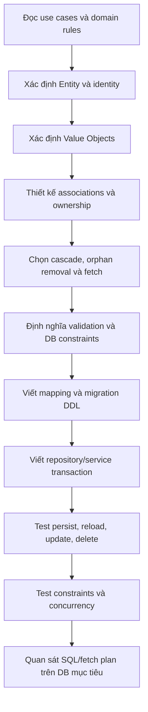

# Ánh xạ định danh, đối tượng giá trị, quan hệ và các ràng buộc

## 1. Bài toán tổng hợp: mô hình hóa một đơn hàng bằng Hibernate

Khi thiết kế persistence model, ta không chỉ gắn @Entity lên mọi class rồi tạo quan hệ theo hình dạng object graph. Trước tiên phải hiểu domain:

- Đối tượng nào có danh tính riêng và tồn tại độc lập?
- Đối tượng nào chỉ là một giá trị thuộc về đối tượng khác?
- Quan hệ nào bắt buộc, quan hệ nào tùy chọn?
- Bảng nào sở hữu foreign key?
- Ai chịu trách nhiệm tạo, cập nhật và xóa đối tượng con?
- Dữ liệu nào phải duy nhất hoặc không được null?
- Điều gì cần được bảo vệ ở Java, điều gì phải được database bảo vệ?

Bài thực hành này xây dựng một mô hình quản lý đơn hàng gồm Customer, Product, PurchaseOrder, OrderLine, Address và Money. Qua đó ta kết hợp bốn nhóm khái niệm:

1. **Định danh (identity):** phân biệt entity theo danh tính bền vững.
2. **Đối tượng giá trị (value object):** mô tả một giá trị không có vòng đời độc lập.
3. **Quan hệ (association):** ánh xạ liên kết giữa các entity và collection.
4. **Ràng buộc (constraints):** bảo vệ tính hợp lệ ở application và database.

Ví dụ sử dụng Jakarta Persistence với Hibernate ORM 6+ và Spring Boot 3+. Một số annotation là chuẩn JPA; những phần ghi rõ Hibernate-specific phụ thuộc Hibernate.

## 2. Bắt đầu từ domain, không bắt đầu từ annotation

Mô hình nghiệp vụ đơn giản:

```text
Customer
  id
  email
  name
  address

Product
  id
  sku
  name
  currentPrice

PurchaseOrder
  id
  orderNumber
  customer
  status
  billingAddress
  shippingAddress
  total
  tags
  lines

OrderLine
  id
  order
  product
  quantity
  unitPriceAtPurchase
```

Các quyết định domain:

- Customer, Product và PurchaseOrder có identity riêng. Chúng là entity.
- Address là tập hợp giá trị địa chỉ, không cần được truy vấn hay cập nhật độc lập. Nó là value object.
- Money gồm amount và currency. Nó được so sánh theo giá trị, không theo ID. Nó là value object.
- OrderLine thuộc vòng đời PurchaseOrder, nhưng trong ví dụ cần row riêng, liên kết Product và có thể được audit. Ta ánh xạ nó thành child entity.
- Product được tham chiếu bởi nhiều OrderLine. Một sản phẩm không bị xóa khi một đơn hàng bị xóa.
- OrderLine lưu unit price tại thời điểm mua để giá lịch sử không đổi khi Product cập nhật giá hiện tại.

Đừng mặc định một class Java tương ứng với một bảng. Entity, embeddable, element collection và DTO phục vụ những mục đích khác nhau.

## 3. Entity và Value Object khác nhau ở đâu?

| Đặc điểm | Entity | Value Object |
|---|---|---|
| Danh tính | Có identity ổn định | Không có identity độc lập |
| Equality | Theo identity/domain identity | Theo các giá trị cấu thành |
| Vòng đời | Có thể tồn tại qua nhiều transaction | Thường thuộc về entity khác |
| Thay đổi | Có thể thay đổi state trong lifecycle | Nên bất biến hoặc thay bằng giá trị mới |
| Truy vấn | Có thể tìm trực tiếp theo ID | Thường đọc qua owner |
| Mapping JPA | @Entity | @Embeddable, @Embedded, @ElementCollection |

Ví dụ hai địa chỉ giống nhau:

```text
Address A:
  street = "12 Example Street"
  city = "Da Nang"
  postalCode = "550000"

Address B:
  street = "12 Example Street"
  city = "Da Nang"
  postalCode = "550000"
```

Nếu Address là value object, A và B có thể bằng nhau vì toàn bộ giá trị giống nhau. Ta không cần hỏi Address A có ID nào.

Ngược lại, hai Customer có cùng tên và địa chỉ vẫn có thể là hai khách hàng khác nhau. Tên và địa chỉ không xác định identity của Customer.

## 4. Chọn khóa định danh cho entity

Entity thường có primary key surrogate:

```java
@Id
@GeneratedValue(strategy = GenerationType.SEQUENCE)
private Long id;
```

Primary key có nhiệm vụ định danh row ổn định. Nó không nhất thiết mang ý nghĩa nghiệp vụ.

### Surrogate key

Ví dụ customer.id = 101, product.id = 9001 và purchase_order.id = 70001.

Ưu điểm:

- Ngắn gọn và ổn định.
- Không phụ thuộc tên/email/giá trị nghiệp vụ có thể đổi.
- Dễ tạo foreign key.
- Có thể đổi business code mà không phải đổi primary key.

### Natural/business key

Một số domain có khóa nghiệp vụ:

- SKU của Product.
- External reference của đơn hàng trong phạm vi tenant.
- Mã quốc gia hoặc mã định danh theo chuẩn nghiệp vụ.

Natural key có thể dùng làm unique constraint hoặc Hibernate @NaturalId, nhưng chỉ nên làm primary key/equality key khi nó thật sự ổn định và có semantics rõ.

Email Customer thường không phải khóa bất biến vì người dùng có thể đổi email.

### Unique key trong phạm vi tenant

Nếu order number chỉ duy nhất trong từng tenant:

```sql
UNIQUE (tenant_id, order_number)
```

Không đặt UNIQUE(order_number) nếu domain cho phép hai tenant dùng cùng một mã.

## 5. Ánh xạ ID sinh tự động

Ví dụ dùng sequence:

```java
@Entity
@Table(name = "customers")
public class Customer {

    @Id
    @GeneratedValue(
        strategy = GenerationType.SEQUENCE,
        generator = "customer_seq"
    )
    @SequenceGenerator(
        name = "customer_seq",
        sequenceName = "customer_seq",
        allocationSize = 50
    )
    private Long id;

    protected Customer() {
    }
}
```

Với PostgreSQL, sequence tương ứng có thể được tạo trong migration. allocationSize cần đồng bộ với sequence increment/schema strategy mà Hibernate mong đợi.

### Các ID strategies thường gặp

| Strategy | Cách hoạt động | Điểm cần lưu ý |
|---|---|---|
| SEQUENCE | Lấy ID từ sequence | Có thể cấp ID trước INSERT; phù hợp DB hỗ trợ sequence |
| IDENTITY | Database cấp ID khi INSERT | Thường cần INSERT sớm để biết ID; có thể hạn chế insert batching |
| TABLE | Dùng bảng làm bộ cấp ID | Có thể tạo contention; thường ít hấp dẫn hơn sequence |
| AUTO | Provider chọn strategy | Kết quả phụ thuộc dialect/provider |

Không chọn ID strategy chỉ vì annotation ngắn. Xem DB vendor, batching, throughput và schema migration.

## 6. Composite identity khi một cột không đủ

Một bảng liên kết có thể dùng nhiều cột làm primary key. Ví dụ một dòng order được định danh bởi order_id và line_number.

### Dùng @EmbeddedId

```java
@Embeddable
public class OrderLineId implements Serializable {

    @Column(name = "order_id")
    private Long orderId;

    @Column(name = "line_number")
    private Integer lineNumber;

    protected OrderLineId() {
    }

    public OrderLineId(Long orderId, Integer lineNumber) {
        this.orderId = orderId;
        this.lineNumber = lineNumber;
    }

    public Long getOrderId() {
        return orderId;
    }

    public Integer getLineNumber() {
        return lineNumber;
    }

    @Override
    public boolean equals(Object other) {
        if (this == other) {
            return true;
        }
        if (!(other instanceof OrderLineId that)) {
            return false;
        }
        return Objects.equals(orderId, that.orderId)
            && Objects.equals(lineNumber, that.lineNumber);
    }

    @Override
    public int hashCode() {
        return Objects.hash(orderId, lineNumber);
    }
}
```

Entity dùng key:

```java
@Entity
@Table(name = "order_lines")
public class OrderLine {

    @EmbeddedId
    private OrderLineId id;

    protected OrderLine() {
    }
}
```

Key class cần equals/hashCode nhất quán trên tất cả thành phần khóa. Các thành phần nên được thiết lập trước khi key được dùng trong Set/Map và không thay đổi sau khi entity persistent.

### @IdClass

JPA cũng hỗ trợ @IdClass: các field ID nằm trên entity, còn key class biểu diễn cùng tên/kiểu field và implement Serializable, equals/hashCode.

Chọn @EmbeddedId khi muốn gom key thành một value object. Chọn @IdClass khi codebase muốn truy cập từng ID field trực tiếp. Không dùng cả hai cho cùng entity.

## 7. Đối tượng giá trị Money bằng @Embeddable

Money không cần bảng riêng trong ví dụ. Ta lưu amount và currency ngay trong bảng owner.

```java
@Embeddable
public class Money {

    @Column(name = "amount", nullable = false,
            precision = 19, scale = 4)
    private BigDecimal amount;

    @Column(name = "currency", nullable = false, length = 3)
    private String currency;

    protected Money() {
    }

    public Money(BigDecimal amount, String currency) {
        if (amount == null) {
            throw new IllegalArgumentException("amount is required");
        }
        if (currency == null || currency.length() != 3) {
            throw new IllegalArgumentException("ISO currency code is required");
        }
        this.amount = amount;
        this.currency = currency.toUpperCase(Locale.ROOT);
    }

    public BigDecimal getAmount() {
        return amount;
    }

    public String getCurrency() {
        return currency;
    }

    public Money add(Money other) {
        requireSameCurrency(other);
        return new Money(amount.add(other.amount), currency);
    }

    private void requireSameCurrency(Money other) {
        if (!currency.equals(other.currency)) {
            throw new IllegalArgumentException("Currency mismatch");
        }
    }

    @Override
    public boolean equals(Object other) {
        if (this == other) {
            return true;
        }
        if (!(other instanceof Money that)) {
            return false;
        }
        return amount.compareTo(that.amount) == 0
            && currency.equals(that.currency);
    }

    @Override
    public int hashCode() {
        return Objects.hash(amount.stripTrailingZeros(), currency);
    }
}
```

Trong ứng dụng tài chính thật, currency nên được validate bằng danh sách mã ISO 4217 hoặc type chuyên biệt; chỉ kiểm tra độ dài ba ký tự là chưa đủ. Scale/rounding phải theo currency và chính sách nghiệp vụ.

### Vì sao BigDecimal cần chú ý?

new BigDecimal("10.0").equals(new BigDecimal("10.00")) trả false vì scale khác nhau, trong khi compareTo() trả 0. Nếu equality của Money coi hai số tiền này là cùng giá trị, hashCode phải normalize scale tương ứng. Một cách khác là chuẩn hóa scale ngay khi tạo value object theo currency/domain rules.

## 8. Dùng cùng một @Embeddable nhiều lần bằng @AttributeOverrides

PurchaseOrder có thể có total, billing address và shipping address. Hai Money/Address fields không thể cùng ghi vào một bộ tên cột mặc định.

Ví dụ:

```java
@Embedded
@AttributeOverrides({
    @AttributeOverride(
        name = "amount",
        column = @Column(name = "total_amount",
                         nullable = false,
                         precision = 19, scale = 4)
    ),
    @AttributeOverride(
        name = "currency",
        column = @Column(name = "total_currency",
                         nullable = false, length = 3)
    )
})
private Money total;
```

@AttributeOverride đổi tên cột cho một embedded attribute. Nếu dùng nhiều embedded values cùng kiểu, override từng field để tránh collision và làm schema dễ đọc.

## 9. Đối tượng giá trị Address

```java
@Embeddable
public class Address {

    @Column(name = "street", nullable = false, length = 180)
    private String street;

    @Column(name = "city", nullable = false, length = 100)
    private String city;

    @Column(name = "postal_code", length = 20)
    private String postalCode;

    @Column(name = "country_code", nullable = false, length = 2)
    private String countryCode;

    protected Address() {
    }

    public Address(
            String street,
            String city,
            String postalCode,
            String countryCode) {
        this.street = requireText(street, "street");
        this.city = requireText(city, "city");
        this.postalCode = postalCode;
        this.countryCode = requireText(countryCode, "countryCode")
            .toUpperCase(Locale.ROOT);
    }

    private static String requireText(String value, String field) {
        if (value == null || value.isBlank()) {
            throw new IllegalArgumentException(field + " is required");
        }
        return value.trim();
    }

    public String getStreet() { return street; }
    public String getCity() { return city; }
    public String getPostalCode() { return postalCode; }
    public String getCountryCode() { return countryCode; }

    @Override
    public boolean equals(Object other) {
        if (this == other) {
            return true;
        }
        if (!(other instanceof Address that)) {
            return false;
        }
        return Objects.equals(street, that.street)
            && Objects.equals(city, that.city)
            && Objects.equals(postalCode, that.postalCode)
            && Objects.equals(countryCode, that.countryCode);
    }

    @Override
    public int hashCode() {
        return Objects.hash(street, city, postalCode, countryCode);
    }
}
```

Value object nên được thay bằng instance mới khi giá trị thay đổi:

```java
customer.changeAddress(
    new Address("25 New Street", "Hue", "530000", "VN")
);
```

Thay vì sửa từng field bên trong một Address đang được chia sẻ giữa nhiều owner. Cách thiết kế bất biến giúp tránh một Customer vô tình làm thay đổi địa chỉ của một Order lịch sử.

## 10. @Embedded và @Embeddable khác nhau thế nào?

| Annotation | Đặt ở đâu | Ý nghĩa |
|---|---|---|
| @Embeddable | Class value object | Khai báo class có thể được nhúng vào entity/embeddable khác |
| @Embedded | Field/property của owner | Nhúng state của embeddable vào bảng owner |
| @AttributeOverride | Field/property owner | Đổi mapping cột của một embedded attribute |
| @AssociationOverride | Field/property owner | Đổi mapping association bên trong embeddable khi cần |

@Embeddable không tạo một entity/table độc lập theo mặc định. Các cột của nó nằm trong bảng chứa nó.

## 11. @ElementCollection cho tập hợp value objects

Nếu Order có các tag đơn giản, không cần identity riêng:

```java
@ElementCollection
@CollectionTable(
    name = "purchase_order_tags",
    joinColumns = @JoinColumn(name = "order_id")
)
@Column(name = "tag", nullable = false, length = 40)
private Set<String> tags = new HashSet<>();
```

Hibernate lưu collection trong bảng phụ có foreign key về PurchaseOrder. Mỗi tag không phải entity riêng và không có ID JPA.

### ElementCollection với embeddable

Có thể lưu danh sách value objects:

```java
@Embeddable
public class DeliveryWindow {

    @Column(name = "start_time", nullable = false)
    private LocalTime start;

    @Column(name = "end_time", nullable = false)
    private LocalTime end;

    protected DeliveryWindow() {
    }

    public DeliveryWindow(LocalTime start, LocalTime end) {
        if (start == null || end == null || !start.isBefore(end)) {
            throw new IllegalArgumentException("Invalid delivery window");
        }
        this.start = start;
        this.end = end;
    }
}
```

```java
@ElementCollection
@CollectionTable(
    name = "customer_delivery_windows",
    joinColumns = @JoinColumn(name = "customer_id")
)
private List<DeliveryWindow> deliveryWindows = new ArrayList<>();
```

### Khi nào không dùng ElementCollection?

Nếu phần tử có identity riêng, được tham chiếu từ nơi khác, có lifecycle độc lập, cần audit/version riêng hoặc cần repository/query độc lập, hãy cân nhắc entity.

ElementCollection phù hợp với các giá trị thuộc owner và được thay đổi cùng owner. Việc cập nhật collection lớn có thể làm Hibernate xóa/chèn lại nhiều rows tùy mapping/provider; hãy đo SQL khi collection có quy mô lớn.

## 12. Ánh xạ Customer entity

```java
@Entity
@Table(
    name = "customers",
    uniqueConstraints = {
        @UniqueConstraint(
            name = "uk_customers_email",
            columnNames = "email"
        )
    }
)
public class Customer {

    @Id
    @GeneratedValue(strategy = GenerationType.SEQUENCE,
                    generator = "customer_seq")
    @SequenceGenerator(
        name = "customer_seq",
        sequenceName = "customer_seq",
        allocationSize = 50
    )
    private Long id;

    @Column(nullable = false, length = 254)
    private String email;

    @Column(name = "display_name", nullable = false, length = 120)
    private String displayName;

    @Embedded
    private Address address;

    @Version
    private long version;

    protected Customer() {
    }

    public Customer(String email, String displayName, Address address) {
        this.email = requireEmail(email);
        this.displayName = requireName(displayName);
        this.address = Objects.requireNonNull(address);
    }

    public Long getId() { return id; }
    public String getEmail() { return email; }
    public String getDisplayName() { return displayName; }
    public Address getAddress() { return address; }
    public long getVersion() { return version; }

    public void rename(String newName) {
        this.displayName = requireName(newName);
    }

    public void changeAddress(Address newAddress) {
        this.address = Objects.requireNonNull(newAddress);
    }

    private static String requireEmail(String value) {
        if (value == null || value.isBlank()) {
            throw new IllegalArgumentException("email is required");
        }
        return value.trim().toLowerCase(Locale.ROOT);
    }

    private static String requireName(String value) {
        if (value == null || value.isBlank()) {
            throw new IllegalArgumentException("name is required");
        }
        return value.trim();
    }
}
```

Đây là mô hình minh họa. Việc lower-case email phải theo chính sách định danh của hệ thống; không phải mọi phần local-part của email đều có semantics case-insensitive theo mọi chuẩn. Với hệ thống thực tế, cần định nghĩa normalization và unique semantics rõ.

## 13. Ánh xạ Product entity và giá hiện tại

```java
@Entity
@Table(
    name = "products",
    uniqueConstraints = @UniqueConstraint(
        name = "uk_products_sku",
        columnNames = "sku"
    )
)
public class Product {

    @Id
    @GeneratedValue(strategy = GenerationType.SEQUENCE,
                    generator = "product_seq")
    @SequenceGenerator(
        name = "product_seq",
        sequenceName = "product_seq",
        allocationSize = 50
    )
    private Long id;

    @Column(nullable = false, length = 50, updatable = false)
    private String sku;

    @Column(nullable = false, length = 160)
    private String name;

    @Embedded
    @AttributeOverrides({
        @AttributeOverride(
            name = "amount",
            column = @Column(name = "price_amount",
                             nullable = false,
                             precision = 19, scale = 4)
        ),
        @AttributeOverride(
            name = "currency",
            column = @Column(name = "price_currency",
                             nullable = false, length = 3)
        )
    })
    private Money currentPrice;

    @Column(nullable = false)
    private boolean active = true;

    @Version
    private long version;

    protected Product() {
    }

    public Product(String sku, String name, Money currentPrice) {
        this.sku = Objects.requireNonNull(sku);
        this.name = Objects.requireNonNull(name);
        this.currentPrice = Objects.requireNonNull(currentPrice);
    }

    public Long getId() { return id; }
    public String getSku() { return sku; }
    public String getName() { return name; }
    public Money getCurrentPrice() { return currentPrice; }
    public boolean isActive() { return active; }

    public void changePrice(Money newPrice) {
        this.currentPrice = Objects.requireNonNull(newPrice);
    }
}
```

Product.currentPrice là giá hiện tại. Khi tạo OrderLine, ta copy giá thành unitPriceAtPurchase để giữ lịch sử giao dịch.

## 14. Ánh xạ OrderLine: child entity có quan hệ với Product

```java
@Entity
@Table(
    name = "order_lines",
    uniqueConstraints = @UniqueConstraint(
        name = "uk_order_line_number",
        columnNames = {"order_id", "line_number"}
    )
)
public class OrderLine {

    @Id
    @GeneratedValue(strategy = GenerationType.SEQUENCE,
                    generator = "order_line_seq")
    @SequenceGenerator(
        name = "order_line_seq",
        sequenceName = "order_line_seq",
        allocationSize = 50
    )
    private Long id;

    @ManyToOne(fetch = FetchType.LAZY, optional = false)
    @JoinColumn(name = "order_id", nullable = false)
    private PurchaseOrder order;

    @ManyToOne(fetch = FetchType.LAZY, optional = false)
    @JoinColumn(name = "product_id", nullable = false)
    private Product product;

    @Column(name = "line_number", nullable = false)
    private int lineNumber;

    @Column(nullable = false)
    private int quantity;

    @Embedded
    @AttributeOverrides({
        @AttributeOverride(
            name = "amount",
            column = @Column(name = "unit_price_amount",
                             nullable = false,
                             precision = 19, scale = 4)
        ),
        @AttributeOverride(
            name = "currency",
            column = @Column(name = "unit_price_currency",
                             nullable = false, length = 3)
        )
    })
    private Money unitPriceAtPurchase;

    protected OrderLine() {
    }

    OrderLine(
            Product product,
            int lineNumber,
            int quantity,
            Money unitPriceAtPurchase) {
        this.product = Objects.requireNonNull(product);
        this.lineNumber = lineNumber;
        changeQuantity(quantity);
        this.unitPriceAtPurchase =
            Objects.requireNonNull(unitPriceAtPurchase);
    }

    void attachTo(PurchaseOrder order) {
        this.order = Objects.requireNonNull(order);
    }

    void detachFromOrder() {
        this.order = null;
    }

    public Long getId() { return id; }
    public Product getProduct() { return product; }
    public int getLineNumber() { return lineNumber; }
    public int getQuantity() { return quantity; }
    public Money getUnitPriceAtPurchase() { return unitPriceAtPurchase; }

    public void changeQuantity(int quantity) {
        if (quantity <= 0) {
            throw new IllegalArgumentException("quantity must be positive");
        }
        this.quantity = quantity;
    }

    public Money subtotal() {
        BigDecimal amount = unitPriceAtPurchase.getAmount()
            .multiply(BigDecimal.valueOf(quantity));
        return new Money(amount, unitPriceAtPurchase.getCurrency());
    }
}
```

order là owning side vì field này có @JoinColumn và quyết định giá trị foreign key order_id. Phía PurchaseOrder sẽ dùng mappedBy = "order".

## 15. Ánh xạ PurchaseOrder aggregate root

```java
@Entity
@Table(
    name = "purchase_orders",
    uniqueConstraints = @UniqueConstraint(
        name = "uk_purchase_orders_order_number",
        columnNames = "order_number"
    ),
    indexes = {
        @Index(
            name = "ix_purchase_orders_customer_created",
            columnList = "customer_id, created_at"
        )
    }
)
public class PurchaseOrder {

    @Id
    @GeneratedValue(strategy = GenerationType.SEQUENCE,
                    generator = "purchase_order_seq")
    @SequenceGenerator(
        name = "purchase_order_seq",
        sequenceName = "purchase_order_seq",
        allocationSize = 50
    )
    private Long id;

    @Column(name = "order_number", nullable = false,
            length = 40, updatable = false)
    private String orderNumber;

    @ManyToOne(fetch = FetchType.LAZY, optional = false)
    @JoinColumn(name = "customer_id", nullable = false)
    private Customer customer;

    @Enumerated(EnumType.STRING)
    @Column(nullable = false, length = 24)
    private OrderStatus status;

    @Embedded
    @AttributeOverrides({
        @AttributeOverride(
            name = "street",
            column = @Column(name = "billing_street",
                             nullable = false, length = 180)
        ),
        @AttributeOverride(
            name = "city",
            column = @Column(name = "billing_city",
                             nullable = false, length = 100)
        ),
        @AttributeOverride(
            name = "postalCode",
            column = @Column(name = "billing_postal_code", length = 20)
        ),
        @AttributeOverride(
            name = "countryCode",
            column = @Column(name = "billing_country_code",
                             nullable = false, length = 2)
        )
    })
    private Address billingAddress;

    @Embedded
    @AttributeOverrides({
        @AttributeOverride(
            name = "street",
            column = @Column(name = "shipping_street",
                             nullable = false, length = 180)
        ),
        @AttributeOverride(
            name = "city",
            column = @Column(name = "shipping_city",
                             nullable = false, length = 100)
        ),
        @AttributeOverride(
            name = "postalCode",
            column = @Column(name = "shipping_postal_code", length = 20)
        ),
        @AttributeOverride(
            name = "countryCode",
            column = @Column(name = "shipping_country_code",
                             nullable = false, length = 2)
        )
    })
    private Address shippingAddress;

    @Embedded
    @AttributeOverrides({
        @AttributeOverride(
            name = "amount",
            column = @Column(name = "total_amount",
                             nullable = false,
                             precision = 19, scale = 4)
        ),
        @AttributeOverride(
            name = "currency",
            column = @Column(name = "total_currency",
                             nullable = false, length = 3)
        )
    })
    private Money total;

    @Column(name = "created_at", nullable = false)
    private Instant createdAt;

    @OneToMany(
        mappedBy = "order",
        cascade = {CascadeType.PERSIST, CascadeType.MERGE},
        orphanRemoval = true
    )
    @OrderBy("lineNumber ASC")
    private List<OrderLine> lines = new ArrayList<>();

    @ElementCollection
    @CollectionTable(
        name = "purchase_order_tags",
        joinColumns = @JoinColumn(name = "order_id")
    )
    @Column(name = "tag", nullable = false, length = 40)
    private Set<String> tags = new HashSet<>();

    @Version
    private long version;

    protected PurchaseOrder() {
    }

    public PurchaseOrder(
            String orderNumber,
            Customer customer,
            Address billingAddress,
            Address shippingAddress) {
        this.orderNumber = Objects.requireNonNull(orderNumber);
        this.customer = Objects.requireNonNull(customer);
        this.billingAddress = Objects.requireNonNull(billingAddress);
        this.shippingAddress = Objects.requireNonNull(shippingAddress);
        this.status = OrderStatus.NEW;
        this.createdAt = Instant.now();
        this.total = new Money(BigDecimal.ZERO, "VND");
    }

    public Long getId() { return id; }
    public String getOrderNumber() { return orderNumber; }
    public Customer getCustomer() { return customer; }
    public OrderStatus getStatus() { return status; }
    public Money getTotal() { return total; }
    public List<OrderLine> getLines() {
        return Collections.unmodifiableList(lines);
    }
    public long getVersion() { return version; }

    public void addLine(
            Product product,
            int quantity,
            Money unitPriceAtPurchase) {
        int nextLineNumber = lines.size() + 1;
        OrderLine line = new OrderLine(
            product,
            nextLineNumber,
            quantity,
            unitPriceAtPurchase
        );
        line.attachTo(this);
        lines.add(line);
        recalculateTotal();
    }

    public void removeLine(Long lineId) {
        OrderLine line = lines.stream()
            .filter(item -> Objects.equals(item.getId(), lineId))
            .findFirst()
            .orElseThrow(() -> new IllegalArgumentException("Line not found"));

        lines.remove(line);
        line.detachFromOrder();
        recalculateTotal();
    }

    public void changeShippingAddress(Address address) {
        this.shippingAddress = Objects.requireNonNull(address);
    }

    public void markPaid() {
        if (status != OrderStatus.NEW) {
            throw new IllegalStateException("Only a new order can be paid");
        }
        status = OrderStatus.PAID;
    }

    private void recalculateTotal() {
        BigDecimal amount = lines.stream()
            .map(line -> line.subtotal().getAmount())
            .reduce(BigDecimal.ZERO, BigDecimal::add);
        this.total = new Money(amount, "VND");
    }
}
```

Enum:

```java
public enum OrderStatus {
    NEW,
    PAID,
    SHIPPED,
    CANCELLED
}
```

Đây là một ví dụ mô hình, không phải một implementation hoàn chỉnh cho mọi hệ thống tiền tệ. Nếu đơn hàng có thể chứa nhiều currencies, cần quy tắc chuyển đổi/kiểm soát currency thay vì cộng trực tiếp tất cả amount.

## 16. Owning side và inverse side

Trong quan hệ hai chiều, JPA xác định một phía sở hữu quan hệ. Phía sở hữu thường chứa foreign key mapping.

Trong ví dụ:

```java
// Owning side: OrderLine
@ManyToOne(fetch = FetchType.LAZY)
@JoinColumn(name = "order_id")
private PurchaseOrder order;

// Inverse side: PurchaseOrder
@OneToMany(mappedBy = "order")
private List<OrderLine> lines;
```

mappedBy = "order" trỏ đến **tên thuộc tính Java** trên OrderLine, không phải tên cột order_id.

### Vì sao phải cập nhật cả hai phía?

```java
public void addLine(OrderLine line) {
    lines.add(line);
    line.attachTo(this);
}
```

Chỉ gọi lines.add(line) mà không đặt line.order có thể không cập nhật foreign key vì OrderLine là owning side.

Helper method giữ object graph nhất quán và giảm lỗi khi persist/flush.

## 17. @ManyToOne: thường là owning side

```java
@ManyToOne(fetch = FetchType.LAZY, optional = false)
@JoinColumn(name = "customer_id", nullable = false)
private Customer customer;
```

Ý nghĩa:

- Nhiều Orders có thể thuộc một Customer.
- customer_id nằm ở bảng purchase_orders.
- optional = false mô tả association không được thiếu ở mức mapping.
- nullable = false yêu cầu column không null trong schema được sinh từ mapping.
- Foreign key thực tế vẫn cần có trong database schema.

Không dùng cascade = REMOVE từ Order sang Customer: xóa một đơn hàng không có nghĩa xóa khách hàng.

## 18. @OneToMany: collection con thuộc owner

```java
@OneToMany(
    mappedBy = "order",
    cascade = {CascadeType.PERSIST, CascadeType.MERGE},
    orphanRemoval = true
)
private List<OrderLine> lines = new ArrayList<>();
```

orphanRemoval = true phù hợp khi OrderLine chỉ thuộc một PurchaseOrder và việc bỏ line khỏi aggregate có nghĩa xóa row line.

### Cascade và orphan removal khác nhau

| Cấu hình | Ý nghĩa |
|---|---|
| CascadeType.PERSIST | Persist parent có thể cascade persist đến child |
| CascadeType.MERGE | Merge parent có thể cascade merge state đến child |
| CascadeType.REMOVE | Remove parent có thể cascade remove đến child |
| orphanRemoval = true | Child bị loại khỏi association owner có thể bị xóa khi flush |
| CascadeType.ALL | Bao gồm các cascade operations chuẩn |

Không chọn ALL theo thói quen. Chỉ cascade lifecycle operations mà domain ownership thực sự yêu cầu.

## 19. @OneToOne và shared primary key

Một ví dụ Customer có Profile riêng, Profile không tồn tại độc lập:

```java
@Entity
public class CustomerProfile {

    @Id
    private Long id;

    @OneToOne(fetch = FetchType.LAZY, optional = false)
    @MapsId
    @JoinColumn(name = "customer_id")
    private Customer customer;

    @Column(name = "preferred_language", length = 10)
    private String preferredLanguage;

    protected CustomerProfile() {
    }
}
```

@MapsId cho biết primary key của Profile đồng thời lấy từ Customer association. DDL thường có customer_id vừa là primary key vừa là foreign key.

### Chọn shared key khi nào?

- Profile có cùng identity với Customer.
- Profile không có vòng đời độc lập.
- Mỗi Customer có tối đa một Profile.

Nếu hai object có identity độc lập hoặc association optional phức tạp, dùng generated ID riêng và unique foreign key có thể rõ ràng hơn.

## 20. @ManyToMany: dùng khi quan hệ không có thuộc tính riêng

Ví dụ user và role đơn giản:

```java
@ManyToMany
@JoinTable(
    name = "user_roles",
    joinColumns = @JoinColumn(name = "user_id"),
    inverseJoinColumns = @JoinColumn(name = "role_id"),
    uniqueConstraints = @UniqueConstraint(
        name = "uk_user_role",
        columnNames = {"user_id", "role_id"}
    )
)
private Set<Role> roles = new HashSet<>();
```

Nếu quan hệ có thuộc tính riêng như assignedAt, assignedBy, quantity, status hoặc order sequence, hãy mô hình hóa join table thành entity:

```text
User 1 --- * UserRole * --- 1 Role

UserRole:
  user_id
  role_id
  assigned_at
  assigned_by
```

Association entity giúp quản lý lifecycle, audit, constraints và concurrency rõ ràng hơn.

Tránh cascade REMOVE qua @ManyToMany nếu hai đầu có thể được chia sẻ bởi nhiều owners.

## 21. FetchType.LAZY và EAGER

Fetch strategy quyết định khi nào association được nạp.

| Mapping | Default JPA phổ biến | Khuyến nghị thiết kế |
|---|---|---|
| @ManyToOne | EAGER | Khai báo LAZY và fetch theo use case |
| @OneToOne | EAGER | Cân nhắc LAZY và kiểm tra provider behavior |
| @OneToMany | LAZY | Thường giữ LAZY |
| @ManyToMany | LAZY | Thường giữ LAZY |

Ví dụ:

```java
@ManyToOne(fetch = FetchType.LAZY, optional = false)
private Customer customer;
```

Không chuyển tất cả association sang EAGER để tránh LazyInitializationException. EAGER có thể tải graph lớn, phát thêm queries hoặc tạo N+1 theo đường truy cập.

### Fetch theo use case

JPQL fetch join:

```java
select o
from PurchaseOrder o
join fetch o.customer
where o.id = :id
```

EntityGraph:

```java
EntityGraph<PurchaseOrder> graph =
    entityManager.createEntityGraph(PurchaseOrder.class);
graph.addAttributeNodes("customer");

PurchaseOrder order = entityManager.find(
    PurchaseOrder.class,
    id,
    Map.of("jakarta.persistence.fetchgraph", graph)
);
```

Fetch plan cần dựa vào API response và query shape. Không fetch mọi collection cùng lúc; nhiều to-many joins có thể nhân rows lớn.

## 22. Ràng buộc ở Java và ràng buộc ở database

Hai lớp bảo vệ có vai trò khác nhau:

| Lớp | Ví dụ | Vai trò |
|---|---|---|
| Domain constructor/method | quantity > 0 | Giữ object hợp lệ trong business flow |
| Bean Validation | @NotBlank, @Positive | Validate input/object trước khi ghi |
| JPA mapping | nullable = false, length | Mô tả mapping/schema generation |
| Database constraint | NOT NULL, UNIQUE, FK, CHECK | Bảo vệ dữ liệu ở mọi writer/transaction |

Không coi Bean Validation thay thế database constraints. Có thể có nhiều application instances, SQL scripts, batch jobs hoặc service khác ghi vào cùng database.

## 23. Bean Validation trên entity và value object

Ví dụ:

```java
@Entity
public class Product {

    @NotBlank
    @Size(max = 50)
    @Column(nullable = false, length = 50)
    private String sku;

    @NotBlank
    @Size(max = 160)
    @Column(nullable = false, length = 160)
    private String name;
}
```

OrderLine:

```java
@Positive
@Column(nullable = false)
private int quantity;
```

Value object:

```java
@Embeddable
public class Money {

    @NotNull
    @Digits(integer = 15, fraction = 4)
    @Column(nullable = false, precision = 19, scale = 4)
    private BigDecimal amount;

    @NotBlank
    @Size(min = 3, max = 3)
    @Column(nullable = false, length = 3)
    private String currency;
}
```

Để validation trên embedded value object được áp dụng từ owner, có thể dùng @Valid:

```java
@Embedded
@Valid
private Money total;
```

Validation khi persist/update phụ thuộc Bean Validation provider và JPA integration/configuration. Nếu cần bảo đảm ở mọi đường ghi, vẫn tạo DB constraints tương ứng.

## 24. NOT NULL, UNIQUE và FOREIGN KEY

### NOT NULL

```sql
display_name VARCHAR(120) NOT NULL
```

Đảm bảo mỗi row có giá trị. @Column(nullable = false) mô tả mapping nhưng cần migration thực tế tạo constraint.

### UNIQUE

```sql
ALTER TABLE products
ADD CONSTRAINT uk_products_sku UNIQUE (sku);
```

Đảm bảo SKU không trùng trong phạm vi bảng. Với multi-tenant, unique key có thể cần (tenant_id, sku).

### FOREIGN KEY

```sql
ALTER TABLE purchase_orders
ADD CONSTRAINT fk_purchase_orders_customer
FOREIGN KEY (customer_id) REFERENCES customers(id);
```

Đảm bảo order tham chiếu một customer tồn tại.

### CHECK

```sql
ALTER TABLE order_lines
ADD CONSTRAINT ck_order_lines_quantity_positive
CHECK (quantity > 0);
```

Đảm bảo quantity luôn dương kể cả khi row được ghi bởi SQL ngoài Hibernate.

## 25. Constraint trong JPA mapping và migration DDL

Một mapping:

```java
@Table(
    name = "products",
    uniqueConstraints = @UniqueConstraint(
        name = "uk_products_sku",
        columnNames = "sku"
    ),
    indexes = @Index(
        name = "ix_products_active_name",
        columnList = "active, name"
    )
)
```

Annotation có thể hỗ trợ schema generation, nhưng production schema thường nên được quản lý bằng migration tool như Flyway/Liquibase.

Ví dụ migration:

```sql
CREATE TABLE products (
    id BIGINT PRIMARY KEY,
    sku VARCHAR(50) NOT NULL,
    name VARCHAR(160) NOT NULL,
    price_amount NUMERIC(19, 4) NOT NULL,
    price_currency VARCHAR(3) NOT NULL,
    active BOOLEAN NOT NULL DEFAULT TRUE,
    version BIGINT NOT NULL DEFAULT 0,
    CONSTRAINT uk_products_sku UNIQUE (sku),
    CONSTRAINT ck_products_price_nonnegative
        CHECK (price_amount >= 0)
);

CREATE INDEX ix_products_active_name
    ON products(active, name);
```

Tên cột, kiểu dữ liệu, default, check và indexes phải khớp mapping/DB dialect. Đừng dùng ddl-auto=update làm chiến lược schema migration production.

## 26. Unique constraints và race conditions

Một service có thể kiểm tra trước:

```java
if (repository.existsBySku(sku)) {
    throw new DuplicateSkuException(sku);
}
repository.save(product);
```

Nhưng hai transactions đồng thời có thể cùng thấy SKU chưa tồn tại rồi cùng insert. Chỉ database unique constraint mới bảo vệ được invariant trong race này.

Xử lý:

1. Kiểm tra sớm để đưa lỗi thân thiện.
2. Vẫn tạo unique constraint ở DB.
3. Bắt và chuyển đổi unique violation thành domain/API error phù hợp.
4. Không tiếp tục dùng transaction đã bị đánh dấu rollback-only sau constraint failure.

Pre-check là trải nghiệm người dùng; constraint là bảo vệ dữ liệu.

## 27. @Version và optimistic locking

Entity có thể được cập nhật bởi nhiều transactions. Thêm version:

```java
@Version
private long version;
```

Hibernate dùng version trong UPDATE để phát hiện stale write. Mô hình SQL thường tương tự:

```sql
UPDATE purchase_orders
SET status = ?, version = version + 1
WHERE id = ? AND version = ?;
```

Nếu row count bằng 0 vì version đã thay đổi, provider phát hiện optimistic locking conflict.

Version không thay thế unique/FK/check constraints. Nó bảo vệ concurrent update của một entity, không bảo vệ mọi invariant liên bảng.

## 28. Cascade là quyết định về ownership, không phải tiện ích giảm code

Ví dụ PurchaseOrder sở hữu OrderLine:

```java
@OneToMany(
    mappedBy = "order",
    cascade = {CascadeType.PERSIST, CascadeType.MERGE},
    orphanRemoval = true
)
private List<OrderLine> lines;
```

Có thể cascade persist/merge đến lines vì chúng thuộc vòng đời Order.

Nhưng Customer và Product được chia sẻ:

```java
@ManyToOne(fetch = FetchType.LAZY)
private Customer customer;

@ManyToOne(fetch = FetchType.LAZY)
private Product product;
```

Không cascade REMOVE từ OrderLine lên Product hoặc từ Order lên Customer. Xóa một order không được xóa customer/product được dùng bởi các orders khác.

### Bảng quyết định tham khảo

| Association | Persist cascade | Remove cascade | Orphan removal |
|---|---:|---:|---:|
| Order → OrderLine sở hữu riêng | Có thể | Có thể | Thường phù hợp |
| OrderLine → Product dùng chung | Thường không | Không | Không |
| Order → Customer dùng chung | Thường không | Không | Không |
| Customer → Address embedded | Không cần cascade | Không | Không |

Với embedded value, không có lifecycle entity riêng để cascade.

## 29. Xóa entity và database ON DELETE

orphanRemoval = true là semantics ở association owner: child bị loại khỏi relationship có thể bị xóa khi flush.

ON DELETE CASCADE là hành vi ở database khi parent row bị xóa.

Hai cơ chế không đồng nhất:

- JPA orphan removal phụ thuộc entity relationship state.
- DB ON DELETE CASCADE có thể xóa child mà Hibernate không trực tiếp quản lý từng entity.
- Persistence Context đang mở có thể giữ state cũ sau database-side cascade.
- Audit/entity callbacks có thể không chạy như managed remove từng child.

Chọn một chiến lược rõ ràng và test cả SQL/database state lẫn cache/persistence-context effects.

## 30. Many-to-many có join entity khi cần metadata

Giả sử Order có coupon. Nếu chỉ là liên kết hai entity không có thuộc tính, @ManyToMany có thể đủ.

Nhưng nếu cần lưu thời điểm coupon được áp dụng, số tiền giảm, người áp dụng hoặc trạng thái coupon, tạo entity OrderCoupon:

```java
@Entity
@Table(
    name = "order_coupons",
    uniqueConstraints = @UniqueConstraint(
        name = "uk_order_coupon",
        columnNames = {"order_id", "coupon_id"}
    )
)
public class OrderCoupon {

    @Id
    @GeneratedValue(strategy = GenerationType.SEQUENCE)
    private Long id;

    @ManyToOne(fetch = FetchType.LAZY, optional = false)
    @JoinColumn(name = "order_id", nullable = false)
    private PurchaseOrder order;

    @ManyToOne(fetch = FetchType.LAZY, optional = false)
    @JoinColumn(name = "coupon_id", nullable = false)
    private Coupon coupon;

    @Column(name = "applied_at", nullable = false)
    private Instant appliedAt;

    @Embedded
    private Money discount;
}
```

Join entity biến quan hệ thành một phần domain có thể validate, audit, version và truy vấn độc lập.

## 31. @MapsId khi foreign key cũng là một phần primary key

Một trường hợp khác là OrderLine dùng composite key có order ID:

```java
@Embeddable
public class OrderLineKey implements Serializable {

    private Long orderId;
    private Integer lineNumber;

    // no-arg constructor, getters, equals and hashCode
}
```

Entity:

```java
@Entity
public class OrderLine {

    @EmbeddedId
    private OrderLineKey id;

    @MapsId("orderId")
    @ManyToOne(fetch = FetchType.LAZY, optional = false)
    @JoinColumn(name = "order_id")
    private PurchaseOrder order;
}
```

@MapsId("orderId") liên kết thuộc tính orderId của embedded key với primary key của association. Đây là mapping hữu ích khi key của child phụ thuộc identity của parent.

Vì composite key có thể được hoàn thiện khi parent đã có ID, hãy kiểm soát thời điểm tạo key và không thay đổi nó sau khi entity đã persistent hoặc nằm trong hash collection.

## 32. Ràng buộc nghiệp vụ liên quan đến tổng tiền

PurchaseOrder.total có thể là dữ liệu tính từ OrderLine:

```java
private void recalculateTotal() {
    BigDecimal amount = lines.stream()
        .map(line -> line.subtotal().getAmount())
        .reduce(BigDecimal.ZERO, BigDecimal::add);
    this.total = new Money(amount, "VND");
}
```

Nhưng nếu database cho phép SQL ngoài ứng dụng cập nhật OrderLine, total có thể bị lệch.

Các lựa chọn:

1. Không lưu total; tính khi query/report.
2. Lưu total và chỉ cập nhật qua aggregate service/transaction.
3. Dùng DB trigger/generated column khi semantics phù hợp.
4. Dùng asynchronous projection/read model và chấp nhận eventual consistency có kiểm soát.

Không tự động coi @Formula là cột được ghi. Hibernate @Formula là Hibernate-specific read expression, không phải persisted field thông thường.

## 33. Null semantics và optional associations

```java
@ManyToOne(fetch = FetchType.LAZY, optional = true)
@JoinColumn(name = "sales_rep_id", nullable = true)
private SalesRepresentative salesRep;
```

Nếu association tùy chọn:

- Mapping nên thể hiện optional.
- Column cho phép null.
- Business logic phải xử lý không có sales rep.
- Query cần chọn INNER hay LEFT join đúng semantics.

Không dùng optional=false trong khi schema cho null hoặc domain cho phép không có association. Sự không nhất quán gây lỗi ở cả validation và query results.

## 34. Fetch join và duplicate rows khi có to-many relationship

Query:

```java
select distinct o
from PurchaseOrder o
left join fetch o.lines
where o.id = :id
```

Có thể lấy Order và Lines trong một truy vấn. Nhưng nếu fetch nhiều collection cùng lúc, SQL rows có thể nhân theo tích số phần tử của các collection.

Với pagination trên to-many fetch join, database pagination có thể không tương ứng với số root entities. Cần:

- Page IDs trước.
- Fetch graph cho tập IDs sau.
- Dùng batch fetching hoặc DTO projection.
- Kiểm tra SQL và result rows.

Không chuyển toàn bộ associations sang EAGER để đỡ query.

## 35. Thiết kế schema migration tương ứng

Một DDL rút gọn cho mô hình:

```sql
CREATE SEQUENCE customer_seq START WITH 1 INCREMENT BY 50;
CREATE SEQUENCE product_seq START WITH 1 INCREMENT BY 50;
CREATE SEQUENCE purchase_order_seq START WITH 1 INCREMENT BY 50;
CREATE SEQUENCE order_line_seq START WITH 1 INCREMENT BY 50;

CREATE TABLE customers (
    id BIGINT PRIMARY KEY,
    email VARCHAR(254) NOT NULL,
    display_name VARCHAR(120) NOT NULL,
    street VARCHAR(180) NOT NULL,
    city VARCHAR(100) NOT NULL,
    postal_code VARCHAR(20),
    country_code VARCHAR(2) NOT NULL,
    version BIGINT NOT NULL DEFAULT 0,
    CONSTRAINT uk_customers_email UNIQUE(email)
);

CREATE TABLE products (
    id BIGINT PRIMARY KEY,
    sku VARCHAR(50) NOT NULL,
    name VARCHAR(160) NOT NULL,
    price_amount NUMERIC(19, 4) NOT NULL,
    price_currency VARCHAR(3) NOT NULL,
    active BOOLEAN NOT NULL DEFAULT TRUE,
    version BIGINT NOT NULL DEFAULT 0,
    CONSTRAINT uk_products_sku UNIQUE(sku),
    CONSTRAINT ck_products_price_nonnegative
        CHECK(price_amount >= 0)
);

CREATE TABLE purchase_orders (
    id BIGINT PRIMARY KEY,
    order_number VARCHAR(40) NOT NULL,
    customer_id BIGINT NOT NULL,
    status VARCHAR(24) NOT NULL,
    billing_street VARCHAR(180) NOT NULL,
    billing_city VARCHAR(100) NOT NULL,
    billing_postal_code VARCHAR(20),
    billing_country_code VARCHAR(2) NOT NULL,
    shipping_street VARCHAR(180) NOT NULL,
    shipping_city VARCHAR(100) NOT NULL,
    shipping_postal_code VARCHAR(20),
    shipping_country_code VARCHAR(2) NOT NULL,
    total_amount NUMERIC(19, 4) NOT NULL,
    total_currency VARCHAR(3) NOT NULL,
    created_at TIMESTAMP WITH TIME ZONE NOT NULL,
    version BIGINT NOT NULL DEFAULT 0,
    CONSTRAINT uk_purchase_orders_order_number UNIQUE(order_number),
    CONSTRAINT fk_purchase_orders_customer
        FOREIGN KEY(customer_id) REFERENCES customers(id),
    CONSTRAINT ck_purchase_orders_status
        CHECK(status IN ('NEW', 'PAID', 'SHIPPED', 'CANCELLED')),
    CONSTRAINT ck_purchase_orders_total_nonnegative
        CHECK(total_amount >= 0)
);

CREATE TABLE order_lines (
    id BIGINT PRIMARY KEY,
    order_id BIGINT NOT NULL,
    product_id BIGINT NOT NULL,
    line_number INTEGER NOT NULL,
    quantity INTEGER NOT NULL,
    unit_price_amount NUMERIC(19, 4) NOT NULL,
    unit_price_currency VARCHAR(3) NOT NULL,
    CONSTRAINT fk_order_lines_order
        FOREIGN KEY(order_id) REFERENCES purchase_orders(id),
    CONSTRAINT fk_order_lines_product
        FOREIGN KEY(product_id) REFERENCES products(id),
    CONSTRAINT uk_order_line_number UNIQUE(order_id, line_number),
    CONSTRAINT ck_order_lines_quantity_positive CHECK(quantity > 0),
    CONSTRAINT ck_order_lines_price_nonnegative
        CHECK(unit_price_amount >= 0)
);

CREATE TABLE purchase_order_tags (
    order_id BIGINT NOT NULL,
    tag VARCHAR(40) NOT NULL,
    CONSTRAINT fk_order_tags_order
        FOREIGN KEY(order_id) REFERENCES purchase_orders(id),
    CONSTRAINT uk_order_tag UNIQUE(order_id, tag)
);

CREATE INDEX ix_purchase_orders_customer_created
    ON purchase_orders(customer_id, created_at);

CREATE INDEX ix_order_lines_product
    ON order_lines(product_id);
```

DDL là ví dụ cho PostgreSQL và cần được điều chỉnh theo naming strategy, sequence allocation, timestamp type, schema version và các fields thực tế. Nếu allocationSize = 50, sequence increment cần tương thích với cách Hibernate cấp ID và cấu hình generator.

## 36. Mapping annotations không tự quản lý production schema

Trong môi trường local, spring.jpa.hibernate.ddl-auto=create hoặc update có thể tiện cho thử nghiệm.

Production nên:

- Quản lý DDL bằng migration có version.
- Review constraints/indexes như code.
- Triển khai migration theo thứ tự tương thích với ứng dụng.
- Kiểm tra dữ liệu hiện có trước khi thêm NOT NULL/UNIQUE.
- Có kế hoạch backfill và rollback/forward-fix.

Ví dụ thêm unique constraint khi dữ liệu cũ có duplicate sẽ thất bại. Cần xử lý duplicate trước migration.

## 37. Repository và service: nơi đặt transaction boundary

Repository tập trung truy cập:

```java
public interface PurchaseOrderRepository
        extends JpaRepository<PurchaseOrder, Long> {

    Optional<PurchaseOrder> findByOrderNumber(String orderNumber);
}
```

Service thực hiện use case:

```java
@Service
public class PlaceOrderService {

    private final CustomerRepository customers;
    private final ProductRepository products;
    private final PurchaseOrderRepository orders;

    public PlaceOrderService(
            CustomerRepository customers,
            ProductRepository products,
            PurchaseOrderRepository orders) {
        this.customers = customers;
        this.products = products;
        this.orders = orders;
    }

    @Transactional
    public Long place(PlaceOrderCommand command) {
        Customer customer = customers.findById(command.customerId())
            .orElseThrow(() -> new CustomerNotFoundException(
                command.customerId()
            ));

        PurchaseOrder order = new PurchaseOrder(
            command.orderNumber(),
            customer,
            command.billingAddress(),
            command.shippingAddress()
        );

        for (PlaceOrderLine line : command.lines()) {
            Product product = products.findById(line.productId())
                .orElseThrow(() -> new ProductNotFoundException(
                    line.productId()
                ));

            if (!product.isActive()) {
                throw new InactiveProductException(product.getSku());
            }

            order.addLine(
                product,
                line.quantity(),
                product.getCurrentPrice()
            );
        }

        orders.save(order);
        return order.getId();
    }
}
```

Đây là khung use case: constructor command/exception/repository cần được định nghĩa trong dự án. Cascade PERSIST từ PurchaseOrder đến OrderLine cho phép lưu child; Customer và Product được tải managed và được tham chiếu, không bị cascade remove.

Không gọi save() cho từng field update của managed entity. Trong transaction, dirty checking ghi thay đổi khi flush/commit.

## 38. Validation trước khi tạo aggregate

Command:

```java
public record PlaceOrderLine(
    @NotNull Long productId,
    @Positive int quantity
) {}

public record PlaceOrderCommand(
    @NotBlank String orderNumber,
    @NotNull Long customerId,
    @NotEmpty List<@Valid PlaceOrderLine> lines,
    @NotNull @Valid Address billingAddress,
    @NotNull @Valid Address shippingAddress
) {}
```

Validation ở API boundary giúp phản hồi sớm. Domain methods vẫn cần bảo vệ invariants quan trọng để use case nội bộ không thể tạo object sai.

Database constraints bảo vệ dữ liệu trước mọi writer. Ba lớp có mục đích khác nhau và bổ sung cho nhau.

## 39. Test mapping bằng @DataJpaTest

Test cần xác minh entity/value object/relationship được lưu và đọc lại đúng:

```java
@DataJpaTest
class PurchaseOrderMappingTest {

    @Autowired
    private TestEntityManager entityManager;

    @Test
    void persistsEmbeddedValuesAndRelationships() {
        Customer customer = new Customer(
            "buyer@example.test",
            "Buyer",
            new Address("12 Main Street", "Da Nang", "550000", "VN")
        );
        Product product = new Product(
            "SKU-100",
            "Keyboard",
            new Money(new BigDecimal("500000"), "VND")
        );

        entityManager.persist(customer);
        entityManager.persist(product);

        PurchaseOrder order = new PurchaseOrder(
            "ORD-2026-001",
            customer,
            customer.getAddress(),
            new Address("25 New Street", "Hue", "530000", "VN")
        );

        order.addLine(
            product,
            2,
            product.getCurrentPrice()
        );

        entityManager.persist(order);
        entityManager.flush();

        Long orderId = order.getId();
        entityManager.clear();

        PurchaseOrder actual =
            entityManager.find(PurchaseOrder.class, orderId);

        assertThat(actual.getOrderNumber()).isEqualTo("ORD-2026-001");
        assertThat(actual.getCustomer().getEmail())
            .isEqualTo("buyer@example.test");
        assertThat(actual.getLines()).hasSize(1);
        assertThat(actual.getLines().get(0).getQuantity()).isEqualTo(2);
        assertThat(actual.getTotal().getAmount())
            .isEqualByComparingTo("1000000");
    }
}
```

Trong test thật, getLines() có thể lazy và cần transaction test còn mở. @DataJpaTest thường bao test trong transaction và rollback khi kết thúc; flush/clear giúp kiểm chứng round-trip trong transaction đó.

## 40. Test orphan removal

```java
@Test
void removingOrderLineDeletesOwnedChild() {
    // Persist customer, product, order and one line first.
    entityManager.persist(order);
    entityManager.flush();

    Long orderId = order.getId();
    Long lineId = order.getLines().get(0).getId();

    order.removeLine(lineId);
    entityManager.flush();
    entityManager.clear();

    PurchaseOrder reloaded =
        entityManager.find(PurchaseOrder.class, orderId);

    assertThat(reloaded.getLines())
        .noneMatch(line -> line.getId().equals(lineId));
}
```

Test cần fixture đầy đủ và helper method thực tế. Có thể bổ sung JDBC count query để kiểm tra row child đã bị xóa trong transaction hiện tại.

## 41. Test unique constraint và foreign key

Bean Validation hoặc service pre-check không đủ để kiểm tra DB constraint. Một integration test có thể cố tình insert duplicate SKU hoặc foreign key không tồn tại rồi flush:

```java
entityManager.persist(new Product(
    "SKU-DUP",
    "First",
    new Money(new BigDecimal("10"), "VND")
));
entityManager.flush();

entityManager.persist(new Product(
    "SKU-DUP",
    "Second",
    new Money(new BigDecimal("20"), "VND")
));

assertThatThrownBy(entityManager::flush)
    .isInstanceOf(RuntimeException.class);
```

Exception thực tế có thể được bọc bởi Hibernate/Spring. Sau constraint failure, transaction có thể rollback-only; đặt tình huống lỗi trong test riêng và không tiếp tục dùng context như bình thường.

## 42. Test optimistic locking

Một test concurrency cần hai Persistence Context/transactions riêng:

```text
Transaction A loads version 3
Transaction B loads version 3

A changes status and commits -> version 4
B changes status and tries to commit using version 3

B receives optimistic locking conflict
```

Không mô phỏng hai transaction bằng hai references trong cùng Persistence Context, vì first-level identity map sẽ trả cùng managed object.

## 43. Test equals/hashCode cho entity và value object

Entity và value object có equality semantics khác nhau:

- Entity: theo persistent identity hoặc immutable natural key.
- Value object: theo toàn bộ giá trị cấu thành.

Ví dụ Address:

```java
Address first =
    new Address("12 Main Street", "Da Nang", "550000", "VN");
Address second =
    new Address("12 Main Street", "Da Nang", "550000", "VN");

assertThat(first).isEqualTo(second);
assertThat(first.hashCode()).isEqualTo(second.hashCode());
```

Với entity generated ID, không để hashCode thay đổi khi ID được cấp nếu entity có thể đã nằm trong HashSet. Proxy equality cần được test theo Hibernate version/hierarchy strategy.

## 44. Test enum mapping và tránh ordinal

Dùng:

```java
@Enumerated(EnumType.STRING)
private OrderStatus status;
```

String mapping lưu tên enum, dễ đọc và không phụ thuộc thứ tự khai báo. Nhưng đổi tên enum vẫn là schema/data migration cần thiết.

Tránh EnumType.ORDINAL cho trạng thái nghiệp vụ lâu dài vì thêm/chèn enum constant có thể làm ý nghĩa dữ liệu cũ thay đổi.

Nếu cần mã lưu DB ổn định khác tên enum, dùng AttributeConverter.

## 45. Test fetch strategy và query count

Mapping đúng không có nghĩa query hiệu quả.

Test các use cases:

- Load Order chỉ cần header.
- Load Order detail cùng Customer.
- Load Order detail cùng Lines và Product.
- Search page chỉ cần DTO fields.

Dùng SQL logging/Hibernate Statistics để quan sát query count, nhưng đừng assert nguyên văn SQL nếu test không thực sự cần contract SQL. Đo query plan trên DB vendor mục tiêu cho performance tests.

## 46. Kiểm tra migration schema với mapping

Các loại drift thường gặp:

- Column nullable trong DB nhưng mapping cho rằng bắt buộc.
- Precision/scale Money không khớp.
- Unique constraint thiếu tenant scope.
- Foreign key thiếu hoặc tham chiếu nhầm column.
- Enum column length không đủ.
- Sequence increment không khớp allocation size.
- Index thiếu trên foreign key/filter thường dùng.
- Check constraint không phản ánh domain.

Hãy review migration DDL và mapping cùng nhau. ddl-auto=validate trong môi trường phù hợp có thể phát hiện một số khác biệt schema, nhưng không thay thế kiểm tra mọi constraint/index/behavior.

## 47. Các quyết định thường gây lỗi

| Quyết định sai | Hậu quả |
|---|---|
| Dùng @Entity cho mọi class | Tạo bảng/identity không cần thiết |
| Dùng email mutable làm primary/equality key | Update email gây vấn đề identity/collection |
| Dùng @Embedded nhưng không override cột khi nhúng hai lần | Column collision hoặc schema khó hiểu |
| Dùng ElementCollection cho object có lifecycle độc lập | Khó tham chiếu/audit/version riêng |
| Dùng ManyToMany khi join có metadata | Không có nơi đặt state của association |
| Đặt cascade REMOVE lên Customer/Product dùng chung | Có thể xóa dữ liệu được nhiều orders tham chiếu |
| Chỉ cập nhật inverse collection | Foreign key owning side không đổi |
| Fetch EAGER mọi association | Graph lớn, N+1 hoặc query nặng |
| Không có FK/unique/check ở DB | Writer khác có thể tạo dữ liệu sai |
| Chỉ dùng Bean Validation | Không bảo vệ các đường ghi ngoài application |
| Không dùng @Version khi cần optimistic locking | Lost update có thể không được phát hiện |
| Dùng BigDecimal.equals mà không xét scale | Money 10.0 và 10.00 bị xem khác |
| Đổi hash key khi entity nằm trong Set | contains/remove có thể thất bại |
| Dùng ddl-auto=update làm migration production | Schema change thiếu kiểm soát |

## 48. Quy trình thiết kế một persistence model



Thứ tự này giúp annotation phản ánh domain thay vì để database schema quyết định ngược mô hình nghiệp vụ.

## 49. Bài thực hành 1: thiết kế domain Order

Tạo các class Customer, Product, PurchaseOrder, OrderLine, Address và Money.

Yêu cầu:

1. Xác định class nào là entity.
2. Xác định class nào là value object.
3. Chọn generated ID hoặc natural key cho từng entity.
4. Map Address và Money bằng @Embeddable.
5. Map Product/Customer associations bằng @ManyToOne.
6. Map Order → OrderLine bằng @OneToMany.
7. Viết helper methods addLine/removeLine cập nhật hai phía.
8. Lưu unit price snapshot tại thời điểm mua.

## 50. Bài thực hành 2: map nhiều embedded values

1. Nhúng Address vào Customer.
2. Nhúng billingAddress và shippingAddress vào PurchaseOrder.
3. Nhúng Money vào Product.currentPrice.
4. Nhúng Money vào PurchaseOrder.total.
5. Dùng @AttributeOverrides đặt tên cột.
6. Tạo migration DDL tương ứng.
7. Persist/flush/clear/reload và assert mọi field.

## 51. Bài thực hành 3: relationships và ownership

1. Map PurchaseOrder.customer.
2. Map OrderLine.order và OrderLine.product.
3. Map PurchaseOrder.lines với mappedBy.
4. Viết add/remove helpers.
5. Chọn cascade PERSIST/MERGE.
6. Bật orphanRemoval nếu line thuộc riêng order.
7. Test owning side bằng JDBC query foreign key.
8. Xóa một line và xác nhận row child bị xóa.

## 52. Bài thực hành 4: constraints

Tạo các constraints:

- Customer email unique.
- Product SKU unique.
- Order number unique hoặc unique theo tenant.
- OrderLine quantity > 0.
- Money amount không âm nếu domain yêu cầu.
- FK Order → Customer.
- FK OrderLine → Order/Product.
- Unique (order_id, line_number).

Test:

1. Duplicate SKU.
2. Duplicate order number.
3. Quantity bằng 0.
4. Foreign key không tồn tại.
5. Concurrent insert cùng unique key.

## 53. Bài thực hành 5: cascade và orphan removal

1. Persist Order cùng hai Lines.
2. Xác nhận cascade persist.
3. Remove một Line qua aggregate method.
4. Flush/clear/reload.
5. Xác nhận Line bị xóa.
6. Xóa Order và xác nhận Lines được xử lý theo lifecycle đã chọn.
7. Xác nhận Product và Customer vẫn tồn tại.

## 54. Bài thực hành 6: fetch plan

Viết ba query:

1. Order header chỉ lấy scalar fields.
2. Order detail fetch Customer và Lines.
3. Search page dùng DTO projection.

So sánh SQL statements, rows returned, memory và behavior pagination. Không fetch hai collection lớn trong cùng query nếu không cần.

## 55. Bài thực hành 7: optimistic locking

1. Thêm @Version cho PurchaseOrder.
2. Mở hai transactions.
3. Load cùng Order ở cả hai transactions.
4. Update và commit transaction thứ nhất.
5. Update/commit transaction thứ hai.
6. Xác nhận optimistic locking conflict.
7. Thiết kế cách báo conflict cho client.

## 56. Bài thực hành 8: mapping và schema migration

1. Viết migration tạo sequence/tables.
2. Tạo NOT NULL/UNIQUE/FK/CHECK constraints.
3. Tạo indexes cho query paths.
4. Chạy Hibernate schema validation.
5. Chạy Testcontainers với cùng DB vendor.
6. Persist/reload/update/delete fixtures.
7. Kiểm tra DDL không lệch mapping.

## 57. Câu hỏi tự kiểm tra

1. Entity khác Value Object ở identity như thế nào?
2. Vì sao Customer và Address không nên được mô hình hóa giống nhau?
3. Khi nào natural key phù hợp làm identity?
4. Vì sao email thường không phải immutable key?
5. SEQUENCE khác IDENTITY ở thời điểm cấp ID thế nào?
6. Khi nào dùng @EmbeddedId?
7. Vì sao composite key cần equals/hashCode?
8. @Embeddable khác @Embedded thế nào?
9. @AttributeOverride giải quyết vấn đề gì?
10. Khi nào dùng @ElementCollection?
11. Khi nào value object nên trở thành entity?
12. Vì sao OrderLine có thể là child entity?
13. Owning side là gì?
14. mappedBy trỏ đến tên gì?
15. Vì sao phải cập nhật cả hai phía quan hệ hai chiều?
16. @ManyToOne thường chứa foreign key ở bảng nào?
17. Khi nào orphanRemoval phù hợp?
18. Cascade REMOVE nguy hiểm với Product/Customer vì sao?
19. Khi nào dùng @MapsId?
20. Khi nào nên dùng join entity thay ManyToMany?
21. Vì sao LAZY thường là lựa chọn tốt cho associations?
22. Vì sao EAGER không giải quyết triệt để N+1?
23. Bean Validation khác database constraint thế nào?
24. Vì sao pre-check exists không thay thế UNIQUE?
25. CHECK constraint bảo vệ điều gì?
26. @Version phát hiện loại lỗi nào?
27. Vì sao version không thay thế foreign key/unique?
28. Vì sao cần snapshot giá tại thời điểm mua?
29. BigDecimal.equals khác compareTo thế nào?
30. Vì sao test flush/clear/reload hữu ích?
31. Vì sao @DataJpaTest rollback không chứng minh commit visibility?
32. Vì sao cần migration tool trong production?

**Gợi ý:** (1) entity có identity, value object theo value; (2) Customer tồn tại độc lập, Address thuộc owner; (3) unique và immutable; (4) người dùng đổi email; (5) sequence có thể cấp trước insert, identity cần insert; (6) khóa gồm nhiều field; (7) key value semantics; (8) type vs usage; (9) đổi column mapping; (10) collection values thuộc owner; (11) cần identity/lifecycle/reference/audit riêng; (12) có row, Product association và lifecycle; (13) phía ghi FK; (14) field Java trên phía kia; (15) giữ graph và FK đồng nhất; (16) bảng many-to-one; (17) child thuộc riêng owner; (18) xóa entity dùng chung; (19) PK phụ thuộc association; (20) association có metadata; (21) chỉ load khi cần; (22) có thể phát thêm queries; (23) validation app vs bảo vệ mọi writer; (24) race condition; (25) invariant trên column; (26) stale concurrent update; (27) bảo vệ invariant khác; (28) lịch sử giá; (29) scale; (30) tránh L1 cache che state; (31) transaction vẫn rollback; (32) schema changes có version/review.

## 58. Nguyên tắc cần ghi nhớ

1. **Entity có identity; value object có equality theo giá trị.** Đừng tạo entity/table cho mọi class Java.
2. **Chọn surrogate key ổn định cho entity khi natural key có thể thay đổi.** Natural key cần duy nhất, có giá trị và bất biến theo domain.
3. **Composite key cần một key class có equals/hashCode nhất quán.** Không thay đổi thành phần key sau khi persistent.
4. **@Embeddable mô tả value type; @Embedded đặt value đó vào owner.** Dùng @AttributeOverride khi nhúng nhiều field cùng kiểu.
5. **@ElementCollection phù hợp với values thuộc owner.** Nếu phần tử cần identity/lifecycle/reference/audit riêng, cân nhắc entity.
6. **Owning side quyết định foreign key.** mappedBy tham chiếu field/property Java của phía owning.
7. **Helper methods nên cập nhật cả hai phía của bidirectional association.**
8. **Cascade phản ánh ownership.** Không cascade REMOVE đến Customer/Product được chia sẻ.
9. **orphanRemoval phù hợp với child thuộc riêng aggregate owner.** Nó khác database ON DELETE CASCADE.
10. **LAZY và fetch plan theo use case giúp kiểm soát graph.** Không dùng EAGER toàn cục để né lỗi session.
11. **Bean Validation và domain methods bảo vệ application; database constraints bảo vệ mọi writer.**
12. **Pre-check không thay thế UNIQUE/FK/CHECK constraints** vì vẫn có race conditions.
13. **@Version phát hiện stale updates**, nhưng không thay thế các constraints khác.
14. **Lưu snapshot giá/địa chỉ khi lịch sử nghiệp vụ yêu cầu** thay vì luôn đọc giá trị hiện tại từ entity liên quan.
15. **Quản lý schema bằng migration có version.** Mapping annotations không thay thế review DDL production.
16. **Test persist, flush, clear, reload, update, delete, cascade, constraints và concurrency** trên database phù hợp.

Một persistence model tốt bắt đầu từ danh tính và vòng đời của đối tượng trong domain. Entity được ánh xạ bằng primary key; value object được nhúng hoặc lưu trong collection phụ; association thể hiện rõ owning side và quyền sở hữu; constraints bảo vệ invariant ở database. Khi bốn phần này nhất quán, Hibernate có thể quản lý object graph và đồng bộ dữ liệu mà không tạo ra những side effects bất ngờ. Hãy dùng bài thực hành Order làm mẫu, rồi điều chỉnh identity, relationships, fetch plans và constraints theo quy tắc nghiệp vụ thực tế của ứng dụng.

### Tài liệu tham khảo chính thức

- [Hibernate ORM User Guide — Mapping entities](https://docs.hibernate.org/orm/current/userguide/html_single/)
- [Hibernate ORM User Guide — Embeddables and collections](https://docs.hibernate.org/orm/current/userguide/html_single/)
- [Hibernate ORM User Guide — Associations](https://docs.hibernate.org/orm/current/userguide/html_single/)
- [Jakarta Persistence Specification](https://jakarta.ee/specifications/persistence/)
- [Jakarta Persistence API — Entity](https://jakarta.ee/specifications/persistence/3.2/apidocs/jakarta.persistence/jakarta/persistence/entity)
- [Jakarta Persistence API — Embeddable](https://jakarta.ee/specifications/persistence/3.2/apidocs/jakarta.persistence/jakarta/persistence/embeddable)
- [Jakarta Bean Validation Specification](https://jakarta.ee/specifications/bean-validation/)
- [Spring Data JPA Reference](https://docs.spring.io/spring-data/jpa/reference/)
- [Flyway Documentation](https://documentation.red-gate.com/flyway)
- [Testcontainers for Java](https://java.testcontainers.org/)
