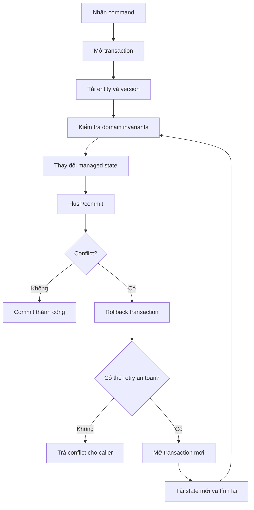

# Bảo vệ cập nhật đồng thời bằng phiên bản và ràng buộc cơ sở dữ liệu

## 1. Bài toán: hai người cùng cập nhật một dữ liệu

Một ứng dụng bán hàng có sản phẩm với số lượng tồn kho là 10. Hai request gần như đồng thời cùng đọc giá trị này:

```text
Request A đọc available = 10
Request B đọc available = 10

A đặt hàng 7 sản phẩm
B đặt hàng 6 sản phẩm

A ghi available = 3
B ghi available = 4
```

Nếu cả hai thao tác đều được chấp nhận, ứng dụng đã bán tổng cộng 13 sản phẩm trong khi chỉ có 10 sản phẩm ban đầu. Một lần ghi đã ghi đè kết quả của lần ghi kia. Đây là một dạng **lost update**.

Một vấn đề khác: hai request cùng đăng ký email hoặc cùng tạo order number. Cả hai đều kiểm tra “chưa tồn tại”, sau đó cùng insert. Nếu chỉ kiểm tra ở Java mà không có ràng buộc database, dữ liệu trùng vẫn có thể xuất hiện.

Để bảo vệ dữ liệu khi có nhiều transactions, cần kết hợp:

- **Optimistic locking:** phát hiện một transaction đang ghi dựa trên phiên bản cũ.
- **Pessimistic locking:** khóa row phù hợp trong lúc transaction xử lý.
- **Database constraints:** buộc các invariant dữ liệu được thực thi ngay tại database.
- **Atomic conditional updates:** thực hiện điều kiện và thay đổi trong cùng một câu SQL.
- **Transaction boundary và retry có kiểm soát:** đảm bảo thao tác được commit hoặc rollback như một đơn vị.

Bài thực hành dùng Hibernate/JPA và Spring để mô hình hóa các tình huống này, chỉ ra khi nào @Version đủ dùng, khi nào cần constraint hoặc lock, và cách kiểm thử với hai transactions thật.

## 2. Vì sao transaction riêng lẻ vẫn có thể gây lỗi khi chạy đồng thời?

Transaction giúp nhóm các thao tác thành một đơn vị commit/rollback. Nó không tự động tuần tự hóa mọi transactions.

Ví dụ:

```text
Transaction A                  Transaction B
--------------                 --------------
SELECT stock = 10
                               SELECT stock = 10
UPDATE stock = 3
COMMIT
                               UPDATE stock = 4
                               COMMIT
```

Cả hai transactions đều có thể hợp lệ theo cách database xử lý từng statement, nhưng kết quả nghiệp vụ sai.

Các lỗi đồng thời thường gặp:

| Lỗi | Tình huống |
|---|---|
| Lost update | Ghi mới đè thay đổi của transaction khác |
| Dirty write | Một transaction ghi đè dữ liệu chưa commit của transaction khác; database thường ngăn hiện tượng này |
| Non-repeatable read | Đọc lại cùng row trong transaction và thấy giá trị khác |
| Phantom read | Query lại predicate và thấy tập rows thay đổi |
| Write skew | Hai transactions cập nhật các rows khác nhau nhưng vi phạm invariant chung |
| Duplicate insert | Hai transactions cùng tạo một business key |
| Overselling/overbooking | Hai transactions cùng tiêu thụ một nguồn lực hữu hạn |
| Stale command | Request cũ ghi đè state mới hơn sau thời gian xử lý dài |

Không phải tất cả lỗi đều được giải quyết bằng một annotation. Trước tiên hãy viết rõ invariant nào cần giữ.

## 3. Xác định invariant trước khi chọn cơ chế khóa

Ví dụ các invariant:

- Email phải duy nhất trong toàn hệ thống.
- SKU phải duy nhất trong một tenant.
- Quantity đặt mua phải lớn hơn 0.
- Tồn kho không được âm.
- Mỗi order number chỉ xuất hiện một lần.
- Một tài khoản không được có số dư âm.
- Một phòng chỉ có một booking đang hoạt động tại một thời điểm.
- Một aggregate không được vượt quá hạn mức.

Mỗi invariant cần cơ chế phù hợp:

| Invariant | Cơ chế bảo vệ thường phù hợp |
|---|---|
| Một column không null | NOT NULL |
| Một business key duy nhất | UNIQUE |
| Foreign key phải tồn tại | FOREIGN KEY |
| Giá trị nằm trong miền hợp lệ | CHECK |
| Cập nhật cùng một row không ghi đè state cũ | @Version hoặc row lock |
| Giảm tồn kho không vượt số lượng có sẵn | Conditional UPDATE hoặc row lock + validation |
| Giới hạn liên quan nhiều rows | Unique/exclusion constraint, lock, trigger hoặc SERIALIZABLE tùy mô hình |
| Lệnh từ client không được áp dụng hai lần | Idempotency key/unique constraint |

Một service-level check giúp báo lỗi sớm, nhưng không thay thế invariant ở database nếu có thể có nhiều transactions hoặc nhiều writer.

## 4. Lost update khi không có @Version

Entity tồn kho:

```java
@Entity
@Table(name = "inventory")
public class Inventory {

    @Id
    private Long id;

    @Column(nullable = false)
    private int available;

    protected Inventory() {
    }

    public void reserve(int quantity) {
        if (quantity <= 0) {
            throw new IllegalArgumentException("quantity must be positive");
        }
        if (available < quantity) {
            throw new InsufficientStockException();
        }
        available -= quantity;
    }
}
```

Hai transactions cùng tải entity, mỗi bên gọi reserve(), rồi Hibernate phát UPDATE. Nếu UPDATE chỉ dùng primary key trong WHERE, transaction sau có thể ghi giá trị tính từ snapshot cũ.

SQL khái quát:

```sql
UPDATE inventory
SET available = ?
WHERE id = ?;
```

Database tuần tự hóa việc ghi row ở mức vật lý, nhưng câu UPDATE thứ hai vẫn có thể ghi một giá trị đã được tính từ lần SELECT cũ. Row lock trong lúc UPDATE không tự phát hiện logic đọc-sửa-ghi đã dựa trên snapshot stale.

## 5. Optimistic locking là gì?

Optimistic locking giả định xung đột không thường xuyên. Transaction đọc một phiên bản, làm việc trong application, rồi chỉ được ghi nếu phiên bản trong database vẫn bằng phiên bản đã đọc.

Nếu transaction khác đã thay đổi row và tăng version, UPDATE cũ không match. Hibernate nhận ra không có row nào được cập nhật và báo optimistic locking conflict.

Sơ đồ:

```text
Database: id=42, available=10, version=5

Transaction A reads version=5
Transaction B reads version=5

A updates WHERE id=42 AND version=5
  -> row updated, version becomes 6
  -> COMMIT

B updates WHERE id=42 AND version=5
  -> zero rows match
  -> optimistic lock conflict
  -> ROLLBACK
```

Transaction B phải tải lại state mới và quyết định lại nghiệp vụ. Không được âm thầm ghi đè.

## 6. Ánh xạ @Version trong JPA

Thêm một version field vào entity:

```java
@Entity
@Table(name = "inventory")
public class Inventory {

    @Id
    private Long id;

    @Column(nullable = false)
    private int available;

    @Version
    @Column(nullable = false)
    private long version;

    protected Inventory() {
    }

    public int getAvailable() {
        return available;
    }

    public long getVersion() {
        return version;
    }

    public void reserve(int quantity) {
        if (quantity <= 0) {
            throw new IllegalArgumentException("quantity must be positive");
        }
        if (available < quantity) {
            throw new InsufficientStockException();
        }
        available -= quantity;
    }
}
```

Hibernate quản lý version. Khi entity dirty và được flush, provider tạo UPDATE có điều kiện theo ID và version hiện tại, đồng thời tăng version.

Ví dụ SQL khái quát:

```sql
UPDATE inventory
SET available = ?,
    version = ?
WHERE id = ?
  AND version = ?;
```

Nếu row count bằng 0 vì version đã thay đổi hoặc row không còn tồn tại, provider phát hiện stale update và ném optimistic locking exception.

SQL thực tế phụ thuộc dialect, mapping, dynamic update và Hibernate version. Đừng phụ thuộc vào exact SQL string trừ khi đó là điều test cần kiểm tra.

## 7. Các kiểu version được hỗ trợ

Jakarta Persistence hỗ trợ version field có kiểu:

- int / Integer
- short / Short
- long / Long
- java.sql.Timestamp

Hibernate có thể hỗ trợ thêm một số kiểu thời gian/provider-specific theo version. Khi muốn mapping portable JPA, dùng một trong các kiểu chuẩn.

Version field cần:

- Nằm trên entity root theo quy tắc mapping JPA.
- Được provider quản lý.
- Có column database phù hợp và không null.
- Không bị application tự tăng/ghi đè tùy tiện.

Không dùng version như số thứ tự nghiệp vụ, số lần đăng nhập hay sequence hiển thị. Nó là metadata concurrency.

### Vì sao không tự set version?

Code như:

```java
inventory.setVersion(inventory.getVersion() + 1);
```

có thể làm sai semantics của provider, khiến stale detection không còn đáng tin. Để Hibernate/JPA quản lý version.

## 8. Version bắt đầu từ đâu và tăng khi nào?

Khi entity mới được persist, provider khởi tạo version theo semantics của mapping/provider. Application không cần tự đặt version ban đầu.

Khi entity có thay đổi persistent state và flush, provider tăng version. Nếu transaction rollback, giá trị version đã ghi trong database cũng rollback theo transaction.

Một số thao tác không làm entity dirty có thể không tạo UPDATE và không tăng version. Đừng giả định mỗi lần gọi repository.save() đều tăng version.

### Kiểm tra version sau flush

```java
Inventory inventory = entityManager.find(Inventory.class, id);
long before = inventory.getVersion();

inventory.reserve(2);
entityManager.flush();

assertThat(inventory.getVersion()).isGreaterThan(before);
```

Assertion cụ thể cần phù hợp provider và thay đổi thực sự đã dirty. Không tự tăng version để làm test pass.

## 9. OptimisticLockException và StaleObjectStateException

Với JPA, exception phổ biến là:

```java
jakarta.persistence.OptimisticLockException
```

Spring có thể dịch lỗi sang:

```java
org.springframework.orm.ObjectOptimisticLockingFailureException
```

Hibernate native API có các exception như StaleObjectStateException hoặc StaleStateException tùy trường hợp/version.

Exception có thể xuất hiện tại:

- merge() nếu provider phát hiện conflict trong quá trình merge.
- flush() khi UPDATE/DELETE có version predicate trả về zero rows.
- commit/transaction completion khi flush được thực hiện tự động ở cuối transaction.

Vì vậy không chỉ bọc try/catch quanh setter hoặc repository.save(). Đặt exception handling quanh đúng transaction boundary.

## 10. Transaction boundary quyết định nơi bắt conflict

Ví dụ Spring:

```java
@Transactional
public void reserve(Long inventoryId, int quantity) {
    Inventory inventory = entityManager.find(
        Inventory.class, inventoryId
    );
    if (inventory == null) {
        throw new InventoryNotFoundException(inventoryId);
    }
    inventory.reserve(quantity);
}
```

Hibernate có thể flush khi transaction commit sau khi method đã chạy xong. Exception có thể được ném ra ngoài proxy transaction khi caller nhận kết quả.

Nếu cần phát hiện conflict ngay trong service:

```java
@Transactional
public void reserve(Long inventoryId, int quantity) {
    Inventory inventory = entityManager.find(
        Inventory.class, inventoryId
    );
    inventory.reserve(quantity);
    entityManager.flush();
}
```

Explicit flush làm conflict xuất hiện tại điểm rõ ràng hơn, nhưng không commit transaction. Chỉ dùng khi cần mốc lỗi sớm hoặc phải thực hiện bước tiếp theo dựa trên việc SQL đã đồng bộ.

## 11. Không bắt optimistic conflict rồi tiếp tục dùng transaction cũ

Sau khi persistence exception xảy ra, transaction thường đã bị đánh dấu rollback-only. Persistence Context cũng có thể không còn ở trạng thái phù hợp để tiếp tục công việc.

Không nên:

```java
try {
    entityManager.flush();
} catch (OptimisticLockException ex) {
    // Sửa entity và tiếp tục trong cùng transaction.
}
```

Hãy rollback transaction hiện tại, bắt đầu transaction mới, tải state mới và thực hiện lại quyết định nghiệp vụ nếu policy cho phép.

## 12. Retry optimistic locking phải chạy toàn bộ use case trong transaction mới

Retry chỉ hợp lý khi:

- Xung đột có thể giải quyết bằng cách đọc state mới và tính lại.
- Operation có thể thực hiện lại an toàn.
- Có giới hạn số lần retry.
- Có backoff/jitter nếu contention cao.
- Mỗi lần retry dùng Persistence Context/transaction mới.

Không retry một câu UPDATE cũ với cùng version và cùng dữ liệu đã stale.

### Tách transaction worker

Một cách tổ chức:

```java
@Service
public class InventoryReservationService {

    private final InventoryReservationAttempt attempt;

    public InventoryReservationService(InventoryReservationAttempt attempt) {
        this.attempt = attempt;
    }

    public void reserve(Long inventoryId, int quantity) {
        int maxAttempts = 3;

        for (int i = 1; i <= maxAttempts; i++) {
            try {
                attempt.reserveOnce(inventoryId, quantity);
                return;
            } catch (ObjectOptimisticLockingFailureException ex) {
                if (i == maxAttempts) {
                    throw new ReservationConflictException(ex);
                }
                // Lần gọi tiếp theo chạy transaction mới.
            }
        }
    }
}
```

Bean thực hiện một lần thử:

```java
@Service
public class InventoryReservationAttempt {

    @PersistenceContext
    private EntityManager entityManager;

    @Transactional(propagation = Propagation.REQUIRES_NEW)
    public void reserveOnce(Long inventoryId, int quantity) {
        Inventory inventory = entityManager.find(
            Inventory.class, inventoryId
        );
        if (inventory == null) {
            throw new InventoryNotFoundException(inventoryId);
        }
        inventory.reserve(quantity);
        entityManager.flush();
    }
}
```

Hai class tách riêng để lời gọi qua Spring proxy áp dụng transaction boundary. Nếu đặt hai method trong cùng class rồi gọi this.reserveOnce(), self-invocation thường bỏ qua proxy transaction.

Trong hệ thống thực tế, có thể dùng Spring Retry hoặc retry orchestration riêng. Cần bảo đảm mỗi attempt mở transaction mới; annotation retry và transaction ordering phải được cấu hình đúng.

### Không retry mọi exception

Chỉ retry conflict có thể giải quyết được. Không retry:

- Invalid quantity.
- Insufficient stock sau khi đọc state mới.
- Foreign key/unique violation mang ý nghĩa business conflict cần trả lỗi.
- Validation error.
- Database unavailable kéo dài mà không có policy.
- Lỗi lập trình.

## 13. Retry phải idempotent

Giả sử client gửi lệnh thanh toán. Server cập nhật trạng thái rồi response bị mất. Client gửi lại. Nếu chỉ retry theo optimistic lock, lệnh có thể được áp dụng lần thứ hai.

Cần phân biệt:

- Retry do transaction conflict nội bộ.
- Retry do client/network không biết kết quả request trước.

Với retry từ client, dùng idempotency key:

```sql
CREATE TABLE idempotency_records (
    id BIGINT PRIMARY KEY,
    tenant_id BIGINT NOT NULL,
    idempotency_key VARCHAR(100) NOT NULL,
    request_hash VARCHAR(64) NOT NULL,
    response_body JSONB,
    created_at TIMESTAMPTZ NOT NULL,
    CONSTRAINT uk_idempotency_tenant_key
        UNIQUE (tenant_id, idempotency_key)
);
```

Trong transaction:

1. Nhận idempotency key.
2. Ghi record với unique key.
3. Nếu key đã tồn tại, kiểm tra request hash và trả lại kết quả đã lưu.
4. Nếu request khác nội dung nhưng tái sử dụng key, trả conflict.
5. Ghi business changes và response result trong cùng transaction.

Unique constraint giúp hai requests cùng key không cùng xử lý như hai lệnh mới.

## 14. @Version không thay thế database constraints

@Version giải quyết stale update trên entity có version. Nó không tự đảm bảo:

- SKU duy nhất.
- Email duy nhất.
- Foreign key hợp lệ.
- Quantity dương.
- Số dư không âm.
- Không có hai booking trùng thời gian.
- Tổng số allocations không vượt quota.

Ví dụ hai transactions tạo cùng email:

```text
A: SELECT email -> chưa có
B: SELECT email -> chưa có
A: INSERT email
B: INSERT email
```

Không có entity row cũ để version-check. Cả hai đều có thể insert nếu database không có UNIQUE constraint.

## 15. UNIQUE constraint là lớp bảo vệ cho business key

Mapping:

```java
@Entity
@Table(
    name = "customers",
    uniqueConstraints = @UniqueConstraint(
        name = "uk_customers_email",
        columnNames = "email"
    )
)
public class Customer {
    // fields
}
```

Production migration:

```sql
ALTER TABLE customers
ADD CONSTRAINT uk_customers_email UNIQUE (email);
```

Hai cách khai báo có vai trò khác nhau:

- Annotation mô tả mapping/schema generation.
- Migration tạo constraint thật trong database đã triển khai.

Đừng giả định thay đổi annotation sẽ tự cập nhật production schema.

### Unique theo tenant

Nếu SKU chỉ duy nhất trong một tenant:

```sql
ALTER TABLE products
ADD CONSTRAINT uk_products_tenant_sku
UNIQUE (tenant_id, sku);
```

Application pre-check cũng phải tìm theo cả tenant_id và sku. Không dùng unique global nếu domain chỉ yêu cầu unique trong tenant.

## 16. NULL và UNIQUE có semantics phụ thuộc database

Nhiều database cho phép nhiều NULL trong unique index/constraint vì NULL không được xem là một giá trị bằng NULL theo semantics SQL thông thường. Chi tiết khác nhau theo database và loại index.

Nếu business key bắt buộc có giá trị:

```sql
email VARCHAR(254) NOT NULL,
CONSTRAINT uk_customers_email UNIQUE(email)
```

Kết hợp NOT NULL với UNIQUE để bảo đảm cả hai điều kiện.

Với partial unique index, filtered index hoặc NULLS NOT DISTINCT, hãy dùng DDL đặc thù DB khi business rule yêu cầu. Không suy luận semantics chỉ từ annotation.

## 17. Foreign key bảo vệ tham chiếu hợp lệ

Mapping:

```java
@ManyToOne(fetch = FetchType.LAZY, optional = false)
@JoinColumn(name = "customer_id", nullable = false)
private Customer customer;
```

Database:

```sql
ALTER TABLE purchase_orders
ADD CONSTRAINT fk_purchase_orders_customer
FOREIGN KEY (customer_id) REFERENCES customers(id);
```

Foreign key ngăn một order tham chiếu customer không tồn tại, kể cả khi writer không dùng Hibernate.

Application vẫn nên trả lỗi nghiệp vụ rõ khi customer không tồn tại. Nhưng giữa lần kiểm tra và INSERT, customer có thể bị xóa bởi transaction khác. FK là lớp bảo vệ cuối cùng.

### ON DELETE behavior

Database có thể dùng RESTRICT/NO ACTION, CASCADE hoặc SET NULL theo domain. Hãy chọn rõ:

- Xóa Customer có được phép khi còn Orders?
- Có lưu lịch sử order không?
- Có cần soft delete?
- Nếu SET NULL, association có thực sự optional?

Không chọn ON DELETE CASCADE chỉ để tránh xử lý lifecycle trong ứng dụng.

## 18. CHECK constraint bảo vệ invariant trên row

Ví dụ:

```sql
ALTER TABLE inventory
ADD CONSTRAINT ck_inventory_available_nonnegative
CHECK (available >= 0);

ALTER TABLE order_lines
ADD CONSTRAINT ck_order_lines_quantity_positive
CHECK (quantity > 0);
```

CHECK hữu ích để chặn giá trị không hợp lệ dù SQL đến từ batch job, admin script hay service khác.

### CHECK có giới hạn

CHECK thường kiểm tra giá trị trên row hiện tại. Nó không phải cơ chế tổng quát để:

- Đếm tổng quantity qua nhiều rows.
- Đảm bảo không có booking overlap giữa các rows.
- So sánh tổng số dư của nhiều tài khoản.
- Đảm bảo tổng allocations toàn tenant không vượt quota.

Các invariant nhiều rows cần unique/exclusion constraints, khóa, trigger hoặc isolation phù hợp.

## 19. Conditional UPDATE: kiểm tra và thay đổi trong một statement

Với tồn kho, có thể dùng một câu SQL nguyên tử:

```sql
UPDATE inventory
SET available = available - :quantity
WHERE id = :inventoryId
  AND available >= :quantity;
```

Nếu affected row count bằng 1, reservation đã được áp dụng. Nếu bằng 0, row không tồn tại hoặc không đủ hàng.

Đây là một kỹ thuật rất hiệu quả vì điều kiện và thay đổi được database đánh giá trong cùng statement.

Ví dụ Spring Data repository:

```java
public interface InventoryRepository
        extends JpaRepository<Inventory, Long> {

    @Modifying
    @Query("""
        update Inventory i
        set i.available = i.available - :quantity
        where i.id = :inventoryId
          and i.available >= :quantity
        """)
    int reserveIfAvailable(
        @Param("inventoryId") Long inventoryId,
        @Param("quantity") int quantity
    );
}
```

Service:

```java
@Transactional
public void reserve(Long inventoryId, int quantity) {
    if (quantity <= 0) {
        throw new IllegalArgumentException("quantity must be positive");
    }

    int changed = inventoryRepository.reserveIfAvailable(
        inventoryId, quantity
    );

    if (changed == 0) {
        throw new InsufficientStockException();
    }
}
```

Query trên là JPQL bulk update. Nó không chạy dirty checking trên từng Inventory entity và có thể để Persistence Context chứa state cũ. Không load Inventory trước đó rồi tiếp tục dùng object managed mà không clear/refresh.

Nếu dùng cùng transaction có managed Inventory:

- Flush pending ORM changes trước bulk DML nếu thứ tự đó cần thiết.
- Chạy bulk update.
- Clear hoặc refresh entity bị ảnh hưởng.
- Không tiếp tục đọc state cũ từ managed object.

## 20. Conditional UPDATE và @Version có thể phối hợp

Nếu bulk update cần giữ optimistic version semantics, đưa version vào predicate và tăng version trong cùng câu lệnh:

```sql
UPDATE inventory
SET available = available - :quantity,
    version = version + 1
WHERE id = :inventoryId
  AND version = :expectedVersion
  AND available >= :quantity;
```

Affected rows:

- 1: row vẫn có version mong đợi và đủ hàng.
- 0: row không tồn tại, version stale hoặc không đủ hàng.

Application cần phân biệt nguyên nhân nếu API phải trả thông điệp khác nhau. Có thể đọc lại state trong transaction mới hoặc dùng một query phù hợp, nhưng không biến read-then-write thành invariant duy nhất.

Vì bulk JPQL/native update bỏ qua entity lifecycle theo cách managed update thông thường, hãy tự quản lý version predicate/increment khi cần. Không kỳ vọng @Version tự động thêm vào mọi bulk query.

## 21. Pessimistic locking là gì?

Optimistic locking phát hiện conflict khi ghi. Pessimistic locking yêu cầu database khóa row để transaction khác không thể lấy cùng loại lock ghi/xung đột trong lúc transaction hiện tại xử lý.

JPA có lock modes:

- PESSIMISTIC_READ
- PESSIMISTIC_WRITE
- PESSIMISTIC_FORCE_INCREMENT
- OPTIMISTIC
- OPTIMISTIC_FORCE_INCREMENT
- READ/WRITE legacy aliases trong một số API

Ví dụ:

```java
Inventory inventory = entityManager.find(
    Inventory.class,
    inventoryId,
    LockModeType.PESSIMISTIC_WRITE
);
```

Database thường thực hiện một dạng SELECT ... FOR UPDATE, tùy dialect.

### Khi nào chọn pessimistic lock?

- Contention cao và retry optimistic thường xuyên.
- Cần tuần tự hóa thao tác trên một row.
- Transaction ngắn, lock scope nhỏ.
- Nghiệp vụ cần đọc state rồi thực hiện nhiều bước phụ thuộc state đó.

Không giữ lock trong lúc gọi HTTP service, gửi email, chờ người dùng hoặc thực hiện công việc dài.

## 22. @Lock trong Spring Data JPA

Repository method có thể khai báo lock mode:

```java
public interface InventoryRepository
        extends JpaRepository<Inventory, Long> {

    @Lock(LockModeType.PESSIMISTIC_WRITE)
    @Query("select i from Inventory i where i.id = :id")
    Optional<Inventory> findForUpdate(@Param("id") Long id);
}
```

Service:

```java
@Transactional
public void reserveWithLock(Long id, int quantity) {
    Inventory inventory = inventoryRepository.findForUpdate(id)
        .orElseThrow(() -> new InventoryNotFoundException(id));

    inventory.reserve(quantity);
}
```

Transaction phải còn mở trong suốt thời gian cần lock. Khi transaction commit/rollback, database giải phóng lock.

## 23. Lock timeout và deadlock

Pessimistic locking có chi phí:

- Transaction khác phải chờ.
- Lock timeout có thể xảy ra.
- Deadlock có thể xảy ra khi transactions khóa rows theo thứ tự khác nhau.
- Throughput giảm nếu lock giữ lâu.

Ví dụ deadlock:

```text
Transaction A                  Transaction B
--------------                 --------------
LOCK account 1
                               LOCK account 2
LOCK account 2 (wait)
                               LOCK account 1 (wait)

Database detects deadlock
One transaction is aborted
```

Giảm rủi ro:

1. Khóa rows theo một thứ tự toàn cục, ví dụ tăng dần theo ID.
2. Giữ transaction ngắn.
3. Không gọi network khi đang giữ lock.
4. Chọn lock scope tối thiểu.
5. Cấu hình timeout hợp lý.
6. Có policy retry cho deadlock victim nếu operation idempotent.

Không bắt deadlock rồi tiếp tục dùng transaction đã bị rollback.

## 24. Optimistic và pessimistic: chọn theo workload

| Tiêu chí | Optimistic (@Version) | Pessimistic |
|---|---|---|
| Giả định | Conflict hiếm | Cần khóa để tuần tự hóa |
| Khi conflict | Phát hiện lúc ghi/flush/commit | Transaction khác chờ hoặc timeout |
| Throughput khi ít conflict | Thường tốt | Có overhead lock |
| Khi contention cao | Retry có thể tăng | Có thể phù hợp hơn nếu lock ngắn |
| Deadlock | Không thường do version check | Có thể xảy ra |
| Phạm vi | Entity/row có version | Rows/query được lock |
| Phù hợp | CRUD, profile, catalog, aggregate updates | Inventory hot row, tài khoản, phân bổ tài nguyên |

Không có quy tắc “optimistic luôn tốt hơn”. Đo contention và thời gian giữ lock bằng workload thực tế.

## 25. @Version chỉ bảo vệ entity row có version

Giả sử một Order có:

- Row purchase_orders với version = 8.
- Nhiều rows order_lines.

Hai transactions chỉ sửa OrderLine khác nhau. Nếu không có thao tác nào làm parent Order dirty hoặc tăng version, cả hai có thể không conflict trên version của PurchaseOrder.

Nếu invariant nằm ở cấp aggregate, ví dụ tổng số line hoặc tổng giá trị Order, cần bảo vệ aggregate root:

- Cập nhật một field/version của root trong cùng transaction.
- Dùng OPTIMISTIC_FORCE_INCREMENT khi cần tăng version root.
- Dùng PESSIMISTIC_WRITE trên root.
- Dùng DB constraint/trigger hoặc thiết kế schema khác khi invariant có thể được biểu diễn ở database.

Ví dụ JPA:

```java
entityManager.lock(
    order,
    LockModeType.OPTIMISTIC_FORCE_INCREMENT
);
```

Provider sẽ yêu cầu kiểm tra optimistic lock và tăng version theo semantics của lock mode. Dùng khi có thay đổi child làm thay đổi invariant của aggregate root dù field root không đổi.

## 26. Write skew: hai rows khác nhau nhưng invariant chung bị phá

Ví dụ lịch trực có hai bác sĩ A và B. Quy tắc: mỗi ca phải có ít nhất một bác sĩ trực.

Ban đầu cả hai đang trực:

```text
Doctor A on_call = true
Doctor B on_call = true
```

Transaction A đọc cả hai, thấy B đang trực nên tắt A.
Transaction B đọc cả hai, thấy A đang trực nên tắt B.

Hai transactions cập nhật hai rows khác nhau. Nếu mỗi row có @Version, cả hai version check đều có thể thành công vì không có row nào bị transaction kia cập nhật.

Kết quả:

```text
Doctor A on_call = false
Doctor B on_call = false
```

Invariant “ít nhất một người trực” bị phá. Đây là write skew.

### Cách bảo vệ

- Khóa một aggregate/root row đại diện cho ca trực.
- Dùng SERIALIZABLE isolation nếu DB và workload phù hợp, xử lý serialization failure.
- Thiết kế lại dữ liệu để invariant trở thành constraint có thể thực thi.
- Dùng một row counter/guard row được cập nhật có điều kiện.

Chỉ thêm @Version vào từng Doctor không giải quyết invariant liên-row này.

## 27. CHECK constraint không kiểm tra tổng nhiều rows

Một CHECK:

```sql
CHECK (available >= 0)
```

có thể bảo vệ một row Inventory. Nhưng invariant tổng active reservations <= capacity không phải CHECK row-level thông thường.

Nếu nhiều rows cùng tiêu thụ một capacity:

- Dùng một row capacity/counter được cập nhật nguyên tử.
- Dùng unique/exclusion constraint nếu quy tắc có thể biểu diễn thành index.
- Dùng trigger có locking semantics rõ.
- Dùng SERIALIZABLE và retry serialization failures.

Không đưa một SELECT SUM() ở Java rồi INSERT reservation như thể hai bước đó là nguyên tử.

## 28. Ví dụ quota bằng conditional UPDATE

Bảng quota:

```sql
CREATE TABLE tenant_quota (
    tenant_id BIGINT PRIMARY KEY,
    capacity INTEGER NOT NULL,
    used INTEGER NOT NULL,
    CONSTRAINT ck_quota_capacity CHECK (capacity >= 0),
    CONSTRAINT ck_quota_used CHECK (used >= 0),
    CONSTRAINT ck_quota_within_capacity CHECK (used <= capacity)
);
```

Reserve một đơn vị:

```sql
UPDATE tenant_quota
SET used = used + :amount
WHERE tenant_id = :tenantId
  AND used + :amount <= capacity;
```

Row count bằng 1 nghĩa là quota đã được giữ. Row count bằng 0 nghĩa là tenant không tồn tại hoặc không đủ quota.

CHECK constraint giữ used <= capacity ngay cả khi một writer khác bỏ qua service. Conditional UPDATE làm việc kiểm tra và tăng used thành một thao tác nguyên tử.

## 29. Unique constraint cho khoảng thời gian booking

Giả sử một resource không được có hai booking overlap. UNIQUE(resource_id, start_time) không đủ vì hai khoảng khác start time vẫn có thể chồng lấn.

Trên PostgreSQL, có thể dùng exclusion constraint với range:

```sql
CREATE EXTENSION IF NOT EXISTS btree_gist;

ALTER TABLE bookings
ADD CONSTRAINT ex_booking_no_overlap
EXCLUDE USING gist (
    resource_id WITH =,
    tstzrange(starts_at, ends_at, '[)') WITH &&
)
WHERE (status IN ('HELD', 'CONFIRMED'));
```

Exclusion constraint là PostgreSQL-specific. Với DB khác, có thể cần row lock theo resource, trigger hoặc transaction isolation phù hợp.

Đừng thay constraint bằng một SELECT overlap rồi insert mà không có cơ chế khóa. Hai transactions có thể cùng nhận count = 0.

## 30. Isolation level có vai trò gì?

Isolation level quyết định mức độ một transaction nhìn thấy thay đổi của transaction khác và cách database xử lý các anomaly.

| Isolation | Khái quát |
|---|---|
| READ UNCOMMITTED | Có thể cho phép dirty reads; nhiều DB không triển khai đúng mức này |
| READ COMMITTED | Mỗi statement đọc dữ liệu đã commit tại thời điểm statement theo DB semantics |
| REPEATABLE READ | Giữ ổn định các rows đã đọc theo semantics của DB; phantom/write-skew behavior phụ thuộc engine |
| SERIALIZABLE | Database cố đảm bảo kết quả tương đương một thứ tự tuần tự; có thể abort transaction để bảo vệ tính đúng |

JPA/Spring có thể cấu hình isolation qua transaction manager:

```java
@Transactional(isolation = Isolation.READ_COMMITTED)
public void updateProfile() {
    // ...
}
```

Isolation không thay thế unique/FK/check constraints. Cũng không nên giả định cùng một tên isolation có mọi behavior giống nhau giữa PostgreSQL, MySQL, SQL Server và Oracle.

## 31. SERIALIZABLE có nghĩa là không còn lỗi cần xử lý?

Không. Database có thể hủy một transaction khi phát hiện serialization anomaly. Application vẫn phải:

- Bắt serialization failure đúng boundary.
- Rollback transaction bị hủy.
- Retry toàn bộ transaction bằng snapshot mới nếu operation an toàn.
- Giới hạn retry.
- Bảo đảm side effects ngoài DB không bị lặp.

SERIALIZABLE thường có chi phí cao hơn và có thể làm tăng retry dưới contention. Dùng nó cho invariant thực sự cần, sau khi hiểu behavior của DB vendor.

## 32. Pessimistic lock với nhiều rows

Nếu một use case cần cập nhật hai accounts, khóa cả hai theo thứ tự ID:

```java
List<Long> ids = Stream.of(fromId, toId)
    .sorted()
    .toList();

List<Account> locked = entityManager.createQuery("""
    select a
    from Account a
    where a.id in :ids
    order by a.id
    """, Account.class)
    .setParameter("ids", ids)
    .setLockMode(LockModeType.PESSIMISTIC_WRITE)
    .getResultList();
```

Trong ứng dụng thực tế cần xác nhận database/provider áp dụng lock theo đúng rows và thứ tự dự kiến. Nếu cần khóa chắc chắn theo ID từng row, có thể tải theo thứ tự từng ID.

Transfer:

```java
@Transactional
public void transfer(long fromId, long toId, BigDecimal amount) {
    if (fromId == toId || amount.signum() <= 0) {
        throw new IllegalArgumentException("Invalid transfer");
    }

    List<Long> ids = Stream.of(fromId, toId).sorted().toList();
    Map<Long, Account> accounts = new HashMap<>();

    for (Long id : ids) {
        Account account = entityManager.find(
            Account.class,
            id,
            LockModeType.PESSIMISTIC_WRITE
        );
        if (account == null) {
            throw new AccountNotFoundException(id);
        }
        accounts.put(id, account);
    }

    accounts.get(fromId).debit(amount);
    accounts.get(toId).credit(amount);
}
```

Thứ tự khóa nhất quán giúp giảm deadlock giữa các transfers ngược chiều. Account vẫn nên có CHECK balance >= 0 để database bảo vệ invariant row-level.

## 33. Cập nhật đồng thời qua HTTP: optimistic version trong API

Một REST API có thể trả version/ETag:

```http
GET /api/orders/100

HTTP/1.1 200 OK
ETag: "8"
```

Client gửi update kèm:

```http
PUT /api/orders/100
If-Match: "8"
Content-Type: application/json

{"shippingAddress": "..."}
```

Nếu state đã thay đổi thành version 9, server trả lỗi precondition/conflict theo API contract, thường là 412 Precondition Failed khi dùng If-Match hoặc 409 Conflict theo semantics API.

### Kiểm tra version

```java
@Transactional
public void changeShippingAddress(
        long orderId,
        long expectedVersion,
        Address address) {

    PurchaseOrder order = entityManager.find(
        PurchaseOrder.class, orderId
    );
    if (order == null) {
        throw new OrderNotFoundException(orderId);
    }

    if (order.getVersion() != expectedVersion) {
        throw new StaleOrderCommandException();
    }

    order.changeShippingAddress(address);
}
```

So sánh version ở Java cải thiện feedback nhưng vẫn có race giữa check và UPDATE. @Version trên entity vẫn cần để database update có version predicate.

Nếu client version cũ nhưng entity không dirty, Hibernate có thể không phát UPDATE và do đó không tự phát hiện version stale. Nếu endpoint phải kiểm tra precondition ngay cả khi nội dung không đổi, hãy kiểm tra expected version rõ ràng và/hoặc dùng lock mode phù hợp.

## 34. Bulk JPQL update bỏ qua optimistic locking tự động

Ví dụ:

```java
entityManager.createQuery("""
    update PurchaseOrder o
    set o.status = :status
    where o.id = :id
    """)
    .setParameter("status", OrderStatus.CANCELLED)
    .setParameter("id", id)
    .executeUpdate();
```

Bulk update không hoạt động như tải entity rồi thay field. Nó không tự động áp dụng dirty checking và version update như managed entity update thông thường.

Nếu cần optimistic check, viết predicate và version increment rõ:

```java
int changed = entityManager.createQuery("""
    update PurchaseOrder o
    set o.status = :status,
        o.version = o.version + 1
    where o.id = :id
      and o.version = :expectedVersion
    """)
    .setParameter("status", OrderStatus.CANCELLED)
    .setParameter("id", id)
    .setParameter("expectedVersion", expectedVersion)
    .executeUpdate();

if (changed == 0) {
    throw new StaleOrderCommandException();
}
```

Tên version property có thể được dùng trong JPQL như field mapped. Sau bulk DML, clear/refresh managed state liên quan. Nếu bulk operation tác động nhiều rows, cần cân nhắc persistence context đang chứa những entity nào.

## 35. Delete cũng có optimistic locking

Nếu entity có @Version, provider có thể dùng version predicate khi DELETE để phát hiện một row đã thay đổi hoặc bị xóa bởi transaction khác.

SQL khái quát:

```sql
DELETE FROM purchase_orders
WHERE id = ?
  AND version = ?;
```

Nếu row count bằng 0, thao tác có thể báo optimistic locking conflict/stale state.

Đối với bulk JPQL DELETE, version checking không tự áp dụng như remove từng managed entity. Nếu cần version semantics, viết predicate phù hợp hoặc dùng entity lifecycle.

## 36. Soft delete và concurrent update

Soft delete thường cập nhật cột:

```sql
UPDATE customers
SET deleted_at = CURRENT_TIMESTAMP
WHERE id = ?;
```

Nếu soft delete là một thay đổi entity state, hãy dùng @Version để bảo vệ nó khỏi stale update. Query nghiệp vụ cần loại rows đã deleted.

Với uniqueness, câu hỏi quan trọng là business key có cần được tái sử dụng sau soft delete không:

- Unique toàn bộ rows: email đã soft-delete vẫn chiếm key.
- Partial unique index trên active rows: chỉ active customers phải unique (PostgreSQL-specific).
- Tái sử dụng key cần quy tắc restore/conflict rõ ràng.

Ví dụ PostgreSQL:

```sql
CREATE UNIQUE INDEX uk_active_customer_email
ON customers(email)
WHERE deleted_at IS NULL;
```

JPA @UniqueConstraint thông thường không diễn tả partial index này; dùng migration DDL.

## 37. Database constraints phải được triển khai bằng migration

Annotation:

```java
@Column(nullable = false)
private int available;
```

không đảm bảo schema production hiện tại đã có NOT NULL. Migration:

```sql
ALTER TABLE inventory
ALTER COLUMN available SET NOT NULL;

ALTER TABLE inventory
ADD CONSTRAINT ck_inventory_available_nonnegative
CHECK (available >= 0);
```

Trước khi thêm constraint trên bảng có dữ liệu:

1. Tìm rows vi phạm.
2. Quyết định sửa/backfill hoặc loại bỏ dữ liệu sai.
3. Triển khai migration.
4. Kiểm tra constraint được tạo.
5. Cập nhật application behavior để trả lỗi dễ hiểu.

Không dùng ddl-auto=update làm chiến lược quản lý production constraints.

## 38. Xử lý constraint violation trong Spring

Unique/FK/check violation có thể được dịch thành các exception thuộc Spring DataAccessException hierarchy, ví dụ DataIntegrityViolationException.

```java
try {
    customerRepository.saveAndFlush(customer);
} catch (DataIntegrityViolationException ex) {
    throw new DuplicateCustomerEmailException(customer.getEmail(), ex);
}
```

Đặt handling ở transaction boundary phù hợp. Nếu transaction đã bị đánh dấu rollback-only, đừng bắt lỗi rồi tiếp tục ghi trong cùng transaction.

Không dựa vào tên constraint trong message của database nếu có thể dùng SQLState/vendor error code hoặc exception translation có cấu trúc. Message có thể thay đổi theo DB driver/version.

## 39. Optimistic locking và transaction propagation

Một lỗi dễ gặp là retry method được gọi trong transaction ngoài:

```java
@Transactional
public void reserveWithRetry(...) {
    for (...) {
        try {
            reserveOnce(...);
        } catch (OptimisticLockException ex) {
            // Retry?
        }
    }
}
```

Nếu reserveOnce tham gia cùng transaction mặc định REQUIRED, các lần gọi có thể vẫn nằm trong transaction đã rollback-only. Retry không tạo snapshot mới.

Muốn retry độc lập:

- Orchestrator chạy ngoài transaction ghi.
- Mỗi attempt gọi bean khác với REQUIRES_NEW hoặc transaction template.
- Mỗi attempt tải entity mới.
- Conflict được xử lý sau khi attempt transaction rollback.

Kiểm tra proxy/self-invocation và thứ tự retry/transaction interceptor trong cấu hình Spring thực tế.

## 40. Test optimistic locking với hai EntityManagers

Test cần chứng minh hai Persistence Context đọc cùng version và chỉ một ghi thành công.

Pseudocode:

```java
EntityManager emA = emf.createEntityManager();
EntityManager emB = emf.createEntityManager();

EntityTransaction txA = emA.getTransaction();
EntityTransaction txB = emB.getTransaction();

txA.begin();
txB.begin();

Inventory a = emA.find(Inventory.class, id);
Inventory b = emB.find(Inventory.class, id);

a.reserve(7);
b.reserve(6);

txA.commit();

assertThatThrownBy(txB::commit)
    .isInstanceOf(RollbackException.class);

emA.close();
emB.close();
```

Exception bọc bên ngoài có thể là RollbackException, với cause là OptimisticLockException hoặc provider exception. Chi tiết phụ thuộc transaction manager/test setup.

Trong test thực tế:

- Dùng database thật hoặc Testcontainers.
- Hai EntityManagers/transactions độc lập.
- Dùng latches/barriers để điều khiển thứ tự.
- Đừng dùng Thread.sleep làm đồng bộ.
- Xác nhận row cuối cùng có version và available như mong đợi.

## 41. Test race condition bằng barrier

Một concurrency test có thể dùng CyclicBarrier:

```java
ExecutorService pool = Executors.newFixedThreadPool(2);
CyclicBarrier barrier = new CyclicBarrier(2);

Callable<Void> task = () -> {
    transactionTemplate.executeWithoutResult(status -> {
        Inventory inventory = repository.findById(id).orElseThrow();
        await(barrier);
        inventory.reserve(7);
        entityManager.flush();
    });
    return null;
};

Future<Void> first = pool.submit(task);
Future<Void> second = pool.submit(task);
```

Đây chỉ là khung minh họa. Test cần kiểm soát hai transactions cùng đọc trước khi bên nào flush, và dùng hai persistence contexts thực sự độc lập. Không chia sẻ một EntityManager giữa threads.

## 42. Test conditional update cho inventory

Chạy hai transactions đồng thời cùng reserve một lượng vượt tổng tồn kho. Conditional UPDATE:

```sql
UPDATE inventory
SET available = available - 7
WHERE id = 1
  AND available >= 7;
```

Nếu available ban đầu 10, hai request cùng reserve 7:

- Một UPDATE thành công, available còn 3.
- UPDATE còn lại đánh giá predicate trên row đã được cập nhật và ảnh hưởng 0 rows.

Assert:

- Tổng số reservation thành công là một.
- available cuối cùng bằng 3.
- Không có giá trị âm.

Test trên DB vendor production vì locking/statement semantics cần được xác nhận với engine mục tiêu.

## 43. Test UNIQUE constraint dưới concurrency

Một test chỉ gọi existsByEmail() tuần tự không chứng minh race safety.

Test đúng cần:

1. Hai transactions độc lập cùng kiểm tra email chưa tồn tại.
2. Dùng barrier để cả hai cùng vượt qua pre-check.
3. Cả hai cùng INSERT.
4. Database unique constraint chỉ cho một transaction commit.
5. Application chuyển transaction còn lại thành lỗi duplicate rõ ràng.

Kết quả cuối:

```sql
SELECT COUNT(*)
FROM customers
WHERE email = 'same@example.test';
```

Kỳ vọng count bằng 1.

## 44. Test transaction rollback sau conflict

Khi transaction B bị optimistic lock failure:

- Các thay đổi của B trong transaction phải rollback.
- Các thao tác DB cùng transaction cũng rollback.
- Không để một phần nghiệp vụ được commit.

Nếu transaction còn gửi message/email trước commit, external side effect không được database rollback. Dùng after-commit event hoặc transactional outbox để tránh phát side effect trước khi transaction thành công.

## 45. Transactional outbox và side effects

Ví dụ đặt hàng:

1. Trừ inventory.
2. Tạo order.
3. Ghi outbox event.
4. Commit một transaction.
5. Worker đọc outbox và publish message.

Outbox row nằm cùng transaction với business changes. Nếu transaction rollback, outbox cũng rollback.

Consumer cần idempotency/deduplication vì message broker có thể giao lại message. Optimistic locking bảo vệ entity updates; outbox bảo vệ sự nhất quán giữa database commit và event publishing. Hai kỹ thuật giải quyết vấn đề khác nhau.

## 46. Transaction isolation và @Version phối hợp ra sao?

@Version là cơ chế kiểm tra optimistic concurrency ở mức entity. Isolation level là chính sách visibility/anomaly của database transaction.

Chúng có thể cùng tồn tại:

- READ COMMITTED + @Version: thường phù hợp nhiều CRUD workloads.
- REPEATABLE READ + @Version: provider vẫn có thể dùng version predicate; DB có thể phát lỗi serialization/lock khác.
- SERIALIZABLE + @Version: hai lớp bảo vệ có thể bổ sung nhưng tăng chi phí.

Không nâng isolation lên SERIALIZABLE chỉ để che một mapping version sai. Cũng không bỏ @Version chỉ vì database đang dùng REPEATABLE READ; semantics cụ thể phụ thuộc DB.

## 47. Chọn cơ chế theo tình huống

| Tình huống | Hướng ưu tiên |
|---|---|
| Cập nhật profile/catalog ít contention | @Version |
| Chỉnh sửa form lâu, client gửi state cũ | @Version + ETag/expected version |
| Tồn kho hot row | Conditional UPDATE hoặc PESSIMISTIC_WRITE |
| Email/SKU duy nhất | UNIQUE + pre-check cho UX |
| FK phải hợp lệ | FOREIGN KEY |
| Quantity/số dư không âm | CHECK + atomic conditional update |
| Booking không overlap | Exclusion constraint hoặc locking/serializable phù hợp DB |
| Transfer nhiều accounts | Lock theo thứ tự ổn định hoặc conditional updates |
| Quota chung của tenant | Guard/counter row + conditional UPDATE |
| Request có thể được gửi lại | Idempotency key + UNIQUE |
| Thay đổi entity graph detached | @Version + merge đúng cách hoặc load managed |
| Cập nhật nhiều rows bằng JPQL bulk | Predicate/version increment rõ + clear context |

## 48. Những lỗi triển khai thường gặp

| Lỗi | Hậu quả |
|---|---|
| Không có @Version khi cần phát hiện stale update | Lost update |
| Tự set version | Làm sai concurrency metadata |
| Chỉ check exists rồi insert | Race condition tạo duplicate |
| Chỉ validate ở Java | Writer khác có thể ghi dữ liệu sai |
| CHECK được kỳ vọng kiểm tra nhiều rows | Invariant liên-row không được bảo vệ |
| Retry trong transaction rollback-only | Retry không có transaction/snapshot mới |
| Retry không giới hạn | Tăng tải và kéo dài contention |
| Retry operation không idempotent | Side effects/commands bị lặp |
| Pessimistic lock giữ quá lâu | Chờ, timeout, deadlock |
| Khóa rows theo thứ tự tùy ý | Deadlock dễ xảy ra |
| Bulk update không tăng version | Bỏ qua optimistic semantics |
| Bulk update không clear context | Managed entity stale |
| Chỉ thêm @Version vào child | Không bảo vệ invariant aggregate root |
| Pre-check version ở Java nhưng không có @Version | Race giữa check và write |
| Chia sẻ EntityManager giữa threads | Persistence Context không thread-safe |
| Test concurrency bằng sleep | Flaky và không điều khiển được interleaving |
| Coi flush là commit | Hiểu sai visibility và durability |

## 49. Quy trình xử lý một cập nhật đồng thời



Constraint violation và insufficient stock là business outcomes khác với optimistic stale state. Đừng retry vô điều kiện khi transaction mới đọc state và xác nhận nghiệp vụ không còn hợp lệ.

## 50. Bài thực hành 1: lost update và @Version

1. Tạo entity Inventory với id, available.
2. Viết test không có @Version.
3. Dùng hai EntityManagers tải cùng row.
4. Cập nhật từ hai transactions.
5. Quan sát lost update.
6. Thêm @Version.
7. Lặp lại và xác nhận một transaction bị conflict.
8. Assert state cuối cùng không bị ghi đè im lặng.

## 51. Bài thực hành 2: optimistic retry

1. Tạo method reserveOnce có REQUIRES_NEW.
2. Tạo orchestrator retry tối đa ba lần.
3. Bắt đúng optimistic locking exception sau rollback.
4. Mỗi attempt tải entity mới.
5. Không retry InsufficientStockException.
6. Ghi metrics số conflict/retry.
7. Test retry thành công và retry hết giới hạn.

## 52. Bài thực hành 3: unique key race

1. Thêm unique constraint cho customer email.
2. Viết hai transactions cùng pre-check email.
3. Đồng bộ bằng barrier.
4. Cho cả hai insert.
5. Assert một commit thành công và một transaction bị duplicate.
6. Assert database chỉ có một row.

## 53. Bài thực hành 4: conditional inventory update

1. Tạo inventory available = 10.
2. Viết JPQL bulk update hoặc native SQL conditional update.
3. Chạy đồng thời hai requests reserve 7.
4. Kiểm tra affected row count.
5. Assert chỉ một reservation thành công.
6. Assert available = 3.
7. Kiểm tra persistence context không giữ stale Inventory object.

## 54. Bài thực hành 5: pessimistic locking

1. Tạo repository method dùng PESSIMISTIC_WRITE.
2. Mở hai transactions.
3. Transaction A lấy lock và giữ trong thời gian ngắn.
4. Transaction B cố lấy lock.
5. Quan sát wait/timeout.
6. Commit A.
7. Xác nhận B đọc state mới.
8. Thử khóa hai accounts theo thứ tự khác nhau để nghiên cứu deadlock.

## 55. Bài thực hành 6: write skew

1. Tạo bảng shift_doctors với hai doctors đang on_call.
2. Viết hai transactions đọc cả hai rows.
3. Mỗi transaction tắt một doctor khác nhau.
4. Quan sát cả hai commit có thể phá invariant.
5. Thêm guard row/lock hoặc SERIALIZABLE.
6. Lặp lại và xác nhận invariant được giữ.

## 56. Bài thực hành 7: booking overlap

1. Tạo bảng bookings.
2. Viết pre-check overlap.
3. Chạy hai transactions cùng pre-check và insert khoảng thời gian chồng lấn.
4. Quan sát race.
5. Thêm exclusion constraint nếu dùng PostgreSQL.
6. Hoặc khóa resource row trong transaction.
7. Assert chỉ một booking active được chấp nhận.

## 57. Bài thực hành 8: API ETag và stale command

1. GET Order và trả ETag từ version.
2. Client A và B cùng đọc version 5.
3. A cập nhật với If-Match version 5.
4. B cập nhật với If-Match version 5 sau khi A commit.
5. Trả 412 hoặc 409 theo API contract.
6. Kiểm tra @Version vẫn bảo vệ race sau bước compare.
7. Test trường hợp request không làm entity dirty.

## 58. Bài thực hành 9: idempotency và retry

1. Tạo idempotency_records với unique tenant/key.
2. Gửi cùng một request hai lần.
3. Cho hai requests đến đồng thời.
4. Chỉ một business operation được thực hiện.
5. Request lặp trả lại kết quả đã lưu.
6. Tái sử dụng key với request hash khác phải bị từ chối.
7. Test transaction rollback không để lại idempotency record giả.

## 59. Câu hỏi tự kiểm tra

1. Vì sao transaction riêng lẻ không tự ngăn lost update?
2. Optimistic locking hoạt động dựa trên thông tin nào?
3. @Version được khai báo ở đâu?
4. Những kiểu version nào portable theo Jakarta Persistence?
5. Vì sao không tự set version?
6. Hibernate phát hiện stale update bằng cách nào?
7. Conflict có thể xuất hiện tại thời điểm nào?
8. Vì sao không tiếp tục dùng transaction sau persistence exception?
9. Retry optimistic locking cần transaction boundary thế nào?
10. Vì sao retry cần tải entity mới?
11. Khi nào không nên retry?
12. Idempotency key giải quyết vấn đề gì?
13. @Version có thay UNIQUE không?
14. Vì sao existsByEmail rồi save vẫn race?
15. Foreign key bảo vệ invariant nào?
16. CHECK row-level không giải quyết được loại invariant nào?
17. Conditional UPDATE giúp bảo vệ tồn kho thế nào?
18. Vì sao bulk JPQL update không tự áp dụng @Version?
19. PESSIMISTIC_WRITE thường tương ứng thao tác DB nào?
20. Vì sao giữ lock khi gọi HTTP nguy hiểm?
21. Deadlock có thể giảm bằng cách nào?
22. @Version trên child có bảo vệ invariant của aggregate root không?
23. Write skew là gì?
24. Khi nào cần SERIALIZABLE?
25. Vì sao SERIALIZABLE vẫn cần retry?
26. Làm thế nào để bảo vệ quota nhiều requests?
27. Unique constraint có xử lý booking overlap bằng hai timestamps đơn giản không?
28. Vì sao @Lock phải nằm trong transaction?
29. ETag/If-Match liên hệ với @Version ra sao?
30. Vì sao pre-check expected version ở Java chưa đủ?
31. Vì sao EntityManager không được chia sẻ giữa threads?
32. Làm thế nào kiểm thử concurrency đáng tin cậy?

**Gợi ý:** (1) transactions có thể cùng đọc snapshot cũ; (2) version đã đọc; (3) version property của entity; (4) int/Integer, short/Short, long/Long, Timestamp; (5) provider quản lý metadata; (6) UPDATE/DELETE với ID và version predicate; (7) merge, flush hoặc commit; (8) transaction có thể rollback-only; (9) mỗi attempt transaction mới; (10) cần snapshot mới; (11) lỗi validation/business/không idempotent; (12) request lặp; (13) không; (14) race giữa SELECT và INSERT; (15) tham chiếu row tồn tại; (16) tổng nhiều rows/overlap; (17) predicate và decrement trong một statement; (18) bulk DML bỏ qua managed lifecycle; (19) SELECT FOR UPDATE tùy DB; (20) giữ lock lâu; (21) thứ tự khóa ổn định và transaction ngắn; (22) không nếu root version không đổi; (23) cập nhật rows khác nhau phá invariant chung; (24) cần serializable semantics; (25) DB có thể abort transaction; (26) guard row/conditional update; (27) không; (28) lock sống trong transaction; (29) version làm precondition token; (30) race sau compare; (31) Persistence Context không thread-safe; (32) hai transactions/contexts, barrier và DB thật.

## 60. Nguyên tắc cần ghi nhớ

1. **Transaction không tự giải quyết mọi race condition.** Hai transactions vẫn có thể đọc cùng snapshot rồi ghi đè nhau.
2. **@Version phát hiện stale update trên entity có version.** Hibernate dùng ID và version predicate khi đồng bộ state.
3. **Version là metadata do provider quản lý.** Không tự tăng hoặc dùng làm business counter.
4. **Optimistic conflict có thể xuất hiện khi merge, flush hoặc commit.** Bắt lỗi ở transaction boundary phù hợp.
5. **Sau persistence exception, rollback transaction và bỏ Persistence Context của attempt đó.**
6. **Retry phải chạy toàn bộ use case trong transaction mới**, tải state mới và tính lại quyết định nghiệp vụ.
7. **Chỉ retry lỗi có thể giải quyết an toàn.** Giới hạn attempts và bảo đảm idempotency.
8. **@Version không thay UNIQUE, FOREIGN KEY, NOT NULL hoặc CHECK.** Mỗi constraint bảo vệ một loại invariant khác nhau.
9. **Pre-check ở application không thay database constraint** vì có race giữa kiểm tra và ghi.
10. **Conditional UPDATE bảo vệ thao tác kiểm tra-sửa trong một statement**, phù hợp tồn kho/quota.
11. **Bulk JPQL/native DML không tự chạy dirty checking/version semantics như managed entity update.** Viết predicate/increment version rõ và đồng bộ Persistence Context.
12. **PESSIMISTIC_WRITE khóa row trong transaction.** Giữ transaction ngắn, khóa theo thứ tự ổn định và xử lý timeout/deadlock.
13. **@Version chỉ bảo vệ row/version được cập nhật.** Invariant nhiều rows cần guard row, constraints, locking hoặc isolation phù hợp.
14. **SERIALIZABLE có thể abort transaction.** Application vẫn cần xử lý serialization failure và retry có kiểm soát.
15. **Idempotency key bảo vệ request lặp từ client.** Dùng unique constraint và lưu kết quả trong cùng transaction với business changes.
16. **Test concurrency cần hai transactions/Persistence Context độc lập**, barrier/latch và database vendor phù hợp.
17. **Mapping annotations không tự triển khai schema production.** Dùng migration có version và xác nhận constraints thật sự tồn tại.

Thiết kế concurrency tốt bắt đầu bằng việc xác định invariant và nơi invariant được bảo vệ. @Version phù hợp khi nhiều người cùng sửa một entity và cần phát hiện stale state. UNIQUE, FOREIGN KEY, NOT NULL và CHECK bảo vệ dữ liệu bất kể writer đến từ đâu. Conditional UPDATE xử lý nguyên tử các thao tác như trừ tồn kho; pessimistic locks và SERIALIZABLE phù hợp với những invariant phức tạp hơn khi được dùng đúng phạm vi. Hãy kiểm thử bằng các transactions độc lập trên database mục tiêu để chứng minh dữ liệu cuối cùng vẫn hợp lệ dưới tải đồng thời.

### Tài liệu tham khảo chính thức

- [Hibernate ORM User Guide — Locking](https://docs.hibernate.org/orm/current/userguide/html_single/)
- [Hibernate ORM User Guide — Transactions and concurrency](https://docs.hibernate.org/orm/current/userguide/html_single/)
- [Hibernate ORM Javadocs — LockModeType](https://docs.hibernate.org/orm/current/javadocs/org/hibernate/LockMode.html)
- [Jakarta Persistence API — Version](https://jakarta.ee/specifications/persistence/3.2/apidocs/jakarta.persistence/jakarta/persistence/version)
- [Jakarta Persistence API — LockModeType](https://jakarta.ee/specifications/persistence/3.2/apidocs/jakarta.persistence/jakarta/persistence/lockmodetype)
- [Spring Data JPA Reference — Locking](https://docs.spring.io/spring-data/jpa/reference/jpa/locking.html)
- [Spring Framework Reference — Declarative Transaction Management](https://docs.spring.io/spring-framework/reference/data-access/transaction/declarative.html)
- [PostgreSQL Documentation — Explicit Locking](https://www.postgresql.org/docs/current/explicit-locking.html)
- [PostgreSQL Documentation — Constraints](https://www.postgresql.org/docs/current/ddl-constraints.html)
- [PostgreSQL Documentation — Transaction Isolation](https://www.postgresql.org/docs/current/transaction-iso.html)
- [Testcontainers for Java](https://java.testcontainers.org/)
