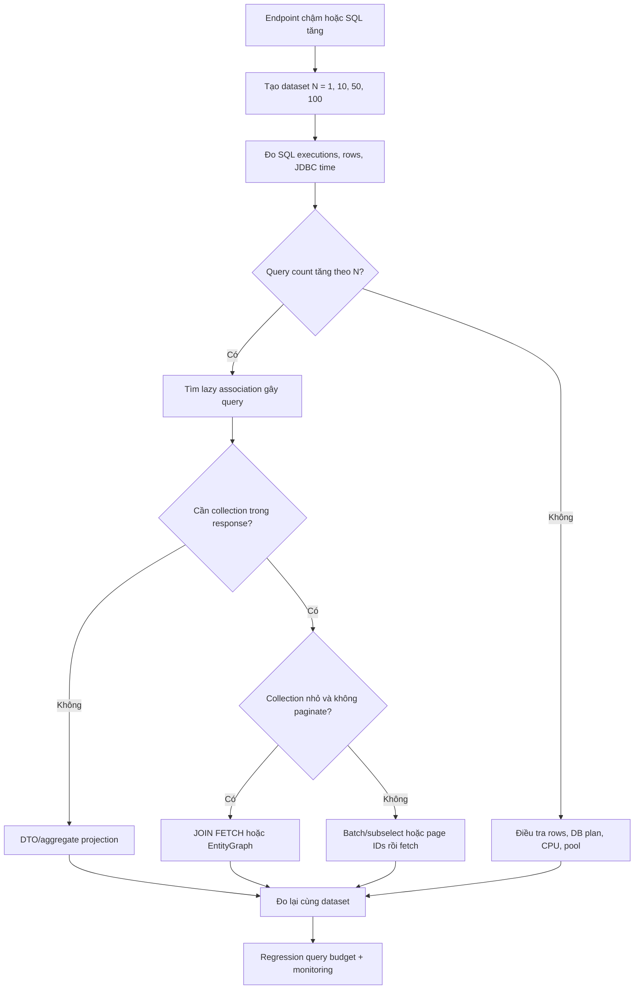

# Phát hiện rồi xử lý N+1 bằng kế hoạch tải được đo cụ thể

Một endpoint lấy 50 đơn hàng gần nhất có thể chỉ gọi một repository method, nhưng khi tạo response, Hibernate lại phát thêm 50 truy vấn lấy khách hàng và 50 truy vấn lấy dòng hàng. Tổng cộng endpoint có thể thực thi 101 câu SELECT. Đây là vấn đề **N+1**: một truy vấn lấy tập dữ liệu gốc, sau đó một truy vấn bổ sung cho từng phần tử hoặc từng association được truy cập.

N+1 thường không làm endpoint lỗi. Nó làm số SQL tăng theo kích thước dữ liệu, khiến latency, connection usage và tải database tăng dần khi page size hoặc lượng dữ liệu lớn lên. Cách xử lý hiệu quả bắt đầu bằng một phép đo có thể lặp lại: tăng số đơn hàng đầu vào, đếm SQL executions, quan sát rows/time, tìm association gây truy vấn, chọn fetch plan theo cardinality và kiểm tra lại bằng regression test.

Trong bài thực hành này, chúng ta dùng mô hình Customer–PurchaseOrder–OrderLine–Product. Mục tiêu là biến câu “có vẻ bị N+1” thành kết luận có bằng chứng, rồi chọn cách tải phù hợp cho từng use case: JOIN FETCH, EntityGraph, batch fetching, subselect fetching hoặc DTO projection.

---

## 1. N+1 là gì?

Giả sử API lấy danh sách đơn hàng:

```java
@Transactional(readOnly = true)
public List<PurchaseOrder> findRecentOrders(int limit) {
    return entityManager.createQuery(
        """
        select o
        from PurchaseOrder o
        order by o.createdAt desc
        """,
        PurchaseOrder.class
    )
    .setMaxResults(limit)
    .getResultList();
}
```

Entity có các quan hệ lazy:

```java
@Entity
@Table(name = "purchase_orders")
public class PurchaseOrder {

    @Id
    private Long id;

    private String orderNumber;

    private Instant createdAt;

    @ManyToOne(fetch = FetchType.LAZY, optional = false)
    @JoinColumn(name = "customer_id")
    private Customer customer;

    @OneToMany(mappedBy = "order", fetch = FetchType.LAZY)
    private List<OrderLine> lines = new ArrayList<>();

    // getters
}
```

Một đoạn code tạo response:

```java
List<OrderSummary> summaries = orders.stream()
    .map(order -> new OrderSummary(
        order.getId(),
        order.getOrderNumber(),
        order.getCustomer().getFullName(),
        order.getLines().stream()
            .map(OrderLine::getProductNameSnapshot)
            .toList()
    ))
    .toList();
```

Truy vấn gốc chỉ lấy PurchaseOrder. Khi code đọc customer hoặc lines chưa được tải, Hibernate có thể phát SQL bổ sung.

Nếu có N orders và mỗi order có customer/collection chưa được tải, số truy vấn có thể tăng theo N.

### 1.1. Ví dụ số truy vấn

Giả sử:

- Một SELECT lấy danh sách 50 orders.
- Mỗi order có một customer khác nhau.
- Mỗi order có một collection lines chưa được tải.
- Không có batch fetching hoặc cache giúp giảm query.

Khi đó:

```text
1 SELECT purchase_orders
50 SELECT customers WHERE id = ?
50 SELECT order_lines WHERE order_id = ?
---------------------------------------
101 SELECT statements
```

Công thức minh họa:

\[
Q(N) = 1 + N + N = 1 + 2N
\]

Với N = 50, Q = 101.

Đây không phải công thức cố định cho mọi mapping. Số truy vấn thực tế phụ thuộc association được truy cập, cache, fetch strategy, số entity trùng nhau, Hibernate version và database driver.

### 1.2. N+1 không nhất thiết chỉ có 1 + N

Nếu mỗi OrderLine lại truy cập Product lazy, có thể có thêm một truy vấn cho mỗi product khác nhau:

```text
1 SELECT orders
N SELECT customers
N SELECT order_lines
M SELECT products
```

M là số Product chưa được tải mà serializer/mapper thực sự truy cập. Nếu nhiều lines cùng tham chiếu một product, persistence context có thể reuse entity đã tải.

### 1.3. N+1 có thể nằm ở nhiều tầng

SQL bổ sung có thể bị kích hoạt bởi:

- Vòng lặp trong service khi đọc getter của lazy association.
- DTO mapper duyệt entity graph.
- Jackson serialize entity trả về từ controller.
- Template engine đọc association trong view.
- Logging gọi phương thức toString trên entity.
- Debugger/watch expression mở rộng proxy.
- Business rule gọi collection size hoặc stream collection.
- Một repository trả entities nhưng caller truy cập association ngoài method.

Vì vậy, chỉ đọc repository method thường không đủ để tìm nguyên nhân.

## 2. Phân biệt query count, row count và thời gian

Một kế hoạch tải tốt không chỉ giảm số câu SQL. Cần đo ít nhất bốn đại lượng:

| Đại lượng | Câu hỏi trả lời |
|---|---|
| SQL executions | Database/driver phải thực thi bao nhiêu statement? |
| Rows returned | Có bao nhiêu rows được gửi về application? |
| JDBC/database time | Tổng thời gian thực thi và đọc kết quả là bao lâu? |
| Object/response size | Hibernate và application phải hydrate/serialize bao nhiêu dữ liệu? |

Một JOIN FETCH có thể giảm 101 SELECT xuống một SELECT nhưng trả về hàng nghìn joined rows. Số statement giảm chưa chắc tổng chi phí thấp hơn nếu query tạo Cartesian multiplication hoặc tải dữ liệu thừa.

### 2.1. SQL count

Đếm số statement executions theo request/endpoint, không chỉ đếm số dòng log SQL. Một prepared statement có thể được execute nhiều lần với parameters khác nhau.

### 2.2. Row count

Ví dụ 50 orders, mỗi order có trung bình 20 lines:

- Query gốc chỉ trả 50 order rows.
- Collection JOIN FETCH có thể trả khoảng 1.000 joined rows.
- Nếu còn join một collection khác, số rows có thể nhân tiếp.

Database và driver vẫn phải xử lý các joined rows, kể cả khi Hibernate deduplicate root entities trong memory.

### 2.3. Thời gian

Đo cả:

- Tổng JDBC execution/fetch time.
- Connection acquisition wait.
- Thời gian hydrate entities.
- Thời gian map DTO.
- Serialization/response time.
- HTTP p50/p95/p99.

Slow query log chỉ bắt các câu lệnh vượt một ngưỡng riêng lẻ. Một trăm truy vấn mỗi truy vấn 3 ms có thể tạo ra khoảng 300 ms DB time mà không truy vấn nào được ghi là slow.

### 2.4. Một query không đồng nghĩa nhanh

| Phương án | SQL statements | Rows trả về | Nhận xét |
|---|---:|---:|---|
| N+1 | 101 | Có thể gần 1.100 | Nhiều round-trips |
| JOIN FETCH một collection | 1 | Có thể gần 1.000 | Ít statements, lặp root columns |
| Batch fetching size 25 | Khoảng 5 | Có thể gần 1.100 | Chia thành nhóm queries |
| DTO projection | 1 hoặc 2 | Chỉ fields cần | Thường phù hợp list screen |

Số liệu chỉ minh họa. Hãy đo trên dataset và driver thực tế.

## 3. Dựng một phép đo có thể tái hiện

Đừng bắt đầu bằng cách thêm JOIN FETCH vào query ngay khi thấy endpoint chậm. Trước tiên, dựng một phép đo làm lộ xu hướng tăng query count theo số root entities.

### 3.1. Tạo fixture đủ lớn

Một dataset thực hành:

- 100 customers.
- 100 products.
- 200 orders.
- Mỗi order có 5 lines.
- Mỗi order tham chiếu một customer.
- Các lines tham chiếu nhiều products, có một số product được dùng lại.

Cần có cả dữ liệu lặp và dữ liệu khác nhau để thấy first-level cache ảnh hưởng query count thế nào.

### 3.2. Chọn các kích thước thử nghiệm

Chạy cùng một use case với:

```text
N = 1
N = 10
N = 25
N = 50
N = 100
```

Giữ nguyên mapping, query shape, DBMS, driver, cache policy và response fields. Chỉ thay số root entities.

### 3.3. Lập bảng baseline

Ghi lại:

| N orders | SQL SELECT | Rows | JDBC time | HTTP time |
|---:|---:|---:|---:|---:|
| 1 | Đo thực tế | Đo thực tế | Đo thực tế | Đo thực tế |
| 10 | Đo thực tế | Đo thực tế | Đo thực tế | Đo thực tế |
| 25 | Đo thực tế | Đo thực tế | Đo thực tế | Đo thực tế |
| 50 | Đo thực tế | Đo thực tế | Đo thực tế | Đo thực tế |
| 100 | Đo thực tế | Đo thực tế | Đo thực tế | Đo thực tế |

Nếu query count tăng gần tuyến tính theo N, kiểm tra các association lazy được truy cập trong vòng lặp/serializer.

### 3.4. Kiểm soát cache

First-level cache có thể khiến kết quả khác nhau giữa các lần chạy:

- Cùng một Session, một Customer được load một lần rồi được reuse.
- L2 cache có thể giảm database SELECT.
- Query cache có thể thay đổi execution behavior.
- Một lần chạy warm có thể không giống lần chạy cold.

Để kiểm tra N+1, tạo fixture trước, flush/commit, bắt đầu persistence context mới và xác định rõ L2/query cache có bật hay không. So sánh cold và warm khi cần, nhưng đừng trộn hai trạng thái vào một baseline.

### 3.5. Đo đúng HTTP request

Nếu N+1 phát sinh trong Jackson serialization, test chỉ gọi service sẽ không thấy đủ SQL. Hãy đo qua HTTP integration test hoặc trace toàn bộ request tới khi response body hoàn tất.

## 4. Quan sát SQL bằng Hibernate

Hibernate cung cấp nhiều mức quan sát.

### 4.1. SQL logging

Trong môi trường dev/test:

```properties
logging.level.org.hibernate.SQL=DEBUG
```

Hibernate 6 có thể log bind values bằng:

```properties
logging.level.org.hibernate.orm.jdbc.bind=TRACE
```

Bind logging giúp biết parameters thay đổi theo từng root ID. Không bật rộng production nếu chưa có redaction và kiểm soát PII/secrets.

### 4.2. Nhận diện fingerprint lặp lại

Ví dụ log:

```sql
select c.id, c.full_name
from customers c
where c.id = ?;

select c.id, c.full_name
from customers c
where c.id = ?;

select c.id, c.full_name
from customers c
where c.id = ?;
```

SQL shape giống nhau, bind ID khác nhau, thời điểm gần nhau và xuất hiện theo số orders là dấu hiệu rõ của N+1.

Có thể chuẩn hóa SQL thành fingerprint để nhóm statement theo cấu trúc thay vì theo literal parameter.

### 4.3. Hibernate Statistics

Bật statistics:

```properties
spring.jpa.properties.hibernate.generate_statistics=true
```

Lấy Statistics:

```java
Statistics statistics = entityManagerFactory
    .unwrap(SessionFactory.class)
    .getStatistics();

long preparedStatements =
    statistics.getPrepareStatementCount();

long entityFetches =
    statistics.getEntityFetchCount();

long collectionFetches =
    statistics.getCollectionFetchCount();

long queryExecutions =
    statistics.getQueryExecutionCount();
```

Ý nghĩa cần phân biệt:

- **getPrepareStatementCount()** đếm prepared statements theo bộ đếm Hibernate; không mặc nhiên bằng network round-trips.
- **getEntityFetchCount()** cung cấp tín hiệu về entity fetches.
- **getCollectionFetchCount()** cung cấp tín hiệu về collection fetches.
- **getQueryExecutionCount()** liên quan các query executions được Hibernate Statistics theo dõi; không nên coi là tổng mọi JDBC statement trong ứng dụng.

Statistics thuộc phạm vi SessionFactory và có thể bị ảnh hưởng bởi requests chạy đồng thời. Trong production, không gọi statistics.clear() cho mỗi request vì nó reset bộ đếm dùng chung. Hãy dùng tracing/JDBC instrumentation để có số liệu theo request.

### 4.4. JDBC instrumentation

Datasource proxy, P6Spy hoặc OpenTelemetry JDBC instrumentation có thể ghi:

- SQL fingerprint.
- Execution count.
- Execute/fetch duration.
- Error count.
- Batch size nếu workload dùng JDBC batching.
- Connection acquisition và usage khi instrumentation hỗ trợ.

Kết hợp JDBC spans với HTTP trace ID để biết truy vấn xuất hiện trong service, mapper hay response serialization.

### 4.5. HikariCP metrics

Quan sát:

- Active connections.
- Idle connections.
- Pending threads.
- Connection acquisition time.
- Connection usage duration.
- Connection timeout count.

N+1 thường làm tăng tổng số lần dùng connection và DB workload. Nhưng đừng kết luận mọi request giữ connection suốt quá trình serialize; Session lifecycle và JDBC connection lifecycle là hai việc khác nhau.

## 5. Xác định chính xác association gây N+1

Một query root trả entity không tự tạo N+1. N+1 xuất hiện khi code chạm một association chưa được tải.

Ví dụ:

```java
for (PurchaseOrder order : orders) {
    String customerName = order.getCustomer().getFullName();

    for (OrderLine line : order.getLines()) {
        String sku = line.getProduct().getSku();
    }
}
```

Có thể phát sinh ba tầng fetch:

1. PurchaseOrder.customer.
2. PurchaseOrder.lines.
3. OrderLine.product.

### 5.1. Dùng SQL log và bind values

Ghi lại SQL sau query root. Nếu có statement lặp theo customer_id, order_id hoặc product_id, map chúng ngược về association.

### 5.2. Tạm tách mapper thành từng bước

Trong test/dev, thử:

```java
orders.forEach(order -> order.getId());
```

Sau đó:

```java
orders.forEach(order -> order.getCustomer().getFullName());
```

Cuối cùng:

```java
orders.forEach(order -> order.getLines().size());
```

Mỗi bước đo query count riêng. Thao tác này giúp xác định association nào tạo truy vấn.

Không để các đoạn chẩn đoán như vậy trong production code nếu chúng làm thay đổi fetch behavior hoặc hydrate collections lớn.

### 5.3. Dùng Hibernate.isInitialized trong debugging

```java
boolean initialized =
    Hibernate.isInitialized(order.getLines());
```

Có thể dùng để quan sát proxy/collection đã được tải chưa. Không gọi Hibernate.initialize chỉ để che N+1 trước khi hiểu query budget.

### 5.4. Kiểm tra serialization

Nếu service span kết thúc mà JDBC SELECT vẫn xuất hiện trong cùng HTTP request, xem xét Jackson, custom serializers, getters, toString và response mappers. Một endpoint có thể trả entity trực tiếp và vô tình giao fetch plan cho serializer.

## 6. Chọn fetch plan theo use case

Không có một fetch strategy tối ưu cho mọi query. Chọn theo số root entities, cardinality associations, fields cần trả và yêu cầu pagination.

| Use case | Chiến lược thường phù hợp |
|---|---|
| Một order detail, có một customer và ít lines | JOIN FETCH hoặc EntityGraph |
| Danh sách nhiều orders, cần customer name | To-one JOIN FETCH hoặc DTO projection |
| Danh sách orders, cần từng lines | Batch fetching hoặc page IDs rồi fetch collections |
| Chỉ cần tổng số lines | Aggregate projection |
| Export lớn, nhiều rows | DTO/scalar streaming với lifecycle rõ |
| Nhiều collections lớn | Tách queries; tránh join tất cả cùng lúc |

Fetch plan là một phần của query/use case, không nên biến mọi association thành EAGER.

## 7. Cách 1 — JOIN FETCH

JOIN FETCH tải association cùng query root.

### 7.1. Detail một đơn hàng

```java
@Query("""
    select distinct o
    from PurchaseOrder o
    join fetch o.customer
    left join fetch o.lines line
    join fetch line.product
    where o.id = :id
    """)
Optional<PurchaseOrder> findDetailsById(
    @Param("id") Long id
);
```

Query này tải:

- PurchaseOrder.
- Customer.
- OrderLine collection.
- Product cho từng line.

Với một order có số lines giới hạn, một query có thể phù hợp.

### 7.2. SQL hình dung

```sql
SELECT o.*, c.*, l.*, p.*
FROM purchase_orders o
JOIN customers c ON c.id = o.customer_id
LEFT JOIN order_lines l ON l.order_id = o.id
JOIN products p ON p.id = l.product_id
WHERE o.id = ?;
```

Hibernate hydrate object graph từ joined rows và liên kết các entity theo identifiers.

### 7.3. JOIN FETCH to-one

To-one association như customer thường có cardinality tối đa một row trên mỗi order. Join to-one thường không nhân số root rows:

```java
@Query("""
    select o
    from PurchaseOrder o
    join fetch o.customer
    where o.status = :status
    """)
List<PurchaseOrder> findWithCustomer(
    @Param("status") OrderStatus status
);
```

Nếu list endpoint chỉ cần customer, đây thường là fetch plan đơn giản.

### 7.4. JOIN FETCH collection

Collection join nhân rows theo số phần tử trong collection. Với 50 orders và trung bình 20 lines, database có thể trả khoảng 1.000 joined rows.

Hibernate có thể deduplicate root entity instances, nhưng database/driver vẫn phải xử lý rows và dữ liệu cột lặp.

### 7.5. Vì sao không JOIN mọi collection?

Giả sử mỗi order có:

- 10 lines.
- 4 payments.
- 3 tags.

Join đồng thời ba collections có thể tạo xấp xỉ:

\[
10 \times 4 \times 3 = 120
\]

joined rows cho một order, trước khi tính số orders. Đây là Cartesian multiplication do nhiều collection joins.

Ngoài chi phí dữ liệu, nhiều bag collections có thể dẫn đến MultipleBagFetchException. Hãy fetch một collection phù hợp rồi tải collection khác bằng query/batch riêng.

### 7.6. DISTINCT và Hibernate 6

select distinct o thường được dùng để biểu đạt root entity duy nhất trong JPQL/HQL và làm query dễ đọc. Hibernate 6 có cơ chế loại duplicate root entity results do fetch join trong một số trường hợp; không nên mặc định rằng từ khóa DISTINCT luôn giảm số rows database trả về. Kiểm tra SQL và behavior đúng release.

## 8. Cách 2 — EntityGraph

EntityGraph khai báo association nào cần được fetch cho một repository method.

```java
@EntityGraph(attributePaths = {
    "customer",
    "lines",
    "lines.product"
})
Optional<PurchaseOrder> findWithDetailsById(Long id);
```

Hoặc định nghĩa graph trên entity:

```java
@NamedEntityGraph(
    name = "PurchaseOrder.details",
    attributeNodes = {
        @NamedAttributeNode("customer"),
        @NamedAttributeNode(
            value = "lines",
            subgraph = "line-details"
        )
    },
    subgraphs = {
        @NamedSubgraph(
            name = "line-details",
            attributeNodes = {
                @NamedAttributeNode("product")
            }
        )
    }
)
@Entity
public class PurchaseOrder {
    // fields and mappings
}
```

Dùng graph:

```java
EntityGraph<?> graph = entityManager.getEntityGraph(
    "PurchaseOrder.details"
);

PurchaseOrder order = entityManager.find(
    PurchaseOrder.class,
    orderId,
    Map.of("jakarta.persistence.fetchgraph", graph)
);
```

### 8.1. EntityGraph có bảo đảm một JOIN không?

Không. EntityGraph mô tả fetch requirements. Provider có thể dùng JOIN hoặc secondary SELECT tùy mapping, Dialect, query và Hibernate version.

Hãy kiểm tra SQL thực tế và query budget. Không kết luận N+1 đã hết chỉ vì đã thêm annotation.

### 8.2. FETCH graph và LOAD graph

- **jakarta.persistence.fetchgraph:** các attribute được chỉ định là fetch; những attribute khác được xử lý theo fetch graph semantics.
- **jakarta.persistence.loadgraph:** các attribute được chỉ định được fetch thêm; những attribute khác giữ mapping/default fetch behavior.

Chi tiết provider và association defaults cần được kiểm tra theo JPA/Hibernate release.

### 8.3. Khi nào dùng EntityGraph?

EntityGraph hữu ích khi cùng entity có nhiều use cases với fetch needs khác nhau. Một query list chỉ cần customer; detail query cần customer, lines và product. Thay vì chuyển mapping thành EAGER, tạo graph riêng theo use case.

## 9. Cách 3 — Batch fetching

Batch fetching giữ associations lazy nhưng tải nhiều proxies/collections trong một SELECT có nhiều identifiers.

### 9.1. Cấu hình mặc định

```properties
spring.jpa.properties.hibernate.default_batch_fetch_size=32
```

Hoặc Hibernate property:

```properties
hibernate.default_batch_fetch_size=32
```

### 9.2. Đặt @BatchSize trên collection

```java
@OneToMany(mappedBy = "order", fetch = FetchType.LAZY)
@BatchSize(size = 32)
private List<OrderLine> lines = new ArrayList<>();
```

Hibernate có thể gom các collection chưa khởi tạo cùng role trong persistence context thành một truy vấn:

```sql
SELECT l.*
FROM order_lines l
WHERE l.order_id IN (?, ?, ?, ...);
```

### 9.3. Đặt @BatchSize cho entity

```java
@Entity
@BatchSize(size = 32)
public class Customer {
    // fields
}
```

Khi nhiều Customer proxies cùng tồn tại và được truy cập, Hibernate có thể tải chúng theo nhóm.

### 9.4. Số query giảm như thế nào?

Với 100 orders, batch size 25:

```text
Không batch:
  100 SELECT order_lines WHERE order_id = ?

Batch size 25:
  4 SELECT order_lines WHERE order_id IN (...)
```

Ước lượng số collection-fetch statements:

\[
Q_{\text{collection}} \approx \left\lceil \frac{N}{B} \right\rceil
\]

Trong đó B là batch size. Đây là ước lượng; Hibernate có thể chia batch theo các proxies đang có, dialect parameter limits và trạng thái persistence context.

### 9.5. Ưu điểm và giới hạn

Ưu điểm:

- Giữ mapping lazy.
- Không nhân root rows như collection JOIN FETCH.
- Phù hợp khi cần đọc collections của nhiều root entities.
- Giảm round-trips từ N xuống các nhóm có giới hạn.

Giới hạn:

- Có thể vẫn tải collection lớn nếu caller duyệt hết.
- Batch size quá lớn tạo nhiều bind parameters/rows.
- Không giúp nếu các proxies không cùng persistence context hoặc không được truy cập trong thời gian phù hợp.
- Không thay DTO projection khi chỉ cần một vài scalar fields.

## 10. Cách 4 — Subselect fetching

Hibernate có thể tải collection cho một nhóm parent entities bằng một subselect.

```java
@OneToMany(mappedBy = "order", fetch = FetchType.LAZY)
@Fetch(FetchMode.SUBSELECT)
private List<OrderLine> lines = new ArrayList<>();
```

Khi một query load một nhóm PurchaseOrders rồi code truy cập collection role, Hibernate có thể dùng subselect dựa trên query parent để tải collections cho nhóm đó.

SQL hình dung:

```sql
SELECT l.*
FROM order_lines l
WHERE l.order_id IN (
    SELECT o.id
    FROM purchase_orders o
    WHERE o.status = ?
);
```

### 10.1. Khi nào phù hợp?

- Một use case load một tập parent tương đối ổn định.
- Cần collection cùng role cho phần lớn parents.
- Tránh collection join làm nhân root rows.
- Có thể chấp nhận một truy vấn phụ tải collections cho tập parent.

### 10.2. Khi nào cần thận trọng?

- Persistence context chứa nhiều parent entities từ các query khác.
- Collection rất lớn.
- Parent query phức tạp hoặc result set lớn.
- Caller chỉ cần một phần nhỏ collections.
- Use case cần pagination và chỉ muốn tải collections cho page hiện tại.

Subselect fetching là Hibernate-specific strategy. Đo SQL và row counts thay vì giả định nó luôn rẻ hơn batch fetching.

## 11. Cách 5 — DTO projection

Nếu endpoint chỉ cần vài fields, không cần hydrate entity graph. DTO projection thường là lựa chọn hiệu quả cho list/search screens.

### 11.1. DTO cho danh sách đơn hàng

```java
public record OrderListItem(
    Long id,
    String orderNumber,
    String customerName,
    OrderStatus status,
    Instant createdAt,
    long lineCount
) {}
```

Query:

```java
@Query("""
    select new com.example.shop.web.dto.OrderListItem(
        o.id,
        o.orderNumber,
        c.fullName,
        o.status,
        o.createdAt,
        count(line)
    )
    from PurchaseOrder o
    join o.customer c
    left join o.lines line
    where c.id = :customerId
    group by
        o.id,
        o.orderNumber,
        c.fullName,
        o.status,
        o.createdAt
    order by o.createdAt desc, o.id desc
    """)
List<OrderListItem> findOrderListItems(
    @Param("customerId") Long customerId
);
```

Query này lấy customer name và line count trong một statement. Nó không tải Customer/OrderLine/Product entities vào persistence context.

### 11.2. DTO cho order detail

```java
public record OrderLineView(
    Long lineId,
    String sku,
    String productName,
    int quantity,
    BigDecimal unitPrice
) {}

public record OrderDetailView(
    Long id,
    String orderNumber,
    String customerName,
    OrderStatus status,
    List<OrderLineView> lines
) {}
```

Có thể query rows phẳng rồi group thành response DTO trong service. Với order detail nhỏ, JOIN FETCH entity graph cũng hợp lý; projection hữu ích khi chỉ cần các cột cụ thể.

### 11.3. DTO projection giảm overfetch

Nếu UI chỉ cần order number, customer name, status, created time và number of lines, không cần tải toàn bộ lines, products, addresses và payment entities. Aggregate query chỉ trả các scalar values cần thiết.

### 11.4. DTO không bảo đảm luôn chỉ một SQL

Một response DTO có thể được tạo từ nhiều queries được thiết kế có chủ đích. Điều cần tránh là query count tăng theo từng root một cách bất ngờ. Hai hoặc ba queries có bounded count đôi khi tốt hơn một JOIN khổng lồ.

## 12. Pagination và collection fetch join

Đây là một trong những chỗ dễ sửa N+1 sai nhất.

Ví dụ:

```java
@Query("""
    select distinct o
    from PurchaseOrder o
    left join fetch o.lines
    order by o.createdAt desc
    """)
Page<PurchaseOrder> findPageWithLines(Pageable pageable);
```

Collection join nhân rows. Database pagination áp trên joined rows, không tự động có nghĩa là một page gồm đúng số root orders với toàn bộ lines.

Hibernate có thể phải paginate trong memory, phát warning hoặc fail tùy version/configuration.

### 12.1. Phát hiện pagination trên collection fetch

Trong Hibernate, có thể bật:

```properties
spring.jpa.properties.hibernate.query.fail_on_pagination_over_collection_fetch=true
```

Property này giúp biến trường hợp pagination trên collection fetch join thành lỗi sớm thay vì âm thầm thực hiện in-memory pagination ở các cấu hình hỗ trợ.

### 12.2. Chiến lược hai pha: page IDs rồi fetch graph

Pha 1: lấy page IDs theo thứ tự ổn định.

```java
List<Long> ids = entityManager.createQuery(
    """
    select o.id
    from PurchaseOrder o
    where o.customer.id = :customerId
    order by o.createdAt desc, o.id desc
    """,
    Long.class
)
.setParameter("customerId", customerId)
.setFirstResult(offset)
.setMaxResults(pageSize)
.getResultList();
```

Pha 2: fetch details cho IDs vừa lấy.

```java
List<PurchaseOrder> loaded = entityManager.createQuery(
    """
    select distinct o
    from PurchaseOrder o
    join fetch o.customer
    left join fetch o.lines line
    join fetch line.product
    where o.id in :ids
    """,
    PurchaseOrder.class
)
.setParameter("ids", ids)
.getResultList();
```

IN (:ids) không bảo đảm giữ thứ tự ban đầu. Khôi phục order bằng map:

```java
Map<Long, PurchaseOrder> byId = loaded.stream()
    .collect(Collectors.toMap(
        PurchaseOrder::getId,
        Function.identity()
    ));

List<PurchaseOrder> ordered = ids.stream()
    .map(byId::get)
    .filter(Objects::nonNull)
    .toList();
```

Đây là hai queries có số lượng bị chặn theo page, không phải một query cho mỗi order.

### 12.3. Count query riêng

Page API thường cần thêm count query để biết tổng số pages. Đó là một query có chủ đích, không phải N+1. Khi đánh giá query budget, hãy tính cả root query, count query và association fetch queries.

### 12.4. Collections lớn nên phân trang riêng

Nếu một order có hàng chục nghìn lines, không fetch toàn bộ collection chỉ vì trang chi tiết cần một phần. Cung cấp endpoint/query riêng cho order lines có pagination và sorting.

## 13. Cách map DTO trong transaction

Service nên hoàn thành data access và mapping trước khi transaction kết thúc.

```java
@Service
public class OrderQueryService {

    private final PurchaseOrderRepository repository;

    public OrderQueryService(PurchaseOrderRepository repository) {
        this.repository = repository;
    }

    @Transactional(readOnly = true)
    public OrderDetailView getDetails(Long id) {
        PurchaseOrder order = repository.findDetailsById(id)
            .orElseThrow(() ->
                new OrderNotFoundException(id)
            );

        List<OrderLineView> lines = order.getLines()
            .stream()
            .map(line -> new OrderLineView(
                line.getId(),
                line.getSkuSnapshot(),
                line.getProductNameSnapshot(),
                line.getQuantity(),
                line.getUnitPrice()
            ))
            .toList();

        return new OrderDetailView(
            order.getId(),
            order.getOrderNumber(),
            order.getCustomer().getFullName(),
            order.getStatus(),
            List.copyOf(lines)
        );
    }
}
```

Controller chỉ trả DTO:

```java
@GetMapping("/{id}")
public OrderDetailView getDetails(@PathVariable Long id) {
    return orderQueryService.getDetails(id);
}
```

Với OSIV disabled, Jackson không thể vô tình khởi tạo các Hibernate collections từ entity graph sau khi service transaction kết thúc, vì response chỉ chứa DTO đã materialize.

## 14. Quy trình đo trước và sau khi sửa

Dùng một quy trình nhất quán để so sánh.

### 14.1. Baseline

1. Seed dataset đại diện.
2. Tạo persistence context mới.
3. Chạy đúng endpoint/use case.
4. Ghi SQL fingerprints và execution counts.
5. Ghi rows, JDBC time, HTTP latency và response size.
6. Lặp lại với N = 1, 10, 25, 50, 100.

### 14.2. Xác định association gây tăng query

Dùng bind parameters, trace và mapper inspection để tìm query fingerprint lặp lại. Thử đọc từng association riêng trong test để xác định trigger.

### 14.3. Chọn fetch plan

- Detail một root, collection nhỏ: JOIN FETCH.
- Nhiều roots và cần to-one: join to-one hoặc DTO projection.
- Nhiều roots và cần collection: batch fetching hoặc page IDs rồi fetch.
- Cần counts/totals: aggregate projection.
- Cần nhiều collections: tách query; tránh Cartesian multiplication.

### 14.4. Chạy lại cùng dataset

Giữ nguyên:

- DBMS và version.
- JDBC driver và options.
- Input data.
- Page size.
- Transaction boundary.
- Cache state.
- Concurrency.
- JVM/heap.
- Response fields.

Chỉ thay fetch plan để so sánh công bằng.

### 14.5. Bảng so sánh

| Metric | Baseline | Sau sửa | Mục tiêu |
|---|---:|---:|---|
| SQL SELECT executions | Đo | Đo | Không tăng tuyến tính theo N |
| Rows returned | Đo | Đo | Không tăng quá mức cần thiết |
| JDBC total time | Đo | Đo | Giảm hoặc nằm trong budget |
| Entity/collection fetches | Đo | Đo | Phù hợp fetch plan |
| HTTP p95 | Đo | Đo | Cải thiện |
| Heap/GC | Đo | Đo | Không tăng bất thường |
| Response correctness | Kiểm tra | Kiểm tra | Không đổi ngoài contract |

Một fetch plan tốt thường làm query count tăng chậm hoặc giữ bounded count khi N tăng, đồng thời không làm rows/payload phình lên quá mức.

## 15. Viết regression test để N+1 không quay lại

Test nên xác nhận query budget của use case với fixture có nhiều root entities. Không chỉ test một order.

### 15.1. Test qua HTTP khi serializer có thể gây lazy load

Với REST API:

- Tắt OSIV trong test.
- Seed fixtures và commit trước request.
- Gọi endpoint qua MockMvc/HTTP.
- Để service transaction kết thúc bình thường.
- Để Jackson serialize response.
- Đo SQL trong toàn request.

Không đặt outer test transaction bao quanh cả request nếu điều đó làm persistence context sống lâu hơn production và che lazy loading.

### 15.2. Hibernate Statistics trong test cô lập

Ví dụ ý tưởng:

```java
Statistics statistics = entityManagerFactory
    .unwrap(SessionFactory.class)
    .getStatistics();

statistics.setStatisticsEnabled(true);

// Fixture đã được commit; request/use case bắt đầu với context mới.
statistics.clear();

mockMvc.perform(get("/api/orders/recent"))
    .andExpect(status().isOk());

long prepared =
    statistics.getPrepareStatementCount();

assertThat(prepared)
    .isLessThanOrEqualTo(4);
```

Ngưỡng 4 chỉ là ví dụ cho một endpoint cụ thể có bounded query plan. Cần xác định expected queries gồm root, count, association loads và các framework queries cần thiết.

Statistics là bộ đếm SessionFactory dùng chung. Không chạy test này song song với các tests khác cùng factory nếu muốn assert count chính xác; hoặc dùng JDBC instrumentation gắn request context.

### 15.3. Query budget thay vì exact count mong manh

Một test có thể cho phép một khoảng query hợp lý:

- 1 root query.
- 1 count query nếu dùng Page.
- Tối đa 1–2 fetch queries theo strategy.

Không assert đúng một con số nếu query plan hợp lệ có thể khác theo DBMS/Hibernate version. Hãy assert upper bound đủ chặt để phát hiện N+1.

### 15.4. Kiểm tra xu hướng theo N

Một regression test nâng cao có thể chạy cùng use case với 5 và 50 roots, ghi số SELECT. Nếu 50 roots làm query count tăng khoảng 45 lần, có dấu hiệu N+1.

Sau batch fetching size 25, số collection queries có thể tăng từ 1 nhóm lên 2 nhóm, thay vì từ 5 lên 50. Đặt tiêu chí dựa trên expected strategy.

### 15.5. Dùng DataSource proxy cho request-level count

JDBC datasource proxy có thể đếm statement executions theo thread/request. Đây là cách phù hợp hơn Statistics toàn SessionFactory khi test nhiều request song song, miễn là correlation context được gắn đúng.

### 15.6. Dùng production-like database

H2 có thể khác PostgreSQL/MySQL/Oracle/SQL Server về SQL dialect, query planner, pagination, parameter limits, locking và driver behavior. Dùng Testcontainers hoặc staging DBMS tương thích production cho kiểm chứng cuối.

## 16. Một ví dụ thực hành hoàn chỉnh: từ N+1 đến batch fetching

Giả sử list endpoint cần:

- Order number.
- Customer name.
- Danh sách SKU/tên sản phẩm của từng order.

Mapping:

```java
@Entity
public class PurchaseOrder {

    @Id
    private Long id;

    private String orderNumber;

    @ManyToOne(fetch = FetchType.LAZY)
    private Customer customer;

    @OneToMany(mappedBy = "order", fetch = FetchType.LAZY)
    @BatchSize(size = 25)
    private List<OrderLine> lines = new ArrayList<>();
}
```

Service ban đầu:

```java
@Transactional(readOnly = true)
public List<OrderDetailView> recent(int limit) {
    List<PurchaseOrder> orders = repository.findRecent(limit);

    return orders.stream()
        .map(order -> new OrderDetailView(
            order.getId(),
            order.getOrderNumber(),
            order.getCustomer().getFullName(),
            order.getLines().stream()
                .map(line -> line.getProductNameSnapshot())
                .toList()
        ))
        .toList();
}
```

Giả sử N = 100, mỗi customer khác nhau và collection lines chưa tải:

```text
1 SELECT purchase_orders
100 SELECT customers
100 SELECT order_lines
-----------------------
201 SELECT statements
```

Sau khi đặt batch fetching cho collection, số query collection có thể giảm xuống khoảng:

```text
1 SELECT purchase_orders
100 SELECT customers
4 SELECT order_lines WHERE order_id IN (...)
-----------------------------------------------
105 SELECT statements
```

Đây vẫn còn N+1 ở Customer. Có thể join fetch to-one hoặc projection customer:

```java
@Query("""
    select o
    from PurchaseOrder o
    join fetch o.customer
    where o.createdAt >= :from
    order by o.createdAt desc
    """)
List<PurchaseOrder> findRecentWithCustomer(
    @Param("from") Instant from,
    Pageable pageable
);
```

Khi to-one đã được fetch và collections được batch:

```text
1 SELECT purchase_orders JOIN customers
4 SELECT order_lines WHERE order_id IN (...)
------------------------------------------------
5 SELECT statements (minh họa)
```

Con số thực tế phụ thuộc page size, collection state và cách Hibernate chia batches. Bước tiếp theo là đo rows/time để chắc rằng query join và collection batches không overfetch.

## 17. Một ví dụ DTO projection cho list screen

Nếu list screen không cần toàn bộ OrderLine, không nên tải lines chỉ để đếm.

DTO:

```java
public record OrderSummary(
    Long id,
    String orderNumber,
    String customerName,
    OrderStatus status,
    long lineCount
) {}
```

Query:

```java
@Query("""
    select new com.example.shop.dto.OrderSummary(
        o.id,
        o.orderNumber,
        c.fullName,
        o.status,
        count(line)
    )
    from PurchaseOrder o
    join o.customer c
    left join o.lines line
    where o.status = :status
    group by o.id, o.orderNumber, c.fullName, o.status
    order by o.id desc
    """)
Page<OrderSummary> findSummaries(
    @Param("status") OrderStatus status,
    Pageable pageable
);
```

Database tính count(line) và trả scalar data. Không cần tải collection vào Java chỉ để gọi size().

Nếu dùng pageable projection có grouping, kiểm tra count query mà Spring Data sinh ra; với query phức tạp, khai báo count query riêng nếu cần.

## 18. Những bẫy khi chọn fetch plan

### 18.1. Đổi mọi association sang EAGER

EAGER không bảo đảm một SQL JOIN. Hibernate có thể dùng secondary SELECT và vẫn tạo N+1. Ngoài ra, các use cases không cần association cũng phải tải dữ liệu.

Giữ mapping lazy có chủ đích và chọn fetch plan theo query.

### 18.2. JOIN FETCH mọi collection

Có thể tạo row multiplication, Cartesian products, bộ nhớ lớn và vấn đề pagination. Chỉ fetch collection khi cardinality và use case phù hợp.

### 18.3. Batch size quá lớn

Batch lớn giảm số query nhưng tăng bind parameters, rows và memory. Chọn size bằng benchmark; không mặc định 1000 luôn tốt hơn 32.

### 18.4. Dùng size() như aggregate miễn phí

Lazy collection size() có thể khởi tạo collection hoặc thực hiện query tùy provider/mapping. Nếu cần count, dùng aggregate query.

### 18.5. DTO mapper chạy ngoài transaction

Mapper chạm lazy properties sau service transaction có thể phát SQL nếu OSIV còn bật hoặc ném LazyInitializationException nếu Session đã đóng. Map trong service transaction hoặc dùng projection.

### 18.6. Lấy Hibernate Statistics làm số query per request

Statistics cấp SessionFactory, bị nhiễu bởi concurrency và có các counter không đồng nghĩa với JDBC round-trips. Dùng request-level tracing/proxy để đo per-request.

### 18.7. Cache làm test tưởng đã hết N+1

Test chạy lại trên persistence context/cache warm có thể ít SQL hơn. Reset/kiểm soát cache và tạo Session mới giữa fixture và use case.

### 18.8. Chỉ đo statement count

Một JOIN duy nhất vẫn có thể trả quá nhiều rows. Đo rows, bytes, DB time, hydration, heap và response latency.

### 18.9. Quên count query của Page

Page có thể chạy một count query bổ sung. Đây là query có chủ đích, không phải N+1. Đưa nó vào query budget.

### 18.10. Không giữ thứ tự khi fetch bằng IN

WHERE id IN (...) không bảo đảm trả rows theo thứ tự list IDs. Khôi phục order trong Java hoặc dùng order expression phù hợp.

### 18.11. Fetch nhiều bag collections

Có thể gây MultipleBagFetchException hoặc row multiplication lớn. Tách fetch plans hoặc dùng DTO query.

### 18.12. Chỉ test một root entity

N+1 chỉ lộ khi có nhiều root entities. Test với N=1 không đủ.

## 19. Checklist chọn chiến lược

Trước khi sửa query, trả lời các câu hỏi:

| Câu hỏi | Hướng xử lý |
|---|---|
| Cần bao nhiêu root entities? | Xác định page size và giới hạn |
| Cần association nào trong response? | Không tải graph không cần |
| Association là to-one hay collection? | To-one thường join dễ hơn |
| Collection có cardinality bao nhiêu? | Nhỏ: có thể fetch join; lớn: batch/page riêng |
| Cần pagination root không? | Tránh collection fetch join trực tiếp |
| Chỉ cần count/summary? | Dùng aggregate projection |
| Có nhiều collections? | Tách queries, tránh Cartesian multiplication |
| SQL count tăng theo N? | Tìm lazy association và chọn batch/join/projection |
| Rows tăng quá mạnh sau JOIN? | Chuyển sang batch hoặc projection |
| Mapper/serializer gây SQL? | Trả DTO materialized trong transaction |

## 20. Quy trình vận hành để N+1 không quay lại

Một quy trình thực tế cho từng endpoint:

1. **Định nghĩa response contract.** Liệt kê fields/nested data mà client thực sự cần.
2. **Tạo dataset đại diện.** Có nhiều root entities, associations lặp và collections có cardinality thực tế.
3. **Đo baseline.** SQL fingerprints, executions, rows, JDBC time, HTTP latency và heap.
4. **Thử N tăng dần.** So sánh query growth ở N=1/10/50/100.
5. **Xác định trigger.** Trace service, mapper và serializer; map SQL bind IDs về association.
6. **Chọn fetch plan.** JOIN FETCH, EntityGraph, batch, subselect hoặc projection theo use case.
7. **Kiểm tra pagination.** Đặc biệt collection joins và page count queries.
8. **Đo lại.** Cùng DB, driver, data, cache state và concurrency.
9. **Viết regression test.** Query budget/upper bound với fixture nhiều roots và OSIV disabled khi phù hợp.
10. **Theo dõi production.** JDBC executions per request, rows/time, Hikari metrics và HTTP p95/p99.



## 21. Kết luận

N+1 là vấn đề về fetch plan: ứng dụng tải một tập root entities, rồi truy cập các lazy associations khiến Hibernate phát thêm query theo từng root. Muốn xử lý bền vững, cần đo query growth và chọn cách tải phù hợp với dữ liệu thực tế.

- **JOIN FETCH** phù hợp cho to-one associations và một collection nhỏ trong detail use case; collection joins có thể nhân rows.
- **EntityGraph** cho phép khai báo fetch requirements theo use case; vẫn phải kiểm tra SQL provider thực tế sinh ra.
- **Batch fetching** gom lazy entity/collection loads theo nhóm, giảm số query từ N xuống các batch có kích thước giới hạn.
- **Subselect fetching** có thể tải collection cho một tập parents bằng một query phụ, phù hợp với một số read patterns.
- **DTO projection** tránh hydrate entity graph khi màn hình chỉ cần scalar fields, counts hoặc summaries.
- **Pagination** cần được thiết kế riêng; page IDs rồi fetch associations thường an toàn hơn collection fetch join trực tiếp.
- **Regression tests** nên dùng fixture nhiều roots, cache state được kiểm soát và query budget có upper bound.
- **Đo rows/time cùng SQL count** để tránh đổi N+1 thành một JOIN khổng lồ.

Một tiêu chí thực tế: khi tăng page size từ 10 lên 100, số SQL executions không nên tăng gần 10 lần chỉ vì application đọc thêm một association lazy cho từng order. Nếu query count có tăng, phải có lý do bounded và được đo rõ. Fetch plan tốt là fetch plan vừa đáp ứng response contract, vừa giữ query count, rows và latency trong budget đã xác định.

### Tài liệu tham khảo

- [Hibernate ORM 6.6 User Guide — Fetching](https://docs.hibernate.org/orm/6.6/userguide/html_single/#fetching) — fetch strategies, batch fetching, subselect và fetch joins.
- [Hibernate ORM 6.6 User Guide — Batch fetching](https://docs.hibernate.org/orm/6.6/userguide/html_single/#fetching-batch) — batch fetching entity/collection.
- [Hibernate ORM 6.6 User Guide — Statistics](https://docs.hibernate.org/orm/6.6/userguide/html_single/#statistics) — SessionFactory statistics.
- [Hibernate ORM Javadocs — BatchSize](https://docs.hibernate.org/orm/6.6/javadocs/org/hibernate/annotations/BatchSize.html) — batch size trên entity/collection.
- [Hibernate ORM Javadocs — Fetch](https://docs.hibernate.org/orm/6.6/javadocs/org/hibernate/annotations/Fetch.html) — Hibernate fetch mode annotations.
- [Jakarta Persistence Specification](https://jakarta.ee/specifications/persistence/) — EntityGraph, fetch joins, persistence context và query semantics.
- [Spring Data JPA Reference — Projections](https://docs.spring.io/spring-data/jpa/reference/repositories/projections.html) — DTO/interface projections.
- [Spring Data JPA Reference — EntityGraph](https://docs.spring.io/spring-data/jpa/reference/jpa/query-methods.html) — query methods và fetch configuration.
- [Micrometer Reference](https://docs.micrometer.io/micrometer/reference/) — metrics và timers.
- [OpenTelemetry Java Instrumentation](https://opentelemetry.io/docs/zero-code/java/agent/) — JDBC và HTTP tracing.
- [Testcontainers Documentation](https://java.testcontainers.org/) — integration tests với database thật.

SQL generation, statistics counters, pagination behavior và fetch optimizers có thể khác theo **Hibernate ORM version, Jakarta Persistence provider, Dialect, JDBC driver và DBMS**. Hãy ghi rõ versions trong benchmark, xác nhận bằng SQL/JDBC instrumentation và đo trên dataset đại diện trước khi triển khai.
