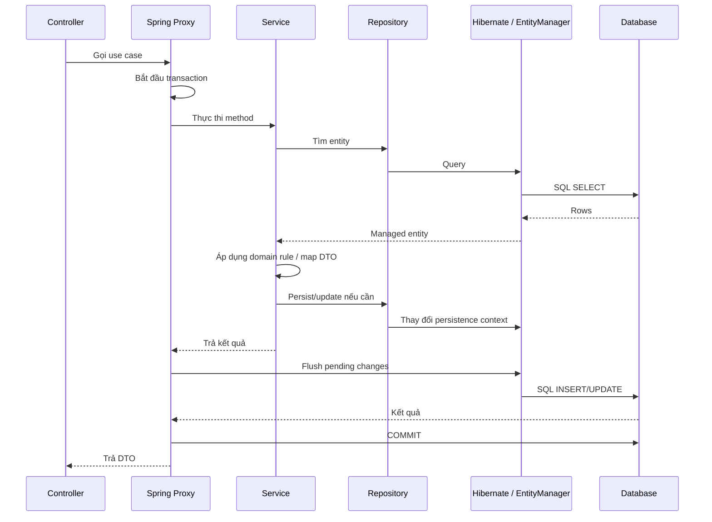
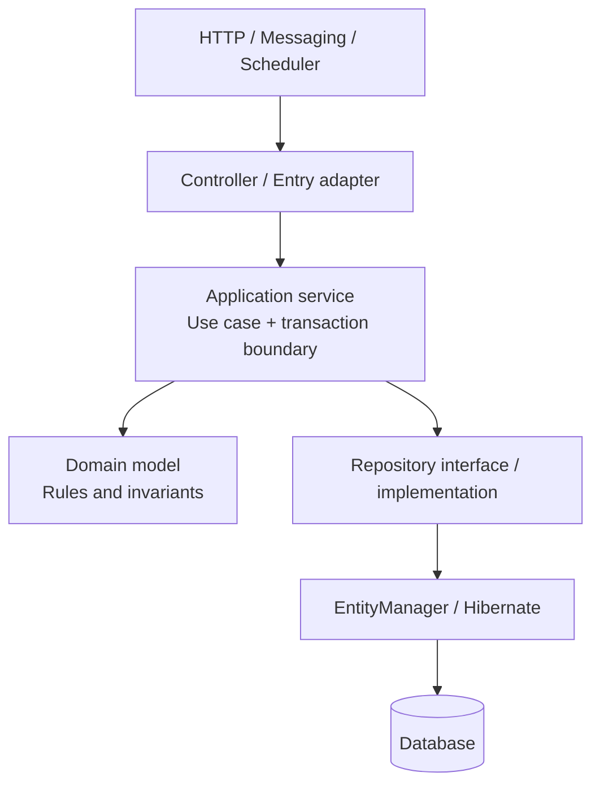
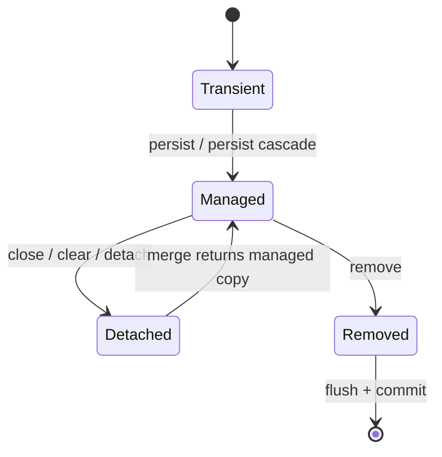
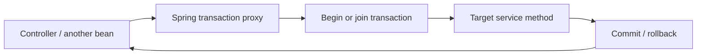
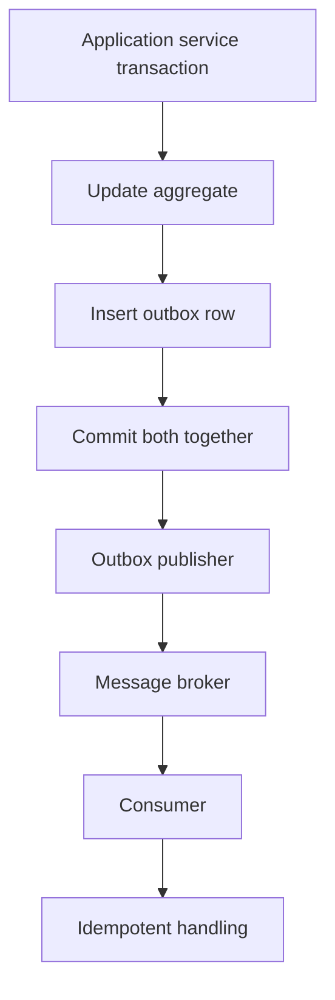

# Tích hợp Spring mà vẫn giữ rõ nơi mở context và giao dịch

Spring và Hibernate thường được dùng cùng nhau để xây dựng ứng dụng Java có persistence layer. Spring quản lý dependency, bean lifecycle và transaction boundary; Hibernate thực hiện object-relational mapping, quản lý entity state và phát SQL; database bảo đảm tính toàn vẹn và lưu dữ liệu. Lỗi tích hợp thường xuất hiện khi các ranh giới bị che khuất: controller vô tình kích hoạt lazy loading, method có annotation giao dịch nhưng không chạy qua proxy, test luôn rollback nên không kiểm tra được commit, hoặc tác vụ async tưởng đang dùng transaction của request nhưng thực tế chạy trên thread khác.

Mục tiêu của bài học là tổ chức tích hợp Spring/Hibernate sao cho có thể trả lời rõ:

- Spring ApplicationContext được tạo ở đâu và bean nào sở hữu vòng đời?
- JPA PersistenceContext được mở, gắn với transaction và đóng ở đâu?
- Transaction bắt đầu và kết thúc quanh use case nào?
- Khi nào entity còn managed, khi nào đã detached?
- Code nào được phép truy cập lazy association?
- Làm sao kiểm tra các ranh giới này bằng unit tests và integration tests?

**Nguyên tắc kiến trúc:** để Spring quản lý bean, để service/application layer xác định transaction boundary, để repository thực hiện persistence operations và để controller trao đổi DTO. Entity chỉ được dùng trong phạm vi persistence context có chủ đích. Không để việc mở Session, mở transaction hay truy cập database trở thành side effect khó nhìn thấy trong serialization, background thread hoặc test fixture.

> **Phạm vi ví dụ:** Java 17+, Spring Boot 3.x, Spring Framework 6, Jakarta Persistence và Hibernate ORM 6.x. Ví dụ dùng Spring Data JPA, JUnit Jupiter và AssertJ. API cụ thể có thể khác theo Spring Boot/Hibernate version; hãy dùng dependency management và tài liệu của đúng dòng version trong dự án.

---

## 1. Phân biệt ba loại context

Từ “context” được dùng ở nhiều tầng. Trong ứng dụng Spring/Hibernate, cần phân biệt ít nhất ba khái niệm.

| Khái niệm | Ai quản lý? | Phạm vi thường gặp | Chứa gì? |
| --- | --- | --- | --- |
| Spring ApplicationContext | Spring container | Vòng đời ứng dụng | Beans, configuration, environment, event infrastructure |
| JPA PersistenceContext | JPA provider/Hibernate, thông qua EntityManager | Thường gắn với transaction trong Spring | Managed entities, identity map, dirty checking, snapshots |
| Database transaction | Transaction manager và database | Một đơn vị công việc nguyên tử | Locks, isolation, uncommitted writes, commit/rollback state |

Ba khái niệm liên quan nhưng không đồng nghĩa.

### Spring ApplicationContext

ApplicationContext là container tạo và quản lý các Spring beans: controller, service, repository, DataSource, EntityManagerFactory, PlatformTransactionManager, configuration properties, event listeners và các infrastructure beans khác.

ApplicationContext thường sống suốt vòng đời ứng dụng. Nó không phải nơi chứa entity đang được load trong một request.

### JPA PersistenceContext

PersistenceContext là phạm vi quản lý entity của EntityManager. Một entity được quản lý (managed) sẽ có identity trong context; Hibernate theo dõi thay đổi để dirty checking và đồng bộ SQL khi flush.

Trong cấu hình Spring JPA thông thường, EntityManager được inject vào bean thông qua một proxy dùng chung. Khi code chạy trong transaction, proxy lấy EntityManager thực gắn với transaction/thread hiện tại.

PersistenceContext có thể tồn tại ngoài transaction trong một số cấu hình, ví dụ Open EntityManager in View. Vì vậy, không nên suy luận rằng “Session còn mở” đồng nghĩa “transaction vẫn đang mở”.

### Database transaction

Transaction là phạm vi commit/rollback. Nó quy định các SQL changes được commit cùng nhau và cách concurrent transactions nhìn thấy dữ liệu theo isolation level.

Transaction thường được Spring mở qua annotation hoặc TransactionTemplate. Hibernate sử dụng EntityManager/Session tham gia transaction đó để flush SQL.

### Một luồng xử lý điển hình



Đây là luồng khái niệm. Hibernate có thể flush sớm hơn commit, ví dụ trước một query theo FlushMode AUTO hoặc khi application gọi EntityManager.flush().

## 2. Đặt trách nhiệm theo từng layer

Một cấu trúc phổ biến:



| Layer | Trách nhiệm chính | Không nên sở hữu |
| --- | --- | --- |
| Controller/adapter | Parse request, auth context, gọi use case, trả DTO | Tự mở EntityManager/transaction cho từng endpoint |
| Application service | Điều phối use case, xác định transaction boundary, map kết quả | Chứa SQL hoặc serialize lazy entity |
| Domain model | Invariants, state transitions, calculations | Phụ thuộc Spring container hoặc EntityManager |
| Repository | Load/persist aggregate, query theo contract | Quyết định toàn bộ transaction của use case |
| Hibernate/JPA | Mapping, persistence context, dirty checking, SQL | Quy tắc nghiệp vụ |
| Database | Constraints, isolation, durable storage | Điều phối HTTP/application workflow |

Không phải mọi dự án đều cần domain layer tách riêng. Nhưng dù dùng kiến trúc nào, vẫn cần một nơi rõ ràng chịu trách nhiệm transaction cho mỗi use case.

## 3. Để Spring quản lý beans

Spring Boot thường tự cấu hình EntityManagerFactory và transaction manager khi dependencies và properties phù hợp. Service/repository nên là Spring beans được inject qua constructor.

```java
@Service
public class PurchaseOrderService {

    private final PurchaseOrderRepository orders;

    public PurchaseOrderService(
            PurchaseOrderRepository orders) {
        this.orders = orders;
    }
}
```

Tránh tự tạo dependency bằng `new` ở application code:

```java
public class PurchaseOrderController {

    private final PurchaseOrderService service =
        new PurchaseOrderService(
            new JpaPurchaseOrderRepository()
        );
}
```

Cách này bỏ qua Spring lifecycle, dependency injection, transaction proxies, exception translation và cấu hình dùng chung.

Constructor injection có lợi: dependency hiện rõ, bean có thể immutable, unit test dễ tạo service với fake/mock dependency, circular dependency dễ phát hiện và không cần field injection để test.

### Không tự tạo EntityManager trong service thông thường

Không làm như sau trong một Spring-managed service:

```java
EntityManagerFactory factory = ...;
EntityManager entityManager =
    factory.createEntityManager();

entityManager.getTransaction().begin();
```

Cách này tạo một persistence context riêng ngoài transaction management của Spring. Nó có thể không tham gia cùng transaction với repository khác, không được đóng đúng lúc và khó test.

Hãy inject EntityManager được Spring quản lý hoặc dùng Spring Data repository. Chỉ tự tạo EntityManager khi thực sự cần một persistence lifecycle thủ công, ví dụ infrastructure code độc lập với Spring; khi đó phải sở hữu rõ begin/commit/rollback/close.

## 4. Cấu hình persistence trong Spring Boot

Ví dụ cấu hình:

```yaml
spring:
  datasource:
    url: jdbc:postgresql://localhost:5432/orders
    username: app_user
    password: ${DB_PASSWORD}

  jpa:
    open-in-view: false
    hibernate:
      ddl-auto: validate
    properties:
      hibernate:
        jdbc:
          batch_size: 50
        order_inserts: true
        order_updates: true

  flyway:
    enabled: true
```

Đây là cấu hình minh họa. Credentials phải đến từ secret/configuration management của môi trường; không commit password thật.

### Vì sao tắt Open EntityManager in View?

`spring.jpa.open-in-view=false` yêu cầu web layer không dựa vào EntityManager mở xuyên suốt HTTP request. Service phải load đủ dữ liệu và map DTO trước khi trả về.

Cấu hình này giúp controller không vô tình lazy-load entity sau service transaction, JSON serialization không âm thầm phát SQL, truy vấn cần thiết được xác định trong service/repository và integration tests phản ánh đúng persistence boundary hơn.

Một số ứng dụng server-rendered có thể chọn OSIV có chủ đích. Nếu bật, phải hiểu nó mở persistence context quanh request chứ không tự giữ một database transaction duy nhất suốt request. Bài học này ưu tiên API/service architecture với OSIV tắt.

### Hibernate ddl-auto

- `validate`: kiểm tra một phần tương thích mapping/schema mà Hibernate hỗ trợ.
- `none`: không yêu cầu Hibernate quản lý schema.
- `create`/`create-drop`: thường dành cho test/dev có chủ đích.
- `update`: không nên dùng như migration strategy production.

Dùng Flyway/Liquibase hoặc công cụ migration được quản lý để tạo schema. Hibernate validate sau migration giúp phát hiện một số mismatch, nhưng không thay thế kiểm tra index, trigger, RLS policy, native SQL hoặc data contract.

## 5. Đặt transaction boundary ở application service

Một transaction nên bao trọn một use case cần tính nguyên tử.

```java
@Service
public class ConfirmOrderService {

    private final PurchaseOrderRepository orders;

    public ConfirmOrderService(
            PurchaseOrderRepository orders) {
        this.orders = orders;
    }

    @Transactional
    public OrderSummary confirm(long orderId) {
        PurchaseOrder order = orders.findById(orderId)
            .orElseThrow(() ->
                new OrderNotFoundException(orderId)
            );

        order.confirm();

        return OrderSummary.from(order);
    }
}
```

Transaction bắt đầu trước khi method thực thi qua Spring proxy và được commit khi method kết thúc bình thường. Nếu method ném unchecked exception, transaction mặc định bị rollback.

Ở đây service xác định boundary vì nó biết use case cần load Order, áp dụng rule và lưu thay đổi trong cùng một đơn vị công việc.

### Dirty checking: không cần save mọi managed entity

Nếu `order` đã được load trong transaction và còn managed, Hibernate theo dõi thay đổi:

```java
@Transactional
public void rename(long id, String newName) {
    PurchaseOrder order = orders.findById(id)
        .orElseThrow();

    order.rename(newName);
    // Hibernate phát UPDATE khi flush.
}
```

Với Spring Data JPA, không nhất thiết gọi `repository.save(order)` sau khi sửa một managed entity. Dirty checking sẽ đồng bộ state khi flush. Gọi save có thể vẫn hợp lệ theo repository contract, nhưng không phải yêu cầu để Hibernate nhận biết thay đổi của managed entity.

Đối với entity mới hoặc detached entity, semantics khác; cần dùng persist/save/merge theo lifecycle và repository API phù hợp.

## 6. Repository không phải nơi duy nhất quyết định transaction

Spring Data JPA repository có transaction configuration mặc định cho các inherited CRUD methods. Các read methods thường có read-only hint; write methods có transaction. Query methods tự khai báo không nhất thiết nhận transaction configuration giống inherited CRUD methods nếu không cấu hình.

Dù repository method có transaction riêng, application service vẫn nên đặt boundary cho use case gồm nhiều thao tác.

```java
@Transactional
public void transfer(long fromId, long toId, BigDecimal amount) {
    Account source = accounts.findById(fromId).orElseThrow();
    Account target = accounts.findById(toId).orElseThrow();

    source.withdraw(amount);
    target.deposit(amount);
}
```

Nếu chỉ dựa vào hai repository calls độc lập, có thể có hai transaction riêng; khi thao tác thứ hai lỗi, thao tác thứ nhất có thể đã commit. Transaction ở service giúp hai thay đổi tham gia cùng một transaction.

Repository có thể cung cấp query/fetch behavior; application service sở hữu tính nguyên tử của use case.

## 7. Inject EntityManager đúng cách

Khi cần JPA API trực tiếp:

```java
@Repository
public class JpaPurchaseOrderReader {

    @PersistenceContext
    private EntityManager entityManager;

    public Optional<PurchaseOrder> findWithLines(long id) {
        return entityManager.createQuery("""
            select distinct o
            from PurchaseOrder o
            left join fetch o.lines
            where o.id = :id
            """, PurchaseOrder.class)
            .setParameter("id", id)
            .getResultStream()
            .findFirst();
    }
}
```

Trong Spring, `@PersistenceContext` thường inject shared EntityManager proxy. Proxy này resolve EntityManager thực gắn với transaction/persistence context hiện tại.

Constructor injection cho EntityManager có thể dùng shared proxy nếu được cấu hình đúng, nhưng `@PersistenceContext` là cách JPA truyền thống, dễ nhận biết trong persistence adapter.

Không giữ EntityManager như mutable field chứa một instance tự mở cho nhiều requests. Không chia sẻ một Hibernate Session giữa threads.

## 8. PersistenceContext và transaction có liên hệ nhưng không phải một thứ

Một transaction thường gắn với một EntityManager/persistence context trong Spring JPA. Tuy vậy, persistence context có thể được mở trước hoặc sống lâu hơn transaction, một context có thể tham gia nhiều transaction tuần tự trong một số lifecycle, một transaction có thể phối hợp nhiều resources qua transaction manager phù hợp và entity detached khi context đóng hoặc entity bị clear/detach.

### Entity states



| State | Ý nghĩa |
| --- | --- |
| Transient | Object Java chưa được persistence context quản lý |
| Managed | Entity đang được EntityManager theo dõi |
| Detached | Entity từng được quản lý nhưng hiện không thuộc context |
| Removed | Entity được đánh dấu xóa trong context |

`merge()` không biến object truyền vào thành managed một cách đảm bảo. Nó copy state vào một managed instance và trả về instance đó. Luôn dùng giá trị trả về của merge nếu cần managed entity.

## 9. Không trả entity trực tiếp qua HTTP boundary

Một controller trả JPA entity có thể vô tình kích hoạt lazy loading trong JSON serializer, N+1 queries khi serializer đi qua collection, vòng lặp JSON giữa hai association hai chiều, lộ field nội bộ, SQL chạy sau khi service transaction đã kết thúc nếu OSIV bật hoặc LazyInitializationException nếu OSIV tắt.

Nên trả DTO:

```java
public record OrderLineView(
    String productCode,
    int quantity,
    BigDecimal unitPrice
) {}

public record OrderDetails(
    long id,
    String orderNumber,
    String status,
    List<OrderLineView> lines
) {}
```

Map DTO bên trong service transaction:

```java
@Transactional(readOnly = true)
public OrderDetails getDetails(long id) {
    PurchaseOrder order = orders.findWithLinesById(id)
        .orElseThrow(() -> new OrderNotFoundException(id));

    List<OrderLineView> lines = order.getLines().stream()
        .map(line -> new OrderLineView(
            line.getProductCode(),
            line.getQuantity(),
            line.getUnitPrice()
        ))
        .toList();

    return new OrderDetails(
        order.getId(),
        order.getOrderNumber(),
        order.getStatus().name(),
        lines
    );
}
```

Method map toàn bộ dữ liệu cần thiết khi persistence context còn sẵn sàng. Sau khi service trả về, transaction interceptor hoàn tất commit/close; controller chỉ nhận DTO thuần Java.

Controller chỉ điều phối HTTP:

```java
@RestController
@RequestMapping("/orders")
public class PurchaseOrderController {

    private final PurchaseOrderService service;

    public PurchaseOrderController(
            PurchaseOrderService service) {
        this.service = service;
    }

    @GetMapping("/{id}")
    public OrderDetails get(@PathVariable long id) {
        return service.getDetails(id);
    }
}
```

Controller không cần `@Transactional` trong trường hợp thông thường. Nó không nên điều khiển EntityManager lifecycle hay quyết định query fetch graph.

## 10. Load đúng dữ liệu trước khi map DTO

Tắt OSIV không có nghĩa mọi association đều phải eager. Hãy chọn fetch strategy theo use case.

### Fetch join

```java
@Query("""
    select distinct o
    from PurchaseOrder o
    left join fetch o.lines
    where o.id = :id
    """)
Optional<PurchaseOrder> findWithLinesById(long id);
```

Phù hợp khi load một aggregate có collection nhỏ, biết rõ cần dữ liệu.

### EntityGraph

```java
@EntityGraph(attributePaths = {"customer", "lines"})
Optional<PurchaseOrder> findDetailsById(long id);
```

EntityGraph diễn tả association cần load cho query cụ thể, không buộc mọi query của entity phải eager.

### Projection

```java
public record OrderListRow(
    Long id,
    String orderNumber,
    String status
) {}

@Query("""
    select new com.example.orders.OrderListRow(
        o.id, o.orderNumber, o.status
    )
    from PurchaseOrder o
    where o.status = :status
    """)
List<OrderListRow> findRowsByStatus(OrderStatus status);
```

Projection phù hợp cho list view không cần hydrate cả entity graph.

### Cẩn thận collection fetch join với pagination

Fetch join một collection và pagination có thể dẫn tới duplicate rows, in-memory pagination hoặc warning/behavior phụ thuộc Hibernate. Với list endpoint có pagination, thường nên query page IDs/projection trước, load associations cho tập IDs bằng query thứ hai và giữ thứ tự theo page IDs; hoặc dùng DTO projection trực tiếp.

Không dùng một collection fetch join cho mọi query.

## 11. Open EntityManager in View (OSIV) và lazy loading

OSIV mở EntityManager quanh web request. Nó thường được dùng để tránh LazyInitializationException khi view/serializer truy cập association sau service method.

Nhưng OSIV có thể che giấu ranh giới persistence:

- Controller/serializer không nhìn thấy mình đang phát SQL.
- N+1 queries có thể xảy ra trong serialization.
- SQL có thể chạy sau transaction nghiệp vụ.
- Response latency bao gồm truy vấn phát sinh muộn.
- Test có thể pass nhờ request-bound EntityManager dù service không load đủ dữ liệu.

### OSIV không đồng nghĩa một transaction kéo dài suốt request

Persistence context mở không nhất thiết có nghĩa database transaction vẫn mở. Sau khi service transaction kết thúc, lazy load có thể chạy theo cơ chế khác tùy provider/configuration và có thể phát SQL ngoài transaction nghiệp vụ.

Đừng dùng OSIV như cách thay thế cho fetch planning hoặc DTO mapping.

### Khi nào có thể bật OSIV?

Một ứng dụng server-rendered legacy có thể chọn OSIV có chủ đích. Nếu bật, ghi rõ lý do/phạm vi, theo dõi SQL trong view rendering/serialization, có test query count, không thực hiện writes ngoài service transaction và tránh trả entity graph lớn.

Với API, tắt OSIV và map DTO trong service là một default dễ hiểu.

## 12. @Transactional hoạt động qua Spring proxy

Annotation `@Transactional` không tự mở transaction chỉ vì method có annotation. Spring thường tạo proxy quanh bean và proxy intercept invocation để áp dụng transaction advice.



Lời gọi phải đi qua proxy để transaction advice được áp dụng.

### Self-invocation không đi qua proxy

```java
@Service
public class ImportService {

    public void importAll() {
        importOne(); // Gọi trực tiếp trên this
    }

    @Transactional
    public void importOne() {
        // Không có transaction advice mới từ self-invocation.
    }
}
```

Nếu caller gọi `importAll()` qua proxy, proxy chỉ thấy method importAll. Lời gọi nội bộ `this.importOne()` không quay lại proxy, nên annotation trên importOne không được intercept theo cách mong đợi.

Cách xử lý:

- Đặt use case transactional ở một bean riêng và gọi qua dependency.
- Đặt transaction ở method entry point thực sự được gọi qua proxy.
- Dùng TransactionTemplate nếu cần boundary lập trình.
- Không dựa vào self-injection hoặc gọi proxy qua chính mình như workaround mặc định.

```java
@Service
public class ImportCoordinator {

    private final ImportBatchService batches;

    public ImportCoordinator(ImportBatchService batches) {
        this.batches = batches;
    }

    public void importAll(List<Long> ids) {
        for (Long id : ids) {
            batches.importOne(id);
        }
    }
}

@Service
public class ImportBatchService {

    @Transactional
    public void importOne(Long id) {
        // Một batch/item có transaction riêng.
    }
}
```

Ở ví dụ này, mỗi lần gọi `importOne` đi qua Spring bean proxy của ImportBatchService. Chọn transaction per item hay per entire import tùy atomicity và kích thước công việc.

## 13. Method và class visibility ảnh hưởng proxy

Để tránh hiểu nhầm:

- Spring proxy-based transaction management áp dụng khi invocation đi qua proxy.
- Public methods trên service bean là lựa chọn dễ dự đoán nhất.
- JDK dynamic proxy và class-based proxy có giới hạn khác nhau.
- Final class/method không thể được subclass override bởi CGLIB theo cách cần thiết.
- Private method không phải entry point phù hợp cho transaction annotation trong proxy mode.

Một số Spring versions hỗ trợ các trường hợp visibility rộng hơn trong class-based proxy, nhưng không nên thiết kế transaction boundary dựa vào behavior tinh vi. Dùng public method trên Spring-managed service bean và kiểm tra configuration thực tế.

`@EnableTransactionManagement` thường được Spring Boot auto-configuration xử lý khi có transaction infrastructure; không cần thêm annotation này một cách máy móc nếu Boot đã cấu hình. Trong ứng dụng Spring Framework không dùng Boot, cần cấu hình transaction management rõ ràng.

## 14. Propagation: transaction tham gia hay tạo mới?

Propagation xác định method được xử lý thế nào khi caller đã có transaction.

| Propagation | Ý nghĩa khái quát | Khi dùng |
| --- | --- | --- |
| REQUIRED | Tham gia transaction hiện tại hoặc tạo mới | Default cho đa số use cases |
| REQUIRES_NEW | Tạm suspend transaction hiện tại, tạo transaction mới | Ghi audit/side effect độc lập có chủ đích |
| SUPPORTS | Tham gia nếu có; nếu không thì chạy không transaction | Một số read operations tùy contract |
| MANDATORY | Bắt buộc caller đã có transaction | Persistence operation chỉ hợp lệ trong use case lớn hơn |
| NOT_SUPPORTED | Suspend transaction hiện tại và chạy không transaction | Công việc không nên giữ transaction |
| NEVER | Từ chối nếu đang có transaction | Ràng buộc rõ cho operation ngoài transaction |
| NESTED | Savepoint/nested semantics nếu transaction manager hỗ trợ | Trường hợp đặc thù; không mặc định portable với JPA |

Ví dụ:

```java
@Transactional
public void placeOrder(...) {
    inventory.reserve(...);   // REQUIRED: cùng transaction
    payments.recordIntent(...);
    orders.save(...);
}
```

Nếu một operation REQUIRED ném exception làm transaction rollback, toàn bộ transaction chung có thể rollback.

### REQUIRES_NEW không phải cách “đảm bảo lưu log” miễn phí

```java
@Transactional(propagation = Propagation.REQUIRES_NEW)
public void recordAudit(...) {
    auditRepository.save(...);
}
```

REQUIRES_NEW tạo transaction độc lập. Nó có thể commit audit dù transaction nghiệp vụ bên ngoài rollback. Điều đó đôi khi đúng, nhưng cũng có thể tạo audit record nói rằng hành động thành công trong khi nghiệp vụ thất bại.

Ngoài ra, transaction ngoài có thể giữ connection trong lúc transaction mới cần connection khác, gây áp lực connection pool. Dùng khi semantics được định nghĩa rõ.

### NESTED không phải nested JPA transaction phổ quát

NESTED thường dựa trên savepoints và khả năng của transaction manager/database. Không giả định nó hoạt động như nested EntityManager transaction trong mọi cấu hình JPA. Kiểm tra transaction manager cụ thể và DBMS trước khi dùng.

## 15. Isolation và readOnly là thuộc tính của transaction

Ví dụ:

```java
@Transactional(
    readOnly = true,
    isolation = Isolation.READ_COMMITTED
)
public OrderDetails getDetails(long id) {
    ...
}
```

- `isolation` có thể yêu cầu isolation level cho transaction mới, nhưng hiệu lực phụ thuộc DBMS/transaction manager.
- `readOnly = true` là hint cho transaction manager/provider/driver; không phải lúc nào cũng là database-enforced prohibition đối với writes.
- `timeout` có thể giới hạn thời gian transaction theo support của manager.
- `rollbackFor`/`noRollbackFor` điều khiển rollback rule.

Không đặt isolation SERIALIZABLE cho mọi method để “an toàn”; nó có thể tăng blocking/retry. Chọn theo consistency requirement và test trên DB mục tiêu.

Một read-only transaction không tự giải quyết N+1, thiếu index hay fetch graph quá lớn. Vẫn cần query design và observability.

## 16. Quy tắc rollback mặc định và checked exceptions

Mặc định Spring rollback transaction khi method ném `RuntimeException` hoặc `Error`. Checked exceptions thường không làm rollback theo default rule.

```java
@Transactional
public void process() throws IOException {
    repository.save(entity);
    throw new IOException("File processing failed");
}
```

Tùy rollback rules, transaction có thể commit dù checked exception được ném ra. Nếu checked exception biểu thị failure cần rollback:

```java
@Transactional(rollbackFor = IOException.class)
public void process() throws IOException {
    repository.save(entity);
    throw new IOException("File processing failed");
}
```

Có thể cấu hình `noRollbackFor` khi một exception được xem là kết quả nghiệp vụ không cần rollback, nhưng phải có chủ đích.

### Đừng bắt exception rồi nuốt trong transaction

```java
@Transactional
public void updateOrder(long id) {
    try {
        repository.updateSomething(id);
    } catch (DataAccessException ex) {
        log.warn("Update failed", ex);
        // Trả về bình thường có thể khiến transaction commit
        // nếu transaction chưa bị đánh dấu rollback-only.
    }
}
```

Nếu lỗi database đã đánh dấu transaction rollback-only, method trả về bình thường vẫn có thể gặp UnexpectedRollbackException ở commit. Nếu muốn rollback, ném exception phù hợp hoặc đánh dấu transaction rollback-only một cách rõ ràng.

Không bắt exception chỉ để che lỗi rồi tiếp tục ghi trong một transaction đã không còn hợp lệ.

## 17. Flush không phải commit

Ba hành động khác nhau:

- `persist()` đưa entity mới vào persistence context.
- `flush()` đồng bộ pending changes thành SQL trong transaction hiện tại.
- `commit()` xác nhận transaction và làm changes durable theo DB semantics.

Flush không bảo đảm transaction đã commit. Sau flush, transaction vẫn có thể rollback.

SQL có thể được flush khi application gọi EntityManager.flush(), khi transaction commit, trước một query khi FlushMode AUTO yêu cầu đồng bộ, hoặc theo behavior/provider-specific conditions.

Dùng flush trong test hoặc khi cần phát hiện constraint error sớm, nhưng không dùng nó như bằng chứng commit thành công.

## 18. Xử lý constraint errors đúng boundary

Một unique constraint có thể chỉ fail khi SQL được phát ra ở flush/commit. Vì vậy exception có thể xảy ra trong method tại explicit flush, sau khi method body kết thúc khi transaction interceptor commit, hoặc ở transaction boundary của caller nếu transaction được join.

Đừng chỉ catch exception quanh lời gọi repository nếu lỗi thực tế phát sinh ở commit sau khi repository đã return.

Application boundary có thể translate lỗi persistence thành response/domain error, nhưng cần giữ transaction rollback đúng. Controller advice có thể xử lý exception sau khi proxy hoàn tất rollback.

## 19. Transaction boundary không nên bao remote calls dài

Một anti-pattern:

```java
@Transactional
public void checkout(long orderId) {
    Order order = orders.findById(orderId).orElseThrow();

    paymentClient.charge(order.total()); // HTTP call
    shippingClient.reserve(order);        // HTTP call

    order.markPaid();
}
```

Transaction DB đang giữ connection/locks trong lúc chờ network. Remote call có thể timeout, retry hoặc thành công trong khi DB rollback. Database transaction không tự bao được HTTP service khác.

Các lựa chọn:

- Tách bước gọi external system ra ngoài DB transaction.
- Dùng state machine/pending state.
- Dùng outbox để publish event sau commit.
- Dùng saga/compensation cho workflow nhiều services.
- Thiết kế idempotency keys cho payment/remote operations.
- Giữ transaction ngắn, chỉ bao các DB changes cần atomicity.

Không thể làm distributed atomicity chỉ bằng cách đặt `@Transactional` trên method gọi nhiều clients.

## 20. Transactional events: after commit

Spring hỗ trợ `@TransactionalEventListener` để xử lý event theo transaction phase:

```java
@Component
public class OrderEventListener {

    @TransactionalEventListener(
        phase = TransactionPhase.AFTER_COMMIT
    )
    public void onOrderConfirmed(OrderConfirmed event) {
        // Chỉ chạy sau khi transaction phát event commit.
    }
}
```

Điều này giúp tránh gửi notification cho một thay đổi DB đã rollback.

Tuy nhiên, listener AFTER_COMMIT không tự tạo durable delivery guarantee. Process có thể crash sau commit nhưng trước khi listener hoàn tất. Nếu event phải được giao đáng tin cậy, dùng transactional outbox: ghi outbox row trong cùng transaction với aggregate, rồi worker publish/retry idempotently.

Sau commit, transaction gốc đã hoàn tất. Nếu listener cần transaction mới, đặt method xử lý trong bean khác với `@Transactional(propagation = REQUIRES_NEW)` hoặc dùng transaction template phù hợp. Tránh self-invocation làm mất proxy advice.

`@Async` chạy trên executor/thread khác. Transaction context thread-bound của caller không tự chuyển sang thread mới. Nếu async listener cần truy cập DB, mở transaction riêng trong worker/service và truyền ID/DTO, không truyền managed entity.

## 21. @Async, executor và thread boundaries

Transaction resources của Spring JPA thường gắn với thread hiện tại. Do đó:

- Không truyền EntityManager/Session sang thread khác.
- Không chia sẻ managed entity giữa threads.
- Không giả định `@Async` kế thừa transaction của caller.
- Không dùng parallel stream trên collection entity để chạy persistence operations chung context.
- Truyền identifier hoặc immutable DTO.
- Worker mở transaction riêng khi cần.

Ví dụ:

```java
@Service
public class OrderExportScheduler {

    private final OrderExportWorker worker;

    public OrderExportScheduler(OrderExportWorker worker) {
        this.worker = worker;
    }

    @Async
    public CompletableFuture<Void> exportAsync(long orderId) {
        worker.exportOne(orderId);
        return CompletableFuture.completedFuture(null);
    }
}

@Service
public class OrderExportWorker {

    private final PurchaseOrderRepository orders;

    public OrderExportWorker(PurchaseOrderRepository orders) {
        this.orders = orders;
    }

    @Transactional(readOnly = true)
    public void exportOne(long orderId) {
        PurchaseOrder order = orders.findById(orderId)
            .orElseThrow();
        // Load data and produce a detached DTO/export payload.
    }
}
```

`OrderExportWorker` là bean riêng để lời gọi transactional đi qua proxy. Nếu `exportAsync` gọi một method private transactional trên chính nó, annotation không được áp dụng theo proxy mode.

## 22. Scheduled jobs và batch processing

Một scheduled job có thể xử lý hàng nghìn rows. Không nên mặc định một transaction duy nhất cho toàn bộ job.

### Transaction cho toàn bộ job

Phù hợp khi dataset nhỏ, tính nguyên tử toàn bộ batch là yêu cầu và transaction duration/locks được kiểm soát. Rủi ro là giữ connection/locks lâu, persistence context lớn và rollback rất tốn kém.

### Transaction theo chunk

```java
@Component
public class ExpiredOrderJob {

    private final ExpiredOrderChunkService chunks;

    public ExpiredOrderJob(ExpiredOrderChunkService chunks) {
        this.chunks = chunks;
    }

    @Scheduled(cron = "0 */5 * * * *")
    public void run() {
        Long cursor = null;

        while (true) {
            ChunkResult result = chunks.processNext(cursor, 200);

            if (result.processed() == 0) {
                break;
            }
            cursor = result.lastId();
        }
    }
}

@Service
public class ExpiredOrderChunkService {

    @Transactional
    public ChunkResult processNext(Long cursor, int size) {
        // Load one stable chunk, update it, return checkpoint.
    }
}
```

Mỗi chunk có transaction riêng; một chunk lỗi không rollback các chunk đã commit. Cần checkpoint/idempotency để job có thể chạy lại.

Khi xử lý nhiều entities, cân nhắc flush/clear theo chunk để tránh persistence context giữ quá nhiều managed objects. Phải cẩn thận khi clear vì entities đang giữ trong memory trở thành detached.

## 23. Transaction và Spring Data repository methods

Một service có thể gọi nhiều repositories; tất cả cần tham gia cùng transaction manager và resource tương ứng.

```java
@Transactional
public void confirmAndReserve(long orderId) {
    PurchaseOrder order = orders.findById(orderId)
        .orElseThrow();

    order.confirm();
    inventory.reserve(order.getLines());
    audit.recordConfirmation(orderId);
}
```

Nếu `inventory` và `audit` dùng cùng DataSource/transaction manager, REQUIRED có thể tham gia transaction hiện tại. Nếu chúng dùng datasource khác, transaction manager mặc định không tự tạo atomic commit giữa hai DB.

Với nhiều datasources, cần xác định transaction manager nào được dùng qua `@Transactional("ordersTransactionManager")` hoặc cấu hình tương ứng. Nếu cần distributed transaction, đánh giá XA/JTA hoặc thiết kế outbox/saga; không giả định hai local transactions là một transaction nguyên tử.

## 24. Nhiều transaction managers và nhiều persistence units

Ứng dụng có thể có hai database:

- `ordersDataSource` + `ordersEntityManagerFactory` + `ordersTransactionManager`.
- `reportingDataSource` + `reportingEntityManagerFactory` + `reportingTransactionManager`.

Mỗi repository cần gắn đúng persistence unit. Service phải chọn transaction manager tương ứng.

```java
@Transactional("ordersTransactionManager")
public void updateOrder(...) {
    ...
}
```

Nếu method ghi cả orders DB và reporting DB, annotation trên một transaction manager không tự bảo đảm commit/rollback đồng thời cho DB kia.

Cách xử lý phụ thuộc consistency requirement: eventual consistency qua outbox/CDC, distributed transaction nếu hạ tầng hỗ trợ, hoặc chấp nhận hai bước với compensation. Phải ghi rõ failure mode.

## 25. Đừng để transaction bị mở quá sớm ở controller

Một controller được annotate `@Transactional` có thể vô tình giữ transaction trong suốt request parsing, validation, service calls, DTO serialization và response writing.

Đây thường là boundary quá rộng và khó quan sát. Hãy để controller gọi service; service mở transaction cho phần persistence/use case.

Ngoại lệ có thể tồn tại trong ứng dụng server-rendered hoặc use case rất đặc thù, nhưng cần giải thích rõ lý do và đo thời gian transaction.

## 26. Domain events bên trong transaction

Một aggregate có thể ghi nhận domain event khi state transition xảy ra:

```java
public void confirm() {
    if (status != OrderStatus.DRAFT) {
        throw new IllegalStateException("Order is not draft");
    }

    status = OrderStatus.CONFIRMED;
    registerEvent(new OrderConfirmed(id));
}
```

Application service sau đó persist aggregate và lưu outbox row trong cùng transaction:

```java
@Transactional
public void confirm(long id) {
    PurchaseOrder order = orders.findById(id).orElseThrow();
    order.confirm();

    outbox.save(OutboxMessage.from(order.pullEvents()));
}
```

Khi commit thành công, order và outbox row cùng durable. Publisher đọc outbox ở transaction riêng và gửi message. Publisher cần retry/idempotency vì publish có thể thành công nhưng đánh dấu row sent có thể thất bại.

Không publish message trực tiếp trước DB commit nếu consumer có thể xử lý event cho một state sau đó bị rollback.

## 27. Entity callbacks không thay application transaction design

JPA callbacks như `@PrePersist`, `@PreUpdate`, `@PostLoad` phù hợp với một số logic gắn lifecycle entity. Chúng không nên chứa remote HTTP calls, gửi email, mở transaction lồng phức tạp, truy vấn repository qua Spring bean một cách vòng vo hoặc business workflow nhiều aggregates.

Callback chạy trong lifecycle của persistence provider và có giới hạn rõ. Đặt orchestration ở application service hoặc event/outbox flow.

## 28. Transaction timeout và connection pool

Một transaction lâu có thể giữ connection từ pool và locks ở DB. Khi nhiều requests cùng làm vậy, pool pending tăng, request khác chờ connection, DB lock waits tăng, deadlocks/timeout có thể xuất hiện và throughput giảm dù CPU application chưa cao.

Cần theo dõi transaction duration, connection acquisition time, active/pending connections, DB lock waits và slow queries.

```java
@Transactional(timeout = 10)
public void processOrder(long id) {
    ...
}
```

Timeout semantics phụ thuộc transaction manager/driver/database và có thể không hủy mọi remote operation. Không xem timeout là cách thay thế cho thiết kế transaction ngắn.

## 29. Optimistic locking trong service boundary

Entity có version field:

```java
@Version
private long version;
```

Khi hai transaction cùng load version V, transaction đầu commit sẽ tăng version. Transaction sau update với version stale sẽ không match và Hibernate ném optimistic lock exception.

Service có thể translate conflict:

```java
@Transactional
public void changeAddress(long id, Address address) {
    PurchaseOrder order = orders.findById(id)
        .orElseThrow();

    order.changeAddress(address);
}
```

Exception có thể xuất hiện lúc flush/commit, tức sau khi body service kết thúc. Controller advice hoặc application boundary cần xử lý conflict phù hợp, thường trả conflict response hoặc yêu cầu client reload/retry.

Không tự retry một transaction có external side effects nếu chưa thiết kế idempotency.

## 30. Pessimistic locking và transaction scope

Repository có thể dùng:

```java
@Lock(LockModeType.PESSIMISTIC_WRITE)
@Query("select o from PurchaseOrder o where o.id = :id")
Optional<PurchaseOrder> findForUpdate(long id);
```

Lock được giữ theo transaction/database semantics. Transaction phải đủ ngắn; không gọi remote API trong lúc giữ lock; đặt timeout phù hợp; kiểm tra DBMS/dialect; xử lý lock timeout/deadlock; test với hai transactions thật.

Không dùng pessimistic lock chỉ để che một domain invariant có thể bảo vệ bằng unique constraint hoặc optimistic version.

## 31. Transactional boundaries trong controller, service và repository

Một quy ước dễ hiểu:

| Thành phần | Transaction mặc định |
| --- | --- |
| Controller | Không mở transaction |
| Application service command | `@Transactional` |
| Application service query | `@Transactional(readOnly = true)` nếu phù hợp |
| Repository | Transaction theo Spring Data/default hoặc tham gia transaction caller |
| Domain object | Không quản lý transaction |
| DTO mapper | Chạy trong service transaction nếu cần đọc lazy state |
| Async worker | Transaction riêng trong worker service |
| Scheduled entry point | Không transaction dài; gọi chunk service transactional |

Đây là guideline, không phải luật cứng. Một query projection thuần có thể không cần explicit annotation nếu repository tự quản lý. Nhưng use case gồm nhiều persistence operations cần service boundary rõ.

---

## 32. Testing: phân biệt Spring context với persistence behavior

Test có thể khởi động Spring ApplicationContext mà không chứng minh mọi transaction semantics. Cũng có thể test domain logic mà không cần Spring.

| Loại test | Spring context | Hibernate/DB | Mục tiêu |
| --- | --- | --- | --- |
| Pure unit | Không | Không | Domain rules/service orchestration |
| Repository slice | Một phần | Có | Mapping/query/persistence behavior |
| Service integration | Có | Có | DI, transaction boundary, repositories cùng hoạt động |
| Full application | Có, rộng | Có | HTTP/security/events/config xuyên hệ thống |

### Unit test service bằng constructor injection

```java
@ExtendWith(MockitoExtension.class)
class ConfirmOrderServiceTest {

    @Mock
    PurchaseOrderRepository orders;

    @InjectMocks
    ConfirmOrderService service;

    @Test
    void confirmsExistingOrder() {
        PurchaseOrder order = draftOrder();

        when(orders.findById(10L))
            .thenReturn(Optional.of(order));

        service.confirm(10L);

        assertThat(order.getStatus())
            .isEqualTo(OrderStatus.CONFIRMED);
    }
}
```

Đây là unit test logic/service orchestration. Nó không chứng minh `@Transactional` được áp dụng vì service được tạo trực tiếp bởi test, không qua Spring proxy.

## 33. Repository test với @DataJpaTest

```java
@DataJpaTest
class PurchaseOrderRepositoryTest {

    @Autowired
    PurchaseOrderRepository orders;

    @Autowired
    TestEntityManager entityManager;

    @Test
    void reloadsPersistedOrder() {
        PurchaseOrder order = draftOrder();

        entityManager.persist(order);
        entityManager.flush();
        entityManager.clear();

        PurchaseOrder loaded =
            orders.findById(order.getId()).orElseThrow();

        assertThat(loaded.getStatus())
            .isEqualTo(OrderStatus.DRAFT);
    }
}
```

`@DataJpaTest` tạo JPA-focused test slice. Cấu hình mặc định có thể thay datasource bằng embedded database nếu có dependency phù hợp. Dùng Testcontainers hoặc cấu hình rõ khi cần DBMS mục tiêu.

### Transaction mặc định trong @DataJpaTest

Spring Boot JPA slice tests thường chạy mỗi test trong transaction và rollback sau test. Điều này tiện cho isolation nhưng không chứng minh commit thật; after-commit listeners không chạy như transaction đã commit; thread khác không tự tham gia test transaction; deferred constraints có thể chỉ fail lúc commit; async workers không nhìn thấy uncommitted data.

Flush/clear vẫn hữu ích để kiểm tra SQL và reload trong transaction test, nhưng không thay test commit/visibility.

## 34. Test service transaction qua Spring proxy

Muốn kiểm tra transaction behavior, phải gọi Spring-managed bean từ ApplicationContext, không dùng `new`.

```java
@SpringBootTest
class ConfirmOrderTransactionTest {

    @Autowired
    ConfirmOrderService service;

    @Autowired
    PurchaseOrderRepository orders;

    @Test
    void serviceCommitsOrderState() {
        long id = createCommittedDraftOrder();

        service.confirm(id);

        // Kiểm tra bằng repository/context mới hoặc transaction mới.
    }
}
```

Đoạn trên minh họa cách lấy bean từ Spring. Nếu test method tự có `@Transactional`, service REQUIRED có thể join transaction của test và commit thật chưa xảy ra cho đến cuối test; test framework sau đó rollback. Để chứng minh commit, cần điều khiển transaction của test tường minh hoặc dùng test method không mở transaction.

### Kiểm tra bằng TransactionTemplate

```java
@Autowired
PlatformTransactionManager transactionManager;

@Autowired
PurchaseOrderRepository orders;

@Test
void committedStateIsVisibleInNewTransaction() {
    long id = createCommittedDraftOrder();

    service.confirm(id);

    TransactionTemplate verifier =
        new TransactionTemplate(transactionManager);

    OrderStatus status = verifier.execute(tx ->
        orders.findById(id).orElseThrow().getStatus()
    );

    assertThat(status).isEqualTo(OrderStatus.CONFIRMED);
}
```

Ví dụ cần bảo đảm test method không có transaction bao ngoài nếu muốn service commit độc lập. Trong test thực tế, tạo fixture qua transaction đã commit và cleanup rõ.

## 35. Test rollback của service

Một use case có thể thay đổi hai records. Khi bước thứ hai thất bại, cả hai phải rollback.

Có thể tạo integration test: tạo fixture đã commit; gọi service qua Spring proxy; buộc bước thứ hai ném unchecked exception sau khi bước đầu đã sửa managed entity; bắt exception bên ngoài lời gọi proxy; mở transaction mới và kiểm tra database state chưa đổi.

Không chỉ assert exception. Cần xác nhận DB state sau rollback qua persistence context mới.

Nếu service catch exception rồi trả bình thường, transaction interceptor có thể không thấy exception để áp dụng default rollback rule. Nếu transaction chưa được đánh dấu rollback-only, changes có thể commit. Thiết kế exception handling và rollback rule theo contract, không dựa vào việc “có log lỗi là đủ”.

## 36. Test after-commit event

Một test after-commit nên chứng minh listener chỉ chạy sau commit: gọi use case qua Spring proxy, xác nhận listener chưa chạy khi transaction chưa commit, commit transaction, xác nhận listener được gọi, rollback một case khác và xác nhận listener không chạy.

Nếu listener async, đợi completion bằng synchronization/polling có timeout, không dùng sleep cố định.

Nếu event delivery phải bền vững khi process crash, test outbox row cùng transaction và publisher retry; không coi một in-memory listener là durable messaging.

## 37. Test lazy boundary với OSIV tắt

Một integration test nên load entity trong service transaction, map DTO bên trong service, trả DTO về controller/test, xác nhận serialization không cần persistence context và test riêng việc truy cập lazy association trên detached entity ném exception nếu đó là expected boundary.

Cấu hình `spring.jpa.open-in-view=false` trong test profile giống production. Nếu test vẫn bật OSIV, một controller test có thể pass nhờ context request-bound dù service map thiếu dữ liệu.

## 38. Test async transaction

Để kiểm tra worker:

- Gọi async entry point qua Spring proxy.
- Worker mở transaction riêng.
- Truyền ID/DTO thay entity managed.
- Dùng latch/future/Awaitility để đợi kết quả.
- Kiểm tra DB state qua transaction mới.
- Có timeout để CI không treo.
- Không giả định test transaction được thread worker kế thừa.

Không dùng `@Transactional` trên test method rồi khởi chạy async worker và mong worker thấy uncommitted fixture. Hãy commit fixture trước khi worker chạy.

## 39. Test transaction propagation

Một số integration tests có thể kiểm tra REQUIRED join transaction caller, REQUIRES_NEW commit độc lập khi outer transaction rollback, MANDATORY fail khi không có transaction, NOT_SUPPORTED chạy ngoài transaction, rollback-only propagation và timeout/isolation nếu DBMS hỗ trợ.

Không cần test mọi propagation mode nếu ứng dụng không sử dụng. Tập trung vào semantics thực sự là contract của codebase.

Ví dụ kiểm tra REQUIRED: service A gọi service B; B ghi row; A ném exception; transaction mới xác nhận cả hai thay đổi rollback.

Ví dụ REQUIRES_NEW: B ghi audit độc lập; A rollback; audit còn tồn tại nếu đó là policy đã chọn. Test cũng cần xác nhận semantics này có thực sự đúng nghiệp vụ.

## 40. Test với database production-like

H2 có thể phù hợp cho repository tests portable, nhưng không chứng minh mọi PostgreSQL/MySQL/Oracle semantics.

Dùng Testcontainers khi cần kiểm tra dialect-specific SQL, JSON/array/UUID types, sequences/identity, locking/isolation, native queries, migration DDL, generated columns/triggers và precision/timezone behavior.

Cấu hình datasource trong test nên trỏ tới container, và migration tool nên chạy migrations thật nếu đó là cách production tạo schema.

---

## 41. ApplicationContext startup và test slicing

Không phải test nào cũng cần boot toàn ứng dụng.

- `@DataJpaTest`: tập trung JPA/repository.
- `@JdbcTest`: tập trung JDBC.
- `@WebMvcTest`: tập trung MVC/controller, thường mock service.
- `@SpringBootTest`: khởi động application context rộng hơn.
- Pure JUnit: không khởi động Spring.

Chọn slice theo câu hỏi. `@WebMvcTest` có thể chứng minh controller trả status/body đúng với mock service, nhưng không chứng minh transaction/Hibernate. `@DataJpaTest` chứng minh repository behavior nhưng không chứng minh HTTP/security filters. `@SpringBootTest` có thể kiểm tra tích hợp rộng, nhưng startup chậm hơn và test có nhiều phụ thuộc hơn.

### Không tạo ApplicationContext thủ công trong production flow

Tránh gọi `new AnnotationConfigApplicationContext(...)` trong controller/service chỉ để lấy bean. ApplicationContext thuộc application lifecycle, không phải object factory cho mỗi request.

Nếu cần nhiều cấu hình, dùng profiles/configuration classes và dependency injection. Không khởi động context lồng nhau cho từng test method.

## 42. Spring bean scope và EntityManager scope khác nhau

Service/repository beans thường là singleton. Điều đó không có nghĩa chúng chứa một EntityManager/Session singleton dùng chung cho mọi requests.

Shared EntityManager proxy là thread/transaction-aware infrastructure. Nó resolve actual EntityManager theo context hiện hành.

Không lưu entity managed vào field singleton:

```java
@Service
public class BadOrderCache {

    private PurchaseOrder currentOrder; // Không an toàn

    public void setCurrentOrder(PurchaseOrder order) {
        this.currentOrder = order;
    }
}
```

Entity có thể detached sau transaction, bị chia sẻ giữa requests và chứa lazy proxies không an toàn.

Nếu cần cache, dùng cache abstraction với DTO/immutable values hoặc cache provider phù hợp; không dùng managed entity làm application-wide shared state.

## 43. Transaction context không truyền qua thread bằng ThreadLocal

Spring imperative transaction management thường gắn resources vào thread hiện tại. Vì vậy, `CompletableFuture.supplyAsync` dùng thread khác không tự tham gia transaction; `@Async` không kế thừa EntityManager; parallel stream không an toàn với shared persistence context; một thread mới cần transaction riêng nếu truy cập DB.

Reactive transaction dùng Reactor context, semantics khác thread-bound imperative JPA. JPA/Hibernate là blocking persistence API. Không đưa EntityManager vào reactive pipeline rồi kỳ vọng nó hoạt động như reactive transaction manager. Nếu dùng WebFlux với JPA, cần quản lý blocking execution và thread boundaries rõ; cân nhắc reactive database stack nếu cần non-blocking end-to-end.

## 44. Application events và transaction synchronization

Spring application event mặc định có thể được publish và listener gọi đồng bộ trong thread hiện tại. Nếu event được publish trong transaction, listener thường chạy ngay lúc publish trừ khi dùng `@TransactionalEventListener`.

Các phase: BEFORE_COMMIT, AFTER_COMMIT, AFTER_ROLLBACK và AFTER_COMPLETION.

Chọn phase theo semantics. BEFORE_COMMIT vẫn nằm trong transaction và listener failure có thể ảnh hưởng commit. AFTER_COMMIT chạy khi transaction đã commit; listener failure không thể rollback transaction đã commit.

Không dùng listener để che giấu transaction boundary. Tên event và phase phải thể hiện khi side effect được phép xảy ra.

## 45. Outbox khi cần reliable event delivery



Publisher chạy transaction riêng, claim rows, gửi message và đánh dấu sent theo policy. Nếu broker nhận message nhưng app crash trước khi đánh dấu sent, message có thể được gửi lại. Consumer cần idempotency.

Outbox đảm bảo DB state và intent-to-publish được ghi nguyên tử; nó không biến network delivery thành exactly-once tuyệt đối.

## 46. Transaction boundary cho file import/export

File import lớn thường có nhiều hàng. Không nên đọc toàn bộ file và giữ transaction mở trong suốt thời gian parse.

Một cách:

1. Parse/validate file thành chunks ngoài DB transaction.
2. Gọi service transactional cho từng chunk.
3. Ghi checkpoint và kết quả.
4. Retry chunk lỗi theo idempotency key.
5. Có trạng thái job để resume.
6. Không giữ EntityManager mở trong lúc chờ upload/download network.

Nếu nghiệp vụ yêu cầu cả file all-or-nothing, cần đánh giá kích thước, staging tables, bulk load, validation phase và transaction cost. Đừng mặc định một transaction khổng lồ là lựa chọn an toàn.

## 47. Transaction boundary cho read APIs

Một read API thường cần load projection/entity graph theo use case, map DTO, kết thúc transaction và serialize response ngoài persistence context.

```java
@Transactional(readOnly = true)
public Page<OrderListItem> search(OrderFilter filter, Pageable page) {
    return repository.searchRows(filter, page);
}
```

Nếu repository trả DTO projection, method có thể không cần giữ entity graph. Nếu trả entities, map trước khi method kết thúc.

Không dùng `readOnly = true` làm lý do trả entity ra controller và hy vọng OSIV xử lý lazy loading.

## 48. Transaction boundary cho command APIs

Command API thường cần transaction quanh load aggregate, validate domain transition, update aggregate, persist outbox/audit rows cần atomic và tạo response DTO.

```java
@Transactional
public OrderDetails cancel(long id, CancelReason reason) {
    PurchaseOrder order = orders.findById(id)
        .orElseThrow();

    order.cancel(reason);
    outbox.save(OutboxMessage.orderCancelled(order));

    return mapper.toDetails(order);
}
```

Mapper cần load association nào thì phải được chuẩn bị rõ. Không để controller hoặc serializer tiếp tục lazy-load sau commit.

## 49. Spring Security và transaction ordering

Nếu transaction phụ thuộc tenant/user context, cần xác định thứ tự authentication, authorization/tenant resolution, transaction begin, Hibernate tenant/session selection, repository queries, transaction completion và context cleanup.

Tenant context phải được thiết lập trước khi Hibernate mở Session hoặc resolve tenant connection. ThreadLocal tenant context cần được clear trong mọi path, kể cả exception. Async workers phải nhận tenant identity tường minh và thiết lập context riêng.

Không lấy tenant từ một mutable singleton field. Test cả request boundary và persistence tenant isolation.

## 50. Multi-tenancy và EntityManager lifecycle

Với Hibernate multi-tenancy, tenant identifier thường được xác định khi Session/EntityManager được tạo. Không thay tenant giữa chừng trong cùng persistence context.

Một service transaction nên thuộc một tenant. Nếu cần xử lý nhiều tenants, chia theo tenant và mở persistence context/transaction riêng cho từng đơn vị công việc.

Test tenant A không đọc được rows B, cache key có tenant, native SQL/JDBC paths tuân thủ tenant policy, background job tạo Session đúng tenant, tenant context được clear sau request và cross-tenant association bị ngăn theo schema/constraint/policy.

---

## 51. Những lỗi tích hợp Spring/Hibernate thường gặp

1. **Tạo service bằng `new`:** bỏ qua proxy/DI. Inject bean qua constructor.
2. **Mở EntityManager thủ công trong service:** không tham gia Spring transaction. Dùng shared EntityManager/repository.
3. **Đặt transaction ở controller:** boundary quá rộng. Đặt ở application service.
4. **Nghĩ ApplicationContext là PersistenceContext:** hai lifecycle khác nhau. Phân biệt bean container và entity identity map.
5. **Nghĩ Session mở nghĩa transaction mở:** OSIV có thể giữ context ngoài transaction. Tắt OSIV hoặc hiểu rõ behavior.
6. **Trả entity cho JSON serializer:** lazy SQL/N+1/loop. Map DTO trong service.
7. **Self-invocation với @Transactional:** không đi qua proxy. Tách bean hoặc đổi entry boundary.
8. **Đặt annotation trên private method:** proxy mode không intercept như kỳ vọng. Dùng public service entry point.
9. **Tự gọi transactional method trong cùng class:** annotation không được áp dụng qua proxy. Chuyển method sang bean riêng.
10. **Catch exception rồi trả bình thường:** transaction có thể commit hoặc rollback-only. Định nghĩa rollback semantics.
11. **Nghĩ checked exception luôn rollback:** default rule thường không rollback checked exception. Dùng rollbackFor khi cần.
12. **Gọi remote HTTP trong DB transaction:** giữ connection/lock và không có distributed atomicity. Tách workflow/outbox.
13. **Dùng REQUIRES_NEW tùy tiện:** tạo commit độc lập và tiêu thụ connection. Chỉ dùng khi semantics cần.
14. **Giả định NESTED luôn hoạt động với JPA:** savepoint support phụ thuộc manager/DB. Kiểm tra cấu hình.
15. **Dùng readOnly như security control:** đây thường là hint. Dùng DB permissions/constraints nếu cần enforcement.
16. **Dùng flush như commit:** flush chỉ gửi SQL trong transaction. Chỉ commit mới kết thúc transaction.
17. **Dựa vào repository transaction cho use case nhiều bước:** các calls có thể tách transaction. Đặt boundary ở service.
18. **Không test commit thật:** test transaction rollback che behavior. Dùng test transaction tường minh.
19. **Async dùng entity managed từ request:** persistence context không thread-safe. Truyền ID/DTO.
20. **Scheduled job transaction quá dài:** pool/locks/persistence context tăng. Chia chunk.
21. **Collection fetch join với pagination:** duplicate/in-memory paging. Dùng page IDs/projection và query fetch thứ hai.
22. **OSIV che N+1:** SQL phát sinh khi serialize. Tắt OSIV và test query behavior.
23. **Test chạy qua proxy giả nhưng không dùng bean thật:** không chứng minh transaction. Lấy bean từ ApplicationContext.
24. **Test fixture chưa commit nhưng worker thread đọc:** worker không thấy uncommitted data. Commit fixture trước.
25. **Dùng hai transaction managers nhưng nghĩ chúng atomic:** local transactions không tự phối hợp. Dùng outbox/XA/saga theo yêu cầu.
26. **Listener AFTER_COMMIT được coi là durable:** process có thể crash trước delivery. Dùng outbox khi cần guarantee.
27. **Entity singleton cache:** managed/detached state chia sẻ giữa threads. Cache DTO/immutable values.
28. **Thay tenant sau khi Session mở:** persistence context có tenant cũ. Một tenant cho mỗi context.
29. **Chỉ test repository, bỏ service boundary:** chưa kiểm tra orchestration/rollback. Thêm integration test theo use case.
30. **Bật OSIV trong test nhưng tắt production:** test không phản ánh boundary. Đồng nhất profile hoặc test rõ cả hai.

---

## 52. Bài thực hành

1. **Tạo Spring service và repository:** tạo Spring Boot application có EntityManagerFactory, transaction manager, repository và service. Inject dependencies qua constructor.
2. **Transaction boundary cho command:** tạo Order và OrderLines trong một service transaction; nếu một line invalid, xác nhận toàn bộ rollback.
3. **Phân biệt ba context:** log identity của Spring bean qua requests và identity của managed entity trong transaction; xác nhận singleton service không đồng nghĩa một EntityManager dùng chung.
4. **Tắt OSIV và map DTO:** đặt `spring.jpa.open-in-view=false`, load lines bằng fetch join/entity graph và map DTO trong service; kiểm tra serialization không phát SQL.
5. **Bắt lỗi self-invocation:** tạo service A gọi transactional method nội bộ trên cùng class; chứng minh annotation không tạo boundary mới; refactor method sang bean B.
6. **Kiểm tra rollback rules:** ghi entity rồi ném RuntimeException và checked exception; kiểm tra default behavior, thêm rollbackFor và xác nhận lại.
7. **REQUIRED và REQUIRES_NEW:** kiểm tra REQUIRED cùng rollback; kiểm tra REQUIRES_NEW commit độc lập khi outer rollback.
8. **Dirty checking:** load managed entity, sửa field mà không gọi save, flush và reload; sau đó detach entity và quan sát khác biệt.
9. **Async worker:** truyền entity ID thay entity; worker mở transaction riêng, load dữ liệu và ghi kết quả; commit fixture trước khi chạy.
10. **After-commit và outbox:** publish event trong transaction, kiểm tra listener không chạy khi rollback; ghi outbox cùng aggregate và xác nhận atomicity.
11. **Chunked scheduled job:** xử lý dữ liệu theo keyset pagination, mỗi chunk có transaction riêng và checkpoint; dừng rồi resume để xác nhận idempotency.
12. **Test slices:** viết repository test bằng `@DataJpaTest` và service transaction test bằng `@SpringBootTest`; ghi rõ điều mỗi test chứng minh.
13. **Test commit thật:** không đặt transaction trên test method; gọi service qua Spring proxy và kiểm tra bằng transaction mới.
14. **Test fetch plan:** viết list endpoint có pagination; so sánh projection, entity graph và collection fetch join; kiểm tra query count.
15. **Tenant/thread boundary:** thiết lập tenant context ở request, chạy async worker với tenant rõ ràng, xác nhận Session mới dùng đúng tenant và context được clear.

---

## 53. Câu hỏi tự kiểm tra

**1. Spring ApplicationContext là gì?**  
Container quản lý beans, configuration và application infrastructure trong vòng đời ứng dụng.

**2. JPA PersistenceContext là gì?**  
Phạm vi EntityManager quản lý managed entities, identity map và dirty checking.

**3. Database transaction khác PersistenceContext thế nào?**  
Transaction kiểm soát commit/rollback và isolation; PersistenceContext theo dõi entity state. Chúng thường gắn với nhau trong Spring JPA nhưng không đồng nhất.

**4. Vì sao không tự tạo EntityManager trong service thông thường?**  
Nó có thể nằm ngoài Spring transaction/resource lifecycle và khó đóng đúng cách.

**5. Vì sao transaction boundary thường đặt ở service?**  
Service biết toàn bộ use case và các persistence operations cần nguyên tử.

**6. Dirty checking là gì?**  
Hibernate phát hiện thay đổi của managed entities và đồng bộ chúng khi flush.

**7. Managed entity có cần gọi save sau mỗi thay đổi không?**  
Không nhất thiết; nếu entity vẫn managed trong transaction, dirty checking đủ.

**8. flush() có commit transaction không?**  
Không; flush gửi SQL trong transaction hiện tại, transaction vẫn có thể rollback.

**9. Vì sao nên trả DTO thay entity?**  
DTO ngăn serializer truy cập lazy state, tạo N+1, vòng lặp hoặc lộ fields ngoài contract.

**10. OSIV làm gì?**  
Giữ EntityManager/persistence context mở quanh web request theo cấu hình, có thể cho phép lazy loading ngoài service transaction.

**11. OSIV có nghĩa transaction mở suốt request không?**  
Không. Persistence context và database transaction là hai lifecycle khác nhau.

**12. Vì sao tắt OSIV giúp ranh giới rõ hơn?**  
Service phải load và map dữ liệu cần thiết trước khi trả response; serialization không phát SQL ẩn.

**13. @Transactional được áp dụng qua cơ chế nào?**  
Thường qua Spring AOP proxy intercept invocation của Spring-managed bean.

**14. Self-invocation là gì?**  
Method trong bean gọi method khác trên this; lời gọi nội bộ không đi qua proxy nên transaction advice trên method được gọi có thể không chạy.

**15. Vì sao nên dùng public service entry point?**  
Đây là cách dễ dự đoán và tương thích với proxy-based transaction management.

**16. REQUIRED có nghĩa gì?**  
Tham gia transaction hiện tại hoặc tạo transaction mới nếu chưa có.

**17. REQUIRES_NEW có nghĩa gì?**  
Suspend transaction hiện tại và tạo transaction độc lập mới.

**18. Vì sao REQUIRES_NEW có thể nguy hiểm?**  
Nó có thể commit độc lập với nghiệp vụ bên ngoài và cần thêm connection khi outer transaction vẫn giữ resource.

**19. NESTED có luôn hoạt động với JPA không?**  
Không; phụ thuộc transaction manager, savepoint và DB support.

**20. readOnly=true có cấm mọi write ở database không?**  
Không nhất thiết; thường là hint cho transaction manager/provider/driver.

**21. Spring mặc định rollback với exception nào?**  
Unchecked RuntimeException và Error; checked exceptions thường không rollback nếu không cấu hình thêm.

**22. Làm sao rollback checked exception?**  
Dùng rollbackFor phù hợp hoặc cấu hình rollback rule.

**23. Vì sao catch exception rồi trả bình thường có thể nguy hiểm?**  
Transaction có thể commit hoặc đã bị đánh dấu rollback-only; cần xử lý rollback semantics rõ.

**24. Vì sao không gọi HTTP service trong DB transaction dài?**  
Giữ connection/locks trong lúc chờ network và không tạo distributed atomicity.

**25. @Async có kế thừa transaction caller không?**  
Không; thread mới không tự nhận thread-bound transaction context.

**26. Async worker nên nhận gì?**  
Identifier hoặc immutable DTO; worker tự load entity trong transaction riêng nếu cần.

**27. @TransactionalEventListener(AFTER_COMMIT) bảo đảm điều gì?**  
Listener chạy sau transaction commit; nó không tự bảo đảm durable delivery nếu process crash.

**28. Khi nào cần transactional outbox?**  
Khi DB update và ý định publish event cần được ghi nguyên tử, có retry/delivery bền vững.

**29. Vì sao test @DataJpaTest không chứng minh commit thật?**  
Test slice thường chạy transaction và rollback sau test.

**30. Làm sao test service transaction qua Spring proxy?**  
Inject bean từ ApplicationContext và gọi qua bean đó, không dùng new.

**31. Vì sao test async cần commit fixture trước?**  
Worker thread không nhìn thấy dữ liệu chưa commit trong test transaction của thread khác.

**32. Collection fetch join có luôn phù hợp với pagination không?**  
Không; có thể tạo duplicate rows hoặc in-memory pagination. Dùng page IDs/projection và fetch riêng.

**33. Vì sao không lưu entity managed trong singleton field?**  
Entity có thể detached, chứa lazy proxies và bị chia sẻ không an toàn giữa requests/threads.

**34. Một transaction manager có tự commit nguyên tử hai databases không?**  
Không; cần distributed transaction hoặc thiết kế consistency khác như outbox/saga.

**35. Ranh giới nào cần rõ nhất trong Spring/Hibernate?**  
Bean lifecycle thuộc Spring ApplicationContext; entity state thuộc PersistenceContext; atomicity thuộc transaction; use case service xác định nơi các persistence operations được mở và hoàn tất.

---

## 54. Checklist tích hợp Spring/Hibernate

### Spring container và persistence context

1. [ ] Service/repository được Spring quản lý và inject qua constructor.
2. [ ] Không tự tạo EntityManager trong application service thông thường.
3. [ ] Phân biệt ApplicationContext, PersistenceContext và database transaction.
4. [ ] Không chia sẻ EntityManager/Session hoặc managed entities giữa threads.
5. [ ] Entity lifecycle transient/managed/detached/removed được hiểu rõ.
6. [ ] Không giữ entity trong singleton fields hoặc global cache.
7. [ ] EntityManagerFactory/transaction manager được cấu hình rõ.
8. [ ] Nhiều datasources có transaction manager/persistence unit đúng.

### Transaction boundary

9. [ ] Transaction command đặt ở application service/use case.
10. [ ] Read methods có readOnly hint khi phù hợp.
11. [ ] Transaction ngắn và không bao remote calls dài.
12. [ ] Propagation REQUIRED/REQUIRES_NEW/NESTED được dùng có chủ đích.
13. [ ] Rollback rules cho checked/unchecked exceptions được hiểu rõ.
14. [ ] Exception không bị catch/nuốt làm sai commit semantics.
15. [ ] Flush không bị nhầm với commit.
16. [ ] Lock/isolation/timeout được chọn theo DB behavior.
17. [ ] Optimistic/pessimistic locking được test nếu nghiệp vụ dựa vào chúng.
18. [ ] Scheduled/batch jobs có chunk boundaries và checkpoint.

### HTTP, lazy loading và async

19. [ ] Controller trả DTO thay entity.
20. [ ] DTO được map trong service transaction nếu cần lazy associations.
21. [ ] Fetch plan rõ bằng projection/entity graph/fetch join.
22. [ ] Pagination không phụ thuộc collection fetch join không phù hợp.
23. [ ] OSIV được tắt hoặc có quyết định/documentation rõ.
24. [ ] Async worker nhận ID/DTO và mở transaction riêng.
25. [ ] After-commit side effects được đặt đúng phase.
26. [ ] Outbox được dùng khi event delivery cần độ bền.
27. [ ] Tenant context được thiết lập trước khi mở persistence context và được clear đúng.

### Testing và vận hành

28. [ ] Unit tests không cần Spring khi test domain logic thuần.
29. [ ] Repository mapping/query có @DataJpaTest hoặc integration test tương ứng.
30. [ ] Service transaction được test qua Spring-managed proxy.
31. [ ] Có test rollback và commit thật khi contract yêu cầu.
32. [ ] Test after-commit không bị outer test transaction che khuất.
33. [ ] Async fixtures đã commit trước khi worker chạy.
34. [ ] Test profile dùng OSIV/schema behavior gần production.
35. [ ] Test DBMS mục tiêu cho dialect/locking/native SQL quan trọng.
36. [ ] Có quan sát transaction duration, pool pending, lock waits và SQL errors.
37. [ ] Migration tool quản lý schema; Hibernate validate theo phạm vi hỗ trợ.
38. [ ] Runbook biết transaction/worker/cache nào cần kiểm tra khi incident.

## 55. Tổng kết

- Spring ApplicationContext quản lý beans; JPA PersistenceContext quản lý entity state; database transaction quản lý commit/rollback. Ba khái niệm cần được phân biệt.
- Application service là nơi phù hợp để xác định transaction boundary cho một use case gồm nhiều persistence operations.
- Spring Data repository thực hiện truy vấn và persistence; repository transaction defaults không thay thế boundary của use case.
- Inject shared EntityManager qua Spring/JPA; không tự tạo Session trong service thông thường.
- Managed entities được Hibernate theo dõi bằng dirty checking; flush không đồng nghĩa commit.
- Tắt OSIV và map DTO trong service giúp lazy loading/fetch behavior có ranh giới rõ.
- @Transactional dựa vào Spring proxy; self-invocation và object tạo bằng new có thể bỏ qua transaction advice.
- Propagation, rollback rules, readOnly, isolation và timeout phải phản ánh semantics nghiệp vụ và DBMS.
- Không giữ DB transaction trong lúc chờ remote service; dùng outbox/saga cho workflow xuyên hệ thống.
- Async/scheduled workers cần persistence context và transaction riêng; truyền ID/DTO thay managed entity.
- Test transaction phải gọi Spring-managed bean qua proxy; @DataJpaTest rollback mặc định không chứng minh commit thật.
- Query fetch plan, OSIV, thread boundaries, multiple datasources và tenant context đều cần được kiểm tra ở đúng integration boundary.

**Ghi nhớ cuối cùng:** khi mỗi tầng có một trách nhiệm rõ, ta luôn biết Spring bean sống ở đâu, Hibernate đang quản lý entity trong context nào và transaction nào chịu trách nhiệm commit dữ liệu. Sự rõ ràng đó làm cho lazy loading, rollback, async processing và integration tests dễ dự đoán hơn.

---

## Tài liệu tham khảo

1. [Spring Framework — Transaction Management](https://docs.spring.io/spring-framework/reference/data-access/transaction.html): declarative transactions, propagation, rollback rules và transaction synchronization.
2. [Spring Boot — Data Access](https://docs.spring.io/spring-boot/reference/data/sql.html): datasource, JPA, Hibernate và transaction auto-configuration.
3. [Spring Data JPA Reference](https://docs.spring.io/spring-data/jpa/reference/): repository abstraction, query methods, transactions, projections và entity graphs.
4. [Hibernate ORM User Guide](https://docs.hibernate.org/orm/6.6/userguide/html_single/Hibernate_User_Guide.html): persistence context, entity states, flushing, fetching, locking và transactions.
5. [Jakarta Persistence Specification](https://jakarta.ee/specifications/persistence/): EntityManager, lifecycle, relationships và transaction semantics.
6. [Spring Boot Testing Reference](https://docs.spring.io/spring-boot/reference/testing/index.html): test slices, @DataJpaTest, @SpringBootTest và test transaction behavior.
7. [Spring Framework — Transaction-bound Events](https://docs.spring.io/spring-framework/reference/data-access/transaction/event.html): @TransactionalEventListener và transaction phases.
8. [Spring Framework — Task Execution and Scheduling](https://docs.spring.io/spring-framework/reference/integration/scheduling.html): @Async, task executors và scheduled methods.
9. [Testcontainers for Java](https://java.testcontainers.org/): database containers cho integration tests.
10. [Flyway Documentation](https://documentation.red-gate.com/flyway): versioned schema migrations và validation.

Ví dụ trong bài là mẫu kiến trúc. Điều chỉnh transaction manager, proxy mode, datasource, migration configuration, DB dialect và imports theo stack thực tế. Các behavior phụ thuộc commit, thread hoặc DBMS cần được xác nhận bằng integration tests trên cấu hình tương ứng.
