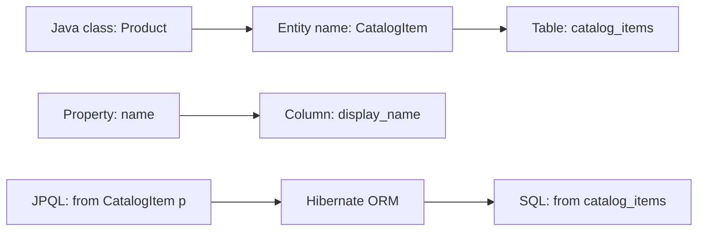

# `@Entity`, `@Table` và sự khác nhau giữa tên thực thể với tên bảng

Trong Hibernate/Jakarta Persistence, một lớp Java biểu diễn dữ liệu quan hệ có thể mang **ba tên khác nhau**: tên lớp trong Java, tên thực thể trong mô hình JPA và tên bảng trong cơ sở dữ liệu. Hiểu được ba lớp tên này là điều kiện cần để đọc entity mapping, viết đúng JPQL/HQL và native SQL, cũng như tránh những lỗi chỉ xuất hiện khi chuyển môi trường hoặc đổi cấu trúc database.

**Ý chính của bài học:**

- `@Entity` đánh dấu lớp Java là **entity** do JPA/Hibernate quản lý; thuộc tính `name` của nó quy định **tên thực thể logic** sử dụng trong JPQL/HQL.
- `@Table` khai báo **bảng chính** mà entity được ánh xạ tới; thuộc tính `name` xác định tên bảng SQL được khai báo.
- **Tên lớp Java** xuất hiện trong kiểu dữ liệu và các API như `entityManager.find(Product.class, 1L)`.
- **Tên entity** xuất hiện trong JPQL/HQL, ví dụ `select p from CatalogItem p`.
- **Tên bảng** xuất hiện trong SQL, ví dụ `select * from catalog_items`.

Tên lớp, tên entity và tên bảng có thể giống nhau, nhưng không bắt buộc. Trong một dự án có naming strategy, tên bảng vật lý cuối cùng có thể còn khác chuỗi khai báo trong annotation.

## 1. Ví dụ xuyên suốt: ba tên của một entity

Giả sử ứng dụng quản lý danh mục có class Java `Product`. Trong tầng ORM, nhóm phát triển muốn gọi thực thể này là `CatalogItem`, còn database đã có bảng `catalog_items`.

```java
import jakarta.persistence.Column;
import jakarta.persistence.Entity;
import jakarta.persistence.GeneratedValue;
import jakarta.persistence.GenerationType;
import jakarta.persistence.Id;
import jakarta.persistence.Table;

@Entity(name = "CatalogItem")
@Table(name = "catalog_items")
public class Product {

    @Id
    @GeneratedValue(strategy = GenerationType.IDENTITY)
    private Long id;

    @Column(name = "display_name", nullable = false)
    private String name;

    protected Product() {
        // JPA cần constructor không tham số.
    }

    public Product(String name) {
        this.name = name;
    }

    public Long getId() {
        return id;
    }

    public String getName() {
        return name;
    }

    public void setName(String name) {
        this.name = name;
    }
}
```

Bây giờ có bốn cặp tên cần nhận diện:

| Khái niệm | Tên ví dụ | Dùng ở đâu? |
| --- | --- | --- |
| Java class | `Product` | `Product.class`, biến Java, kiểu trả về |
| JPA entity name | `CatalogItem` | JPQL/HQL `FROM CatalogItem` |
| SQL table name | `catalog_items` | SQL `FROM catalog_items` |
| Java property | `name` | JPQL `p.name` |
| SQL column | `display_name` | SQL `display_name` |

Truy vấn JPQL tương ứng:

```java
List<Product> products = entityManager
    .createQuery(
        "select p from CatalogItem p where p.name = :name",
        Product.class)
    .setParameter("name", "Mechanical Keyboard")
    .getResultList();
```

SQL Hibernate có thể tạo, giản lược để dễ đọc:

```sql
SELECT id, display_name
FROM catalog_items
WHERE display_name = ?;
```

Ở đây **`CatalogItem` là thực thể logic, `catalog_items` là bảng vật lý**. Tương tự, `p.name` là thuộc tính entity còn `display_name` là cột database.



## 2. `@Entity`: đánh dấu lớp được ORM quản lý

`jakarta.persistence.Entity` là annotation đặt trên lớp Java. Nó cho biết lớp có thể tham gia mô hình persistence, được tải và quản lý trong Persistence Context, đồng bộ thay đổi với database qua Hibernate.

```java
import jakarta.persistence.Entity;
import jakarta.persistence.Id;

@Entity
public class Customer {

    @Id
    private Long id;

    private String fullName;

    protected Customer() {
    }
}
```

Khi lớp `Customer` được đăng ký vào persistence unit, Hibernate biết rằng:

1. `Customer` là một entity type trong metamodel.
2. Entity có thuộc tính định danh `id`.
3. Các đối tượng được tải có thể ở trạng thái managed trong Persistence Context.
4. Truy vấn JPQL có thể tham chiếu entity bằng tên logic của nó.
5. Hibernate ánh xạ các property sang cột theo annotation và quy tắc naming đang dùng.

`@Entity` **không tự nó quyết định phải có một bảng tên chính xác là `Customer`**. Tên bảng được điều khiển bởi `@Table` hoặc chiến lược đặt tên mặc định.

### Điều kiện cơ bản của một entity

Một lớp có `@Entity` cần phù hợp các yêu cầu mapping JPA: thường có khóa chính `@Id` hoặc `@EmbeddedId`, constructor không tham số với phạm vi phù hợp, và được đăng ký/quét vào persistence unit. Annotation đơn lẻ chưa bảo đảm một entity hợp lệ hoặc bảng đã có sẵn.

Trong ví dụ, import dùng `jakarta.persistence.*`. Ứng dụng Java EE/JPA cũ có thể dùng namespace `javax.persistence.*`; chọn namespace tương thích với framework, không trộn hai thế hệ annotation.

## 3. Thuộc tính `name` của `@Entity` là tên thực thể

Cú pháp:

```java
@Entity(name = "CustomerAccount")
public class Customer {

    @Id
    private Long id;

    protected Customer() {}
}
```

Tên entity của lớp lúc này là **`CustomerAccount`**. Trong JPQL:

```java
List<Customer> customers = entityManager.createQuery(
    "select c from CustomerAccount c",
    Customer.class
).getResultList();
```

**Tên `CustomerAccount` không phải tên bảng SQL**, cũng không nhất thiết phải giống tên class `Customer`.

Nếu bỏ tham số `name`:

```java
@Entity
public class Customer {
    @Id
    private Long id;
}
```

tên entity mặc định theo JPA là **tên lớp không kèm package**, ở đây là `Customer`. Hai đoạn code trên minh họa hai cách khai báo khác nhau, không phải hai lớp `Customer` đồng thời trong một project.

### Tên entity được sử dụng ở đâu?

- Trong `FROM` của JPQL: `from CustomerAccount c`.
- Trong `JOIN` giữa các entity theo cú pháp thích hợp và các truy vấn HQL tương ứng.
- Trong `@NamedQuery` dùng JPQL.
- Trong `@Query` mặc định của Spring Data JPA.
- Trong các API tạo truy vấn dựa vào entity name.

Trong JPQL portable, không tự thay tên entity bằng tên Java class nếu đã đặt `@Entity(name)` khác. Hibernate HQL có thể hỗ trợ một số cách phân giải tên lớp đầy đủ, nhưng không nên phụ thuộc phần mở rộng ấy khi đang học cú pháp chuẩn.

### Trùng tên entity giữa các package

Giả sử ứng dụng có:

```text
com.example.sales.Order
com.example.shipping.Order
```

Nếu cả hai lớp đều gắn `@Entity` và cùng nằm trong một persistence unit, hai entity cùng có tên mặc định `Order`, có thể gây xung đột.

Có thể đặt tên tách biệt:

```java
// com.example.sales.Order
@Entity(name = "SalesOrder")
public class Order { /* ... */ }
```

```java
// com.example.shipping.Order
@Entity(name = "ShippingOrder")
public class Order { /* ... */ }
```

Khi đó truy vấn phân biệt rõ:

```sql
select s from SalesOrder s
```

và:

```sql
select s from ShippingOrder s
```

Hai câu trên là **JPQL**; từ khóa `FROM` đang tham chiếu entity type, không phải bảng SQL.

Tên entity nên có ý nghĩa nghiệp vụ, dễ đọc, khác nhau trong cùng persistence unit và tránh từ khóa dành riêng của JPQL/HQL.

## 4. `@Table`: ánh xạ tới bảng chính trong database

`jakarta.persistence.Table` cho phép chỉ định bảng chính tương ứng với entity.

```java
@Entity
@Table(name = "customer_accounts")
public class Customer {

    @Id
    private Long id;
}
```

Từ mapping trên:

- Class Java: `Customer`.
- Tên entity mặc định: `Customer`.
- Tên bảng được khai báo: `customer_accounts`.

Truy vấn JPQL:

```java
List<Customer> result = entityManager.createQuery(
        "select c from Customer c",
        Customer.class)
    .getResultList();
```

Truy vấn native SQL:

```sql
SELECT *
FROM customer_accounts;
```

`@Table` không làm tên `customer_accounts` trở thành tên entity trong JPQL. Mỗi annotation điều khiển một tầng riêng biệt.

### Có bắt buộc khai báo `@Table` không?

**Không.** Ví dụ sau vẫn là một entity hợp lệ về ý tưởng mapping:

```java
@Entity
public class Invoice {
    @Id
    private Long id;
}
```

Khi không có `@Table`, JPA/Hibernate suy ra tên bảng theo quy tắc mặc định. Theo JPA, tên bảng mặc định gắn với tên entity; Hibernate có thể áp dụng implicit/physical naming strategy để tạo tên SQL thực tế.

Vì vậy, đừng kết luận máy móc rằng lớp `InvoiceLine` chắc chắn truy cập bảng `invoice_line` hay `INVOICE_LINE` trong mọi ứng dụng. Kết quả còn tùy cấu hình Hibernate, framework tích hợp và cách database xử lý định danh.

### Thuộc tính quan trọng của `@Table`

| Thuộc tính | Mục đích | Ví dụ |
| --- | --- | --- |
| `name` | Đặt tên bảng chính | `name = "customers"` |
| `schema` | Chỉ định schema chứa bảng | `schema = "crm"` |
| `catalog` | Chỉ định catalog nếu DB hỗ trợ | `catalog = "appdb"` |
| `uniqueConstraints` | Khai báo unique constraint để hỗ trợ sinh schema | `@UniqueConstraint(...)` |
| `indexes` | Khai báo index để hỗ trợ sinh schema | `@Index(...)` |

Ví dụ:

```java
import jakarta.persistence.Column;
import jakarta.persistence.Entity;
import jakarta.persistence.Id;
import jakarta.persistence.Index;
import jakarta.persistence.Table;
import jakarta.persistence.UniqueConstraint;

@Entity(name = "CustomerAccount")
@Table(
    name = "customers",
    schema = "crm",
    uniqueConstraints = {
        @UniqueConstraint(
            name = "uk_customers_email",
            columnNames = {"email_address"}
        )
    },
    indexes = {
        @Index(
            name = "idx_customers_display_name",
            columnList = "display_name"
        )
    }
)
public class Customer {
    @Id
    private Long id;

    @Column(name = "email_address", nullable = false)
    private String email;

    @Column(name = "display_name")
    private String name;

    protected Customer() {}
}
```

SQL có thể truy cập bảng bằng tên được schema phân giải:

```sql
SELECT id, email_address, display_name
FROM crm.customers;
```

Lưu ý: annotation `uniqueConstraints` và `indexes` mô tả metadata dùng trong schema generation; chúng **không tự sửa cơ sở dữ liệu đang chạy** nếu ứng dụng không thực hiện tạo/cập nhật schema. Trong hệ thống thực tế, migration thường được quản lý bằng Flyway hoặc Liquibase.

## 5. Bảng so sánh bốn cách khai báo phổ biến

Xét class `OrderLine`, với trường khóa chính `id`. Bốn cấu hình sau là bốn biến thể **thay thế nhau**.

| Khai báo | Entity name trong JPQL | Tên bảng chính |
| --- | --- | --- |
| Chỉ `@Entity` | `OrderLine` | Suy ra theo quy tắc tên mặc định |
| `@Entity(name = "PurchaseLine")` | `PurchaseLine` | Suy ra theo quy tắc tên mặc định |
| `@Entity` + `@Table(name = "order_line_items")` | `OrderLine` | Khai báo `order_line_items` |
| `@Entity(name = "PurchaseLine")` + `@Table(name = "order_line_items")` | `PurchaseLine` | Khai báo `order_line_items` |

### Chỉ có `@Entity`

```java
@Entity
public class OrderLine {
    @Id
    private Long id;
}
```

JPQL:

```java
"select o from OrderLine o"
```

Bảng vật lý được suy ra từ cấu hình đặt tên.

### Chỉ đặt tên entity

```java
@Entity(name = "PurchaseLine")
public class OrderLine {
    @Id
    private Long id;
}
```

JPQL:

```java
"select o from PurchaseLine o"
```

Tên bảng vẫn mặc định. Nếu cần **đổi tên JPQL nhưng giữ bảng cũ**, hãy đặt `@Table` rõ ràng.

### Chỉ đặt tên bảng

```java
@Entity
@Table(name = "order_line_items")
public class OrderLine {
    @Id
    private Long id;
}
```

JPQL dùng `OrderLine`, còn SQL dùng bảng `order_line_items` theo mapping.

### Đặt cả hai tên

```java
@Entity(name = "PurchaseLine")
@Table(name = "order_line_items")
public class OrderLine {
    @Id
    private Long id;
}
```

JPQL:

```java
"select o from PurchaseLine o"
```

SQL:

```sql
SELECT *
FROM order_line_items;
```

Đặt tên bảng cụ thể giúp giảm phụ thuộc vào cách Hibernate suy ra tên khi tên class hoặc tên entity thay đổi. Tuy nhiên, physical naming strategy vẫn có thể biến đổi tên đã khai báo: đây là một đặc tính quan trọng của Hibernate.

## 6. Sự khác nhau giữa JPQL/HQL và native SQL

**JPQL** là ngôn ngữ truy vấn của JPA theo mô hình đối tượng. **HQL** là ngôn ngữ truy vấn hướng đối tượng của Hibernate và hỗ trợ các tính năng mở rộng. **Native SQL** gửi câu truy vấn ở tầng bảng/cột của DB.

Với mapping:

```java
@Entity(name = "CatalogItem")
@Table(name = "catalog_items")
public class Product {

    @Id
    private Long id;

    @Column(name = "display_name")
    private String name;
}
```

JPQL đúng:

```java
List<Product> products = entityManager.createQuery(
        "select p from CatalogItem p where p.name = :name",
        Product.class)
    .setParameter("name", "Notebook")
    .getResultList();
```

Native SQL tương ứng:

```java
List<?> products = entityManager.createNativeQuery(
        "select id, display_name " +
        "from catalog_items where display_name = :name",
        Product.class)
    .setParameter("name", "Notebook")
    .getResultList();
```

| Khía cạnh | JPQL/HQL | Native SQL |
| --- | --- | --- |
| API điển hình | `createQuery(...)` | `createNativeQuery(...)` |
| `FROM` | Entity name | Table name |
| `WHERE` | Tên thuộc tính entity | Tên cột vật lý |
| Kết quả | Entity, DTO/projection hoặc scalar | Result set, scalar hoặc mapping entity |
| Quan hệ | Dùng đường dẫn entity, ví dụ `p.category` | Dùng khóa ngoại và `JOIN` SQL |
| Tính di động | JPQL chuẩn có thể portable giữa JPA providers | Phụ thuộc DB và dialect |

Lỗi quen thuộc là viết:

```java
// SAI về ngữ nghĩa nếu entity không mang tên "catalog_items".
entityManager.createQuery(
    "select p from catalog_items p",
    Product.class
);
```

Hibernate phân giải `catalog_items` thành tên entity nhưng không tìm thấy entity ấy. Sửa thành:

```java
entityManager.createQuery(
    "select p from CatalogItem p",
    Product.class
);
```

Nếu muốn truy cập trực tiếp bảng, chuyển sang `createNativeQuery` và dùng SQL tương ứng.

### JPQL dùng tên thuộc tính, không dùng tên cột

Với `@Column(name = "display_name") private String name;`:

- Đúng: `where p.name = :value`.
- Sai: `where p.display_name = :value`, trừ khi entity thực sự có thuộc tính tên `display_name`.

Đây là quy tắc giống với `FROM`: JPQL hiểu **mô hình entity**, SQL hiểu **cấu trúc database**.

## 7. Phân biệt `@Column`, `@JoinColumn` và `@Table`

`@Table` quy định bảng chính. `@Column` quy định mapping của cột cơ bản. `@JoinColumn` thường quy định cột khóa ngoại trong một quan hệ.

Ví dụ:

```java
@Entity(name = "EmployeeRecord")
@Table(name = "employees")
public class Employee {

    @Id
    @Column(name = "employee_id")
    private Long id;

    @Column(name = "full_name")
    private String fullName;

    @ManyToOne
    @JoinColumn(name = "department_id")
    private Department department;

    protected Employee() {}
}
```

Ý nghĩa:

| Trong entity model | Trong database |
| --- | --- |
| Entity name `EmployeeRecord` | Bảng `employees` |
| Property `id` | Cột `employee_id` |
| Property `fullName` | Cột `full_name` |
| Quan hệ `department` | Khóa ngoại `department_id` |

JPQL:

```java
List<Employee> result = entityManager.createQuery(
    "select e from EmployeeRecord e " +
    "join e.department d where d.name = :departmentName",
    Employee.class
).setParameter("departmentName", "Sales")
 .getResultList();
```

JPQL join theo `e.department`, không tự viết tên bảng quan hệ. Hibernate chuyển quan hệ đã mapping thành SQL JOIN dựa trên metadata của entity, `@JoinColumn` và kiểu quan hệ.

### Access type và tên property

JPA có **field access** hoặc **property access**. Khi đặt `@Id` trên field như các ví dụ trên, Hibernate thường dùng field access. Nếu đặt mapping trên getter, ứng dụng có thể dùng property access. Sự lựa chọn này ảnh hưởng nơi đặt annotation nhưng **không thay đổi nguyên tắc JPQL dùng thuộc tính đã ánh xạ, không dùng cột vật lý**.

## 8. Naming strategy: vì sao tên bảng cuối cùng có thể thay đổi?

Hibernate phân biệt **implicit naming strategy** và **physical naming strategy**.

### Implicit naming strategy

Khi không ghi `@Table(name = "...")`, Hibernate phải suy ra một tên logic từ tên entity hoặc metadata mapping. Khi không ghi `@Column(name = "...")`, nó cũng phải suy ra tên cột từ property.

Ví dụ:

```java
@Entity
public class PurchaseOrder {
    @Id
    private Long id;

    private String deliveryAddress;
}
```

Tên bảng và cột sẽ được suy ra theo quy tắc tên mặc định. Không nên mặc định rằng kết quả vật lý chính xác là `PurchaseOrder` và `deliveryAddress` trong mọi dự án.

### Physical naming strategy

Sau khi có tên logic, Hibernate có thể chuyển nó thành định danh SQL cuối cùng. Một chiến lược chuyển camel case sang snake case có thể tạo:

| Tên ban đầu | Tên SQL minh họa |
| --- | --- |
| `PurchaseOrder` | `purchase_order` |
| `deliveryAddress` | `delivery_address` |
| `CustomerAccount` | `customer_account` |

Điểm quan trọng: **physical naming strategy có thể áp dụng cả với tên khai báo tường minh**, ví dụ `@Table(name = "CustomerAccount")`. Do đó, chuỗi `name` trong annotation chưa hẳn là toàn bộ câu chuyện về tên xuất hiện trong SQL runtime.

Trong một ứng dụng Spring Boot sử dụng Hibernate, có thể cấu hình chiến lược đặt tên bằng những thuộc tính như:

```properties
spring.jpa.hibernate.naming.implicit-strategy=org.hibernate.boot.model.naming.ImplicitNamingStrategyJpaCompliantImpl
spring.jpa.hibernate.naming.physical-strategy=org.hibernate.boot.model.naming.CamelCaseToUnderscoresNamingStrategy
```

Đây là **ví dụ cấu hình**, không phải khẳng định mọi phiên bản Spring Boot đều có đúng hai giá trị mặc định này. Nếu yêu cầu giữ nguyên tên logic dưới physical strategy tiêu chuẩn, có thể chọn:

```properties
spring.jpa.hibernate.naming.physical-strategy=org.hibernate.boot.model.naming.PhysicalNamingStrategyStandardImpl
```

Tuy vậy, tên vật lý còn chịu quy tắc chữ hoa/chữ thường, quoting và schema của database.

### Khi nào cần chỉ định `@Table(name)`?

Nên cân nhắc đặt tên tường minh khi:

- Database đã tồn tại với quy ước riêng, khác tên class Java.
- Team dùng migration có tên bảng ổn định.
- Đổi tên Java class không được phép thay tên bảng.
- Có naming strategy thay đổi theo môi trường.
- Cần phân biệt tên entity phục vụ domain với tên bảng do bên thứ ba cung cấp.

Dù khai báo rõ tên bảng, vẫn cần giữ **physical naming strategy nhất quán** giữa các môi trường.

## 9. `schema`, `catalog` và tên bảng có namespace

Một entity có thể ánh xạ tới bảng trong schema cụ thể.

```java
@Entity(name = "AuditEvent")
@Table(name = "event_log", schema = "audit")
public class AuditLogEntry {

    @Id
    private Long id;

    private String message;

    protected AuditLogEntry() {}
}
```

JPQL:

```java
entityManager.createQuery(
    "select e from AuditEvent e",
    AuditLogEntry.class
).getResultList();
```

SQL minh họa:

```sql
SELECT id, message
FROM audit.event_log;
```

Các thành phần:

- `AuditEvent`: entity name.
- `audit`: schema database.
- `event_log`: table name.
- `AuditLogEntry`: Java class.

`@Table(catalog = "...")` có thể chỉ định catalog trong hệ quản trị hỗ trợ. Khái niệm catalog và schema không đồng nhất trên mọi DBMS; cách SQL được sinh phụ thuộc dialect.

Khi cần schema tách biệt, ưu tiên viết `@Table(name = "event_log", schema = "audit")` thay vì gộp `audit.event_log` vào thuộc tính `name` rồi mặc định mọi dialect đều hiểu giống nhau.

## 10. Chữ hoa/thường, reserved word và quoted identifiers

Trong JPQL, tên entity là **định danh logic** trong ngôn ngữ truy vấn. Trong database, tên bảng là **SQL identifier** và có thể chịu quy tắc viết hoa/thường, từ khóa dành riêng hoặc dấu trích dẫn.

Ví dụ, chọn bảng tên `order` có thể gặp vấn đề vì `ORDER` là từ khóa SQL. Hibernate hỗ trợ cơ chế quoted identifier theo dialect; với Hibernate, có thể diễn đạt một tên cần quote bằng cú pháp riêng của provider hoặc cấu hình quoting toàn cục. Tuy nhiên, cách trích dẫn chính xác không nên suy từ riêng quy tắc Java.

Với schema mới, các tên như `purchase_orders` hoặc `customer_accounts` thường tránh được nhiều va chạm hơn `order` hay `user`.

Một số hệ quản trị chuẩn hóa tên không trích dẫn; tên đã quote có thể phân biệt hoa/thường. Vì vậy, `Customer`, `customer` và một định danh quote `"Customer"` không nhất thiết là cùng một bảng trong mọi database.

Để tránh lệch môi trường:

1. Chọn một quy ước tên SQL đơn giản, ví dụ chữ thường và dấu gạch dưới.
2. Sử dụng annotation và migration nhất quán.
3. Kiểm tra chiến lược quoting và naming của Hibernate.
4. Xem SQL được phát ra khi chẩn đoán lỗi tên bảng.

## 11. Tên entity trong Spring Data JPA

Spring Data JPA khai báo repository theo **kiểu Java của entity**:

```java
import org.springframework.data.jpa.repository.JpaRepository;

public interface ProductRepository
        extends JpaRepository<Product, Long> {

    List<Product> findByName(String name);
}
```

`Product` ở đây là Java class; `findByName` dựa trên property `name`. Không cần đặt tên repository theo bảng.

Nếu viết JPQL bằng `@Query`:

```java
import org.springframework.data.jpa.repository.Query;
import org.springframework.data.repository.query.Param;

public interface ProductRepository
        extends JpaRepository<Product, Long> {

    @Query("select p from CatalogItem p where p.name = :name")
    List<Product> searchByName(@Param("name") String name);
}
```

Khi ghi `nativeQuery = true`:

```java
@Query(
    value = "select * from catalog_items where display_name = :name",
    nativeQuery = true
)
List<Product> searchNative(@Param("name") String name);
```

Phân biệt:

| Nơi khai báo | Ngôn ngữ được hiểu |
| --- | --- |
| `JpaRepository<Product, Long>` | Kiểu Java `Product` |
| `findByName(...)` | Property `name` |
| `@Query("from CatalogItem ...")` | JPQL theo entity name |
| `@Query(..., nativeQuery = true)` | SQL theo bảng/cột thực tế |

Spring Data JPA còn hỗ trợ biểu thức `#{#entityName}` trong một số truy vấn `@Query`:

```java
@Query("select p from #{#entityName} p where p.name = :name")
List<Product> search(@Param("name") String name);
```

Biểu thức này được Spring Data xử lý thành tên entity phù hợp với repository. Đây là tính năng **Spring Data JPA**, không phải cú pháp JPQL thuần có thể đưa nguyên văn vào `EntityManager.createQuery()` ở mọi provider.

## 12. Một entity có luôn ánh xạ đúng một bảng?

`@Table` xác định **bảng chính** của entity; điều đó không có nghĩa mỗi entity chỉ liên quan đúng một bảng trong mọi trường hợp.

### Bảng phụ bằng `@SecondaryTable`

```java
import jakarta.persistence.Column;
import jakarta.persistence.Entity;
import jakarta.persistence.Id;
import jakarta.persistence.SecondaryTable;
import jakarta.persistence.Table;

@Entity(name = "EmployeeProfile")
@Table(name = "employees")
@SecondaryTable(name = "employee_details")
public class Employee {

    @Id
    private Long id;

    private String name;

    @Column(table = "employee_details", name = "biography")
    private String biography;

    protected Employee() {}
}
```

Ở đây:

- Entity name: `EmployeeProfile`.
- Bảng chính: `employees`.
- Bảng phụ: `employee_details`.
- JPQL vẫn viết `select e from EmployeeProfile e`.

Hibernate có thể cần JOIN nhiều bảng để nạp đầy đủ entity tùy mapping và truy vấn.

### Bảng quan hệ bằng `@JoinTable`

Với quan hệ nhiều-nhiều:

```java
@ManyToMany
@JoinTable(
    name = "product_categories",
    joinColumns = @JoinColumn(name = "product_id"),
    inverseJoinColumns = @JoinColumn(name = "category_id")
)
private Set<Category> categories;
```

Bảng `product_categories` là bảng lưu **quan hệ giữa entity**, không phải tên entity trong JPQL. JPQL có thể dùng `join p.categories c` dựa trên property, còn Hibernate tạo JOIN SQL phù hợp với mapping.

### `@MappedSuperclass` và `@Embeddable`

`@MappedSuperclass` cho phép kế thừa mapping nhưng lớp đó **không tự trở thành entity root trong JPQL**. `@Embeddable` biểu diễn một value object được nhúng, không tự có tên entity và bảng chính như `@Entity`. Phải phân biệt các annotation mapping khác nhau để không kỳ vọng mọi lớp persistence đều có thể xuất hiện sau `FROM` của JPQL.

## 13. Đổi tên class, entity hoặc bảng khi bảo trì

### Đổi tên Java class

Ban đầu:

```java
@Entity
@Table(name = "accounts")
public class UserAccount { /* ... */ }
```

Nếu đổi class thành `CustomerAccount` và vẫn để `@Entity` không có `name`, entity name mặc định cũng đổi theo. Các query cũ viết `from UserAccount` có thể hỏng.

Muốn giữ tên JPQL cũ trong giai đoạn chuyển tiếp:

```java
@Entity(name = "UserAccount")
@Table(name = "accounts")
public class CustomerAccount { /* ... */ }
```

Class Java mới là `CustomerAccount`; JPQL vẫn dùng `UserAccount`; bảng giữ `accounts`.

### Đổi tên entity, giữ bảng

```java
@Entity(name = "CustomerAccount")
@Table(name = "accounts")
public class UserAccount { /* ... */ }
```

Các câu JPQL dùng tên cũ cần được cập nhật thành `from CustomerAccount`. Database vẫn dùng bảng `accounts`.

### Đổi tên bảng, giữ entity

```java
@Entity(name = "CustomerAccount")
@Table(name = "customer_accounts")
public class UserAccount { /* ... */ }
```

JPQL giữ `from CustomerAccount`. SQL của Hibernate hướng tới bảng mới theo mapping. **Đổi `@Table(name)` không tự chuyển dữ liệu** từ `accounts` sang `customer_accounts`: cần migration phù hợp.

### Đổi naming strategy

Nếu trước đó các entity dựa vào tên mặc định, đổi physical naming strategy có thể khiến Hibernate phát SQL với hàng loạt tên bảng/cột khác. Những câu JPQL theo entity và property có thể không đổi nhưng vẫn lỗi tại database. Vì vậy, xem đổi naming strategy như thay đổi mapping cần phối hợp với migration.

## 14. Những lỗi thường gặp

### Lỗi 1: dùng tên bảng trong JPQL

Mapping:

```java
@Entity(name = "CatalogItem")
@Table(name = "catalog_items")
public class Product { /* ... */ }
```

Sai:

```java
entityManager.createQuery(
    "select p from catalog_items p",
    Product.class
);
```

Nguyên nhân: `catalog_items` là table name, Hibernate tìm entity cùng tên nhưng không thấy. Sửa thành `from CatalogItem` hoặc dùng native SQL nếu mục tiêu là truy vấn bảng.

### Lỗi 2: dùng tên cột trong JPQL

Giả sử `@Column(name = "display_name") private String name;`.

Sai:

```java
"select p from CatalogItem p where p.display_name = :value"
```

Đúng:

```java
"select p from CatalogItem p where p.name = :value"
```

JPQL dùng **property name** trong object model.

### Lỗi 3: database báo bảng không tồn tại

Mapping có `@Table(name = "customers")` nhưng database đang chứa bảng `customer_account`. Truy vấn JPQL vẫn phân tích đúng entity; Hibernate chỉ lỗi khi phát SQL vào bảng không tồn tại.

Cần kiểm tra bảng đã migrate, schema/catalog, database đang kết nối, physical naming strategy và cơ chế quoting. Đổi `@Entity(name)` thường không giải quyết loại lỗi này.

### Lỗi 4: hai entity trùng tên logic

Hai class `Order` ở hai package đăng ký trong cùng persistence unit có thể trùng entity name mặc định `Order`. Đặt `@Entity(name)` khác nhau hoặc điều chỉnh cấu hình persistence unit.

### Lỗi 5: đổi tên entity gây lỗi `@NamedQuery`/`@Query`

Refactor Java class hoặc thay `@Entity(name)` không tự động cập nhật mọi chuỗi truy vấn. Rà soát những chuỗi JPQL/HQL, kể cả query trong repository và annotation tên truy vấn.

### Lỗi 6: table naming phụ thuộc môi trường

Ứng dụng chạy với naming strategy chuyển camel case sang snake case ở development nhưng dùng strategy khác tại production. Với cùng class `PurchaseOrder`, Hibernate có thể sinh hai tên bảng khác nhau. Cần giữ cấu hình nhất quán và ghi rõ mapping khi thích hợp.

### Lỗi 7: tưởng `@Table` tự tạo hoặc đổi cấu trúc database

Annotation chỉ mô tả mapping. Tạo bảng và đồng bộ DDL phụ thuộc cấu hình schema generation và công cụ migration. Trong production, không nên dựa vào việc Hibernate tự động đổi tên bảng khi đổi annotation.

## 15. Thực hành với một schema có sẵn

Giả sử bảng SQL:

```sql
CREATE TABLE catalog_items (
    id BIGINT PRIMARY KEY,
    display_name VARCHAR(150) NOT NULL,
    unit_price DECIMAL(12, 2) NOT NULL
);
```

Viết entity:

```java
import java.math.BigDecimal;
import jakarta.persistence.Column;
import jakarta.persistence.Entity;
import jakarta.persistence.Id;
import jakarta.persistence.Table;

@Entity(name = "CatalogItem")
@Table(name = "catalog_items")
public class Product {
    @Id
    private Long id;

    @Column(name = "display_name", nullable = false)
    private String name;

    @Column(name = "unit_price", nullable = false)
    private BigDecimal price;

    protected Product() {}

    public Product(Long id, String name, BigDecimal price) {
        this.id = id;
        this.name = name;
        this.price = price;
    }

    public Long getId() { return id; }

    public String getName() { return name; }

    public BigDecimal getPrice() { return price; }
}
```

### Cách A: tra cứu bằng Java class

```java
Product product = entityManager.find(Product.class, 10L);
```

`find` cần biết **kiểu entity Java** và khóa chính. Hibernate dựa vào metadata đã đăng ký để xác định bảng cần truy cập.

### Cách B: truy vấn bằng JPQL

```java
List<Product> products = entityManager.createQuery(
        "select p from CatalogItem p where p.price >= :min",
        Product.class)
    .setParameter("min", new BigDecimal("100.00"))
    .getResultList();
```

JPQL sử dụng entity `CatalogItem` và property `price`. Hibernate biên dịch thành SQL theo bảng `catalog_items` và cột `unit_price`.

### Cách C: truy vấn bằng native SQL

```java
List<?> products = entityManager.createNativeQuery(
        "select id, display_name, unit_price " +
        "from catalog_items where unit_price >= :min",
        Product.class)
    .setParameter("min", new BigDecimal("100.00"))
    .getResultList();
```

Native SQL sử dụng trực tiếp tên bảng và tên cột. Tham số `Product.class` chỉ kiểu entity dùng để ánh xạ kết quả.

**Kết nối ba cách làm:** `Product.class` là class Java, `CatalogItem` là entity name, `catalog_items` là SQL table. ORM cung cấp metadata để dịch đúng giữa ba tầng ấy.

## 16. Câu hỏi tự kiểm tra

**Câu 1.** Với class:

```java
@Entity(name = "Member")
@Table(name = "app_users")
public class User {
    @Id
    private Long id;
}
```

Câu JPQL nào nên dùng?

- A. `select u from User u`
- B. `select u from app_users u`
- C. `select u from Member u`

**Đáp án: C.** `Member` là entity name. `app_users` là bảng; `User` là Java class.

**Câu 2.** Bỏ `@Table`, giữ `@Entity` thì class có còn là entity không?

Có, nếu mapping còn hợp lệ và class được đăng ký. Hibernate sẽ suy ra tên bảng theo naming strategy.

**Câu 3.** Đổi `@Table(name = "orders")` thành `@Table(name = "purchase_orders")` có đổi tên JPQL không?

Không. Đó là thay đổi bảng vật lý. Cần migration khi database chưa có bảng mới.

**Câu 4.** Đổi `@Entity(name = "Order")` thành `@Entity(name = "PurchaseOrder")` có nhất thiết đổi bảng không?

Không. Nếu đã khai báo `@Table(name)` ổn định thì bảng có thể giữ nguyên; khi dựa vào tên mặc định, việc đổi entity name có thể tác động đến tên được suy ra.

**Câu 5.** Vì sao `@Table(name = "CustomerAccount")` có thể dẫn tới SQL truy cập `customer_account`?

Vì Hibernate physical naming strategy có thể biến đổi identifier sau bước khai báo hoặc suy ra tên.

**Câu 6.** Khi JPQL viết `where p.name = :x`, `name` là tên cột hay property?

Đó là tên thuộc tính entity. `@Column(name = "display_name")` quy định cách property ấy ánh xạ vào cột database.

## 17. Nguyên tắc cần ghi nhớ

1. **`@Entity` xác định entity**, và `@Entity(name)` xác định tên logic trong JPQL/HQL.
2. **`@Table` xác định bảng chính**, cùng các thông tin schema/catalog và metadata DDL khi cần.
3. **Java API và repository dùng class Java**; JPQL/HQL dùng entity name và property name; native SQL dùng table name và column name.
4. **Naming strategy của Hibernate** có thể ảnh hưởng tên vật lý, kể cả những tên đã đặt rõ trong annotation.
5. **Đổi tên entity ảnh hưởng truy vấn ORM**; đổi tên bảng ảnh hưởng mapping SQL và thường cần migration database.
6. **Không nhầm `@Table` với `@SecondaryTable` và `@JoinTable`** khi một entity liên quan nhiều bảng.
7. **Dùng naming convention nhất quán** để giảm lỗi reserved words, quoted identifiers và khác biệt môi trường.

Khi đọc một lớp Hibernate, hãy lần lượt tìm **tên Java class**, **`@Entity(name)`** và **`@Table(name)`**. Ba thông tin này giải thích vì sao code Java dùng `Product`, JPQL truy vấn `CatalogItem` và SQL truy cập `catalog_items` mà tất cả vẫn đại diện cho cùng một mô hình dữ liệu.
