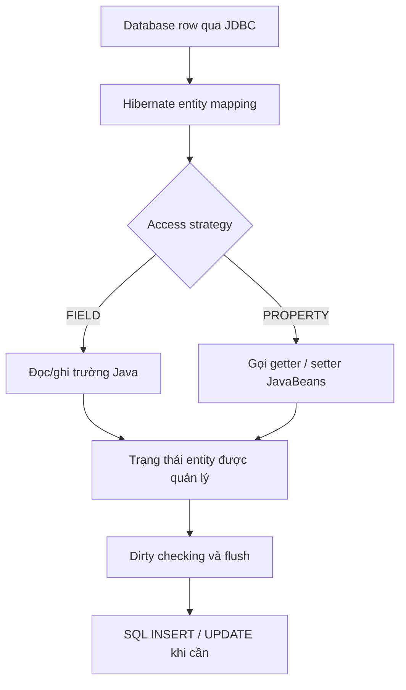

# Chiến lược truy cập qua trường hoặc thuộc tính trong ánh xạ thực thể Hibernate

Khi Hibernate ORM đọc một hàng từ cơ sở dữ liệu để tạo entity, nó phải đưa giá trị vào đối tượng Java. Khi cần `INSERT` hoặc `UPDATE`, nó phải lấy giá trị hiện tại của entity để chuyển thành tham số JDBC. Câu hỏi quan trọng là: **Hibernate đọc và ghi trực tiếp các trường (`field access`) hay thông qua các phương thức getter/setter (`property access`)?**

Quyết định này gọi là **access strategy**, hay *chiến lược truy cập trạng thái persistent*. Nó chi phối vị trí đặt annotation ánh xạ, cách Hibernate tiếp cận trạng thái, tương tác với quy tắc đóng gói của domain model và một số lỗi khó phát hiện khi refactor entity.

Bài học sử dụng Jakarta Persistence (`jakarta.persistence.*`) với Hibernate ORM 6.x. Phần lớn quy tắc là quy tắc JPA, còn một số tối ưu và khả năng mở rộng thuộc riêng Hibernate. Cần phân biệt **thuộc tính JavaBeans** với một trường Java: cả hai có thể mô tả cùng một giá trị nghiệp vụ nhưng là hai điểm truy cập khác nhau đối với ORM.

## 1. Đặt access strategy vào luồng ORM

Một entity có thể có cả trường và getter:

```java
private String title;

public String getTitle() {
    return title;
}

public void setTitle(String title) {
    this.title = title;
}
```

Cả hai cách sau đều có thể biểu diễn giá trị `title`:

- **Field access:** Hibernate thao tác với trường `title` thông qua bộ truy cập thuộc tính nội bộ (có thể dựa trên reflection, bytecode accessors hoặc cơ chế tối ưu tương ứng). Hibernate không cần gọi `getTitle()`/`setTitle()` chỉ để đọc/ghi trạng thái persistent này.
- **Property access:** Hibernate làm việc với thuộc tính JavaBeans `title` qua cặp `getTitle()`/`setTitle()`; annotation ánh xạ thường được đặt trên **getter**.



Chiến lược truy cập **không** quyết định DBMS, kiểu SQL của cột hoặc transaction scope. Nó cũng không phải `FetchType.LAZY`/`EAGER`: *access* nói về **cách truy cập giá trị trong đối tượng Java**, còn *fetch* nói về **khi nào dữ liệu được tải**.

## 2. Hibernate/JPA xác định kiểu truy cập mặc định như thế nào?

Nếu không khai báo `@Access`, JPA suy ra kiểu truy cập mặc định từ **vị trí của các annotation ánh xạ** trong entity hierarchy. Quy ước thông dụng và dễ nhận biết nhất là vị trí đặt `@Id` hoặc `@EmbeddedId`:

| Khai báo | Kiểu truy cập thường được xác lập | Vị trí annotation persistent tiếp theo |
| --- | --- | --- |
| `@Id` trên trường `private Long id;` | `FIELD` | Trên các trường: `@Column`, `@ManyToOne`, `@Version`, v.v. |
| `@Id` trên `public Long getId()` | `PROPERTY` | Trên các getter JavaBeans. |
| `@Access(AccessType.FIELD)` trên lớp | `FIELD` một cách tường minh | Trên trường, trừ attribute được override có chủ đích. |
| `@Access(AccessType.PROPERTY)` trên lớp | `PROPERTY` một cách tường minh | Trên getter, trừ attribute được override có chủ đích. |

**Điểm cần nhớ:** vị trí `@Id` là dấu hiệu thực hành rất hữu ích, nhưng quy tắc JPA xét toàn bộ các lớp entity và mapped superclass liên quan. Không được mặc định rằng Hibernate sẽ tự hiểu chính xác khi `@Id` nằm trên trường còn các annotation khác đặt tùy tiện trên getter. Nếu trộn vị trí khai báo mà không dùng `@Access` rõ ràng, hành vi ánh xạ có thể không được định nghĩa theo JPA hoặc bị Hibernate bỏ qua một số annotation.

`@Access` đến từ `jakarta.persistence.Access` và nhận giá trị `AccessType.FIELD` hoặc `AccessType.PROPERTY`. Nó có thể khai báo ở cấp lớp hoặc trên một thuộc tính cần override. Khi phát triển một hệ thống lâu dài, **khai báo tường minh ở cấp lớp** thường làm chủ ý kiến trúc dễ nhận biết hơn là dựa hoàn toàn vào vị trí `@Id`.

## 3. Field access: Hibernate truy cập trường Java

### 3.1. Entity hoàn chỉnh dùng `FIELD`

```java
import jakarta.persistence.Access;
import jakarta.persistence.AccessType;
import jakarta.persistence.Column;
import jakarta.persistence.Entity;
import jakarta.persistence.GeneratedValue;
import jakarta.persistence.GenerationType;
import jakarta.persistence.Id;
import jakarta.persistence.Table;

@Entity
@Table(name = "accounts")
@Access(AccessType.FIELD)
public class Account {

    @Id
    @GeneratedValue(strategy = GenerationType.IDENTITY)
    private Long id;

    @Column(name = "email", nullable = false, length = 254)
    private String email;

    @Column(name = "display_name", nullable = false, length = 100)
    private String displayName;

    protected Account() {
        // Constructor không tham số cho JPA.
    }

    public Account(String email, String displayName) {
        changeEmail(email);
        rename(displayName);
    }

    public Long getId() {
        return id;
    }

    public String getEmail() {
        return email;
    }

    public String getDisplayName() {
        return displayName;
    }

    public void changeEmail(String newEmail) {
        if (newEmail == null || newEmail.isBlank()) {
            throw new IllegalArgumentException("Email must not be blank");
        }
        this.email = newEmail.trim();
    }

    public void rename(String newName) {
        if (newName == null || newName.isBlank()) {
            throw new IllegalArgumentException("Name must not be blank");
        }
        this.displayName = newName.trim();
    }
}
```

Ở đây:

1. `@Access(AccessType.FIELD)` xác định strategy của entity; mọi annotation JPA ở ví dụ này nằm trên **trường**.
2. Trường `id` không có public setter. Hibernate vẫn có thể gán ID được tạo vì nó truy cập trường theo mapping.
3. `changeEmail()` và `rename()` là API nghiệp vụ của đối tượng, dùng để kiểm soát cách **mã ứng dụng** thay đổi trạng thái.
4. Hibernate có thể gán lại `email` và `displayName` khi nạp entity mà **không gọi** các phương thức thay đổi nghiệp vụ đó.
5. `private` không làm Hibernate không ánh xạ được trường; provider xử lý theo cơ chế access đã chọn. Entity vẫn cần constructor không tham số với visibility phù hợp JPA (`public` hoặc `protected` là cách an toàn cho tính di động).

Nếu bỏ `@Access(AccessType.FIELD)` nhưng vẫn giữ `@Id` trên trường và mọi mapping nhất quán, ví dụ này vẫn thường dùng field access theo quy tắc mặc định.

### 3.2. Ưu điểm chính của field access

- **Đóng gói domain:** không bắt buộc phải có getter/setter công khai cho mọi trường persistent. Một entity có thể cung cấp `activate()`, `changeEmail()` hoặc `rename()` thay cho API `setX()` tùy ý.
- **Tách truy cập ORM khỏi hành vi accessor:** Hibernate không cần thực thi code trong getter/setter thông thường chỉ để hydrate hoặc đọc trạng thái, tránh một số side effect từ accessor.
- **Dễ thấy nguồn dữ liệu được lưu:** annotation `@Column`, `@ManyToOne`, `@Version`, `@Embedded` đặt ngay cạnh khai báo trường.
- **Phù hợp với domain model nhiều ràng buộc:** phương thức nghiệp vụ có thể thực hiện kiểm tra, thay đổi nhiều trường nhất quán, phát sinh domain event theo thiết kế.

Tuy vậy, field access **không tự thực thi invariant của entity**. Khi Hibernate hydrate từ database, nó có thể gán giá trị vào trường mà không đi qua `changeEmail()`. Vì vậy tính đúng đắn dữ liệu vẫn cần ràng buộc DB, validation ở đúng ranh giới ứng dụng và chính sách xử lý dữ liệu đã lưu.

### 3.3. Field access không có nghĩa Hibernate luôn dùng Java reflection thuần

`FIELD` diễn đạt **ngữ nghĩa truy cập**: đọc/ghi field thay vì dựa vào JavaBeans getter/setter. Hibernate có thể sử dụng accessor tối ưu hoặc bytecode enhancement tùy phiên bản và cấu hình. Không nên rút ra kết luận hiệu năng chỉ từ việc thấy `FIELD` và `PROPERTY`; sự khác biệt truy vấn, batching và số lần round trip tới database thường quan trọng hơn nhiều.

## 4. Property access: Hibernate dùng getter/setter

### 4.1. Entity hoàn chỉnh dùng `PROPERTY`

```java
import jakarta.persistence.Access;
import jakarta.persistence.AccessType;
import jakarta.persistence.Column;
import jakarta.persistence.Entity;
import jakarta.persistence.GeneratedValue;
import jakarta.persistence.GenerationType;
import jakarta.persistence.Id;
import jakarta.persistence.Table;

@Entity
@Table(name = "library_books")
@Access(AccessType.PROPERTY)
public class Book {

    private Long id;
    private String isbn;
    private boolean available;

    protected Book() {
    }

    public Book(String isbn) {
        this.isbn = isbn;
        this.available = true;
    }

    @Id
    @GeneratedValue(strategy = GenerationType.IDENTITY)
    public Long getId() {
        return id;
    }

    protected void setId(Long id) {
        this.id = id;
    }

    @Column(name = "isbn", nullable = false, unique = true, length = 20)
    public String getIsbn() {
        return isbn;
    }

    protected void setIsbn(String isbn) {
        this.isbn = isbn;
    }

    @Column(name = "is_available", nullable = false)
    public boolean isAvailable() {
        return available;
    }

    protected void setAvailable(boolean available) {
        this.available = available;
    }

    public void lend() {
        if (!available) {
            throw new IllegalStateException("Book is already lent");
        }
        available = false;
    }
}
```

Đối với property access, Hibernate nhìn thấy thuộc tính JavaBeans `id`, `isbn` và `available` từ các getter `getId()`, `getIsbn()` và `isAvailable()`. Mapping annotation nằm trên **getter**, dù dữ liệu thật vẫn được lưu trong các trường `private`.

Chú ý cặp tên `isAvailable()` / `setAvailable(boolean)`: JavaBeans cho phép getter dạng `isX()` với boolean. Cách đặt tên không đúng quy tắc (`getISBN()` đi cùng `setIsbn()`, getter chỉ nhận tham số, setter khác kiểu dữ liệu…) có thể khiến Hibernate/JPA không xác định được property như mong muốn.

**Tính di động JPA:** khi dùng property access, hãy cung cấp getter và setter tương ứng với visibility và kiểu trả về/tham số phù hợp chuẩn JavaBeans; `public` hoặc `protected` là lựa chọn an toàn. Hibernate có thể có các khả năng mở rộng cho accessor riêng, nhưng không nên dùng chúng nếu mục tiêu là chạy được với nhiều JPA provider.

### 4.2. Vì sao property access hữu ích?

Property access phù hợp khi:

- Mô hình đối tượng vốn đã theo **JavaBeans convention** và accessor là giao diện tự nhiên của trạng thái persistent.
- Cần một giá trị persistent không được biểu diễn bằng một trường cùng tên, hoặc muốn kiểm soát đường truy cập thông qua getter/setter một cách rõ ràng.
- Kế thừa một lớp đã áp dụng property access và cần duy trì nhất quán trong hierarchy.
- Một phần API/framework đã được thiết kế dựa trên thuộc tính JavaBeans, đồng thời đội ngũ chủ động chấp nhận hệ quả Hibernate gọi accessor trong vòng đời ORM.

Nhưng nếu `getTotal()` tính bằng tổng collection, gọi REST API hoặc đọc dữ liệu từ file thì **không nên mặc nhiên ánh xạ nó thành một cột có setter**. Getter persistent có thể được Hibernate gọi trong những thời điểm không trùng với luồng gọi giao diện nghiệp vụ, chẳng hạn lúc flush hoặc snapshot trạng thái.

### 4.3. Các tác dụng phụ cần tránh trong getter/setter

Ví dụ một getter nhiều side effect:

```java
@Column(name = "visits")
public int getVisits() {
    visits++;          // KHÔNG NÊN: getter thay đổi chính trạng thái nó đọc.
    return visits;
}
```

Với property access, Hibernate có thể đọc thuộc tính nhiều lần trong vòng đời đối tượng. Mỗi lần gọi getter này đều thay đổi `visits`, tạo kết quả không ổn định, có thể dẫn đến cập nhật không mong muốn. Nếu setter gửi email hoặc ghi log nghiệp vụ, việc hydrate dữ liệu từ DB có thể kích hoạt hành vi ngoài dự tính.

Quy tắc thiết kế:

- Getter persistent nên **đơn giản, ổn định, không gây side effect**, và trả về trạng thái hiện tại của thuộc tính.
- Setter persistent nên chủ yếu gán trạng thái với chuyển đổi được hiểu rõ; không tự mở transaction, gọi network hoặc cập nhật aggregate khác một cách bất ngờ.
- Kiểm tra nghiệp vụ phức tạp nên nằm ở command/service/domain method phù hợp; không phụ thuộc hoàn toàn vào việc ORM có gọi setter hay không.
- Nếu cần normalize dữ liệu, chọn một điểm xử lý nhất quán; nhớ rằng thay đổi cách setter xử lý có thể ảnh hưởng **cả đường nạp dữ liệu cũ** trong property access.

## 5. Đặt annotation đúng nơi: lỗi rất dễ bỏ sót

Một entity có property truy cập qua getter nhưng lại đặt `@Column` trên field có thể khiến Hibernate dùng tên mặc định, bỏ qua tùy chọn `nullable`, `length` hoặc rơi vào cấu hình không xác định. Ngược lại, với field access, `@Transient` đặt trên getter có thể không ngăn trường tương ứng được persist.

| Ý định ánh xạ | Nếu `FIELD` | Nếu `PROPERTY` |
| --- | --- | --- |
| Khóa chính | `@Id` trên field | `@Id` trên getter |
| Cột cơ bản | `@Column` trên field | `@Column` trên getter |
| Khóa ngoại/entity association | `@ManyToOne`, `@JoinColumn` trên field | Các annotation đó trên getter |
| Collection association | `@OneToMany`, `@JoinTable` trên field | Trên getter trả về collection |
| Embedded value | `@Embedded`, `@AttributeOverride` trên field | Trên getter |
| Optimistic locking | `@Version` trên field | `@Version` trên getter |
| Enum/converter | `@Enumerated`, `@Convert` trên field | Trên getter |
| Không persist giá trị | `@Transient` trên field | `@Transient` trên getter |

Nếu chọn strategy ở cấp lớp, hãy **đặt nhất quán các annotation quản lý persistence theo strategy đó**. Annotation của thư viện khác như Jackson hoặc Bean Validation có cách nhận diện trường/getter riêng; vị trí chúng xuất hiện không tự đổi access type của JPA.

### 5.1. Ví dụ sai vị trí annotation

```java
@Entity
public class Customer {
    @Id
    private Long id;  // FIELD access mặc định

    @Column(name = "contact_email", nullable = false)
    public String getEmail() {
        return email;
    }

    private String email;
}
```

Ở đây `@Id` đặt trên trường, trong khi `@Column` lại ở getter. Không có `@Access` cho trường hợp ngoại lệ, nên **đừng tin rằng `contact_email` chắc chắn sẽ được dùng**. Sửa bằng một trong hai cách: chuyển `@Column` xuống trường `email`, hoặc chuyển cả cấu hình sang property access đồng bộ với `@Id` trên getter cùng các accessor hợp lệ.

### 5.2. Dữ liệu tính toán không persist

Trong field access, một phương thức được đặt tên `getFullName()` **không tự nhiên trở thành một cột** chỉ vì nó giống getter. Nó có thể đơn thuần là phương thức tính toán:

```java
@Entity
@Access(AccessType.FIELD)
class Contact {
    @Id
    private Long id;

    private String firstName;
    private String lastName;

    public String getFullName() {
        return firstName + " " + lastName;
    }
}
```

`getFullName()` trong ví dụ trên không được Hibernate map thành column theo field access. Trong **property access**, nếu Hibernate coi một getter JavaBeans là thuộc tính cần ánh xạ, muốn loại trừ thì đặt `@Transient` trên **getter**:

```java
@Transient
public String getFullName() {
    return firstName + " " + lastName;
}
```

Không nên nhầm `@Transient` của JPA với từ khóa Java `transient`, hoặc với quy tắc bỏ qua trường của framework serialize JSON. Mỗi cơ chế có mục đích khác nhau; đặt annotation sai vị trí có thể khiến mapping không như dự tính.

## 6. Pha trộn hai chiến lược một cách có chủ đích bằng `@Access`

Không bắt buộc toàn bộ entity phải dùng cùng một cách truy cập nếu có lý do chính đáng. JPA hỗ trợ **explicit access override** cho từng thuộc tính. Tuy vậy đây là cơ chế nên sử dụng thận trọng vì một giá trị có thể vô tình được map hai lần nếu vừa có field vừa có getter cùng tên.

### 6.1. Class dùng field access; một attribute dùng property access

```java
import jakarta.persistence.Access;
import jakarta.persistence.AccessType;
import jakarta.persistence.Column;
import jakarta.persistence.Entity;
import jakarta.persistence.Id;
import jakarta.persistence.Transient;

@Entity
@Access(AccessType.FIELD)
public class Subscriber {

    @Id
    private Long id;

    @Column(name = "login_name")
    private String loginName;

    // Không map trường này theo FIELD access mặc định.
    @Transient
    private String normalizedLogin;

    protected Subscriber() {
    }

    @Access(AccessType.PROPERTY)
    @Column(name = "normalized_login", nullable = false)
    public String getNormalizedLogin() {
        return normalizedLogin;
    }

    public void setNormalizedLogin(String value) {
        this.normalizedLogin = value;
    }
}
```

Trong ví dụ này:

1. `id` và `loginName` được persist bằng **field access**.
2. Trường lưu dữ liệu `normalizedLogin` được đánh dấu `@Transient` để tránh bị map như một trường persistent theo default field access.
3. Getter `getNormalizedLogin()` có `@Access(PROPERTY)` và `@Column`: Hibernate coi **property** này là thuộc tính persistent và dùng accessor tương ứng.
4. Getter và setter phải đại diện cho **một nguồn trạng thái nhất quán**. Không nên viết getter liên tục tính lại từ `loginName` trong khi setter ghi vào một biến khác mà Hibernate không dùng tới, vì có thể làm giá trị hydrate khác giá trị flush.

`normalizedLogin` ở đây được lưu trong cột riêng để minh họa cách override kỹ thuật. Trong thiết kế nghiệp vụ thật, nếu giá trị luôn có thể tính lại từ `loginName`, cần cân nhắc **không persist dữ liệu dẫn xuất** để tránh mất nhất quán; nếu cần cột normalized để lập chỉ mục/tìm kiếm thì quy tắc duy trì hai cột phải rõ ràng.

### 6.2. Khi nào nên tránh mixed access?

Tránh dùng mixed access chỉ vì muốn đặt annotation “cho tiện” hoặc do copy/paste từ một entity khác. Mỗi lần override sẽ làm tăng số quy tắc người đọc phải ghi nhớ khi xem mapping. Nếu phần lớn thuộc tính đều cần property access, có thể chọn property access cho cả lớp và chỉ override trường thật sự đặc biệt, hoặc ngược lại.

**Không gắn đồng thời `@Id`/`@Column` trên cả field và getter của cùng một persistent attribute** với hy vọng Hibernate tự hợp nhất chúng. Điều đó dễ gây trùng mapping, duplicate column hoặc lỗi boot. Muốn một attribute chuyển strategy, hãy thiết kế một đường ánh xạ duy nhất và khai báo `@Access` minh bạch.

## 7. Ánh xạ kế thừa: entity và `@MappedSuperclass`

Access strategy liên quan đến cả **hierarchy**, không chỉ riêng một file Java. Giả sử khóa chính được đặt trong mapped superclass:

```java
import jakarta.persistence.Access;
import jakarta.persistence.AccessType;
import jakarta.persistence.GeneratedValue;
import jakarta.persistence.Id;
import jakarta.persistence.MappedSuperclass;

@MappedSuperclass
@Access(AccessType.FIELD)
public abstract class BaseEntity {
    @Id
    @GeneratedValue
    protected Long id;

    public Long getId() {
        return id;
    }
}

@Entity
public class Invoice extends BaseEntity {
    @Column(name = "invoice_no", nullable = false)
    private String invoiceNo;

    protected Invoice() {
    }
}
```

Ở đây các trường persistent được khai báo nhất quán theo field access. Annotation trên `BaseEntity.id` tham gia metadata của `Invoice` vì mapped superclass đóng góp mapping cho các entity con.

Nếu refactor subclass để chuyển `@Column` lên `getInvoiceNo()` nhưng không khai báo `@Access(PROPERTY)` cho property đó, ta đã tạo ra cấu hình trộn không rõ ràng. Trong hierarchy lớn, nên chọn và ghi rõ một convention ngay ở lớp nền (và ở lớp con khi cần), nhất là khi nhiều nhóm cùng đóng góp entity.

**Đừng di chuyển `@Id` từ trường sang getter chỉ để đổi style code.** Việc đó có thể đổi chiến lược truy cập suy ra của cả hierarchy và ảnh hưởng các mapping khác. Khi thay access strategy, cần kiểm tra toàn bộ entity liên quan, mapped superclass, embeddable và annotation kế thừa.

### 7.1. Entity inheritance khác Java getter override

Một subclass có thể override getter nhằm sửa hành vi Java; điều đó không bảo đảm JPA tự hiểu ý định mapping như lập trình viên. Ví dụ getter bị override và có thêm annotation ở subclass có thể tạo xung đột với mapping có sẵn ở superclass. Nên dùng các annotation override theo mục đích (`@AttributeOverride`, `@AssociationOverride` trong phạm vi phù hợp) hoặc explicit access override, thay vì dựa vào việc override phương thức như một cơ chế cấu hình mapping ngầm.

## 8. `@Embeddable` và access type của lớp chứa

Một embeddable thường dùng để đóng gói các thuộc tính của value object. Theo quy tắc mặc định của JPA, **access type của embeddable được xác định theo entity mà nó được nhúng vào**, trừ khi embeddable chỉ định `@Access` rõ ràng.

Ví dụ value object có field access tường minh:

```java
import jakarta.persistence.Access;
import jakarta.persistence.AccessType;
import jakarta.persistence.Column;
import jakarta.persistence.Embeddable;
import jakarta.persistence.Embedded;
import jakarta.persistence.Entity;
import jakarta.persistence.Id;

@Embeddable
@Access(AccessType.FIELD)
public class PostalAddress {
    @Column(name = "street", nullable = false)
    private String street;

    @Column(name = "city", nullable = false)
    private String city;

    protected PostalAddress() {
    }

    public PostalAddress(String street, String city) {
        this.street = street;
        this.city = city;
    }
}

@Entity
@Access(AccessType.PROPERTY)
public class Shipment {
    private Long id;
    private PostalAddress address;

    protected Shipment() {
    }

    @Id
    public Long getId() {
        return id;
    }

    protected void setId(Long id) {
        this.id = id;
    }

    @Embedded
    public PostalAddress getAddress() {
        return address;
    }

    protected void setAddress(PostalAddress address) {
        this.address = address;
    }
}
```

Ở đây `Shipment` dùng property access để đọc/ghi **thuộc tính `address`**, còn `PostalAddress` tự chỉ định field access cho **các thành phần bên trong**. Chúng là hai phạm vi ánh xạ khác nhau. Việc nhúng embeddable không có nghĩa setter từng trường của embeddable sẽ được gọi khi entity chứa nó dùng property access.

Nếu không đặt `@Access` trên `PostalAddress`, default access cần xét theo ngữ cảnh owner. Với một embeddable được tái sử dụng ở nhiều nơi có access strategy khác nhau, khai báo `@Access` tường minh trên embeddable giúp tránh kết quả phụ thuộc vị trí nhúng. Khi dùng `@AttributeOverride` để đổi tên cột, annotation override đặt đúng trên thuộc tính nhúng theo strategy của entity chứa.

## 9. Access strategy trong vòng đời entity

### 9.1. Nạp dữ liệu với `find()`

Khi ứng dụng gọi:

```java
Account account = entityManager.find(Account.class, 100L);
```

Hibernate dựa trên entity mapping để biết phải lấy những cột nào. Khi dữ liệu đã có, nó khởi tạo đối tượng và gán trạng thái theo access strategy:

- Với `Account` field access: Hibernate đưa ID, email và display name vào **trường persistent**. `changeEmail()` và `rename()` không phải một phần bắt buộc của quá trình này.
- Với `Book` property access: Hibernate có thể sử dụng các **setter JavaBeans** để đưa giá trị nạp được vào property; đây là lý do setter cần có semantics phù hợp với hydration.

Không nên dựa vào constructor nghiệp vụ có tham số để Hibernate tạo entity. JPA cần constructor không tham số phù hợp, và code chỉ chạy trong constructor nghiệp vụ không nhất thiết chạy khi ORM dựng lại entity từ database.

### 9.2. Thay đổi và dirty checking

Ví dụ `Account` dùng field access:

```java
Account account = entityManager.find(Account.class, 100L);
account.changeEmail("new@example.com");
// Trong transaction, Hibernate có thể phát hiện trạng thái đã đổi
// và sinh UPDATE vào thời điểm flush/commit.
```

Với property access, Hibernate có thể đọc trạng thái qua getter để phục vụ dirty checking. Khi bật các cơ chế **bytecode enhancement**, Hibernate có thể sử dụng chiến lược theo dõi thay đổi khác để tối ưu; điều đó không làm quy tắc mapping field/property biến mất. Cách Hibernate phát hiện thay đổi còn phụ thuộc basic type, mutability, collection tracking và runtime configuration.

**Setter không phải nút bấm gửi SQL.** Việc gọi `setIsbn()` không tự tạo `UPDATE` ngay tại thời điểm đó. Trong persistence context đang managed, Hibernate đồng bộ thay đổi khi flush theo chính sách áp dụng. Entity đã detached thì gọi setter đơn thuần không tự ghi database.

### 9.3. Persist và giá trị do database sinh

Với `@GeneratedValue`, Hibernate phải đưa ID được database hoặc generator tạo vào trạng thái entity theo strategy đã chọn. Vì vậy field access có thể hoạt động dù không có public setter cho `id`; property access thì cần một setter phù hợp để provider gán lại giá trị định danh.

Chọn access strategy không thay đổi `GenerationType.IDENTITY` thành `SEQUENCE` hoặc làm DB tự hỗ trợ kiểu ID khác. Đó là những quyết định mapping/generator và dialect riêng.

## 10. Lazy loading, proxy và bytecode enhancement

Một số hiểu lầm xuất hiện vì cả access strategy lẫn lazy loading đều có thể liên quan tới getter hoặc bytecode:

| Khái niệm | Câu hỏi cần trả lời | Không nên suy ra |
| --- | --- | --- |
| `FIELD` / `PROPERTY` | Hibernate tiếp cận thuộc tính persistent theo trường hay getter/setter? | Field access không mặc định eager hoặc lazy. |
| `FetchType.LAZY` / `EAGER` | Khi nào cần tải dữ liệu liên quan? | Property access không có nghĩa Hibernate luôn gọi DB trong getter. |
| Proxy | Khi nào Hibernate cần khởi tạo đại diện của một entity? | Có getter không nghĩa mọi lời gọi getter đều khởi tạo mọi association. |
| Bytecode enhancement | ORM bổ sung khả năng theo dõi/truy cập trạng thái vào bytecode ra sao? | Bật enhancement không làm việc chia sẻ entity/session đa luồng an toàn. |
| Dirty checking | Thay đổi managed state nào phải ghi xuống DB? | Không phải mọi lần gọi setter đều phát SQL ngay. |

Ví dụ một quan hệ:

```java
@ManyToOne(fetch = FetchType.LAZY)
@JoinColumn(name = "customer_id")
private Customer customer; // Một field trong entity FIELD access.
```

Hibernate có thể giữ proxy hoặc cơ chế lazy loading phù hợp cho `customer`, dù mapping annotation nằm trên field. Khi mã ứng dụng gọi `order.getCustomer().getName()`, hành vi khởi tạo phụ thuộc trạng thái đã tải, loại association, proxy/enhancement và persistence context còn khả dụng. **Không nên chọn property access chỉ để “bật lazy loading”**, cũng không nên chọn field access để né `LazyInitializationException`.

Basic attribute lazy loading (`@Basic(fetch = FetchType.LAZY)`) có những điều kiện hỗ trợ riêng; với Hibernate, việc lazy load những field cơ bản thường cần bytecode enhancement phù hợp. Lựa chọn `@Access(FIELD)` đơn thuần không bảo đảm một basic attribute sẽ được nạp trễ.

## 11. Invariant nghiệp vụ và tính đóng gói

Đây là tình huống thiết kế quan trọng nhất khi lựa chọn cách truy cập.

### 11.1. Field access và hành vi domain

Giả sử nghiệp vụ cấm chuyển đơn hàng đã hủy trở lại trạng thái thanh toán. Entity có thể không cho phép application gọi setter tự do:

```java
@Entity
@Access(AccessType.FIELD)
public class PurchaseOrder {
    @Id
    private Long id;

    @Enumerated(EnumType.STRING)
    private OrderStatus status;

    protected PurchaseOrder() {
    }

    public void markPaid() {
        if (status == OrderStatus.CANCELLED) {
            throw new IllegalStateException("Cancelled order cannot be paid");
        }
        status = OrderStatus.PAID;
    }
}

enum OrderStatus { NEW, PAID, CANCELLED }
```

Với field access, code nghiệp vụ đi qua `markPaid()` để kiểm soát chuyển trạng thái. Hibernate có thể nạp trạng thái `CANCELLED` từ database mà không cần gọi `markPaid()`, điều này là hợp lý vì **khôi phục trạng thái đã lưu** khác với **thực thi một command nghiệp vụ mới**.

Tuy nhiên nếu database chứa dữ liệu sai, ORM vẫn có thể dựng entity từ những trường sai đó. Cần phối hợp database constraints, input validation, migration và cách bảo vệ truy cập trạng thái trong mã ứng dụng.

### 11.2. Property access và validation trong setter

Với property access, một setter kiểm tra trạng thái rất chặt có thể bị Hibernate gọi khi hydrate. Ví dụ `setStatus(PAID)` chỉ cho phép khi trạng thái hiện tại là `NEW` có thể thất bại khi Hibernate nạp một bản ghi `PAID` mới, vì đối tượng ban đầu chưa có `NEW`. Do đó không nên biến setter JPA thành một state machine hoàn chỉnh nếu setter còn phải phục vụ persistence.

Cách làm phổ biến là giữ setter phù hợp với việc phục hồi state và đặt kiểm tra chuyển trạng thái vào phương thức nghiệp vụ có tên rõ ràng (`markPaid()`, `cancel()`). Nếu bất biến cần được bảo đảm ngay khi đọc dữ liệu, có thể áp dụng kiểm tra nhất quán trong một tầng phù hợp với lifecycle hoặc database constraints, đồng thời tính đến dữ liệu cũ.

### 11.3. Annotation Bean Validation ở đâu?

`@NotNull`, `@Size`, `@Email` của Jakarta Bean Validation có thể đặt trên field hoặc getter tùy chiến lược validation của ứng dụng. Vị trí những annotation này **không tự quyết định access strategy của JPA**. Nếu đặt cùng ràng buộc lên cả field và getter, hệ thống validation có thể đánh giá lặp lại. Điều quan trọng là thống nhất quy ước validate và xác định validation được gọi lúc nào, thay vì mặc định Hibernate setter tự thực hiện tất cả kiểm tra nghiệp vụ.

## 12. Sửa entity cũ: thay chiến lược có thể gây thay đổi hành vi

Một refactor trông như chỉ đổi vị trí annotation thực chất có thể ảnh hưởng cả quá trình đọc và ghi entity.

**Trước:** `@Id` và `@Column` nằm trên field; getter có logic định dạng dữ liệu cho UI.

```java
@Column(name = "phone_number")
private String phone;

public String getPhone() {
    return phone == null ? "" : phone.trim();
}
```

Nếu chuyển sang property access và gắn `@Column` lên getter này, Hibernate có thể đọc **giá trị đã trim hoặc chuỗi rỗng** thay cho state gốc. Những giá trị `null`, khoảng trắng và dữ liệu cũ có thể được xử lý khác trước, kể cả khi tên cột `phone_number` không đổi.

**Trước:** property access dùng `setPrice()` để chuẩn hóa `BigDecimal`; **sau:** field access làm ORM bỏ qua setter khi hydrate. Một số quy tắc chuẩn hóa trước đây chỉ tồn tại trong setter có thể không còn tác dụng ở đường đọc.

Khi đổi chiến lược ở entity đang dùng trong sản xuất, cần xem xét:

1. **Metadata:** vị trí `@Id`, `@Column`, `@Version`, associations, converter và `@Transient` của từng thuộc tính.
2. **Đường đọc/ghi:** getter có chuyển đổi dữ liệu không? Setter có side effect hoặc validation không? Hàm nào chỉ nên phục vụ application?
3. **Kế thừa/embeddable:** các lớp nền và value object có nhận default access mới không?
4. **SQL/schema:** tên cột, tính nullable, uniqueness hoặc converter có đổi do annotation bị di chuyển/sót hay không?
5. **Dữ liệu hiện có:** có giá trị cũ nào trước đây được accessor sửa/chuẩn hóa khi tải mà giờ không còn không?
6. **Serialization/framework khác:** Jackson, mapper, Bean Validation, Lombok vẫn có quy tắc riêng; việc đổi JPA access không đồng nhất chúng.

Không phải cứ đổi `FIELD` sang `PROPERTY` là database phải migration. Nếu mapping và biểu diễn dữ liệu thực sự tương đương, schema có thể không đổi. Nhưng nếu annotation bị đặt sai nơi hoặc getter/setter đổi nghĩa, SQL hay dữ liệu có thể thay đổi âm thầm.

## 13. Lombok, generated accessor và các kiểu Java đặc biệt

### 13.1. Lombok không quyết định access type

```java
@Getter
@Entity
@Access(AccessType.FIELD)
class WarehouseItem {
    @Id
    private Long id;

    private String sku;
}
```

Trong ví dụ giả định có Lombok trên classpath, `@Getter` chỉ sinh getter lúc biên dịch; Hibernate vẫn map các **field** do `@Access(FIELD)`. Không bắt buộc thêm `@Setter` lên toàn bộ entity để Hibernate cập nhật dữ liệu.

Nếu lựa chọn property access và Lombok sinh getter/setter, cần chú ý **annotation thực tế xuất hiện trên getter ở bytecode**. Đặt `@Column` trên field vì dễ viết không tự đảm bảo nó sẽ xuất hiện trên getter. Lombok có thể cung cấp cách chỉ định annotation trên method được sinh; nên kiểm soát rõ ràng thay vì đoán.

`@Data` trên entity còn tạo `equals()`, `hashCode()` và `toString()` dựa trên nhiều trường. Điều này có thể khiến việc log/so sánh làm truy cập lazy association, gặp vòng lặp quan hệ hoặc thay đổi hash của entity có generated ID. Đây là vấn đề thiết kế entity khác với access strategy, nhưng thường xuất hiện đồng thời khi quá phụ thuộc vào generated getter/setter.

### 13.2. Entity kiểu record, field `final` và API bất biến

Java record có accessor dạng `id()`, `name()` khác với getter JavaBeans `getId()`, `getName()`. Record còn có thành phần `final` và không cung cấp constructor không tham số chuẩn cho JPA entity. Vì thế **không nên xem Java record là một JPA entity di động chỉ bằng việc chọn property access**. Record thường phù hợp hơn với DTO/projection; khả năng dùng record cho embeddable hoặc các ánh xạ khác phụ thuộc Hibernate version và cách mapping cụ thể.

Tương tự, một entity với mọi trường persistent đều `final` hoặc chỉ có constructor chứa toàn bộ thuộc tính không mặc nhiên tương thích với các yêu cầu instantiate/hydrate/proxy của JPA/Hibernate. Nếu muốn bất biến ở mức API, có thể dùng field access với các phương thức nghiệp vụ hạn chế, nhưng phải duy trì yêu cầu constructor và mapping khả dụng.

### 13.3. Method mang dữ liệu nhưng không phải JavaBeans property

Trong property access, tên method và cặp getter/setter rất quan trọng. Ví dụ `email()` của record, `fetchEmail()` hay `readEmail()` **không mặc nhiên** là getter chuẩn `getEmail()`. Nếu mục tiêu là property access JPA di động, nên theo JavaBeans convention và đặt annotation trực tiếp trên getter tương ứng.

## 14. So sánh hai chiến lược để chọn cho dự án

| Tiêu chí | `FIELD` | `PROPERTY` |
| --- | --- | --- |
| Hibernate đọc/ghi giá trị persistent | Trường Java | Getter và setter JavaBeans |
| Vị trí annotation mapping mặc định | Trường | Getter |
| Có cần public setter cho mỗi thuộc tính? | Không | Cần setter phù hợp với chuẩn/khả năng provider; có thể `protected` |
| Phù hợp entity có API nghiệp vụ chặt | Thường thuận tiện | Cần thiết kế setter cẩn thận |
| Getter có tính toán/side effect | Thường không bị ORM gọi chỉ để map trường | Có thể ảnh hưởng persistence khi getter là property được map |
| Constructor không tham số JPA | Vẫn cần | Vẫn cần |
| Có quyết định lazy/eager? | Không | Không |
| Có làm entity thread-safe? | Không | Không |
| Có đổi SQL/schema khi cùng metadata? | Về nguyên tắc không | Về nguyên tắc không |
| Khi nên chọn | Muốn giữ trạng thái đóng gói và domain method kiểm soát thay đổi | Mô hình chủ động dựa trên JavaBeans accessor hoặc có lý do rõ ràng để dùng accessor |

**Gợi ý mặc định:** đối với entity mới theo hướng domain model, field access thường dễ duy trì tính đóng gói và tránh side effect khi ORM hydrate. Property access hoàn toàn hợp lệ nếu codebase có convention nhất quán và accessor được thiết kế thích hợp. Hai cách đều dùng được với Hibernate; lựa chọn tốt nhất là cách cả nhóm có thể **áp dụng nhất quán và hiểu rõ hệ quả**.

### 14.1. Câu hỏi quyết định nhanh

1. Entity có cần che giấu setter để áp dụng business command thay vì `setX()` tùy ý? **Nghiêng về `FIELD`.**
2. Model đã là JavaBeans với getter/setter đơn giản, đồng nhất và muốn ORM đi qua chúng? **Có thể chọn `PROPERTY`.**
3. Annotation đang phân tán giữa field và getter? **Chọn lại một strategy cấp lớp và sắp xếp nhất quán**, hoặc chỉ rõ từng override bằng `@Access`.
4. Mapped superclass, embeddable có mapping được tái sử dụng? **Xác định access strategy ở phạm vi phù hợp**, tránh phụ thuộc ngầm vào từng owner.
5. Property có dữ liệu tính toán, gọi network hoặc side effect? **Đừng map getter đó một cách vô tình**; dùng `@Transient`, DTO hoặc mapping tường minh theo đúng mục đích.
6. Muốn bật lazy, giải quyết `LazyInitializationException` hay tăng concurrency? **Đừng xem access strategy là công cụ chính**; những vấn đề đó thuộc fetch plan, persistence context, transaction và concurrency design.

## 15. Các lỗi thực tế và hướng tìm nguyên nhân

| Biểu hiện | Nguyên nhân có thể xảy ra | Cách tiếp cận |
| --- | --- | --- |
| `@Column(name = "...")` có vẻ bị bỏ qua | Mapping dùng field access nhưng annotation ở getter, hoặc ngược lại | Xem `@Access`, vị trí `@Id`, vị trí annotation của thuộc tính đó. |
| Hibernate báo duplicate mapping/duplicate column | Cả field và getter cùng bị ánh xạ như hai attribute | Bỏ mapping trùng; dùng một chiến lược hoặc explicit override kèm loại trừ backing field đúng cách. |
| Getter bị gọi nhiều lần trong lúc flush | Entity dùng property access; Hibernate đọc trạng thái qua accessor | Loại side effect khỏi getter; tách property tính toán ra khỏi persistent property. |
| Setter phát sinh exception khi load entity | Property access đi qua validation/state transition chỉ dành cho command nghiệp vụ | Tách setter phục hồi trạng thái và phương thức nghiệp vụ, xác định invariant đúng lớp. |
| Getter tính toán bị persist không mong muốn | Getter JavaBeans thuộc property access nhưng chưa `@Transient` | Đặt `@Transient` trên getter hoặc chuyển thiết kế sang field access có chủ đích. |
| Trường `private` không có setter nhưng vẫn được lưu | Đó là hành vi mong đợi của `FIELD` | Không cần thêm setter công khai chỉ để chiều Hibernate. |
| Đổi vị trí `@Id` khiến mapping khác trước | Default access type bị suy ra lại trong hierarchy | Khai báo `@Access` tường minh và rà lại mapping của lớp nền/lớp con. |
| Không thể nạp entity chỉ có constructor tham số | Entity không đáp ứng yêu cầu khởi tạo của JPA/Hibernate | Bổ sung constructor không tham số phù hợp và xem lại các field final/thiết kế immutable. |
| `LazyInitializationException` khi gọi getter | Association chưa tải và persistence context không còn phù hợp | Chỉnh transaction boundary và fetch plan, không sửa access strategy theo cảm tính. |

### 15.1. Một tình huống dễ nhầm: không có setter nhưng update được

```java
@Entity
@Access(AccessType.FIELD)
class Task {
    @Id
    private Long id;

    private boolean completed;

    protected Task() {
    }

    void complete() {
        completed = true;
    }
}
```

Khi một `Task` đang managed, gọi `task.complete()` trong transaction và commit, Hibernate có thể phát hiện `completed` đã đổi và cập nhật database. Không có `setCompleted()` không phải lỗi vì persistence hoạt động trên field. Nếu sau đó thêm `getCompleted()` chỉ để serialize JSON, getter này cũng không tự chuyển entity sang property access khi đã có `@Access(FIELD)` tường minh.

### 15.2. Một tình huống ngược lại: setter chạy khi ORM đọc DB

```java
@Entity
@Access(AccessType.PROPERTY)
class Counter {
    private Long id;
    private long count;

    protected Counter() {
    }

    @Id
    public Long getId() { return id; }
    protected void setId(Long id) { this.id = id; }

    @Column(name = "counter_value")
    public long getCount() { return count; }

    protected void setCount(long count) {
        this.count = count;
    }
}
```

Setter có nhiệm vụ gán trạng thái đơn giản; việc tăng biến đếm do nghiệp vụ phải nằm ở một phương thức khác, ví dụ `increment()`. Nếu `setCount()` tự tăng `count` thêm 1 hoặc gửi event mỗi lần gọi, khi Hibernate hydrate bản ghi nó có thể gây sai lệch dữ liệu và hành vi khó đoán.

## 16. Ghi nhớ ranh giới trách nhiệm

Chiến lược truy cập là **quy tắc giao tiếp giữa Hibernate và trạng thái Java của entity**. Nó trả lời chính xác hai câu hỏi: **Hibernate lấy/đặt giá trị thông qua field hay JavaBeans property? Annotation ánh xạ phải nằm ở đâu?**

Chọn **field access** khi muốn entity có API nghiệp vụ rõ ràng, trường được đóng gói và ORM độc lập với logic getter/setter. Chọn **property access** khi accessor là hợp đồng lưu trữ được thiết kế có chủ đích và ổn định. Khi kết hợp, dùng `@Access` rõ ràng cho lớp hoặc thuộc tính và tránh ánh xạ hai lần cùng một giá trị. Khi có kế thừa hoặc embeddable, xét cả hierarchy và owner thay vì chỉ một file.

Giữ riêng bốn tầng quyết định: **access strategy** xác định điểm truy cập trong object; **mapping metadata** xác định bảng, cột và quan hệ; **fetch strategy** xác định thời điểm tải dữ liệu; **transaction/persistence context** xác định phạm vi quản lý và đồng bộ. Phân biệt chúng giúp entity dễ refactor, tránh mất annotation khi đổi code style và làm hành vi Hibernate trở nên dễ dự đoán.
