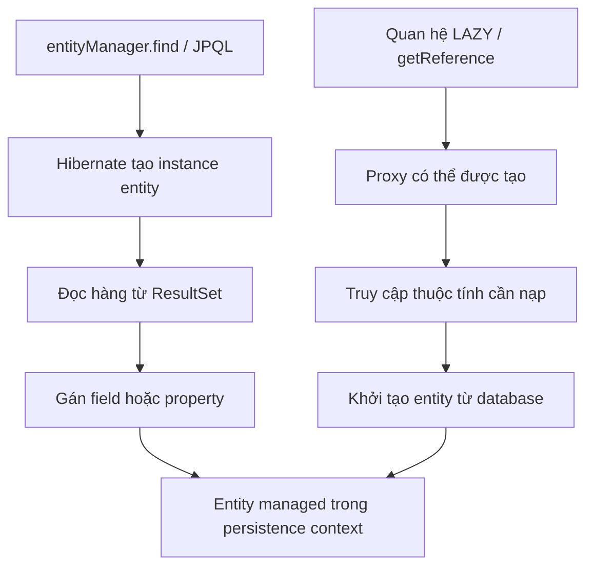
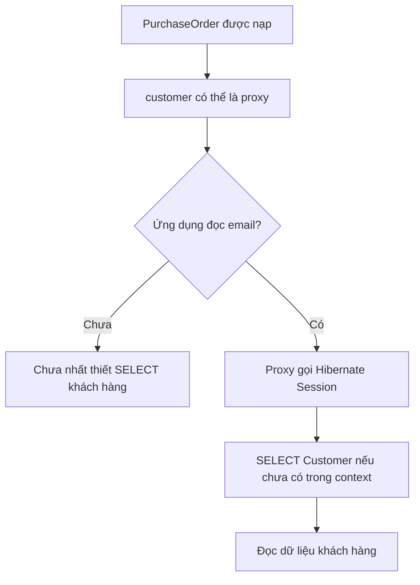

# Constructor, tính khả kiến và tác động của lớp hoặc phương thức `final` trong Hibernate ORM

## 1. Mục tiêu và bối cảnh

Khi ánh xạ một lớp Java thành entity của Hibernate, không thể chỉ nhìn vào `@Entity`, `@Id` và quan hệ giữa các bảng. **Cách khai báo constructor, mức truy cập của lớp/trường/phương thức và từ khóa `final` ảnh hưởng trực tiếp đến khả năng Hibernate tạo đối tượng, nạp dữ liệu, theo dõi thay đổi và thực hiện lazy loading.**

Bài học sử dụng Jakarta Persistence (JPA) với Hibernate ORM làm persistence provider, Java 17+ và một ứng dụng đặt hàng nhỏ gồm `Customer`, `PurchaseOrder` và `Product`. Các ví dụ dùng `jakarta.persistence.*` và phong cách Hibernate 6.x/Spring Boot 3.x, nhưng nguyên lý constructor, property/field access và proxy cũng hữu ích với các dự án Hibernate khác.

Sau bài này, bạn cần hiểu và vận dụng được:

- Vì sao một entity cần constructor không tham số; vì sao `protected` thường là lựa chọn phù hợp.
- Khi nào được giữ field `private`, không viết public setter và vẫn để Hibernate nạp/lưu dữ liệu.
- Sự khác nhau giữa **field access** và **property access**, nhất là vị trí đặt `@Id`.
- Tại sao `final class`, `final` getter hoặc `final` persistent field gây trở ngại cho Hibernate, đặc biệt với proxy và lazy loading.
- Cách bảo vệ bất biến nghiệp vụ bằng factory/method thay vì làm entity bất biến theo kiểu Java record.
- Cách nhận diện và sửa các lỗi constructor, visibility, proxy trong ứng dụng thực tế.

> Ý chính: entity là một đối tượng nghiệp vụ do **cả ứng dụng lẫn Hibernate** quản lý. Ứng dụng muốn khởi tạo object hợp lệ; Hibernate cần đường khởi tạo và cơ chế tiếp cận trạng thái của object khi đọc bản ghi từ database. Thiết kế entity tốt phải phục vụ được cả hai.

## 2. Vì sao Hibernate cần tạo entity thay cho ứng dụng?

Giả sử ứng dụng có bảng `customers`:

```sql
CREATE TABLE customers (
    id BIGINT GENERATED BY DEFAULT AS IDENTITY PRIMARY KEY,
    email VARCHAR(255) NOT NULL UNIQUE,
    full_name VARCHAR(150) NOT NULL
);
```

Khi bạn gọi:

```java
Customer customer = entityManager.find(Customer.class, 10L);
```

Hibernate cần tìm hàng trong database, **tạo một instance của `Customer`**, đưa giá trị cột vào field hoặc property, gắn object vào persistence context và trả về cho ứng dụng. Trong tình huống khác, Hibernate có thể tạo một **proxy** đại diện cho entity chưa được nạp đầy đủ, rồi truy vấn khi ứng dụng chạm tới dữ liệu cần thiết.



Chính bước **tạo instance** giải thích yêu cầu về constructor. Bước **gán dữ liệu** giải thích vì sao Hibernate cần quyền truy cập field hoặc setter. Bước **proxy** giải thích ràng buộc với `final`.

## 3. Constructor không tham số: yêu cầu cốt lõi của entity

### 3.1. Thiết kế chuẩn nên sử dụng

Một entity JPA portable phải có constructor **không tham số** với mức truy cập `public` hoặc `protected`. Hibernate có thể hỗ trợ một số trường hợp mức truy cập rộng/hẹp khác thông qua cơ chế riêng, nhưng dùng `protected` là lựa chọn cân bằng: framework có thể tạo instance, còn code nghiệp vụ thông thường không dễ gọi constructor trống từ bên ngoài.

```java
import jakarta.persistence.*;
import java.util.Objects;

@Entity
@Table(name = "customers")
public class Customer {

    @Id
    @GeneratedValue(strategy = GenerationType.IDENTITY)
    private Long id;

    @Column(nullable = false, unique = true, length = 255)
    private String email;

    @Column(name = "full_name", nullable = false, length = 150)
    private String fullName;

    protected Customer() {
        // Dành cho JPA/Hibernate.
    }

    public Customer(String email, String fullName) {
        changeEmail(email);
        changeFullName(fullName);
    }

    public Long getId() { return id; }
    public String getEmail() { return email; }
    public String getFullName() { return fullName; }

    public void changeEmail(String value) {
        if (value == null || value.isBlank()) {
            throw new IllegalArgumentException("Email không được để trống");
        }
        this.email = value.trim();
    }

    public void changeFullName(String value) {
        if (value == null || value.isBlank()) {
            throw new IllegalArgumentException("Tên không được để trống");
        }
        this.fullName = value.trim();
    }
}
```

Ở đây có hai đường tạo đối tượng khác nhau:

1. **Code ứng dụng:** `new Customer("an@example.com", "An")` chạy constructor nhận tham số, qua đó thiết lập dữ liệu cần thiết.
2. **Hibernate đọc database:** tạo instance qua constructor không tham số và phục hồi các persistent field từ hàng dữ liệu. Hibernate không bắt buộc chạy constructor nghiệp vụ có tham số.

Việc chỉ viết constructor có tham số sẽ làm Java **không còn tự sinh default constructor**. Ví dụ sau có thể biên dịch nhưng không phải một entity JPA portable hợp lệ:

```java
@Entity
public class Customer {
    @Id
    private Long id;

    private String email;

    // Không có constructor không tham số.
    public Customer(String email) {
        this.email = email;
    }
}
```

Tùy hoàn cảnh, lỗi xuất hiện khi Hibernate kiểm tra mapping hoặc khi cố tạo instance: các thông báo kiểu *no default constructor* hoặc *could not instantiate entity*. Cách sửa là thêm constructor không tham số `protected` (hoặc `public`) chứ không nên bỏ constructor nghiệp vụ.

### 3.2. Chọn mức truy cập nào cho constructor?

| Constructor không tham số | Với JPA portable | Nhận xét |
|---|---|---|
| `public Customer() {}` | Phù hợp | Framework và mọi caller đều có thể tạo object chưa đủ thông tin. |
| `protected Customer() {}` | **Khuyến nghị** | Đúng yêu cầu JPA và hạn chế việc tạo object thiếu dữ liệu từ code thông thường. |
| `Customer() {}` (package-private) | Không bảo đảm portable theo yêu cầu JPA | Hibernate có thể chấp nhận trong một số cấu hình; ảnh hưởng còn phụ thuộc proxy, module và reflection. |
| `private Customer() {}` | Không đáp ứng yêu cầu JPA portable | Một số cơ chế riêng có thể dựng object, nhưng proxy/subclass khó truy cập; tránh dùng cho entity. |
| Không khai báo constructor nào | Java tạo constructor không tham số với mức truy cập tương ứng lớp | Với `public class`, default constructor ngầm định là public; thêm constructor có tham số làm constructor này biến mất. |

**Không nên đặt logic nghiệp vụ nặng trong constructor không tham số.** Khi Hibernate gọi nó, các field như `email`, `customer`, `items` có thể chưa được nạp. Không truy vấn repository, không gọi dịch vụ, không đòi `id != null`, không phát sự kiện hoặc gửi thông báo ở đây.

### 3.3. Constructor với tham số không bị cấm

JPA không ngăn bạn thiết kế constructor nhận dữ liệu nghiệp vụ, private constructor hỗ trợ static factory hoặc overload để tạo đối tượng theo nhiều use case. Yêu cầu thiết yếu là **vẫn tồn tại một constructor không tham số phù hợp** cho provider.

Ví dụ sử dụng static factory để diễn đạt mục đích:

```java
@Entity
public class Product {
    @Id
    @GeneratedValue(strategy = GenerationType.IDENTITY)
    private Long id;

    private String sku;
    private String name;

    protected Product() {}

    private Product(String sku, String name) {
        if (sku == null || sku.isBlank()) {
            throw new IllegalArgumentException("SKU không hợp lệ");
        }
        this.sku = sku;
        this.name = Objects.requireNonNull(name);
    }

    public static Product register(String sku, String name) {
        return new Product(sku, name);
    }

    public Long getId() { return id; }
    public String getSku() { return sku; }
    public String getName() { return name; }
}
```

`Product.register("KB-01", "Bàn phím")` tạo object mới theo API nghiệp vụ; Hibernate vẫn có thể gọi `protected Product()` khi đọc bản ghi. `id` để Hibernate/database sinh ra, không truyền `id` của entity mới nếu đang dùng `@GeneratedValue`.

## 4. Constructor, nạp dữ liệu và bất biến nghiệp vụ

Một ngộ nhận thường gặp là *constructor có validate thì dữ liệu nạp từ database chắc chắn đã đi qua validate đó*. Khi đọc entity, Hibernate dùng đường khởi tạo riêng và nạp field/property; nó không bắt buộc chạy constructor nhận tham số của ứng dụng.

Điều này dẫn đến ba tầng bảo vệ khác nhau:

| Tầng | Vai trò | Ví dụ |
|---|---|---|
| Constructor/factory và business method | Ngăn code ứng dụng tạo/chỉnh trạng thái không hợp lệ. | Không cho tạo `Customer` với email trống. |
| Bean Validation hoặc kiểm tra tại service | Kiểm tra dữ liệu và yêu cầu use case trước khi lưu. | `@NotBlank`, kiểm tra định dạng, chính sách đăng ký. |
| Constraint tại database | Giữ tính toàn vẹn kể cả khi có nhiều transaction hay client khác ghi DB. | `NOT NULL`, `UNIQUE`, `CHECK`, `FOREIGN KEY`. |

Chẳng hạn `@Column(nullable = false)` giúp mô tả mapping và tạo constraint khi Hibernate sinh schema, nhưng bản thân nó **không thay thế** validation nghiệp vụ. Với email duy nhất, `UNIQUE` trong DB vẫn cần thiết ngay cả khi ứng dụng kiểm tra trùng trước khi insert, vì hai request có thể đồng thời vượt qua phép kiểm tra ở service.

Nếu cần một điều kiện phụ thuộc trạng thái đã nạp, có thể xác minh sau khi load trong service hoặc dùng lifecycle callback phù hợp. Tuy nhiên `@PostLoad` không nên tự ý gọi repository, khởi tạo quan hệ lazy hàng loạt hoặc gây side effect. Lỗi dữ liệu cũ nên được xử lý bằng migration/chiến lược làm sạch dữ liệu rõ ràng.

## 5. Tính khả kiến của class, field và method

Java phân biệt `public`, `protected`, package-private (không ghi modifier) và `private`. Các mức truy cập này có vai trò khác nhau với entity:

| Thành phần | Thiết kế thông dụng | Lý do |
|---|---|---|
| Lớp entity | `public`, không `final` | Dễ sử dụng xuyên package và cho phép Hibernate tạo proxy dạng subclass khi cần. |
| Constructor không tham số | `protected` | Phù hợp JPA và giới hạn việc tạo entity thiếu dữ liệu. |
| Persistent field | `private`, không `final` | Giữ đóng gói; Hibernate truy cập qua field access. |
| Constructor/factory nghiệp vụ | `public`/`private` tùy API | Bắt caller cung cấp thông tin hợp lệ. |
| Getter được công bố | `public`, không `final` | API đọc dữ liệu; proxy có thể intercept khi cần. |
| Setter cho mọi field | **Không bắt buộc** nếu dùng field access | Tránh cho code bất kỳ thay đổi trạng thái tùy ý. |
| Method đổi trạng thái | `public` theo use case, không `final` khi liên quan entity proxy | Thể hiện rõ hành động như `changeEmail`, `confirm`. |
| Hằng số class | `private static final` | Hợp lệ; không phải persistent instance field. |

Thông thường không cần public field và cũng không cần public setter chỉ để “cho Hibernate truy cập”. Quyết định thực tế nằm ở **chiến lược ánh xạ field access hay property access**.

Lớp entity package-private có thể được Hibernate hỗ trợ, nhưng dễ làm API, repository, proxy và module Java khó sử dụng hơn. Với tài liệu/ứng dụng hướng JPA portable, `public class` không `final` là cách an toàn và rõ ràng.

### 5.1. Vì sao `private` field vẫn làm ORM hoạt động?

Trong Java, code bên ngoài không được gọi trực tiếp `customer.email`. Nhưng ORM có thể sử dụng reflection, method handle hoặc bytecode enhancement để đọc/gán field theo mapping và quyền truy cập runtime thích hợp. Với cấu hình **field access**, Hibernate không cần caller công khai setter chỉ vì field là persistent.

Vì vậy không có mâu thuẫn giữa:

```java
@Column(nullable = false)
private String email;
```

và việc Hibernate lưu/đọc cột `email`. Mục tiêu là **đóng gói dữ liệu đối với code ứng dụng**, trong khi provider vẫn thao tác với state theo metadata mapping.

Trong dự án Java dùng JPMS (`module-info.java`), reflective access đến private member có thể cần mở package cho Hibernate, ví dụ:

```java
module com.example.shop {
    requires jakarta.persistence;
    // Các requires khác tùy dự án.
    opens com.example.shop.domain to org.hibernate.orm.core;
}
```

Ví dụ module trên chỉ minh họa ý tưởng `opens`; tên module và các `requires` cần phù hợp với phiên bản thư viện và cách đóng gói thực tế. Trong ứng dụng Spring Boot chạy classpath thông thường, bạn thường không cần tự khai báo `module-info.java`.

## 6. `FIELD` access và `PROPERTY` access: nơi annotation quyết định cách đọc/ghi

Jakarta Persistence hỗ trợ hai chiến lược truy cập state. Điều quan trọng là vị trí `@Id`/`@EmbeddedId` thường quyết định access type mặc định của một entity hierarchy nếu không cấu hình `@Access` tường minh.

### 6.1. Field access: đặt `@Id` trên field

```java
import jakarta.persistence.*;

@Entity
@Access(AccessType.FIELD)
public class Customer {
    @Id
    @GeneratedValue(strategy = GenerationType.IDENTITY)
    private Long id;

    @Column(nullable = false)
    private String email;

    protected Customer() {}

    public Customer(String email) {
        this.email = email;
    }

    public Long getId() { return id; }
    public String getEmail() { return email; }

    public void changeEmail(String email) {
        if (email == null || email.isBlank()) {
            throw new IllegalArgumentException("Email trống");
        }
        this.email = email;
    }
}
```

Hibernate đọc/gán trực tiếp các field persistent, bất kể `getEmail()` có tồn tại hay không. Việc không có `setEmail(String)` vẫn ổn. Nếu `Customer` đang **managed** trong transaction và `changeEmail()` đổi field, Hibernate có thể phát hiện thay đổi qua dirty checking và tạo `UPDATE` lúc flush/commit.

Ưu điểm thiết kế:

- State được đóng gói trong `private` field.
- Phương thức thay đổi (`changeEmail`) có thể kiểm soát bất biến thay vì tạo setter công khai hàng loạt.
- Getter có thể chỉ phục vụ giao diện đọc của ứng dụng; Hibernate không cần gọi getter để lấy persistent state theo đường property access.

Lưu ý: một field không muốn lưu cần đánh dấu `@Transient` hoặc là `transient` theo quy tắc mapping, thay vì giả định `private` sẽ khiến Hibernate bỏ qua.

### 6.2. Property access: đặt `@Id` trên getter

```java
import jakarta.persistence.*;

@Entity
@Access(AccessType.PROPERTY)
public class Product {
    private Long id;
    private String sku;

    protected Product() {}

    public Product(String sku) {
        this.sku = sku;
    }

    @Id
    @GeneratedValue(strategy = GenerationType.IDENTITY)
    public Long getId() { return id; }

    protected void setId(Long id) { this.id = id; }

    @Column(nullable = false, unique = true)
    public String getSku() { return sku; }

    protected void setSku(String sku) { this.sku = sku; }
}
```

Ở đây Hibernate ánh xạ **property** qua cặp getter/setter theo quy ước JavaBeans. Để portable, nên có accessor phù hợp và tránh `final` getter/setter persistent. `protected` setter có thể phục vụ provider mà không mở toàn bộ quyền sửa state cho caller ngoài package, nhưng quyết định mức truy cập cụ thể cần đáp ứng quy định phiên bản JPA đang dùng.

Điểm phân biệt: cùng là field `private String sku`, nhưng trong ví dụ property access, annotation `@Column` được đặt trên **getter**. Việc đặt nhầm metadata chỉ lên field trong class đang dùng property access có thể khiến mapping bị bỏ qua hoặc hành vi không như mong muốn.

### 6.3. Nếu muốn trộn hai kiểu access?

Nên khai báo `@Access(...)` **rõ ràng** tại class hoặc thuộc tính cần ngoại lệ, đặc biệt khi có entity kế thừa `@MappedSuperclass`. Không đặt `@Id` trên getter rồi vô tình để nhiều annotation mapping khác trên field mà không hiểu access type. Quy tắc xác định access giữa các class trong hierarchy có thể phức tạp, nên chọn một chiến lược chủ đạo để giảm lỗi.

| So sánh | Field access | Property access |
|---|---|---|
| Metadata thông thường | Trên field | Trên getter |
| Hibernate đọc/ghi state | Field persistent | Getter/setter property |
| Setter công khai | Không cần | Có setter thích hợp để provider ghi property; không nhất thiết public trong mọi cấu hình |
| Dễ bảo vệ state bằng business method | Có | Vẫn được, nhưng cần thiết kế setter cẩn thận |
| Rủi ro final | Persistent field `final` không portable | Persistent getter/setter `final` gây vấn đề, đặc biệt với proxy |

**Nguyên tắc:** private field + protected no-arg constructor + field access + phương thức nghiệp vụ tường minh là một mẫu thiết kế dễ kiểm soát đối với phần lớn entity thông thường.

## 7. `final class` và cơ chế proxy của Hibernate

Trong Java, lớp đánh dấu `final` **không được kế thừa**:

```java
public final class Customer {
    // Không thể khai báo: class CustomerProxy extends Customer
}
```

Proxy Hibernate truyền thống thường là **subclass** của entity, được tạo động để trì hoãn việc tải dữ liệu khi code tham chiếu tới entity khác. Chẳng hạn `PurchaseOrder` có quan hệ khách hàng:

```java
@ManyToOne(fetch = FetchType.LAZY, optional = false)
@JoinColumn(name = "customer_id", nullable = false)
private Customer customer;
```

Nếu `Customer` không `final`, Hibernate có thể dùng proxy mang thông tin định danh của khách hàng và chưa load các cột còn lại. Khi ứng dụng gọi một phương thức cần dữ liệu như `customer.getEmail()`, proxy có thể kích hoạt truy vấn SQL để nạp entity.



Nếu entity `Customer` là `final`, Hibernate không thể tạo subclass proxy theo cơ chế đó. Một số đường ORM hoặc cấu hình tăng cường bytecode có thể hỗ trợ tình huống đặc biệt, và Hibernate có thể vẫn persist/load trực tiếp một final class trong một số trường hợp. Tuy nhiên **không nên dựa vào đó nếu cần tương thích JPA và lazy loading dựa trên proxy**. Theo quy tắc thiết kế JPA portable, entity nên không `final`.

### 7.1. Ví dụ gây rắc rối

```java
import jakarta.persistence.*;

@Entity
public final class Customer {
    @Id
    private Long id;
    private String email;

    protected Customer() {}
    public String getEmail() { return email; }
}
```

Lớp trên có no-arg constructor nhưng vẫn có vấn đề: `final` ngăn Hibernate tạo subclass proxy của `Customer`. Khi `@ManyToOne(fetch = LAZY)` trỏ đến nó, chiến lược nạp dữ liệu có thể không còn đúng kỳ vọng, phải nạp sớm hoặc gây lỗi phụ thuộc mapping/provider/phiên bản. Sửa bằng cách bỏ `final` ở class:

```java
@Entity
public class Customer {
    @Id
    private Long id;
    private String email;

    protected Customer() {}
    public String getEmail() { return email; }
}
```

Không nên kết luận rằng mọi trường hợp `final entity` đều lỗi biên dịch hoặc luôn xuất hiện exception ngay khi khởi động. Java có thể biên dịch bình thường; giới hạn thường chỉ lộ ra khi provider tạo proxy, đọc quan hệ, hoặc khởi tạo mapping cụ thể.

### 7.2. `LAZY` không đồng nghĩa chắc chắn không có SELECT

`FetchType.LAZY` là yêu cầu trì hoãn tải dữ liệu theo cơ chế provider hỗ trợ, **không phải lời hứa rằng một quan hệ bất kỳ luôn chỉ dùng proxy**. Truy vấn SQL thực tế phụ thuộc kiểu quan hệ, trạng thái persistence context, mapping, enhancement và Hibernate version.

Đặc biệt với entity `final`, câu SQL có thể chạy sớm hơn dự kiến. Khi chẩn đoán, hãy xem SQL log hoặc đo Statistics và kiểm tra dữ liệu đã khởi tạo, thay vì chỉ dựa vào annotation.

## 8. `final` method: vì sao getter và nghiệp vụ có thể bị ảnh hưởng?

Một lớp không `final` vẫn có thể khai báo phương thức `final`:

```java
@Entity
public class Customer {
    @Id
    private Long id;
    private String email;

    protected Customer() {}

    public final String getEmail() {
        return email;
    }
}
```

Vì `getEmail()` là `final`, subclass proxy không thể override phương thức này để thực hiện logic khởi tạo lazy hoặc chuyển lời gọi đến entity thật theo cơ chế proxy. Với một proxy chưa được khởi tạo, gọi phương thức `final` có thể bypass interception và dẫn đến hành vi không mong muốn; trong một số cách hoạt động, field ở proxy chưa chứa giá trị được mong đợi. Không nên dùng final getter như trên đối với persistent state của entity.

### 8.1. Có phải *mọi* phương thức `final` đều bị cấm như nhau?

Cần phân biệt ba trường hợp:

| Trường hợp | Tác động |
|---|---|
| `final class` của entity | Ngăn subclass proxy, không portable theo yêu cầu thông thường của JPA. |
| `final` getter/setter của persistent property | Ngăn proxy override/intercept, đặc biệt đáng ngại khi dùng property access hoặc lazy proxy. |
| `final` method không liên quan đến persistent state | Có thể không ảnh hưởng trong một tình huống cụ thể, nhưng Hibernate không thể intercept phương thức đó nếu được gọi trên proxy. |

Thực tế nên để các **instance method mà ứng dụng có thể gọi thông qua tham chiếu entity/proxy** là non-final, trừ khi bạn hiểu rõ mapping và cơ chế Hibernate hiện tại. Một phương thức `private` vốn không được override, nên đừng dựa vào nó làm API để kích hoạt lazy loading từ proxy.

Ví dụ không nên làm:

```java
public final String customerSummary() {
    return email + " / " + fullName;
}
```

Nếu `customerSummary()` chạy trực tiếp trên một proxy chưa được khởi tạo, nó không có cơ hội được proxy override để nạp entity trước khi dùng field. Phương thức business bình thường nên là:

```java
public String customerSummary() {
    return getEmail() + " / " + getFullName();
}
```

Với thực thể dùng proxy, vẫn cần gọi trong phạm vi session/transaction hợp lệ nếu phải nạp liên kết lazy. Bỏ `final` không tự giải quyết `LazyInitializationException` sau khi persistence context đã đóng.

### 8.2. Tác động đến `equals`, `hashCode`, `toString`

Proxy có kiểu runtime khác với entity thật vì nó có thể là subclass. Bởi vậy:

- Không mặc định so sánh entity bằng `getClass()` một cách ngây thơ rồi coi proxy và entity thật là hai domain type khác nhau.
- Không cho IDE/Lombok tự sinh `equals`, `hashCode` hoặc `toString` đi xuyên các quan hệ `@OneToMany`, `@ManyToOne` vì có thể gây truy vấn lazy ngoài ý muốn, vòng lặp hoặc `StackOverflowError`.
- Nếu dùng ID sinh bởi database để xác định equality, phải tính đến entity transient có `id == null` và việc ID xuất hiện sau khi persist; cách hiện thực `equals/hashCode` cần ổn định khi entity đặt trong `Set`/`Map`.
- Không đánh dấu `equals`/`hashCode` là `final` chỉ để “đảm bảo bất biến”, vì proxy behavior và cơ chế intercept cần được cân nhắc.

Không có một `equals/hashCode` duy nhất phù hợp mọi domain model. Với entity có natural key bất biến thật sự, có thể chọn chiến lược khác với entity dùng surrogate ID. Quan trọng là test với **managed entity, detached entity và proxy**, không chỉ với object tạo bằng `new`.

## 9. `final` persistent field khác với `private` field

Hai đoạn code dưới đây có ý nghĩa rất khác nhau:

```java
private String email;       // Đóng gói nhưng có thể được Hibernate gán dữ liệu.
private final String email; // Chỉ được gán khi khởi tạo theo quy tắc Java.
```

Persistent instance field `final` **không phù hợp yêu cầu portable của entity JPA thông thường**. Hibernate cần phục hồi trạng thái từ database; nhiều cơ chế thay đổi trạng thái, dirty checking, bytecode enhancement và proxy dựa trên field có thể gán/thay đổi được. Dù một số runtime dùng reflection hoặc cơ chế đặc biệt để tác động final field, đó không phải hợp đồng thiết kế nên dựa vào.

Ví dụ dễ gây vấn đề:

```java
@Entity
public class Customer {
    @Id
    @GeneratedValue
    private Long id;

    private final String email;

    protected Customer() {
        this.email = null; // Chỉ để thỏa compiler, không giải quyết mapping.
    }

    public Customer(String email) {
        this.email = email;
    }
}
```

**Không nên dùng cách gán `null` cho final field trong no-arg constructor** để biến entity thành “immutable”. Khi Hibernate nạp dữ liệu, field đã bị ràng buộc final về mặt ngôn ngữ và có thể không được gán/hydrate đúng trên mọi môi trường. Cũng khó hỗ trợ thay đổi giá trị qua nghiệp vụ về sau.

Thiết kế thay thế:

```java
private String email; // Non-final field.

protected Customer() {}

public Customer(String email) {
    changeEmail(email);
}

public String getEmail() { return email; }

public void changeEmail(String email) {
    // Kiểm tra rồi cập nhật theo quy tắc nghiệp vụ.
    this.email = email;
}
```

Ứng dụng vẫn có **API được kiểm soát**: code ngoài class không trực tiếp gán field; chỉ các business method hợp lệ mới sửa state. `private` cung cấp đóng gói, còn `final` là ràng buộc ngôn ngữ khác hẳn và không phải lựa chọn mặc định cho persistent state.

Các hằng số tĩnh vẫn có thể là `static final`:

```java
private static final int MAX_EMAIL_LENGTH = 255;
```

Chúng không đại diện cột persistent và không cần Hibernate hydrate.

## 10. `record`, Lombok và các annotation dễ vô tình tạo `final`

### 10.1. Java record phù hợp DTO hơn entity

Java `record` có class `final`, thành phần lưu trong các field `final` và constructor theo cấu trúc component. Vì vậy một record thông thường **không đáp ứng mẫu entity JPA portable** cần no-arg constructor, persistent state có thể hydrate và khả năng proxy.

Không nên viết:

```java
@Entity
public record Customer(Long id, String email) {}
```

Hãy giữ entity là class thông thường và dùng record làm dữ liệu truyền qua tầng API/service:

```java
public record CustomerView(Long id, String email) {}

public CustomerView toView(Customer customer) {
    return new CustomerView(customer.getId(), customer.getEmail());
}
```

Hibernate/JPA ở một số phiên bản có cơ chế đặc biệt để dùng record cho **DTO projection hoặc embeddable**, nhưng đó là câu chuyện khác với entity chính có định danh, vòng đời managed và lazy proxy. Không suy ra “record dùng được cho một số mapping” đồng nghĩa “mọi record đều dùng được làm `@Entity`”.

### 10.2. Những bẫy thường gặp khi dùng Lombok

Lombok giúp giảm boilerplate nhưng cần biết annotation sẽ sinh code gì:

| Annotation | Điều cần lưu ý với entity |
|---|---|
| `@NoArgsConstructor(access = AccessLevel.PROTECTED)` | Thường phù hợp để tạo no-arg constructor cho JPA. |
| `@AllArgsConstructor` | Sinh constructor có tham số; không tự đảm bảo no-arg constructor cần thiết. |
| `@RequiredArgsConstructor` | Constructor dựa trên field `final`/`@NonNull`, không thay thế no-arg của JPA. |
| `@Value` | Thường khiến class và field thành `final`, không hợp với entity JPA/proxy thông thường. |
| `@Data` | Sinh setter, `equals`, `hashCode`, `toString`; có thể phá đóng gói, đi qua quan hệ lazy hoặc tạo vòng lặp. |
| `@Builder` | Không tự cung cấp no-arg constructor cho JPA và có thể bỏ qua invariants nếu builder mở mọi field. |
| `@NoArgsConstructor(force = true)` | Có thể ép gán giá trị mặc định cho final field, khiến invariant bị vi phạm; tránh dùng để “chữa” thiết kế persistent field final. |

Nếu dùng Lombok, một pattern thận trọng là:

```java
import lombok.AccessLevel;
import lombok.Getter;
import lombok.NoArgsConstructor;
import jakarta.persistence.*;

@Entity
@Getter
@NoArgsConstructor(access = AccessLevel.PROTECTED)
public class Customer {
    @Id
    @GeneratedValue(strategy = GenerationType.IDENTITY)
    private Long id;

    @Column(nullable = false)
    private String email;

    public Customer(String email) {
        if (email == null || email.isBlank()) {
            throw new IllegalArgumentException("Email trống");
        }
        this.email = email;
    }
}
```

Không cần tự động thêm `@Setter` lên toàn bộ class. Nếu có quan hệ hai chiều, nên cung cấp helper method cập nhật đồng thời hai phía của quan hệ thay vì cho caller sửa tùy ý collection hoặc foreign-key reference.

## 11. Ví dụ tích hợp: constructor, encapsulation và quan hệ LAZY

Thiết kế hai entity sau để thấy cách các quy tắc phối hợp trong một nghiệp vụ tạo đơn hàng. Chúng sử dụng field access, constructor không tham số `protected`, field `private` và class/method **không** `final`.

### 11.1. `Customer`

```java
package com.example.shop.domain;

import jakarta.persistence.*;

@Entity
@Table(name = "customers")
@Access(AccessType.FIELD)
public class Customer {
    @Id
    @GeneratedValue(strategy = GenerationType.IDENTITY)
    private Long id;

    @Column(nullable = false, unique = true)
    private String email;

    protected Customer() {}

    public Customer(String email) {
        if (email == null || email.isBlank()) {
            throw new IllegalArgumentException("Email không hợp lệ");
        }
        this.email = email;
    }

    public Long getId() { return id; }
    public String getEmail() { return email; }

    public void changeEmail(String value) {
        if (value == null || value.isBlank()) {
            throw new IllegalArgumentException("Email không hợp lệ");
        }
        this.email = value;
    }
}
```

### 11.2. `PurchaseOrder`

```java
package com.example.shop.domain;

import jakarta.persistence.*;
import java.time.Instant;
import java.util.Objects;

@Entity
@Table(name = "purchase_orders")
@Access(AccessType.FIELD)
public class PurchaseOrder {
    @Id
    @GeneratedValue(strategy = GenerationType.IDENTITY)
    private Long id;

    @ManyToOne(fetch = FetchType.LAZY, optional = false)
    @JoinColumn(name = "customer_id", nullable = false)
    private Customer customer;

    @Column(name = "created_at", nullable = false)
    private Instant createdAt;

    protected PurchaseOrder() {}

    private PurchaseOrder(Customer customer, Instant createdAt) {
        this.customer = Objects.requireNonNull(customer);
        this.createdAt = Objects.requireNonNull(createdAt);
    }

    public static PurchaseOrder placeFor(Customer customer, Instant createdAt) {
        return new PurchaseOrder(customer, createdAt);
    }

    public Long getId() { return id; }
    public Customer getCustomer() { return customer; }
    public Instant getCreatedAt() { return createdAt; }
}
```

Ở `PurchaseOrder`, `customer` là một persistent field `private` và quan hệ LAZY. Không cần public `setCustomer()` vì nghiệp vụ đặt đơn chọn khách ngay ở factory `placeFor`. Khi đọc đơn từ database, Hibernate có thể gán association qua field access; khi cần, nó tạo proxy cho `Customer` vì class đó không `final` và có constructor thích hợp.

### 11.3. Dùng trong service

```java
package com.example.shop.application;

import com.example.shop.domain.Customer;
import com.example.shop.domain.PurchaseOrder;
import jakarta.persistence.EntityManager;
import jakarta.persistence.PersistenceContext;
import org.springframework.stereotype.Service;
import org.springframework.transaction.annotation.Transactional;
import java.time.Instant;

@Service
public class OrderService {
    @PersistenceContext
    private EntityManager em;

    @Transactional
    public Long placeOrder(Long customerId) {
        Customer customer = em.find(Customer.class, customerId);
        if (customer == null) {
            throw new IllegalArgumentException("Khách hàng không tồn tại");
        }
        PurchaseOrder order = PurchaseOrder.placeFor(customer, Instant.now());
        em.persist(order);
        return order.getId();
    }

    @Transactional(readOnly = true)
    public String getCustomerEmailForOrder(Long orderId) {
        PurchaseOrder order = em.find(PurchaseOrder.class, orderId);
        if (order == null) {
            throw new IllegalArgumentException("Đơn hàng không tồn tại");
        }
        return order.getCustomer().getEmail();
    }
}
```

Ở phương thức đọc, việc truy cập `order.getCustomer().getEmail()` diễn ra **trong transaction**, khi persistence context vẫn hoạt động. Hibernate có thể nạp customer qua lazy proxy ở thời điểm cần đọc email. Phương thức service trả `String` đơn giản thay vì trả entity/proxy trực tiếp ra HTTP layer.

Điểm cần nhớ trong ví dụ:

- Constructor nghiệp vụ `private PurchaseOrder(Customer, Instant)` không ngăn Hibernate instantiate entity vì đã có `protected PurchaseOrder()`.
- `Customer` và `PurchaseOrder` đều không `final` để có đường proxy/subclass khi cần.
- Persistent field đều non-final; không có public setter tùy ý.
- `@Access(FIELD)` thống nhất cách Hibernate hydrate state.
- Truy cập LAZY được xử lý trong transaction service.

## 12. Kiểm chứng bằng một thực nghiệm với Hibernate

Tại môi trường học tập có database và `EntityManager`, thử theo thứ tự sau:

1. **Constructor:** tạo `Customer` qua `new Customer("an@example.com")`, persist, `flush()` và `clear()`; gọi `find()` để đọc lại. Việc đọc lại phải không phụ thuộc constructor nghiệp vụ có tham số.
2. **Field access:** không thêm setter cho ID/email; đổi email qua `changeEmail()` trên entity managed, flush/commit rồi đọc từ persistence context mới. Quan sát câu `UPDATE` do dirty checking.
3. **Lazy proxy:** tạo đơn hàng, `flush()`/`clear()`, sau đó `find(PurchaseOrder.class, orderId)` và lấy `order.getCustomer()`. Với proxy setup hỗ trợ, kiểm tra trạng thái trước/sau `getEmail()`.
4. **Final class:** ở một nhánh thực hành tách biệt, thử đánh dấu `Customer` là `final` và quan sát sự khác biệt trong lazy association hoặc proxy. Hoàn nguyên sau thử nghiệm.
5. **Final getter:** đánh dấu `getEmail()` là `final` ở nhánh thử nghiệm riêng; kiểm tra khả năng proxy intercept trên chính phiên bản Hibernate đang dùng. Hoàn nguyên sau thử nghiệm.

Đoạn kiểm tra trạng thái proxy minh họa:

```java
import org.hibernate.Hibernate;

PurchaseOrder order = em.find(PurchaseOrder.class, orderId);
Customer customerRef = order.getCustomer();

System.out.println(Hibernate.isInitialized(customerRef));
String email = customerRef.getEmail();
System.out.println(Hibernate.isInitialized(customerRef));
```

Chạy các thao tác trên **trong persistence context còn mở**, sau khi đã `clear()` để tránh dùng lại `Customer` managed từ bước setup. Kết quả `isInitialized` trước truy cập phụ thuộc provider, mapping, caching và chiến lược tải dữ liệu; mục đích là quan sát thực tế, không ép kết quả phải là `false` trong mọi hoàn cảnh.

Nếu muốn lấy proxy tường minh, có thể dùng:

```java
Customer ref = em.getReference(Customer.class, customerId);
```

`getReference` có thể trả proxy chưa nạp, hoặc hoạt động theo cơ chế khác của provider. Thời điểm kiểm tra tồn tại của entity và exception khi ID không có có thể khác nhau; không dùng `getReference` như một cách chắc chắn kiểm tra khách có tồn tại hay không. Khi cần xác thực tồn tại, dùng `find` hoặc query thích hợp.

### 12.1. Kiểm tra thông qua SQL log

Trong Spring Boot/Hibernate 6, có thể bật ở local:

```yaml
spring:
  jpa:
    open-in-view: false
    show-sql: false
    properties:
      hibernate:
        format_sql: true

logging:
  level:
    org.hibernate.SQL: DEBUG
    org.hibernate.orm.jdbc.bind: TRACE
```

Quan sát thời điểm `SELECT customers ...` xuất hiện: khi đọc đơn, khi lấy `customer` reference hay khi gọi `getEmail()`? Câu trả lời là bằng chứng cụ thể về chiến lược lazy trên mapping và phiên bản hiện tại. Chỉ bật bind logger ở môi trường phù hợp, vì nó có thể in dữ liệu người dùng.

### 12.2. Tham khảo skeleton integration test

```java
import jakarta.persistence.EntityManager;
import org.hibernate.Hibernate;
import org.junit.jupiter.api.Test;
import org.springframework.beans.factory.annotation.Autowired;
import org.springframework.boot.test.autoconfigure.orm.jpa.DataJpaTest;

import static org.assertj.core.api.Assertions.assertThat;

@DataJpaTest
class EntityConstructionTest {

    @Autowired EntityManager em;

    @Test
    void readsEntityUsingJpaConstructorAndFieldAccess() {
        Customer customer = new Customer("an@example.com");
        em.persist(customer);
        Long id = customer.getId();

        em.flush();
        em.clear();

        Customer found = em.find(Customer.class, id);
        assertThat(found.getEmail()).isEqualTo("an@example.com");
    }
}
```

Ví dụ đặt `Customer` trong package/import phù hợp với dự án. Test này minh họa constructor và field access; test proxy nên được viết riêng với entity association, cùng database/dialect mà ứng dụng sử dụng. Không suy ra hành vi của proxy chỉ từ test `find()` đơn giản.

## 13. Hibernate bytecode enhancement có thay đổi quy tắc không?

Hibernate có thể dùng **bytecode enhancement** để thêm khả năng theo dõi dirty state, quản lý một số kiểu lazy loading và cải thiện quá trình truy cập state. Điều đó có thể làm một số use case ít phụ thuộc vào proxy subclass truyền thống hơn.

Tuy vậy cần phân biệt:

1. **Yêu cầu portable của Jakarta Persistence:** constructor không tham số phù hợp; thiết kế entity tránh lớp/method/field persistent `final` theo các ràng buộc của mô hình entity.
2. **Khả năng mở rộng của Hibernate:** trong một cấu hình nhất định, Hibernate có thể hỗ trợ những mô hình không hoàn toàn portable hoặc dùng enhancement để thực hiện một số tính năng lazy theo cách khác.
3. **Hành vi được kiểm chứng của ứng dụng:** bản Hibernate, mapping, cách build enhancement, kiểu association và test thực tế quyết định kết quả.

Không nên chọn `final entity` rồi mặc định “Hibernate mới sẽ tự giải quyết bằng bytecode enhancement”. Enhancement không phải giấy phép chung để bỏ toàn bộ yêu cầu của JPA, và không làm Java cho phép subclass một final class. Nếu có nhu cầu đặc biệt, phải đọc tài liệu đúng phiên bản và kiểm thử việc nạp dữ liệu/lazy/dirty checking trên cấu hình triển khai.

## 14. Kế thừa entity và lớp cha

Khi một entity kế thừa từ `@MappedSuperclass` hoặc entity khác, constructor của lớp con có thể cần gọi constructor không tham số của lớp cha theo quy tắc Java:

```java
import jakarta.persistence.*;
import java.time.Instant;

@MappedSuperclass
public abstract class AuditedEntity {
    @Column(name = "created_at", nullable = false)
    private Instant createdAt;

    protected AuditedEntity() {}

    protected AuditedEntity(Instant createdAt) {
        this.createdAt = createdAt;
    }

    public Instant getCreatedAt() { return createdAt; }
}

@Entity
public class Invoice extends AuditedEntity {
    @Id
    @GeneratedValue(strategy = GenerationType.IDENTITY)
    private Long id;

    protected Invoice() {
        super();
    }

    public Invoice(Instant createdAt) {
        super(createdAt);
    }
}
```

`AuditedEntity` có constructor `protected` để lớp con gọi được. Nếu superclass chỉ có constructor nhận tham số mà entity không gọi `super(...)` thích hợp, code có thể lỗi ngay ở bước biên dịch Java. Nếu lớp cha `final`, Java không cho kế thừa; nếu method mà proxy cần override là `final`, ràng buộc proxy vẫn tồn tại.

Một số kiểu kế thừa JPA có thêm yêu cầu mapping khác (single-table, joined, table-per-class); nội dung này chỉ nhấn mạnh rằng **constructor và tính kế thừa Java vẫn áp dụng** khi Hibernate dựng instance.

## 15. Các lỗi phổ biến và cách sửa

| Triệu chứng | Nguyên nhân có thể | Cách sửa |
|---|---|---|
| `No default constructor for entity` hoặc lỗi instantiate | Chỉ có constructor với tham số; không có no-arg phù hợp. | Thêm `protected EntityName() {}`. |
| Entity compile nhưng Hibernate khó tạo proxy | Lớp `final`, constructor không cho subclass truy cập hoặc cấu trúc kế thừa không phù hợp. | Dùng class non-final, protected no-arg và xác nhận mapping lazy. |
| Quan hệ ghi `LAZY` nhưng xuất hiện SELECT sớm | Target entity final, getter final, provider không dùng proxy, fetch plan hoặc query đã chủ động fetch. | Xem SQL thực tế; sửa ràng buộc proxy/mapping khi cần. |
| Getter trên proxy trả kết quả sai hoặc không kích hoạt load | Method `final`/không intercept được hoặc truy cập state trực tiếp không phù hợp. | Giữ persistent getter/business method non-final, dùng session hợp lệ. |
| Dùng `@Id` trên getter nhưng annotation field không tác dụng | Trộn property access và field access thiếu `@Access`. | Chọn access strategy rõ ràng, thống nhất vị trí annotation. |
| Nghĩ rằng muốn Hibernate ghi field phải có public setter | Nhầm field access với property access. | Đặt `@Id` trên field hoặc `@Access(FIELD)`; dùng business method cập nhật. |
| Entity dùng `record` hoặc Lombok `@Value` | Class/field final, thiếu no-arg constructor, không hợp mô hình entity portable. | Dùng class thường cho entity, record cho DTO. |
| `@Builder`/`@AllArgsConstructor` làm entity không thể instantiate | Constructor không tham số bị thiếu hoặc sinh không đúng access. | Tạo `protected` no-arg, giữ factory/builder hợp lệ. |
| `@Data` khiến API chậm hoặc lặp vô hạn khi log | `toString`/equality chạm quan hệ lazy hoặc vòng tham chiếu. | Viết rõ getter, `toString` và chiến lược equality; không tự động đưa association vào. |
| `LazyInitializationException` sau khi trả entity ra controller | Proxy/collection được truy cập ngoài persistence context. | Fetch đúng dữ liệu trong service rồi trả DTO; giữ ranh giới transaction hợp lý. |
| Dữ liệu đọc từ DB không đi qua validation ở constructor nghiệp vụ | Hibernate hydrate bằng no-arg và field/property. | Kết hợp business method, Bean Validation, DB constraint và migration. |
| Private field không thể được reflection truy cập trong modular Java | Package chưa `opens` cho module ORM cần dùng. | Khai báo `opens` phù hợp với module thực tế. |

## 16. Những lựa chọn thiết kế nên ưu tiên

Với entity nghiệp vụ thông thường có lazy association, cấu trúc dưới đây là một **mẫu xuất phát** đáng tin cậy:

```java
@Entity
@Access(AccessType.FIELD)
public class ExampleEntity {                  // Không final.
    @Id
    @GeneratedValue(strategy = GenerationType.IDENTITY)
    private Long id;                         // Private, non-final.

    @Column(nullable = false)
    private String businessValue;            // Private, non-final.

    protected ExampleEntity() {}             // No-arg cho JPA.

    public ExampleEntity(String value) {     // Constructor nghiệp vụ.
        changeBusinessValue(value);
    }

    public Long getId() { return id; }       // Getter non-final.

    public String getBusinessValue() {
        return businessValue;
    }

    public void changeBusinessValue(String value) {
        if (value == null || value.isBlank()) {
            throw new IllegalArgumentException("Dữ liệu không hợp lệ");
        }
        businessValue = value;
    }
}
```

Mẫu này giải quyết đồng thời bốn yêu cầu: Hibernate có thể dựng instance, code ngoài class không sửa state tùy ý, các field được hydrate qua field access và proxy có thể override method cần thiết khi cơ chế nạp lazy yêu cầu.

Khi có trường hợp khác biệt (immutable read model, hierarchy phức tạp, bytecode enhancement, tối ưu đặc thù), nên giải thích rõ lý do và kiểm thử trên đúng provider/phiên bản, thay vì áp dụng mặc định các quy tắc thiết kế class Java thuần cho entity ORM.

## 17. Câu hỏi tự kiểm tra và bài tập cuối bài

**Câu hỏi 1.** Vì sao `new Customer(email)` chạy được nhưng `entityManager.find(Customer.class, id)` có thể lỗi nếu class chỉ có constructor đó? Hãy giải thích ai chịu trách nhiệm tạo instance ở từng trường hợp.

**Câu hỏi 2.** Có cần `public setId(Long id)` và `public setEmail(String email)` để Hibernate ghi dữ liệu không? So sánh khi `@Id` đặt trên field với khi `@Id` đặt trên getter.

**Câu hỏi 3.** Một quan hệ `@ManyToOne(fetch = FetchType.LAZY)` tham chiếu `public final class Customer`. Vì sao class này làm proxy subclass khó hoặc không thể được tạo? Những hành vi thực tế nào cần quan sát bằng SQL log?

**Câu hỏi 4.** Nếu class không `final` nhưng `getEmail()` là `final`, proxy có override được getter không? Điều gì có thể xảy ra khi ứng dụng gọi getter trước khi object được nạp?

**Câu hỏi 5.** Tại sao đổi `private final String email` thành `private String email` **không nhất thiết làm mất đóng gói**? Hãy thiết kế `changeEmail(...)` giữ ràng buộc hợp lệ.

**Bài tập thực hành:** tạo một entity `Customer` với protected no-arg constructor, private non-final fields, constructor nghiệp vụ và getter không final; tạo `PurchaseOrder` có LAZY reference đến `Customer`. Persist dữ liệu, `flush`/`clear`, nạp đơn từ DB và quan sát query khi đọc email khách. Sau đó lần lượt thử `final Customer`, `final getEmail()` trong nhánh riêng; ghi lại thời điểm SQL xuất hiện, loại proxy/giá trị được đọc và cấu hình Hibernate tương ứng. Kết thúc bằng cách khôi phục mẫu entity portable ban đầu.

**Kết quả cần đạt:** bạn giải thích được **constructor không tham số phục vụ việc Hibernate dựng entity**, **field/property visibility quyết định cách ORM truy cập state**, và **`final` có thể chặn proxy hoặc cơ chế hydrate/intercept cần thiết**. Từ đó có thể thiết kế entity vừa bảo vệ nghiệp vụ vừa tương thích với vòng đời managed, lazy loading và dirty checking của Hibernate.
