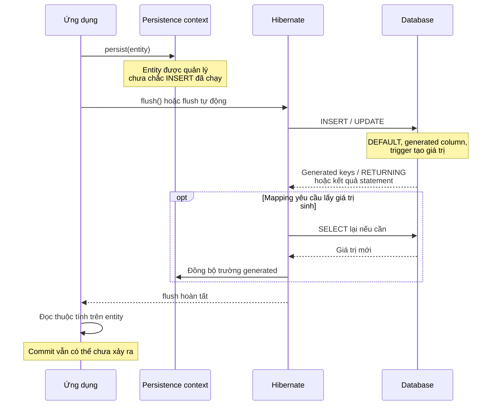

# Thuộc tính do cơ sở dữ liệu sinh và thời điểm đọc lại trong Hibernate

Trong một entity Hibernate, không phải giá trị nào cũng được ứng dụng Java tự tính rồi đưa vào câu lệnh `INSERT` hoặc `UPDATE`. Cơ sở dữ liệu có thể tự sinh **khóa định danh**, điền **giá trị mặc định**, ghi **thời điểm tạo/cập nhật**, tính **cột dẫn xuất** hoặc thay đổi trường thông qua **trigger**. Khi đó, có hai vấn đề cần giải quyết riêng:

1. **Ai tạo giá trị và vào thời điểm nào?** Java, Hibernate hay cơ sở dữ liệu tạo nó khi chuẩn bị statement, chạy `INSERT`/`UPDATE` hoặc thực thi trigger?
2. **Giá trị mới xuất hiện trong entity Java lúc nào?** Hibernate có biết cần đọc lại sau khi ghi không, hay ứng dụng phải tự `flush()` và `refresh()`?

Điểm cốt lõi: **giá trị đúng trong bảng chưa chắc đã được phản ánh ngay trong object đang nằm trong bộ nhớ**. Hibernate chỉ có thể đồng bộ giá trị do database sinh khi mapping hoặc thao tác của ứng dụng cho nó biết **trường nào cần đọc lại, sau sự kiện nào**.

Bài này đặt trong ngữ cảnh ánh xạ thực thể (`@Entity`) với Jakarta Persistence và Hibernate, dùng ví dụ Hibernate 6 trở lên. Khi áp dụng vào dự án sử dụng Hibernate đời khác, cần đối chiếu API annotation theo chính phiên bản đang chạy.

## 1. Nhận diện các loại giá trị được sinh

Các thuật ngữ dễ bị dùng lẫn nhau dù khác nguồn sinh và thời điểm có giá trị.

| Loại thuộc tính | Nơi tạo giá trị | Ví dụ | Khi nào có giá trị ở database? | Có tự xuất hiện trong entity Java không? |
|---|---|---|---|---|
| Khóa `IDENTITY` | Database khi `INSERT` | `id BIGINT GENERATED ... AS IDENTITY` | Khi câu `INSERT` được thực thi | Hibernate thường lấy khóa sinh ra để gán cho `@Id` |
| Khóa `SEQUENCE` | Database cấp giá trị từ sequence; Hibernate yêu cầu giá trị | `nextval(...)` | Giá trị sequence được cấp trước/độc lập `INSERT` | Hibernate biết ID trước khi bản ghi nhất thiết được chèn |
| `DEFAULT` | Database khi insert không truyền giá trị/cột | `created_at DEFAULT CURRENT_TIMESTAMP` | Trong quá trình `INSERT` | Chỉ khi mapping hoặc thao tác tải lại xử lý nó |
| Giá trị do trigger | Database khi trigger chạy | `updated_at` được cập nhật trong trigger | Khi trigger tương ứng được thực thi | Cần Hibernate biết trường được sinh sau insert/update hoặc refresh |
| Computed/generated column | Database tự tính theo biểu thức | `subtotal = quantity * unit_price` | Sau thao tác làm thay đổi dữ liệu nguồn, theo semantics của DB | Cần mapping read-only và cơ chế đồng bộ giá trị |
| Giá trị Hibernate sinh tại JVM | Ứng dụng/Hibernate trước SQL | `@CreationTimestamp` mặc định dùng thời gian JVM trong các phiên bản phù hợp | Có trước hoặc khi phát SQL, rồi mới ghi DB | Thường do Hibernate đặt vào entity, không phải DB default |
| Giá trị Hibernate yêu cầu DB sinh | Hibernate tổ chức việc tạo biểu thức DB | `@CreationTimestamp(source = SourceType.DB)` | Khi DB thực thi statement chứa biểu thức DB | Hibernate xử lý việc lấy lại theo cơ chế sinh giá trị được cấu hình |

**Đừng đồng nhất “giá trị do database sinh” với “mọi giá trị mà Hibernate tự đặt”.** Chẳng hạn, thời gian từ đồng hồ JVM khác nguồn với `CURRENT_TIMESTAMP` trên server database. Đây có thể là khác biệt quan trọng về múi giờ, đồng hồ lệch và thao tác ghi qua những ứng dụng khác nhau.

### 1.1. Ví dụ một bảng có nhiều cơ chế sinh

Ví dụ PostgreSQL dưới đây minh họa một đơn vị hàng trong đơn mua:

```sql
CREATE TABLE order_lines (
    id BIGINT GENERATED BY DEFAULT AS IDENTITY PRIMARY KEY,

    quantity INTEGER NOT NULL CHECK (quantity > 0),
    unit_price NUMERIC(19, 2) NOT NULL
        CHECK (unit_price >= 0),

    -- Cột dẫn xuất: ứng dụng không được ghi trực tiếp.
    subtotal NUMERIC(19, 2)
        GENERATED ALWAYS AS (quantity * unit_price) STORED,

    -- Giá trị mặc định áp dụng khi INSERT bỏ qua cột.
    created_at TIMESTAMP WITH TIME ZONE
        NOT NULL DEFAULT CURRENT_TIMESTAMP,

    updated_at TIMESTAMP WITH TIME ZONE
        NOT NULL DEFAULT CURRENT_TIMESTAMP
);
```

Cột `updated_at` hiện mới có default lúc insert; nếu muốn nó tự đổi ở mỗi lần update bất kể ứng dụng nào ghi, có thể dùng trigger PostgreSQL:

```sql
CREATE FUNCTION touch_order_line_updated_at()
RETURNS trigger
LANGUAGE plpgsql
AS $$
BEGIN
    NEW.updated_at = CURRENT_TIMESTAMP;
    RETURN NEW;
END;
$$;

CREATE TRIGGER trg_order_lines_updated_at
BEFORE UPDATE ON order_lines
FOR EACH ROW
EXECUTE FUNCTION touch_order_line_updated_at();
```

Bốn thuộc tính có nguồn sinh khác nhau: `id` từ identity, `subtotal` từ generated column, `created_at` từ default và `updated_at` từ default cộng trigger. Hibernate phải ánh xạ phù hợp để tránh ghi đè lên cột do database quản lý và biết khi nào đọc giá trị sinh ra.

Đây là ví dụ theo cú pháp PostgreSQL; cách tạo identity, stored generated column và trigger khác nhau giữa các hệ quản trị.

## 2. Phân biệt các thời điểm: persist, flush, insert, refresh, commit

Thời điểm một entity được tạo trong Java không phải lúc cơ sở dữ liệu đã có bản ghi. Một luồng điển hình:



Vài khái niệm cần phân biệt rõ:

- **`persist(entity)`**: đưa một entity mới vào persistence context. SQL insert có thể chưa xảy ra, tùy chiến lược ID và thời điểm flush.
- **`flush()`**: yêu cầu Hibernate đồng bộ những thay đổi đang chờ với database thông qua SQL. Flush không cam kết transaction.
- **`INSERT` / `UPDATE`**: database thực thi câu lệnh, áp dụng default, computed column và trigger theo semantics của engine.
- **Đọc lại giá trị sinh**: Hibernate có thể dùng kết quả trả về của câu lệnh như `RETURNING`/generated keys hoặc phát thêm `SELECT`, tùy Dialect, mapping, version và khả năng của DB.
- **`refresh(entity)`**: yêu cầu tải lại trạng thái persistent của entity từ database vào object managed, phù hợp khi cần lấy giá trị mới mà Hibernate chưa đồng bộ.
- **`commit`**: transaction được xác nhận nếu thành công. Giá trị đã được đọc sau flush vẫn có thể thuộc một transaction sẽ rollback.

**Thời điểm chắc chắn hơn để kiểm tra thuộc tính do DB sinh trong cùng transaction là sau khi SQL sinh giá trị đã thực thi và Hibernate đã đồng bộ hoặc ứng dụng đã refresh.** Không thể dựa đơn thuần vào việc vừa gọi constructor hay setter.

### 2.1. `persist` không đồng nghĩa insert đã chạy

Ví dụ:

```java
OrderLine line = new OrderLine(3, new BigDecimal("12.50"));
entityManager.persist(line);

// Chưa thể suy luận mọi trường do DB sinh đã có giá trị tại đây.
```

Nếu ID dùng `SEQUENCE`, Hibernate có thể lấy ID trước rồi trì hoãn `INSERT`. Nếu dùng `IDENTITY`, Hibernate thường cần insert sớm để biết khóa, nhưng thời điểm cụ thể còn phụ thuộc cách sử dụng transaction và phiên bản ORM. Vì vậy **không mặc định** `persist` luôn thực hiện SQL ngay, cũng không mặc định mọi `persist` đều trì hoãn SQL tới commit.

### 2.2. `flush` khác `commit`

```java
entityManager.persist(line);
entityManager.flush();

// SQL cần thiết đã được đẩy tới database.
// Tuy nhiên transaction vẫn có thể rollback.
```

Sau `flush`, giá trị do trigger/generated column tạo thường đã tồn tại trong database theo trạng thái transaction hiện tại. Nhưng object Java có cập nhật hay không còn phụ thuộc mapping generated property hoặc việc gọi `refresh()`.

Khi transaction rollback, thay đổi chưa được commit. Không nên dùng một giá trị vừa đọc sau flush để thực hiện tác động bên ngoài không thể hoàn tác mà không có thiết kế nhất quán phù hợp.

### 2.3. `find` trong cùng persistence context không đảm bảo truy vấn lại

```java
OrderLine first = entityManager.find(OrderLine.class, lineId);
OrderLine again = entityManager.find(OrderLine.class, lineId);
```

Trong cùng persistence context, Hibernate thường trả lại **cùng một managed entity** theo ID. Lời gọi `find` thứ hai không nhất thiết gửi `SELECT` mới. Do đó, nếu database vừa được thay đổi bằng native SQL hoặc một phiên khác, gọi `find` lặp lại chưa chắc làm giá trị mới xuất hiện trên object.

Khi cần đồng bộ lại trạng thái của managed entity, `refresh` là thao tác có ý nghĩa khác với `find`.

## 3. Ánh xạ đúng thuộc tính do database sinh bằng Hibernate

### 3.1. `@Generated`: khai báo trường cần đọc lại sau insert/update

Hibernate cung cấp `org.hibernate.annotations.Generated` để mô tả thuộc tính có giá trị được sinh khi câu SQL ghi tương ứng chạy. Với Hibernate 6, có thể khai báo các sự kiện bằng `org.hibernate.generator.EventType`:

```java
import org.hibernate.annotations.Generated;
import org.hibernate.generator.EventType;

// Chỉ sinh sau INSERT.
@Generated(event = EventType.INSERT)

// Sinh sau INSERT và UPDATE.
@Generated(event = { EventType.INSERT, EventType.UPDATE })
```

Với trường do database quản lý hoàn toàn, nên kết hợp mapping read-only ở phía ghi:

```java
@Generated(event = { EventType.INSERT, EventType.UPDATE })
@Column(name = "updated_at", insertable = false, updatable = false)
private Instant updatedAt;
```

Ý nghĩa:

- `insertable = false`: Hibernate không đưa giá trị thuộc tính này vào danh sách cột ghi khi insert theo mapping đó.
- `updatable = false`: Hibernate không đưa giá trị này vào câu update của entity.
- `@Generated(...)`: cho Hibernate biết cần lấy lại giá trị do DB sinh khi sự kiện đã khai báo xảy ra.

**Chỉ đặt `insertable = false, updatable = false` chưa có nghĩa Hibernate sẽ tự đọc lại sau mỗi lần ghi.** Chúng chỉ kiểm soát chiều ghi; muốn ORM chủ động cập nhật giá trị trong bộ nhớ phải dùng cơ chế sinh giá trị phù hợp hoặc `refresh()`.

Mặt khác, Hibernate không tự biết một trigger cập nhật cột nào nếu mapping không khai báo. Trigger được tạo ở database bên ngoài entity là một phần của contract giữa schema và ORM.

### 3.2. Ví dụ entity `OrderLine` với bốn giá trị do DB quản lý

Dựa trên bảng `order_lines` ở trên:

```java
import jakarta.persistence.Column;
import jakarta.persistence.Entity;
import jakarta.persistence.GeneratedValue;
import jakarta.persistence.GenerationType;
import jakarta.persistence.Id;
import jakarta.persistence.Table;
import java.math.BigDecimal;
import java.time.Instant;
import org.hibernate.annotations.Generated;
import org.hibernate.generator.EventType;

@Entity
@Table(name = "order_lines")
public class OrderLine {
    @Id
    @GeneratedValue(strategy = GenerationType.IDENTITY)
    private Long id;

    @Column(name = "quantity", nullable = false)
    private int quantity;

    @Column(name = "unit_price",
            nullable = false, precision = 19, scale = 2)
    private BigDecimal unitPrice;

    @Generated(event = {
        EventType.INSERT, EventType.UPDATE
    })
    @Column(name = "subtotal",
            insertable = false, updatable = false,
            precision = 19, scale = 2)
    private BigDecimal subtotal;

    @Generated(event = EventType.INSERT)
    @Column(name = "created_at",
            insertable = false, updatable = false)
    private Instant createdAt;

    @Generated(event = {
        EventType.INSERT, EventType.UPDATE
    })
    @Column(name = "updated_at",
            insertable = false, updatable = false)
    private Instant updatedAt;

    protected OrderLine() {
        // Constructor cho JPA/Hibernate.
    }

    public OrderLine(int quantity, BigDecimal unitPrice) {
        requireValid(quantity, unitPrice);
        this.quantity = quantity;
        this.unitPrice = unitPrice;
    }

    public void changeQuantity(int newQuantity) {
        if (newQuantity <= 0) {
            throw new IllegalArgumentException(
                    "Quantity must be positive");
        }
        this.quantity = newQuantity;
    }

    private static void requireValid(
            int quantity, BigDecimal unitPrice) {
        if (quantity <= 0 || unitPrice == null
                || unitPrice.signum() < 0) {
            throw new IllegalArgumentException(
                    "Invalid quantity or price");
        }
    }

    public Long getId() { return id; }
    public BigDecimal getSubtotal() { return subtotal; }
    public Instant getCreatedAt() { return createdAt; }
    public Instant getUpdatedAt() { return updatedAt; }
}
```

Trong entity này:

| Trường | Cơ chế database | Mapping Hibernate | Khi nào cần đồng bộ? |
|---|---|---|---|
| `id` | Identity | `@GeneratedValue(IDENTITY)` | Khi lấy khóa sau insert |
| `subtotal` | Stored generated column | `@Generated(INSERT, UPDATE)` + read-only | Sau insert và sau cập nhật `quantity/unit_price` |
| `createdAt` | `DEFAULT CURRENT_TIMESTAMP` | `@Generated(INSERT)` + read-only | Sau insert |
| `updatedAt` | Default + trigger update | `@Generated(INSERT, UPDATE)` + read-only | Sau insert và sau update |

**Ứng dụng không gán trực tiếp `subtotal`, `createdAt` và `updatedAt`.** Database có quyền tạo chúng; Hibernate đảm nhiệm việc phản ánh lại theo mapping khi SQL xảy ra.

Lưu ý việc sử dụng `Instant` với cột timestamp có timezone phải được xác nhận trên đúng DBMS/driver và chính sách timezone của hệ thống. PostgreSQL `TIMESTAMP WITH TIME ZONE` đại diện cho một thời điểm, không lưu nguyên offset do người dùng nhập; biểu diễn khi đọc có thể phụ thuộc conversion.

### 3.3. Đọc giá trị sau khi insert

Giả sử đã mở transaction và có `EntityManager`:

```java
OrderLine line = new OrderLine(
        3, new BigDecimal("12.50"));

entityManager.persist(line);
entityManager.flush();

System.out.println(line.getId());        // Khóa do identity.
System.out.println(line.getSubtotal());  // 37.50
System.out.println(line.getCreatedAt()); // Giá trị do DB sinh.
System.out.println(line.getUpdatedAt()); // Giá trị do DB sinh.
```

`flush()` bảo đảm các thao tác SQL đang chờ được thực hiện, còn `@Generated` thông báo cho Hibernate đồng bộ trường sau insert. Tùy Dialect, Hibernate có thể lấy nhiều giá trị qua dữ liệu trả về của statement hoặc bằng một truy vấn đọc lại; không nên giả định số round-trip cố định.

Trong code nghiệp vụ thông thường, transaction manager có thể flush khi cần hoặc trước commit. **Chỉ gọi `flush()` chủ động khi thật sự cần dùng ngay giá trị do database sinh trong cùng transaction**, hoặc cần quan sát lỗi constraint sớm; flush quá thường xuyên có thể phá hiệu quả batching.

### 3.4. Đọc lại sau update

```java
OrderLine line = entityManager.find(
        OrderLine.class, lineId);

line.changeQuantity(4);

entityManager.flush();

BigDecimal newSubtotal = line.getSubtotal();
Instant newUpdatedAt = line.getUpdatedAt();
```

Khi Hibernate flush, `quantity` được cập nhật; database tính lại `subtotal` và trigger gán `updated_at`. Vì hai thuộc tính được đánh dấu `@Generated` cho `UPDATE`, Hibernate có cơ sở đồng bộ lại chúng. Nếu chỉ khai báo `@Generated(event = INSERT)`, ORM không được hướng dẫn đọc lại sau update; ứng dụng có thể nhìn thấy giá trị cũ.

Một lưu ý: nếu gọi setter với **cùng giá trị hiện có**, Hibernate có thể không phát SQL `UPDATE` do dirty checking; trigger update cũng không chạy. Mọi quy tắc dựa trên “đã gọi một phương thức Java thì timestamp update luôn đổi” đều không đúng nếu thực tế không có SQL thay đổi bản ghi.

### 3.5. Nếu không khai `@Generated` thì sao?

Bạn vẫn có thể giữ các trường dưới dạng read-only rồi chủ động đồng bộ khi cần:

```java
entityManager.persist(line);
entityManager.flush();   // Bảo đảm INSERT đã chạy.
entityManager.refresh(line); // Đọc lại trạng thái từ database.
```

Cách này có thể hữu ích khi số trường được DB sinh ít, trường hợp đọc lại hiếm hoặc thao tác bằng native SQL. Tuy nhiên `refresh()` thường yêu cầu entity còn **managed** và có thể phát thêm truy vấn; với object detached phải tải/merge theo thiết kế phù hợp trước khi refresh.

Nếu một entity đang có thay đổi chưa flush, `refresh()` có thể **ghi đè trạng thái chưa được lưu trong bộ nhớ** bằng dữ liệu database. Vì vậy quy trình cần đọc ngay giá trị DB sinh thường là **flush trước, refresh sau**. Hãy cân nhắc việc flush có thể ghi cả những thay đổi đang chờ khác trong persistence context.

## 4. `@ColumnDefault`, `@DynamicInsert` và default của database

Một lỗi rất thường gặp là nghĩ rằng chỉ cần ghi:

```java
@ColumnDefault("CURRENT_TIMESTAMP")
private Instant createdAt;
```

thì khi insert, database sẽ tự đặt timestamp và Hibernate luôn đọc được nó. Thực tế có **hai bước độc lập**:

1. Database phải nhận câu insert **không cung cấp giá trị cho cột** (hoặc được yêu cầu dùng `DEFAULT` theo cú pháp phù hợp) để default có tác dụng.
2. Hibernate phải **đọc lại giá trị sinh** nếu ứng dụng cần nó ngay trong entity managed.

`@ColumnDefault` của Hibernate là metadata để hỗ trợ khai báo default ở DDL khi schema được tạo, **không tự đảm bảo** Hibernate bỏ cột khỏi mọi `INSERT` hoặc cập nhật field trong bộ nhớ sau insert. Nếu Hibernate insert rõ `NULL` vào một cột có `DEFAULT`, database thường không áp dụng default cho giá trị `NULL` đó; tùy constraint, insert có thể thất bại.

### 4.1. Phương án dành cho cột hoàn toàn do database quản lý

```java
@Generated(event = EventType.INSERT)
@Column(name = "created_at",
        insertable = false, updatable = false)
private Instant createdAt;
```

Hibernate không gửi giá trị do Java cung cấp cho cột này và có thông tin để nhận lại giá trị default sau insert. Database vẫn phải có default thật trong schema, được tạo qua migration hoặc DDL tương ứng.

### 4.2. `@DynamicInsert` cho những field nullable có default

Hibernate hỗ trợ `@DynamicInsert` để phát sinh statement chỉ chứa những cột cần insert theo trạng thái object, qua đó các cột có giá trị `null` có thể được bỏ khỏi `INSERT` và kích hoạt database default:

```java
import org.hibernate.annotations.DynamicInsert;

@Entity
@DynamicInsert
class NotificationSettings {
    // ... id, các thuộc tính khác ...
}
```

Nhưng:

- `@DynamicInsert` không thay `@Generated` hoặc `refresh()` khi cần đọc giá trị do DB sinh.
- Một trường được Java gán rõ giá trị vẫn có thể được insert, thay vì để default chạy.
- Việc tạo SQL động có chi phí và ảnh hưởng đến khả năng tái sử dụng/batching statement trong một số bối cảnh.
- Không dùng mặc định database để che giấu một thuộc tính bắt buộc nhưng ứng dụng quên cung cấp.

Nếu cột luôn do DB quản lý, dùng `insertable = false, updatable = false` và mapping generated thường rõ ý nghĩa hơn.

### 4.3. `@ColumnDefault` và migration

Khi dùng Flyway hoặc Liquibase, **schema trong database mới là nguồn quyết định default thật**. `@ColumnDefault` trong entity không tự sửa một schema production đã tồn tại nếu ứng dụng không bật schema generation. Cần migration tương ứng, ví dụ:

```sql
ALTER TABLE order_lines
ALTER COLUMN created_at
SET DEFAULT CURRENT_TIMESTAMP;
```

Tương tự, khi thay đổi biểu thức generated column hoặc trigger, phải triển khai migration tương thích với phiên bản ứng dụng và dữ liệu đang lưu.

## 5. Khóa định danh do database sinh là trường hợp đặc biệt

Thuộc tính `@Id` thường có cơ chế đồng bộ riêng khi dùng `@GeneratedValue`. Không nên coi nó giống các trường default thông thường.

### 5.1. `IDENTITY`: thường phải insert để có khóa

```java
@Id
@GeneratedValue(strategy = GenerationType.IDENTITY)
private Long id;
```

Với chiến lược identity, database sinh giá trị khi insert. Hibernate cần lấy khóa để quản lý entity và các quan hệ tham chiếu tới nó, thường bằng JDBC generated keys hoặc cơ chế DB hỗ trợ.

Vì ID phụ thuộc insert, Hibernate có thể phải phát SQL sớm và chiến lược identity có thể hạn chế một số tối ưu batching của insert. Đừng áp dụng quy tắc “ID luôn sẵn có ngay sau persist trong mọi bối cảnh” cho mọi provider, mode và tình huống. Nếu cần một thời điểm xác định để sử dụng ID trong transaction, hãy hiểu hành vi chiến lược và flush khi phù hợp.

### 5.2. `SEQUENCE`: ID có thể được lấy trước insert

```java
@Id
@GeneratedValue(
    strategy = GenerationType.SEQUENCE,
    generator = "order_line_seq")
@SequenceGenerator(
    name = "order_line_seq",
    sequenceName = "order_line_seq",
    allocationSize = 50)
private Long id;
```

Hibernate có thể lấy trước hoặc phân bổ một vùng ID dựa trên sequence/optimizer để gán vào entity **trước khi bản ghi thật sự được insert**. `allocationSize` phải được cấu hình đồng bộ với chiến lược sequence/optimizer và schema trong database theo yêu cầu của phiên bản Hibernate.

Một ID đã được cấp không chứng minh bản ghi đã commit. Sequence thường không tự rollback giá trị đã cấp, vì vậy khoảng trống ID là hiện tượng bình thường và không nên dùng ID sequence làm số thứ tự nghiệp vụ bắt buộc liên tục.

### 5.3. Không dùng ID generated để suy luận mọi trường khác đã được đọc

`id != null` chỉ nói rằng ORM đã có một định danh theo chiến lược đang dùng. Nó không chứng minh `createdAt` do default tạo hay `subtotal` do computed column đã được đồng bộ. Hãy xét từng thuộc tính theo nguồn sinh và sự kiện của nó.

## 6. Timestamp: Java time, DB time và trigger

Ứng dụng thường cần `createdAt` và `updatedAt`. Có ba thiết kế phổ biến, và nên chọn một nguồn sinh có chủ đích.

### 6.1. Ứng dụng tự cung cấp thời gian

Ứng dụng có thể gán `Instant.now()` trong domain/service hoặc JPA callback:

```java
@PrePersist
void onCreate() {
    Instant now = Instant.now();
    this.createdAt = now;
    this.updatedAt = now;
}

@PreUpdate
void onUpdate() {
    this.updatedAt = Instant.now();
}
```

Lúc này giá trị lấy từ đồng hồ JVM. Ưu điểm là object Java có timestamp trước SQL; nhược điểm là các writer khác ngoài ứng dụng không tự thực hiện cùng quy tắc, và nhiều JVM có thể chênh lệch đồng hồ. Callback chỉ chạy khi persistence lifecycle tương ứng diễn ra qua ORM; không bảo đảm chạy cho bulk update JPQL hoặc SQL trực tiếp.

### 6.2. Hibernate tạo timestamp

Hibernate cung cấp annotation chuyên biệt:

```java
import org.hibernate.annotations.CreationTimestamp;
import org.hibernate.annotations.UpdateTimestamp;
import org.hibernate.annotations.SourceType;

@CreationTimestamp
private Instant createdAt;

@UpdateTimestamp
private Instant updatedAt;
```

Ở các phiên bản Hibernate hiện đại, nguồn sinh mặc định của các annotation timestamp thường là **VM**. Nếu muốn dùng thời gian DB thay vì JVM, Hibernate cho phép chỉ định:

```java
@CreationTimestamp(source = SourceType.DB)
private Instant createdAt;

@UpdateTimestamp(source = SourceType.DB)
private Instant updatedAt;
```

Đây là **cơ chế Hibernate tổ chức việc tạo timestamp**; không tự động tương đương với một database trigger chạy trên mọi đường ghi. Nếu ứng dụng khác hoặc batch job cập nhật bảng qua SQL trực tiếp, annotation Hibernate không chạy cho thao tác đó.

Cần xem tài liệu version đang dùng và SQL thực tế để hiểu cách Hibernate dùng biểu thức DB và lấy giá trị về entity.

### 6.3. Database default + trigger

Nếu muốn mọi writer cập nhật qua database đều tuân thủ quy tắc, có thể dùng default khi insert và trigger khi update như ví dụ `order_lines`. Entity khai báo `@Generated` để Hibernate đồng bộ lại.

Mô hình này hữu ích khi có nhiều ứng dụng cùng ghi, nhưng cần quản trị trigger/migration cẩn thận. Khi dùng timestamp trong audit, phải xác định: thời điểm thực thi statement, thời điểm bắt đầu transaction hay thời điểm commit mới là ý nghĩa cần thiết? Một số hàm thời gian database trả giá trị cố định trong suốt transaction; **không nên tự giả định** `CURRENT_TIMESTAMP` luôn thay đổi ở mỗi câu update trong cùng một transaction. Trên PostgreSQL, `CURRENT_TIMESTAMP` phản ánh thời điểm bắt đầu transaction.

Nếu yêu cầu chính xác thời điểm commit, một cột `updated_at DEFAULT CURRENT_TIMESTAMP` hoặc trigger thông thường có thể **không** đủ; cần thiết kế audit/CDC hoặc cơ chế chuyên biệt phù hợp.

### 6.4. Tránh hai nguồn cùng cạnh tranh ghi một timestamp

Một mapping vừa dùng `@UpdateTimestamp`, vừa đặt `updatable = false` và dựa vào trigger DB có thể tạo semantics khó hiểu hoặc không hoạt động theo mong đợi. Hãy chọn rõ:

- **Hibernate quản lý timestamp**: sử dụng `@CreationTimestamp`/`@UpdateTimestamp` và cấu hình nguồn VM/DB thích hợp.
- **Database quản lý timestamp**: default/trigger cùng mapping read-only và `@Generated` tương ứng.
- **Application/domain quản lý timestamp**: tự tính và ghi, kèm quy tắc dùng đồng hồ nhất quán.

Sau đó kiểm chứng bằng integration tests đúng DBMS.

## 7. Cột tính toán, trigger và thuộc tính chỉ đọc

### 7.1. Generated column được database tính

Với:

```sql
subtotal NUMERIC(19, 2)
    GENERATED ALWAYS AS (quantity * unit_price) STORED
```

Database duy trì `subtotal`; ứng dụng không nên tự insert/update cột này. Trong entity, cách biểu đạt là mapping read-only ở chiều ghi và đánh dấu giá trị sinh sau insert/update:

```java
@Generated(event = {
    EventType.INSERT, EventType.UPDATE
})
@Column(
    name = "subtotal",
    insertable = false,
    updatable = false,
    precision = 19,
    scale = 2)
private BigDecimal subtotal;
```

Ở những phiên bản Hibernate hỗ trợ các annotation chuyên dụng cho generated column, cú pháp mapping có thể khác. Nhưng bản chất vẫn là: **database sở hữu biểu thức và giá trị**, còn Hibernate phải biết trường này cần đọc sau khi SQL thay đổi dữ liệu nguồn.

Phải kiểm soát migration vì việc thay đổi biểu thức computed column có thể cần sửa schema và ảnh hưởng index/query. Không lấy công thức computed column làm thay thế vô điều kiện cho quy tắc nghiệp vụ: phép tính tiền còn phụ thuộc đơn vị tiền, làm tròn và thuế theo miền nghiệp vụ.

### 7.2. Trigger do database quản lý

Trigger có thể ghi `updated_at`, chuẩn hóa mã hoặc sinh mã đối soát. Khi trigger thay đổi các trường mà Hibernate đang giữ trong entity, cần đánh dấu sự kiện thích hợp:

- Trigger chạy lúc insert: `@Generated(event = INSERT)`.
- Trigger chạy lúc update: `@Generated(event = UPDATE)`.
- Trigger có thể chạy cả hai: `@Generated(event = {INSERT, UPDATE})`.

Tên enum trong ví dụ là `EventType.INSERT` và `EventType.UPDATE`. Nếu trigger chỉ chạy trong điều kiện riêng, ORM có thể đọc lại sau những lần ghi mà trigger không đổi giá trị; đây là chi phí cần cân nhắc khi thiết kế.

Không mặc định mọi trigger đã hoàn tất ở cùng thời điểm với dữ liệu gửi về cho ORM: một số cơ chế database có trigger hoãn/deferred action hoặc sự kiện bất đồng bộ. Nếu kết quả được cập nhật sau commit hoặc bởi job khác, `@Generated` đọc ngay sau SQL sẽ không nhìn thấy giá trị cuối cùng; cần cơ chế đọc lại/nhận sự kiện thích hợp tại thời điểm sau đó.

### 7.3. Giá trị do database sinh có thể bị writer khác thay đổi

Một tiến trình ETL, stored procedure, thao tác native SQL hoặc dịch vụ khác có thể cập nhật bảng. Hibernate **không nhận thông báo tự động** rằng state trong persistence context đã cũ. Annotation `@Generated` chủ yếu gắn với những sự kiện insert/update mà Hibernate biết và thực hiện theo mapping của entity đó.

Khi thay đổi xảy ra ở ngoài vòng đời entity managed, cần chủ động làm mới state, clear context hoặc tải lại trong transaction mới phù hợp.

## 8. `refresh()`, `clear()`, `detach()`: dùng khi nào?

### 8.1. `refresh()` để lấy lại state database của entity managed

```java
OrderLine line = entityManager.find(
        OrderLine.class, lineId);

// Một thủ tục DB hoặc native update đã thay đổi bản ghi.
entityManager.refresh(line);

// line tiếp tục là managed, trạng thái được tải từ DB.
```

`refresh` là chỉ thị rõ ràng “đọc lại thực thể này”. Nó khác việc đơn thuần truy cập getter hoặc gọi lại `find` trong cùng context. Khi dùng ngoài transaction hoặc với entity detached, hành vi phụ thuộc contract và yêu cầu của provider; thực hành an toàn là dùng với managed entity trong transaction thích hợp.

**Cảnh báo về dữ liệu chưa flush:**

```java
line.changeQuantity(5);

// Nếu refresh ngay tại đây, thay đổi local có thể bị mất.
entityManager.refresh(line);
```

Nếu cần ghi thay đổi rồi đọc giá trị mà DB sinh, hãy cân nhắc:

```java
line.changeQuantity(5);

entityManager.flush();    // Gửi UPDATE.
entityManager.refresh(line); // Tải lại giá trị DB sau UPDATE.
```

Khi `@Generated` đã xử lý đúng các trường đó, có thể **không cần** thêm `refresh`; dùng nó có thể tăng số truy vấn và thay thế cả những field khác từ database.

### 8.2. `clear()` và tải lại

```java
entityManager.flush();
entityManager.clear();

OrderLine reloaded = entityManager.find(
        OrderLine.class, lineId);
```

`clear()` làm tất cả entity managed trong context trở thành detached, nên lần `find` sau có thể tải lại dữ liệu. Nhưng đây là thao tác ảnh hưởng **toàn bộ persistence context**, không riêng một object. Gọi `clear()` khi có thay đổi chưa flush có thể khiến những thay đổi đó không được lưu.

Khi chỉ một entity cần làm mới, `refresh()` thường biểu đạt ý định chính xác hơn.

### 8.3. `detach()` cho một object

`entityManager.detach(line)` tách entity khỏi context; từ đó dirty checking không còn tự áp dụng cho object này. Ứng dụng có thể `find` một managed instance khác rồi đọc state mới. Nhưng việc sửa object detached không tự đồng bộ, và việc `merge` có thể ghi đè trường nếu dùng thiếu kiểm soát.

### 8.4. Sau commit có luôn đọc được dữ liệu mới không?

Không mặc định. Tùy cách quản lý `EntityManager` và transaction, entity có thể không còn managed sau commit hoặc vẫn nằm trong một persistence context mở rộng. Getter trên object Java chỉ đọc dữ liệu trong bộ nhớ. Nếu một tác vụ phía DB hoàn tất **sau** commit, cần query/refresh tại một thời điểm phù hợp với semantics giao dịch và isolation.

Việc tạo transaction đọc mới có thể giúp nhìn thấy dữ liệu đã commit từ giao dịch khác; tuy nhiên còn phụ thuộc isolation, cache và các cơ chế đồng bộ liên quan.

## 9. Bulk update, native SQL và tình huống giá trị cũ

### 9.1. Bulk JPQL/HQL không đồng bộ mọi managed entity

Ví dụ:

```java
OrderLine line = entityManager.find(
        OrderLine.class, lineId);

entityManager.createQuery(
    "update OrderLine l " +
    "set l.quantity = :quantity " +
    "where l.id = :id")
    .setParameter("quantity", 8)
    .setParameter("id", lineId)
    .executeUpdate();

// line có thể vẫn chứa quantity và subtotal cũ.
```

Bulk update thường làm việc trực tiếp với database, bỏ qua dirty checking và đồng bộ trạng thái riêng lẻ của những managed entity đang nằm trong persistence context. Trigger/generated column ở database có thể chạy, nhưng object `line` vẫn cũ.

Tùy trường hợp, sau khi xử lý những thay đổi đang chờ, có thể dùng:

```java
entityManager.refresh(line);
```

Hoặc `clear()` rồi load lại khi xử lý số lượng lớn. Phải xem xét ảnh hưởng của bulk update tới optimistic locking/version, transaction và cache, không coi nó tương đương một vòng lặp gọi setter trên từng entity.

### 9.2. Native query hoặc JDBC ngoài Hibernate

Một câu update chạy qua `JdbcTemplate`, native SQL hoặc một hệ thống khác có thể tạo lại `updated_at` hay computed column. Hibernate không nhất thiết phát hiện những thay đổi đó trong entity managed đang cache.

Ví dụ:

```java
entityManager.createNativeQuery(
    "update order_lines set quantity = ? where id = ?")
    .setParameter(1, 7)
    .setParameter(2, lineId)
    .executeUpdate();

// Nếu cần dùng ngay trạng thái mới của line:
entityManager.refresh(line);
```

Chỉ làm như vậy khi `line` vẫn managed và thời điểm refresh phù hợp; cần xử lý những thay đổi đang chờ trước đó để tránh ghi đè hoặc mất dữ liệu.

### 9.3. External updates và database isolation

Một tiến trình khác có thể cập nhật database trong transaction độc lập. Nếu transaction hiện tại dùng isolation cho snapshot ổn định, `refresh` trong **cùng transaction** chưa chắc nhìn thấy thay đổi đã commit ở nơi khác theo kỳ vọng. Vì vậy, lựa chọn thời điểm đọc lại phải dựa trên transaction isolation, locking và tính nhất quán mà use case cần.

Ví dụ, dữ liệu phát sinh bởi job sau commit không thể bảo đảm xuất hiện ngay sau `flush` ở transaction tạo bản ghi. Khi người dùng cần trạng thái “đang xử lý” rồi “đã hoàn tất”, mô hình trạng thái và cơ chế polling/event thường rõ nghĩa hơn một lần refresh ngay lập tức.

## 10. Đọc lại thế nào để vừa đúng vừa tránh dư truy vấn?

Giả sử một entity có 3 field do DB sinh và cần chúng ngay sau insert:

- Nếu mapping được cấu hình với `@Generated` phù hợp, Hibernate có cơ sở lấy lại cả các field cần thiết sau SQL, bằng `RETURNING`/generated keys hoặc câu `SELECT` bổ sung tùy Dialect.
- Nếu ứng dụng gọi `refresh()` sau mỗi lần persist/update dù Hibernate đã đồng bộ, nó có thể tạo **truy vấn dư**.
- Nếu ứng dụng gọi `flush()` quá thường xuyên trong một vòng lặp, Hibernate có thể giảm cơ hội batching và tăng database round trips.
- Nếu chỉ cần ID, chiến lược sinh ID có thể đã cung cấp nó; không nhất thiết refresh toàn entity.
- Nếu chỉ cần các trường read-only sau commit để trả API response, có thể thiết kế thời điểm fetch riêng theo transaction, yêu cầu nhất quán và tải dữ liệu.

Ví dụ tránh flush lặp trong vòng xử lý nhiều bản ghi:

```java
for (OrderLine line : lines) {
    entityManager.persist(line);
}

// Khi thực sự cần truy cập các giá trị DB-generated:
entityManager.flush();

for (OrderLine line : lines) {
    // Với mapping @Generated phù hợp,
    // có thể đọc subtotal/createdAt tại đây.
    renderResponse(line);
}
```

Đây là nguyên tắc khái quát; hiệu năng thực tế còn phụ thuộc chiến lược ID. Nếu dùng `IDENTITY`, insert có thể phải diễn ra sớm nên khả năng batch khác với sequence. Hãy quan sát SQL và số statement thực thi thay vì suy luận chỉ từ code Java.

### 10.1. Tại sao không phải lúc nào cũng cần đọc lại?

Một số giá trị chỉ phục vụ báo cáo hoặc audit và không dùng ngay trong request tạo bản ghi. Khi đó, tải lại ở một lần đọc sau có thể phù hợp hơn việc chủ động refresh nhiều lần trong transaction ghi.

Ngược lại, nếu API phải trả mã đơn do DB cấp, subtotal computed hoặc timestamp chính xác ngay sau khi tạo, ứng dụng cần một điểm đồng bộ rõ ràng trước khi tạo response.

## 11. Kiểm thử trường do database sinh

Các cơ chế default, computed column, trigger, identity và khả năng fetch generated values phụ thuộc DBMS/Dialect. Vì vậy nên kiểm thử tích hợp trên **cùng hệ quản trị và phiên bản database** với môi trường triển khai, thay vì chỉ kiểm thử bằng H2 nếu production là PostgreSQL, Oracle hay SQL Server.

Ví dụ test dùng JPA trong một transaction đang hoạt động:

```java
OrderLine line = new OrderLine(
    2, new BigDecimal("15.25"));

entityManager.persist(line);
entityManager.flush();

assertNotNull(line.getId());
assertEquals(
    0,
    new BigDecimal("30.50")
        .compareTo(line.getSubtotal()));
assertNotNull(line.getCreatedAt());
assertNotNull(line.getUpdatedAt());

line.changeQuantity(3);
entityManager.flush();

assertEquals(
    0,
    new BigDecimal("45.75")
        .compareTo(line.getSubtotal()));
```

Đoạn trên minh họa những assertion mong muốn, không phải một class test tự chạy độc lập. Nó giả định bảng, trigger và mapping đã được chuẩn bị, và `EntityManager` được cung cấp trong transaction. Với timestamp, kiểm tra một thuộc tính là non-null thường bền vững hơn so sánh bằng tuyệt đối với `Instant.now()` của JVM.

Những tình huống bổ sung nên xem xét tùy yêu cầu:

| Tình huống | Kết quả cần quan sát |
|---|---|
| Insert không truyền `created_at` | Database gán default và entity đọc được khi cần |
| Update làm đổi `quantity` | Database tính lại `subtotal`, Hibernate đồng bộ trường |
| Update giữ nguyên `quantity` | Dirty checking có thể không phát SQL, trigger có thể không chạy |
| Update qua native SQL | Managed entity có thể cũ cho tới khi refresh/reload |
| Bulk JPQL update | State trong persistence context không tự đồng bộ đầy đủ |
| Rollback transaction sau flush | Dữ liệu database chưa được commit |
| Trigger chỉ hoạt động theo điều kiện | Đọc lại sau update có thể trả cùng giá trị cũ nếu trigger không cập nhật |
| Nhiều phiên cập nhật đồng thời | Áp dụng optimistic locking/isolation phù hợp, không chỉ refresh |
| Chuyển DBMS/driver/Dialect | Generated keys, returning, kiểu dữ liệu và timing vẫn hoạt động |

Quan trọng: **STEP 4 chỉ cung cấp tài liệu và ví dụ**, việc thiết kế test thực thi, chấm chất lượng hay refactor nội dung theo quy trình học liệu thuộc các bước sau.

## 12. Những nhầm lẫn dễ gây lỗi

### “Có DEFAULT nên object Java tự có giá trị”

Không. Default tồn tại trong schema và chạy khi DB thực thi SQL phù hợp. Giá trị không tự “đẩy” vào object đang nằm trong JVM. Mapping generated hoặc `refresh` mới quyết định khi nào object biết giá trị.

### “Dùng `@ColumnDefault` là đủ”

`@ColumnDefault` chủ yếu mô tả default cho DDL. Nó không đảm bảo insert bỏ cột, không đảm bảo schema production đã có default và không tự fetch giá trị mới. Cần xét `insertable`, `@Generated` hoặc cách tạo SQL khác.

### “Đọc getter ngay sau `persist` sẽ luôn thấy giá trị DB sinh”

Không thể khẳng định với mọi generator. `persist` không phải commit; SQL có thể chưa chạy. IDENTITY có thể insert sớm để lấy ID, SEQUENCE có thể lấy ID trước insert. Muốn dùng các trường generated ngoài ID một cách rõ ràng, tổ chức điểm flush và đồng bộ phù hợp.

### “Chỉ cần `insertable = false, updatable = false` thì giá trị luôn mới”

Hai thuộc tính này chỉ điều khiển Hibernate không ghi cột đó. Chúng không phải tín hiệu “hãy đọc lại sau mỗi update”. Khi database sinh giá trị, cần mapping generated hoặc thao tác refresh/reload.

### “Gọi lại `find` sẽ lấy bản ghi mới nhất”

Cùng persistence context, `find` thường trả về object managed đã có. Nếu DB thay đổi từ ngoài ORM, entity có thể cũ. `refresh` hoặc lifecycle của context/transaction mới mới là điểm cần xem xét.

### “`flush` đồng nghĩa commit”

`flush` gửi SQL nhưng transaction vẫn có thể rollback. Giá trị trả về sau flush không có nghĩa thay đổi đã bền vững với các reader khác.

### “`@UpdateTimestamp` giống trigger cập nhật tự động”

`@UpdateTimestamp` do Hibernate áp dụng qua các thao tác ORM phù hợp; trigger ở DB áp dụng cho các statement mà DB thực thi theo điều kiện đã khai báo, kể cả writer khác. Chúng có phạm vi khác nhau và không nên dùng chồng chéo tùy tiện.

### “Đã bật `@Generated` thì chắc chắn không có SELECT bổ sung”

Hibernate quyết định cách fetch dựa trên Dialect, JDBC capabilities và phiên bản ORM. Có thể sử dụng dữ liệu trả về từ statement hoặc một `SELECT` bổ sung. Muốn biết tác động hiệu năng, xem SQL và đo số round-trip thực tế.

### “Cứ refresh tất cả entity sau mọi lần save là an toàn”

Refresh dư tốn truy vấn, có thể ghi đè thay đổi chưa flush và tăng tải database. Nên xác định field nào được sinh sau sự kiện nào và chọn mapping/điểm đọc lại phù hợp.

### “Giá trị được trigger sinh luôn có sẵn trước commit”

Trigger đồng bộ trong statement thường hoàn tất trước khi statement trả về, nhưng các cơ chế tác vụ trì hoãn, event bất đồng bộ, queue/job sau commit có thời gian khác. Không dùng một lần refresh trong transaction đầu tiên để bảo đảm nhìn thấy giá trị mà tác vụ ngoài transaction sẽ sinh trong tương lai.

## 13. Ma trận chọn giải pháp

| Yêu cầu cụ thể | Cách ánh xạ/đọc lại gợi ý | Ghi chú |
|---|---|---|
| ID do identity column | `@Id` + `@GeneratedValue(IDENTITY)` | Hibernate quản lý cơ chế lấy khóa; không cần tự refresh chỉ để lấy ID |
| ID từ DB sequence | `@GeneratedValue(SEQUENCE)` và sequence generator | ID có thể được cấp trước insert; không chứng minh row đã commit |
| `created_at` dùng DB default | `@Generated(INSERT)` + `insertable=false, updatable=false` | Đảm bảo migration tạo default thật |
| `updated_at` do trigger insert/update | `@Generated(INSERT, UPDATE)` + read-only | Kiểm tra trigger chạy khi UPDATE thực sự được phát |
| Computed column trong DB | Read-only + `@Generated(INSERT, UPDATE)` | Tùy DB, generated column và Dialect |
| Timestamp do Hibernate sinh trong JVM | `@CreationTimestamp`/`@UpdateTimestamp` mặc định theo version | Phân biệt source VM với source DB |
| Timestamp dùng đồng hồ database qua Hibernate | Timestamp annotation với `source=SourceType.DB` | Không tương đương trigger cho mọi writer |
| DB cập nhật bởi native/bulk SQL | `flush` pending work khi cần; `refresh` hoặc clear/reload | Tránh giữ state managed đã cũ |
| Giá trị do job sinh sau commit | Query lại trong transaction/tại thời điểm phù hợp | Có thể cần event, status, polling |
| Không cần trường generated ngay lúc ghi | Đọc ở use case truy vấn sau | Tránh refresh không cần thiết |

### Quy tắc chọn nhanh

1. **Xác định ai sở hữu giá trị**: ứng dụng, Hibernate hay database.
2. **Xác định sự kiện sinh**: insert, update, cả hai hay tác vụ riêng sau commit.
3. **Xác định ai được phép ghi trường**: nếu DB sở hữu hoàn toàn, mapping theo hướng read-only.
4. **Xác định lúc cần đọc**: ngay trong transaction ghi, khi trả API response hay ở request sau.
5. **Chọn cách đồng bộ**: `@Generated` trên đúng sự kiện, cơ chế generated ID riêng, `refresh` hoặc reload theo transaction.
6. **Xác minh trên DB đích**: kiểm tra trigger/default thực, Hibernate SQL, số lần đọc lại và mức nhất quán.

## 14. Kết luận

Đối với Hibernate, **thuộc tính do cơ sở dữ liệu sinh** là bài toán của cả hai phía: database phải thực sự tạo giá trị, và persistence context phải biết khi nào lấy lại giá trị đó. Khóa `IDENTITY` và `SEQUENCE` có cơ chế riêng; các trường default, trigger và computed column thường cần khai báo generated property hoặc đọc lại có chủ đích.

Một chiến lược rõ ràng là: để database sinh những giá trị mà nó sở hữu, ánh xạ cột do DB quản lý thành read-only khi phù hợp, dùng `@Generated` đúng sự kiện `INSERT`/`UPDATE`, chỉ `flush` và `refresh` khi cần dùng kết quả ngay, đồng thời nhận thức rằng `commit`, transaction isolation và tác vụ ngoài ORM có thể làm thời điểm nhìn thấy dữ liệu khác đi.

Hiểu chính xác trình tự **Java state → SQL → database-generated value → Hibernate readback → transaction commit** giúp tránh lỗi timestamp null, subtotal cũ, ghi đè cột tính toán và những truy vấn đọc lại thừa trong ứng dụng thực tế.

### Tài liệu tham khảo để đối chiếu theo phiên bản

- [Hibernate ORM User Guide](https://docs.jboss.org/hibernate/orm/current/userguide/html_single/Hibernate_User_Guide.html) — các mục generated properties, identity/sequence generators và persistence context.
- [Hibernate ORM Javadocs](https://docs.jboss.org/hibernate/orm/current/javadocs/) — tra `org.hibernate.annotations.Generated`, `CreationTimestamp`, `UpdateTimestamp` và generator API tương ứng release.
- [Jakarta Persistence Specification](https://jakarta.ee/specifications/persistence/) — semantics của `persist`, `flush`, `refresh`, managed/detached entities và các chiến lược ID.

Khi triển khai, chọn tài liệu của **đúng Hibernate release** trong dự án vì cú pháp annotation và khả năng database/Dialect có thể thay đổi.
