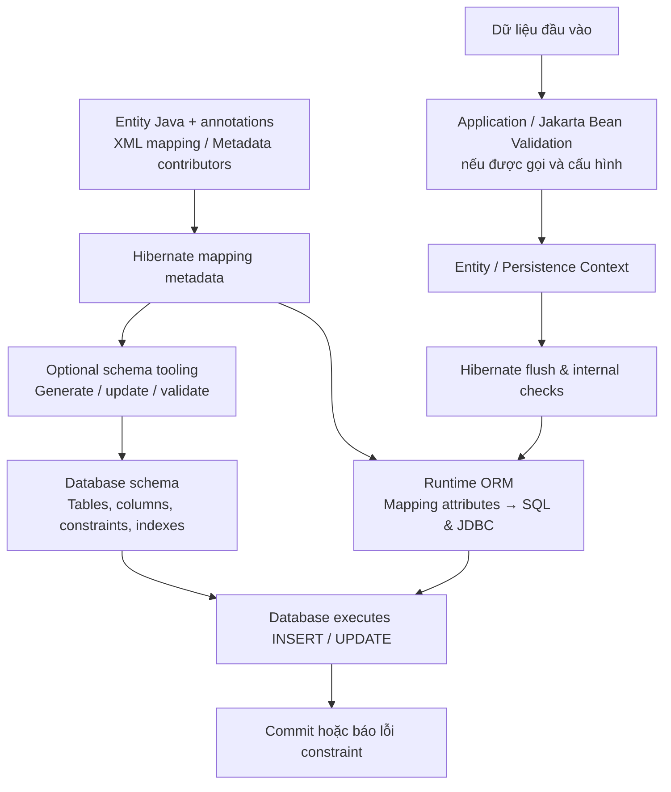
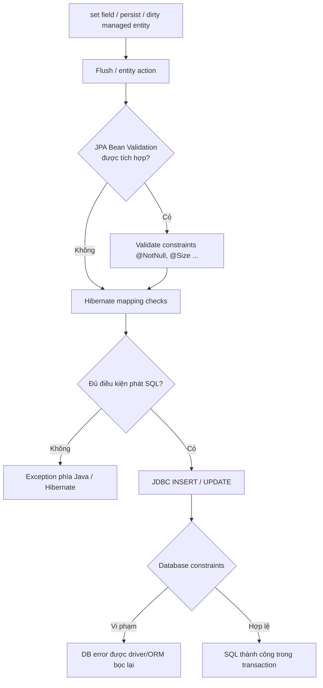
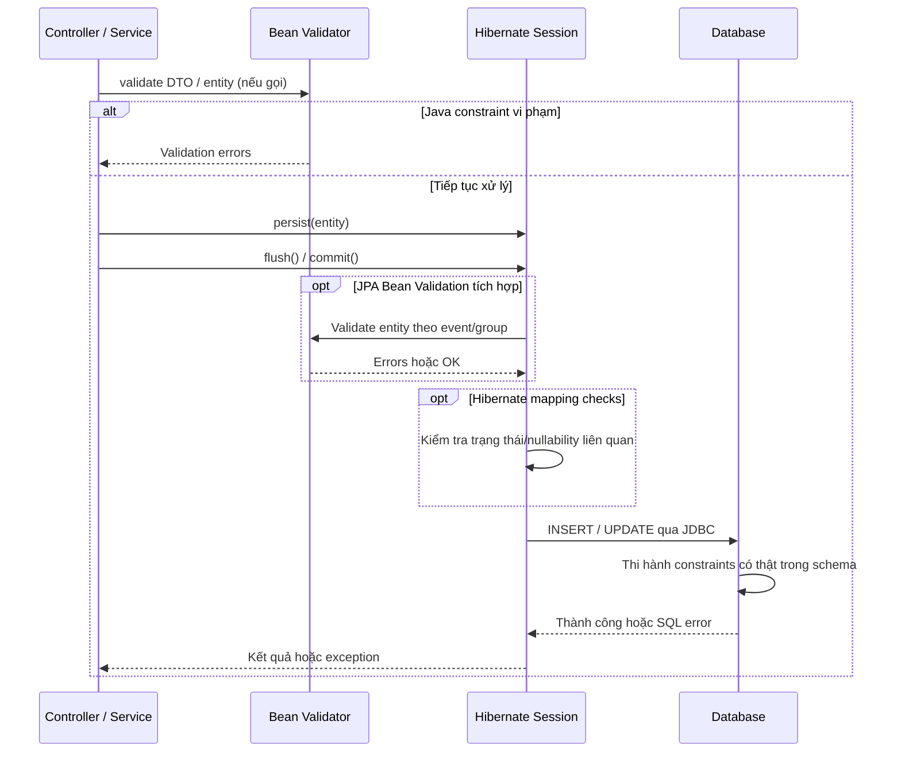

# Phân biệt metadata phục vụ sinh DDL với kiểm tra dữ liệu lúc chạy

Khi ánh xạ thực thể bằng Hibernate ORM, nhiều annotation trông như đang “kiểm tra dữ liệu”: `@Column(nullable = false)`, `@Column(length = 100)`, `@UniqueConstraint`, `@NotNull`, `@Size`, `@Check`. Tuy nhiên, **khai báo đặc điểm của cột**, **sinh cấu trúc cơ sở dữ liệu** và **kiểm tra giá trị tại thời điểm chạy** là những công việc khác nhau.

Nhầm lẫn các tầng này dễ tạo ra lỗi âm thầm: dữ liệu vẫn được lưu dù đối tượng Java không đáp ứng ràng buộc nghiệp vụ; validation báo hợp lệ nhưng `INSERT` thất bại vì trùng khóa; ứng dụng khởi động với `ddl-auto=validate` nhưng dữ liệu sai vẫn tồn tại; hoặc thay đổi annotation rồi tưởng cấu trúc database production đã tự được cập nhật.

Bài học này đặt metadata trong tổng thể kiến trúc Hibernate và phân biệt bốn nơi có thể áp dụng quy tắc:

1. **ORM mapping metadata:** mô tả entity, thuộc tính, cột, bảng, kiểu dữ liệu, khóa, association; là nguồn thông tin để Hibernate xây dựng SQL, quản lý đối tượng và *có thể* sinh DDL.
2. **Schema generation/management:** đọc mapping metadata rồi tạo, cập nhật hoặc đối chiếu cấu trúc database theo cấu hình. Kết quả là **DDL** như `CREATE TABLE`, `ALTER TABLE`, `UNIQUE`, `FOREIGN KEY`.
3. **Kiểm tra trước khi ghi dữ liệu trong ứng dụng:** Jakarta Bean Validation (nếu tích hợp), các quy tắc nghiệp vụ và một số kiểm tra nội bộ của Hibernate khi `persist`/`flush`. Đây là kiểm tra **giá trị Java**.
4. **Ràng buộc do DBMS thi hành:** khi nhận SQL `INSERT`/`UPDATE`/`DELETE`, database kiểm tra `NOT NULL`, `UNIQUE`, `CHECK`, `FOREIGN KEY` và các quy tắc khác đang **thực sự tồn tại** trong schema.

Điểm quan trọng nhất: **một annotation có thể cung cấp metadata cho một hoặc nhiều tầng, nhưng điều đó không có nghĩa annotation ấy tự đảm bảo mọi kiểm tra ở mọi thời điểm.**

## 1. Bốn tầng trong cùng một đường đi dữ liệu



Trong sơ đồ:

- Luồng **metadata → DDL** thường diễn ra lúc bootstrap/deployment hoặc qua công cụ migration. Nó chủ yếu quyết định **schema sẽ có cấu trúc nào**.
- Luồng **entity → validation → SQL → database** diễn ra khi ứng dụng xử lý dữ liệu. Nó quyết định **một giá trị cụ thể có được chấp nhận không**.
- Hibernate vẫn cần mapping metadata để chạy ORM **ngay cả khi hoàn toàn tắt sinh DDL**.
- Database thi hành những constraint **đang có trong database**, không đơn giản dựa trên annotation hiện nằm trong source code.

Ví dụ cơ bản:

```java
@Column(nullable = false, length = 80)
private String displayName;
```

Khai báo này mô tả cột không nullable và độ dài khi Hibernate tạo schema. Nếu database đã có `VARCHAR(255) NULL`, việc thêm annotation **không tự sửa cột** khi schema generation bị tắt. Và `length = 80` **không tương đương** với việc Hibernate luôn chủ động kiểm tra `displayName.length() <= 80` trước mọi câu `INSERT`.

## 2. Mapping metadata trong Hibernate là gì?

**Metadata** là mô hình Hibernate xây dựng khi khởi tạo `SessionFactory`, từ annotation Jakarta Persistence, annotation riêng của Hibernate, XML mapping và các cấu hình khác. Metadata liên kết thế giới Java với thế giới quan hệ.

Ví dụ:

```java
import jakarta.persistence.*;

@Entity
@Table(name = "customers")
public class Customer {
    @Id
    @GeneratedValue(strategy = GenerationType.IDENTITY)
    private Long id;

    @Column(name = "display_name", nullable = false, length = 120)
    private String displayName;

    @Column(name = "email", nullable = false, length = 180, unique = true)
    private String email;

    protected Customer() {}

    // Constructors, getters và setters phù hợp với ứng dụng.
}
```

Hibernate đọc được:

| Metadata | Hibernate hiểu gì? |
|---|---|
| `@Entity` | `Customer` là một entity được quản lý |
| `@Table(name = "customers")` | Entity ánh xạ tới bảng `customers` |
| `@Id` | Thuộc tính định danh |
| `@GeneratedValue` | Cơ chế sinh ID |
| `@Column(name = "display_name")` | Thuộc tính Java ánh xạ tới cột `display_name` |
| `nullable = false` | Cột được khai báo không được NULL khi tạo schema; cũng có thể tham gia kiểm tra nullability nội bộ |
| `length = 120` | Gợi ý chiều dài cột ký tự khi sinh schema |
| `unique = true` | Yêu cầu uniqueness cho cột khi Hibernate quản lý schema |

**Metadata không chỉ phục vụ DDL.** Nó còn giúp Hibernate biết cách chuyển `Customer.displayName` thành cột `display_name` trong SQL, lấy ID, thực hiện dirty checking và dựng lại đối tượng từ `ResultSet`.

Đặt `hibernate.hbm2ddl.auto=none` không làm Hibernate mất mapping. Nó chỉ tắt hành vi quản lý schema tự động qua cấu hình đó.

### Metadata được sử dụng ở nhiều giai đoạn

```text
Giai đoạn khởi tạo:
  Scan/mapping classes → Metadata → SessionFactory
                               └── Có thể chạy schema tooling

Giai đoạn request:
  Entity changes → Persistence context → SQL generated using metadata
                                      → JDBC → Database
```

Vì thế cần phân biệt **khai báo metadata** với **tác dụng phụ khi Hibernate khởi tạo** và **hành vi runtime**.

## 3. DDL là gì và Hibernate sinh DDL khi nào?

**DDL — Data Definition Language** — là các lệnh định nghĩa schema, ví dụ:

```sql
create table customers (
    id bigint generated by default as identity,
    display_name varchar(120) not null,
    email varchar(180) not null,
    primary key (id),
    unique (email)
);
```

Đây là SQL **minh họa**, không phải kết quả được Hibernate bảo đảm sinh nguyên văn. Cú pháp identity, kiểu dữ liệu, tên constraint và thứ tự lệnh phụ thuộc dialect, Hibernate version và mapping.

**DML — Data Manipulation Language** là các lệnh thao tác dữ liệu như:

```sql
insert into customers (display_name, email)
values ('Mai', 'mai@example.com');

update customers
set display_name = 'Mai Anh'
where id = 10;
```

DDL định nghĩa **quy tắc của database**; DML đưa **dữ liệu thực** vào database. DDL có thể tạo constraint, nhưng constraint chỉ được đánh giá trên dữ liệu khi lệnh DML phù hợp được thực thi.

### Cấu hình schema management

Trong Hibernate native, một cấu hình quen thuộc là:

```properties
hibernate.hbm2ddl.auto=validate
```

Trong Spring Boot, property tương ứng thường được cấu hình qua:

```properties
spring.jpa.hibernate.ddl-auto=validate
```

Các chế độ thường gặp:

| Chế độ | Ý nghĩa tổng quát | Lưu ý |
|---|---|---|
| `none` | Không yêu cầu Hibernate tự quản lý schema | Mapping vẫn hoạt động lúc runtime |
| `validate` | Kiểm tra mức tương thích schema với mapping tại thời điểm khởi tạo | **Không kiểm tra dữ liệu từng hàng** và không thay thế hệ thống migration |
| `update` | Cố gắng thay đổi một phần schema để phù hợp mapping | Không phải cơ chế migration an toàn, đầy đủ cho production |
| `create` | Tạo lại schema do Hibernate quản lý theo cấu hình | Có nguy cơ mất dữ liệu hiện hữu |
| `create-drop` | Tạo schema và dọn khi hạ tầng đóng theo lifecycle | Hợp với thử nghiệm/test có kiểm soát |

Hibernate/JPA còn có các thiết lập schema generation khác, chẳng hạn các thuộc tính `jakarta.persistence.schema-generation.*` để tạo schema vào database hoặc script. **Hiệu ứng chính xác tùy phiên bản và môi trường**, vì thế phải chọn đúng contract trong ứng dụng.

Trong production, quy trình phổ biến là dùng migration có phiên bản như Flyway/Liquibase để thay đổi schema có kiểm soát, còn Hibernate dùng mapping để truy vấn và có thể bật `validate` tại startup nhằm phát hiện một số kiểu lệch cấu trúc.

### `validate` trong `ddl-auto=validate` không phải Bean Validation

Tên “validate” ở đây dễ gây hiểu nhầm:

- **Schema validation:** Hibernate đối chiếu schema database với mapping metadata về một số đặc tính được hỗ trợ, chẳng hạn bảng/cột/kiểu. Đây là thao tác kiểm tra **cấu trúc** lúc khởi động.
- **Bean Validation:** kiểm tra **giá trị object** như tên rỗng, số âm, email sai định dạng.
- **Database constraint validation:** DBMS kiểm tra **giá trị hàng** theo constraint thực có khi thực thi SQL.

`ddl-auto=validate` không có nghĩa “toàn bộ các dòng dữ liệu trong database tuân thủ `@NotNull`, `@Size` hay mọi quy tắc nghiệp vụ”. Nó cũng không bảo đảm phát hiện mọi khác biệt về index, unique constraint, foreign key, default, check constraint hoặc biểu thức tương ứng ở mọi dialect.

## 4. Ví dụ đầy đủ: metadata DDL và validation trên cùng entity

Xét entity khách hàng với email, tên hiển thị, hạn mức tín dụng và khu vực:

```java
import jakarta.persistence.*;
import jakarta.validation.constraints.*;
import java.math.BigDecimal;

@Entity
@Table(
    name = "customers",
    uniqueConstraints = @UniqueConstraint(
        name = "uk_customer_email",
        columnNames = "email"
    )
)
public class Customer {

    @Id
    @GeneratedValue(strategy = GenerationType.IDENTITY)
    private Long id;

    @NotBlank
    @Size(min = 2, max = 120)
    @Column(name = "display_name", nullable = false, length = 120)
    private String displayName;

    @NotBlank
    @Email
    @Size(max = 180)
    @Column(name = "email", nullable = false, length = 180)
    private String email;

    @NotNull
    @DecimalMin("0.00")
    @Digits(integer = 12, fraction = 2)
    @Column(name = "credit_limit", nullable = false,
            precision = 14, scale = 2)
    private BigDecimal creditLimit;

    @NotNull
    @ManyToOne(fetch = FetchType.LAZY, optional = false)
    @JoinColumn(name = "region_id", nullable = false,
                foreignKey = @ForeignKey(name = "fk_customer_region"))
    private Region region;

    protected Customer() {}

    // Constructor nghiệp vụ, getters/setters được lược bớt.
}

@Entity
@Table(name = "regions")
class Region {
    @Id
    private Long id;

    @Column(nullable = false, length = 100)
    private String name;

    protected Region() {}
}
```

Trong ví dụ này, hai họ annotation có vai trò khác nhau:

**Jakarta Persistence/Hibernate mapping:**

- `@Table`, `@Column`, `@JoinColumn`, `@ManyToOne`, `@ForeignKey` và `@UniqueConstraint` mô tả ánh xạ quan hệ và các đặc tính schema.
- Hibernate có thể dùng chúng để tạo các cột `VARCHAR(120)`, `VARCHAR(180)`, `DECIMAL(14,2)`, foreign key, unique constraint, v.v. khi được giao tạo schema.
- Tại runtime, mapping cũng giúp Hibernate sinh SQL và bind kiểu dữ liệu.

**Jakarta Bean Validation:**

- `@NotBlank`: chuỗi phải khác null và có ít nhất một ký tự không phải whitespace.
- `@Size(min = 2, max = 120)`: giới hạn độ dài chuỗi Java; riêng `@Size` không tự yêu cầu non-null.
- `@Email`: kiểm tra định dạng email theo validator provider và contract annotation; không xác minh hộp thư tồn tại.
- `@NotNull`: không chấp nhận giá trị Java `null`.
- `@DecimalMin("0.00")`: hạn mức không nhỏ hơn 0.
- `@Digits(integer = 12, fraction = 2)`: kiểm tra số chữ số nguyên và thập phân của giá trị Java.
- Chúng có tác dụng khi Bean Validation được **thực thi**: ví dụ gọi `Validator.validate(...)`, validation tại web boundary hoặc Hibernate tích hợp Bean Validation vào lifecycle của entity.

### DDL minh họa cho mapping trên

Với schema tương tự PostgreSQL, ta có thể hình dung:

```sql
create table regions (
    id bigint primary key,
    name varchar(100) not null
);

create table customers (
    id bigint generated by default as identity primary key,
    display_name varchar(120) not null,
    email varchar(180) not null,
    credit_limit numeric(14,2) not null,
    region_id bigint not null,

    constraint uk_customer_email unique (email),
    constraint fk_customer_region
        foreign key (region_id) references regions(id)
);
```

Đây **chỉ là DDL tham khảo**. Tùy Hibernate Validator được tích hợp và cấu hình schema generation, một số constraint Bean Validation có thể cung cấp thêm metadata cho schema. Dù vậy, **không nên dựa vào sự lan truyền này như một cam kết portable giữa mọi provider/dialect/phiên bản**. Nếu cần quy tắc bắt buộc tại database, hãy thiết kế constraint và migration tường minh.

Điều đặc biệt đáng chú ý: DDL trên **chưa có** `CHECK (credit_limit >= 0)` hoặc rule phát hiện email sai định dạng chỉ vì Java có `@DecimalMin` và `@Email`. Database sẽ chấp nhận số âm nếu không có CHECK thích hợp và không có tầng ứng dụng từ chối, trừ khi DBMS/schema còn quy tắc khác.

## 5. `@Column(nullable = false)` khác `@NotNull` như thế nào?

Đây là cặp dễ nhầm lẫn nhất.

```java
@Column(nullable = false)
private String code;
```

`nullable = false` là **mapping hint** nói rằng cột không nullable. Trong chế độ sinh schema, Hibernate thường sinh `NOT NULL` tương ứng. Khi flush, Hibernate cũng có cơ chế kiểm tra nullability nội bộ dựa trên một số metadata mapping, nên **không được khẳng định nó tuyệt đối không kiểm tra tại Java**. Nhưng đây không phải Jakarta Bean Validation: exception, thời điểm và phạm vi kiểm tra khác nhau, và hành vi có thể phụ thuộc cấu hình.

```java
@NotNull
private String code;
```

`@NotNull` là **Bean Validation constraint**. Khi Bean Validation được gọi, nó phát hiện Java value `null` ngay cả khi chưa cần chạy SQL. Nó không kiểm tra chuỗi `""` hay chuỗi chỉ gồm khoảng trắng. Một số tích hợp Hibernate Validator có thể đưa ảnh hưởng của `@NotNull` vào sinh DDL, nhưng **không nên xem đó là điều đương nhiên trong mọi hệ thống**.

Vì vậy, khi vừa cần ý nghĩa ở schema vừa cần phản hồi validation gần tầng Java, có thể khai báo cả hai:

```java
@NotNull
@Column(nullable = false)
private String code;
```

Điều này hơi lặp nhưng có chủ đích: một ràng buộc dành cho validation API, một ràng buộc mô tả schema/mapping. Ở tầng database, constraint `NOT NULL` thực sự tồn tại vẫn là lớp bảo vệ cuối cùng cho dữ liệu ghi từ mọi client.

### So sánh hành vi thường gặp

| Tình huống | `@Column(nullable = false)` | `@NotNull` |
|---|---|---|
| Hibernate sinh DDL | Có thể sinh cột `NOT NULL` | Có thể tác động khi tích hợp Bean Validation với DDL, tùy cấu hình |
| Gọi `Validator.validate(entity)` | Không phải Bean Validation constraint | Có kiểm tra |
| Hibernate tự kiểm tra lúc flush | Có thể được kiểm tra bằng internal nullability check | Có thể được kiểm tra qua Bean Validation callbacks |
| Dùng JDBC thuần ghi vào cùng bảng | Java mapping không được JDBC biết đến | Validator không tự chạy |
| DBMS đã có `NOT NULL` | DB chặn NULL dù ứng dụng nào gửi | Không phụ thuộc `@NotNull` trong Java |
| Database schema vẫn cho NULL | Annotation Java không tự thay đổi schema khi DDL bị tắt | Không tự sửa schema nếu không chạy cơ chế schema/migration |

### Có những cấu hình ảnh hưởng hành vi

Hibernate có tùy chọn liên quan đến kiểm tra nullability nội bộ, thường được biết tới là `hibernate.check_nullability`. Mặc định và tương tác với Bean Validation có thể khác theo phiên bản/tích hợp. Ngoài ra, `jakarta.persistence.validation.mode` quy định chế độ tích hợp Bean Validation của persistence provider.

Vì vậy, trong một ứng dụng cụ thể có thể gặp:

- **Jakarta `ConstraintViolationException`**: giá trị `null` bị `@NotNull` phát hiện trong Bean Validation.
- **Hibernate `PropertyValueException`**: Hibernate phát hiện property không được null theo metadata/mapping.
- **Lỗi constraint từ database**: giá trị NULL đi tới SQL nhưng cột thực có `NOT NULL`.

Ba đường lỗi đều có thể liên quan tới một lỗi đầu vào nhưng là **những cơ chế khác nhau**. Không nên dự đoán chắc loại exception sẽ xảy ra trước nếu chưa biết runtime configuration.

## 6. `@Column(length = ...)` khác `@Size(max = ...)`

```java
@Size(max = 50)
@Column(length = 50)
private String title;
```

- `@Column(length = 50)` mô tả chiều dài cột ký tự cho schema generation, thường được chuyển thành kiểu như `VARCHAR(50)` nếu dialect cho phép.
- `@Size(max = 50)` là ràng buộc Bean Validation đối với độ dài của đối tượng phù hợp, ví dụ chuỗi. Nó được kiểm tra khi validator chạy.
- Database có thể từ chối chuỗi dài hơn giới hạn kiểu cột khi thực thi SQL; một số DBMS, type và cấu hình lại có hành vi cắt chuỗi, cảnh báo hoặc xử lý khác. Cần hiểu đúng DBMS đang dùng.

Nếu chỉ có:

```java
@Column(length = 50)
private String title;
```

thì code Java thường **không tự có một quy tắc ứng dụng hoàn chỉnh** cho lỗi “tiêu đề quá dài”. Nếu schema hiện hữu có cột khác với metadata hoặc DBMS cho phép giá trị vượt giới hạn mong đợi, ứng dụng có thể không nhận được hành vi như tác giả tưởng.

Nếu chỉ có:

```java
@Size(max = 50)
private String title;
```

thì validator có thể từ chối chuỗi Java dài quá 50, nhưng một lệnh JDBC thuần, một service khác hoặc một truy vấn bulk bypass callback có thể gửi chuỗi dài hơn tới DB. Chỉ constraint/type của schema thực mới bảo vệ mọi đường ghi.

### Một chi tiết dễ bị bỏ quên: NULL

`@Size(min = 1)` thường coi giá trị `null` là **hợp lệ** theo contract Bean Validation. Nếu bắt buộc có chuỗi và độ dài tối thiểu, cần kết hợp với `@NotNull` hoặc `@NotBlank` theo ngữ nghĩa mong muốn.

```java
@NotBlank
@Size(min = 2, max = 50)
@Column(nullable = false, length = 50)
private String title;
```

Trong ví dụ trên:

- `@NotBlank` loại `null`, chuỗi rỗng và chuỗi chỉ toàn whitespace.
- `@Size` kiểm tra độ dài; nó không tự làm `trim()`.
- `nullable = false` hỗ trợ schema `NOT NULL`.
- `length = 50` hỗ trợ schema độ dài tối đa.
- Muốn database cấm **chuỗi rỗng** hoặc chuỗi toàn khoảng trắng, cần một `CHECK` hoặc cơ chế database phù hợp; `NOT NULL` đơn thuần không đủ.

## 7. Precision, scale và kiểm tra giá trị số

Với số thập phân:

```java
@NotNull
@DecimalMin("0.00")
@Digits(integer = 10, fraction = 2)
@Column(nullable = false, precision = 12, scale = 2)
private BigDecimal amount;
```

`precision = 12, scale = 2` phục vụ mapping kiểu số và sinh SQL type như `DECIMAL(12, 2)` hoặc `NUMERIC(12, 2)` tùy dialect. Nó nói về **dạng dữ liệu quan hệ** và vùng giá trị được DBMS cho phép.

`@DecimalMin("0.00")` và `@Digits(integer = 10, fraction = 2)` kiểm tra **giá trị Java** khi Bean Validation được thực thi. Database type có precision/scale không tự đảm bảo `amount >= 0`. Ngược lại, Bean Validation không làm thay đổi cách một database không cùng schema lưu hoặc làm tròn số.

Ví dụ:

| Giá trị | `@DecimalMin("0.00")` | `@Digits(integer=10,fraction=2)` | `DECIMAL(12,2)` |
|---|---|---|---|
| `123.45` | Đạt | Đạt | Có thể lưu |
| `-1.00` | **Không đạt** | Đạt | Có thể lưu nếu thiếu `CHECK` |
| `12.345` | Đạt | **Không đạt** do 3 chữ số thập phân | DB có thể làm tròn hoặc báo lỗi tùy hệ |
| `null` | Có thể được coi hợp lệ bởi riêng `@DecimalMin` | Có thể được coi hợp lệ bởi riêng `@Digits` | Bị DB chặn nếu cột `NOT NULL` |

Không nên dùng kiểu `double` hoặc `float` cho số tiền nếu cần độ chính xác thập phân; `BigDecimal` kết hợp quy tắc nghiệp vụ và kiểu database phù hợp thường là lựa chọn rõ ràng hơn.

### Quy tắc “số phải dương” cần được bảo vệ ở đâu?

Nếu domain tuyệt đối không cho phép âm, có thể dùng:

```java
@DecimalMin("0.00")
private BigDecimal amount;
```

để tạo lỗi validation sớm, và một constraint ở database:

```sql
alter table invoices
add constraint chk_invoice_amount_nonnegative
check (amount >= 0);
```

Tại DB, `CHECK (amount >= 0)` đơn thuần có thể không loại `NULL` vì SQL dùng logic ba giá trị; cần thêm `NOT NULL` nếu giá trị bắt buộc.

## 8. Unique constraint: vì sao không thể chỉ “validate trước”?

Một địa chỉ email phải duy nhất toàn hệ thống thường được ánh xạ:

```java
@Entity
@Table(
    name = "customers",
    uniqueConstraints = @UniqueConstraint(
        name = "uk_customers_email",
        columnNames = "email"
    )
)
class Customer {
    // ...
}
```

Metadata này yêu cầu Hibernate tạo unique constraint khi Hibernate phụ trách sinh schema. Nó **không đồng nghĩa** có một Java validator tự truy vấn database trước mỗi lệnh `persist()` để kiểm tra email đã tồn tại chưa.

Ngay cả khi lập trình viên viết thêm:

```java
if (customerRepository.existsByEmail(email)) {
    throw new DuplicateEmailException(email);
}
customerRepository.save(customer);
```

vẫn có race condition:

```text
Transaction A                  Transaction B
-------------                  -------------
existsByEmail(x) → false
                               existsByEmail(x) → false
INSERT email=x
                               INSERT email=x
COMMIT                         COMMIT?
                               → một giao dịch có thể bị DB chặn
```

Nếu database có unique constraint đúng, nó có thể bảo vệ tính duy nhất khi hai transaction tranh chấp. **Kiểm tra trước để đưa thông báo thân thiện chỉ là bổ sung**, không thay thế unique constraint.

Tuy nhiên uniqueness của `NULL`, case sensitivity, collation, whitespace và cách index/constraint xử lý giá trị thường phụ thuộc DBMS. Ví dụ “EMAIL@example.com” và “email@example.com” có bị coi là trùng hay không không thể xác định chỉ từ `@UniqueConstraint`. Cần chuẩn hóa dữ liệu và thiết kế unique index/collation theo luật nghiệp vụ.

### Composite unique constraint

Nếu mỗi cửa hàng không được có hai sản phẩm cùng SKU nhưng hai cửa hàng khác nhau có thể dùng chung SKU:

```java
@Table(
    name = "products",
    uniqueConstraints = @UniqueConstraint(
        name = "uk_products_store_sku",
        columnNames = {"store_id", "sku"}
    )
)
```

Cần uniqueness theo **cặp** (`store_id`, `sku`), thay vì đánh dấu `sku` là unique toàn bảng. DB schema phải có constraint tương ứng. Hibernate không tự biến một validator trên object thành bảo vệ được concurrent inserts.

## 9. Foreign key và association mapping

Xét quan hệ nhiều-một:

```java
@ManyToOne(fetch = FetchType.LAZY, optional = false)
@JoinColumn(
    name = "region_id",
    nullable = false,
    foreignKey = @ForeignKey(name = "fk_customer_region")
)
private Region region;
```

Có ba ý nghĩa cần tách:

- **`@ManyToOne`** cho Hibernate biết đây là quan hệ tới entity `Region`. Nó phục vụ ORM SQL generation, entity loading và association management.
- **`optional = false`** cho biết association không được xem là tùy chọn trong mapping; có thể ảnh hưởng kiểm tra, join hoặc xử lý liên quan.
- **`@JoinColumn(nullable = false)`** và `@ForeignKey` định hướng column/foreign-key schema khi DDL được sinh.

Muốn giá trị Java `region` không null theo Bean Validation, thêm:

```java
@NotNull
private Region region;
```

**Tuy vậy, `@NotNull` không xác minh rằng `region.id` thực sự tham chiếu đến một hàng còn tồn tại ở database.** Database foreign key mới là lớp bảo vệ quan hệ đó ở phạm vi mọi đường ghi. Hibernate có thể tự phát hiện hoặc ném lỗi liên quan transient association trong một số thao tác, nhưng đó không thay thế integrity constraint của DB.

### `@Valid` không phải JPA cascade

Ví dụ:

```java
@Valid
@OneToMany(mappedBy = "order", cascade = CascadeType.ALL)
private List<OrderLine> lines;
```

- **`@Valid`** là Bean Validation cascading: khi validate order, validator có thể đi vào từng `OrderLine` để kiểm tra constraints của chúng.
- **`cascade = CascadeType.ALL`** là JPA state-transition cascading: persist/merge/remove/refresh/detach được truyền tới entity con theo các quy tắc tương ứng.
- Hai loại cascade **độc lập về ý nghĩa**. Có thể cần cả hai, một trong hai, hoặc không cái nào.

Với collection, database foreign keys, join table và các constraint khác phải được thiết kế đúng để bảo vệ dữ liệu khi ORM không tham gia (ví dụ import CSV trực tiếp).

## 10. `@Check`, `@ColumnDefault` và index: ví dụ metadata nghiêng về schema

Hibernate có annotation riêng giúp mô tả những đặc tính schema không phải quy tắc Bean Validation:

```java
import org.hibernate.annotations.Check;
import org.hibernate.annotations.ColumnDefault;

@Entity
@Table(
    name = "inventory_items",
    indexes = @Index(name = "idx_item_status", columnList = "status")
)
@Check(constraints = "quantity >= 0")
class InventoryItem {
    @Id
    private Long id;

    @Column(nullable = false)
    private int quantity;

    @ColumnDefault("'ACTIVE'")
    @Column(length = 20)
    private String status;
}
```

Giải thích:

| Metadata | Mục đích chính |
|---|---|
| `@Check(constraints = "...")` | Mô tả biểu thức CHECK để Hibernate đưa vào DDL khi được hỗ trợ |
| `@ColumnDefault("'ACTIVE'")` | Mô tả giá trị mặc định của cột cho DDL |
| `@Index(...)` | Mô tả index trong schema |
| `@Column(nullable = false)` | Mô tả khả năng chứa NULL ở cột |
| `@Column(length = 20)` | Mô tả chiều dài cột ký tự |

**Không có annotation nào trong bảng trên tự biến thành một lời gọi `Validator.validate(entity)`.**

Một số hệ quả:

- `@Check` làm phát sinh **database CHECK** khi schema được tạo đúng; nó không tự gọi Java expression checker trước mỗi `persist()`.
- `@ColumnDefault` định nghĩa giá trị default **ở database** nếu DDL áp dụng. Khi Hibernate gửi cột với giá trị `NULL` một cách tường minh, DB default thường không được áp dụng; DB default thường hoạt động khi cột bị **bỏ khỏi INSERT** hoặc dùng cú pháp `DEFAULT`. Nếu cần DB default hoạt động với ORM, phải hiểu cơ chế generated values hoặc `@DynamicInsert` và mapping tương ứng.
- `@Index` tối ưu cách database tìm dữ liệu trong những tình huống phù hợp; index thông thường không kiểm tra giá trị hợp lệ. Unique index/constraint là trường hợp khác.
- Với kiểu primitive `int quantity`, đối tượng Java không thể mang `null`, nhưng vẫn có thể mang giá trị `-3`. DB check `quantity >= 0` chỉ có tác dụng nếu constraint thực sự tồn tại.

Ví dụ khi cần rule runtime rõ ràng:

```java
@Min(0)
@Column(nullable = false)
private int quantity;
```

Và database CHECK cần được quản lý bằng migration/sơ đồ schema, nhằm bảo vệ mọi ứng dụng ghi dữ liệu.

## 11. Chú ý: Hibernate Validator có thể tham gia sinh DDL

Ranh giới giữa annotation “schema” và annotation “validation” không hoàn toàn là hai danh sách annotation tuyệt đối. Khi **Hibernate Validator** được tích hợp với Hibernate ORM, một số Bean Validation constraints có thể được chuyển thành gợi ý/ràng buộc cho schema generation.

Ví dụ trong một môi trường được hỗ trợ, `@NotNull` có thể ảnh hưởng tính `NOT NULL` của cột khi Hibernate tạo schema; các constraint khác có thể có ảnh hưởng nhất định tùy phiên bản, provider, dialect và cấu hình.

Có cấu hình Hibernate Validator liên quan:

```properties
hibernate.validator.apply_to_ddl=false
```

Thuộc tính trên được dùng trong các môi trường Hibernate Validator hỗ trợ để không áp dụng Bean Validation constraints vào DDL tự động. Nó **không phải** công tắc tổng quát tắt mọi Bean Validation lúc runtime. Với hệ thống thực tế, cần kiểm tra tên và mức hỗ trợ theo phiên bản Hibernate ORM/Validator đang dùng.

**Quy tắc nên nhớ:** Nếu một constraint là bất biến dữ liệu quan trọng tại DB, hãy quản lý nó tường minh trong migration. Không dựa vào việc provider “có thể suy ra” từ annotation validation, đặc biệt khi production tắt Hibernate DDL generation.

### Ví dụ về hai luồng phát sinh khác nhau

```java
@NotNull
@Size(max = 64)
@Column(name = "username", length = 64)
private String username;
```

Một dự án dùng Hibernate Validator + schema generation có thể tạo ra schema chịu ảnh hưởng từ các annotation validation. Nhưng ở một dự án khác, DBA đã tạo `username VARCHAR(255) NULL` và Hibernate không được quyền sửa schema; `@NotNull` và `@Size` vẫn có thể chạy khi ứng dụng gọi validation, trong khi DB cũ vẫn có thể chứa NULL hoặc chuỗi dài hơn 64 do client khác ghi vào.

Điều này không mâu thuẫn: **mapping, validation runtime và schema thực đang ở những trạng thái khác nhau**.

## 12. Jakarta Bean Validation chạy ở đâu?

Hibernate ORM không phải Jakarta Bean Validation provider. **Hibernate Validator** là một implementation phổ biến của Jakarta Bean Validation. Tích hợp thực tế cần API và provider phù hợp trên classpath, cộng với cấu hình đúng.

Các con đường phổ biến:

1. **Validation tường minh:** Code tạo `Validator` rồi gọi `validate(object)`.
2. **Validation tại API boundary:** Framework như Spring MVC kiểm tra request object khi có `@Valid`/`@Validated` đúng chỗ.
3. **JPA lifecycle validation:** Persistence provider phối hợp với Bean Validation provider để kiểm tra entity ở các event phù hợp, ví dụ trước persist/update theo cấu hình.

Không nên mặc định ba đường này lúc nào cũng bật hoặc cùng kiểm tra một tập constraints. Chúng có ranh giới khác nhau.

### 12.1. Validation tường minh

```java
import jakarta.validation.Validation;
import jakarta.validation.Validator;
import jakarta.validation.ValidatorFactory;
import jakarta.validation.ConstraintViolation;

import java.util.Set;

try (ValidatorFactory factory =
         Validation.buildDefaultValidatorFactory()) {

    Validator validator = factory.getValidator();
    Set<ConstraintViolation<Customer>> violations =
        validator.validate(customer);

    for (ConstraintViolation<Customer> violation : violations) {
        System.out.println(
            violation.getPropertyPath() + ": " + violation.getMessage()
        );
    }

    if (!violations.isEmpty()) {
        throw new IllegalArgumentException("Customer không hợp lệ");
    }
}
```

`validate(customer)` kiểm tra các constraint Java đã khai báo được áp dụng cho nhóm mặc định. Nó **không tự chạy `INSERT`**, không tự kiểm tra email có duy nhất trong database và không thay thế transaction.

Khi triển khai ứng dụng thực tế, `ValidatorFactory` thường được tạo một lần tại bootstrap hoặc do framework quản lý, rồi tái sử dụng; không nên tạo nhà máy mới cho từng request.

### 12.2. Validation ở web/controller

Với Spring MVC và DTO:

```java
public record CreateCustomerRequest(
    @NotBlank @Size(max = 120) String displayName,
    @NotBlank @Email String email
) {}

@PostMapping("/customers")
public ResponseEntity<Void> create(
    @Valid @RequestBody CreateCustomerRequest request
) {
    // Nếu cấu hình Spring validation phù hợp,
    // request có thể bị từ chối trước khi vào phần xử lý nghiệp vụ.
    return ResponseEntity.accepted().build();
}
```

Các import/web classes được lược bớt để tập trung vào cơ chế. Đây là **validation request DTO**. Nó không làm DB tự có unique constraint và không có nghĩa entity sẽ được validate qua ORM khi được ghi từ nơi khác.

### 12.3. Validation tại JPA lifecycle

Trong một ứng dụng có Bean Validation provider tích hợp đúng cách, các constraint của entity có thể được đánh giá trước các lifecycle operations như **pre-persist** và **pre-update**. Thời điểm cụ thể phụ thuộc provider và khi ORM thực hiện flush; không nhất thiết xảy ra ngay lúc setter được gọi.

Có thể cấu hình chế độ tích hợp:

```properties
jakarta.persistence.validation.mode=AUTO
```

Các giá trị chuẩn thường gặp:

| Giá trị | Ý nghĩa |
|---|---|
| `AUTO` | Nếu có validation provider phù hợp thì tích hợp theo điều kiện quy định |
| `CALLBACK` | Yêu cầu callback validation ở các event JPA tương ứng |
| `NONE` | Vô hiệu hóa tích hợp validation lifecycle của persistence provider |

Các property `jakarta.persistence.validation.group.pre-persist`, `jakarta.persistence.validation.group.pre-update` và `jakarta.persistence.validation.group.pre-remove` cho phép điều chỉnh validation groups được dùng tại các event đó. Các group mặc định của pre-persist và pre-update thường là `Default`; pre-remove không mặc định kiểm tra như hai event kia.

Tắt `jakarta.persistence.validation.mode` bằng `NONE` không làm DB ngừng thi hành `NOT NULL` hay `UNIQUE`. Ngược lại, bật `CALLBACK` không tự biến mọi constraint ở Java thành ràng buộc SQL.

## 13. Vì sao callback validation có thể xảy ra lúc flush?

Hibernate thường dùng cơ chế **transactional write-behind**: thay đổi của managed entity được ghi nhận trong persistence context, rồi đồng bộ thành SQL ở lần flush thích hợp.

```java
try (Session session = sessionFactory.openSession()) {
    Transaction tx = session.beginTransaction();

    Customer customer = session.find(Customer.class, 100L);
    customer.setDisplayName(" "); // Giả sử có setter.

    // Lúc này mới sửa object trong bộ nhớ.
    // Chưa có gì bảo đảm câu UPDATE đã được gửi.

    session.flush(); // Có thể kích hoạt Bean Validation trước UPDATE.
    tx.commit();
}
```

Nếu `@NotBlank` được tích hợp vào lifecycle validation, lỗi thường xuất hiện khi ORM chuẩn bị ghi entity qua flush (có thể tại flush do ứng dụng gọi, flush trước query, hoặc commit). Không nên dự đoán lỗi sẽ ném ra ngay ở `customer.setDisplayName(...)`, vì setter Java thông thường không tự gọi Jakarta Validator.

Cũng cần nhớ: nếu một object được nạp từ database mà **không có update** đi kèm, Hibernate không mặc định kiểm tra lại tất cả constraints của object ngay khi đọc `SELECT`. Validation của entity ở pre-update phụ thuộc event cập nhật thực tế; còn gọi `Validator.validate(...)` là cách kiểm tra tường minh.

## 14. Hibernate nullability check nằm ở đâu?

Ngoài Bean Validation, Hibernate có các kiểm tra nội bộ về mapping, trạng thái entity và association. Ví dụ property khai báo non-nullable nhưng nhận null có thể bị phát hiện trước khi SQL gửi đi, tùy cấu hình và loại giá trị.

Đường xử lý có thể nhìn khái quát:



Sơ đồ trên chỉ mô tả các **lớp kiểm tra**; nó không cố định thứ tự callback và mọi loại kiểm tra cho tất cả phiên bản. Một số hoạt động có thể xảy ra ở các mốc khác nhau theo id generation, flush mode và event listener configuration.

Ví dụ:

```java
@NotNull
@Column(nullable = false)
private String name;
```

Khi `name == null`, kết quả có thể khác tùy môi trường:

- `jakarta.validation.ConstraintViolationException` nếu Bean Validation phát hiện trước.
- `org.hibernate.PropertyValueException` nếu Hibernate internal nullability logic phát hiện.
- Lỗi JDBC do DB trả về nếu `NOT NULL` database được thi hành sau khi Java-side checks không chặn.
- Không có lỗi nếu tất cả các lớp kiểm tra liên quan bị bỏ qua và schema database cho phép NULL — một trạng thái lệch cấu hình nguy hiểm.

Điểm cần nhấn mạnh là **annotation không phải toàn bộ cơ chế bảo đảm**. Phải xem runtime configuration và constraint thực trong DB.

## 15. Database constraint kiểm tra dữ liệu khi nào?

Ràng buộc trong schema thực như:

```sql
create table products (
    id bigint primary key,
    sku varchar(50) not null,
    price numeric(12, 2) not null,
    category_id bigint not null,
    constraint uk_products_sku unique (sku),
    constraint chk_products_price check (price >= 0),
    constraint fk_products_category
        foreign key (category_id) references categories(id)
);
```

được DBMS áp dụng với những thao tác ghi dữ liệu liên quan. Hành vi kiểm tra **ngay khi statement chạy hay trì hoãn đến commit** tùy loại constraint, DBMS và cấu hình constraint (ví dụ deferred constraints ở các hệ hỗ trợ).

Các tình huống:

| Giá trị hoặc hành động | Constraint DB thực | Điều có thể xảy ra |
|---|---|---|
| `sku = NULL` | `NOT NULL` | `INSERT/UPDATE` bị từ chối |
| `sku` trùng | `UNIQUE` | Một transaction có thể không được commit |
| `price = -5` | `CHECK (price >= 0)` | Statement hoặc transaction bị từ chối |
| `category_id` không tồn tại | `FOREIGN KEY` | DB từ chối tham chiếu không hợp lệ |
| Tạo SKU dài 90 ký tự | `VARCHAR(50)` | Lỗi/cắt/biến đổi tùy DBMS, kiểu và cấu hình |

**Constraint của database là nơi duy nhất bảo vệ được mọi đường ghi được DBMS kiểm soát theo cùng schema**: Hibernate, JDBC thuần, script migration, batch import, một microservice khác hoặc công cụ DBA. Tuy nhiên, nếu constraint chưa được tạo, đã bị tắt hoặc khác với thiết kế, chỉ có annotation Java không thể bảo vệ các đường ghi đó.

### Constraint không đồng nghĩa với thông báo lỗi thân thiện

Database thường trả SQLSTATE, error code và tên constraint. Hibernate có thể bọc lỗi JDBC trong exception của mình; framework tích hợp có thể chuyển tiếp thành loại exception khác. Vì thế:

- Cần chuyển lỗi DB thành mã lỗi nghiệp vụ ổn định ở tầng service/API khi phù hợp.
- Không dựa hoàn toàn vào văn bản lỗi SQL để xác định nguyên nhân, vì thông điệp thay đổi theo DBMS/driver.
- Nếu giao dịch gặp integrity violation, thường phải rollback và kết thúc unit of work đó. Không nên tiếp tục tái sử dụng một persistence context vừa gặp lỗi ghi.

## 16. Hai loại `ConstraintViolationException` dễ gây nhầm

Tên exception giống nhau nhưng thuộc hai package khác:

**Bean Validation:**

```java
jakarta.validation.ConstraintViolationException
```

Thường được ném khi Java validation phát hiện một hay nhiều `ConstraintViolation<?>`, có thể truy cập property path và validation message.

**Hibernate JDBC constraint:**

```java
org.hibernate.exception.ConstraintViolationException
```

Đây là exception liên quan lỗi ràng buộc do SQL/database báo về qua JDBC, thường có thông tin SQL/constraint khi provider có thể trích xuất được.

Có thể minh họa hai tình huống:

```text
@NotBlank thất bại
  → Bean Validation exception
  → Chưa chắc SQL đã được gửi

UNIQUE trong DB thất bại
  → Driver / SQL exception
  → Hibernate JDBC constraint exception hoặc wrapper
  → Transaction phải xử lý rollback
```

Trong Spring, một lỗi database integrity còn có thể được translate thành `org.springframework.dao.DataIntegrityViolationException`; exception thực tới service phụ thuộc integration và vị trí lỗi xảy ra. Nếu ghi ở `commit()`, nó có thể được bọc tiếp trong transaction exception.

**Điểm chốt:** “constraint violation” chưa đủ để biết lỗi ở **object validation** hay **database constraint**. Xem package, causal chain và SQL để xác định nguồn gốc.

## 17. Chỉ có metadata DDL không thay thế được validation nghiệp vụ

Xét một sản phẩm có giá và ngày bán:

```java
@Column(nullable = false, precision = 12, scale = 2)
private BigDecimal price;

@Column(nullable = false)
private LocalDate publishedDate;
```

Metadata này chưa nói:

- Giá có được bằng 0 không?
- Giá có âm không?
- Ngày bán có được nằm trong tương lai?
- Sản phẩm thuộc danh mục đã bị khóa có được bán?
- Giá đã chiết khấu có phải nhỏ hơn giá gốc?

Những điều kiện đơn trường có thể được Bean Validation thể hiện:

```java
@NotNull
@DecimalMin("0.01")
private BigDecimal price;

@NotNull
@PastOrPresent
private LocalDate publishedDate;
```

Những điều kiện phụ thuộc nhiều trường có thể dùng custom class-level constraint hoặc quy tắc trong domain service. Ví dụ `discountPrice <= listPrice`, hạn mức khách hàng, quyền của người đặt hàng, trạng thái phiên duyệt… có thể cần đọc thêm dữ liệu và phối hợp transaction.

Nếu là **bất biến dữ liệu cần có ngay cả khi bỏ qua ứng dụng**, hãy xem có thể bảo vệ bằng database `CHECK`, `UNIQUE`, `FOREIGN KEY`, exclusion constraint, trigger hoặc transaction strategy phù hợp hay không. Không phải mọi quy tắc nghiệp vụ đều biểu diễn được bằng một CHECK đơn giản; những rule liên quan nhiều bản ghi cần cơ chế concurrency/isolation đúng.

### Validation không phải authorization

Một input có `@NotNull` và `@Size` hợp lệ chưa có nghĩa người dùng được quyền thay đổi dữ liệu. Kiểm soát truy cập, tenant isolation và ownership phải được thực thi riêng. Annotation mapping/validation không tự giải quyết bài toán bảo mật.

## 18. Bulk HQL và native SQL có thể đi vòng qua entity validation

Một điểm đặc biệt quan trọng trong kiến trúc Hibernate: không phải mọi lệnh ghi đều đi qua **entity state-transition events**.

Ví dụ bulk update:

```java
int rows = session.createMutationQuery("""
    update Customer c
    set c.displayName = :name
    where c.id = :id
    """)
    .setParameter("name", " ")
    .setParameter("id", 100L)
    .executeUpdate();
```

Đây là một bulk HQL update. Nó được dịch thành câu SQL cập nhật trực tiếp, **không thực hiện cơ chế dirty checking và Bean Validation pre-update đối với từng entity như cách sửa managed object thông thường**. Nó cũng có thể khiến những entity tương ứng trong persistence context đang giữ trạng thái cũ.

Nếu database chỉ có `display_name VARCHAR(120) NOT NULL`, giá trị `" "` là non-null và không vượt độ dài, nên DB có thể chấp nhận dù `@NotBlank` trên Java yêu cầu loại bỏ.

Tương tự, `session.createNativeMutationQuery(...)` hoặc một JDBC client khác không tự thực hiện Jakarta Bean Validation của entity. Do đó, **các bất biến quan trọng phải được bảo vệ cả ở database nếu mọi đường ghi đều cần tuân thủ**.

### Đường ghi so sánh

| Đường ghi | Entity-level Bean Validation callback | Mapping ORM | DB constraints |
|---|---|---|---|
| Sửa managed entity rồi flush | Có thể chạy nếu tích hợp | Có | Luôn áp dụng nếu constraint tồn tại |
| `persist(entity)` rồi flush | Có thể chạy nếu tích hợp | Có | Luôn áp dụng nếu constraint tồn tại |
| HQL/JPQL bulk update | Không validate từng entity theo cơ chế entity callback | Dùng mapping để dịch SQL | Luôn áp dụng nếu constraint tồn tại |
| Native SQL qua Hibernate | Không mặc định validate Java entity | Chỉ có một phần hỗ trợ Hibernate/JDBC | Luôn áp dụng nếu constraint tồn tại |
| JDBC thuần/service khác | Không | Không | Luôn áp dụng nếu constraint tồn tại |

“Luôn áp dụng” giả định DBMS không vô hiệu hóa constraint và thao tác chịu ràng buộc theo đúng semantics của hệ quản trị.

## 19. Validation group và sự khác nhau theo luồng nghiệp vụ

Trong Jakarta Bean Validation, **group** cho phép kiểm tra bộ constraint khác nhau theo use case.

```java
public interface OnCreate {}
public interface OnUpdate {}
```

```java
@NotBlank(groups = OnCreate.class)
private String initialPassword;

@NotNull
private String username;
```

Nếu gọi:

```java
validator.validate(entity, OnCreate.class);
```

validator sẽ xét constraint thuộc `OnCreate`, chứ không tự động bao gồm tất cả constraint của `Default` trừ khi nhóm/chuỗi nhóm được thiết kế phù hợp.

Trong ORM lifecycle, cấu hình các group pre-persist/pre-update quyết định những ràng buộc nào được thực thi. Điều này giải thích tại sao một annotation tồn tại nhưng không hề ném lỗi ở đường ghi đang xét: **constraint có thể không thuộc validation group đang chạy** hoặc lifecycle validation đã bị tắt.

Ví dụ property mang ý nghĩa create-only không nên được áp dụng thiếu suy nghĩ cho mọi update; nhiều ứng dụng tách DTO `CreateRequest` và `UpdateRequest`, rồi giữ bất biến quan trọng ở domain/database. Group validation phù hợp khi quy trình phức tạp, nhưng dễ gây khó hiểu nếu dùng quá nhiều lớp group không có contract rõ ràng.

## 20. Schema drift: entity và database có thể không khớp

Một hệ thống production thường có tuổi đời dài và nhiều migration. Có thể xảy ra:

```text
Java mapping hiện tại:
    @Column(nullable = false, length = 80)
    private String code;

Database production:
    code VARCHAR(120) NULL

Database môi trường test được tạo tự động:
    code VARCHAR(80) NOT NULL
```

Cùng một ứng dụng có thể cho hành vi khác nhau:

- Test tạo schema từ Hibernate chặn `NULL` hoặc chuỗi dài qua schema.
- Production không tự tạo schema, DB vẫn cho `NULL` nếu các lớp Java-side check không chặn.
- `hibernate.hbm2ddl.auto=validate` có thể phát hiện một số dạng lệch metadata, nhưng không phải bộ đối chiếu đầy đủ mọi constraint trên mọi dialect.
- Một script JDBC ngoài ứng dụng có thể ghi dữ liệu sai vào production mà không biết bất kỳ annotation Java nào.

Để xử lý, cần kiểm tra cả:

1. Mapping và Bean Validation constraints hiện tại trong Java.
2. Migration đã được áp dụng thật ở từng môi trường.
3. DDL thực tế trong database catalog (types, nullability, unique, FK, CHECK, index).
4. Quy tắc runtime đang bật trong Hibernate/validation provider.
5. Dữ liệu legacy đã tồn tại trước khi constraint mới được thêm.

Điều thứ năm rất quan trọng: nhiều lệnh `ALTER TABLE ADD CONSTRAINT` có thể thất bại nếu các hàng cũ vi phạm, hoặc yêu cầu cách triển khai từng bước để giảm khóa bảng. Đổi Java annotation đơn thuần không tự dọn dữ liệu cũ.

## 21. Quy trình thêm một constraint mới an toàn

Giả sử yêu cầu mới: `customers.email` bắt buộc, không được rỗng và phải duy nhất.

Một trình tự thường dễ kiểm soát:

**Bước 1 — Xác định semantics nghiệp vụ.**

“Duy nhất” có phân biệt chữ hoa/chữ thường không? Có trim space không? Cho phép email NULL hay không? Có hỗ trợ khách hàng dùng chung email? Một unique constraint thông thường không trả lời tất cả câu hỏi đó.

**Bước 2 — Thêm validation sớm trong Java.**

```java
@NotBlank
@Email
@Size(max = 180)
@Column(nullable = false, length = 180)
private String email;
```

Ở API input, nên kiểm tra DTO để phản hồi người dùng ngay. Tại service, chuẩn hóa email theo quy tắc nghiệp vụ trước khi ghi. Việc chuẩn hóa và valid email phải đồng nhất để tránh “cùng email” nhưng hai biểu diễn được xem là khác nhau.

**Bước 3 — Rà dữ liệu hiện có.**

Tìm NULL, chuỗi rỗng, email sai định dạng, duplicate email theo semantics đã chọn. Lên phương án sửa dữ liệu trước khi áp dụng constraint.

**Bước 4 — Tạo migration database có kiểm soát.**

Ví dụ minh họa cho database PostgreSQL, sau khi dữ liệu đã được xử lý và kiểm tra:

```sql
alter table customers
    alter column email set not null;

alter table customers
    add constraint uk_customers_email unique (email);
```

Đây chưa giải quyết case-insensitive uniqueness. Nếu cần, migration có thể dùng unique expression index theo chuẩn hóa phù hợp với PostgreSQL; cú pháp portable giữa DBMS là một vấn đề khác.

**Bước 5 — Xử lý cạnh tranh và lỗi DB.**

Service có thể kiểm tra duplicate để trả thông báo sớm, nhưng vẫn phải bắt đúng integrity violation tại flush/commit, rollback giao dịch và trả mã lỗi thống nhất. Database unique constraint là tuyến bảo vệ concurrency cuối cùng.

**Bước 6 — Đồng bộ các môi trường.**

Chạy migration qua pipeline deployment, kiểm tra schema thực tế, rồi bật Hibernate schema validation phù hợp để phát hiện những lệch cơ bản.

Trình tự này cho thấy **validation Java và migration schema là hai phần triển khai khác nhau** của cùng một yêu cầu.

## 22. Những quy tắc ở database có thể không xuất hiện trong annotation

Database có thể có constraint, trigger, stored procedure, generated column, row-level security, exclusion rule hoặc chính sách đặc thù mà Java entity không mô tả đầy đủ. Ví dụ:

```sql
alter table orders
add constraint chk_orders_total
check (total_amount >= 0);
```

Dù Java entity không có `@DecimalMin`, database vẫn từ chối số âm nếu SQL đi qua constraint này. Trong ứng dụng muốn phản hồi sớm, có thể thêm validation tương ứng, nhưng **DB constraint đã tồn tại không phụ thuộc Java validator**.

Mặt khác, database cũng có thể có default value mà Java không tự biết. Ví dụ một row được tạo qua JDBC với `created_at default current_timestamp`, còn entity `createdAt` cần mapping đọc lại generated value đúng cách nếu ứng dụng muốn dùng nó ngay. Metadata schema không tự bảo đảm state Java được đồng bộ đúng ở mọi kiểu insert/update.

**Không thể suy toàn bộ schema thực từ chỉ một entity class.** Muốn chẩn đoán, phải xem database catalog hoặc migration.

## 23. Những lỗi xuất hiện ở các thời điểm khác nhau

Giả sử `Customer` có `email = null`, `creditLimit = -10`, và `region` tham chiếu không hợp lệ.



Thời điểm phát hiện từng lỗi có thể khác nhau:

| Lỗi | Ai có thể phát hiện? | Lúc nào? |
|---|---|---|
| Email `null` | Request validator, Bean Validation callback, Hibernate nullability check, DB `NOT NULL` | Trước service, lúc flush, hoặc khi SQL chạy |
| Hạn mức âm | `@DecimalMin` validator hoặc DB `CHECK` nếu có | Validation hoặc SQL |
| Trùng email | Service query kiểm tra sớm hoặc DB `UNIQUE` | Query trước ghi, SQL hoặc commit |
| Region không tồn tại | ORM mapping/state checks trong một số trường hợp hoặc DB FK | Trước SQL hoặc lúc DB thi hành |
| Tên quá dài | `@Size` validator hoặc database type | Validation hoặc lúc ghi |
| Quy tắc phụ thuộc trạng thái đơn hàng | Domain service/custom validator/DB trigger hoặc constraint đặc thù | Tùy thiết kế |

Khi debug, trước hết xác định **lỗi bị phát hiện ở đâu**, rồi xem vì sao lớp trước đó cho phép dữ liệu đi qua. Không quy mọi lỗi integrity thành “Hibernate validation bị hỏng”.

## 24. Các phản ví dụ thường gặp

### 24.1. “Có `@NotNull` nên JDBC thuần không thể ghi NULL.”

Sai. JDBC thuần không tự đọc annotation trên entity. Nó chỉ chịu schema thực. Nếu cột DB còn nullable, một client JDBC khác vẫn có thể ghi NULL.

### 24.2. “Có `nullable = false` nên chắc chắn sẽ nhận Bean Validation exception.”

Sai. `nullable = false` không phải Bean Validation annotation. Hibernate internal check hoặc DB constraint có thể phát hiện và trả loại exception khác; Bean Validation exception chỉ phát sinh từ validator phù hợp.

### 24.3. “`@UniqueConstraint` sẽ kiểm tra trùng ngay khi gọi `save()`.”

Sai. Metadata unique chủ yếu phục vụ schema DDL; DB phát hiện trùng theo constraint thực khi câu ghi chạy hoặc tại commit nếu deferrable. `save()`/`persist()` có thể chỉ lên lịch thao tác đến flush.

### 24.4. “`ddl-auto=validate` đã kiểm tra mọi giá trị hiện có.”

Sai. Nó kiểm tra khả năng tương thích schema ở mức được hỗ trợ, không quét từng row để thực thi `@NotBlank`, `@Email` hoặc tất cả bất biến nghiệp vụ.

### 24.5. “`@ColumnDefault` sẽ gán field Java khi gọi `new`.”

Sai. Column default là metadata phục vụ database DDL. Nó không phải Java field initializer và không tự kích hoạt khi tạo object. Muốn default Java, cần initializer/constructor; muốn giá trị DB-generated, cần mapping và cơ chế lấy lại giá trị phù hợp.

### 24.6. “Nếu Hibernate Validator được tích hợp thì mọi lệnh HQL update đều bị validate.”

Sai. Bulk HQL update không làm entity-level validation callback cho từng hàng như flush một managed entity.

### 24.7. “Chỉ cần annotation đúng, production sẽ có constraint.”

Sai. Nếu production dùng migration và không cho Hibernate chạy DDL, schema chỉ đổi khi migration tương ứng được triển khai.

### 24.8. “Bean Validation đạt thì INSERT chắc chắn thành công.”

Sai. DB còn có unique, foreign key, check, lock, concurrent transactions, kiểu dữ liệu và các quy tắc khác; bất kỳ điều nào có thể khiến DML thất bại.

### 24.9. “DB có CHECK thì không cần kiểm tra Java.”

Không nhất thiết. DB CHECK quan trọng cho tính đúng đắn cuối cùng; validation Java cung cấp phản hồi sớm, thông điệp rõ ràng và có thể tránh round trip không cần thiết. Hai lớp giải quyết các vấn đề khác nhau.

## 25. Cách chẩn đoán có hệ thống trong dự án

Khi gặp một tình huống “annotation đã khai báo mà dữ liệu sai vẫn lưu được”, nên điều tra theo trình tự:

**1. Xác định annotation thuộc loại nào.**

`@Column`/`@UniqueConstraint`/`@Check` mô tả schema? `@NotBlank`/`@Size` là Bean Validation? Custom method nào đang kiểm tra nghiệp vụ?

**2. Xác định đường ghi.**

`persist` của managed entity? Bulk HQL update? Native SQL? JDBC thuần? Batch import? Tầng ghi quyết định Java callbacks có cơ hội chạy hay không.

**3. Xác định thời điểm ghi thật.**

Một entity có thể được thay đổi trong bộ nhớ nhưng chưa flush. Log SQL và JDBC bind nếu cần để biết statement đã phát ra.

**4. Xác định provider/runtime configuration.**

Có Bean Validation provider không? `jakarta.persistence.validation.mode` là gì? Những validation group nào áp dụng? Có đặt cấu hình nullability riêng của Hibernate không?

**5. Kiểm tra schema thực tế.**

Đọc table DDL/metadata catalog của DBMS đang chạy, xem constraint/index và tên cột. So sánh với migration đã được áp dụng, không chỉ với entity Java.

**6. Đọc đúng loại exception.**

Phân biệt Bean Validation exception, Hibernate property value exception, JDBC integrity exception và transaction rollback exception.

**7. Xác định bất biến nào cần DB bảo vệ.**

Nếu lỗi có thể đến từ nhiều đường ghi hoặc có concurrent race, thiết kế constraint database cùng service-level error handling tương ứng.

### Cấu hình giúp quan sát

Ở Hibernate ORM 6+, log SQL và bind thường dùng:

```properties
# Tùy nền tảng logging của ứng dụng:
# org.hibernate.SQL = DEBUG
# org.hibernate.orm.jdbc.bind = TRACE
```

Trong Spring Boot khi dùng logging chuẩn:

```properties
logging.level.org.hibernate.SQL=DEBUG
logging.level.org.hibernate.orm.jdbc.bind=TRACE
```

Đừng để logging bind TRACE chạy rộng rãi ở production vì có thể lộ dữ liệu nhạy cảm. Log SQL giúp biết câu ghi có xảy ra hay không; **không cho biết đầy đủ mọi Java Bean Validation** nếu không có log/exception ở tầng đó.

Với database, tra cứu constraint/index qua system catalogs hoặc công cụ quản trị phù hợp. Với schema generation, đọc migration scripts và lịch sử áp dụng của Flyway/Liquibase.

## 26. Bảng phân biệt các annotation quan trọng

| Khai báo | Vai trò khi sinh schema | Runtime Java-side validation | DB enforcement khi constraint thực tồn tại |
|---|---|---|---|
| `@Entity` | Xác định entity mapping | Không phải validation constraint | Không trực tiếp |
| `@Table(name = ...)` | Tên bảng | Không | Không trực tiếp |
| `@Column(nullable = false)` | Gợi ý `NOT NULL` | Có thể tham gia Hibernate internal nullability check | DB `NOT NULL` |
| `@Column(length = 80)` | Gợi ý `VARCHAR(80)` | Không phải `@Size` | Phụ thuộc kiểu cột và DBMS |
| `@Column(precision, scale)` | Định kiểu số | Không phải `@Digits` | DB định kiểu/range/làm tròn |
| `@Column(unique = true)` | Unique constraint đơn cột | Không chủ động query duplicate | DB unique |
| `@Table(uniqueConstraints = ...)` | Unique constraint nhiều cột | Không chủ động query duplicate | DB unique |
| `@JoinColumn(nullable = false)` | FK column non-null | Có thể tham gia ORM nullability logic | DB `NOT NULL` |
| `@ForeignKey` | Cấu hình DDL foreign key | Không phải validator existence | DB FK |
| `@Index` | Tạo index | Không | Không trực tiếp, trừ unique index |
| Hibernate `@Check` | Gợi ý DB CHECK | Không tự chạy Java check | DB CHECK |
| Hibernate `@ColumnDefault` | Gợi ý DB default | Không khởi tạo Java field | DB default khi điều kiện áp dụng |
| `@NotNull` | Có thể ảnh hưởng DDL nếu tích hợp | Có, khi Bean Validation chạy | Không trực tiếp trừ schema có `NOT NULL` |
| `@NotBlank` | Không nên giả định có DB CHECK tương ứng | Có, với chuỗi | Không trực tiếp |
| `@Size` | Có thể ảnh hưởng DDL tùy provider, không nên dựa vào | Có, với kiểu áp dụng | Không trực tiếp |
| `@Email` | Không nên giả định có DB constraint tương ứng | Có, kiểm tra cú pháp theo provider | Không trực tiếp |
| `@DecimalMin` | Có thể ảnh hưởng DDL tùy provider, không nên dựa vào | Có, với số phù hợp | Không trực tiếp |
| `@Digits` | Có thể ảnh hưởng metadata DDL tùy provider | Có, với số phù hợp | Không trực tiếp |
| `@Valid` | Không phải schema constraint | Cascade validation sang object liên quan | Không trực tiếp |

“Không trực tiếp” nghĩa là annotation Java **không tự tạo ra runtime DB check nếu không có schema constraint**. Các hàng có chữ “có thể” nhắc tới hành vi phụ thuộc cấu hình/tích hợp, không phải hợp đồng giống hệt giữa các phiên bản.

## 27. Ba kịch bản để tự đối chiếu

### Kịch bản A — Khởi tạo database mới cho integration test

Ứng dụng tạo schema từ metadata:

```properties
spring.jpa.hibernate.ddl-auto=create-drop
```

Trong môi trường test được cô lập, Hibernate có thể tạo bảng, cột và constraints từ mapping. Các lỗi dữ liệu tại database phụ thuộc DDL đã sinh và DBMS chạy test. Bean Validation ở Java chỉ chạy nếu provider và lifecycle/API validation được cấu hình.

**Bài học:** Schema test được sinh từ entity **có thể khác** schema production do migration; test cần môi trường DB thực tế khi kiểm chứng tính tương thích.

### Kịch bản B — Production dùng migration và `validate`

```properties
spring.jpa.hibernate.ddl-auto=validate
```

Ứng dụng không tự thêm constraint mới khi developer thêm `@NotBlank`. Bật Bean Validation có thể chặn những request thông qua entity lifecycle; nhưng JDBC client khác không bị ảnh hưởng. Muốn mọi đường ghi bị chặn, production cần constraint database thích hợp qua migration.

**Bài học:** `validate` khi startup không phải “runtime data validator”.

### Kịch bản C — Lỗi trùng email dưới tải đồng thời

Ứng dụng dùng `@Email` và `@NotBlank`, service còn gọi `existsByEmail` trước khi lưu, nhưng hai request vẫn có thể vượt qua check sớm. Nếu DB có unique constraint, nó ngăn tồn tại hai hàng trùng. Transaction thua sẽ thất bại khi ghi/commit, cần rollback và trả lỗi nghiệp vụ phù hợp.

**Bài học:** Quy tắc uniqueness có tính cạnh tranh phải được đảm bảo ở tầng database; validation Java giúp trải nghiệm người dùng, không thay thế concurrency control.

## 28. Ghi nhớ kiến trúc qua ba câu hỏi

Khi nhìn một annotation hoặc một lỗi, hãy tự hỏi:

**“Đây là metadata để Hibernate dựng schema hay hướng dẫn cách ánh xạ?”**

Ví dụ `@Column(length=120)`, `@JoinColumn`, `@UniqueConstraint` và `@Index`. Những khai báo này là thông tin để Hibernate hiểu schema và *có thể* đưa ra DDL.

**“Đây là logic kiểm tra giá trị của Java object khi validator được gọi?”**

Ví dụ `@NotBlank`, `@Size`, `@Positive` và custom Bean Validation constraint. Cần biết validator chạy ở web layer, gọi thủ công hay qua JPA lifecycle, và constraint nào thuộc group đang dùng.

**“Ràng buộc đó có đang thực sự được DB thi hành trên mọi đường ghi?”**

Ví dụ `NOT NULL`, `UNIQUE`, `FOREIGN KEY` và `CHECK` có mặt trong schema production. Cần kiểm tra migration, DB catalog và semantics DBMS; không thể chỉ nhìn annotation Java.

Một công thức tổ chức trách nhiệm hữu ích:

```text
Mapping metadata
  → Hibernate hiểu entity và có thể tạo DDL

Application + Bean Validation
  → Phản hồi sớm, kiểm tra object và luật nghiệp vụ

Hibernate runtime checks
  → Bảo vệ một số bất biến mapping/trạng thái khi xử lý entity

Database constraints
  → Bảo vệ tính toàn vẹn dữ liệu ở nơi lưu trữ cuối cùng
```

**Kết luận:** Trong Hibernate, metadata phục vụ sinh DDL mô tả *schema nên có hình dạng và ràng buộc nào*; kiểm tra dữ liệu lúc chạy đánh giá *giá trị cụ thể có hợp lệ tại thời điểm thao tác không*. Hai cơ chế có thể chia sẻ annotation hoặc ảnh hưởng lẫn nhau thông qua tích hợp, nhưng không đồng nhất. Thiết kế đáng tin cậy kết hợp mapping chính xác, validation sớm phù hợp, migration schema có kiểm soát, và database constraints cho các bất biến cần được bảo vệ trên mọi đường ghi.
