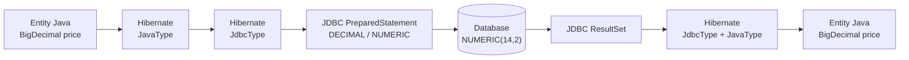

# Ánh xạ kiểu Java, kiểu JDBC và kiểu cột của hệ quản trị

## 1. Một thuộc tính Java đi vào database qua những lớp nào?

Trong ứng dụng Java dùng Hibernate ORM, kiểu dữ liệu không chỉ nằm ở một chỗ. Ví dụ, thuộc tính `BigDecimal price` của entity được Java nhìn nhận là `BigDecimal`, JDBC phải truyền giá trị theo một kiểu dữ liệu tương ứng, còn PostgreSQL có thể lưu nó trong cột `numeric(14, 2)`. Hibernate phải phối hợp **ba lớp kiểu dữ liệu**:

1. **Kiểu Java (Java type):** kiểu của field/property trong entity, quy định cách ứng dụng thao tác với giá trị.
2. **Kiểu JDBC (JDBC type):** cách biểu diễn, bind tham số và đọc kết quả khi giao tiếp với database qua JDBC.
3. **Kiểu SQL/DDL của hệ quản trị (database column type):** kiểu thực tế của cột trong schema, chịu ảnh hưởng từ database dialect và cách định nghĩa bảng.



Điểm cốt lõi: **kiểu Java, mã kiểu JDBC và tên kiểu SQL của một database không nhất thiết giống nhau**. Hibernate cung cấp mapping giữa chúng, đồng thời dựa vào dialect để diễn giải những khác biệt giữa PostgreSQL, MySQL, Oracle, SQL Server và các hệ quản trị khác.

## 2. Phân biệt rõ Java type, JDBC type và SQL column type

| Lớp | Ví dụ | Điều nó quyết định | Nguồn thông tin |
|---|---|---|---|
| **Java type** | `String`, `Long`, `BigDecimal`, `LocalDate`, `UUID` | Giá trị và hành vi ở phía Java, cách Hibernate so sánh hoặc quản lý giá trị | Khai báo field/property và Java type descriptor |
| **JDBC type** | `VARCHAR`, `BIGINT`, `DECIMAL`, `DATE`, `TIMESTAMP`, `OTHER` | Cách bind/tháo gói giá trị qua JDBC, cách lấy kết quả | JDBC type descriptor, cấu hình Hibernate và driver |
| **SQL column type** | `varchar(100)`, `bigint`, `numeric(14,2)`, `uuid`, `jsonb` | Cách database lưu và kiểm soát dữ liệu; cú pháp DDL | Schema thực tế, dialect, migration và khai báo DDL |

### Kiểu Java

Khi khai báo:

```java
@Column(name = "price", nullable = false, precision = 14, scale = 2)
private BigDecimal price;
```

Java biết `price` là một `BigDecimal`. Đây là đối tượng biểu diễn số thập phân có độ chính xác thích hợp cho tiền tệ, giá cả hoặc phép tính cần kiểm soát phần thập phân.

### Kiểu JDBC

Đối với trường `price`, Hibernate thường chọn JDBC `NUMERIC` hoặc `DECIMAL` tùy mapping. Khi lưu, Hibernate phối hợp JDBC driver để truyền giá trị như một tham số của câu SQL:

```sql
INSERT INTO products (price) VALUES (?);
```

Dấu `?` được bind bằng giá trị `BigDecimal` phù hợp, thay vì ghép chuỗi SQL. Khi đọc, giá trị JDBC được chuyển lại thành kiểu Java mà entity khai báo.

### Kiểu cột SQL

Trên PostgreSQL, cột có thể là:

```sql
price NUMERIC(14, 2) NOT NULL
```

Trong trường hợp này, `precision = 14` là số chữ số tối đa và `scale = 2` là số chữ số sau dấu thập phân. Định nghĩa thực tế phụ thuộc hệ quản trị. Một số database có quy tắc làm tròn, giới hạn precision/scale hoặc tên kiểu khác nhau.

**Quan trọng:** `@Column(precision = ..., scale = ...)` chủ yếu mô tả metadata ánh xạ và DDL; nó không tự thay thế validation ở tầng Java, cũng không bảo đảm schema đang triển khai thực sự trùng với annotation khi schema được quản lý bằng migration.

## 3. Hibernate chọn kiểu như thế nào?

Với các thuộc tính cơ bản (*basic attributes*), Hibernate ORM 6.x dùng những khái niệm tiêu biểu:

- **`JavaType`:** mô tả kiểu dữ liệu bên Java, ví dụ `BigDecimal` hoặc `LocalDate`, cách so sánh, hash, chuyển đổi biểu diễn và một số đặc tính khác.
- **`JdbcType`:** mô tả phương thức tương tác JDBC, ví dụ binder/extractor dùng để đặt tham số và đọc giá trị.
- **`DdlType`:** biểu diễn tên hoặc mẫu tên kiểu SQL dùng khi Hibernate sinh DDL cho database tương ứng.
- **`BasicType`:** một biểu diễn mapping cơ bản liên kết một Java type với một JDBC type cùng các thông tin liên quan.
- **`Dialect`:** điều chỉnh cách Hibernate tạo SQL/DDL và sử dụng những khả năng riêng của database.

Với một thuộc tính:

```java
private LocalDate publishedOn;
```

Hibernate có thể suy ra:

```text
Java attribute:  LocalDate
Java type:       LocalDate
JDBC mapping:    DATE
PostgreSQL DDL:  date
```

Khi thêm tùy chỉnh, ví dụ `@JdbcTypeCode(...)`, `@Convert(...)` hoặc `@Column(...)`, kết quả có thể thay đổi theo từng thành phần. Vì vậy cần đọc **toàn bộ mapping**, thay vì chỉ nhìn tên kiểu Java.

> Phần mô tả và ví dụ dưới đây hướng đến Hibernate ORM hiện đại với package `jakarta.persistence.*` và các API kiểu dữ liệu Hibernate ORM 6.x. Tên annotation, khả năng của dialect và các mặc định có thể khác ở những phiên bản Hibernate cũ.

## 4. Bảng ánh xạ các kiểu phổ biến

Những cặp sau là **minh họa thông dụng**, không phải quy tắc bất biến cho mọi dialect, phiên bản, driver và cấu hình:

| Java attribute | JDBC type thường gặp | Kiểu cột có thể gặp trong SQL | Ghi chú |
|---|---|---|---|
| `String` | `VARCHAR` | `varchar(255)`, `varchar(n)` | `@Column(length = n)` ảnh hưởng độ dài DDL; hỗ trợ Unicode/collation do DB quyết định |
| `char` / `Character` | `CHAR` | `char(1)` | Khác `String` về độ dài và biểu diễn |
| `int` / `Integer` | `INTEGER` | `integer` / `int` | Primitive không nhận `null`; wrapper có thể nhận `null` |
| `long` / `Long` | `BIGINT` | `bigint` | Thường dùng cho khóa định danh, bộ đếm |
| `short` / `Short` | `SMALLINT` | `smallint` | Phạm vi nhỏ hơn `Integer` |
| `boolean` / `Boolean` | `BOOLEAN` hoặc kiểu tương ứng | `boolean`, `bit` hoặc dạng số | Phụ thuộc hỗ trợ boolean của database/dialect |
| `BigDecimal` | `NUMERIC` / `DECIMAL` | `numeric(p,s)`, `decimal(p,s)` | Nên xác định precision/scale theo nghiệp vụ |
| `float` / `Float` | `FLOAT` / `REAL` | `real` / `float` | Dấu phẩy động gần đúng, không phù hợp với tiền cần độ chính xác thập phân |
| `double` / `Double` | `DOUBLE` | `double precision` hoặc tương đương | Có sai số biểu diễn nhị phân |
| `LocalDate` | `DATE` | `date` | Chỉ có ngày, không có giờ/múi giờ |
| `LocalTime` | `TIME` | `time` | Chỉ có giờ trong ngày |
| `LocalDateTime` | `TIMESTAMP` | `timestamp`, `datetime` | Không mang thông tin múi giờ |
| `Instant` | Ánh xạ timestamp theo chính sách Hibernate | `timestamp` hoặc kiểu timezone phù hợp | Cần xem cấu hình thời gian và dialect |
| `OffsetDateTime` | Timestamp có/không có timezone theo chiến lược | `timestamp with time zone` hoặc tương đương | Không mặc định database giữ nguyên offset ban đầu |
| `UUID` | `UUID`, `BINARY`, `VARCHAR` hoặc kiểu khác | `uuid`, `binary(16)`, `char(36)` | Tùy khả năng database và override mapping |
| `byte[]` | `VARBINARY` | `varbinary`, `bytea`, `blob` | Dữ liệu nhị phân; `@Lob` thay đổi chủ đích mapping |
| `Enum` | `TINYINT`/`SMALLINT` hoặc chuỗi/enum riêng | `smallint`, `varchar`, native enum | Quyết định bằng `@Enumerated` hoặc mapping tùy chỉnh |
| `Map<String, Object>` | Mapping JSON chuyên biệt khi khai báo | `jsonb`, `json`, loại khác | Không suy ra JSON chỉ vì Java type là `Map` |

Những ví dụ như `varchar(255)` hoặc `timestamp with time zone` mô tả **kết quả có thể có**, không có nghĩa Hibernate sẽ tạo đúng chuỗi DDL đó ở mọi cơ sở dữ liệu.

## 5. Ví dụ entity với nhiều kiểu dữ liệu

Giả sử hệ thống bán hàng lưu sản phẩm, trạng thái và một tập thuộc tính mở rộng. Entity dưới đây dùng JPA annotation kết hợp một annotation Hibernate riêng để ánh xạ JSON:

```java
package com.example.catalog;

import jakarta.persistence.Column;
import jakarta.persistence.Entity;
import jakarta.persistence.EnumType;
import jakarta.persistence.Enumerated;
import jakarta.persistence.GeneratedValue;
import jakarta.persistence.GenerationType;
import jakarta.persistence.Id;
import jakarta.persistence.Table;
import org.hibernate.annotations.JdbcTypeCode;
import org.hibernate.type.SqlTypes;

import java.math.BigDecimal;
import java.time.Instant;
import java.time.LocalDate;
import java.util.Map;
import java.util.UUID;

@Entity
@Table(name = "products")
public class Product {

    @Id
    @GeneratedValue(strategy = GenerationType.UUID)
    private UUID id;

    @Column(name = "sku", nullable = false, unique = true, length = 64)
    private String sku;

    @Column(name = "price", nullable = false, precision = 14, scale = 2)
    private BigDecimal price;

    @Column(name = "active", nullable = false)
    private boolean active;

    @Column(name = "available_on")
    private LocalDate availableOn;

    @Column(name = "created_at", nullable = false)
    private Instant createdAt;

    @Enumerated(EnumType.STRING)
    @Column(name = "status", nullable = false, length = 32)
    private ProductStatus status;

    @JdbcTypeCode(SqlTypes.JSON)
    @Column(name = "attributes")
    private Map<String, Object> attributes;

    protected Product() {
        // Constructor cần cho JPA/Hibernate.
    }

    // Constructor và getter/setter nghiệp vụ được lược bỏ.
}

enum ProductStatus {
    DRAFT, ACTIVE, ARCHIVED
}
```

Ví dụ trên cho thấy:

- `UUID` ở Java được map đến kiểu SQL phù hợp dialect và chiến lược UUID; `GenerationType.UUID` là lựa chọn sinh định danh thuộc Jakarta Persistence phiên bản hiện đại.
- `BigDecimal` chỉ định rõ precision/scale để schema thể hiện yêu cầu thập phân.
- `boolean` thể hiện giá trị bắt buộc ở Java vì primitive không thể là `null`.
- `LocalDate` biểu diễn ngày lịch, khác với một thời điểm cụ thể như `Instant`.
- `@Enumerated(EnumType.STRING)` lưu tên hằng enum thay vì chỉ số thứ tự, giúp tránh vấn đề khi đảo thứ tự khai báo.
- `@JdbcTypeCode(SqlTypes.JSON)` yêu cầu mapping JSON; cách lưu phụ thuộc database và thư viện hỗ trợ JSON hiện diện trên classpath.

Với PostgreSQL, schema **có thể được thiết kế** như sau:

```sql
CREATE TABLE products (
    id UUID PRIMARY KEY,
    sku VARCHAR(64) NOT NULL UNIQUE,
    price NUMERIC(14, 2) NOT NULL,
    active BOOLEAN NOT NULL,
    available_on DATE,
    created_at TIMESTAMP WITH TIME ZONE NOT NULL,
    status VARCHAR(32) NOT NULL,
    attributes JSONB
);
```

Đây là DDL **minh họa để đọc mô hình**, không phải cam kết Hibernate sẽ xuất đúng từng dòng. Hibernate/dialect có thể chọn kiểu timestamp khác tùy cấu hình lưu thời gian, có thể bổ sung constraint cho enum hoặc sử dụng chi tiết DDL khác. Nếu sử dụng công cụ migration, schema cuối cùng được quyết định bởi các script migration đã áp dụng.

## 6. Điều gì xảy ra khi Hibernate đọc và ghi một thuộc tính?

Xét entity có:

```java
@Column(name = "price", precision = 14, scale = 2)
private BigDecimal price;
```

Khi chạy:

```java
Product product = session.find(Product.class, productId);
BigDecimal currentPrice = product.getPrice();
```

Hibernate phối hợp driver để đọc cột `price` từ JDBC `ResultSet`, dùng mapping chuyển dữ liệu thành `BigDecimal`, rồi đặt vào entity.

Khi ghi:

```java
product.setPrice(new BigDecimal("159.90"));
// Entity đang managed: khi flush, Hibernate có thể phát UPDATE tương ứng.
```

Hibernate dựa vào Java type descriptor để nhận biết/thao tác giá trị, JDBC type descriptor để bind tham số cho `PreparedStatement`, còn database áp dụng quy tắc của cột `NUMERIC(14,2)`. Việc flush/commit thuộc cơ chế persistence và transaction, không do kiểu dữ liệu quyết định.

### Tại sao nên dùng tham số JDBC?

Truy vấn có tham số như:

```java
List<Product> products = session.createQuery(
    "from Product p where p.price >= :minPrice",
    Product.class
).setParameter("minPrice", new BigDecimal("100.00"))
 .getResultList();
```

cho phép Hibernate bind đúng kiểu dữ liệu, đồng thời tránh việc ghép chuỗi chứa giá trị người dùng vào cú pháp SQL. Đừng tự đưa `BigDecimal`, ngày giờ hoặc UUID vào SQL bằng định dạng chuỗi thủ công nếu API hỗ trợ parameter binding.

## 7. Kiểm soát kiểu cột bằng @Column

`@Column` của Jakarta Persistence cung cấp metadata cột, ví dụ:

```java
@Column(name = "display_name", length = 120, nullable = false)
private String displayName;

@Column(name = "amount", precision = 19, scale = 4)
private BigDecimal amount;
```

Các thuộc tính thường dùng:

| Thuộc tính | Ý nghĩa |
|---|---|
| `name` | Tên cột thực tế hoặc tên logic tùy naming strategy |
| `length` | Độ dài áp dụng cho những kiểu dữ liệu có ý nghĩa độ dài, thường là chuỗi |
| `precision` | Tổng độ chính xác số học của cột phù hợp |
| `scale` | Số chữ số sau dấu thập phân |
| `nullable` | Thông tin nullability cho mapping/DDL |
| `unique` | Khai báo tính duy nhất phục vụ schema generation; không thay thế việc quản lý migration |
| `columnDefinition` | Mẫu khai báo kiểu/cột SQL tùy chỉnh, phụ thuộc hệ quản trị |

Ví dụ ép cú pháp DDL:

```java
@Column(name = "attributes", columnDefinition = "jsonb")
@JdbcTypeCode(SqlTypes.JSON)
private Map<String, Object> attributes;
```

`columnDefinition = "jsonb"` là chi tiết **PostgreSQL**, không portable sang mọi database. Nó tác động cách cột được định nghĩa trong DDL; `@JdbcTypeCode(SqlTypes.JSON)` lại chỉ định mapping JDBC cho dữ liệu JSON. **Một khai báo DDL không tự thay thế cấu hình chuyển đổi/bind dữ liệu.**

### Annotation không tự đổi schema đang có

Nếu migration đã tạo cột `amount DECIMAL(10,2)` nhưng entity đổi sang `@Column(precision = 19, scale = 4)`, Hibernate không tự đảm bảo schema thực tế đã đổi. Điều này phụ thuộc chế độ schema management:

- `validate`: kiểm tra tương thích schema ở thời điểm khởi tạo theo khả năng công cụ; không sửa bảng.
- `create` / `create-drop`: tạo lại schema theo cấu hình, có thể gây mất dữ liệu và chỉ phù hợp môi trường được kiểm soát.
- `update`: cố gắng cập nhật một phần schema; không nên xem như phương án migration đầy đủ.
- Công cụ như Flyway/Liquibase: quản lý lịch sử thay đổi DDL tường minh trong hệ thống triển khai.

Ngay cả khi `validate` chạy thành công, vẫn cần migration/constraint và kiểm tra tích hợp thực tế cho những yêu cầu dữ liệu quan trọng.

## 8. @JdbcTypeCode: lựa chọn kiểu JDBC có chủ đích

Trong Hibernate ORM 6.x, annotation `@JdbcTypeCode` cho phép chọn mã kiểu JDBC/Hibernate `SqlTypes` mà attribute sẽ sử dụng:

```java
import org.hibernate.annotations.JdbcTypeCode;
import org.hibernate.type.SqlTypes;

@JdbcTypeCode(SqlTypes.JSON)
private Map<String, Object> metadata;
```

`SqlTypes` bao gồm các mã tương ứng với `java.sql.Types` và những mã mở rộng của Hibernate cho loại dữ liệu chuyên biệt. Không nên hiểu một mã `SqlTypes` là tên cột SQL cố định: cùng `SqlTypes.JSON`, dialect có thể quyết định cách tạo/bind JSON khác nhau giữa các database.

### Khi nào dùng?

- Khi kiểu Java cho phép nhiều cách lưu trữ và bạn cần chọn cách tương ứng với schema.
- Khi dùng loại dữ liệu riêng như JSON và dialect/driver có hỗ trợ.
- Khi mapping mặc định không khớp với một schema đã tồn tại.

### Các giới hạn

- Database và JDBC driver phải hỗ trợ cách bind và đọc dữ liệu tương ứng.
- Với JSON, Hibernate có thể cần thư viện JSON mapper thích hợp, ví dụ Jackson hoặc JSON-B tùy cấu hình và phiên bản.
- Ép kiểu JDBC khác mặc định chưa chắc đã hợp lệ với Java type đã khai báo. Nếu cách chuyển đổi không được hỗ trợ, bạn sẽ cần converter hoặc type mapping tùy chỉnh.
- DDL, mã kiểu JDBC và dữ liệu Java cần thống nhất. Chỉ chỉnh một trong ba lớp có thể làm xuất hiện lỗi chạy hoặc lỗi schema validation.

## 9. AttributeConverter: chuyển đổi giá trị nghiệp vụ

**`AttributeConverter<X, Y>`** của Jakarta Persistence cho phép chuyển giữa **kiểu ứng dụng `X`** và **kiểu lưu trữ `Y`** mà persistence provider có thể ánh xạ tiếp xuống JDBC.

Ví dụ ứng dụng muốn giữ kiểu enum ở Java nhưng lưu mã trạng thái ngắn vào cột `VARCHAR(1)`:

```java
public enum ReviewState {
    NEW, APPROVED, REJECTED
}
```

```java
import jakarta.persistence.AttributeConverter;
import jakarta.persistence.Converter;

@Converter
public class ReviewStateConverter
        implements AttributeConverter<ReviewState, String> {

    @Override
    public String convertToDatabaseColumn(ReviewState value) {
        if (value == null) {
            return null;
        }
        return switch (value) {
            case NEW -> "N";
            case APPROVED -> "A";
            case REJECTED -> "R";
        };
    }

    @Override
    public ReviewState convertToEntityAttribute(String dbValue) {
        if (dbValue == null) {
            return null;
        }
        return switch (dbValue) {
            case "N" -> ReviewState.NEW;
            case "A" -> ReviewState.APPROVED;
            case "R" -> ReviewState.REJECTED;
            default -> throw new IllegalArgumentException(
                "Unsupported state: " + dbValue
            );
        };
    }
}
```

Sử dụng trong entity:

```java
import jakarta.persistence.Column;
import jakarta.persistence.Convert;

@Convert(converter = ReviewStateConverter.class)
@Column(name = "review_state", nullable = false, length = 1)
private ReviewState reviewState;
```

Luồng ánh xạ:

```text
ReviewState.APPROVED (Java enum)
    ↓ AttributeConverter<ReviewState, String>
"A" (Java String dùng cho JDBC mapping)
    ↓ JDBC VARCHAR
'A' (VARCHAR(1) trong database)
```

Không đặt `@Enumerated` trên cùng thuộc tính khi đã chọn converter cho enum: đây là **hai cách biểu diễn khác nhau**. Với converter `autoApply = true`, hãy cân nhắc phạm vi tự áp dụng để tránh chuyển đổi ngoài ý muốn trong các entity khác.

**Phạm vi của converter:** nó biến đổi giá trị giữa hai kiểu Java; `Y` tiếp tục cần JDBC mapping phù hợp. Converter không phải một phép tạo column DDL tùy ý và không thay thế database constraint.

## 10. Các trường hợp đặc biệt dễ gây sai lệch

### 10.1. BigDecimal, precision và scale

```java
@Column(precision = 12, scale = 2)
private BigDecimal totalAmount;
```

`BigDecimal` ưu tiên cho tiền và số thập phân chính xác, nhưng phải quản lý:

- **Precision/scale:** ví dụ `9999999999.99` đã dùng đủ 12 chữ số khi tính 10 chữ số nguyên và 2 chữ số thập phân.
- **Làm tròn:** nếu phép tính sinh nhiều chữ số phần thập phân, dùng `RoundingMode` có chủ đích, không trông chờ database tự cắt theo cách mong muốn.
- **So sánh trong Java:** `new BigDecimal("1.0").equals(new BigDecimal("1.00"))` trả về `false` vì khác scale, còn `compareTo(...)` cho kết quả bằng nhau về giá trị số học. Logic nghiệp vụ cần chọn cách so sánh phù hợp.

`float` và `double` lưu số nhị phân gần đúng, không thay thế `BigDecimal` cho tổng tiền cần chính xác.

### 10.2. LocalDate, LocalDateTime, Instant và OffsetDateTime

Các kiểu thời gian biểu diễn những khái niệm khác nhau:

| Kiểu Java | Ngữ nghĩa | Một lựa chọn sử dụng |
|---|---|---|
| `LocalDate` | Ngày theo lịch, không thời gian/múi giờ | Ngày sinh, ngày phát hành |
| `LocalTime` | Giờ trong ngày, không ngày/múi giờ | Giờ mở cửa định kỳ |
| `LocalDateTime` | Ngày + giờ địa phương, không định danh múi giờ/offset | Lịch hẹn theo giờ địa phương khi đã có ngữ cảnh vùng |
| `Instant` | Một thời điểm tuyệt đối trên UTC timeline | Thời gian tạo/sửa bản ghi, audit |
| `OffsetDateTime` | Ngày giờ kèm offset tại thời điểm biểu diễn | Dữ liệu tích hợp có offset cần xử lý rõ ràng |
| `ZonedDateTime` | Ngày giờ gắn với `ZoneId` và quy tắc múi giờ | Đặt lịch theo khu vực, xử lý DST |

Không giả định database lưu được đầy đủ `ZoneId` hoặc giữ nguyên offset người dùng gửi. Nhiều hệ quản trị chuẩn hóa thông tin thời gian khi ghi cột timezone-aware, và cách Hibernate xử lý còn phụ thuộc chiến lược `TimeZoneStorage`/dialect.

Ví dụ:

```java
private LocalDate birthday;
private Instant createdAt;
```

`birthday` là một **ngày lịch** nên không cần chuyển sang `Instant`. `createdAt` đại diện cho một **thời điểm toàn cục**, nên nên có chính sách nhất quán về lưu/đọc mốc thời gian.

Khi tích hợp nhiều dịch vụ, quy định rõ time zone của ứng dụng, database session, JDBC driver và JSON serialization. Với stack cũ dùng `java.sql.Timestamp` hoặc `java.util.Date`, cần kiểm tra cách Hibernate ánh xạ và chuẩn hóa thời gian; đừng suy ra từ riêng tên kiểu cột.

### 10.3. Enum: tên hay thứ tự?

```java
@Enumerated(EnumType.STRING)
@Column(length = 24)
private OrderStatus status;
```

Với `EnumType.STRING`, database thường lưu tên như `"SHIPPED"`. Với `EnumType.ORDINAL`, database lưu vị trí số của hằng trong danh sách enum. **Đổi thứ tự enum sẽ làm ý nghĩa dữ liệu ordinal đã lưu thay đổi**, có thể dẫn đến lỗi nghiêm trọng nhưng khó nhận biết.

Vì vậy, khi các hằng enum có thể thay đổi theo thời gian, lưu tên hoặc một mã ổn định qua converter thường dễ bảo trì hơn. Việc đổi tên hằng cũng là thay đổi schema dữ liệu và có thể cần migration.

Một số dialect/Hibernate version có hỗ trợ native enum SQL; đây là lựa chọn riêng về DDL và binding, không tự suy ra mọi database đều dùng `varchar` cho `EnumType.STRING`.

### 10.4. UUID

`java.util.UUID` có thể được lưu:

- Bằng kiểu `UUID` riêng của hệ quản trị, như PostgreSQL.
- Dưới dạng 16 byte binary khi schema/driver phù hợp.
- Dưới dạng chuỗi, thường 36 ký tự bao gồm dấu gạch nối.

Các cách lưu có khác biệt về kích thước, đọc/ghi và tính portable. Khi mapping một schema có sẵn, hãy xác định rõ cột hiện có thay vì mặc định mọi database đều hỗ trợ native `uuid`. Đồng thời phân biệt **cách sinh UUID** với **cách lưu UUID**: `@GeneratedValue(strategy = GenerationType.UUID)` liên quan sinh ID, không tự quy định cú pháp cột mà mọi dialect phải dùng.

### 10.5. JSON và cấu trúc linh hoạt

```java
@JdbcTypeCode(SqlTypes.JSON)
private Map<String, Object> attributes;
```

Mapping JSON hữu ích khi một số thuộc tính linh hoạt, nhưng vẫn cần chọn schema phù hợp:

- Database có thể dùng `json`, `jsonb` hoặc kiểu dữ liệu/biểu diễn khác.
- JSON mapper và Jackson/JSON-B dependency phải tương thích với cấu hình Hibernate.
- Các khóa và kiểu dữ liệu bên trong JSON thường không được database kiểm tra giống các cột quan hệ thông thường.
- Việc query theo trường JSON, lập index JSON và di chuyển giữa các database phụ thuộc vào chức năng riêng của hệ quản trị.
- Đừng chuyển các dữ liệu cần join, unique constraint hoặc transaction chặt chẽ thành JSON chỉ vì mapping JSON tiện.

### 10.6. Chuỗi dài, nhị phân và LOB

```java
@Column(length = 2000)
private String description;

@Lob
private byte[] attachment;
```

`@Lob` biểu thị loại dữ liệu large object phù hợp, thường liên quan `BLOB` với dữ liệu nhị phân hoặc `CLOB` với dữ liệu ký tự. Cách lưu và truy cập LOB khác nhau giữa database/driver. **`@Lob` không đơn giản là “VARCHAR rất dài”**. Với văn bản dài, nên xem xét mapping kiểu chuỗi dài thích hợp với dialect và schema; với file lớn, cân nhắc yêu cầu streaming, backup, dung lượng và kiến trúc lưu trữ trước khi đặt vào database.

### 10.7. Nullable và kiểu primitive/wrapper

```java
private int quantity;      // Luôn có giá trị Java, mặc định 0.
private Integer discount;  // Có thể null.
```

Database có thể chứa `NULL` cho `discount` nếu schema cho phép. Ngược lại, `int` không biểu diễn được `NULL` trong Java; không nên chọn primitive cho cột nullable nếu nghiệp vụ cần phân biệt "chưa có giá trị" với số `0`.

`@Column(nullable = false)`, `@NotNull` của Jakarta Validation, `NOT NULL` trong database và nullability của kiểu Java có **các cơ chế tác động khác nhau**. Để dữ liệu an toàn, chúng nên được thiết kế nhất quán và kiểm tra cả ở tầng ứng dụng lẫn schema thực tế.

## 11. Dialect quyết định mức độ tương thích

**Hibernate Dialect** nắm những khác biệt giữa các hệ quản trị: kiểu dữ liệu hỗ trợ, cách sinh SQL, cú pháp phân trang, hàm SQL, chiến lược xử lý identity/sequence và các chi tiết schema.

Ví dụ cùng một mô hình Java:

```java
private UUID id;
private boolean enabled;
private BigDecimal balance;
```

có thể được tạo thành các kiểu cột khác nhau tùy database và phiên bản Hibernate:

| Yêu cầu | PostgreSQL | Các database khác |
|---|---|---|
| UUID | Có kiểu `uuid` riêng | Có thể cần `binary(16)`, `char(36)` hoặc hỗ trợ native tùy hệ quản trị |
| Boolean | `boolean` | Có thể là `bit`, số hoặc kiểu boolean |
| Decimal | `numeric(p,s)` | `decimal(p,s)` hay cú pháp tương đương |
| JSON | `json` / `jsonb` | Có thể hỗ trợ JSON native hoặc cách biểu diễn khác |
| Timestamp và time zone | Các kiểu timestamp riêng | Hỗ trợ và ngữ nghĩa về timezone khác nhau |

Không nên đem một `columnDefinition` vốn chỉ hợp lệ trên PostgreSQL sang Oracle hay SQL Server rồi kỳ vọng Hibernate tự chuyển đổi cú pháp đó. Việc dùng annotation JPA không đồng nghĩa mọi chi tiết schema đều portable.

Trong Hibernate 6.x, dialect thường có thể tự suy ra từ JDBC metadata nếu truy cập database thích hợp. Có thể cấu hình rõ `hibernate.dialect` khi hệ thống cần, nhưng phải chọn dialect phù hợp với đúng phiên bản Hibernate và DB đang chạy.

## 12. Một lỗi ánh xạ thường xuất hiện ở đâu?

### Lỗi tại bootstrap/schema validation

Ví dụ entity dùng `UUID` nhưng schema là `VARCHAR(36)`, còn Hibernate/dialect suy ra JDBC type khác. Bật chế độ validate có thể phát hiện mismatch ở giai đoạn khởi tạo:

```properties
hibernate.hbm2ddl.auto=validate
```

Thông báo có thể nhắc tới kiểu cột dự kiến và kiểu được metadata JDBC của database báo về. Cách xử lý là xác định:

1. Kiểu Java thực tế của field.
2. Kiểu JDBC Hibernate đang chọn (mặc định hay có override).
3. Kiểu cột thực tế trong database.
4. Dialect, driver và phiên bản Hibernate.
5. Migration cần thay schema hay mapping cần sửa cho tương thích.

Không sửa một cách mù quáng bằng `columnDefinition` nếu vấn đề thật sự là binder JDBC hoặc converter.

### Lỗi khi bind tham số

Một giá trị Java chưa có mapping phù hợp, hoặc JDBC driver không hỗ trợ kiểu được chỉ định, có thể gây lỗi khi Hibernate chuẩn bị/executing SQL. Lỗi này có thể chỉ xuất hiện khi insert, update hoặc filter theo trường đó.

### Lỗi khi đọc kết quả

Ví dụ database trả chuỗi không hợp lệ cho một enum converter, số vượt phạm vi Java type hoặc timestamp có cách diễn giải khác dự kiến. Trường hợp này xuất hiện khi JDBC/extractor hoặc converter chuyển dữ liệu thành giá trị Java.

### Dữ liệu không lỗi nhưng sai nghĩa

Đây là nhóm khó phát hiện hơn:

- Số tiền bị làm tròn ngoài ý muốn khi scale của cột quá nhỏ.
- Ngày giờ lệch giờ do chuyển đổi timezone không nhất quán.
- Enum ordinal trỏ tới trạng thái khác sau khi đổi thứ tự khai báo.
- Giá trị `NULL` bị hiểu thành `0` trong logic nghiệp vụ.
- Chuỗi bị cắt/ngăn bởi giới hạn cột hoặc sự khác biệt về collation.

Thử nghiệm bằng dữ liệu biên và dữ liệu thực tế thường cần thiết để phát hiện lỗi ngữ nghĩa này.

## 13. Quy trình thiết kế kiểu dữ liệu cho một thuộc tính mới

Giả sử cần lưu `subtotal` của đơn hàng.

**Bước 1 — Xác định ngữ nghĩa nghiệp vụ.** Đây là số tiền thập phân có tối đa hai chữ số phần lẻ và cần tính chính xác.

**Bước 2 — Chọn kiểu Java.** Dùng `BigDecimal` thay vì `double`:

```java
private BigDecimal subtotal;
```

**Bước 3 — Chọn ràng buộc cột và JDBC mapping.** Nếu không có yêu cầu đặc biệt, Hibernate thường suy ra JDBC numeric/decimal. Khai báo precision và scale:

```java
@Column(name = "subtotal", nullable = false, precision = 18, scale = 2)
private BigDecimal subtotal;
```

**Bước 4 — Quản lý schema thực tế.** Với PostgreSQL, migration có thể tạo:

```sql
ALTER TABLE orders
    ADD COLUMN subtotal NUMERIC(18, 2) NOT NULL;
```

Nếu bảng đã có dữ liệu, migration cần xử lý backfill/default phù hợp trước khi áp `NOT NULL`; câu `ALTER TABLE` ở trên chỉ là ví dụ minh họa cho bảng đáp ứng điều kiện.

**Bước 5 — Đảm bảo tính hợp lệ.** Kiểm tra tổng tiền không âm bằng validation/domain logic hoặc database `CHECK` nếu là invariant quan trọng; `precision` và `scale` không tự đảm bảo yêu cầu số tiền không âm.

**Bước 6 — Kiểm tra đường đi đọc/ghi.** Lưu, truy vấn và đọc lại các giá trị biên như `0.00`, `9999999999999999.99` trong database test thực tế để xác nhận driver, mapping và schema cùng hiểu giá trị như mong đợi.

## 14. Bài thực hành ngắn

Giả sử có entity:

```java
@Entity
class Shipment {
    @Id
    private UUID id;

    private LocalDate shippedDate;

    private BigDecimal shippingFee;

    @Enumerated(EnumType.STRING)
    private ShipmentStatus status;
}
```

Hãy tự thiết kế mapping cho các yêu cầu:

1. `id` lưu bằng native UUID trong PostgreSQL.
2. `shippedDate` là ngày gửi hàng, không phải timestamp.
3. `shippingFee` được lưu chính xác đến hai chữ số thập phân và có giới hạn đủ cho chi phí lớn.
4. `status` không bị thay đổi ý nghĩa chỉ vì thứ tự enum đổi.
5. Database bảo vệ các constraint quan trọng khi dữ liệu được ghi từ ứng dụng khác.

Một phương án tham khảo:

```java
@Entity
@Table(name = "shipments")
class Shipment {
    @Id
    @Column(name = "id", nullable = false)
    private UUID id;

    @Column(name = "shipped_date")
    private LocalDate shippedDate;

    @Column(name = "shipping_fee", nullable = false,
            precision = 16, scale = 2)
    private BigDecimal shippingFee;

    @Enumerated(EnumType.STRING)
    @Column(name = "status", nullable = false, length = 24)
    private ShipmentStatus status;

    protected Shipment() {}
}
```

Với PostgreSQL, schema cần có các cột tương ứng như `uuid`, `date`, `numeric(16,2)` và một cách lưu enum phù hợp dialect/thiết kế. Nếu muốn bảo vệ tính hợp lệ của `shipping_fee` ở database, có thể thêm `CHECK (shipping_fee >= 0)` trong migration.

Lưu ý: `shippedDate` nullable hay bắt buộc còn phụ thuộc nghiệp vụ, ví dụ đơn hàng chưa gửi thì chưa có ngày gửi.

## 15. Những nguyên tắc cần ghi nhớ

1. **Bắt đầu từ ngữ nghĩa dữ liệu.** Ngày lịch, thời điểm tuyệt đối, tiền và chuỗi ký tự có yêu cầu khác nhau.
2. **Phân biệt ba lớp.** Java type quyết định giá trị trong entity; JDBC type quyết định giao tiếp JDBC; SQL column type quyết định lưu trữ tại database.
3. **Hiểu mặc định trước khi override.** Hibernate có mapping mặc định cho các kiểu cơ bản, nhưng `@JdbcTypeCode`, converter và mapping tùy chỉnh có thể cần cho schema hoặc kiểu chuyên biệt.
4. **Không nhầm DDL với runtime binding.** `@Column(columnDefinition = "...")` mô tả cú pháp cột; nó không tự đảm bảo JDBC biết chuyển đổi một object Java bất kỳ.
5. **Chú ý dialect và driver.** PostgreSQL `uuid/jsonb`, boolean hoặc timezone không có nghĩa tương đương tuyệt đối trên mọi database.
6. **Đồng bộ mapping với migration.** Entity annotation, JDBC type và schema thực tế phải thống nhất; dùng schema validation và kiểm tra với database mục tiêu.
7. **Thử dữ liệu biên.** Số thập phân, enum, timestamp và giá trị `null` dễ phát sinh lỗi ngầm nếu chỉ kiểm tra dữ liệu bình thường.

Hiểu được đường đi **Java type → Hibernate JavaType/JdbcType → JDBC → SQL column type** sẽ giúp bạn đọc mapping nhanh hơn, debug lỗi kiểu dữ liệu đúng tầng và thiết kế schema an toàn hơn khi thay đổi database hoặc nâng cấp Hibernate ORM.

### Tài liệu chính thức để tìm hiểu thêm

- [Hibernate ORM — User Guide, Basic Types](https://docs.jboss.org/hibernate/orm/current/userguide/html_single/Hibernate_User_Guide.html#basic)
- [Hibernate ORM — Type System](https://docs.jboss.org/hibernate/orm/current/userguide/html_single/Hibernate_User_Guide.html#basic-type)
- [Hibernate ORM — Javadocs: JdbcTypeCode](https://docs.jboss.org/hibernate/orm/current/javadocs/org/hibernate/annotations/JdbcTypeCode.html)
- [Hibernate ORM — Javadocs: SqlTypes](https://docs.jboss.org/hibernate/orm/current/javadocs/org/hibernate/type/SqlTypes.html)
- [Jakarta Persistence Specification](https://jakarta.ee/specifications/persistence/)
