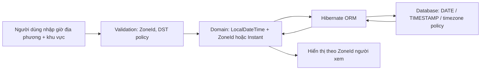

# Instant, LocalDate, LocalDateTime, OffsetDateTime và chính sách múi giờ trong Hibernate

## 1. Vì sao kiểu thời gian là một phần của thiết kế dữ liệu?

Trong ứng dụng dùng Hibernate, vấn đề thời gian không chỉ là chọn kiểu Java hay định dạng chuỗi. Một giá trị thời gian còn liên quan đến **ý nghĩa nghiệp vụ**, **múi giờ**, **kiểu cột SQL**, **cách JDBC chuyển đổi**, **môi trường chạy** và **quy tắc đổi giờ mùa hè** (*daylight saving time* – DST).

Bốn kiểu `java.time` thường gặp có ý nghĩa khác nhau:

- `Instant`: một **thời điểm tuyệt đối** trên trục thời gian UTC.
- `LocalDate`: một **ngày theo lịch**, không mang giờ và không mang múi giờ.
- `LocalDateTime`: **ngày + giờ trên đồng hồ địa phương**, chưa biết thuộc múi giờ nào.
- `OffsetDateTime`: **ngày + giờ + độ lệch UTC** (ví dụ `+07:00`), xác định được một thời điểm tuyệt đối nhưng không chứa toàn bộ quy tắc múi giờ theo khu vực.

Việc chọn sai kiểu có thể dẫn đến lỗi rất khó phát hiện: thời gian hiển thị lệch vài giờ khi đổi server, thời điểm đặt lịch bị sai khi DST chuyển trạng thái, cùng sự kiện được lưu dưới nhiều cách hiểu khác nhau, hoặc dữ liệu thay đổi ý nghĩa sau khi di chuyển database.

Ví dụ: cuộc họp diễn ra tại Thành phố Hồ Chí Minh vào **09:00 ngày 15/11/2026**.

```text
Giờ tường tại Việt Nam:       2026-11-15 09:00
Múi giờ khu vực:              Asia/Ho_Chi_Minh
Độ lệch UTC ngày hôm đó:      +07:00
OffsetDateTime:               2026-11-15T09:00:00+07:00
Instant tương ứng:            2026-11-15T02:00:00Z
```

`LocalDateTime.of(2026, 11, 15, 9, 0)` **chưa đủ** để xác định `Instant`; phải biết đó là 09:00 tại khu vực nào, hoặc ít nhất là offset nào tại thời điểm đó.

## 2. Phân biệt bốn kiểu `java.time`

| Kiểu Java | Ví dụ biểu diễn | Mang ngày? | Mang giờ? | Có offset/zone? | Tự xác định được một thời điểm trên UTC? |
|---|---|---|---|---|---|
| `Instant` | `2026-11-15T02:00:00Z` | Có, theo mốc UTC | Có | UTC là hệ quy chiếu | **Có** |
| `LocalDate` | `2026-11-15` | Có | Không | Không | **Không** |
| `LocalDateTime` | `2026-11-15T09:00:00` | Có | Có | Không | **Không** |
| `OffsetDateTime` | `2026-11-15T09:00:00+07:00` | Có | Có | Offset `+07:00` | **Có** |

### 2.1. `Instant` — thời điểm tuyệt đối

`Instant` mô tả một điểm trên trục thời gian, thường được biểu diễn bằng ISO-8601 với hậu tố `Z` (UTC). Bản thân `Instant` không lưu tên múi giờ như `Asia/Ho_Chi_Minh` hay định dạng hiển thị của người dùng.

```java
import java.time.Instant;

Instant eventTime = Instant.parse("2026-11-15T02:00:00Z");

System.out.println(eventTime);
// 2026-11-15T02:00:00Z
```

Những trường hợp phù hợp:

- `createdAt`, `updatedAt`, `lastLoginAt`, `processedAt`.
- Thời điểm giao dịch, sự kiện, log, token hết hạn.
- Mốc bắt đầu hoặc kết thúc thực tế của một công việc.
- Tìm kiếm, sắp xếp và tính khoảng cách giữa các thời điểm.

Hai người ở hai múi giờ có thể nhìn thấy **hai giờ địa phương khác nhau** từ cùng một `Instant`, nhưng giá trị này vẫn chỉ cùng một sự kiện.

### 2.2. `LocalDate` — ngày trên lịch

`LocalDate` chỉ chứa năm, tháng, ngày:

```java
import java.time.LocalDate;

LocalDate serviceDate = LocalDate.of(2026, 11, 15);
```

Những trường hợp phù hợp:

- Ngày sinh, ngày kỷ niệm.
- Ngày bắt đầu hợp đồng theo quy tắc lịch.
- Ngày nghỉ, ngày làm việc, ngày đặt dịch vụ.
- Các giá trị nghiệp vụ mà **thời gian trong ngày không có ý nghĩa**.

Không nên tự chuyển `LocalDate` thành `Instant` ở UTC midnight nếu nghiệp vụ thực sự là **ngày theo múi giờ địa phương**. Ví dụ, ngày làm việc 15/11 ở Việt Nam bắt đầu lúc `2026-11-14T17:00:00Z`, không phải `2026-11-15T00:00:00Z`.

### 2.3. `LocalDateTime` — ngày giờ chưa gắn múi giờ

`LocalDateTime` chứa ngày và giờ theo đồng hồ, nhưng không xác định timezone:

```java
import java.time.LocalDateTime;

LocalDateTime wallTime =
        LocalDateTime.of(2026, 11, 15, 9, 0);
```

Giá trị này có thể là 09:00 tại Hà Nội, Tokyo, New York hoặc nơi khác. Vì vậy, nó **không biểu diễn một thời điểm toàn cầu duy nhất**.

Những trường hợp có thể dùng:

- Thời gian một cửa hàng dự kiến mở cửa theo địa phương, khi được lưu **kèm ID vùng múi giờ**.
- Lịch hẹn nhập dưới dạng “ngày 15/11, 09:00 tại chi nhánh X”.
- Dữ liệu lịch sử mà schema có chủ ý lưu giá trị giờ tường, không yêu cầu quy chiếu sang UTC.

Nếu nghiệp vụ thật sự cần biết “sự kiện này xảy ra lúc nào trên toàn thế giới”, chỉ lưu `LocalDateTime` là thiếu dữ liệu. Phải biết `ZoneId`/offset phù hợp hoặc dùng `Instant`.

### 2.4. `OffsetDateTime` — ngày giờ cộng độ lệch UTC

`OffsetDateTime` bao gồm `LocalDateTime` và `ZoneOffset`:

```java
import java.time.OffsetDateTime;

OffsetDateTime submittedAt =
        OffsetDateTime.parse("2026-11-15T09:00:00+07:00");

System.out.println(submittedAt.toInstant());
// 2026-11-15T02:00:00Z
```

`+07:00` là **độ lệch UTC tại giá trị đó**. Nó không tương đương với một tên khu vực như `Asia/Ho_Chi_Minh`. Nhiều địa điểm dùng cùng offset, và nhiều khu vực thay đổi offset theo mùa.

`OffsetDateTime` phù hợp khi giao tiếp với API có timestamp kèm offset, cần biết offset mà hệ thống gửi đi đã cung cấp, hoặc cần giữ cả giờ địa phương tại thời điểm nhập. Tuy nhiên, **database và chiến lược lưu của Hibernate quyết định offset gốc có được giữ lại khi đọc lại hay không**.

### 2.5. `ZonedDateTime` và `ZoneId` khi nghiệp vụ gắn với khu vực

Ngoài bốn kiểu chính, nên biết:

- `ZoneId` mô tả timezone theo khu vực, ví dụ `Asia/Ho_Chi_Minh` hoặc `America/New_York`.
- `ZonedDateTime` kết hợp ngày giờ, zone region và offset được tính theo quy tắc timezone tại thời điểm đó.

Nếu ứng dụng lập **lịch lặp “09:00 mỗi ngày tại New York”**, chỉ một offset `-05:00` không đủ vì nơi này có thể chuyển sang `-04:00` khi DST có hiệu lực. Nên lưu quy tắc giờ địa phương cùng zone region, chẳng hạn `LocalTime`/`LocalDateTime` và `America/New_York`, rồi xác định từng occurrence theo quy tắc thời gian.

## 3. Ví dụ chuyển đổi: cùng một thời điểm, nhiều cách hiển thị

```java
import java.time.Instant;
import java.time.LocalDateTime;
import java.time.OffsetDateTime;
import java.time.ZoneId;
import java.time.ZonedDateTime;

ZoneId vietnam = ZoneId.of("Asia/Ho_Chi_Minh");

Instant instant = Instant.parse("2026-11-15T02:00:00Z");

ZonedDateTime localView = instant.atZone(vietnam);
LocalDateTime wallClock = localView.toLocalDateTime();
OffsetDateTime withOffset = localView.toOffsetDateTime();

System.out.println(localView);
// 2026-11-15T09:00+07:00[Asia/Ho_Chi_Minh]

System.out.println(wallClock);
// 2026-11-15T09:00

System.out.println(withOffset);
// 2026-11-15T09:00+07:00

System.out.println(withOffset.toInstant().equals(instant));
// true
```

Ở chiều ngược lại:

```java
LocalDateTime userInput =
        LocalDateTime.of(2026, 11, 15, 9, 0);

Instant scheduledInstant =
        userInput.atZone(vietnam).toInstant();

System.out.println(scheduledInstant);
// 2026-11-15T02:00:00Z
```

Lời gọi `atZone(vietnam)` chỉ đúng về mặt nghiệp vụ nếu đã biết người dùng nhập **09:00 theo giờ Việt Nam**. Không được áp dụng `ZoneId.systemDefault()` một cách tùy tiện vì server có thể chạy ở UTC hoặc một timezone khác.

Lưu ý: chuyển từ `LocalDateTime` sang `ZonedDateTime` qua `atZone` có cách xử lý mặc định với thời điểm DST không tồn tại hoặc bị lặp. Khi nghiệp vụ đòi hỏi người dùng chọn chính xác một giờ trong ngày DST chuyển đổi, cần kiểm tra như mục 7.

## 4. Hibernate ánh xạ các kiểu này xuống SQL ra sao?

Hibernate hỗ trợ `java.time` qua basic type mapping. Với Hibernate hiện đại, `Instant`, `LocalDate`, `LocalDateTime`, `OffsetDateTime` đều có thể là field đơn giản của `@Entity`; **không cần `@Temporal`**. Annotation `@Temporal` thuộc hệ kiểu ngày giờ cũ như `java.util.Date` hoặc `Calendar`, không dùng để đánh dấu bốn kiểu `java.time` này.

Khái quát:

| Thuộc tính entity | SQL/JDBC thường gặp | Điều gì được bảo toàn? |
|---|---|---|
| `LocalDate` | `DATE` | Ngày lịch, không thêm múi giờ. |
| `LocalDateTime` | `TIMESTAMP` / `TIMESTAMP WITHOUT TIME ZONE` | Ngày và giờ theo đồng hồ, không có định danh timezone. |
| `Instant` | Loại timestamp phù hợp với UTC, thường qua ánh xạ `TIMESTAMP_UTC` trong Hibernate hiện đại | Mục tiêu là bảo toàn **instant**; kiểu cột vật lý phụ thuộc dialect và cấu hình. |
| `OffsetDateTime` | `TIMESTAMP WITH TIME ZONE` hoặc `TIMESTAMP` kèm chiến lược timezone storage | Phụ thuộc chiến lược Hibernate và khả năng database; offset gốc không luôn được giữ. |

Bảng mang tính khái quát. **Không thể suy ra chính xác DDL chỉ từ tên kiểu Java**: Hibernate version, SQL dialect, annotation `@JdbcTypeCode`, `@TimeZoneStorage`, thiết kế cột có sẵn và database cụ thể đều có thể ảnh hưởng.

### 4.1. Sự khác nhau giữa hai loại TIMESTAMP phổ biến

**`TIMESTAMP WITHOUT TIME ZONE`** lưu các thành phần năm/tháng/ngày/giờ, không có thông tin múi giờ. Dữ liệu như `2026-11-15 09:00:00` tự nó không trả lời được là 09:00 ở đâu.

**`TIMESTAMP WITH TIME ZONE`** là kiểu có ngữ nghĩa thời gian gắn với timezone theo SQL/vendor, nhưng **cách lưu và đọc lại khác nhau giữa các database**.

Ví dụ PostgreSQL:

- `timestamp without time zone` giữ các thành phần giờ tường.
- `timestamp with time zone` (alias `timestamptz`) lưu thời điểm đã chuẩn hóa về UTC; khi truy vấn, database biểu diễn theo timezone của session PostgreSQL.
- PostgreSQL `timestamptz` **không lưu lại offset hoặc tên timezone gốc** đã có trong chuỗi đầu vào. Nếu insert `2026-11-15 09:00+07`, một client ở UTC có thể đọc giá trị tương ứng là `2026-11-15 02:00+00`.

Vì vậy, tên cột `WITH TIME ZONE` không bảo đảm `OffsetDateTime` đọc ra có offset ban đầu. Nếu ứng dụng cần **giữ nguyên offset đã nhận**, phải kiểm tra round-trip trên database thật hoặc lưu offset dưới dạng dữ liệu riêng.

### 4.2. `Instant` không phải “thời gian địa phương”

Ví dụ `createdAt`, `expiresAt` thường nên là `Instant`:

```java
import jakarta.persistence.Column;
import jakarta.persistence.Entity;
import jakarta.persistence.Id;
import java.time.Instant;

@Entity
public class LoginToken {
    @Id
    private Long id;

    @Column(nullable = false)
    private Instant issuedAt;

    @Column(nullable = false)
    private Instant expiresAt;

    protected LoginToken() { }
}
```

Hibernate/JDBC chuyển đổi giá trị để lưu tùy dialect, nhưng ý nghĩa Java vẫn là một thời điểm tuyệt đối. **Đừng ép `Instant` thành `LocalDateTime` theo timezone của server trước khi persist**: điều đó xóa mất hệ quy chiếu và làm dữ liệu phụ thuộc môi trường.

### 4.3. `LocalDate` và ngày theo nghiệp vụ

Nếu một booking có ngày nhận phòng, `LocalDate` thể hiện ngày trong lịch khách sạn:

```java
@Column(name = "check_in_date", nullable = false)
private LocalDate checkInDate;
```

Ví dụ khách sạn ở Việt Nam có `checkInDate = 2026-11-15`. Một máy chủ ở UTC và một máy chủ ở Tokyo vẫn phải hiểu đó là **cùng ngày nhận phòng**, không tự dịch sang ngày khác vì offset.

Nếu cần tính thời điểm bắt đầu ngày nhận phòng để tìm log/transaction, hãy dùng timezone của khách sạn khi chuyển từ ngày sang khoảng `Instant`, thay vì dùng UTC midnight.

## 5. Chính sách múi giờ: chọn theo **ý nghĩa**, không theo server

Một chính sách thời gian nhất quán nên trả lời bốn câu:

1. Trường dữ liệu là **instant**, **ngày lịch**, hay **giờ địa phương**?
2. Nếu người dùng nhập giờ tường, **zone region** nào xác định giờ đó?
3. Database có cần lưu lại **offset gốc hoặc zone region** để kiểm toán/hiển thị không?
4. Khi tính toán và giao tiếp qua API, dữ liệu dùng chuẩn nào và chuyển đổi ở lớp nào?

Một chính sách thường phù hợp cho ứng dụng nhiều múi giờ:

- **Thời điểm thực tế**: sử dụng `Instant` trong entity/domain hoặc payload ISO-8601 có offset rõ ràng; chuẩn hóa ý nghĩa về UTC.
- **Ngày lịch**: sử dụng `LocalDate`, không tự dịch ngày theo timezone của máy chủ.
- **Giờ địa phương theo địa điểm/người dùng**: lưu `LocalDateTime` hoặc `LocalTime`, **kèm `ZoneId`** (ví dụ một cột `zone_id` dạng chuỗi). Chuyển thành instant khi quy tắc nghiệp vụ yêu cầu.
- **Thông tin offset được đối tác gửi**: dùng `OffsetDateTime` ở biên API; nếu cần chứng minh offset gốc, thiết kế cách lưu offset riêng hoặc chiến lược Hibernate có bảo đảm tương ứng.
- **Hiển thị**: chuyển `Instant` sang `ZonedDateTime` theo timezone của người dùng/địa điểm tại lớp presentation; tránh ghi dữ liệu đã format theo timezone vào cột timestamp chung.

## 6. Cấu hình Hibernate về timezone storage

Hibernate 6.x hỗ trợ chiến lược lưu timezone cho các kiểu như `OffsetDateTime` và `ZonedDateTime`. Các annotation/enum dưới đây sử dụng API của Hibernate; các tùy chọn chính sách được mô tả theo Hibernate **6.2 trở lên**, vì tên và hành vi mặc định có thay đổi giữa các thế hệ.

Các nhóm chiến lược quan trọng là:

| `TimeZoneStorageType` | Ý nghĩa | Khi dùng |
|---|---|---|
| `NATIVE` | Dùng khả năng lưu timezone native của SQL dialect. | Khi database/dialect hỗ trợ kiểu tương ứng và ngữ nghĩa được kiểm chứng. |
| `NORMALIZE` | Chuẩn hóa để lưu vào cột timestamp không có thông tin zone; sử dụng timezone JDBC hoặc JVM theo cấu hình liên quan. | Cân nhắc cho hệ thống legacy; dễ bị hiểu nhầm do phụ thuộc timezone cấu hình. |
| `NORMALIZE_UTC` | Chuẩn hóa timestamp về UTC khi lưu và diễn giải tương ứng khi đọc; không bảo toàn offset gốc. | Khi cần bảo toàn **instant** nhưng không cần giữ offset đầu vào. |
| `COLUMN` | Lưu timestamp và thông tin offset/zone liên quan ở cột bổ sung. | Khi cần giữ thông tin timezone mà một cột timestamp không thể biểu đạt. |
| `AUTO` | Ưu tiên lưu native nếu dialect cho biết hỗ trợ, nếu không dùng cột bổ sung. | Khi muốn giữ thông tin timezone theo lựa chọn được Hibernate hỗ trợ; cần xác minh behavior ở database thật. |
| `DEFAULT` | Chọn cơ chế để bảo toàn instant, thường dùng native nếu được hỗ trợ hoặc chuẩn hóa UTC. | Chính sách mặc định ở nhiều cấu hình Hibernate 6.2+; **không hứa giữ offset gốc**. |

**Lưu ý về khả năng bảo toàn offset:** `NATIVE` dựa trên khả năng của database; không phải mọi hệ quản trị đều lưu lại offset gốc. Với PostgreSQL `timestamptz`, instant được bảo toàn, nhưng offset nhập vào không được giữ nguyên. Do đó, dù Hibernate chọn native, hãy thử ghi rồi đọc trên database/dialect của mình trước khi xây dựng yêu cầu nghiệp vụ dựa vào round-trip offset.

### 6.1. Cấu hình mặc định toàn ứng dụng

Một phần `persistence.xml`:

```xml
<persistence-unit name="appPU" transaction-type="RESOURCE_LOCAL">
    <provider>org.hibernate.jpa.HibernatePersistenceProvider</provider>

    <properties>
        <!-- Các thuộc tính JDBC/DataSource được cấu hình ở nơi phù hợp. -->

        <property name="hibernate.timezone.default_storage"
                  value="NORMALIZE_UTC"/>

        <property name="hibernate.jdbc.time_zone"
                  value="UTC"/>
    </properties>
</persistence-unit>
```

Ý nghĩa của hai thuộc tính **không giống nhau**:

- `hibernate.timezone.default_storage`: chính sách Hibernate lựa chọn cách **lưu thông tin timezone của kiểu có zone/offset**, chẳng hạn `OffsetDateTime` và `ZonedDateTime`, khi không có override chi tiết trên field.
- `hibernate.jdbc.time_zone`: chỉ định timezone dùng cho một số thao tác JDBC timestamp/time thông qua cơ chế `Calendar`/JDBC tương ứng. Nó có thể ảnh hưởng cách đọc/ghi khi mapping dùng kiểu SQL không có timezone hoặc các kiểu thời gian cũ.

Không coi `hibernate.jdbc.time_zone=UTC` là một “công tắc biến mọi field thời gian thành UTC”. `LocalDate` vẫn là ngày lịch; `LocalDateTime` không đột nhiên chứa zone; cơ chế native `TIMESTAMP WITH TIME ZONE` còn có ngữ nghĩa riêng của database.

**Phiên bản và default:** các thế hệ Hibernate 5, Hibernate 6 trước 6.2 và các phiên bản mới có thể khác nhau về kiểu JDBC, annotation, tùy chọn timezone storage cũng như mặc định. Khi nâng cấp hệ thống có dữ liệu cũ, cần kiểm tra behavior theo phiên bản đang dùng và xác định kế hoạch migration. Đừng mặc định dữ liệu cũ được đọc đúng chỉ vì property mới đã bật.

### 6.2. Cấu hình ở mức field

Khi cần chính sách riêng cho một field `OffsetDateTime`, Hibernate cung cấp annotation `@TimeZoneStorage`:

```java
import java.time.OffsetDateTime;

import jakarta.persistence.Column;
import jakarta.persistence.Entity;
import jakarta.persistence.Id;

import org.hibernate.annotations.TimeZoneStorage;
import org.hibernate.annotations.TimeZoneStorageType;

@Entity
public class ExternalEvent {

    @Id
    private Long id;

    @TimeZoneStorage(TimeZoneStorageType.NORMALIZE_UTC)
    @Column(name = "received_at", nullable = false)
    private OffsetDateTime receivedAt;

    protected ExternalEvent() { }
}
```

Với cách này, giá trị đọc ra có thể được chuẩn hóa về offset UTC thay vì offset đầu vào. **Instant** được biểu diễn giống nhau nhưng `receivedAt.getOffset()` không nhất thiết giữ nguyên `+07:00`. Nếu nghiệp vụ chỉ quan tâm “sự kiện xảy ra lúc nào”, dùng `Instant` làm kiểu domain thường rõ nghĩa hơn.

### 6.3. Lưu offset gốc bằng một cột bổ sung

Hibernate hỗ trợ cấu hình `COLUMN` cho các kiểu có timezone:

```java
import java.time.OffsetDateTime;

import jakarta.persistence.Column;
import jakarta.persistence.Entity;
import jakarta.persistence.Id;

import org.hibernate.annotations.TimeZoneColumn;
import org.hibernate.annotations.TimeZoneStorage;
import org.hibernate.annotations.TimeZoneStorageType;

@Entity
public class IncomingMessage {

    @Id
    private Long id;

    @TimeZoneStorage(TimeZoneStorageType.COLUMN)
    @TimeZoneColumn(name = "received_at_offset")
    @Column(name = "received_at", nullable = false)
    private OffsetDateTime receivedAt;

    protected IncomingMessage() { }
}
```

Hibernate quản lý một cột bổ sung để lưu thông tin offset/timezone liên quan theo chiến lược này. Tên cột và kiểu DDL cụ thể phải kiểm tra theo Hibernate version/dialect; khi dùng migration tool, schema thực tế cần khớp với mapping.

Cần phân biệt **offset `+07:00`** và **zone region `Asia/Ho_Chi_Minh`**. Nếu yêu cầu nghiệp vụ là lưu khu vực để lập lịch DST hoặc hiển thị theo chính địa điểm đó trong tương lai, nên lưu `ZoneId.getId()` trong một field rõ ràng, ví dụ `timeZoneId`, thay vì kỳ vọng `OffsetDateTime` tự chứa tên vùng.

## 7. DST: thời điểm địa phương không tồn tại hoặc xuất hiện hai lần

Một số vùng có đổi giờ mùa hè. Với timezone `America/New_York` trong năm 2026, ví dụ:

- **08/03/2026 02:30** là giờ địa phương **không tồn tại** tại thời điểm đồng hồ tiến lên từ 02:00 tới 03:00.
- **01/11/2026 01:30** xuất hiện **hai lần** khi đồng hồ lùi lại, với hai offset khác nhau.

`LocalDateTime` có thể biểu diễn cả hai giá trị này mà không báo lỗi, vì nó không có thông tin timezone:

```java
import java.time.LocalDateTime;

LocalDateTime gap =
        LocalDateTime.of(2026, 3, 8, 2, 30);

LocalDateTime overlap =
        LocalDateTime.of(2026, 11, 1, 1, 30);
```

Khi gắn `ZoneId`, ứng dụng phải có **quy tắc xử lý** thời điểm không tồn tại hoặc không xác định duy nhất.

### 7.1. Kiểm tra offset hợp lệ với `ZoneRules`

```java
import java.time.LocalDateTime;
import java.time.ZoneId;
import java.time.ZoneOffset;
import java.time.zone.ZoneRules;
import java.util.List;

ZoneId newYork = ZoneId.of("America/New_York");
ZoneRules rules = newYork.getRules();

LocalDateTime requested =
        LocalDateTime.of(2026, 11, 1, 1, 30);

List<ZoneOffset> validOffsets =
        rules.getValidOffsets(requested);

if (validOffsets.isEmpty()) {
    throw new IllegalArgumentException(
            "Giờ địa phương không tồn tại do chuyển DST"
    );
} else if (validOffsets.size() > 1) {
    // Có hai instant hợp lệ: yêu cầu người dùng chọn
    // occurrence đầu hay cuối, hoặc áp dụng chính sách rõ ràng.
    System.out.println("Ambiguous local time: " + validOffsets);
} else {
    System.out.println(
            requested.atOffset(validOffsets.get(0)).toInstant()
    );
}
```

Khi lịch hẹn không được phép tự đổi giờ, có thể từ chối gap và bắt buộc lựa chọn overlap. Khi hệ thống có quy định tự điều chỉnh sang giờ tiếp theo, phải làm rõ quy tắc đó trong nghiệp vụ, ghi nhận kết quả và kiểm thử.

`LocalDateTime.atZone(zone)` có hành vi giải quyết gap/overlap mặc định của Java Time; đừng sử dụng ngầm nếu yêu cầu người dùng là **giờ địa phương chính xác**.

### 7.2. Tại sao lưu `ZoneId` quan trọng cho lịch tương lai?

Nếu lịch có quy tắc “09:00 vào thứ Hai hằng tuần ở New York”, offset có thể chuyển từ `-05:00` sang `-04:00`. Lưu duy nhất `OffsetDateTime` của lần đầu rồi cộng `Duration.ofDays(7)` sẽ giữ khoảng cách **168 giờ tuyệt đối**, có thể làm lịch lệch giờ tường sau chuyển DST.

Để xử lý lịch lặp, nên biểu diễn **quy tắc theo local date/time và `ZoneId`**, sau đó tính instant cho mỗi occurrence theo timezone rules hiện hành và chính sách DST.

## 8. Ví dụ entity kết hợp bốn kiểu thời gian

Giả sử ứng dụng quản lý lịch hẹn dịch vụ. Ta muốn lưu:

- `createdAt`: thời điểm bản ghi được tạo, độc lập múi giờ.
- `serviceDate`: ngày cung cấp dịch vụ.
- `requestedLocalStart`: giờ hẹn theo đồng hồ ở địa điểm phục vụ.
- `timeZoneId`: khu vực xác định giờ hẹn, ví dụ `Asia/Ho_Chi_Minh`.
- `submittedAt`: timestamp do đối tác gửi kèm offset, với yêu cầu minh họa giữ offset.

```java
import java.time.Instant;
import java.time.LocalDate;
import java.time.LocalDateTime;
import java.time.OffsetDateTime;

import jakarta.persistence.Column;
import jakarta.persistence.Entity;
import jakarta.persistence.GeneratedValue;
import jakarta.persistence.GenerationType;
import jakarta.persistence.Id;
import jakarta.persistence.Table;

import org.hibernate.annotations.TimeZoneColumn;
import org.hibernate.annotations.TimeZoneStorage;
import org.hibernate.annotations.TimeZoneStorageType;

@Entity
@Table(name = "appointments")
public class Appointment {

    @Id
    @GeneratedValue(strategy = GenerationType.IDENTITY)
    private Long id;

    @Column(name = "created_at", nullable = false)
    private Instant createdAt;

    @Column(name = "service_date", nullable = false)
    private LocalDate serviceDate;

    @Column(name = "requested_local_start", nullable = false)
    private LocalDateTime requestedLocalStart;

    @Column(name = "time_zone_id", nullable = false, length = 64)
    private String timeZoneId;

    @TimeZoneStorage(TimeZoneStorageType.COLUMN)
    @TimeZoneColumn(name = "submitted_at_offset")
    @Column(name = "submitted_at")
    private OffsetDateTime submittedAt;

    protected Appointment() {
    }

    public Appointment(
            Instant createdAt,
            LocalDate serviceDate,
            LocalDateTime requestedLocalStart,
            String timeZoneId,
            OffsetDateTime submittedAt) {

        this.createdAt = createdAt;
        this.serviceDate = serviceDate;
        this.requestedLocalStart = requestedLocalStart;
        this.timeZoneId = timeZoneId;
        this.submittedAt = submittedAt;
    }

    public Instant getCreatedAt() {
        return createdAt;
    }

    public LocalDate getServiceDate() {
        return serviceDate;
    }

    public LocalDateTime getRequestedLocalStart() {
        return requestedLocalStart;
    }

    public String getTimeZoneId() {
        return timeZoneId;
    }

    public OffsetDateTime getSubmittedAt() {
        return submittedAt;
    }
}
```

Ánh xạ trong ví dụ giả định Hibernate 6.2+ có `@TimeZoneStorage` / `@TimeZoneColumn`. Nếu bạn không cần giữ offset gốc từ đối tác, có thể thay `submittedAt` bằng `Instant` hoặc dùng một chiến lược lưu timezone đơn giản hơn.

Trong database, các cột `service_date` và `requested_local_start` mang ý nghĩa **lịch/giờ tường**, còn `created_at` mang ý nghĩa **instant**. Cột `time_zone_id` cần được đọc cùng `requested_local_start` khi chuyển giờ hẹn thành một `Instant`.

### 8.1. Tạo entity và persist

```java
import java.time.Clock;
import java.time.Instant;
import java.time.LocalDate;
import java.time.LocalDateTime;
import java.time.OffsetDateTime;

import jakarta.persistence.EntityManager;
import jakarta.persistence.EntityManagerFactory;
import jakarta.persistence.EntityTransaction;

public class AppointmentService {

    private final EntityManagerFactory emf;
    private final Clock clock;

    public AppointmentService(EntityManagerFactory emf, Clock clock) {
        this.emf = emf;
        this.clock = clock;
    }

    public void create() {
        Instant now = clock.instant();

        Appointment appointment = new Appointment(
                now,
                LocalDate.of(2026, 11, 15),
                LocalDateTime.of(2026, 11, 15, 9, 0),
                "Asia/Ho_Chi_Minh",
                OffsetDateTime.parse("2026-11-15T09:00:00+07:00")
        );

        EntityManager em = emf.createEntityManager();
        try {
            EntityTransaction tx = em.getTransaction();
            try {
                tx.begin();
                em.persist(appointment);
                tx.commit();
            } catch (RuntimeException ex) {
                if (tx.isActive()) {
                    tx.rollback();
                }
                throw ex;
            }
        } finally {
            em.close();
        }
    }
}
```

Ví dụ sử dụng `Clock` để dễ kiểm thử thời điểm tạo. Khi chạy thực tế, có thể truyền `Clock.systemUTC()`; khi test, truyền `Clock.fixed(...)` để tránh test phụ thuộc đồng hồ máy.

Lưu ý ví dụ `EntityTransaction` chỉ dành cho persistence unit có giao dịch kiểu `RESOURCE_LOCAL`. Nếu ứng dụng dùng JTA/Spring container-managed transaction, ranh giới transaction do framework/container đảm nhiệm.

### 8.2. Chuyển giờ hẹn địa phương thành instant

```java
import java.time.Instant;
import java.time.LocalDateTime;
import java.time.ZoneId;

LocalDateTime localStart = appointment.getRequestedLocalStart();
ZoneId appointmentZone = ZoneId.of(appointment.getTimeZoneId());

// Chấp nhận quy tắc giải quyết gap/overlap mặc định của atZone.
// Với ứng dụng đặt lịch, nên kiểm tra DST trước như mục 7.
Instant actualStart = localStart.atZone(appointmentZone).toInstant();
```

Không nên chuyển `requestedLocalStart` sang `Instant` bằng `ZoneOffset.UTC` chỉ vì server hoặc database dùng UTC. Giờ địa phương cần **timezone của địa điểm/người dùng mà nghiệp vụ xác định**, không phải timezone hệ thống.

## 9. Truy vấn khoảng thời gian đúng timezone

Bài toán: tìm mọi đơn hàng được tạo **trong ngày 15/11/2026 theo giờ Việt Nam**, trong khi entity lưu `createdAt` kiểu `Instant`.

Sai về mặt nghiệp vụ nếu dùng:

```java
Instant start = Instant.parse("2026-11-15T00:00:00Z");
Instant end = Instant.parse("2026-11-16T00:00:00Z");
```

Đó là ngày UTC, không phải ngày theo lịch ở `Asia/Ho_Chi_Minh`.

Nên xác định khoảng theo `LocalDate` cùng `ZoneId`:

```java
import java.time.Instant;
import java.time.LocalDate;
import java.time.ZoneId;

LocalDate businessDate = LocalDate.of(2026, 11, 15);
ZoneId businessZone = ZoneId.of("Asia/Ho_Chi_Minh");

Instant startInclusive =
        businessDate.atStartOfDay(businessZone).toInstant();

Instant endExclusive =
        businessDate.plusDays(1).atStartOfDay(businessZone).toInstant();

// Theo giờ Việt Nam (UTC+7):
// startInclusive = 2026-11-14T17:00:00Z
// endExclusive   = 2026-11-15T17:00:00Z
```

Dùng điều kiện **nửa mở** `[startInclusive, endExclusive)` để tránh sai số độ chính xác microsecond/nanosecond ở cuối ngày:

```java
List<Appointment> appointments = em.createQuery(
        """
        select a
        from Appointment a
        where a.createdAt >= :from
          and a.createdAt < :until
        order by a.createdAt
        """,
        Appointment.class
    )
    .setParameter("from", startInclusive)
    .setParameter("until", endExclusive)
    .getResultList();
```

Mẫu này dễ xử lý các ngày DST có 23 hoặc 25 giờ. Đừng cộng cứng `Duration.ofHours(24)` vào instant bắt đầu ngày khi mục tiêu là **ngày địa phương tiếp theo**; trước tiên tính ngày tiếp theo ở `ZoneId`, rồi mới chuyển sang `Instant`.

Nếu trường cần truy vấn thật sự là một `LocalDate` như `serviceDate`, có thể truy vấn trực tiếp:

```java
List<Appointment> appointments = em.createQuery(
        "select a from Appointment a where a.serviceDate = :date",
        Appointment.class
    )
    .setParameter("date", businessDate)
    .getResultList();
```

Truy vấn ngày lịch theo `LocalDate` không cần đi qua UTC.

## 10. Chính sách lưu trữ và hiển thị khi nhiều vùng sử dụng

Một ứng dụng phục vụ nhiều khu vực thường có các tầng:



Chính sách đề xuất theo mục đích:

| Nhu cầu | Kiểu lưu trong domain/entity | Cách xử lý |
|---|---|---|
| Log sự kiện, created/updated timestamp | `Instant` | Quy ước instant; chuyển sang zone khi hiển thị. |
| Sinh nhật, ngày hiệu lực theo lịch | `LocalDate` | Không áp dụng offset khi chỉ so sánh ngày. |
| Lịch hẹn tại chi nhánh | `LocalDateTime` + `ZoneId`, có thể thêm `Instant` sau khi xác nhận | Kiểm tra gap/overlap và tính occurrence đúng khu vực. |
| Lịch tái diễn theo giờ địa phương | `LocalTime` hoặc quy tắc lịch + `ZoneId` | Tính thời điểm riêng cho mỗi lần xảy ra; không cộng giờ tuyệt đối mù quáng. |
| Timestamp từ API đối tác có offset | `OffsetDateTime` ở biên tích hợp; `Instant` để truy vấn thời điểm | Nếu cần offset gốc, lưu offset riêng hoặc dùng storage đã kiểm tra round-trip. |
| Deadline ở thời điểm cụ thể | `Instant` | So sánh trực tiếp với `Clock.instant()`; format riêng cho từng user. |

### 10.1. Chính sách API

Khi API mô tả một thời điểm cụ thể, nên truyền ISO-8601 với offset rõ ràng, ví dụ:

```json
{
  "createdAt": "2026-11-15T02:00:00Z",
  "submittedAt": "2026-11-15T09:00:00+07:00"
}
```

Khi API mô tả lịch hẹn địa phương, truyền tường minh cả giờ và zone:

```json
{
  "serviceDate": "2026-11-15",
  "localStart": "2026-11-15T09:00:00",
  "timeZoneId": "Asia/Ho_Chi_Minh"
}
```

Không truyền `"2026-11-15T09:00:00"` rồi mặc định client nào cũng phải đoán timezone từ máy của mình. Nếu chỉ truyền offset, client biết instant tại thời điểm đó nhưng không đủ dữ liệu để áp dụng quy tắc DST cho lịch tái diễn.

### 10.2. Timezone của JVM và database session

Các giá trị cần phân biệt:

- `ZoneId.systemDefault()` hoặc biến môi trường `TZ`: timezone mặc định của tiến trình Java.
- `hibernate.jdbc.time_zone`: timezone được Hibernate dùng trong một số phép chuyển đổi JDBC.
- Timezone session của database, chẳng hạn tham số `TimeZone` trong PostgreSQL: có thể ảnh hưởng cách hiển thị/cast giá trị timestamp.
- Timezone người dùng, doanh nghiệp hoặc địa điểm: **quy tắc nghiệp vụ**, không nên suy ra từ cấu hình server.

Có thể cấu hình JVM/database ở UTC để tăng tính nhất quán vận hành, nhưng **điều đó không xóa đi nhu cầu lưu zone nghiệp vụ cho lịch địa phương**. Việc chuẩn hóa môi trường giúp giảm sai lệch ngầm, chứ không thay thế lựa chọn kiểu dữ liệu đúng.

## 11. Chính xác đến mili-, micro- hay nanosecond

`Instant`, `LocalDateTime` và `OffsetDateTime` trong Java có thể lưu độ chính xác nanosecond, nhưng kiểu timestamp của database/JDBC có thể chỉ lưu chính xác đến microsecond hoặc millisecond tùy hệ quản trị và cấu hình.

Ví dụ một giá trị Java:

```text
2026-11-15T02:00:00.123456789Z
```

Sau round-trip qua cột database có độ chính xác sáu chữ số phần giây, giá trị có thể trở thành:

```text
2026-11-15T02:00:00.123457Z
```

Cách làm tròn/cắt cụ thể phụ thuộc database và driver. Không giả định rằng một `Instant` luôn so sánh bằng tuyệt đối sau khi lưu và đọc lại.

Nếu hợp đồng dữ liệu cần precision cụ thể, thống nhất cả schema và ứng dụng:

- Lựa chọn độ chính xác cột phù hợp với dialect.
- Thiết kế test round-trip ở cùng precision, tránh test equality nanosecond nếu storage chỉ lưu microsecond.
- Kiểm tra phần fraction trong migration hoặc khi đồng bộ giữa nhiều database.
- Khi lọc thời gian, ưu tiên khoảng nửa mở `>= start` và `< end` thay vì xây dựng “23:59:59.999999999” làm mốc cuối ngày.

## 12. Sai lầm thường gặp

| Sai lầm | Hệ quả | Cách xử lý |
|---|---|---|
| Dùng `LocalDateTime.now()` để lưu `createdAt` không có zone | Đọc dữ liệu khác nghĩa khi đổi timezone JVM/server. | Sử dụng `Instant.now(clock)` cho sự kiện thực tế. |
| Lưu ngày sinh bằng timestamp UTC | Có thể hiện lệch ngày khi chuyển timezone. | Dùng `LocalDate` và SQL `DATE`. |
| Coi `LocalDateTime` là UTC ngầm | Dữ liệu thiếu thông tin; người đọc không biết quy ước. | Nếu đó là instant, dùng `Instant`; nếu là local schedule, lưu zone bên cạnh. |
| Dùng `OffsetDateTime` rồi cho rằng cột `WITH TIME ZONE` giữ offset gốc | Database như PostgreSQL có thể chuẩn hóa và mất offset ban đầu. | Kiểm thử round-trip và dùng cột riêng khi cần giữ offset. |
| Lưu zone bằng `+07:00` cho lịch theo khu vực có DST | Không biết lịch sử và quy tắc thay đổi offset. | Lưu region `ZoneId` như `America/New_York`. |
| Dùng `ZoneId.systemDefault()` để chuyển giờ hẹn | Kết quả phụ thuộc máy đang chạy code. | Dùng zone nghiệp vụ đã được xác định rõ. |
| Cộng 24 giờ để lấy ngày địa phương kế tiếp | Sai ở các ngày DST có 23/25 giờ. | Dùng `LocalDate.plusDays(1).atStartOfDay(zone)`. |
| Bật `hibernate.jdbc.time_zone=UTC` và coi mọi mapping đều UTC | Sai ý nghĩa ngày lịch, giờ tường và lưu native timezone. | Chọn kiểu Java đúng và xác định storage policy riêng. |
| Tự đổi `Instant` sang `LocalDateTime` trước khi persist | Đánh mất mốc thời gian tuyệt đối. | Persist `Instant` trực tiếp với mapping phù hợp. |
| Dùng `@Temporal` với `java.time` | Không đúng mục đích annotation; có thể bị từ chối mapping. | Dùng `java.time` trực tiếp. |
| Dựa vào schema generation để xử lý dữ liệu thời gian cũ | Có thể đổi kiểu cột nhưng không khôi phục timezone chưa từng lưu. | Lập kế hoạch migration với quy tắc diễn giải dữ liệu cũ. |
| Giả định nanosecond luôn bảo toàn qua DB | Test thất bại hoặc dữ liệu bị làm tròn. | Đồng bộ precision cột và kiểm tra round-trip. |

## 13. Kiểm thử chính sách thời gian trong Hibernate

Các bài kiểm thử hữu ích cần phân biệt **kiểm thử chuyển đổi Java Time** và **kiểm thử round-trip qua database thật**.

### 13.1. Kiểm thử chuyển đổi bằng `Clock.fixed`

```java
import java.time.Clock;
import java.time.Instant;
import java.time.ZoneOffset;

Clock clock = Clock.fixed(
        Instant.parse("2026-11-15T02:00:00Z"),
        ZoneOffset.UTC
);

Instant now = clock.instant();
// 2026-11-15T02:00:00Z
```

Inject `Clock` giúp logic tạo timestamp có kết quả lặp lại khi chạy test, không phụ thuộc thời điểm thực tế.

### 13.2. Kiểm thử bản ghi theo timezone của người dùng

Ví dụ kết quả kỳ vọng:

```java
Instant instant = Instant.parse("2026-11-15T02:00:00Z");

var vietnamTime = instant.atZone(
        ZoneId.of("Asia/Ho_Chi_Minh")
);

var newYorkTime = instant.atZone(
        ZoneId.of("America/New_York")
);

System.out.println(vietnamTime);
// 2026-11-15T09:00+07:00[Asia/Ho_Chi_Minh]

System.out.println(newYorkTime);
// 2026-11-14T21:00-05:00[America/New_York]
```

Hai kết quả địa phương khác ngày/giờ, nhưng cùng `instant`.

### 13.3. Kiểm thử round-trip khi dùng `OffsetDateTime`

Tạo `OffsetDateTime` với offset rõ:

```java
OffsetDateTime original =
        OffsetDateTime.parse("2026-11-15T09:00:00+07:00");
```

Persist vào database, đóng persistence context, mở một context khác và đọc lại. Kiểm tra hai thuộc tính **khác nhau**:

```java
boolean sameInstant =
        loaded.toInstant().equals(original.toInstant());

boolean sameOffset =
        loaded.getOffset().equals(original.getOffset());
```

Tùy chính sách storage, `sameInstant` có thể đúng trong khi `sameOffset` sai. Đây không nhất thiết là bug nếu mapping đã được thiết kế để chuẩn hóa UTC. Nếu nghiệp vụ cần giữ offset, test phải yêu cầu cả hai và được chạy trên **đúng DB, dialect và schema production**, không chỉ database nhúng trong unit test.

### 13.4. Kiểm thử DST và timezone môi trường

Với các quy trình lịch hẹn, nên kiểm thử ít nhất:

1. Giờ địa phương bình thường, một offset hợp lệ.
2. Giờ không tồn tại trong DST gap.
3. Giờ bị lặp trong DST overlap.
4. Ngày có 23/25 giờ khi lọc bằng `Instant`.
5. Cùng dữ liệu khi JVM khởi động với timezone khác nhau.
6. Round-trip qua JDBC/database khi thay đổi timezone session (nếu hệ thống cho phép).

Không cần thay `TimeZone.setDefault(...)` toàn cục trong mọi test. Có thể truyền `ZoneId`, `Clock` rõ ràng vào domain code, và dùng test integration độc lập để kiểm tra hành vi Hibernate/JDBC/database.

## 14. Di trú dữ liệu thời gian đã lưu sai quy ước

Một trường hợp phổ biến: hệ thống cũ có cột `created_at TIMESTAMP WITHOUT TIME ZONE` chứa:

```text
2026-11-15 09:00:00
```

Sau đó đội phát triển muốn chuyển sang `Instant` và chuẩn UTC. **Không thể xác định instant chính xác từ cột này nếu không biết timezone ban đầu**.

Nếu giá trị cũ được ghi theo `Asia/Ho_Chi_Minh`:

```text
2026-11-15 09:00 local Vietnam
=> 2026-11-15T02:00:00Z
```

Nếu giá trị cũ vốn đã là giờ UTC:

```text
2026-11-15 09:00 UTC
=> 2026-11-15T09:00:00Z
```

Hai kết quả khác nhau bảy giờ. Migration tự giả định timezone có thể làm sai dữ liệu lịch sử.

Một quy trình di trú nên gồm:

1. Tìm hiểu code ghi dữ liệu cũ, timezone JVM/database và lịch sử vận hành.
2. Xác định quy ước theo từng nguồn dữ liệu, tenant hoặc giai đoạn nếu có thay đổi.
3. Đánh dấu trường hợp không thể xác định chắc chắn, đặc biệt các thời điểm DST overlap.
4. Tạo cột mới hoặc migration có thể kiểm chứng trước khi đổi kiểu entity.
5. Chạy kiểm tra trên tập dữ liệu thực và so sánh các bản ghi mẫu theo timezone nghiệp vụ.
6. Điều chỉnh Hibernate mapping, schema và API cùng lúc để giá trị mới không tiếp tục bị ghi sai.

Đổi tên field Java từ `LocalDateTime` sang `Instant` **không tự chuyển đổi đúng** ý nghĩa thời gian của dữ liệu cũ.

## 15. Tình huống chọn kiểu trong ứng dụng

**Tình huống A — Thời điểm thanh toán thành công**

Cần biết chính xác lúc giao dịch hoàn tất và so sánh với thời điểm hết hạn. Sử dụng `Instant paidAt` và `Instant expiresAt`. Khi hiển thị cho khách hàng, chuyển theo `ZoneId` của khách.

**Tình huống B — Ngày bắt đầu hiệu lực của hợp đồng**

Hợp đồng có hiệu lực “từ ngày 01/12” theo ngày lịch của địa điểm kinh doanh. Nếu nghiệp vụ chỉ so sánh ngày, dùng `LocalDate effectiveDate`. Nếu cần thời điểm bắt đầu hiệu lực chính xác, kết hợp với timezone nghiệp vụ để xác định mốc `Instant`.

**Tình huống C — Đặt lịch tư vấn 09:00 tại New York**

Dùng `LocalDateTime localStart` và `ZoneId.of("America/New_York")`; kiểm tra DST trước khi xác nhận. Có thể lưu thêm `Instant confirmedStart` để xử lý nhắc lịch, nhưng phải định nghĩa chính sách nếu quy định timezone thay đổi trong tương lai.

**Tình huống D — Đối tác gửi API timestamp có offset**

Đầu vào `"2026-11-15T09:00:00+07:00"` phù hợp với `OffsetDateTime`. Nếu hệ thống chỉ cần lọc theo thời điểm, chuyển sang `Instant`. Nếu yêu cầu kiểm toán offset gốc, lưu offset/timestamp gốc theo schema có chủ đích.

**Tình huống E — Báo cáo hoạt động “theo ngày địa phương”**

Xác định `LocalDate` và `ZoneId` báo cáo. Chuyển đầu/cuối ngày thành hai `Instant` rồi lọc `>= start` và `< end`. Không gom nhóm theo ngày UTC nếu báo cáo của người dùng dựa trên ngày địa phương.

## 16. Câu hỏi tự kiểm tra

**Câu 1.** `LocalDateTime.of(2026, 11, 15, 9, 0)` có xác định duy nhất một `Instant` không?

**Không.** Cần một offset hoặc region `ZoneId` hợp lệ tại thời điểm đó.

**Câu 2.** `Instant` và `OffsetDateTime` có thể mô tả cùng một thời điểm không?

**Có.** `OffsetDateTime.toInstant()` cho thời điểm tuyệt đối tương ứng; nhiều offset khác nhau có thể biểu diễn cùng `Instant`.

**Câu 3.** Với PostgreSQL `timestamptz`, liệu đọc `OffsetDateTime` có chắc giữ đúng `+07:00` ban đầu không?

**Không.** PostgreSQL chuẩn hóa instant và không lưu offset đầu vào như một trường thông tin độc lập.

**Câu 4.** Tại sao sinh nhật nên dùng `LocalDate`?

Vì sinh nhật là một **ngày trên lịch**, không phải timestamp cần đổi timezone.

**Câu 5.** Có nên dùng `hibernate.jdbc.time_zone=UTC` để thay cho việc chọn đúng kiểu Java?

**Không.** Thuộc tính đó tác động đến một số tương tác JDBC; nó không thay đổi ý nghĩa của `LocalDate`, `LocalDateTime` hay yêu cầu lưu zone trong lịch theo địa phương.

**Câu 6.** Làm thế nào lọc các event thuộc một ngày ở New York?

Dùng ngày `LocalDate`, chuyển `atStartOfDay(ZoneId.of("America/New_York"))` và ngày kế tiếp sang hai `Instant`, rồi truy vấn khoảng nửa mở.

**Câu 7.** Nếu lịch lặp mỗi ngày 09:00 tại một nơi có DST, chỉ lưu offset lúc tạo lịch có đủ không?

**Không.** Cần region `ZoneId` để tính offset đúng cho những lần diễn ra tương lai.

---

## 17. Ghi nhớ

- **`Instant`:** thời điểm tuyệt đối; thường phù hợp cho dữ liệu kỹ thuật và sự kiện đã xảy ra.
- **`LocalDate`:** ngày lịch; phù hợp khi giờ và múi giờ không có ý nghĩa.
- **`LocalDateTime`:** giờ tường chưa xác định timezone; khi dùng để lên lịch tại một địa điểm, lưu `ZoneId` đi kèm.
- **`OffsetDateTime`:** ngày giờ có offset, quy đổi được thành `Instant` nhưng không thay thế region `ZoneId`; offset có thể mất khi round-trip qua database tùy mapping.
- **Hibernate timezone policy:** chọn chiến lược storage theo database và yêu cầu bảo toàn instant/offset. `hibernate.jdbc.time_zone` không giải quyết mọi trường hợp.
- **DST và precision:** xử lý gap/overlap, lọc theo biên ngày ở timezone nghiệp vụ và kiểm thử round-trip trên database thật.

### Tài liệu tham khảo

- [Java SE `java.time` API](https://docs.oracle.com/en/java/javase/17/docs/api/java.base/java/time/package-summary.html)
- [Hibernate ORM User Guide — Basic types và timezone storage](https://docs.jboss.org/hibernate/orm/6.6/userguide/html_single/Hibernate_User_Guide.html)
- [Hibernate ORM JavaDoc — `TimeZoneStorageType`](https://docs.jboss.org/hibernate/orm/6.6/javadocs/org/hibernate/annotations/TimeZoneStorageType.html)
- [Jakarta Persistence Specification](https://jakarta.ee/specifications/persistence/3.1/jakarta-persistence-spec-3.1)
- [PostgreSQL Documentation — Date/Time Types](https://www.postgresql.org/docs/current/datatype-datetime.html)

