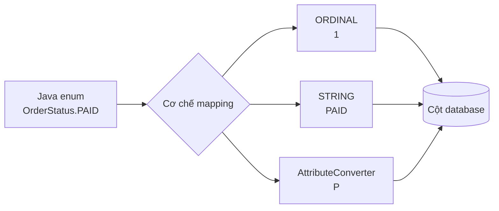
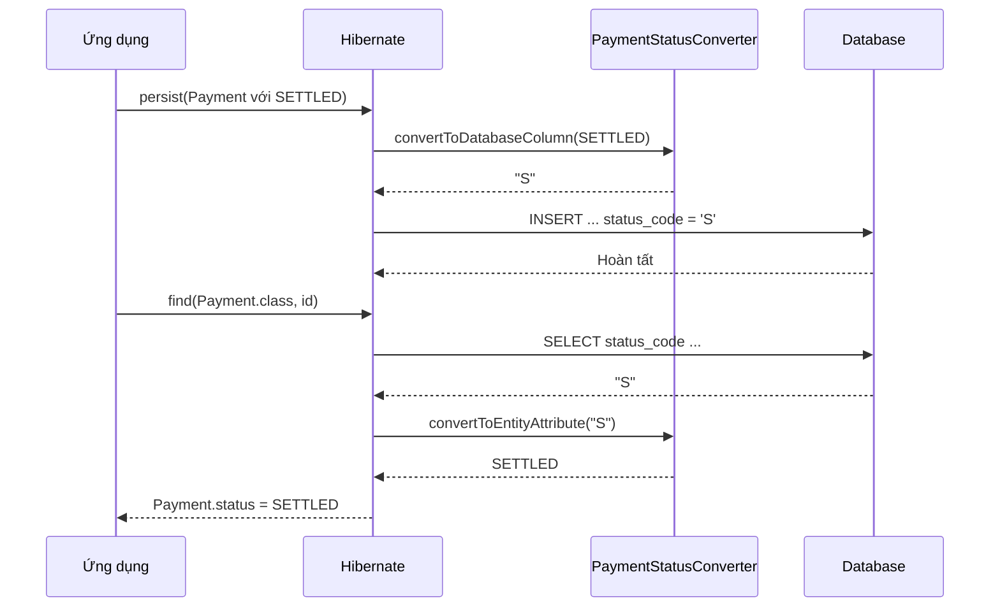

# Enum theo tên hoặc giá trị tùy chỉnh và nguy cơ dùng thứ tự ordinal trong Hibernate

Khi một thuộc tính chỉ được phép nhận một tập giá trị hữu hạn — chẳng hạn trạng thái đơn hàng, phương thức thanh toán hoặc mức ưu tiên — Java `enum` giúp mô hình hóa dữ liệu rõ ràng hơn so với việc lưu chuỗi tùy ý. Trong Hibernate/JPA, điều cần quyết định tiếp theo là **biểu diễn giá trị enum trong cơ sở dữ liệu như thế nào**.

Ba lựa chọn thường gặp là:

1. Lưu **thứ tự khai báo enum** dưới dạng số nguyên, tức `EnumType.ORDINAL`.
2. Lưu **tên hằng enum** dưới dạng chuỗi, tức `EnumType.STRING`.
3. Lưu một **mã nghiệp vụ ổn định do ứng dụng tự quy định**, thông thường bằng `AttributeConverter`.

Những cách ánh xạ này có tác động khác nhau khi mã Java phát triển. Đặc biệt, việc dùng `ORDINAL` cho dữ liệu lưu trữ lâu dài có thể khiến cùng một giá trị trong database được diễn giải thành trạng thái khác sau khi lập trình viên thay đổi thứ tự các hằng enum.

## 1. Enum trong Java và enum được lưu trong database

Xét enum:

```java
public enum OrderStatus {
    CREATED,
    PAID,
    SHIPPED,
    CANCELLED
}
```

Trong bộ nhớ, `OrderStatus.PAID` là một đối tượng enum. Java cung cấp một số giá trị có ý nghĩa khác nhau:

```java
OrderStatus status = OrderStatus.PAID;

System.out.println(status.name());    // "PAID"
System.out.println(status.ordinal()); // 1
System.out.println(status.toString()); // "PAID", nếu không override
```

- `name()` là tên hằng đúng như khai báo trong mã nguồn.
- `ordinal()` là **vị trí bắt đầu từ 0** của hằng trong danh sách khai báo.
- `toString()` mặc định trả tên hằng, nhưng có thể bị override để tạo nội dung hiển thị.

Ví dụ có bốn hằng, ordinal của chúng lần lượt là `0`, `1`, `2`, `3`. Ordinal **không phải mã định danh nghiệp vụ** và không được thiết kế làm khóa lưu trữ ổn định.

Khi entity được ghi xuống database, Hibernate cần chuyển một `OrderStatus` thành giá trị JDBC phù hợp với cột SQL; khi đọc, Hibernate chuyển giá trị cột trở lại thành `OrderStatus`.



Cả ba cách đều có thể hoạt động ở lần triển khai đầu tiên. Khác biệt quan trọng xuất hiện khi enum thay đổi, khi database chứa dữ liệu cũ hoặc khi nhiều phiên bản ứng dụng cùng truy cập database.

## 2. Ánh xạ bằng `@Enumerated(EnumType.ORDINAL)`

Annotation JPA `@Enumerated` khai báo cách ánh xạ thuộc tính enum. Với `ORDINAL`, Hibernate lưu vị trí của hằng.

```java
import jakarta.persistence.Entity;
import jakarta.persistence.EnumType;
import jakarta.persistence.Enumerated;
import jakarta.persistence.Id;

@Entity
public class PurchaseOrder {

    @Id
    private Long id;

    @Enumerated(EnumType.ORDINAL)
    private OrderStatus status;
}
```

Dữ liệu SQL có thể giống:

| `id` | `status` (số nguyên) | Giá trị Java ở phiên bản hiện tại |
|---:|---:|---|
| 101 | 0 | `CREATED` |
| 102 | 1 | `PAID` |
| 103 | 2 | `SHIPPED` |
| 104 | 3 | `CANCELLED` |

Hibernate đọc `1` và chọn hằng enum ở vị trí thứ hai. Database không biết `1` nghĩa là `PAID`; ý nghĩa đó chỉ nằm trong **thứ tự khai báo của mã Java đang chạy**.

### 2.1. Nguy cơ âm thầm khi chèn một hằng ở giữa

Giả sử ban đầu ứng dụng lưu:

```java
public enum OrderStatus {
    CREATED,   // 0
    PAID,      // 1
    SHIPPED,   // 2
    CANCELLED  // 3
}
```

Một phiên bản mới bổ sung `CONFIRMED` vào giữa:

```java
public enum OrderStatus {
    CREATED,    // 0
    CONFIRMED,  // 1: hằng mới
    PAID,       // 2: trước đây là 1
    SHIPPED,    // 3: trước đây là 2
    CANCELLED   // 4: trước đây là 3
}
```

Không có dòng nào trong database tự động thay đổi. Giá trị `status = 1` trước đây có nghĩa `PAID`, nhưng phiên bản mới giải mã thành `CONFIRMED`.

| Giá trị đã lưu | Enum cũ | Enum mới sau khi chèn `CONFIRMED` |
|---:|---|---|
| 0 | `CREATED` | `CREATED` |
| 1 | `PAID` | **`CONFIRMED` — sai ý nghĩa** |
| 2 | `SHIPPED` | **`PAID` — sai ý nghĩa** |
| 3 | `CANCELLED` | **`SHIPPED` — sai ý nghĩa** |

Đây là lỗi nguy hiểm vì ứng dụng có thể **không ném exception**. Các giá trị vẫn nằm trong phạm vi ordinal hợp lệ, chỉ là ý nghĩa đã bị đổi. Những quyết định nghiệp vụ dựa trên trạng thái có thể sai mà không được phát hiện ngay.

### 2.2. Các thay đổi enum có thể làm hỏng ánh xạ ordinal

- **Đổi thứ tự** các hằng: giá trị cũ có thể bị giải mã thành trạng thái khác.
- **Chèn hằng mới ở đầu/giữa**: các hằng phía sau dịch ordinal.
- **Xóa hằng**: dữ liệu cũ có thể được diễn giải thành hằng khác hoặc trỏ tới ordinal không còn tồn tại.
- **Triển khai nhiều phiên bản cùng lúc**: cùng số `1` có thể mang hai ý nghĩa khác nhau trong hai phiên bản ứng dụng.
- **Lưu bản backup rồi khôi phục sau khi thay đổi mã**: ý nghĩa lịch sử của các giá trị có thể mất nếu không còn phiên bản enum tương ứng.

Thêm hằng **ở cuối** giữ nguyên ordinal của các hằng cũ nếu không có thay đổi khác, nhưng vẫn phụ thuộc vào kỷ luật giữ thứ tự mãi mãi. Vì vậy, việc “chỉ thêm ở cuối” không phải một chiến lược bền vững cho dữ liệu nghiệp vụ cần tồn tại lâu dài.

### 2.3. Điều gì xảy ra nếu không viết `@Enumerated`?

Với các cấu hình JPA/Hibernate phổ biến, một enum không có mapping converter hoặc cơ chế đặc biệt thường được ánh xạ theo ordinal. Các phiên bản Jakarta Persistence mới có thêm khả năng ánh xạ enum mà việc suy diễn mặc định có thể khác theo metadata. Vì vậy **không nên phụ thuộc vào một default ngầm**: hãy khai báo rõ chiến lược phù hợp với dự án.

```java
// Thiếu chiến lược rõ ràng: khó nhận biết ý định lưu trữ.
private OrderStatus status;

// Nếu cần lưu tên, khai báo tường minh.
@Enumerated(EnumType.STRING)
private OrderStatus status;
```

Không sử dụng `ordinal()` như một ID nghiệp vụ độc lập ở nơi khác trong hệ thống, ví dụ API, cache key, message queue hay file export.

## 3. Lưu enum theo tên bằng `@Enumerated(EnumType.STRING)`

`EnumType.STRING` yêu cầu JPA/Hibernate lưu **tên hằng enum**. Đây thường là lựa chọn dễ hiểu, phù hợp với các trạng thái có tên ổn định.

```java
import jakarta.persistence.Column;
import jakarta.persistence.Entity;
import jakarta.persistence.EnumType;
import jakarta.persistence.Enumerated;
import jakarta.persistence.Id;
import jakarta.persistence.Table;

@Entity
@Table(name = "purchase_order")
public class PurchaseOrder {

    @Id
    private Long id;

    @Enumerated(EnumType.STRING)
    @Column(name = "status", nullable = false, length = 24)
    private OrderStatus status;
}
```

Giả sử sử dụng cột chuỗi phù hợp, dữ liệu sẽ giống:

| `id` | `status` |
|---:|---|
| 101 | `CREATED` |
| 102 | `PAID` |
| 103 | `SHIPPED` |
| 104 | `CANCELLED` |

Lệnh đọc `PAID` được chuyển thành `OrderStatus.PAID`, **không phụ thuộc vào hằng đó đang đứng thứ mấy** trong file Java.

### 3.1. Ưu điểm

- Người xem database có thể đọc trực tiếp ý nghĩa của cột trạng thái.
- Thay đổi **thứ tự khai báo** không làm sai ý nghĩa dữ liệu cũ.
- Chèn một hằng mới ở bất kỳ vị trí nào không đổi biểu diễn của các hằng đã có.
- SQL quản trị, bản ghi log và báo cáo có thể đọc dễ hơn số ordinal.

### 3.2. Giới hạn quan trọng

`EnumType.STRING` lưu kết quả của **`name()`**, không phải `toString()` hoặc nhãn hiển thị.

```java
public enum OrderStatus {
    CREATED("Đã tạo"),
    PAID("Đã thanh toán"),
    SHIPPED("Đang vận chuyển");

    private final String displayName;

    OrderStatus(String displayName) {
        this.displayName = displayName;
    }

    public String getDisplayName() {
        return displayName;
    }

    @Override
    public String toString() {
        return displayName;
    }
}
```

Với `@Enumerated(EnumType.STRING)`, database vẫn lưu `CREATED`, `PAID` hoặc `SHIPPED`; không lưu `"Đã tạo"` hay `"Đã thanh toán"`. Giao diện có thể hiển thị `displayName`, còn persistence vẫn sử dụng tên hằng.

**Đổi tên hằng là một thay đổi dữ liệu.** Nếu đổi `PAID` thành `SETTLED` trong Java nhưng database vẫn giữ các dòng có `PAID`, Hibernate không thể tự ánh xạ tên cũ sang hằng mới. Cần migration hoặc chiến lược tương thích.

Ngoài ra, độ dài cột, chữ hoa/chữ thường, constraint và khả năng hỗ trợ enum native tùy hệ quản trị. Không nên cho rằng mọi dialect Hibernate đều tự tạo cùng kiểu SQL chỉ vì sử dụng `EnumType.STRING`.

## 4. Khi tên hằng Java không phải giá trị cần lưu

Đôi khi database cần mã trạng thái ổn định, độc lập với tên hằng Java:

| Hằng Java | Mã database | Nhãn hiển thị |
|---|---|---|
| `INITIATED` | `I` | Khởi tạo |
| `SETTLED` | `S` | Đã thanh toán |
| `FAILED` | `F` | Thất bại |

Lưu tên hằng bằng `STRING` trong trường hợp này không đáp ứng yêu cầu, bởi cột phải chứa `I`, `S` hoặc `F`. Cũng không nên dùng `ORDINAL` để tận dụng các số 0, 1, 2 vì đó là thứ tự khai báo, không phải mã thiết kế ổn định.

Giải pháp chuẩn có thể sử dụng với JPA là **`AttributeConverter`** để chuyển qua lại giữa enum và kiểu giá trị của cột SQL.

## 5. Tạo enum mang mã nghiệp vụ ổn định

Ví dụ trạng thái thanh toán:

```java
public enum PaymentStatus {
    INITIATED("I"),
    SETTLED("S"),
    FAILED("F");

    private final String code;

    PaymentStatus(String code) {
        this.code = code;
    }

    public String getCode() {
        return code;
    }

    public static PaymentStatus fromCode(String code) {
        for (PaymentStatus status : values()) {
            if (status.code.equals(code)) {
                return status;
            }
        }

        throw new IllegalArgumentException(
                "Unknown payment status code: " + code);
    }
}
```

Ở đây, `code` là thành phần của hợp đồng dữ liệu. Mã `S` tiếp tục mang nghĩa “đã thanh toán” ngay cả khi đổi tên Java từ `SETTLED` sang `COMPLETED`, với điều kiện ứng dụng vẫn giữ `code = "S"` và xử lý tương thích.

Điều quan trọng là **không tạo code bằng `ordinal()`, `name()` hay `substring()`**. Hãy khai báo mã một cách chủ động, bảo đảm không trùng lặp và không tái sử dụng mã cũ cho ý nghĩa khác.

Đối với enum rất lớn hoặc phải giải mã nhiều lần trong luồng xử lý hiệu năng cao, có thể xây dựng một `Map<String, PaymentStatus>` không đổi để tra cứu theo code. Dù dùng vòng lặp hay map, cần giữ cùng nguyên tắc: **mã không nhận diện được phải được phát hiện rõ ràng**.

## 6. Viết `AttributeConverter` để lưu mã tùy chỉnh

JPA cung cấp interface `jakarta.persistence.AttributeConverter<X, Y>`:

- `X`: kiểu thuộc tính trong entity, ở đây `PaymentStatus`.
- `Y`: kiểu Java trung gian phù hợp với JDBC, ở đây `String`.
- `convertToDatabaseColumn`: đổi enum thành mã lưu xuống cột.
- `convertToEntityAttribute`: đổi mã đọc từ database thành enum.

```java
import jakarta.persistence.AttributeConverter;
import jakarta.persistence.Converter;

@Converter(autoApply = false)
public class PaymentStatusConverter
        implements AttributeConverter<PaymentStatus, String> {

    @Override
    public String convertToDatabaseColumn(PaymentStatus attribute) {
        return attribute == null ? null : attribute.getCode();
    }

    @Override
    public PaymentStatus convertToEntityAttribute(String dbValue) {
        return dbValue == null ? null : PaymentStatus.fromCode(dbValue);
    }
}
```

Sau đó sử dụng trên entity:

```java
import jakarta.persistence.Column;
import jakarta.persistence.Convert;
import jakarta.persistence.Entity;
import jakarta.persistence.Id;
import jakarta.persistence.Table;

@Entity
@Table(name = "payment")
public class Payment {

    @Id
    private Long id;

    @Convert(converter = PaymentStatusConverter.class)
    @Column(name = "status_code", nullable = false, length = 1)
    private PaymentStatus status;
}
```

Một bản ghi:

```sql
INSERT INTO payment (id, status_code)
VALUES (1001, 'S');
```

Khi Hibernate đọc `status_code = 'S'`, converter trả `PaymentStatus.SETTLED`. Khi ghi `PaymentStatus.FAILED`, converter trả `"F"` cho JDBC.

### 6.1. Không kết hợp `@Enumerated` và `@Convert` trên cùng thuộc tính

Với mapping bằng `AttributeConverter` như trên, **không thêm `@Enumerated(EnumType.STRING)` hoặc `@Enumerated(EnumType.ORDINAL)` vào cùng thuộc tính**. Hai cơ chế biểu diễn cùng một giá trị theo hai cách khác nhau; JPA không quy định dùng converter để thay cho `@Enumerated` khi cả hai cùng xuất hiện.

```java
// Đúng: chọn converter để lưu code riêng.
@Convert(converter = PaymentStatusConverter.class)
private PaymentStatus status;

// Không dùng cách này khi đã chọn converter:
// @Enumerated(EnumType.STRING)
// @Convert(converter = PaymentStatusConverter.class)
// private PaymentStatus status;
```

Nếu một lớp enum có nhiều cột cần cùng cách ánh xạ, `@Converter(autoApply = true)` có thể tự động áp dụng converter cho các thuộc tính cùng kiểu trong phạm vi persistence unit khi đủ điều kiện. Tuy nhiên, điều này ảnh hưởng rộng; nên dùng `autoApply = false` và `@Convert` tường minh khi dự án có các trường hợp mapping khác nhau hoặc muốn dễ kiểm tra cấu hình.

### 6.2. Xử lý giá trị null

Converter trên trả `null` khi nhận `null`. Điều đó cho phép ánh xạ một cột nullable, nhưng trong ví dụ entity, `@Column(nullable = false)` thể hiện mong muốn không cho phép trạng thái trống.

Cần phân biệt:

- Converter không được xem là cơ chế duy nhất bảo đảm dữ liệu hợp lệ.
- Constraint `NOT NULL` ở database vẫn cần tồn tại nếu nghiệp vụ bắt buộc có trạng thái.
- Validation trong ứng dụng có thể kiểm tra giá trị trước khi persist.
- Nếu database chứa mã không được định nghĩa, converter nên báo lỗi cụ thể thay vì âm thầm chuyển thành một giá trị mặc định không liên quan.

Cách triển khai `fromCode` ở trên ném `IllegalArgumentException` cho mã lạ; trong quá trình load entity, Hibernate có thể bao bọc nguyên nhân này thành exception khác. Khi điều tra sự cố, cần xem cả `cause` ban đầu.

### 6.3. Converter chạy ở đâu trong luồng dữ liệu?



Hibernate vẫn thực hiện dirty checking, tạo SQL, quản lý transaction và tương tác JDBC. Converter chỉ chịu trách nhiệm chuyển biểu diễn của **giá trị một thuộc tính**, không tự tạo schema, quản lý kết nối hoặc bắt đầu transaction.

## 7. Mã tùy chỉnh dạng số khác hoàn toàn `ORDINAL`

Một số hệ thống muốn lưu mã số vì hợp đồng dữ liệu đã quy định rõ:

```java
public enum DeliveryState {
    PREPARING(10),
    IN_TRANSIT(20),
    DELIVERED(30);

    private final int code;

    DeliveryState(int code) {
        this.code = code;
    }

    public int getCode() {
        return code;
    }

    public static DeliveryState fromCode(int code) {
        for (DeliveryState state : values()) {
            if (state.code == code) {
                return state;
            }
        }
        throw new IllegalArgumentException(
                "Unknown delivery state code: " + code);
    }
}
```

```java
import jakarta.persistence.AttributeConverter;
import jakarta.persistence.Converter;

@Converter
public class DeliveryStateConverter
        implements AttributeConverter<DeliveryState, Integer> {

    @Override
    public Integer convertToDatabaseColumn(DeliveryState state) {
        return state == null ? null : state.getCode();
    }

    @Override
    public DeliveryState convertToEntityAttribute(Integer dbValue) {
        return dbValue == null ? null : DeliveryState.fromCode(dbValue);
    }
}
```

Thuộc tính:

```java
@Convert(converter = DeliveryStateConverter.class)
@Column(name = "delivery_state_code", nullable = false)
private DeliveryState deliveryState;
```

Nếu đảo lại thứ tự khai báo `DeliveryState`, các mã **10, 20, 30** vẫn giữ nguyên vì chúng được chỉ định trong constructor. Nếu dùng `ORDINAL`, cột sẽ chứa **0, 1, 2** và thứ tự khai báo sẽ quyết định ý nghĩa.

| Đặc điểm | `EnumType.ORDINAL` | Converter với mã số tường minh |
|---|---|---|
| Giá trị lưu | Chỉ số vị trí từ 0 | Mã theo hợp đồng nghiệp vụ |
| Đổi vị trí hằng enum | Có thể đổi nghĩa dữ liệu cũ | Không đổi nếu mã giữ nguyên |
| Chèn hằng giữa danh sách | Làm dịch ordinal phía sau | Gán mã mới, mã cũ giữ nguyên |
| Khả năng đọc database | Số khó hiểu nếu thiếu định nghĩa enum theo phiên bản | Có thể đối chiếu mã ổn định trong tài liệu hợp đồng |
| Chi phí duy trì | Ban đầu đơn giản, nhưng phụ thuộc thứ tự | Cần quản lý danh sách mã và quy tắc tương thích |

**Giá trị SQL là số nguyên không có nghĩa mapping đang dùng ordinal.** Phải xem annotation/converter và nguồn sinh ra giá trị đó.

## 8. So sánh và chọn chiến lược ánh xạ

| Tiêu chí | `ORDINAL` | `STRING` | Mã tùy chỉnh + converter |
|---|---|---|---|
| Ví dụ dữ liệu | `1` | `SETTLED` | `S` hoặc `20` |
| Dễ quan sát trực tiếp bằng SQL | Thấp | Cao | Trung bình, cần biết mã |
| An toàn khi đổi thứ tự khai báo enum | Không | Có | Có nếu mã giữ nguyên |
| An toàn khi đổi tên hằng Java | Có thể vẫn cùng ordinal, nhưng rủi ro khác | Không, cần migration/tương thích | Có nếu mã giữ nguyên |
| Dễ đối chiếu với hệ thống ngoài | Thường kém | Tốt nếu dùng chung tên | Tốt khi có hợp đồng mã rõ ràng |
| Kích thước lưu trữ | Thường gọn | Có thể dài hơn | Có thể gọn |
| Độ phức tạp mapping | Thấp | Thấp | Cần converter và xử lý mã lạ |
| Khuyến nghị cho trạng thái nghiệp vụ lâu dài | Nên tránh | Phổ biến, dễ quản lý | Phù hợp khi mã phải ổn định hoặc có tích hợp ngoài |

Không chọn chiến lược chỉ dựa vào số byte tiết kiệm được ở cột. Với dữ liệu cần tồn tại qua nhiều đợt triển khai, khả năng giữ nguyên ý nghĩa sau khi sửa mã nguồn thường quan trọng hơn.

### 8.1. Khi nên chọn `STRING`

- Tên hằng đã là mã nghiệp vụ dễ hiểu, ví dụ `DRAFT`, `APPROVED`, `REJECTED`.
- Không có yêu cầu tích hợp định nghĩa mã riêng.
- Đội phát triển thống nhất không đổi tên hằng mà không thực hiện migration.
- Muốn truy vấn SQL thủ công dễ đọc.

### 8.2. Khi nên chọn converter

- Database đang dùng mã ngắn hoặc mã lịch sử đã tồn tại.
- Tên enum Java có thể được refactor nhưng mã lưu trữ phải ổn định.
- API, message hoặc hệ thống bên ngoài quy định một bộ mã cụ thể.
- Cần ánh xạ giá trị số không liên tiếp, ví dụ `10`, `20`, `30`.

### 8.3. Khi nào `ORDINAL` có thể chấp nhận?

Một số dữ liệu tạm thời hoàn toàn thuộc vòng đời của một phiên bản mã có thể chấp nhận ordinal nếu dự án **cam kết và kiểm soát thứ tự enum**. Nhưng ngay cả khi đó, mapping theo tên hoặc mã tường minh thường làm ý định rõ ràng hơn. Đối với dữ liệu lưu trữ lâu dài, dữ liệu trao đổi giữa phiên bản hoặc trạng thái có ý nghĩa nghiệp vụ, nên tránh ordinal.

## 9. Enum trong truy vấn JPQL/HQL và SQL thuần

### 9.1. Truy vấn bằng giá trị enum trong JPQL

Với entity `Payment` dùng `PaymentStatusConverter`:

```java
List<Payment> settledPayments = entityManager.createQuery(
    "select p from Payment p where p.status = :status",
    Payment.class
)
.setParameter("status", PaymentStatus.SETTLED)
.getResultList();
```

Ở đây, mã Java truyền **enum**, không cần tự truyền `"S"`. Hibernate nhận biết mapping của thuộc tính và xử lý chuyển giá trị tham số theo mapping tương ứng trong ngữ cảnh truy vấn.

Đối với entity dùng `@Enumerated(EnumType.STRING)`, tham số cũng là enum; cột dữ liệu có thể nhận `"SETTLED"` theo tên hằng.

### 9.2. SQL thuần thao tác trực tiếp với representation

Với schema dùng mã tùy chỉnh:

```sql
SELECT id, status_code
FROM payment
WHERE status_code = 'S';
```

Câu SQL ở trên lọc theo **mã đã lưu**. Khi viết native query hoặc xử lý JDBC trực tiếp không dựa trên mapping thuộc tính entity, ứng dụng phải nắm representation thực tế của cột.

Không giả định rằng một native SQL query có tham số enum sẽ tự dùng converter giống mọi JPQL entity query trong mọi tình huống. Với native query, kiểu tham số và cơ chế áp dụng mapping tùy cách Hibernate/JPA nhận được thông tin ánh xạ.

### 9.3. Dữ liệu trong DB phải có cùng quy ước

Nếu cột `status_code` lưu `S` mà entity bất ngờ đổi sang `@Enumerated(EnumType.STRING)`, Hibernate sẽ tìm tên `SETTLED`, không thể tự hiểu `S` là một tên hằng enum. Thay đổi annotation mapping phải đi cùng chiến lược chuyển đổi dữ liệu hoặc giữ tương thích.

## 10. Thiết kế schema cho enum

### 10.1. Dùng cột chuỗi hoặc số thông thường

Với `@Enumerated(EnumType.STRING)`, ứng dụng thường cần cột SQL có khả năng lưu tên enum, ví dụ `VARCHAR`. Với converter trả `String` hoặc `Integer`, kiểu cột nên tương ứng với mã được trả về.

Ví dụ PostgreSQL cho mã thanh toán:

```sql
CREATE TABLE payment (
    id BIGINT PRIMARY KEY,
    status_code VARCHAR(1) NOT NULL,
    CONSTRAINT payment_status_code_check
        CHECK (status_code IN ('I', 'S', 'F'))
);
```

Constraint giúp database từ chối mã ngoài danh sách, kể cả khi dữ liệu được ghi bằng công cụ SQL khác Hibernate. Cần đồng bộ danh sách mã hợp lệ khi bổ sung trạng thái mới.

Nếu dùng chuỗi theo `name()`, constraint có thể là:

```sql
CHECK (status IN ('CREATED', 'PAID', 'SHIPPED', 'CANCELLED'))
```

Nhưng đừng xem `CHECK` là một cách tự động chuyển dữ liệu khi sửa enum. Khi thêm/đổi tên trạng thái, migration cần điều chỉnh cả dữ liệu hiện hữu và constraint thích hợp.

### 10.2. Có nên dùng kiểu ENUM native của DBMS?

Một số DBMS cung cấp kiểu enum riêng (ví dụ PostgreSQL có type do người dùng định nghĩa; MySQL có cú pháp enum ở cấp cột). Đây là **một quyết định về schema database**, không đồng nghĩa với Java `enum` hoặc JPA `@Enumerated`.

Hibernate/dialect và phiên bản cụ thể có thể hỗ trợ ánh xạ kiểu native theo các cách khác nhau; một số trường hợp cần cấu hình JDBC type bổ sung và migration tạo type trước. Không mặc định rằng `@Enumerated(EnumType.STRING)` luôn tạo `VARCHAR` hoặc luôn tự tạo type native.

Ưu điểm của enum native có thể là ràng buộc dữ liệu trực tiếp; nhược điểm là quy trình bổ sung/đổi giá trị có thể phụ thuộc DBMS và yêu cầu migration riêng. Với nhu cầu tích hợp đa cơ sở dữ liệu, `VARCHAR` kết hợp constraint hay bảng tra cứu thường dễ kiểm soát hơn.

### 10.3. Khi enum không còn là tập giá trị cố định

Nếu trạng thái/mã có thể được cấu hình bởi người vận hành, thêm/xóa thường xuyên, có mô tả đa ngôn ngữ hoặc mang thuộc tính nghiệp vụ riêng, cân nhắc một **bảng tra cứu (lookup table)** với khóa ổn định, ràng buộc khóa ngoại và metadata riêng.

Java enum phù hợp nhất khi tập giá trị được xác định ở cấp mã nguồn và được triển khai có kiểm soát.

## 11. Di trú an toàn từ `ORDINAL` sang `STRING`

Đây là tình huống thường gặp khi dự án ban đầu lưu trạng thái dạng số, sau đó nhận ra rủi ro khi thay đổi enum.

Giả sử phiên bản cũ có enum:

```java
public enum ShipmentStatus {
    READY,      // 0
    SHIPPED,    // 1
    CANCELLED   // 2
}
```

Bảng PostgreSQL hiện đang lưu `shipment.status` kiểu số nguyên:

| `id` | `status` |
|---:|---:|
| 1 | 0 |
| 2 | 1 |
| 3 | 2 |

**Không đổi mapping thành `@Enumerated(EnumType.STRING)` rồi triển khai ngay.** Cột vẫn chứa số, nhưng ứng dụng mới sẽ cố ánh xạ chuỗi tên enum; quá trình đọc/ghi có thể thất bại. Hơn nữa, nếu enum đã từng thay đổi thứ tự, không thể dựa vào thứ tự hiện tại để suy diễn dữ liệu cũ.

### 11.1. Bước 1: cố định ý nghĩa ordinal lịch sử

Đầu tiên, xác định chính xác mapping tại thời điểm các bản ghi được tạo:

```text
0 -> READY
1 -> SHIPPED
2 -> CANCELLED
```

Nếu dữ liệu được ghi bởi nhiều phiên bản có thứ tự enum khác nhau, cùng một ordinal có thể đã mang nhiều ý nghĩa. Khi đó cần đối soát từ log, dữ liệu nghiệp vụ hoặc metadata phiên bản; không thể giải quyết chỉ bằng một câu `CASE` chung.

### 11.2. Bước 2: bổ sung cột mới, không ghi đè ngay cột cũ

Ví dụ migration minh họa cho PostgreSQL:

```sql
ALTER TABLE shipment
ADD COLUMN status_name VARCHAR(16);

UPDATE shipment
SET status_name = CASE status
    WHEN 0 THEN 'READY'
    WHEN 1 THEN 'SHIPPED'
    WHEN 2 THEN 'CANCELLED'
    ELSE NULL
END;
```

Sau đó tìm các bản ghi không chuyển đổi được:

```sql
SELECT id, status, status_name
FROM shipment
WHERE status_name IS NULL;
```

Chỉ tiếp tục sau khi đã kiểm tra không còn bản ghi bất thường và xác nhận số lượng, phân bố các trạng thái. Với bảng lớn, cần thiết kế thao tác theo đợt và kế hoạch khóa bảng/hiệu năng phù hợp.

### 11.3. Bước 3: cập nhật mapping theo cột mới

Trong một đợt chuyển đổi có kiểm soát, ứng dụng mới có thể dùng:

```java
@Enumerated(EnumType.STRING)
@Column(name = "status_name", nullable = false, length = 16)
private ShipmentStatus status;
```

Trước khi áp dụng `NOT NULL` ở database, cần xử lý tất cả bản ghi thiếu dữ liệu và xác nhận toàn bộ luồng ghi mới có thể duy trì cột.

Đối với hệ thống cần chạy đồng thời ứng dụng cũ và mới, việc bổ sung cột đơn lẻ **không tự bảo đảm tương thích**: mã cũ có thể chỉ ghi `status` và mã mới chỉ ghi `status_name`. Cần phương án dual-write/đồng bộ hoặc lịch bảo trì, tùy kiến trúc, trước khi cho cả hai phiên bản xử lý dữ liệu cùng lúc.

### 11.4. Bước 4: dọn schema sau khi chuyển đổi

Khi mọi ứng dụng và báo cáo đã dùng cột chuỗi, có thể lên kế hoạch bỏ cột ordinal cũ, đổi tên cột mới hoặc bổ sung constraint. Ví dụ trong giai đoạn dọn dẹp riêng:

```sql
ALTER TABLE shipment
ALTER COLUMN status_name SET NOT NULL;

-- Chỉ thực hiện sau khi đã xác minh không còn phụ thuộc cột cũ.
ALTER TABLE shipment
DROP COLUMN status;

ALTER TABLE shipment
RENAME COLUMN status_name TO status;
```

Sau bước đổi tên, mapping cũng cần trỏ đến cột `status`. Các bước DDL trên chỉ là minh họa; khi triển khai thực tế cần cân nhắc các truy vấn đang chạy, replication, rollback, backup và công cụ migration như Flyway/Liquibase.

### 11.5. Nếu muốn chuyển sang mã tùy chỉnh

Thay `'READY'`, `'SHIPPED'`, `'CANCELLED'` bằng các mã do nghiệp vụ quy định và gắn `AttributeConverter` tương ứng. Ví dụ:

```text
0 -> "R"
1 -> "S"
2 -> "C"
```

Sau đó thống nhất rằng mã `R`, `S`, `C` sẽ không bị thay đổi ý nghĩa khi enum Java được bổ sung hoặc đổi thứ tự.

## 12. Chính sách tương thích khi thay đổi enum

Một enum đang được lưu trong database là một phần của **hợp đồng dữ liệu**, không chỉ là một file Java nội bộ.

| Thay đổi mã nguồn | Mapping `ORDINAL` | Mapping `STRING` | Mapping mã tùy chỉnh |
|---|---|---|---|
| Thêm hằng ở cuối | Ordinal cũ thường giữ nguyên | Tên cũ giữ nguyên | Mã cũ giữ nguyên |
| Thêm hằng ở giữa | **Nguy cơ đổi nghĩa ordinal cũ** | Tên cũ giữ nguyên | Mã cũ giữ nguyên |
| Đảo thứ tự hằng | **Nguy cơ đổi nghĩa dữ liệu** | Không ảnh hưởng đến tên đã lưu | Không ảnh hưởng nếu mã ổn định |
| Đổi tên hằng | Nếu giữ vị trí, số cũ không đổi nhưng vẫn giòn | **Cần migration hoặc hỗ trợ tên cũ** | Có thể không ảnh hưởng nếu mã cũ giữ nguyên |
| Xóa một hằng | Có thể làm dịch số hoặc giải mã lỗi | Dữ liệu chứa tên cũ không còn ánh xạ được | Cần chính sách xử lý mã cũ |
| Đổi mã tùy chỉnh | Không áp dụng | Không áp dụng | **Cần migration/compatibility** |
| Đổi nhãn hiển thị | Không đổi ordinal | Không đổi `name()` | Không đổi mã nếu tách biệt nhãn |

Đặc biệt, **một mã đã từng được lưu không nên được tái sử dụng để biểu diễn ý nghĩa khác**. Nếu trạng thái bị ngừng sử dụng, có thể giữ khả năng đọc dữ liệu lịch sử, hoặc thiết kế quy trình migrate về trạng thái thay thế trước khi xóa hằng.

### 12.1. Hai phiên bản ứng dụng chạy song song

Ví dụ ứng dụng cũ chỉ biết `INITIATED` và `SETTLED`; ứng dụng mới bổ sung `REFUNDED`. Nếu ứng dụng mới ghi `REFUNDED` vào database trong khi ứng dụng cũ vẫn phải đọc bản ghi đó, ứng dụng cũ có thể không hiểu giá trị mới dù mapping là `STRING` hay converter.

Vì vậy, sự ổn định khi **đổi thứ tự** không đồng nghĩa với tương thích khi **bổ sung ý nghĩa mới**. Với triển khai rolling deployment, cần xác định liệu ứng dụng cũ có thể gặp giá trị mới hay không, và sử dụng chiến lược mở rộng từng bước, feature flag, hoặc cơ chế đọc tương thích nếu nghiệp vụ cho phép.

### 12.2. Không tùy tiện trả một enum mặc định cho mã lạ

Một converter như sau trông có vẻ “chịu lỗi” nhưng có thể che giấu dữ liệu hỏng:

```java
// Không khuyến nghị cho trạng thái nghiệp vụ quan trọng.
public static PaymentStatus fromCode(String code) {
    for (PaymentStatus status : values()) {
        if (status.getCode().equals(code)) {
            return status;
        }
    }
    return PaymentStatus.INITIATED; // Che giấu mã không hợp lệ.
}
```

Nếu database chứa `"X"` nhưng ứng dụng âm thầm coi đó là `INITIATED`, quyết định nghiệp vụ có thể sai mà không có cảnh báo. Nếu hệ thống thực sự cần xử lý mã tương lai, hãy thiết kế chính sách có chủ đích, ví dụ lớp mô hình dữ liệu tách `known value` và `raw code`, thay vì ép mọi giá trị chưa biết về một trạng thái có nghĩa.

## 13. Những lỗi thường gặp và cách tìm nguyên nhân

| Triệu chứng | Nguyên nhân khả dĩ | Cách xử lý |
|---|---|---|
| Đơn hàng cũ hiển thị sai trạng thái sau khi phát hành phiên bản mới | Chèn/đảo/xóa hằng khi cột dùng `ORDINAL` | Khôi phục mapping lịch sử, đối chiếu dữ liệu, lên migration ổn định |
| Lỗi kiểu `No enum constant ...` | Cột chuỗi chứa tên hằng không tồn tại trong enum Java hiện tại | Kiểm tra giá trị database, tên hằng, lịch sử đổi tên |
| Lỗi khi convert giá trị `"X"` | Converter không nhận diện mã database | Đối soát dữ liệu; bổ sung chính sách mã hợp lệ hoặc migration |
| Lỗi kiểu SQL/JDBC khi ghi enum | Kiểu cột không phù hợp với representation, ví dụ số so với `VARCHAR` | Kiểm tra DDL, annotation, converter và dialect |
| Native SQL tìm theo `'PAID'` nhưng không thấy dữ liệu | Cột thực tế lưu mã `'P'` hoặc ordinal `1` | Xem representation thật; thống nhất truy vấn |
| App cũ không đọc được trạng thái app mới ghi | Giá trị mới chưa có trong enum của phiên bản cũ | Quản lý tương thích khi triển khai song song |
| Constraint database từ chối giá trị mới | CHECK/native enum chưa được nâng cấp | Migration schema trước khi mã mới bắt đầu ghi |
| Thay đổi `toString()` nhưng SQL không thay đổi | `EnumType.STRING` dùng `name()` | Dùng converter nếu cần representation riêng |

Khi điều tra một sự cố enum mapping, hãy kiểm tra theo chuỗi:

1. Thuộc tính đang dùng `@Enumerated(ORDINAL)`, `@Enumerated(STRING)`, converter hay cấu hình riêng?
2. Kiểu cột SQL thực tế là gì? Database đang chứa **giá trị cụ thể** nào?
3. Lịch sử enum có thay đổi thứ tự, tên hằng, mã hoặc số lượng trạng thái không?
4. Có phiên bản cũ/mới nào đang đồng thời đọc/ghi không?
5. Constraint, native enum type, dữ liệu migration và các câu SQL thuần đã thống nhất cùng một hợp đồng chưa?

Bật SQL log Hibernate khi thích hợp có thể giúp thấy cột và tham số được ràng buộc, nhưng cần bảo vệ dữ liệu nhạy cảm và không phụ thuộc hoàn toàn vào dạng log vì cách in tham số có thể khác theo phiên bản.

## 14. Bài thực hành áp dụng

### Tình huống A — Bổ sung trạng thái mới

Hệ thống đang có:

```java
public enum ApprovalStatus {
    PENDING,
    APPROVED,
    REJECTED
}
```

Database lưu ordinal. Một lập trình viên đổi thành:

```java
public enum ApprovalStatus {
    PENDING,
    IN_REVIEW,
    APPROVED,
    REJECTED
}
```

**Câu hỏi:** Dòng dữ liệu `status = 1` đã tồn tại sẽ được hiểu là gì sau khi triển khai?

**Lời giải:** Trước đây là `APPROVED`; sau thay đổi, `1` là `IN_REVIEW`. Đây là lỗi thay đổi ý nghĩa dữ liệu. Để tránh phát sinh thêm lỗi, cần ngừng sử dụng ordinal cho trạng thái lưu trữ bền vững, xác định mapping lịch sử, rồi migrate sang chuỗi tên hoặc mã cố định trước khi thay đổi thứ tự/hằng mới.

### Tình huống B — Tên Java có thể đổi, mã database phải cố định

Yêu cầu lưu:

```text
P -> PENDING
A -> ACCEPTED
R -> REJECTED
```

Lập trình viên muốn đổi tên `ACCEPTED` thành `APPROVED` mà không chuyển dữ liệu trong database.

**Câu hỏi:** Nên chọn `STRING` hay converter?

**Lời giải:** Chọn converter với mã tường minh `"A"`. Khi đổi tên Java, vẫn gắn mã `"A"` cho hằng tương ứng. Nếu dùng `EnumType.STRING`, database đang lưu `"ACCEPTED"` sẽ không tự biến thành `"APPROVED"`.

### Tình huống C — Cột là số, nhưng số không phải ordinal

Một bảng có cột `priority_code` chứa `10`, `20` và `30`. Java enum được khai báo:

```java
public enum Priority {
    HIGH(30),
    LOW(10),
    NORMAL(20);

    private final int code;

    Priority(int code) {
        this.code = code;
    }
}
```

**Câu hỏi:** Có thể dùng `@Enumerated(EnumType.ORDINAL)` không?

**Lời giải:** Không. Ordinal của `HIGH` là `0`, `LOW` là `1`, `NORMAL` là `2`, hoàn toàn khác mã database `30`, `10`, `20`. Cần converter `AttributeConverter<Priority, Integer>` trả về `code` và giải mã dựa trên `code`.

### Tình huống D — Đổi nhãn hiển thị

Entity lưu `@Enumerated(EnumType.STRING)` với `DeliveryStatus.DELIVERED`. Ứng dụng đổi nhãn hiển thị từ “Đã giao” thành “Giao hàng thành công” thông qua thuộc tính `displayName`, không đổi tên `DELIVERED`.

**Câu hỏi:** Có cần migration dữ liệu?

**Lời giải:** Không, nếu chỉ đổi nhãn phục vụ giao diện. Hibernate tiếp tục lưu `"DELIVERED"` theo `name()`; thay đổi nhãn không ảnh hưởng đến giá trị database.

## 15. Nguyên tắc ghi nhớ khi thiết kế enum persistence

1. **Không dùng thứ tự khai báo làm mã nghiệp vụ ổn định.** `ordinal()` chỉ mô tả vị trí hiện tại của hằng Java.
2. **Ưu tiên `@Enumerated(EnumType.STRING)`** khi tên hằng là mã dữ liệu đủ ổn định, dễ hiểu.
3. **Dùng `AttributeConverter`** khi schema cần mã chuỗi/số riêng; giữ mã ổn định qua các lần refactor enum.
4. **Không kết hợp `@Enumerated` và converter trên cùng thuộc tính.** Chọn một cơ chế biểu diễn rõ ràng.
5. **Tách tên hằng, mã lưu trữ và nhãn hiển thị.** Ba khái niệm này có vòng đời thay đổi khác nhau.
6. **Bổ sung hoặc đổi tên trạng thái cần xem xét tương thích dữ liệu.** Không coi việc sửa enum là thay đổi Java thuần túy.
7. **Migration phải dựa trên ý nghĩa dữ liệu lịch sử.** Không suy diễn ordinal cũ từ enum đã sửa đổi.
8. **Đồng bộ mapping với DDL và các hệ thống liên quan.** Constraint, query, báo cáo, API và triển khai nhiều phiên bản phải dùng hợp đồng nhất quán.

Với dữ liệu Hibernate cần tồn tại lâu dài, hãy chọn giá trị lưu trữ theo **ý nghĩa ổn định**, độc lập với thứ tự hằng trong Java. Cách thiết kế này giúp thay đổi mã nguồn an toàn hơn, làm dữ liệu dễ hiểu và giảm nguy cơ ứng dụng diễn giải sai trạng thái mà không phát sinh lỗi rõ ràng.
