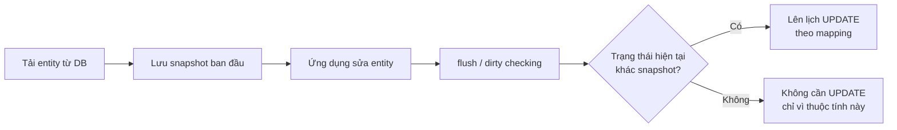
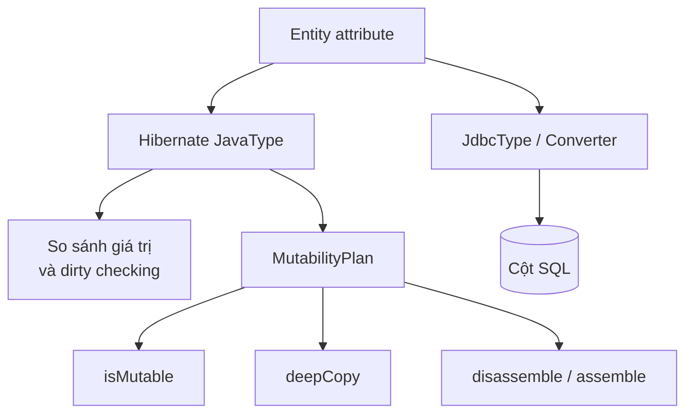
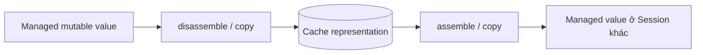

# Tính có thể thay đổi của giá trị và ảnh hưởng đến sao chép với kiểm tra thay đổi trong Hibernate

Khi Hibernate quản lý một entity, nó cần xác định thuộc tính nào đã thay đổi để đồng bộ dữ liệu xuống cơ sở dữ liệu. Với kiểu dữ liệu đơn giản như `String` hoặc `BigDecimal`, cách phát hiện khá trực quan: ứng dụng thường gán một **giá trị mới** thay cho giá trị cũ. Nhưng với `Date`, mảng, danh sách, map hoặc một object JSON có thể bị thay đổi **ngay bên trong cùng một instance**, vấn đề phức tạp hơn.

Ví dụ:

```java
// Trường hợp A: gán tham chiếu tới giá trị mới.
invoice.setDescription("Đã xác nhận");

// Trường hợp B: sửa nội dung object đang được tham chiếu.
invoice.getTags().add("urgent");
```

Trong trường hợp B, reference của thuộc tính `tags` có thể vẫn là cùng một object. Nếu Hibernate lưu bản gốc bằng cách giữ cùng reference đó, mọi thay đổi đối với object hiện tại cũng sẽ làm “bản gốc” thay đổi theo. Hibernate không còn dữ liệu độc lập để so sánh và có thể **bỏ sót thay đổi**.

Vì vậy, **mutability (khả năng thay đổi tại chỗ) của giá trị**, cách **sao chép trạng thái ban đầu** và cơ chế **dirty checking** có quan hệ trực tiếp với nhau. Hibernate dùng các thông tin về Java type, đặc biệt cơ chế `MutabilityPlan`, để quyết định khi nào có thể chia sẻ reference và khi nào cần một bản sao độc lập.

Bài học tập trung vào giá trị được ánh xạ thành các thuộc tính của entity trong Hibernate/Jakarta Persistence. Cần phân biệt *mutability của một giá trị Java* với *entity có được phép cập nhật vào database hay không*; hai khái niệm có liên quan nhưng không giống nhau.

## 1. Mutable và immutable value khác nhau ở điểm nào?

### 1.1. Immutable value: trạng thái không đổi sau khi tạo

Một giá trị **immutable** không cho phép thay đổi trạng thái quan sát được sau khi đã được tạo. Muốn biểu diễn nội dung khác, ứng dụng tạo hoặc lấy một object giá trị khác.

```java
String oldName = "draft";
String newName = oldName.toUpperCase();

// oldName vẫn là "draft".
// newName là "DRAFT".
```

Những kiểu thường được xem là immutable:

- `String`, `UUID`, các wrapper số như `Integer` và `Long`.
- `BigInteger` và `BigDecimal`; các phép toán trả về giá trị mới.
- Các kiểu chính trong `java.time` như `Instant`, `LocalDate` và `LocalDateTime`.
- Một value object tự định nghĩa chỉ chứa thành phần immutable và không cho phép sửa trạng thái.

**Lưu ý:** `final` chỉ ngăn gán lại biến hoặc field; nó không tự biến object được tham chiếu thành immutable.

```java
final List<String> labels = new ArrayList<>();
labels.add("new"); // Vẫn thay đổi danh sách được.
```

### 1.2. Mutable value: cùng object nhưng trạng thái bên trong thay đổi

Một giá trị **mutable** có thể đổi nội dung mà reference vẫn giữ nguyên:

```java
Date scheduledAt = new Date();
Date sameObject = scheduledAt;

scheduledAt.setTime(scheduledAt.getTime() + 86_400_000L);

System.out.println(scheduledAt == sameObject); // true
```

Một số kiểu mutable thường gặp:

| Kiểu/nhóm | Cách thay đổi tại chỗ | Lưu ý khi ánh xạ |
|---|---|---|
| `java.util.Date`, `Calendar` | `setTime(...)`, `add(...)` | Hibernate cần snapshot độc lập để so sánh giá trị cũ và mới |
| `byte[]`, `char[]`, mảng bất kỳ | Thay phần tử ở một index | Copy reference không đủ; mảng phần tử mutable còn cần copy từng phần tử |
| `ArrayList`, `HashMap` | `add`, `put`, `remove` | Phân biệt basic value JSON/converter với persistent collection do Hibernate quản lý |
| POJO có setter | Đổi field của cùng instance | Equality, deep copy và mutability metadata phải nhất quán |
| Object có trường mutable lồng nhau | `getAddress().setCity(...)` | Bản copy nông có thể vẫn chia sẻ object con |

Việc một class **trông như immutable** vì không có setter cũng chưa đủ nếu getter làm lộ `List`, `Map` hoặc mảng có thể sửa bên trong.

### 1.3. Mutable/immutable là thuộc tính của giá trị, không đồng nghĩa khả năng cập nhật entity

Hai quyết định khác nhau:

1. **Giá trị Java có thể bị sửa tại chỗ không?** Đây là vấn đề mutability của Java type và cách Hibernate sao chép/so sánh.
2. **Cột hoặc entity có được Hibernate cập nhật không?** Đây là vấn đề mapping như `@Immutable`, `@Column(updatable = false)` hoặc chính sách nghiệp vụ.

Ví dụ, một `String` vốn immutable vẫn có thể là thuộc tính *được phép cập nhật*:

```java
@Column(name = "display_name")
private String displayName;

public void rename(String newName) {
    this.displayName = newName;
}
```

Ngược lại, một `Map` là mutable nhưng được đánh dấu mapping “không cập nhật” vẫn có thể bị Java code sửa trong bộ nhớ. Khi đó object trong RAM và dữ liệu DB có nguy cơ khác nhau về mặt quan sát, dù Hibernate không gửi SQL update.

## 2. Dirty checking cần trạng thái gốc để so sánh

Khi một entity trở thành **managed**, Hibernate theo dõi trạng thái cần thiết để xác định những trường được sửa. Trong mô hình snapshot-based dirty checking, Hibernate so sánh **giá trị hiện tại** với **giá trị trước đó** tại thời điểm flush.



Ví dụ với một giá trị immutable:

```java
Invoice invoice = entityManager.find(Invoice.class, id);

// Giả sử mô tả ban đầu là "DRAFT".
invoice.setDescription("APPROVED");

entityManager.flush();
```

Hibernate có thể so sánh `"DRAFT"` với `"APPROVED"`. Vì `String` không bị thay đổi tại chỗ, reference tới giá trị cũ có thể dùng làm snapshot an toàn.

Ví dụ với mutable value:

```java
Invoice invoice = entityManager.find(Invoice.class, id);

Date expectedAt = invoice.getExpectedAt();
expectedAt.setTime(expectedAt.getTime() + 86_400_000L);

entityManager.flush();
```

Thuộc tính `expectedAt` vẫn trỏ tới cùng `Date`. Để phát hiện thay đổi theo nội dung, Hibernate cần bản snapshot độc lập và chiến lược equality phù hợp. Nếu không, việc so sánh có thể nhìn thấy cùng object ở cả hai phía và bỏ sót chỉnh sửa.

### 2.1. Tại sao snapshot giữ chung reference có thể sai?

Giả sử Hibernate lưu trạng thái bằng cách gán reference:

```java
List<String> current = new ArrayList<>(List.of("A"));
List<String> snapshot = current; // Chỉ alias, chưa sao chép.

current.add("B");

System.out.println(snapshot); // [A, B]
System.out.println(snapshot.equals(current)); // true
```

“Bản gốc” đã bị sửa cùng lúc với current. Đây là **aliasing**: hai biến cùng trỏ tới một object. So sánh snapshot/current không còn nói được trạng thái từng là gì.

Phải sao chép độc lập nếu muốn phát hiện chỉnh sửa tại chỗ:

```java
List<String> current = new ArrayList<>(List.of("A"));
List<String> snapshot = new ArrayList<>(current);

current.add("B");

System.out.println(snapshot); // [A]
System.out.println(snapshot.equals(current)); // false
```

Ví dụ này copy danh sách các `String` nên đủ an toàn; với phần tử là object mutable, `new ArrayList<>(current)` chỉ sao chép **cấu trúc danh sách**, chưa copy object bên trong.

### 2.2. Dirty checking xảy ra khi nào?

Hibernate thường đánh giá thay đổi khi cần `flush`, chẳng hạn trước commit hoặc tại một số điểm cần đồng bộ theo flush mode. Gọi `persist`, `setX` hoặc sửa object con không đồng nghĩa lập tức có SQL update.

```java
@Transactional
public void changeDescription(Long id) {
    Invoice invoice = entityManager.find(Invoice.class, id);
    invoice.setDescription("Approved");

    // Chưa nhất thiết có UPDATE ngay tại dòng này.
    // Khi flush, Hibernate quyết định có cần UPDATE không.
}
```

`flush` khác `commit`. Hibernate có thể đã gửi UPDATE nhưng transaction vẫn có thể rollback. Với entity detached, cơ chế dirty checking của persistence context hiện tại không tự áp dụng cho thay đổi của object detached.

## 3. Shallow copy và deep copy khác nhau thế nào?

### 3.1. Shallow copy: chép vỏ object nhưng dùng chung object con

```java
final class NotificationOptions {
    private final List<String> channels;

    NotificationOptions(List<String> channels) {
        this.channels = channels;
    }

    List<String> getChannels() {
        return channels;
    }
}

NotificationOptions source =
    new NotificationOptions(new ArrayList<>(List.of("EMAIL")));

NotificationOptions shallow =
    new NotificationOptions(source.getChannels());

source.getChannels().add("SMS");

// Hai NotificationOptions vẫn chia sẻ cùng List.
System.out.println(shallow.getChannels()); // [EMAIL, SMS]
```

Một snapshot kiểu này không ổn nếu collection con tiếp tục bị sửa.

### 3.2. Deep copy: sao chép toàn bộ trạng thái mutable cần độc lập

```java
final class NotificationOptions {
    private final List<String> channels;

    NotificationOptions(List<String> channels) {
        this.channels = new ArrayList<>(channels);
    }

    NotificationOptions(NotificationOptions source) {
        this(source.channels);
    }

    List<String> getChannels() {
        return channels;
    }
}

NotificationOptions current =
    new NotificationOptions(List.of("EMAIL"));
NotificationOptions snapshot =
    new NotificationOptions(current);

current.getChannels().add("SMS");

// snapshot vẫn chỉ có EMAIL.
```

Vì phần tử của danh sách là `String` immutable, tạo `new ArrayList<>(source.channels)` đã tách các phần mutable ở ví dụ này.

Với cấu trúc lồng nhau như `Map<String, List<Address>>`, cần sao chép từng `List` và từng `Address` mutable bên trong. **Deep copy không có nghĩa cứ gọi `clone()`**: một triển khai `clone()` mặc định hoặc copy constructor hời hợt vẫn có thể chia sẻ object con.

### 3.3. Deep copy không phải serialization một cách mặc định

Một số ứng dụng chọn JSON round-trip hoặc Java serialization để tạo bản copy. Cách này có thể chạy nhưng thường tốn CPU, bộ nhớ, không bảo toàn mọi kiểu runtime hoặc thiếu an toàn với model đặc biệt. Với object domain có cấu trúc biết trước, copy constructor hoặc hàm deep copy tường minh thường dễ kiểm soát hơn.

Ngoài ra, tính đúng của deep copy phụ thuộc định nghĩa **giá trị quan sát được**. Nếu một object giữ cache tính toán có thể tái tạo lại, có thể không cần copy cache đó; nhưng những trường tham gia so sánh và lưu trữ phải được tách độc lập.

## 4. MutabilityPlan trong hệ thống kiểu dữ liệu của Hibernate

Hibernate có một hệ thống mô tả kiểu rộng hơn tên Java class. Trong Hibernate 6, các khái niệm đáng chú ý:

- **`JavaType<T>`** mô tả cách Hibernate hiểu giá trị phía Java, bao gồm các hoạt động so sánh/equality và chuyển đổi liên quan.
- **`JdbcType`** mô tả cách giá trị được bind và extract qua JDBC, gắn với biểu diễn SQL.
- **`MutabilityPlan<T>`** mô tả giá trị có mutable không, cách deep copy và cách chuẩn bị/tái tạo trạng thái phục vụ những cơ chế như cache.
- **Mapping attribute** nối Java property với cột SQL, converter hoặc cấu trúc persistent tương ứng.



Ý tưởng không phải Hibernate gọi `deepCopy` vô điều kiện cho mọi kiểu, mà là Hibernate có **chiến lược sao chép và theo dõi hợp với tính mutable thực sự**.

### 4.1. Vai trò chính của MutabilityPlan

| Hoạt động | Điều cần biết từ mutability |
|---|---|
| Tạo snapshot cho dirty checking | Giá trị có thể chia sẻ reference an toàn hay cần copy độc lập? |
| So sánh khi flush | Hai giá trị hiện tại/gốc có bằng nhau theo nội dung lưu trữ không? |
| Second-level cache | Cần tháo lắp và sao chép trạng thái thế nào để dữ liệu cache không bị ứng dụng sửa xuyên reference? |
| Chuyển trạng thái qua những bước nội bộ | Có thể dùng lại instance hay phải tạo bản sao tránh aliasing? |
| Tối ưu memory/CPU | Với immutable value không cần deep copy cấu trúc mutable không tồn tại |

Các phương thức đặc trưng của interface `MutabilityPlan<T>` gồm:

```java
boolean isMutable();
T deepCopy(T value);

// Chuyển thành dạng serializable và dựng lại
// khi làm việc với cơ chế cache, theo API Hibernate.
Serializable disassemble(T value, SharedSessionContract session);
T assemble(Serializable cached, SharedSessionContract session);
```

Đây là chữ ký minh họa cho Hibernate 6; tên/tham số API nội bộ có thể thay đổi giữa major release. Khi viết custom plan cần dùng **đúng interface của phiên bản Hibernate đang chạy**.

- `isMutable() == false`: giá trị được khai báo bất biến, Hibernate có thể giảm sao chép.
- `isMutable() == true`: giá trị có thể đổi tại chỗ, nên cần chiến lược copy thực sự độc lập.
- `deepCopy`: sao chép trạng thái Java.
- `disassemble/assemble`: tạo và khôi phục biểu diễn phù hợp khi Hibernate đưa giá trị qua cache/ranh giới sao chép tương ứng; không nên trả reference mutable đang được ứng dụng sử dụng.

### 4.2. Vì sao khai báo mutable sai có thể làm hỏng dirty checking?

Giả sử custom type `Preferences` chứa một `List` mutable nhưng lại được khai báo immutable:

```text
Giá trị khi load:      Preferences(channels=[EMAIL])
Snapshot đã giữ:      cùng reference với Preferences
Ứng dụng sửa tại chỗ: Preferences(channels=[EMAIL,SMS])
Snapshot nhìn thấy:   Preferences(channels=[EMAIL,SMS])
So sánh:              có thể xem như không thay đổi
```

Hậu quả có thể là:

1. Không có SQL update dù object Java đã thay đổi.
2. Object đang managed và nội dung database khác nhau.
3. Bản cache có nguy cơ chịu ảnh hưởng của aliasing nếu kế hoạch cache sao chép không đúng.
4. Một lần reload sau đó đưa về dữ liệu cũ, làm lỗi trông như “Hibernate làm mất thay đổi”.

Ngược lại, khai báo một object thực sự immutable là mutable có thể khiến Hibernate copy không cần thiết, tốn cấp phát và CPU, đặc biệt khi entity được tải với số lượng lớn.

## 5. Ví dụ đơn giản: kiểu bất biến, kiểu mutable và bản sao

### 5.1. String, BigDecimal và java.time: thường không cần deep copy

```java
String title = "Pending";
String oldTitle = title;

title = "Accepted"; // Gán lại reference.
System.out.println(oldTitle); // Pending

BigDecimal amount = new BigDecimal("10.00");
BigDecimal oldAmount = amount;

amount = amount.add(new BigDecimal("2.50"));
// oldAmount vẫn là 10.00.

Instant now = Instant.now();
Instant tomorrow = now.plus(1, ChronoUnit.DAYS);
// now không đổi.
```

Một snapshot có thể giữ reference đến giá trị cũ vì các instance này không bị sửa nội dung. Hibernate vẫn cần dùng cách equality phù hợp với mapped Java type, nhưng **không cần tạo deep copy chỉ để ngăn đổi trạng thái tại chỗ**.

### 5.2. java.util.Date là mutable

```java
Date original = new Date();

Date wrongSnapshot = original; // Chia sẻ reference.
Date correctSnapshot = new Date(original.getTime());

original.setTime(original.getTime() + 1000L);

System.out.println(wrongSnapshot.equals(original)); // true
System.out.println(correctSnapshot.equals(original)); // false
```

Hibernate có hỗ trợ mutability cho nhiều kiểu built-in, nên ứng dụng thường không phải tự viết plan cho `Date`. Nhưng đoạn code này làm rõ vì sao kiểu mutable cần snapshot độc lập. Khi thiết kế mới, `java.time.Instant` thường thuận tiện hơn `Date` nếu biểu diễn một thời điểm không đổi.

### 5.3. Mảng byte là mutable dù field reference không thay đổi

```java
byte[] data = {1, 2, 3};
byte[] snapshot = data.clone();

data[0] = 9;

System.out.println(Arrays.equals(data, snapshot)); // false
```

Đối với `byte[]`, sao chép mảng primitive tạo dữ liệu độc lập. Nhưng với `Person[]`, `clone()` chỉ copy mảng chứa references; mỗi `Person` mutable bên trong vẫn có thể được cả hai mảng cùng tham chiếu.

Trong Hibernate, những kiểu như `byte[]` có cách xử lý sẵn theo descriptor. Vấn đề chủ yếu xuất hiện khi tự tạo converter/custom type, hoặc khai sai mutability của cấu trúc phức tạp.

## 6. Value object immutable: cách thiết kế thuận lợi cho Hibernate

Nếu một giá trị có thể xem như **một khối bất biến**, ứng dụng nên hạn chế setter công khai và thay toàn bộ value khi cần đổi. Ví dụ một `Address` dùng như embeddable:

```java
import jakarta.persistence.Column;
import jakarta.persistence.Embeddable;
import java.util.Objects;

@Embeddable
public class Address {
    @Column(name = "street")
    private String street;

    @Column(name = "city")
    private String city;

    protected Address() {
        // Hibernate/JPA cần constructor phù hợp.
    }

    public Address(String street, String city) {
        this.street = Objects.requireNonNull(street);
        this.city = Objects.requireNonNull(city);
    }

    public String getStreet() { return street; }
    public String getCity() { return city; }

    @Override
    public boolean equals(Object other) {
        if (this == other) return true;
        if (!(other instanceof Address address)) return false;
        return Objects.equals(street, address.street)
            && Objects.equals(city, address.city);
    }

    @Override
    public int hashCode() {
        return Objects.hash(street, city);
    }
}
```

Entity sử dụng:

```java
@Entity
@Table(name = "customers")
public class Customer {
    @Id
    private Long id;

    @Embedded
    private Address address;

    public void moveTo(String street, String city) {
        address = new Address(street, city);
    }
}
```

Mã nghiệp vụ gọi `moveTo`, tạo một `Address` khác. Việc không có setter trên `Address` giúp hạn chế sửa bên trong instance, thuận lợi cho việc suy nghĩ về dirty checking.

Một vài chi tiết cần hiểu đúng:

- `@Embeddable` được ánh xạ theo cơ chế component/value type, khác với một basic JSON object tùy ý.
- Trong ví dụ, `Address` được **thiết kế để dùng như value bất biến từ code ứng dụng**, nhưng việc Hibernate gán field khi hydrate object vẫn là một phần cơ chế ORM.
- `equals` và `hashCode` nên phản ánh trạng thái value, tránh equality chỉ dựa trên reference.
- Nếu một field `Address` sau này trở thành `List` mutable và getter trả thẳng list, thiết kế immutable ban đầu không còn đúng.
- Đối với domain object chứa nhiều thành phần, cần quyết định dùng embeddable, basic JSON mapping hay entity quan hệ riêng tùy dữ liệu và truy vấn.

**Không phải mọi value object đều cần gắn `@Immutable`.** Tính bất biến ở code Java và chính sách Hibernate cho phép cập nhật property là hai vấn đề khác nhau. Ở ví dụ này, ứng dụng vẫn muốn cập nhật các cột địa chỉ khi gán một `Address` mới.

## 7. Mutable basic value: tình huống custom JSON và MutabilityPlan

Một trường JSON là ví dụ điển hình: về phía Java là một object có danh sách/map có thể sửa; về phía SQL là một cột chứa toàn bộ JSON. Nếu không phân biệt cách sao chép và equality, Hibernate có thể bỏ sót thay đổi hoặc cập nhật thừa.

Giả sử PostgreSQL có bảng:

```sql
CREATE TABLE user_profiles (
    id BIGINT PRIMARY KEY,
    preferences JSONB NOT NULL
);
```

Ứng dụng ánh xạ một POJO vào cột `preferences`. Ví dụ sử dụng Hibernate 6 cùng một JSON mapper tương ứng được cấu hình trên classpath.

### 7.1. Kiểu giá trị Java thực sự mutable

```java
import java.io.Serializable;
import java.util.ArrayList;
import java.util.List;
import java.util.Objects;

public class NotificationPreferences implements Serializable {
    private List<String> channels = new ArrayList<>();

    public NotificationPreferences() {}

    public NotificationPreferences(
            NotificationPreferences source) {
        this.channels = new ArrayList<>(source.channels);
    }

    public List<String> getChannels() {
        return channels;
    }

    public void setChannels(List<String> channels) {
        this.channels = new ArrayList<>(channels);
    }

    public void addChannel(String channel) {
        channels.add(Objects.requireNonNull(channel));
    }

    @Override
    public boolean equals(Object other) {
        if (this == other) return true;
        if (!(other instanceof NotificationPreferences p)) {
            return false;
        }
        return Objects.equals(channels, p.channels);
    }

    @Override
    public int hashCode() {
        return Objects.hashCode(channels);
    }
}
```

`getChannels()` trả trực tiếp list có thể sửa, vì vậy value này **mutable**. Copy constructor tạo list mới; do phần tử là `String` immutable nên copy đó đủ cho cấu trúc ví dụ. Equality dựa trên nội dung list, không dựa trên identity của `NotificationPreferences`.

### 7.2. Khai báo một custom mutability plan

Hibernate 6 cung cấp `org.hibernate.type.descriptor.java.MutabilityPlan`. Khi cần kiểm soát cách snapshot/copy của một custom basic value, có thể triển khai plan:

```java
import java.io.Serializable;
import org.hibernate.SharedSessionContract;
import org.hibernate.type.descriptor.java.MutabilityPlan;

public final class NotificationPreferencesPlan
        implements MutabilityPlan<NotificationPreferences> {

    @Override
    public boolean isMutable() {
        return true;
    }

    @Override
    public NotificationPreferences deepCopy(
            NotificationPreferences value) {
        return value == null
            ? null
            : new NotificationPreferences(value);
    }

    @Override
    public Serializable disassemble(
            NotificationPreferences value,
            SharedSessionContract session) {
        return deepCopy(value);
    }

    @Override
    public NotificationPreferences assemble(
            Serializable cached,
            SharedSessionContract session) {
        return deepCopy((NotificationPreferences) cached);
    }
}
```

Trong ví dụ:

- Plan thông báo value có thể thay đổi tại chỗ.
- `deepCopy` tránh dùng chung list giữa bản gốc và bản hiện tại.
- `disassemble` trả một object serializable độc lập với value đang được dùng.
- `assemble` lại tạo bản độc lập từ dữ liệu đã cache.
- Code này được viết cho API Hibernate 6; với phiên bản khác, phải kiểm tra lại chữ ký interface và quy định serialization/cache.

Với value nhiều cấp, copy constructor phải copy **mọi trạng thái mutable có ảnh hưởng tới dữ liệu**. Một plan đánh dấu mutable nhưng `deepCopy` trả lại chính input vẫn có nguy cơ làm hỏng snapshot.

### 7.3. Gắn MutabilityPlan với thuộc tính JSON

```java
import jakarta.persistence.Column;
import jakarta.persistence.Entity;
import jakarta.persistence.Id;
import jakarta.persistence.Table;
import org.hibernate.annotations.JdbcTypeCode;
import org.hibernate.annotations.Mutability;
import org.hibernate.type.SqlTypes;

@Entity
@Table(name = "user_profiles")
public class UserProfile {
    @Id
    private Long id;

    @JdbcTypeCode(SqlTypes.JSON)
    @Mutability(NotificationPreferencesPlan.class)
    @Column(name = "preferences",
            nullable = false,
            columnDefinition = "jsonb")
    private NotificationPreferences preferences;

    protected UserProfile() {}

    public NotificationPreferences getPreferences() {
        return preferences;
    }

    public void setPreferences(
            NotificationPreferences preferences) {
        this.preferences = preferences;
    }
}
```

`@JdbcTypeCode(SqlTypes.JSON)` yêu cầu Hibernate dùng mapping JSON tương ứng. `columnDefinition = "jsonb"` là ví dụ gắn với PostgreSQL; nếu đổi DBMS cần chọn SQL type và mapping phù hợp. Hibernate cần một cơ chế JSON serialization/deserialization như thư viện JSON mapper được hỗ trợ trên classpath.

`@Mutability(NotificationPreferencesPlan.class)` cho Hibernate một chỉ dẫn rõ về đặc tính mutable của Java value này. Khi attribute được ánh xạ như basic value vào một cột JSON, nó **khác** với một `@OneToMany` collection do Hibernate quản lý từng phần tử.

Ví dụ sử dụng trong transaction:

```java
@Transactional
public void enableSms(Long profileId) {
    UserProfile profile =
        entityManager.find(UserProfile.class, profileId);

    profile.getPreferences().addChannel("SMS");

    // Khi flush, Hibernate cần biết JSON value đã đổi
    // dù reference preferences không đổi.
}
```

Nếu snapshot được deep copy đúng và so sánh theo nội dung, thay đổi danh sách có thể được xác định để Hibernate ghi giá trị JSON mới. Những vấn đề như phần tử trùng, giá trị channel hợp lệ và phân quyền vẫn thuộc ứng dụng.

**Quan trọng:** với các kiểu JSON phổ biến, Hibernate có thể đã cung cấp kế hoạch mutability mặc định thích hợp. Custom `@Mutability` hữu ích khi cần làm rõ hoặc sửa một cách xử lý custom type/converter cụ thể; không nhất thiết phải viết plan cho mọi trường JSON.

## 8. AttributeConverter ảnh hưởng thế nào tới mutability?

JPA `AttributeConverter<X, Y>` chuyển đổi giữa một Java attribute type `X` và kiểu biểu diễn database/JDBC `Y`. Ví dụ, một custom value object có thể được lưu thành chuỗi, JSON hoặc một mã dạng primitive.

```java
@Converter
public class ColorCodeConverter
        implements AttributeConverter<ColorCode, String> {

    @Override
    public String convertToDatabaseColumn(ColorCode color) {
        return color == null ? null : color.toHex();
    }

    @Override
    public ColorCode convertToEntityAttribute(String stored) {
        return stored == null ? null : ColorCode.fromHex(stored);
    }
}
```

Converter mô tả **cách biến đổi biểu diễn**, không tự chứng minh Java value bất biến hay mutable. Nếu `ColorCode` là value immutable và converter tạo object bất biến, một plan immutable có thể phù hợp. Nếu converter trả POJO chứa `Map` mutable, việc Hibernate cần snapshot/deep copy có thể khác.

Cần phân biệt ba trách nhiệm:

| Thành phần | Câu hỏi nó trả lời |
|---|---|
| `AttributeConverter` | Chuyển Java value thành database value và ngược lại như thế nào? |
| Equality của JavaType | Hai giá trị có cùng nội dung về mặt mapping hay không? |
| `MutabilityPlan` | Có thể dùng chung reference không; nếu không, deep copy/cache thế nào? |

Đừng mặc định “đã serialize thành `String` immutable thì Java attribute cũng immutable”: Hibernate có thể đang quản lý một object mutable trước khi converter biến nó thành String.

Với converter hoặc custom type đặc biệt, phải kiểm tra cách phiên bản Hibernate đang dùng suy luận mutability. Nếu cần, sử dụng `@Mutability`/`@Immutable` ở cấp phù hợp để khai báo rõ và kiểm chứng behavior theo mapping thực tế.

## 9. @Immutable và @Mutability: hai mục tiêu cần phân biệt

### 9.1. `@Immutable` trên entity

Hibernate hỗ trợ `org.hibernate.annotations.Immutable`:

```java
import org.hibernate.annotations.Immutable;

@Entity
@Immutable
@Table(name = "exchange_rate_snapshots")
public class ExchangeRateSnapshot {
    @Id
    private Long id;

    @Column(name = "base_currency")
    private String baseCurrency;

    @Column(name = "quote_currency")
    private String quoteCurrency;

    @Column(name = "rate")
    private BigDecimal rate;

    protected ExchangeRateSnapshot() {}
}
```

Entity được đánh dấu immutable thường được Hibernate xem là read-only đối với các thao tác cập nhật trạng thái: sửa field Java của managed entity **không làm Hibernate phát UPDATE tương ứng**. Hibernate có thể giảm công việc dirty checking/snapshot cho entity immutable.

Điều này phù hợp nếu dữ liệu được xem là bất biến sau khi tạo, chẳng hạn bản ghi chụp tỷ giá lịch sử. Nhưng `@Immutable` không tự ngăn người dùng Java gọi setter hay sửa object trong RAM. Nếu có public setter, ứng dụng vẫn có thể nhìn thấy state local khác với state database. Nên thiết kế domain API tương ứng, hạn chế mutation gây nhầm lẫn.

`@Immutable` cũng **không phải thay thế quyền UPDATE trên DB**: process khác hoặc native SQL có thể thay đổi bảng nếu có quyền. Chính sách “không bao giờ thay đổi” phải được bảo vệ thêm ở tầng phù hợp khi đó là bất biến quan trọng.

### 9.2. `@Immutable` trên một thuộc tính

```java
@Entity
class CatalogItem {
    @Id
    private Long id;

    @Immutable
    @Column(name = "source_code")
    private String sourceCode;

    @Column(name = "description")
    private String description;
}
```

Ở đây entity vẫn có thể thay đổi `description`, nhưng `sourceCode` được khai báo không cần theo dõi cập nhật theo mapping Hibernate. `sourceCode` có kiểu `String` vốn immutable về mặt Java, nhưng `@Immutable` biểu đạt thêm rằng **thuộc tính này không được quản lý như trường cập nhật**.

Nếu code gán `sourceCode` mới, đừng mong Hibernate sẽ ghi lại giá trị đó. Nếu yêu cầu chỉ không cho cập nhật SQL, `@Column(updatable = false)` cũng có thể được dùng nhưng semantics về dirty checking/snapshot không nhất thiết giống `@Immutable`.

### 9.3. `@Immutable` trên collection persistent

Một collection được ORM quản lý như `@OneToMany` hoặc `@ElementCollection` có lifecycle khác với một `List` được serialize vào **một cột JSON**. Hibernate có các quy tắc riêng cho immutable persistent collection; cố thay đổi collection được đánh dấu immutable có thể dẫn đến exception trong quá trình flush.

Không áp dụng máy móc mọi nhận định về `@Immutable` của basic value cho collection persistent. Hãy xem mapping cụ thể và cách collection được Hibernate quản lý.

### 9.4. `@Mutability` không phải lệnh “cho phép UPDATE”

`@Mutability(SomePlan.class)` khai báo chiến lược sao chép/mutability của **giá trị Java** để Hibernate xử lý nó đúng. Nó không thay thế:

- `@Column(updatable = false)` để chặn cột trong SQL UPDATE.
- `@Immutable` trên entity hoặc thuộc tính để thay đổi chính sách update tracking.
- Validation, domain rule và permission của ứng dụng.
- Ràng buộc/trigger của database.

Đặc biệt, một value mutable không có nghĩa ứng dụng nên cho người dùng tự do chỉnh mọi field của nó.

## 10. Dirty checking dựa vào snapshot và bytecode enhancement

Hibernate có thể phát hiện thay đổi theo những chiến lược khác nhau. Hai cách thường được nhắc đến:

1. **Snapshot/diff-based dirty checking**: so sánh trạng thái entity hiện tại với trạng thái đã lưu. Với mutable basic value, snapshot deep copy và equality rất quan trọng.
2. **Inline dirty tracking bằng bytecode enhancement**: khi được bật và áp dụng, Hibernate có thể instrument entity để đánh dấu những thuộc tính được gán/thay đổi qua các điểm mà enhancement theo dõi.

Không nên hiểu rằng bật enhancement tự động xử lý hoàn hảo **mọi thay đổi bên trong object mutable**.

```java
// Assignment vào field:
profile.setPreferences(newPreferences);

// Mutation trong object đã tồn tại:
profile.getPreferences().addChannel("EMAIL");
```

Hai thao tác này khác nhau ở cấp bytecode của entity: thao tác thứ hai có thể **không ghi vào field `preferences`** mà chỉ sửa list bên trong object. Khả năng phát hiện thay đổi phụ thuộc cách Hibernate xử lý mutable type, snapshot, tracking mode và mapping cụ thể. Vì vậy:

- Không đánh dấu một object mutable là immutable chỉ để tăng tốc.
- Không mặc định bytecode enhancement bắt được mọi nested mutation.
- Với cấu trúc mutable phức tạp, ưu tiên có `MutabilityPlan`/JavaType metadata phù hợp hoặc thiết kế value bất biến và gán value mới.
- Kiểm chứng hành vi bằng việc quan sát SQL và trạng thái reload sau flush/clear trên DB đích.

Tối ưu dirty tracking chỉ có ý nghĩa khi **không đánh đổi tính đúng đắn của dữ liệu**.

## 11. Equality là nửa còn lại của câu chuyện

Deep copy cho Hibernate một snapshot độc lập; nhưng để quyết định dirty, nó còn cần khái niệm **hai giá trị có bằng nhau hay không**.

Xét POJO:

```java
public final class Threshold {
    private final int minimum;

    public Threshold(int minimum) {
        this.minimum = minimum;
    }

    public int getMinimum() {
        return minimum;
    }
}
```

Nếu `Threshold` không override `equals` và `hashCode`, mặc định từ `Object` so sánh theo reference. Hai instance:

```java
Threshold a = new Threshold(5);
Threshold b = new Threshold(5);

System.out.println(a.equals(b)); // false
```

mặc dù cùng đại diện ngưỡng 5. Với value type custom, equality theo reference có thể tạo **false positive dirty** nếu snapshot được sao chép thành một instance khác nhưng bằng nội dung.

Ngược lại, định nghĩa `equals` bỏ qua một field thực sự được lưu:

```java
// Đừng so sánh chỉ mỗi id nếu value của JSON còn
// bao gồm settings mà ứng dụng cần persist.
```

có thể dẫn tới **false negative dirty**, vì JavaType không nhận ra phần nội dung đã thay đổi. Một JavaType custom có thể cung cấp cách kiểm tra equality riêng; khi không có, khai báo `equals/hashCode` nhất quán theo **giá trị được ánh xạ** thường là bước thiết kế quan trọng.

### 11.1. Bình đẳng theo nội dung, không nhất thiết so sánh mọi field

Một value object có thể chứa field dẫn xuất hoặc cache tạm thời. Equality dùng cho persistence nên phản ánh những phần tạo ra ý nghĩa của giá trị được lưu, đồng bộ với converter/mapping. Không nhất thiết đưa một cache nội bộ có thể tái tạo vào equality, nhưng không được bỏ qua field thuộc dữ liệu cần persist.

### 11.2. Tránh dùng giá trị mutable làm key của HashMap/HashSet

Nếu `hashCode` phụ thuộc một field mutable, sửa field đó khi object đang là key trong `HashMap` hoặc phần tử `HashSet` có thể khiến collection không tìm thấy nó.

```java
// Một key có hashCode dựa trên list mutable
// có thể làm hỏng giả định của HashMap khi list đổi.
```

Đây là vấn đề Java collection độc lập với Hibernate nhưng dễ xuất hiện trong domain model. Nếu một value thường được dùng làm key, ưu tiên thiết kế immutable.

### 11.3. Không áp dụng bừa value equality cho entity identity

Đối với JPA entity có lifecycle, proxy và khóa định danh, thiết kế `equals/hashCode` cần cân nhắc riêng. Bài học này nói về equality của **basic/custom value được ánh xạ**, không có nghĩa mọi entity nên có `equals` dựa trên tất cả field mutable.

## 12. Sao chép cho second-level cache và an toàn reference

Hibernate có **persistence context** ở mức `Session/EntityManager` và có thể có **second-level cache** nếu được bật/cấu hình. Cơ chế mutability không chỉ giúp dirty checking; nó còn quan trọng khi dữ liệu đi qua cache.

Giả sử cache giữ trực tiếp reference của một `Map` mutable. Nếu Session A thay đổi map đó, Session B có thể nhìn thấy thay đổi **chưa được ghi/commit** nếu cả hai cùng truy cập object cache. Một hệ thống cache đúng phải tránh dùng chung reference mutable ngoài ý muốn.

Đó là một lý do `MutabilityPlan` có các thao tác `disassemble` và `assemble` ngoài `deepCopy`.



Không suy luận rằng tất cả second-level cache provider đều lưu object đúng như sơ đồ trên; hình thức serialization, cấu trúc cache entry và transaction strategy khác nhau. Ý nghĩa cần giữ là **state cache phải được cô lập khỏi việc sửa mutable object không kiểm soát**.

Nếu custom plan trả lại reference mutable gốc khi disassemble/assemble, ứng dụng có thể có lỗi aliasing vượt ra ngoài một entity. Ngược lại, deep copy quá nặng ở một value rất lớn có thể làm tốn CPU và bộ nhớ khi đọc nhiều dữ liệu từ cache.

## 13. Chi phí hiệu năng của mutability

Hãy xem xét hai tình huống:

| Tình huống | Thao tác cần thiết | Hệ quả |
|---|---|---|
| Value immutable, có thể dùng lại reference | Tránh deep copy cho snapshot theo semantics kiểu | Ít cấp phát, ít áp lực GC |
| Value mutable, snapshot phải độc lập | Deep copy cấu trúc cần theo dõi | Tốn CPU và memory theo kích thước dữ liệu |
| Value rất lớn trong cột JSON | Copy và so sánh toàn bộ object graph | Chi phí có thể lớn khi load/flush nhiều entity |
| Plan báo mutable sai hoặc copy thiếu | Dirty checking có thể không đúng | Rủi ro mất cập nhật hoặc cache không nhất quán |
| Plan báo immutable cho object thực sự bất biến | Có thể giảm chi phí copy | Tốt khi bất biến là thực chất |
| Equality quá thô hoặc quá nhạy | Bỏ sót thay đổi hoặc UPDATE thừa | Lỗi dữ liệu hoặc tăng write load |

Ví dụ một entity chứa map JSON hàng chục nghìn phần tử: nếu mỗi lần load cần tạo snapshot deep copy, chi phí có thể đáng kể. Điều này không có nghĩa nên bỏ deep copy. Có thể cân nhắc thiết kế:

- Chuyển payload lớn thành model immutable và **gán mới** khi chỉnh sửa, nếu phù hợp use case.
- Chỉ tải trường cần dùng qua projection/DTO thay vì entity đầy đủ.
- Đưa phần dữ liệu có lifecycle riêng ra bảng/entity riêng nếu cần truy vấn và chỉnh sửa độc lập.
- Đánh giá mapping JSON có hợp lý không; đối với dữ liệu quan hệ được cập nhật một phần thường xuyên, normalized table đôi khi phù hợp hơn.
- Đo số entity managed, chi phí flush và SQL sau khi xác nhận tính đúng đắn.

Không đánh đồng tối ưu mutability với `@DynamicUpdate`. `@DynamicUpdate` liên quan cách Hibernate tạo SQL UPDATE với các cột dirty đã biết; nó **không tự phát hiện** được nested mutation nếu thông tin dirty checking sai.

## 14. Truyền value vào getter/setter: phòng tránh aliasing từ ứng dụng

Một custom mutable value có thể bị thay đổi từ nơi khác ngay cả khi entity không có setter gọi trong transaction.

```java
NotificationPreferences preferences =
    new NotificationPreferences();

profile.setPreferences(preferences);

// Code bên ngoài vẫn giữ cùng reference.
preferences.addChannel("EMAIL");
```

Nếu entity giữ thẳng reference đầu vào, người gọi vẫn có thể sửa trạng thái “qua cửa sau”. Điều này có thể là chủ ý, nhưng cần quản lý cẩn thận.

Một thiết kế domain có thể dùng defensive copying:

```java
public void setPreferences(
        NotificationPreferences preferences) {
    this.preferences = preferences == null
        ? null
        : new NotificationPreferences(preferences);
}

public NotificationPreferences getPreferences() {
    return preferences == null
        ? null
        : new NotificationPreferences(preferences);
}
```

Cách này tránh lộ mutable reference, nhưng cần suy nghĩ lại API cập nhật:

```java
// getPreferences() trả copy, nên sửa kết quả này
// không làm thay đổi entity:
profile.getPreferences().addChannel("SMS");

// Nếu muốn thay đổi, ứng dụng phải set bản copy mới:
NotificationPreferences updated = profile.getPreferences();
updated.addChannel("SMS");
profile.setPreferences(updated);
```

Đây là trade-off thiết kế: **defensive copy giúp giữ biên sở hữu**, nhưng có chi phí copy và thay đổi cách lập trình viên cập nhật giá trị. Với entity có lazy loading hoặc custom enhancement, cách viết getter/setter còn phải phù hợp chiến lược access của Hibernate.

Nếu một value object thực sự immutable từ đầu, cả getter và setter thường đơn giản hơn vì có thể chia sẻ reference an toàn.

## 15. Bộ ví dụ theo dõi dirty state trong một transaction

Giả sử có entity:

```java
@Entity
@Table(name = "appointment_records")
class AppointmentRecord {
    @Id
    private Long id;

    @Temporal(TemporalType.TIMESTAMP)
    @Column(name = "scheduled_at")
    private Date scheduledAt;

    @Column(name = "note")
    private String note;

    public Date getScheduledAt() { return scheduledAt; }
    public String getNote() { return note; }

    public void setNote(String note) {
        this.note = note;
    }
}
```

Trong transaction:

```java
AppointmentRecord record =
    entityManager.find(AppointmentRecord.class, id);

// 1. String immutable: thay giá trị.
record.setNote("Mời khách trước 10 phút");

// 2. Date mutable: thay nội dung bên trong.
Date scheduled = record.getScheduledAt();
scheduled.setTime(scheduled.getTime() + 3_600_000L);

// 3. SQL có thể được tạo khi flush.
entityManager.flush();
```

Với các Java types built-in mà Hibernate hỗ trợ, provider có thể theo dõi sự thay đổi theo mapping. Để quan sát, bật SQL logging trong môi trường phát triển:

```properties
logging.level.org.hibernate.SQL=DEBUG
```

Nếu dùng Spring Boot, đây là logger thông dụng cho SQL Hibernate. Đừng dựa vào log mỗi lần gọi setter: Hibernate thường quyết định SQL ở flush. Không bật log bind parameter chứa dữ liệu cá nhân trong production khi không có mục đích kiểm soát thích hợp.

Bây giờ thử một kiểu custom mutable mà bản sao được triển khai sai:

```java
// Ví dụ LỖI: trả về cùng reference.
@Override
public NotificationPreferences deepCopy(
        NotificationPreferences value) {
    return value;
}
```

Về mặt chữ ký phương thức có vẻ đủ, nhưng trả reference gốc khiến snapshot không độc lập. Đó là lỗi semantics chứ không phải lỗi cú pháp. Khi dữ liệu JSON không được cập nhật sau mutation, cần kiểm tra loại lỗi này trước khi cho rằng vấn đề nằm ở transaction.

### 15.1. Nếu giá trị đã thay đổi nhưng Hibernate không phát UPDATE?

Các nguyên nhân có thể khác nhau:

1. Entity không phải managed, hoặc code chỉnh một DTO thay vì entity.
2. Transaction không chạy hoặc không flush theo kỳ vọng.
3. Thuộc tính được đánh dấu read-only/`@Immutable` hoặc `updatable=false`.
4. Mutable value bị khai báo immutable, hoặc deep copy giữ chung reference.
5. Equality không phản ánh field đã sửa.
6. Inline dirty tracking không bắt được nested mutation theo mapping thực tế.
7. Bulk query/native SQL làm trạng thái managed và database lệch nhau.
8. Lỗi xuất hiện sau flush nhưng transaction bị rollback.

Không sửa bằng cách gọi `save` lặp đi lặp lại khi chưa xác định nguyên nhân. Đầu tiên hãy quan sát trạng thái managed, mapping, SQL và dữ liệu reload.

### 15.2. Nếu Hibernate phát UPDATE dù không đổi nội dung?

Có thể do:

- Custom value không có equality theo nội dung, mỗi snapshot clone thành object khác và so sánh theo reference.
- Converter/JavaType báo hai value là khác dù biểu diễn DB không đổi.
- Setter gán một giá trị mới được xem là dirty theo cơ chế tracking.
- Entity hoặc mapping có cơ chế update/timestamp riêng.
- Cấu hình và lifecycle kích hoạt SQL không dựa duy nhất trên một trường đang xét.

Lúc này, xem equality/MutabilityPlan và các mapping liên quan. Tối ưu hiệu năng nên dựa trên SQL thực và yêu cầu dữ liệu, không chỉ số lần gọi setter.

## 16. Một số ngộ nhận cần tránh

### “Khai class `final` là Hibernate hiểu value immutable”

`final` trên class ngăn kế thừa; `final` trên field ngăn gán lại field. Nếu object chứa `List` hoặc array mutable thì trạng thái vẫn đổi được. Tính immutable phải được bảo đảm bởi thiết kế toàn bộ object graph.

### “Bản sao nông lúc nào cũng đủ”

Copy một `List<String>` mới đủ vì `String` bất biến, nhưng copy một `List<MutableAddress>` mới chưa tách các `MutableAddress`. Phải xem cả phần tử lồng nhau.

### “Kiểu được lưu vào cột JSON thì Hibernate luôn so sánh JSON string”

Cách Java value được so sánh phụ thuộc JavaType/converter/MutabilityPlan; không mặc định Hibernate serialize mọi giá trị thành JSON rồi so sánh chuỗi sau mỗi setter. Với custom POJO mutable, thiết kế equality/copy có thể quyết định kết quả dirty checking.

### “`@Immutable` là cách tăng tốc an toàn cho mọi field hiếm thay đổi”

Nếu field vẫn có thể bị sửa trong code, đánh dấu immutable có thể làm những thay đổi hợp lệ không được persist. Chỉ dùng khi bất biến đúng nghĩa, đồng thời thiết kế API thể hiện điều đó.

### “Bytecode enhancement phát hiện mọi lần sửa trong nested object”

Field của entity có thể không được gán lại khi code chỉ gọi `getPreferences().getChannels().add(...)`. Do đó không mặc định tracking assignment sẽ bắt hết thay đổi bên trong graph mutable; hãy xác định cơ chế tracking và mutability plan đang sử dụng.

### “Không có UPDATE nghĩa là trạng thái đã giống DB”

Hibernate có thể không phát update vì entity được khai immutable, thay đổi không được nhận diện, bị rollback hoặc vì property không được phép ghi. Để xác nhận dữ liệu thực, cần kiểm tra transaction và reload từ database theo bối cảnh.

### “`@Column(updatable = false)` và mutability plan là một”

`updatable=false` điều khiển việc Hibernate đưa cột vào SQL update theo mapping. Mutability plan mô tả bản chất/sao chép của Java value. Hai cơ chế ở hai tầng khác nhau.

### “Second-level cache tự giải quyết aliasing cho custom mutable value”

Cache provider có thể sao chép hoặc serialize theo nhiều cách, nhưng custom type vẫn phải khai báo/cung cấp cơ chế disassemble/assemble hợp lý. Không nên trả reference mutable chung từ plan.

## 17. Cách chọn chiến lược cho một giá trị mới

Khi thêm một Java type vào entity, hãy trả lời theo thứ tự:

| Câu hỏi | Nếu câu trả lời là... | Hướng thiết kế |
|---|---|---|
| Giá trị có thể đổi trạng thái của cùng object? | Không | Value immutable; có thể chia sẻ reference an toàn khi snapshot |
| Giá trị có object con mutable? | Có | Phải xác định copy sâu đến đâu, hoặc chuyển sang value immutable |
| Thuộc tính có được cập nhật trong DB? | Không | Cân nhắc mapping read-only/`@Immutable` đúng phạm vi |
| Hibernate đã có JavaType/MutabilityPlan tích hợp chưa? | Có | Ưu tiên cơ chế sẵn có, tránh custom plan dư |
| Value custom được converter/JSON map vào một cột? | Có | Kiểm tra equality, mutability inference và cách copy |
| In-place mutation có được phép qua domain API? | Có | Bảo đảm dirty checking thực sự nhìn thấy nested change |
| Value dùng trong cache? | Có | Đảm bảo disassemble/assemble không chia sẻ mutable state |
| Payload lớn và cập nhật thường xuyên? | Có | Đo chi phí copy; cân nhắc phân tách model hoặc replace-on-write |

Một hướng thiết kế rất phổ biến là **làm value object càng bất biến càng tốt**, rồi thay toàn bộ giá trị khi có ý định thay đổi. Khi cần mutable vì yêu cầu giao diện lập trình, dữ liệu lớn hoặc cấu trúc cộng dồn, đảm bảo kế hoạch sao chép và equality chính xác.

## 18. Kết luận

**Mutability quyết định liệu Hibernate có thể an toàn giữ reference cũ hay phải tạo bản copy độc lập.** Dirty checking cần so sánh trạng thái hiện tại với trạng thái gốc; nếu mutable object và snapshot chia sẻ cùng reference, thay đổi tại chỗ có thể không được phát hiện. Nếu equality không phản ánh đúng nội dung, Hibernate có thể bỏ sót thay đổi hoặc phát SQL cập nhật thừa.

Trong Hibernate, `JavaType`, `MutabilityPlan`, mapping của thuộc tính và cơ chế tracking phối hợp để giải quyết vấn đề này. Với kiểu built-in, Hibernate thường đã có chiến lược thích hợp. Với custom POJO, JSON, converter và object graph mutable, ứng dụng phải thiết kế **deep copy, equality và ownership** theo dữ liệu thực tế. `@Immutable` và `@Column(updatable=false)` điều khiển chính sách ghi, nhưng không phải giấy bảo đảm một object Java bất biến.

Hiểu rõ chuỗi **load entity → giữ snapshot → Java sửa value → so sánh lúc flush → SQL update** giúp viết mapping đúng, tránh mất cập nhật, không làm rò state qua cache và kiểm soát chi phí copy trong ứng dụng Hibernate.

### Tài liệu tham khảo theo phiên bản

- [Hibernate ORM User Guide](https://docs.jboss.org/hibernate/orm/current/userguide/html_single/Hibernate_User_Guide.html) — các mục basic type mapping, mutability, bytecode enhancement và dirty checking.
- [Hibernate ORM Javadocs](https://docs.jboss.org/hibernate/orm/current/javadocs/) — tra `org.hibernate.annotations.Mutability`, `Immutable` và interface `org.hibernate.type.descriptor.java.MutabilityPlan`.
- [Jakarta Persistence Specification](https://jakarta.ee/specifications/persistence/) — vòng đời entity, trạng thái managed/detached, flush và cơ chế attribute converter.

Khi triển khai custom type hoặc custom mutability plan, cần đối chiếu chữ ký API, khả năng JSON mapping và Hibernate Core version cụ thể của dự án thay vì giả định mọi phiên bản có hành vi y hệt.
