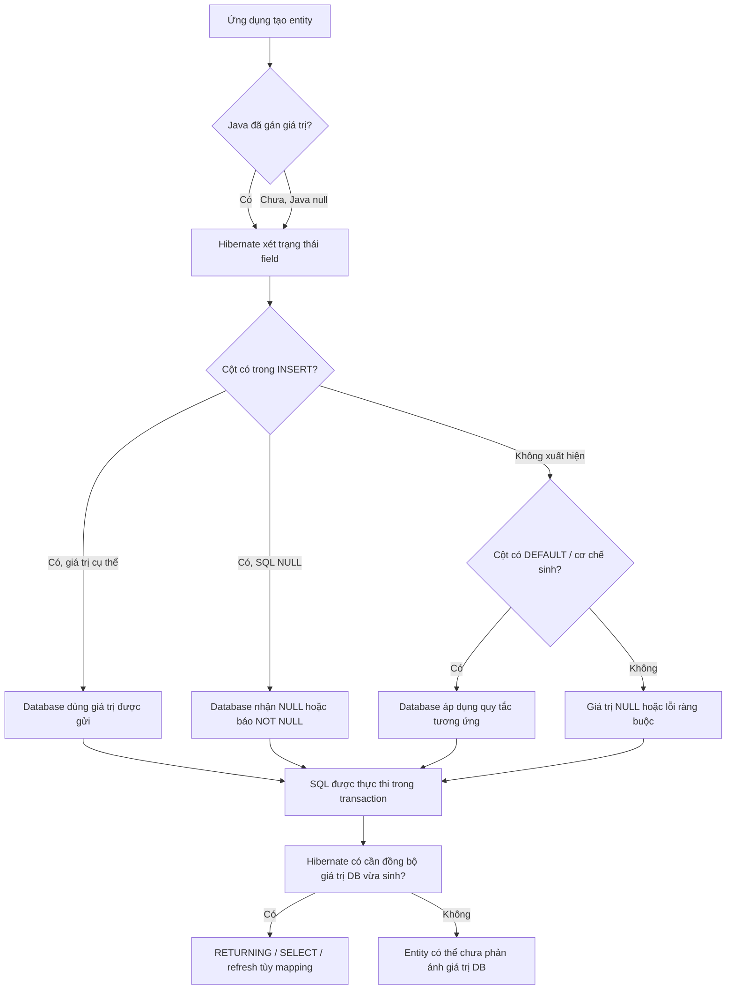

# Null, giá trị mặc định và giá trị do cơ sở dữ liệu tính trong Hibernate ORM

## 1. Vì sao ba khái niệm này rất dễ bị nhầm?

Khi phát triển ứng dụng Java với Hibernate ORM, một thuộc tính entity có thể chưa được gán giá trị, được Java khởi tạo bằng giá trị mặc định, được Hibernate đưa vào câu `INSERT`, hoặc được **chính cơ sở dữ liệu** sinh ra. Những khả năng ấy dẫn đến các kết quả khác nhau, dù code trông khá giống nhau.

Ví dụ hệ thống bán hàng cần lưu đơn mới với trạng thái `DRAFT`, thời điểm tạo đơn, số tiền giảm giá mặc định bằng 0 và mã đơn hàng sinh tự động. Nếu lập trình viên chỉ khai báo:

```java
private String status;
private Instant createdAt;
private BigDecimal discountAmount;
private Long id;
```

thì cả bốn field ban đầu đều nhận `null`. Hibernate không tự suy luận rằng `status` phải là `DRAFT`, `createdAt` phải là giờ hiện tại, `discountAmount` bằng 0 hay `id` phải sinh bằng một chiến lược cụ thể. Ngược lại, chỉ thêm `DEFAULT` vào cột trong database cũng **không bảo đảm** default được áp dụng khi Hibernate gửi giá trị `NULL` một cách tường minh.

Trong bài học thuộc chủ đề **Kiểu dữ liệu** của Hibernate, chúng ta sẽ làm rõ các quy tắc ấy thông qua `Customer`, `PurchaseOrder` và `OrderItem`, với Java 17+, Jakarta Persistence (`jakarta.persistence.*`), Hibernate ORM 6.x và PostgreSQL làm ví dụ. Phần lớn nguyên lý áp dụng cho database khác, nhưng cú pháp identity, generated column, trigger và cách lấy giá trị sinh ra có thể khác nhau theo dialect và phiên bản.

Sau bài học, bạn có thể:

- Phân biệt `null` trong Java với `NULL` trong SQL và với giá trị mặc định của kiểu nguyên thủy Java.
- Chọn `Integer` hay `int`, `Boolean` hay `boolean`, `BigDecimal` hay kiểu số nguyên cho đúng ý nghĩa dữ liệu.
- Hiểu sự khác biệt giữa `@Column(nullable = false)`, `@NotNull`, ràng buộc `NOT NULL` của database và `DEFAULT` trong DDL.
- Biết khi nào Hibernate gửi `NULL`, khi nào bỏ cột khỏi `INSERT`, và tác dụng của `@DynamicInsert`, `insertable = false`, `@ColumnDefault`.
- Ánh xạ giá trị được database sinh từ identity/sequence, timestamp, trigger hoặc generated column; đồng bộ lại trạng thái entity sau khi SQL thực thi.
- Xử lý `null` đúng trong query, DTO, cập nhật một phần và kiểm thử bằng cơ sở dữ liệu thật.

## 2. Bản đồ: Ai quyết định giá trị cuối cùng?

Một thuộc tính như `status` có thể nhận giá trị tại nhiều điểm:



Ba nguồn thiết lập giá trị phổ biến:

| Nguồn giá trị | Ví dụ | Khi áp dụng | Điểm cần lưu ý |
|---|---|---|---|
| **Java/application** | `private OrderStatus status = DRAFT;` | Khi tạo instance Java bằng constructor/initializer. | Hibernate thường đưa giá trị này vào `INSERT`; không đồng nghĩa DB có default. |
| **Database DEFAULT** | `status VARCHAR(20) DEFAULT 'DRAFT'` | Thường khi `INSERT` **không chỉ định** cột hoặc dùng từ khóa SQL `DEFAULT`. | `INSERT ... status = NULL` không kích hoạt default thông thường. |
| **Database-generated value** | Identity ID, cột `GENERATED ALWAYS`, trigger, giá trị timestamp được DB tính. | Khi database xử lý `INSERT` hoặc `UPDATE`, tùy cơ chế. | Hibernate cần mapping phù hợp hoặc `refresh()` để thấy giá trị vừa sinh. |

**Quy tắc nền tảng:** phân biệt *“Java chưa có giá trị”* với *“SQL không đề cập đến cột”*. Hai trạng thái đó không mặc nhiên giống nhau.

## 3. `null` của Java khác `NULL` của SQL như thế nào?

### 3.1. Trong Java, field kiểu tham chiếu chưa gán mặc định là `null`

```java
class DraftOrder {
    Long id;                       // null
    Integer quantity;              // null
    Boolean giftWrapped;           // null
    BigDecimal discountAmount;     // null
    String note;                   // null

    int itemCount;                 // 0
    boolean confirmed;             // false
    long revision;                 // 0L
}
```

Primitive (`int`, `long`, `boolean`) **không biểu diễn được trạng thái `null`**. Kiểu wrapper (`Integer`, `Long`, `Boolean`) và các kiểu tham chiếu có thể `null`. Chọn kiểu dữ liệu theo nghĩa nghiệp vụ:

| Thuộc tính | Kiểu thường hợp lý | Tại sao |
|---|---|---|
| Số lượng tồn kho bắt buộc | `int` hoặc `Integer` kết hợp validation | Nếu luôn phải có giá trị, primitive đơn giản; vẫn cần constraint ở DB. |
| Số lần đăng nhập chưa xác định | `Integer` | `null` có thể khác `0`: chưa đo khác với đã đo và bằng không. |
| Người dùng chọn gói quà | `Boolean` | Có thể cần ba trạng thái: có / không / chưa chọn. |
| Cờ chỉ có đúng/sai | `boolean` | `false` là giá trị xác định; DB phải được thiết kế tương ứng. |
| Tổng tiền, đơn giá | `BigDecimal` | Tránh sai số nhị phân của `float`/`double` khi làm việc với tiền. |
| Thời điểm xác nhận đơn chưa có | `Instant` | `null` có nghĩa đơn chưa được xác nhận, thay vì một timestamp giả định. |
| ID do DB sinh | `Long` | `null` trước khi được persist/sinh ID. |

Đặc biệt, việc dùng primitive trong Java không tự sinh `DEFAULT 0` hoặc `DEFAULT false` trên bảng. Nó chỉ tạo giá trị mặc định **ở bộ nhớ Java** khi instance được tạo theo cách thông thường. Nếu DB có cột nullable, một hàng chứa `NULL` vẫn có thể không map được sang primitive một cách an toàn.

### 3.2. SQL `NULL` mang nghĩa “chưa biết/không có giá trị”

Trong SQL, `NULL` không phải một chuỗi rỗng, số 0, `false` hay một đối tượng đặc biệt có thể so sánh bằng dấu `=`:

```sql
SELECT * FROM purchase_orders WHERE shipped_at = NULL;   -- Sai cách kiểm tra NULL
SELECT * FROM purchase_orders WHERE shipped_at IS NULL;   -- Đúng
SELECT * FROM purchase_orders WHERE shipped_at IS NOT NULL;
```

SQL sử dụng logic ba giá trị: `TRUE`, `FALSE`, `UNKNOWN`. Biểu thức như `NULL = NULL` cho ra `UNKNOWN`, nên điều kiện `WHERE shipped_at = NULL` không tìm các hàng có `NULL`.

Một vài khác biệt quan trọng:

```sql
SELECT COALESCE(discount_amount, 0) FROM purchase_orders;
SELECT COUNT(*) FROM purchase_orders;
SELECT COUNT(shipped_at) FROM purchase_orders;
```

- `COALESCE(x, 0)` trả 0 nếu `x IS NULL`; đây là cách **trình bày/tính toán trên query**, không sửa dữ liệu gốc.
- `COUNT(*)` đếm tất cả hàng.
- `COUNT(shipped_at)` chỉ đếm hàng có `shipped_at IS NOT NULL`.
- Các phép tổng hợp như `SUM` thường bỏ qua `NULL` và có thể trả `NULL` khi không có giá trị phù hợp; code Java cần xử lý trường hợp này.

Không nên lạm dụng `COALESCE` để che dữ liệu thiếu khi nghiệp vụ cần phân biệt “chưa nhập” với “giá trị bằng 0”.

### 3.3. `NULL` và unique constraint

Giả sử bảng khách hàng có email là optional và UNIQUE. Quy tắc số lượng `NULL` được phép trong cột unique **phụ thuộc database và kiểu constraint/index**. Trong PostgreSQL, UNIQUE thông thường cho phép nhiều `NULL` vì các giá trị `NULL` thường được xem là phân biệt với nhau; PostgreSQL cũng hỗ trợ cú pháp `NULLS NOT DISTINCT` khi muốn xử lý khác.

Vì vậy đừng suy luận “có UNIQUE là không có nhiều hàng email null”. Nếu email là bắt buộc, hãy thiết kế `email ... NOT NULL UNIQUE`.

## 4. `@Column(nullable = false)` có tự biến `null` thành giá trị không?

Không. Đây là một khai báo mapping về **nullability**, không phải phép thay thế giá trị hay hàm khởi tạo.

```java
@Entity
@Table(name = "products")
public class Product {
    @Id
    @GeneratedValue(strategy = GenerationType.IDENTITY)
    private Long id;

    @Column(nullable = false, unique = true, length = 50)
    private String sku;

    @Column(nullable = false, precision = 19, scale = 2)
    private BigDecimal unitPrice;

    protected Product() {}
}
```

Ở những môi trường Hibernate sinh DDL, `nullable = false` góp phần tạo cột `NOT NULL`. Nếu đã dùng migration để tạo schema, annotation **không tự sửa** bảng hiện có. Hibernate có thể phát hiện một số vi phạm null trước khi gửi SQL theo cấu hình nullability, nhưng không nên dựa vào thời điểm exception làm cơ chế kiểm tra nghiệp vụ.

Ba cơ chế thường cùng xuất hiện:

| Cơ chế | Vị trí | Mục đích | Ví dụ |
|---|---|---|---|
| `@Column(nullable = false)` | JPA mapping | Diễn đạt yêu cầu nullability cho mapping/DDL. | `@Column(nullable=false)` |
| `@NotNull` / `@NotBlank` | Jakarta Bean Validation | Kiểm tra đối tượng ở tầng Java khi validation được kích hoạt. | `@NotBlank String sku` |
| `NOT NULL` | Schema database | Chặn mọi thao tác SQL vi phạm, kể cả từ client khác ứng dụng. | `sku VARCHAR(50) NOT NULL` |

Ví dụ với Bean Validation:

```java
import jakarta.persistence.*;
import jakarta.validation.constraints.NotBlank;
import jakarta.validation.constraints.NotNull;
import jakarta.validation.constraints.DecimalMin;

@Entity
public class CatalogProduct {
    @Id
    @GeneratedValue(strategy = GenerationType.IDENTITY)
    private Long id;

    @NotBlank
    @Column(nullable = false, length = 100)
    private String name;

    @NotNull
    @DecimalMin("0.00")
    @Column(nullable = false, precision = 19, scale = 2)
    private BigDecimal unitPrice;

    protected CatalogProduct() {}
}
```

`@NotBlank` khác `@NotNull`: nó còn bác bỏ chuỗi rỗng hoặc chỉ chứa khoảng trắng. Những annotation validation cần dependency và cơ chế gọi validator phù hợp; trong Spring Boot thường có starter validation. Kiểm tra Bean Validation vẫn **không thay thế constraint trong DB**, nhất là với điều kiện duy nhất, tham chiếu foreign key và tranh chấp transaction.

Khi ánh xạ quan hệ bắt buộc, có thể dùng đồng thời:

```java
@ManyToOne(fetch = FetchType.LAZY, optional = false)
@JoinColumn(name = "customer_id", nullable = false)
private Customer customer;
```

`optional = false` diễn đạt association không được thiếu trong mapping; `nullable = false` ở join column hướng tới ràng buộc DB. Cần có foreign key thực sự trong schema để bảo vệ tính toàn vẹn quan hệ.

## 5. Giá trị mặc định ở Java và ở database là hai cơ chế khác nhau

### 5.1. Mặc định do Java thiết lập

```java
public enum OrderStatus {
    DRAFT, CONFIRMED, CANCELLED
}

@Entity
public class PurchaseOrder {
    @Id
    @GeneratedValue(strategy = GenerationType.IDENTITY)
    private Long id;

    @Enumerated(EnumType.STRING)
    @Column(nullable = false)
    private OrderStatus status = OrderStatus.DRAFT;

    @Column(nullable = false, precision = 19, scale = 2)
    private BigDecimal discountAmount = BigDecimal.ZERO;

    protected PurchaseOrder() {}

    public PurchaseOrder(/* các dữ liệu nghiệp vụ */) {
        // Các field initializer đã chạy khi tạo instance.
    }
}
```

Trong quá trình tạo một object Java bình thường, field initializer chạy kể cả khi Hibernate gọi constructor không tham số. Khi entity mới được insert, Hibernate thường gửi `status = 'DRAFT'`, `discount_amount = 0` vì đây là giá trị hiện có trên entity.

**Ưu điểm:** state trong bộ nhớ nhất quán ngay khi tạo object, thuận tiện cho validation và business method. **Giới hạn:** nếu ứng dụng khác ghi trực tiếp vào database mà không chỉ định cột, nó không biết default Java; cột DB vẫn cần chính sách riêng nếu phải có default ở mọi điểm ghi.

Ngoài field initializer, có thể đặt mặc định trong constructor hoặc factory để thể hiện ngữ nghĩa:

```java
public static PurchaseOrder startFor(Customer customer) {
    PurchaseOrder order = new PurchaseOrder();
    order.customer = Objects.requireNonNull(customer);
    order.status = OrderStatus.DRAFT;
    order.discountAmount = BigDecimal.ZERO;
    return order;
}
```

Ví dụ factory này chỉ minh họa chiến lược khởi tạo; trong class hoàn chỉnh cần khai báo field `customer`, import `Objects` và bảo vệ factory/constructor theo thiết kế. Dù dùng factory hay constructor, Hibernate không mặc định gọi factory nghiệp vụ khi nạp hàng từ DB.

### 5.2. Mặc định do database thiết lập

Với PostgreSQL:

```sql
CREATE TABLE purchase_orders (
    id BIGINT GENERATED BY DEFAULT AS IDENTITY PRIMARY KEY,
    customer_id BIGINT NOT NULL,
    status VARCHAR(20) NOT NULL DEFAULT 'DRAFT',
    discount_amount NUMERIC(19, 2) NOT NULL DEFAULT 0,
    created_at TIMESTAMP WITH TIME ZONE NOT NULL DEFAULT CURRENT_TIMESTAMP,
    shipped_at TIMESTAMP WITH TIME ZONE NULL
);
```

Câu `INSERT` sau **bỏ qua** ba cột có default:

```sql
INSERT INTO purchase_orders (customer_id)
VALUES (101)
RETURNING id, status, discount_amount, created_at, shipped_at;
```

Database sẽ dùng `DRAFT`, `0`, thời gian hiện tại theo semantics của hàm SQL, còn `shipped_at` là `NULL` vì không có giá trị và được phép nullable.

Nhưng nếu gửi `NULL` tường minh:

```sql
INSERT INTO purchase_orders (customer_id, status)
VALUES (101, NULL);  -- Lỗi NOT NULL, không tự đổi thành DRAFT.
```

Với cột nullable có default, `NULL` tường minh thường được lưu **thành `NULL`**, không sử dụng default. Muốn yêu cầu database dùng default ngay trong SQL, ở dialect hỗ trợ có thể viết:

```sql
INSERT INTO purchase_orders (customer_id, status)
VALUES (101, DEFAULT);
```

Kết luận thực tế: **DEFAULT là quy tắc SQL khi cột không được cung cấp hoặc khi SQL yêu cầu `DEFAULT`, không phải thay thế vô điều kiện mọi `NULL`.**

### 5.3. Default còn tác động khi `UPDATE` không?

Không theo cách nhiều người thường kỳ vọng:

```sql
UPDATE purchase_orders
SET status = NULL
WHERE id = 10;      -- Lỗi vì NOT NULL.
```

Database không tự biến `NULL` khi `UPDATE` thành `'DRAFT'`. Nếu muốn yêu cầu phục hồi giá trị mặc định của cột trong PostgreSQL:

```sql
UPDATE purchase_orders
SET status = DEFAULT
WHERE id = 10;
```

Hibernate ORM thông thường không thay đổi cột về SQL `DEFAULT` chỉ vì bạn gọi `order.setStatus(null)`; nó có thể phát sinh `UPDATE status = NULL` và nhận lỗi constraint. Hãy thiết kế business method tường minh cho việc đặt trạng thái thay vì sử dụng `null` để mang nghĩa “lấy mặc định lại”.

## 6. Hibernate `INSERT`: Vì sao DB default đôi khi không chạy?

Giả sử entity sau ánh xạ một bảng có `DEFAULT 'DRAFT'`:

```java
@Entity
@Table(name = "purchase_orders")
public class PurchaseOrder {
    @Id
    @GeneratedValue(strategy = GenerationType.IDENTITY)
    private Long id;

    @Column(nullable = false)
    private Long customerId;

    @Column(nullable = false, length = 20)
    private String status;

    protected PurchaseOrder() {}

    public PurchaseOrder(Long customerId) {
        this.customerId = customerId;
    }
}
```

Trước khi `persist`, `status == null`. Với chiến lược insert tĩnh thông thường, Hibernate có thể tạo SQL dạng:

```sql
INSERT INTO purchase_orders (customer_id, status) VALUES (?, ?);
-- Bind: customer_id = 101, status = NULL
```

Tại đây DB default không được kích hoạt vì cột `status` **đã có trong SQL**. Bản ghi có thể bị từ chối bởi `NOT NULL`. `@Column(nullable=false)` không khởi tạo giá trị, nên nếu biết trạng thái mặc định ngay trong ứng dụng, cách dễ hiểu nhất là gán `OrderStatus.DRAFT` trong code trước khi persist.

Trường hợp business yêu cầu **DB là nguồn quyết định default**, ta có các lựa chọn khác nhau.

## 7. Lựa chọn A: `@DynamicInsert` để bỏ các cột có giá trị `null`

Hibernate cung cấp annotation riêng:

```java
import jakarta.persistence.*;
import org.hibernate.annotations.ColumnDefault;
import org.hibernate.annotations.DynamicInsert;

@Entity
@Table(name = "purchase_orders")
@DynamicInsert
public class PurchaseOrder {
    @Id
    @GeneratedValue(strategy = GenerationType.IDENTITY)
    private Long id;

    @Column(name = "customer_id", nullable = false)
    private Long customerId;

    @Column(nullable = false, length = 20)
    @ColumnDefault("'DRAFT'")
    private String status;

    @Column(name = "discount_amount", nullable = false,
            precision = 19, scale = 2)
    @ColumnDefault("0")
    private BigDecimal discountAmount;

    protected PurchaseOrder() {}

    public PurchaseOrder(Long customerId) {
        this.customerId = customerId;
    }

    public Long getId() { return id; }
    public String getStatus() { return status; }
    public BigDecimal getDiscountAmount() { return discountAmount; }
}
```

Ở ví dụ này, `@DynamicInsert` hướng Hibernate tạo câu `INSERT` theo các cột có giá trị cần ghi. Những field đang `null` có thể **được bỏ khỏi SQL**, để DB áp dụng default:

```sql
INSERT INTO purchase_orders (customer_id) VALUES (?);
-- DB điền status = 'DRAFT', discount_amount = 0.
```

Các điểm cần nhớ:

- `@DynamicInsert` là **tính năng Hibernate**, không phải annotation JPA chuẩn.
- `@ColumnDefault("'DRAFT'")` mô tả biểu thức default trong DDL mà Hibernate có thể sinh. **Nó không tự bật dynamic insert** và không tự sửa schema đã tạo bằng Flyway/Liquibase.
- Nếu schema do migration quản lý, cần tạo `DEFAULT 'DRAFT'`/`DEFAULT 0` thật ở database; chỉ gắn annotation lên entity chưa đủ.
- `@DynamicInsert` có thể tạo nhiều hình dạng câu SQL khác nhau theo tổ hợp field được gán `null`, làm tăng số dạng SQL cần chuẩn bị và có thể giảm hiệu quả JDBC batching/statement reuse tùy workload.
- `@DynamicInsert` không tự đồng bộ các giá trị DB vừa điền vào object. Trong memory, `order.getStatus()` có thể vẫn là `null` cho tới khi Hibernate nạp lại hoặc mapping chỉ rõ thuộc tính generated.

Ví dụ với `EntityManager`:

```java
PurchaseOrder order = new PurchaseOrder(101L);
em.persist(order);
em.flush();

// Lúc này DB có thể đã đặt default, nhưng state trong entity có thể còn null.
em.refresh(order);

System.out.println(order.getStatus());          // DRAFT
System.out.println(order.getDiscountAmount());  // 0.00 (scale tùy JDBC/DB)
```

`refresh()` yêu cầu Hibernate đọc lại trạng thái hiện tại từ database vào managed entity. Nó có chi phí truy vấn và phải được gọi trong persistence context hợp lệ. Đừng gọi `refresh()` đại trà cho mọi insert nếu chỉ cần một giá trị mà ứng dụng hoàn toàn có thể chủ động thiết lập.

### 7.1. Có nên dùng `@DynamicUpdate` cùng `@DynamicInsert`?

`@DynamicUpdate` là một tính năng Hibernate khác: nó có thể tạo câu `UPDATE` chỉ gồm những cột được coi là thay đổi. Nó **không** có nghĩa “cột Java `null` thì dùng DB default”, và không thay thế logic update nghiệp vụ.

```java
@DynamicInsert
@DynamicUpdate
@Entity
class SomeEntity { /* ... */ }
```

Đoạn trên minh họa annotation, không phải khuyến nghị mặc định bật cả hai. Dynamic SQL có trade-off về statement plan, batching và số hình dạng SQL; cần đo theo khối lượng dữ liệu và use case thực tế. Đặc biệt, `UPDATE field = NULL` vẫn là yêu cầu đặt `NULL`, không phải “bỏ field khỏi update vì muốn default”.

## 8. Lựa chọn B: `insertable = false` để database luôn quyết định cột khi INSERT

Nếu một cột **luôn** do database cấp giá trị khi insert, không có nhu cầu gửi giá trị từ Java, ta có thể loại cột đó khỏi SQL `INSERT`:

```java
@Column(name = "created_at", insertable = false, updatable = false)
private Instant createdAt;
```

Trong schema PostgreSQL:

```sql
created_at TIMESTAMP WITH TIME ZONE NOT NULL DEFAULT CURRENT_TIMESTAMP
```

Với `insertable = false`, Hibernate sẽ không gửi giá trị `createdAt` khi insert dù field có được gán hay không; với `updatable = false`, Hibernate cũng không đưa nó vào SQL update thông thường. Đây là **quyền ghi qua ORM mapping**, không phải ràng buộc cấm client SQL khác sửa cột, và cũng không buộc Hibernate tự đọc lại giá trị ngay khi insert.

Các tình huống phù hợp:

- `created_at` phải là thời điểm từ đồng hồ database.
- Cột được trigger duy trì hoàn toàn và Java chỉ có nhiệm vụ đọc.
- Cột computed là read-only về phía ORM.

Không phù hợp khi cần cho phép người dùng đặt giá trị tùy biến ở lúc tạo entity. Một cột `insertable = false` thường **không thể được ghi qua ORM bằng cách gán field trước khi persist**; nếu muốn có lựa chọn “lấy default khi null, còn có giá trị thì ghi nó”, `@DynamicInsert` hoặc logic SQL chuyên biệt thường phù hợp hơn.

## 9. Lựa chọn C: Đánh dấu field là giá trị DB generated để Hibernate nạp lại

Hibernate có annotation `org.hibernate.annotations.Generated` cho thuộc tính được database sinh hoặc thay đổi tại những sự kiện ghi nhất định. Tùy mapping và dialect, Hibernate có thể lấy giá trị mới thông qua cơ chế SQL `RETURNING`, một câu truy vấn sau khi ghi hoặc chiến lược tương đương, để entity managed phản ánh dữ liệu đã được DB quyết định.

Ví dụ `created_at` do default của PostgreSQL cấp:

```java
import jakarta.persistence.*;
import org.hibernate.annotations.Generated;
import org.hibernate.generator.EventType;
import java.time.Instant;

@Entity
@Table(name = "purchase_orders")
public class PurchaseOrder {
    @Id
    @GeneratedValue(strategy = GenerationType.IDENTITY)
    private Long id;

    @Column(name = "customer_id", nullable = false)
    private Long customerId;

    @Generated(event = EventType.INSERT)
    @Column(name = "created_at", nullable = false,
            insertable = false, updatable = false)
    private Instant createdAt;

    protected PurchaseOrder() {}

    public PurchaseOrder(Long customerId) {
        this.customerId = customerId;
    }

    public Long getId() { return id; }
    public Instant getCreatedAt() { return createdAt; }
}
```

Schema tương ứng cần thực sự có:

```sql
CREATE TABLE purchase_orders (
    id BIGINT GENERATED BY DEFAULT AS IDENTITY PRIMARY KEY,
    customer_id BIGINT NOT NULL,
    created_at TIMESTAMPTZ NOT NULL DEFAULT CURRENT_TIMESTAMP
);
```

Trong Hibernate 6, `@Generated(event = EventType.INSERT)` mô tả thuộc tính được sinh sau insert. `@Column(insertable=false, updatable=false)` thể hiện ứng dụng không ghi trực tiếp cột này; mapping generated hướng Hibernate đọc giá trị từ DB sau thao tác insert theo khả năng dialect. Khác với chỉ khai báo `@ColumnDefault`, provider nay có thông tin rằng trạng thái Java cần được cập nhật từ DB.

> Nếu đang dùng Hibernate phiên bản khác, tên package, thuộc tính `event` của `@Generated` hoặc cơ chế nhận biết generated value có thể thay đổi. Ví dụ ở đây áp dụng API Hibernate ORM 6.x, không phải annotation JPA chuẩn.

### 9.1. `@ColumnDefault` và `@Generated` giải quyết hai việc riêng

| Annotation/thuộc tính | Vai trò chính |
|---|---|
| `@ColumnDefault("CURRENT_TIMESTAMP")` | Mô tả SQL default cho DDL Hibernate sinh; không tự nạp lại state. |
| `@DynamicInsert` | Khi insert, bỏ các cột null khỏi SQL để default DB có cơ hội hoạt động. |
| `insertable = false` | Không ghi cột qua SQL INSERT do Hibernate sinh. |
| `updatable = false` | Không ghi cột qua SQL UPDATE do Hibernate sinh. |
| `@Generated(event = INSERT)` | Cho Hibernate biết DB sinh/điều chỉnh giá trị tại insert và cần đồng bộ state. |
| `@Generated(event = {INSERT, UPDATE})` | Cho Hibernate biết giá trị có thể đổi sau cả insert và update. |

Không nên coi các annotation này là những cách viết khác nhau của cùng một hành vi. Có thể dùng kết hợp khi chúng giải quyết **những phần khác nhau** của yêu cầu.

## 10. Cột được database tính: generated column và công thức truy vấn

Giả sử một dòng đơn hàng có số lượng và đơn giá:

| Dòng hàng | Số lượng | Đơn giá | Thành tiền |
|---|---:|---:|---:|
| Bàn phím cơ | 2 | 250.000 | 500.000 |
| Chuột không dây | 1 | 120.000 | 120.000 |

Bạn có thể tính `lineTotal` bằng Java (`quantity * unitPrice`), trong SQL khi truy vấn, hoặc để database tạo **generated column**. Đây là những lựa chọn với quyền sở hữu và thời điểm tính khác nhau.

### 10.1. Generated column lưu trong bảng PostgreSQL

```sql
CREATE TABLE order_items (
    id BIGINT GENERATED BY DEFAULT AS IDENTITY PRIMARY KEY,
    order_id BIGINT NOT NULL,
    product_id BIGINT NOT NULL,
    quantity INTEGER NOT NULL CHECK (quantity > 0),
    unit_price NUMERIC(19, 2) NOT NULL CHECK (unit_price >= 0),
    line_total NUMERIC(19, 2)
        GENERATED ALWAYS AS (quantity * unit_price) STORED
);
```

Với kiểu `STORED`, database tính `line_total` từ `quantity` và `unit_price` theo biểu thức trong schema khi ghi hàng, rồi lưu giá trị tính được. Ứng dụng không nên cố gửi `line_total` trong `INSERT`/`UPDATE` như một cột bình thường.

Hibernate ORM 6.x có annotation `@GeneratedColumn` để mô tả cột được DB tính theo biểu thức:

```java
import jakarta.persistence.*;
import org.hibernate.annotations.GeneratedColumn;
import java.math.BigDecimal;

@Entity
@Table(name = "order_items")
public class OrderItem {
    @Id
    @GeneratedValue(strategy = GenerationType.IDENTITY)
    private Long id;

    @Column(name = "order_id", nullable = false)
    private Long orderId;

    @Column(name = "product_id", nullable = false)
    private Long productId;

    @Column(nullable = false)
    private int quantity;

    @Column(name = "unit_price", nullable = false, precision = 19, scale = 2)
    private BigDecimal unitPrice;

    @GeneratedColumn("quantity * unit_price")
    @Column(name = "line_total", precision = 19, scale = 2)
    private BigDecimal lineTotal;

    protected OrderItem() {}

    public OrderItem(Long orderId, Long productId,
                     int quantity, BigDecimal unitPrice) {
        if (quantity <= 0 || unitPrice == null || unitPrice.signum() < 0) {
            throw new IllegalArgumentException("Dòng hàng không hợp lệ");
        }
        this.orderId = orderId;
        this.productId = productId;
        this.quantity = quantity;
        this.unitPrice = unitPrice;
    }

    public BigDecimal getLineTotal() { return lineTotal; }
}
```

Trong ứng dụng thật, `orderId` và `productId` thường được ánh xạ thành quan hệ `@ManyToOne`; ở đây dùng `Long` để tập trung vào **kiểu dữ liệu và giá trị được tính**, không mở rộng sang bài quan hệ entity.

Khi đọc entity, `lineTotal` chứa dữ liệu database tính. Khi thay `quantity`/`unitPrice` trên entity và flush thay đổi, generated column được tính lại theo quy tắc DB. Với mapping generated được Hibernate nhận diện, giá trị sau ghi có thể được provider đọc lại; chi tiết tùy version và dialect.

**Lưu ý:** `@GeneratedColumn` là extension Hibernate và mức hỗ trợ DDL tùy database. Nếu schema được quản lý bằng migration, phải tạo/generated column chính xác bằng SQL của database; không coi annotation là cách tự di chuyển schema đang có dữ liệu.

### 10.2. `@Formula`: biểu thức khi SELECT, khác generated column được lưu

Nếu không muốn lưu một cột `line_total`, Hibernate cung cấp `@Formula` để ánh xạ một biểu thức SQL chỉ đọc:

```java
import org.hibernate.annotations.Formula;

@Formula("quantity * unit_price")
private BigDecimal lineTotal;
```

Về mặt ý tưởng, Hibernate có thể đưa biểu thức vào `SELECT`:

```sql
SELECT id, quantity, unit_price,
       quantity * unit_price AS line_total
FROM order_items;
```

So sánh:

| Phương án | Giá trị tính khi nào? | Có cột `line_total` vật lý? | Đặc điểm |
|---|---|---|---|
| Java method `getLineTotal()` | Khi Java gọi | Không | Dễ kiểm thử, không cần DB để tính; dữ liệu Java phải đã có. |
| JPQL/SQL projection | Khi query chạy | Không | Phù hợp báo cáo hoặc DTO. |
| Hibernate `@Formula` | Khi entity được SELECT theo biểu thức | Không | SQL-specific, read-only và phụ thuộc khả năng diễn giải SQL của DB. |
| Database generated column `STORED` | Khi DB ghi/chỉnh cột nguồn | Có | DB bảo đảm công thức áp dụng cả khi client ngoài Hibernate ghi. |

Không nên tạo cùng lúc cả cột generated và `@Formula` cho cùng mục đích mà không có lý do cụ thể. Với tổng đơn hàng, nhiều hệ thống giữ `OrderItem.unitPrice` là **giá chốt tại lúc đặt**, rồi tính tổng trên từng dòng hoặc lưu snapshot tổng tùy quy tắc nghiệp vụ; generated column chỉ giải quyết **công thức cục bộ trong một hàng**, không tự giải quyết giảm giá/thuế/phí/hoàn trả trên nhiều bảng.

## 11. Timestamp do Java sinh, Hibernate sinh hay database sinh?

Hai cột phổ biến nhất là `created_at` và `updated_at`. Cả hai có thể được sinh theo nhiều cách, nhưng phải **chọn một nguồn thời gian chủ đạo** để tránh kết quả khó hiểu.

### 11.1. Thời gian từ Java

```java
private Instant createdAt = Instant.now();
```

Giá trị xuất hiện ngay trong object trước khi persist. Tuy nhiên nó lấy từ đồng hồ JVM, không phải đồng hồ DB. Nếu nhiều server có đồng hồ lệch nhau, timestamp giữa các máy có thể không như kỳ vọng. Để dễ kiểm thử, có thể inject `Clock` trong service rồi truyền `Instant` vào factory entity.

### 11.2. Annotation thời gian của Hibernate

Hibernate hỗ trợ các annotation như:

```java
import org.hibernate.annotations.CreationTimestamp;
import org.hibernate.annotations.UpdateTimestamp;
import java.time.Instant;

@CreationTimestamp
@Column(name = "created_at", nullable = false, updatable = false)
private Instant createdAt;

@UpdateTimestamp
@Column(name = "updated_at", nullable = false)
private Instant updatedAt;
```

`@CreationTimestamp` hướng Hibernate sinh thời gian khi insert; `@UpdateTimestamp` hướng Hibernate sinh/cập nhật thời gian khi insert hoặc update entity. Trong Hibernate 6.x, nguồn mặc định thường là đồng hồ JVM (`SourceType.VM`). Nếu muốn dùng **thời gian từ database** theo khả năng phiên bản/dialect, có thể cấu hình:

```java
import org.hibernate.annotations.SourceType;

@CreationTimestamp(source = SourceType.DB)
private Instant createdAt;

@UpdateTimestamp(source = SourceType.DB)
private Instant updatedAt;
```

Lưu ý: `source = SourceType.DB` yêu cầu Hibernate tạo/lấy thời gian qua phía DB; nó **không đồng nghĩa** bắt buộc dùng biểu thức `DEFAULT CURRENT_TIMESTAMP` đã có trên schema. Câu SQL cụ thể do Hibernate/dialect quyết định. Đừng kết hợp ngẫu nhiên initializer Java, `@CreationTimestamp`, `@Generated` và trigger cho cùng một field; bạn cần biết nguồn nào được ưu tiên.

### 11.3. Database DEFAULT cho `created_at`

```sql
created_at TIMESTAMPTZ NOT NULL DEFAULT CURRENT_TIMESTAMP
```

Cơ chế này chạy cả khi một client ngoài Hibernate insert và bỏ qua cột. Với PostgreSQL, `CURRENT_TIMESTAMP`/`now()` lấy thời điểm bắt đầu transaction, vì vậy nhiều hàng tạo trong cùng transaction có thể có cùng giá trị; không nên mặc định nó luôn là “thời điểm thực thi từng dòng SQL” chính xác tới từng mili giây.

Để Hibernate nhận giá trị đó, dùng mapping kiểu `insertable=false` cộng `@Generated(event=INSERT)` như phần trước, hoặc chủ động refresh entity khi cần.

### 11.4. Trigger cho `updated_at`

Database DEFAULT chỉ áp dụng tại insert, không tự cập nhật thời gian mỗi khi hàng đổi. Nếu hệ thống yêu cầu **mọi client SQL** thay đổi một hàng đều phải làm mới `updated_at`, có thể dùng trigger tại DB.

Ví dụ PostgreSQL:

```sql
ALTER TABLE purchase_orders
ADD COLUMN updated_at TIMESTAMPTZ NOT NULL DEFAULT CURRENT_TIMESTAMP;

CREATE OR REPLACE FUNCTION set_purchase_order_updated_at()
RETURNS trigger AS $$
BEGIN
    NEW.updated_at := CURRENT_TIMESTAMP;
    RETURN NEW;
END;
$$ LANGUAGE plpgsql;

CREATE TRIGGER trg_purchase_order_updated_at
BEFORE UPDATE ON purchase_orders
FOR EACH ROW
EXECUTE FUNCTION set_purchase_order_updated_at();
```

Khi một `UPDATE` thực sự xảy ra, trigger cập nhật cột. Nếu muốn Hibernate đọc lại cột sau cả insert và update, có thể đánh dấu:

```java
import org.hibernate.annotations.Generated;
import org.hibernate.generator.EventType;

@Generated(event = {EventType.INSERT, EventType.UPDATE})
@Column(name = "updated_at", nullable = false,
        insertable = false, updatable = false)
private Instant updatedAt;
```

Không cần gắn đồng thời `@UpdateTimestamp` cho cùng field nếu trigger đã là nguồn thời gian chính. Ngoài ra, dữ liệu trong database **không tự được đồng bộ vào mọi entity đang managed ở các session khác**; những session lâu sống có thể cần nạp lại, kiểm soát transaction hoặc cơ chế versioning để không làm việc trên state cũ.

## 12. ID tự sinh: một dạng generated value đặc biệt

Hibernate/JPA xử lý khóa chính tự sinh qua `@GeneratedValue`. Đây là nhóm khác về bản chất với SQL `DEFAULT` đơn giản trên cột business:

```java
@Id
@GeneratedValue(strategy = GenerationType.IDENTITY)
private Long id;
```

Với PostgreSQL, có thể tương ứng identity column:

```sql
id BIGINT GENERATED BY DEFAULT AS IDENTITY PRIMARY KEY
```

Khi persist entity mới, database tạo ID, và Hibernate nhận ID để quản lý entity trong persistence context. Với `IDENTITY`, Hibernate thường cần thực hiện `INSERT` sớm hơn để lấy ID, điều đó có thể ảnh hưởng tối ưu batching.

Một phương án khác là sequence:

```java
@Id
@GeneratedValue(strategy = GenerationType.SEQUENCE, generator = "order_seq")
@SequenceGenerator(
    name = "order_seq",
    sequenceName = "purchase_order_seq",
    allocationSize = 50
)
private Long id;
```

`SEQUENCE` cho phép Hibernate lấy/đặt trước ID theo cơ chế sequence và bộ tối ưu allocation phù hợp. Nếu quản lý schema bằng migration, sequence thực tế phải được tạo/cấu hình tương thích với `allocationSize`, chiến lược optimizer và version Hibernate; không sao chép ví dụ mà chưa đồng bộ schema.

| Chiến lược | Ai cấp ID? | Điểm cần chú ý |
|---|---|---|
| `IDENTITY` | Database khi insert | Có thể cần insert để biết ID; ảnh hưởng batch insert. |
| `SEQUENCE` | Database sequence, Hibernate có thể cấp trước qua optimizer | Cần sequence thật, đặc biệt chú ý allocation/DDL. |
| `TABLE` | Bảng cấp phát ID giả lập | Thường kém thuận tiện hơn sequence/identity ở DB hỗ trợ. |
| `UUID` | UUID theo cơ chế JPA/provider | Không phụ thuộc số nguyên tăng dần; cần kiểu field/cột tương thích. |

Không nên tự viết code kiểu `SELECT MAX(id) + 1` vì nhiều transaction có thể lấy cùng ID và gây xung đột. Việc ID có giá trị `null` trước persist là bình thường đối với entity mới dùng `Long`; không xem nó là lỗi validation bắt buộc phải sửa bằng cách gán số giả.

## 13. Khi nào giá trị từ DB xuất hiện trong entity Java?

Phân biệt **thời điểm database sinh giá trị** và **thời điểm object Java đã được cập nhật**.

```text
Java new Entity()               field status = null
    |
    v
persist(entity)                 entity trở thành managed
    |
    v
flush / INSERT                  DB áp dụng DEFAULT, trigger, generated column
    |
    +--> Có mapping generated   Hibernate lấy giá trị theo chiến lược hỗ trợ
    |
    +--> Không có mapping đó    object Java có thể vẫn giữ giá trị cũ
    |
    v
refresh(entity)                 đọc lại DB để đồng bộ managed entity
    |
    v
commit                         hoàn tất transaction nếu thành công
```

Trong Hibernate, `flush()` đồng bộ các thay đổi đã có trong persistence context thành SQL nhưng **không có nghĩa transaction đã commit**. Vì vậy bạn có thể đọc giá trị DB sinh sau flush trong cùng transaction. Với generated identifier kiểu `IDENTITY`, câu `INSERT` có thể chạy trước flush tường minh vì cần ID.

### 13.1. Minh họa `refresh()`

```java
@Transactional
public Long createOrder(EntityManager em, Long customerId) {
    PurchaseOrder order = new PurchaseOrder(customerId);
    em.persist(order);
    em.flush();
    em.refresh(order);

    // Sau refresh, các giá trị DEFAULT đã áp dụng trong DB được nạp vào object.
    System.out.println(order.getStatus());
    return order.getId();
}
```

Đoạn trên giả định `PurchaseOrder` từ ví dụ `@DynamicInsert` (có các getter tương ứng) và DB có default thực sự. Tùy mapping, `@Generated` có thể làm `refresh()` không cần thiết; ví dụ nhằm cho thấy điểm đọc lại trạng thái khi provider chưa tự đồng bộ cột DB-generated.

`refresh()` không phải công cụ thay thế `save` hay `flush`: nó **ghi đè state managed bằng dữ liệu hiện có ở DB** và có thể làm mất những chỉnh sửa chưa được đồng bộ theo ngữ cảnh flush. Chỉ dùng khi có lý do cụ thể và hiểu transaction hiện tại.

### 13.2. Cột do trigger sinh khi một client khác cập nhật

Một entity đã load vào persistence context có thể cũ nếu database bị thay đổi bởi transaction khác hoặc native SQL/bulk update. Ngay cả với mapping generated, Hibernate chỉ biết những sự kiện ghi mà nó điều phối theo mapping; không có phép màu tự đẩy mọi thay đổi ngoài Session vào object đang tồn tại. Khi yêu cầu dữ liệu mới, cần giới hạn tuổi thọ persistence context, làm mới entity phù hợp hoặc áp dụng lock/versioning.

## 14. `NULL` trong truy vấn HQL/JPQL và projection

JPQL làm việc với **tên entity và thuộc tính Java**, nhưng semantics của `NULL` vẫn theo SQL:

```java
List<PurchaseOrder> notShipped = em.createQuery("""
    select o from PurchaseOrder o
    where o.shippedAt is null
    """, PurchaseOrder.class).getResultList();
```

Để điều kiện có tham số nullable, cần xác định rõ ý nghĩa “tham số null”:

```java
List<PurchaseOrder> results = em.createQuery("""
    select o from PurchaseOrder o
    where (:status is null or o.status = :status)
    """, PurchaseOrder.class)
    .setParameter("status", requestedStatus)
    .getResultList();
```

Đoạn này coi `requestedStatus == null` là **không lọc theo trạng thái**, không phải tìm các đơn có status NULL. Nếu muốn tìm giá trị NULL trong DB, dùng `o.status IS NULL`. Đặc biệt với native query, việc truyền tham số `null` không có JDBC type rõ ràng có thể cần khai báo kiểu tham số hoặc câu query riêng tùy driver/dialect; không nên dựa vào sự suy luận kiểu trong mọi tình huống.

### 14.1. Có nên cho entity field là `Optional<T>`?

Thông thường **không nên** khai báo persistent field của JPA thành `Optional<String>` chỉ để biểu diễn nullable:

```java
// Tránh dùng như persistent field thông thường:
private Optional<String> note;
```

Giữ persistent field là `String note` có thể `null` theo schema, rồi dùng `Optional` ở API đọc nếu muốn thể hiện ý nghĩa:

```java
public Optional<String> findNote() {
    return Optional.ofNullable(note);
}
```

Repository Spring Data JPA có thể dùng `Optional<Customer>` làm kiểu trả về cho truy vấn theo ID; đó là **Optional ở ranh giới API**, khác với mapping field dữ liệu `Optional` xuống cột SQL.

### 14.2. Tính toán với `NULL`

Đoạn JPQL:

```java
BigDecimal total = em.createQuery("""
    select sum(i.unitPrice * i.quantity)
    from OrderItem i
    where i.orderId = :orderId
    """, BigDecimal.class)
    .setParameter("orderId", orderId)
    .getSingleResult();

BigDecimal safeTotal = total == null ? BigDecimal.ZERO : total;
```

Phép `SUM` có thể trả `null` nếu không có dòng phù hợp. Phần này dùng `safeTotal = 0` vì **tổng của đơn không có dòng** được định nghĩa là 0 trong ví dụ; ứng dụng khác có thể muốn phân biệt không tìm thấy dữ liệu với số 0 để hiển thị cảnh báo.

## 15. `null` trong API cập nhật một phần: không được nhầm với “không gửi field”

Vấn đề quan trọng xuất hiện khi HTTP `PATCH` hoặc JSON payload thay đổi một entity:

```json
{ "note": null }
```

và:

```json
{}
```

Hai request này có thể mang ý nghĩa khác nhau:

- `{}`: client không yêu cầu thay đổi ghi chú.
- `{"note": null}`: client muốn xóa ghi chú (nếu schema cho phép `NULL`).

Nếu deserializing cả hai vào DTO chỉ có field `String note`, code có thể thấy `note == null` trong cả hai trường hợp và **không biết field có được gửi hay không**. Đừng dựa vào `@DynamicUpdate` để tự phân biệt ý nghĩa JSON; đây là trách nhiệm của contract API và service.

Ví dụ tối giản trong tầng service khi nhận payload dạng map (chỉ để minh họa khả năng phân biệt sự hiện diện):

```java
void applyPatch(Map<String, Object> patch, PurchaseOrder order) {
    if (patch.containsKey("note")) {
        Object value = patch.get("note");
        if (value != null && !(value instanceof String)) {
            throw new IllegalArgumentException("note phải là chuỗi hoặc null");
        }
        order.changeNote((String) value);
    }
}
```

Trong code production, nên dùng request DTO/schema và validation phù hợp (hoặc kiểu biểu diễn ba trạng thái: vắng mặt, có giá trị, explicit null). Nếu `note` là `NOT NULL` thì xóa ghi chú phải có quy tắc riêng, ví dụ thay bằng chuỗi rỗng nếu nghiệp vụ cho phép, hoặc từ chối request. **Database DEFAULT không có nghĩa API PATCH với `null` sẽ phục hồi default.**

## 16. Giá trị `NULL`, entity lifecycle và cache

Entity trong trạng thái **managed** được Hibernate theo dõi trong persistence context. Nếu bạn sửa field về `null` rồi commit, Hibernate có thể phát sinh `UPDATE` với `NULL`, và DB quyết định chấp nhận hoặc từ chối theo constraint. Hibernate không tự sửa field về default được khai báo trong SQL.

Với **detached entity**, thay đổi giá trị trong bộ nhớ không tự đồng bộ xuống database. Khi merge một detached object bị thiếu field (ví dụ DTO mapper đã gán nhiều field thành `null`) vào entity managed, `merge` có thể sao chép các giá trị `null` vào object managed và tạo các `UPDATE` không mong đợi. Do đó:

- Không dùng `merge` như cách mặc định để áp dụng request PATCH chỉ chứa vài trường.
- Nạp entity managed trong transaction rồi gọi business method cho đúng field cần thay đổi.
- Giữ constraint `NOT NULL`/foreign key tại DB làm lớp bảo vệ cuối cùng.
- Tách DTO đầu vào khỏi entity để rõ quy tắc “bỏ qua”, “xóa giá trị”, “gán giá trị mới”.

Với `@Version`, một thay đổi có thể được Hibernate kiểm tra xung đột cập nhật giữa transaction; default/trigger không thay thế cơ chế optimistic locking. Nếu trigger hoặc client ngoài Hibernate cập nhật cột, cần hiểu cách version được duy trì, tránh nghĩ DB-generated field tự đảm bảo không ghi đè đồng thời.

## 17. Schema migration: default trong annotation không bằng default đang triển khai

Khi dùng Flyway/Liquibase, database schema là tập hợp migration thực sự chạy, không phải hình ảnh suy diễn từ annotation trên entity. Ví dụ migration PostgreSQL:

```sql
ALTER TABLE purchase_orders
ADD COLUMN discount_amount NUMERIC(19, 2) NOT NULL DEFAULT 0;
```

Thao tác thêm cột với default có thể khiến các hàng hiện có nhận một giá trị theo quy tắc của database/phiên bản và đặt default cho insert mới; các database khác có hạn chế/chi phí thao tác khác nhau. Với bảng rất lớn hoặc yêu cầu không khóa dài, thường cần kế hoạch migration từng bước: thêm cột có thể nullable → backfill theo lô → đặt default → bổ sung `NOT NULL` sau khi kiểm chứng dữ liệu.

Khi thay đổi nghiệp vụ từ default `DRAFT` sang `PENDING`, chỉ sửa Java initializer hoặc chỉ sửa `@ColumnDefault` là **không đảm bảo** database đã có default mới:

```sql
ALTER TABLE purchase_orders
ALTER COLUMN status SET DEFAULT 'PENDING';
```

Với dữ liệu cũ, `ALTER COLUMN ... SET DEFAULT` không nhất thiết sửa các hàng đã lưu. Nếu muốn đổi giá trị lịch sử, cần một migration `UPDATE` riêng có điều kiện và được đánh giá về nghiệp vụ.

### 17.1. Đừng để `ddl-auto=update` là chiến lược migration chính

Trong môi trường học H2, `create-drop` có thể tiện để tạo bảng thử nghiệm. Trong hệ thống thực, nên dùng migration có phiên bản và cấu hình Hibernate kiểm tra mapping:

```yaml
spring:
  jpa:
    hibernate:
      ddl-auto: validate
```

`validate` có giới hạn: nó kiểm tra một số khía cạnh schema/mapping, không đảm bảo mọi `DEFAULT`, trigger, check constraint và generated expression đúng như nghiệp vụ. Các migration cần được kiểm thử trên dialect DB thật.

## 18. Thiết kế một ví dụ đơn hàng hoàn chỉnh

Ta kết hợp các nhu cầu thành bảng PostgreSQL với quy ước rõ quyền sở hữu của từng cột:

```sql
CREATE TABLE customers (
    id BIGINT GENERATED BY DEFAULT AS IDENTITY PRIMARY KEY,
    email VARCHAR(255) NOT NULL UNIQUE
);

CREATE TABLE purchase_orders (
    id BIGINT GENERATED BY DEFAULT AS IDENTITY PRIMARY KEY,
    customer_id BIGINT NOT NULL REFERENCES customers(id),
    status VARCHAR(20) NOT NULL DEFAULT 'DRAFT',
    note VARCHAR(255),
    discount_amount NUMERIC(19, 2) NOT NULL DEFAULT 0,
    created_at TIMESTAMPTZ NOT NULL DEFAULT CURRENT_TIMESTAMP,
    shipped_at TIMESTAMPTZ NULL
);

CREATE TABLE order_items (
    id BIGINT GENERATED BY DEFAULT AS IDENTITY PRIMARY KEY,
    order_id BIGINT NOT NULL REFERENCES purchase_orders(id),
    product_sku VARCHAR(50) NOT NULL,
    quantity INTEGER NOT NULL CHECK (quantity > 0),
    unit_price NUMERIC(19, 2) NOT NULL CHECK (unit_price >= 0),
    line_total NUMERIC(19, 2)
        GENERATED ALWAYS AS (quantity * unit_price) STORED
);
```

Trong bản thiết kế này:

| Cột | Nguồn giá trị / khả năng NULL | Cách mapping phù hợp |
|---|---|---|
| `customers.id` | Identity từ DB | `@Id @GeneratedValue(IDENTITY)` |
| `customers.email` | Ứng dụng cung cấp, không NULL | `@Column(nullable=false)` + validation + UNIQUE ở DB |
| `purchase_orders.status` | DB DEFAULT `'DRAFT'` nếu bỏ cột | `@DynamicInsert` nếu có quyền ghi tùy biến; hoặc Java initializer nếu app làm chủ default |
| `purchase_orders.note` | Nullable thực sự | `String` có thể `null`; PATCH phân biệt thiếu field và explicit null |
| `purchase_orders.discount_amount` | DB DEFAULT 0, không NULL | Java `BigDecimal.ZERO` hoặc dynamic insert với default DB và refresh/generated mapping |
| `purchase_orders.created_at` | Database cấp thời gian insert | `insertable=false` + `@Generated(event=INSERT)` |
| `purchase_orders.shipped_at` | `NULL` cho đến khi giao hàng | `Instant`, được gán khi nghiệp vụ giao hàng xảy ra |
| `order_items.line_total` | Generated column từ `quantity * unit_price` | `@GeneratedColumn(...)`, read-only về phía ứng dụng |

### 18.1. Một phiên bản entity tập trung vào việc phân biệt các kiểu giá trị

```java
import jakarta.persistence.*;
import org.hibernate.annotations.ColumnDefault;
import org.hibernate.annotations.DynamicInsert;
import org.hibernate.annotations.Generated;
import org.hibernate.generator.EventType;
import java.math.BigDecimal;
import java.time.Instant;

@Entity
@Table(name = "purchase_orders")
@DynamicInsert
public class PurchaseOrder {
    @Id
    @GeneratedValue(strategy = GenerationType.IDENTITY)
    private Long id;

    @ManyToOne(fetch = FetchType.LAZY, optional = false)
    @JoinColumn(name = "customer_id", nullable = false)
    private Customer customer;

    @Enumerated(EnumType.STRING)
    @Column(name = "status", nullable = false, length = 20)
    @ColumnDefault("'DRAFT'")
    private OrderStatus status;

    @Column(name = "note")
    private String note;

    @Column(name = "discount_amount", nullable = false,
            precision = 19, scale = 2)
    @ColumnDefault("0")
    private BigDecimal discountAmount;

    @Generated(event = EventType.INSERT)
    @Column(name = "created_at", nullable = false,
            insertable = false, updatable = false)
    private Instant createdAt;

    @Column(name = "shipped_at")
    private Instant shippedAt;

    protected PurchaseOrder() {}

    public PurchaseOrder(Customer customer) {
        if (customer == null) throw new IllegalArgumentException("Thiếu khách hàng");
        this.customer = customer;
    }

    public void addNote(String note) { this.note = note; }

    public void confirm() {
        if (status != null && status != OrderStatus.DRAFT) {
            throw new IllegalStateException("Trạng thái không hợp lệ");
        }
        status = OrderStatus.CONFIRMED;
    }

    public Long getId() { return id; }
    public OrderStatus getStatus() { return status; }
    public BigDecimal getDiscountAmount() { return discountAmount; }
    public Instant getCreatedAt() { return createdAt; }
    public Instant getShippedAt() { return shippedAt; }
}

public enum OrderStatus {
    DRAFT, CONFIRMED, CANCELLED
}
```

**Điểm cần hiểu:** với `@DynamicInsert` và giá trị Java `null`, DB sẽ có cơ hội cấp `status`/`discountAmount` mặc định nhưng entity có thể vẫn giữ `null` cho đến khi refresh. Vì vậy **không nên gọi `confirm()` ngay sau persist rồi giả định `status` đã là `DRAFT`** khi chưa refresh; ví dụ `confirm()` trên chấp nhận `null` chỉ để minh họa trạng thái trước đồng bộ, và không phải mẫu miền nghiệp vụ nên áp dụng nguyên xi.

Một thiết kế production tốt hơn thường chọn một trong hai chính sách rõ ràng:

1. **Application sở hữu default trạng thái nghiệp vụ:** đặt `status = DRAFT` và `discountAmount = ZERO` khi tạo `PurchaseOrder`; DB cũng đặt `DEFAULT`/`NOT NULL` để bảo vệ các client khác.
2. **Database sở hữu giá trị và Hibernate phải đọc nó:** không tự gán state nghiệp vụ trước khi DB xử lý; ánh xạ thuộc tính generated hoặc `refresh()` sau insert, tránh gọi business method dựa vào field còn null.

Nếu chọn chính sách 1, không cần `@DynamicInsert` chỉ để tạo trạng thái `DRAFT`. Nếu chọn chính sách 2, cần cân nhắc generated mapping và ranh giới transaction. Một mô hình nhất quán quan trọng hơn số annotation.

## 19. Kiểm thử bằng SQL và Hibernate với các trường hợp khác nhau

Để phân biệt chính xác default DB và `null`, nên kiểm thử trên **PostgreSQL thực tế hoặc Testcontainers PostgreSQL**. H2 có thể khác ở cú pháp identity/generated column, kiểu timestamp, trigger và quy tắc DDL.

### 19.1. Kiểm chứng bằng SQL thuần

```sql
-- 1. Cột bị bỏ: default chạy.
INSERT INTO purchase_orders (customer_id)
VALUES (101)
RETURNING id, status, discount_amount, created_at;

-- 2. Cột được gửi NULL: NOT NULL từ chối.
INSERT INTO purchase_orders (customer_id, status)
VALUES (101, NULL);

-- 3. DEFAULT tường minh: database xử lý như khi dùng default.
INSERT INTO purchase_orders (customer_id, status)
VALUES (101, DEFAULT);

-- 4. Cột nullable: NULL có nghĩa riêng.
INSERT INTO purchase_orders (customer_id, note)
VALUES (101, NULL)
RETURNING id, note;
```

Ví dụ giả định đã có customer `id = 101`, hoặc bạn đã tạo fixture tương ứng. Nếu không có, foreign key sẽ từ chối insert trước khi ta quan sát default, nên cần setup dữ liệu phù hợp.

### 19.2. Kiểm chứng bằng transaction JPA

Ví dụ service dùng phiên bản entity có `@DynamicInsert` và các getter tương ứng:

```java
@Transactional
public void demonstrateDefaults(EntityManager em, Customer customer) {
    PurchaseOrder order = new PurchaseOrder(customer);
    em.persist(order);
    em.flush();

    // createdAt dùng @Generated(event=INSERT), còn status/discount
    // chỉ có @DynamicInsert + @ColumnDefault nên chưa chắc đồng bộ.
    System.out.println(order.getCreatedAt());
    System.out.println(order.getStatus());

    em.refresh(order);
    System.out.println(order.getStatus());          // DRAFT
    System.out.println(order.getDiscountAmount());  // 0
}
```

Không so sánh chính xác scale của `BigDecimal` bằng `equals` nếu dữ liệu đọc từ DB có scale khác; với tiền tệ, cân nhắc `compareTo` hoặc quy chuẩn scale được định nghĩa trong domain.

### 19.3. Những bài test nên có

| Test | Kỳ vọng |
|---|---|
| Java field `status=null`, dùng insert tĩnh có gửi cột | DB default không “chữa” giá trị null; constraint có thể từ chối. |
| Dùng `@DynamicInsert`, schema có DEFAULT | Database tạo giá trị mặc định khi cột bị bỏ khỏi SQL. |
| Sau `flush` + `refresh` | Managed entity phản ánh giá trị do DB tạo. |
| `@Generated` trên cột timestamp từ DB | Giá trị được đọc lại theo cơ chế Hibernate/dialect. |
| Generated column `quantity * unit_price` | DB tính giá trị đúng cả khi insert và update cột nguồn. |
| `UPDATE note = NULL` với cột nullable | Lưu `NULL` theo yêu cầu nghiệp vụ. |
| `UPDATE status = NULL` với cột `NOT NULL` | Giao dịch bị từ chối. |
| Hai request PATCH: thiếu `note` so với `note:null` | Service không đánh đồng “không thay đổi” và “xóa ghi chú”. |
| Client SQL bên ngoài tạo đơn, bỏ `created_at` | DB vẫn cấp timestamp do schema quy định. |

Khi kiểm thử Hibernate, bật SQL logger ở local để xem cột nào thật sự được gửi:

```yaml
logging:
  level:
    org.hibernate.SQL: DEBUG
    org.hibernate.orm.jdbc.bind: TRACE
```

Mức `TRACE` có thể ghi dữ liệu nhạy cảm, chỉ dùng trong môi trường phù hợp. Nếu muốn đánh giá SQL đã thực thi, hãy đọc log thực tế và schema DB thay vì đoán từ annotation.

## 20. Những lỗi thường gặp

| Triệu chứng | Nguyên nhân thường gặp | Cách xử lý |
|---|---|---|
| Có `DEFAULT 'DRAFT'` nhưng insert lỗi `NOT NULL` | Hibernate gửi `status = NULL`. | Gán default ở Java hoặc bỏ cột có chủ đích khi insert. |
| Có `@ColumnDefault` nhưng database không có DEFAULT | Schema do migration tạo, annotation không tự chỉnh DB. | Viết migration thêm default thực tế. |
| DB đã tạo default nhưng `getStatus()` vẫn `null` | Hibernate chưa đồng bộ giá trị vừa được DB sinh. | Mapping generated phù hợp hoặc `flush()` + `refresh()`. |
| Dùng `@Column(nullable=false)` nhưng field Java vẫn `null` | Annotation không gán giá trị. | Khởi tạo/validate ở Java; constraint ở DB. |
| Boolean chưa chọn bị coi là `false` | Dùng primitive `boolean`, không thể biểu diễn null. | Chọn `Boolean` nếu nghiệp vụ cần trạng thái chưa chọn. |
| `sum(...)` trả `null` và code lỗi | SQL aggregate không có giá trị để tính. | Xử lý null ở DTO/service theo nghĩa nghiệp vụ. |
| Patch rỗng làm mất dữ liệu | DTO mapper biến field vắng mặt thành `null`, rồi `merge` cả entity. | Dùng DTO ba trạng thái và cập nhật managed entity có chọn lọc. |
| `updated_at DEFAULT now()` không đổi khi UPDATE | DEFAULT thông thường chỉ áp dụng ở insert. | Chọn `@UpdateTimestamp` hoặc trigger DB theo yêu cầu. |
| Generated column bị báo không cho insert | ORM đang gửi giá trị vào cột `GENERATED ALWAYS`. | Dùng mapping read-only/generated tương ứng. |
| Timestamp Java và DB có vẻ chênh lệch | Dùng clock khác hoặc hiểu nhầm timezone/kiểu cột. | Quy ước thời điểm `Instant`, timezone JDBC/DB và định dạng hiển thị rõ ràng. |
| Giá trị DB bị đọc cũ sau native bulk update | Persistence context đang giữ entity đã load. | Làm mới/clear theo use case; chú ý transaction và version. |
| Default mới không ảnh hưởng các hàng cũ | Thay `DEFAULT` chỉ áp dụng các INSERT sau đó. | Migration/backfill riêng nếu phải sửa dữ liệu lịch sử. |

## 21. Bài thực hành tổng hợp: hoàn thiện quy tắc dữ liệu cho đơn hàng

Hãy xây dựng một ứng dụng nhỏ với bảng `customers`, `purchase_orders` và `order_items` như phần 18, sử dụng Spring Boot + Hibernate + PostgreSQL. Thực hiện tuần tự:

1. Tạo `Customer` có email `NOT NULL UNIQUE`; cố persist email null và quan sát cách validation/DB từ chối dữ liệu.
2. Tạo `PurchaseOrder` mà Java chưa gán `status`. Giữ insert tĩnh và quan sát SQL, sau đó bật `@DynamicInsert` để thấy sự khác nhau khi cột `status` bị bỏ khỏi SQL.
3. Thêm `@ColumnDefault("'DRAFT'")` vào mapping, nhưng vẫn quản lý schema bằng migration. Xác nhận default trong database thật bằng cách truy vấn catalog/DDL, không chỉ đọc annotation.
4. Sau khi insert đơn, thử đọc `status` trước và sau `em.refresh(order)`. Giải thích vì sao object Java có thể chưa đồng bộ với database.
5. Ánh xạ `created_at` với `@Generated(event = INSERT)`, `insertable=false`, `updatable=false`; xác minh timestamp do DB cấp.
6. Tạo dòng hàng `quantity=2`, `unit_price=250000` và cột `line_total GENERATED ALWAYS AS (...) STORED`. Đọc `lineTotal` và cập nhật quantity để xem công thức được DB tính lại.
7. Thêm `shipped_at` nullable; tạo đơn chưa giao hàng và tìm bằng JPQL `IS NULL`. Khi xác nhận giao hàng, gán `Instant` hợp lệ; đối chiếu sự khác biệt giữa `null` và thời điểm đã có.
8. Viết hai bài kiểm tra PATCH: `{}` không sửa `note`, còn `{"note":null}` xóa ghi chú. Đảm bảo request không vô tình ghi `NULL` lên `status` hoặc field bắt buộc khác.
9. Thiết kế migration thêm cột `discount_amount` có default 0 vào bảng đã có dữ liệu; xác minh tác động với hàng cũ và hàng mới.

Một kết quả hoàn chỉnh phải giải thích được **nguồn tạo của từng giá trị**: Java/application, ORM, SQL DEFAULT, identity/sequence, trigger hoặc generated expression; đồng thời chỉ ra **thời điểm entity được đồng bộ** với giá trị từ database.

## 22. Ghi nhớ để thiết kế entity ổn định

Đối với một thuộc tính mới, hãy tự trả lời bốn câu hỏi trước khi viết annotation:

1. **`null` có ý nghĩa hợp lệ không?** Nếu có, chọn kiểu Java và column nullability thể hiện rõ “chưa có giá trị”. Nếu không, kiểm tra ở code và bảo vệ bằng `NOT NULL` tại DB.
2. **Ai sở hữu giá trị ban đầu?** Java constructor/factory hay database? Nếu cả hai đều có quy tắc, chúng phải thống nhất và được kiểm thử.
3. **Cột có được ghi từ ứng dụng không?** `@DynamicInsert` cho phép bỏ cột null ở INSERT, còn `insertable=false` cho biết ORM không ghi cột đó; generated column/trigger thường cần mapping chỉ đọc.
4. **Sau khi DB sinh giá trị, ai cập nhật entity?** Cần `@Generated`, cơ chế lấy ID của `@GeneratedValue`, hoặc `refresh()` khi provider không tự nạp lại.

**Điểm cốt lõi:** `null`, giá trị mặc định và giá trị do database tính là ba khái niệm liên quan nhưng không đồng nghĩa. Khi hiểu chính xác **SQL đã gửi cột hay chưa**, **schema thực tế quy định gì**, và **entity đang giữ state nào**, bạn sẽ tránh được phần lớn lỗi dữ liệu rỗng, sai default và giá trị generated không đồng bộ trong Hibernate ORM.
