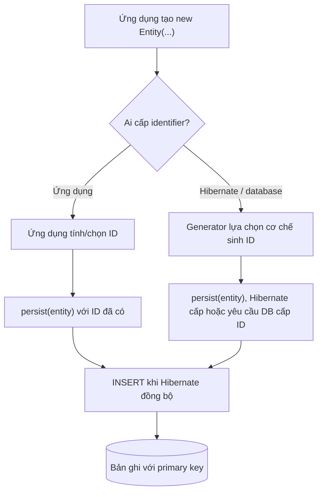
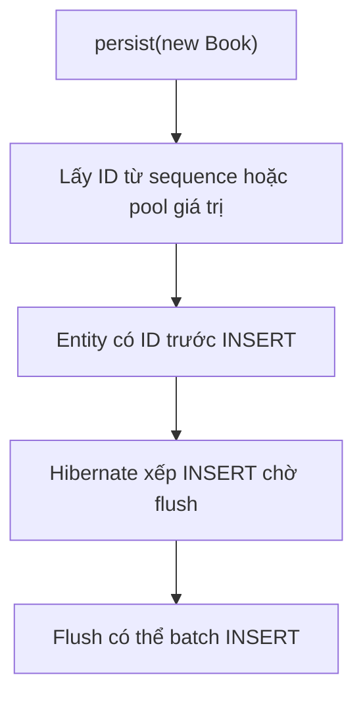

# Định danh do ứng dụng gán hoặc do hệ thống sinh trong JPA/Hibernate

Trong ORM, mỗi entity cần một **định danh (identifier)** để Hibernate xác định đối tượng nào tương ứng với bản ghi nào trong cơ sở dữ liệu. Annotation `@Id` xác định thuộc tính định danh; cách **giá trị của ID được tạo ra** lại là một quyết định riêng: ứng dụng tự gán, hay Hibernate/cơ sở dữ liệu sinh ra.

Hai cách này có thể phục vụ cùng mô hình entity nhưng dẫn tới những khác biệt đáng kể về vòng đời đối tượng, thao tác `persist`, thời điểm có khóa chính, cách tổ chức SQL, hiệu năng ghi hàng loạt và tính duy nhất khi nhiều tiến trình cùng tạo dữ liệu.

Bài học này tập trung vào quyết định **định danh do ứng dụng gán (*assigned identifier*) hay do hệ thống sinh (*generated identifier*)** trong Jakarta Persistence (JPA) và Hibernate, kèm các lựa chọn `IDENTITY`, `SEQUENCE`, `TABLE`, `AUTO`, `UUID`, ví dụ Java, SQL và các lỗi triển khai thường gặp.

## 1. Định danh của entity là gì?

Một entity đại diện cho một đơn vị dữ liệu có thể nhận diện được một cách ổn định trong phạm vi mô hình persistence. Trong JPA, định danh thường ánh xạ đến **primary key** của bảng.

Ví dụ bảng:

```sql
CREATE TABLE books (
    id BIGINT PRIMARY KEY,
    title VARCHAR(200) NOT NULL
);
```

Entity tương ứng:

```java
import jakarta.persistence.Entity;
import jakarta.persistence.Id;
import jakarta.persistence.Table;

@Entity
@Table(name = "books")
public class Book {
    @Id
    private Long id;

    private String title;

    protected Book() {}

    public Long getId() {
        return id;
    }
}
```

`@Id` cho Hibernate biết **`id` là định danh**. Bản thân `@Id` **không đồng nghĩa** với việc hệ thống sẽ tự tạo giá trị ID. Muốn chọn cơ chế sinh tự động theo JPA, ta thường cần thêm `@GeneratedValue`.

Tầm quan trọng của identifier trong Hibernate:

- Khi tải `Book#42`, Hibernate theo dõi entity bằng cặp thông tin tương đương loại entity + giá trị ID trong Persistence Context.
- Khi `find(Book.class, 42L)` được gọi nhiều lần trong một Persistence Context, Hibernate có thể dùng lại managed instance cho cùng định danh.
- Khi flush các thay đổi, ID giúp xác định dòng cần cập nhật/xóa.
- Khóa ngoại giữa các bảng thường tham chiếu primary key hoặc unique key được thiết kế phù hợp.

**Identifier khác object reference:** hai Java object ở hai session khác nhau vẫn có thể biểu diễn một bản ghi có ID bằng nhau. Ngược lại, một object Java chưa được gán ID có thể là entity mới chưa có định danh database.

### Phân biệt ID và business key

Giả sử khách hàng có `customerId` và `email`:

| Thuộc tính | Vai trò | Có nên coi là ID? |
| --- | --- | --- |
| `customerId` | Khóa chính ổn định | Thường phù hợp |
| `email` | Mã nhận diện nghiệp vụ, có thể thay đổi | Thường phù hợp làm unique business key hơn |
| `phoneNumber` | Dữ liệu nghiệp vụ, có thể thay đổi hoặc tái sử dụng | Thường không phù hợp làm khóa chính |
| `orderNumber` | Mã đơn hàng hiển thị cho người dùng | Có thể là natural key nếu quy tắc bảo đảm bất biến và duy nhất |

Trong nhiều hệ thống, nên dùng một **surrogate key** như `Long` hoặc `UUID` cho primary key và đặt unique constraint lên business key nếu cần. Nhưng cũng có bài toán mà mã nghiệp vụ bất biến, do hệ thống ngoài cấp, chính là định danh tốt.

## 2. Hai mô hình cấp định danh



| Tiêu chí | Ứng dụng tự gán | Hệ thống sinh |
| --- | --- | --- |
| Annotation thường gặp | `@Id` | `@Id` và `@GeneratedValue` |
| Ai quyết định ID? | Mã ứng dụng, domain hoặc hệ thống ngoài | Generator của Hibernate hoặc cơ sở dữ liệu |
| Thời điểm có ID | Khi ứng dụng gán, thường trước `persist` | Phụ thuộc chiến lược sinh |
| Bài toán tính duy nhất | Ứng dụng phải bảo đảm hoặc phối hợp với nguồn phát ID | Generator và ràng buộc DB phối hợp |
| Tái sử dụng mã có sẵn | Tự nhiên nếu ID đến từ external system | Cần thiết kế tích hợp riêng |
| Khả năng ghi hàng loạt | Phụ thuộc cách tạo ID và cách Hibernate batch | `SEQUENCE` thường thuận lợi hơn `IDENTITY` trong Hibernate |
| Rủi ro phổ biến | Trùng khóa, thiếu ID, quy tắc ID không thống nhất | DDL không khớp generator, thiếu sequence, đoán sai thời điểm ID sẵn có |

Không có cách nào đúng cho mọi ứng dụng. Cách chọn cần dựa trên tính ổn định của ID, phạm vi phân tán, thiết kế database và hành vi giao dịch.

## 3. Định danh do ứng dụng gán (*assigned identifier*)

Trong cách này, ứng dụng đặt ID **trước khi đưa entity mới vào trạng thái managed**. Một mapping đơn giản:

```java
import jakarta.persistence.Column;
import jakarta.persistence.Entity;
import jakarta.persistence.Id;
import jakarta.persistence.Table;

@Entity
@Table(name = "external_customers")
public class ExternalCustomer {

    @Id
    @Column(name = "customer_code", nullable = false, updatable = false)
    private String customerCode;

    @Column(nullable = false)
    private String displayName;

    protected ExternalCustomer() {}

    public ExternalCustomer(String customerCode, String displayName) {
        this.customerCode = customerCode;
        this.displayName = displayName;
    }

    public String getCustomerCode() {
        return customerCode;
    }

    public String getDisplayName() {
        return displayName;
    }
}
```

Lệnh tạo mới:

```java
ExternalCustomer customer =
    new ExternalCustomer("ERP-CUST-00852", "An Nguyen");

entityManager.persist(customer);
```

Không có `@GeneratedValue`; Hibernate sử dụng `customerCode` được truyền từ ứng dụng làm khóa chính trong `INSERT`.

SQL minh họa:

```sql
INSERT INTO external_customers (customer_code, display_name)
VALUES ('ERP-CUST-00852', 'An Nguyen');
```

Ứng dụng cần xác định chính sách cho:

1. **Tính duy nhất:** hai transaction không được tạo cùng khóa chính cho hai khách hàng khác nhau.
2. **Giá trị bắt buộc:** ID phải có giá trị hợp lệ trước khi insert.
3. **Tính bất biến:** không tùy ý thay đổi ID sau khi entity được persist.
4. **Phạm vi nguồn:** nếu mã đến từ hệ thống ngoài, bảo đảm hiểu đúng phạm vi và quy tắc mã đó.
5. **Ràng buộc database:** vẫn phải có primary key hoặc unique constraint tương ứng để bảo vệ dữ liệu trước trường hợp mã ứng dụng bị lỗi.

### Trường hợp thích hợp với assigned ID

Assigned ID thường phù hợp khi:

- Hệ thống ERP/CRM đã cấp một mã ổn định, duy nhất và toàn bộ ứng dụng dùng chính mã ấy.
- Dữ liệu nhập từ hệ thống khác cần **giữ nguyên định danh**.
- Ứng dụng muốn tạo ID ngoài database trước khi lưu, ví dụ UUID.
- Entity dùng khóa tổng hợp được xác định từ một vài thành phần nghiệp vụ.
- Quy trình tạo dữ liệu ở nhiều dịch vụ cần sinh ID độc lập với trạng thái kết nối database.

Không nhất thiết rằng assigned ID phải là chuỗi. ID có thể là `Long`, `UUID` hoặc kiểu được JPA/Hibernate hỗ trợ. Tuy nhiên, nếu sử dụng số nguyên tăng dần mà ứng dụng tự lấy “MAX(id) + 1”, nhiều transaction đồng thời có thể tính ra cùng một ID.

### Vì sao không dùng `MAX(id) + 1`?

Giả sử bảng hiện có ID cao nhất bằng 100:

```text
Transaction A: SELECT MAX(id) -> 100
Transaction B: SELECT MAX(id) -> 100

Transaction A: INSERT id = 101 -> thành công
Transaction B: INSERT id = 101 -> vi phạm primary key
```

Locking hoặc isolation đặc biệt có thể thay đổi hành vi, nhưng quy tắc “tự tăng bằng MAX+1” thường kém an toàn và kém hiệu quả trong môi trường nhiều writer. Nếu cần số thứ tự, hãy dùng sequence, identity column, dịch vụ phát ID được thiết kế đúng hoặc một generator phù hợp.

### Assigned UUID do ứng dụng tạo

Một biến thể thường dùng là gán UUID tại thời điểm khởi tạo entity:

```java
import java.util.UUID;
import jakarta.persistence.Column;
import jakarta.persistence.Entity;
import jakarta.persistence.Id;
import jakarta.persistence.Table;

@Entity
@Table(name = "invoices")
public class Invoice {

    @Id
    @Column(name = "id", nullable = false, updatable = false)
    private UUID id;

    @Column(nullable = false)
    private String description;

    protected Invoice() {}

    public Invoice(String description) {
        this.id = UUID.randomUUID();
        this.description = description;
    }

    public UUID getId() {
        return id;
    }

    public String getDescription() {
        return description;
    }
}
```

Lúc tạo:

```java
Invoice invoice = new Invoice("Thanh toán tháng 11");

UUID idBeforePersist = invoice.getId(); // Đã có ID.

entityManager.persist(invoice);
```

Đây vẫn là **assigned ID**, vì ứng dụng gọi `UUID.randomUUID()`; không có `@GeneratedValue`. Khả năng lưu `UUID` thành kiểu cột native `UUID`, binary hoặc chuỗi phụ thuộc Hibernate/dialect và cấu hình mapping.

UUID giảm nhu cầu phối hợp phát ID theo thứ tự giữa nhiều tiến trình; tuy nhiên nó vẫn cần unique/primary-key constraint ở DB, và cần cân nhắc chỉ mục, kích thước lưu trữ và tính phân tán của giá trị.

## 4. Định danh do hệ thống sinh (*generated identifier*)

Với cơ chế sinh ID được JPA định nghĩa, dùng `@GeneratedValue` cùng `@Id`:

```java
import jakarta.persistence.Entity;
import jakarta.persistence.GeneratedValue;
import jakarta.persistence.GenerationType;
import jakarta.persistence.Id;
import jakarta.persistence.Table;

@Entity
@Table(name = "books")
public class Book {

    @Id
    @GeneratedValue(strategy = GenerationType.IDENTITY)
    private Long id;

    private String title;

    protected Book() {}

    public Book(String title) {
        this.title = title;
    }

    public Long getId() {
        return id;
    }
}
```

Mã nghiệp vụ không cần gán `id`:

```java
Book book = new Book("Hibernate Fundamentals");
entityManager.persist(book);
```

Hibernate phối hợp với cơ sở dữ liệu để xác định giá trị ID. **Cách xác định và thời điểm ID xuất hiện phụ thuộc `strategy`.**

### Các chiến lược sinh ID chuẩn

| Chiến lược | Cơ chế khái quát | Điểm cần nhớ |
| --- | --- | --- |
| `GenerationType.AUTO` | Provider chọn một chiến lược phù hợp với kiểu ID và dialect | Ít ràng buộc code, nhưng hành vi cụ thể phụ thuộc provider/phiên bản/cấu hình |
| `GenerationType.IDENTITY` | Database sinh ID khi chèn bản ghi (identity/auto-increment) | Thường cần `INSERT` để nhận ID; ảnh hưởng JDBC insert batching trong Hibernate |
| `GenerationType.SEQUENCE` | Lấy ID từ database sequence | Có thể cấp ID trước khi insert; hỗ trợ tối ưu qua allocation/pooled sequences |
| `GenerationType.TABLE` | Sử dụng một bảng riêng theo dõi giá trị generator | Di động về khái niệm, nhưng có chi phí đọc/ghi và tranh chấp trên bảng phát ID |
| `GenerationType.UUID` | Provider sinh UUID | Là giá trị của chuẩn Jakarta Persistence 3.1+; cần kiểm tra phiên bản và kiểu ID |

Không phải mọi database đều hỗ trợ sequence hoặc identity theo cùng cú pháp. Hibernate dùng **dialect** và cấu hình để chọn hoặc triển khai generator thích hợp. `AUTO` không cam kết luôn dùng identity hay sequence; tránh viết code dựa vào dự đoán này.

## 5. `GenerationType.IDENTITY`: database sinh khi INSERT

Với `IDENTITY`, database thường có một cột identity/auto-increment:

```sql
-- Ví dụ cú pháp PostgreSQL:
CREATE TABLE books (
    id BIGINT GENERATED BY DEFAULT AS IDENTITY PRIMARY KEY,
    title VARCHAR(200) NOT NULL
);
```

Mapping:

```java
@Entity
@Table(name = "books")
public class Book {

    @Id
    @GeneratedValue(strategy = GenerationType.IDENTITY)
    private Long id;

    private String title;

    protected Book() {}

    public Book(String title) {
        this.title = title;
    }

    public Long getId() {
        return id;
    }
}
```

Hibernate có thể thực thi:

```sql
INSERT INTO books (title) VALUES (?);
```

sau đó lấy khóa sinh ra qua JDBC generated keys hoặc cơ chế phù hợp của dialect.

### Thời điểm ID có giá trị

Một số lập trình viên nghĩ rằng `persist` **luôn** chỉ thay đổi bộ nhớ và mãi đến `commit` mới có `INSERT`. Điều đó không đúng như một quy tắc tuyệt đối với `IDENTITY`.

Để biết khóa được DB sinh, Hibernate **thường phải chèn bản ghi**. Trong transaction thông thường, Hibernate có thể thực hiện `INSERT` sớm ở hoặc gần `persist`. Một số ngữ cảnh không có transaction hoặc flush mode khác có thể trì hoãn hành vi; không dựa vào thứ tự gọi phương thức nếu yêu cầu tính chính xác.

```java
Book book = new Book("JPA");

System.out.println(book.getId()); // Thường null trước persist.

entityManager.persist(book);

// Với IDENTITY, Hibernate thường đã phải lấy generated ID
// từ INSERT, nhưng thời điểm chính xác phụ thuộc runtime.
Long generatedId = book.getId();
```

Nếu nghiệp vụ cần bảo đảm dữ liệu đã được gửi xuống DB trong transaction tại thời điểm cụ thể, có thể gọi `entityManager.flush()`, đồng thời nhớ rằng **flush không phải commit**.

### Ưu điểm và hạn chế

**Ưu điểm:** quen thuộc với nhiều database, đơn giản, database chịu trách nhiệm cấp khóa.

**Hạn chế:** khả năng batch nhiều `INSERT` của Hibernate thường kém thuận lợi so với `SEQUENCE` vì cần phản hồi ID sau từng lần chèn. Trong môi trường nhập dữ liệu lớn, cần cân nhắc chiến lược khóa và JDBC batching.

Không thể kết luận mọi loại batch hoặc mọi database đều có kết quả giống nhau; đo hiệu năng trên cấu hình Hibernate và database thực tế.

## 6. `GenerationType.SEQUENCE`: lấy ID trước khi INSERT

Database sequence là đối tượng tạo giá trị số. Hibernate có thể lấy ID bằng một lệnh tương đương `nextval` rồi sử dụng ID đó khi insert.

Ví dụ PostgreSQL:

```sql
CREATE SEQUENCE book_id_seq START WITH 1 INCREMENT BY 50;

CREATE TABLE books (
    id BIGINT PRIMARY KEY,
    title VARCHAR(200) NOT NULL
);
```

Entity:

```java
import jakarta.persistence.GeneratedValue;
import jakarta.persistence.GenerationType;
import jakarta.persistence.Id;
import jakarta.persistence.SequenceGenerator;

@Entity
@Table(name = "books")
public class Book {

    @Id
    @GeneratedValue(
        strategy = GenerationType.SEQUENCE,
        generator = "book_id_generator"
    )
    @SequenceGenerator(
        name = "book_id_generator",
        sequenceName = "book_id_seq",
        allocationSize = 50
    )
    private Long id;

    private String title;

    protected Book() {}

    public Book(String title) {
        this.title = title;
    }

    public Long getId() {
        return id;
    }
}
```

Ý nghĩa của hai tên:

- `generator = "book_id_generator"` tham chiếu **tên generator logic trong mapping JPA**.
- `sequenceName = "book_id_seq"` chỉ **sequence thực trong database**.

Hai chuỗi không bắt buộc giống nhau.

### Vì sao sequence thuận lợi cho batching?

Hibernate thường có thể lấy ID **trước khi `INSERT`**, rồi đưa nhiều thao tác chèn vào hàng đợi và batch qua JDBC khi flush. Với `IDENTITY`, thường phải chèn trước để lấy ID.



Sơ đồ minh họa cơ chế thường gặp, không hứa mọi lệnh đều được batch; ID strategy là một trong nhiều yếu tố ảnh hưởng JDBC batching.

### `allocationSize` có ý nghĩa gì?

`@SequenceGenerator(allocationSize = 50)` cho phép provider sử dụng chiến lược phân bổ một nhóm ID để giảm số lần cần tương tác với sequence. Hibernate có thể sử dụng pooled optimizer; cách nhóm ID cụ thể phụ thuộc cấu hình và phiên bản.

**Không tự ý đặt `allocationSize = 50` khi sequence DB vẫn được tạo theo increment không tương thích.** Với pooled generator, Hibernate có thể yêu cầu cấu hình increment thực tế khớp mapping và từ chối bootstrap hoặc sinh ID không đúng kỳ vọng khi DB/schema lệch. Ví dụ DDL ở trên tạo sequence `INCREMENT BY 50` để minh họa một cấu hình tương thích thường gặp.

Nếu muốn bước đi đơn giản với mỗi lần xin một giá trị sequence:

```java
@SequenceGenerator(
    name = "book_id_generator",
    sequenceName = "book_id_seq",
    allocationSize = 1
)
```

thì sequence database nên được cấu hình increment tương ứng. Đổi allocation size là một thay đổi liên quan schema/generator, không chỉ là tối ưu mã Java.

### Có bảo đảm ID liên tiếp không?

Không. Sequence có thể tạo **khoảng trống** do rollback, ứng dụng restart, cấp phát trước, cache sequence và transaction khác cùng tạo dữ liệu.

Nếu cần mã chứng từ liên tục không có số bỏ trống theo quy định nghiệp vụ, primary key từ sequence thường không phải cơ chế đủ để đảm bảo yêu cầu ấy. Cần thiết kế riêng việc cấp số và xử lý hủy giao dịch.

## 7. `GenerationType.TABLE`: bảng phát ID

Với `TABLE`, Hibernate dùng một bảng chứa giá trị generator. Một mapping minh họa:

```java
import jakarta.persistence.GeneratedValue;
import jakarta.persistence.GenerationType;
import jakarta.persistence.Id;
import jakarta.persistence.TableGenerator;

@Entity
@Table(name = "documents")
public class Document {

    @Id
    @GeneratedValue(
        strategy = GenerationType.TABLE,
        generator = "document_ids"
    )
    @TableGenerator(
        name = "document_ids",
        table = "id_allocations",
        pkColumnName = "segment_name",
        valueColumnName = "next_value",
        pkColumnValue = "documents",
        allocationSize = 20
    )
    private Long id;

    private String title;

    protected Document() {}

    public Document(String title) {
        this.title = title;
    }
}
```

Một bảng phát ID có thể có cấu trúc:

```sql
CREATE TABLE id_allocations (
    segment_name VARCHAR(80) PRIMARY KEY,
    next_value BIGINT NOT NULL
);
```

Provider cập nhật dòng tương ứng với segment và dùng giá trị đó để cấp ID; khóa, transaction và công thức tính giá trị cụ thể do generator đảm nhiệm.

Ưu điểm là không phụ thuộc vào một sequence chuyên biệt của database. Tuy nhiên, bảng cấp ID có thể tạo thêm SQL, lock và điểm tranh chấp khi nhiều tiến trình cấp ID đồng thời. Trong các hệ thống có sequence, `SEQUENCE` thường là lựa chọn hiệu quả hơn cho khóa số; còn `TABLE` phù hợp khi có hạn chế về khả năng hỗ trợ sequence/identity hoặc yêu cầu tương thích cụ thể.

## 8. `GenerationType.AUTO`: để provider lựa chọn

Ví dụ:

```java
@Entity
public class Task {

    @Id
    @GeneratedValue(strategy = GenerationType.AUTO)
    private Long id;

    private String name;
}
```

`AUTO` cho phép JPA provider chọn chiến lược sinh phù hợp với loại định danh và dialect. Khi dùng Hibernate, việc chọn có thể khác giữa phiên bản, kiểu khóa và cấu hình generator.

`AUTO` hữu ích nếu ưu tiên mức trừu tượng và portability. Tuy nhiên, nếu dự án cần kiểm soát chính xác DDL, thời điểm có ID, batching hoặc cách phối hợp nhiều ứng dụng dùng cùng bảng, nên chọn một chiến lược rõ ràng và quản lý schema nhất quán.

**Không giả định `AUTO` có nghĩa database auto-increment.** Hãy kiểm tra SQL hoặc mapping runtime thay vì dựa vào tên annotation.

## 9. UUID: ứng dụng tự tạo hay Hibernate tạo đều được

UUID là kiểu ID phù hợp cho nhiều hệ thống cần tạo khóa ở nhiều tiến trình, nhận diện entity trước khi ghi database hoặc tránh phụ thuộc vào một nguồn phát số tập trung.

Có **hai hướng** dùng UUID, phản ánh đúng chủ đề của bài:

### 9.1. Ứng dụng tự gán UUID

```java
@Entity
public class Event {

    @Id
    private UUID id;

    private String description;

    protected Event() {}

    public Event(String description) {
        this.id = UUID.randomUUID();
        this.description = description;
    }

    public UUID getId() {
        return id;
    }
}
```

ID có ngay sau khi gọi constructor:

```java
Event event = new Event("Created");
UUID id = event.getId(); // Có trước persist.
entityManager.persist(event);
```

Đây là **assigned identifier**, dù giá trị ID được tạo bằng thư viện Java.

### 9.2. Hibernate/JPA sinh UUID

Với Jakarta Persistence 3.1 trở lên, `GenerationType.UUID` là một lựa chọn chuẩn:

```java
import java.util.UUID;
import jakarta.persistence.Entity;
import jakarta.persistence.GeneratedValue;
import jakarta.persistence.GenerationType;
import jakarta.persistence.Id;

@Entity
public class AuditEvent {

    @Id
    @GeneratedValue(strategy = GenerationType.UUID)
    private UUID id;

    private String action;

    protected AuditEvent() {}

    public UUID getId() {
        return id;
    }
}
```

Hibernate cũng có các cơ chế UUID generator riêng tùy phiên bản, ví dụ `@UuidGenerator` trong các thế hệ Hibernate hỗ trợ. Khi sử dụng tính năng đặc thù của Hibernate, hãy đối chiếu phiên bản thư viện dự án và không coi annotation mở rộng của provider là API JPA chuẩn.

### Có nên luôn dùng UUID?

Không nhất thiết. Cân nhắc các đặc tính:

| Tiêu chí | ID số `BIGINT` | UUID |
| --- | --- | --- |
| Kích thước giá trị | Thường nhỏ hơn | Thường lớn hơn |
| Dễ đọc/thao tác thủ công | Thuận lợi | Dài, khó đọc |
| Sinh phân tán không phối hợp | Cần cơ chế phát ID thích hợp | Thuận tiện nếu sinh ngẫu nhiên/duy nhất theo quy tắc UUID |
| Thứ tự tăng dần | Có thể có với sequence/identity | Phụ thuộc loại UUID; UUID ngẫu nhiên không tăng theo thời gian |
| Chỉ mục database | Thường gọn và có tính cục bộ cao | Có thể tốn dung lượng và gây phân mảnh hơn, phụ thuộc kiểu UUID và DB |
| Che giấu số lượng bản ghi qua ID | ID tăng dần có thể tiết lộ mức độ sử dụng | UUID khó đoán hơn, nhưng **không thay thế phân quyền** |

Nếu ID xuất hiện trong URL công khai, dùng UUID có thể hạn chế việc đoán ID liên tiếp. Dù vậy, mọi API vẫn phải kiểm tra quyền truy cập theo người dùng/tenant; ID khó đoán không phải cơ chế bảo mật.

## 10. Thời điểm ID được gán: constructor, persist, flush và commit

Một trong những khác biệt thực tế lớn nhất là **khi nào có thể sử dụng ID**.

| Cách cấp ID | Sau `new` | Sau `persist` | Khi nào cần SQL để có ID? |
| --- | --- | --- | --- |
| Assigned chuỗi/số gán trong constructor | Thường đã có | Giữ giá trị đã gán | Không cần SQL để **tạo** ID |
| Assigned UUID trong constructor | Đã có | Giữ giá trị đã gán | Không cần SQL để **tạo** ID |
| `SEQUENCE` | Thường `null` | Thường đã có ID | Có thể cần `SELECT nextval`, không cần chèn bản ghi ngay |
| `IDENTITY` | Thường `null` | Phụ thuộc thời điểm Hibernate thực hiện `INSERT` | Thường cần `INSERT` để DB tạo ID |
| `TABLE` | Thường `null` | Thường đã có sau khi generator cấp | Cần thao tác với bảng phát ID |
| `UUID` do provider sinh | Thường `null` | Thường có ID khi generator chạy | Thường có thể tạo tại ứng dụng, phụ thuộc provider |
| `AUTO` | Phụ thuộc kiểu/generator | Phụ thuộc cách provider chọn | Không cố định |

Các mô tả “thường” chỉ phản ánh kịch bản sử dụng phổ biến. Thời điểm chính xác của SQL có thể thay đổi theo Hibernate version, flush mode, transaction và generator.

### `persist` không phải `commit`

```java
entityManager.getTransaction().begin();

Book book = new Book("Hibernate");
entityManager.persist(book);

entityManager.flush();  // Đồng bộ các thao tác SQL đang chờ.
entityManager.getTransaction().commit(); // Xác nhận transaction.
```

Nếu dùng môi trường transaction do Spring quản lý, thông thường không gọi `getTransaction().begin()`/`commit()` thủ công, mà dùng `@Transactional`.

Cần phân biệt:

- **Gán ID:** entity có một khóa chính.
- **Thực thi INSERT:** Hibernate đã gửi SQL ghi dữ liệu.
- **Flush:** Hibernate đồng bộ Persistence Context với database trong transaction.
- **Commit:** database xác nhận transaction thành công.

Một ID được sinh trước khi commit **không chứng minh** bản ghi đã được commit. Transaction rollback vẫn có thể làm mất bản ghi mặc dù ID từng được cấp.

## 11. Khóa tổng hợp: định danh được ứng dụng cung cấp từ nhiều trường

Không phải ID nào cũng là một trường `Long` hoặc `UUID`. Một bản ghi chi tiết đơn hàng có thể dùng cặp `orderId` + `lineNumber` làm primary key tổng hợp.

JPA hỗ trợ `@EmbeddedId` và `@IdClass`. Với `@EmbeddedId`, giá trị khóa nằm trong một lớp `@Embeddable`.

```java
import java.io.Serializable;
import java.util.Objects;
import jakarta.persistence.Column;
import jakarta.persistence.Embeddable;

@Embeddable
public class OrderLineId implements Serializable {

    @Column(name = "order_id")
    private Long orderId;

    @Column(name = "line_number")
    private Integer lineNumber;

    protected OrderLineId() {}

    public OrderLineId(Long orderId, Integer lineNumber) {
        this.orderId = orderId;
        this.lineNumber = lineNumber;
    }

    public Long getOrderId() {
        return orderId;
    }

    public Integer getLineNumber() {
        return lineNumber;
    }

    @Override
    public boolean equals(Object other) {
        if (this == other) return true;
        if (!(other instanceof OrderLineId)) return false;
        OrderLineId that = (OrderLineId) other;
        return Objects.equals(orderId, that.orderId)
            && Objects.equals(lineNumber, that.lineNumber);
    }

    @Override
    public int hashCode() {
        return Objects.hash(orderId, lineNumber);
    }
}
```

Entity:

```java
import jakarta.persistence.EmbeddedId;
import jakarta.persistence.Entity;
import jakarta.persistence.Table;

@Entity
@Table(name = "order_lines")
public class OrderLine {

    @EmbeddedId
    private OrderLineId id;

    private String productName;

    protected OrderLine() {}

    public OrderLine(OrderLineId id, String productName) {
        this.id = id;
        this.productName = productName;
    }

    public OrderLineId getId() {
        return id;
    }
}
```

Tạo entity:

```java
OrderLineId id = new OrderLineId(9001L, 3);
OrderLine line = new OrderLine(id, "Notebook");

entityManager.persist(line);
```

SQL minh họa:

```sql
CREATE TABLE order_lines (
    order_id BIGINT NOT NULL,
    line_number INTEGER NOT NULL,
    product_name VARCHAR(200),
    PRIMARY KEY (order_id, line_number)
);
```

Trong ví dụ này, **ứng dụng cung cấp khóa tổng hợp**. Cần bảo đảm mỗi cặp `(orderId, lineNumber)` là duy nhất trong database và các thành phần ID không thay đổi sau khi persist.

### Thêm `@MapsId` khi ID phụ thuộc quan hệ

Với entity con có khóa chứa ID của entity cha, JPA có thể dùng `@MapsId` để ánh xạ ID qua association. Điều này giúp tránh phải giữ hai nguồn dữ liệu không nhất quán cho khóa ngoại và ID tổng hợp.

Tuy nhiên, `@MapsId` là một mẫu mapping quan hệ có quy tắc riêng về thời điểm gán khóa. Khi thiết kế, hãy xác định rõ phần ID nào do entity cha cung cấp, phần nào do ứng dụng gán, rồi chọn một chiến lược persist phù hợp.

### Có dùng `@GeneratedValue` cho mọi phần của composite key không?

Không nên giả định như vậy. Hỗ trợ sinh một phần của khóa tổng hợp có những giới hạn theo chuẩn JPA và có thể là tính năng riêng của Hibernate. Với composite ID, hãy ưu tiên mapping rõ ràng và đối chiếu hành vi của provider được chọn. Nếu mô hình không thực sự cần composite primary key, một surrogate ID sinh tự động cộng unique constraint cho cặp business fields thường dễ quản lý hơn.

## 12. Định danh, Persistence Context và trạng thái entity

ID giúp Hibernate xác định entity, nhưng **ID có giá trị không có nghĩa đối tượng đang managed**.

Hai đối tượng:

```java
ExternalCustomer a =
    new ExternalCustomer("ERP-001", "A");

ExternalCustomer b =
    new ExternalCustomer("ERP-001", "B");
```

đều có ID `ERP-001`, nhưng cả hai vừa được tạo bằng `new` và chưa được quản lý. Đây vẫn là **hai Java object** riêng biệt.

Nếu persist cả hai với cùng định danh trong cùng Persistence Context, Hibernate không thể duy trì hai managed instance độc lập cho cùng entity identity; có thể ném lỗi khi phát hiện trùng định danh hoặc khi database từ chối khóa trùng.

### Định danh gắn với các trạng thái

| Trạng thái | ID có thể tồn tại? | Hibernate theo dõi object? |
| --- | --- | --- |
| Transient/new | Có với assigned ID; thường chưa có với generated ID | Chưa |
| Managed | Có hoặc đang được generator cấp theo hành vi provider | Có |
| Detached | Có | Không trong Persistence Context hiện tại |
| Removed | Có | Được quản lý theo trạng thái chờ xóa cho đến khi hoàn tất quy trình thích hợp |

Ví dụ:

```java
ExternalCustomer customer =
    new ExternalCustomer("EXT-45", "Minh");

String id = customer.getCustomerCode(); // Có ID, nhưng vẫn transient.

entityManager.persist(customer);
boolean managed = entityManager.contains(customer); // true.

entityManager.detach(customer);
boolean detached = !entityManager.contains(customer); // true.
```

**Đừng dựa hoàn toàn vào “`id != null`” để xác định entity đang managed.** Với assigned ID, object transient đã có ID trước `persist`; detached object cũng giữ ID sau `detach` hoặc đóng session.

### `merge` với entity có ID được gán

`merge` trả về một **managed instance** có trạng thái được đồng bộ từ đối tượng truyền vào. Điều này không nhất thiết biến chính object được truyền thành managed.

```java
ExternalCustomer detached = obtainDetachedCustomer();

ExternalCustomer managed = entityManager.merge(detached);

System.out.println(entityManager.contains(managed));  // true.
System.out.println(entityManager.contains(detached)); // Thường false.
```

Trong workflow assigned ID, việc nhìn thấy ID không đủ để biết dữ liệu đã tồn tại hay chưa. Đừng coi `merge` là công cụ “upsert không cần suy nghĩ”: nó có thể cần truy vấn, có thể tạo/ghi đè theo quy tắc entity state, version và Hibernate, và cần xử lý va chạm/concurrency đúng cách.

## 13. Spring Data JPA: assigned ID có thể ảnh hưởng `save()`

Một tình huống quan trọng khi dùng Spring Data JPA là cách repository xác định entity có “mới” hay không.

Ví dụ:

```java
@Entity
public class ExternalCustomer {

    @Id
    private String customerCode;

    private String displayName;

    protected ExternalCustomer() {}

    public ExternalCustomer(String customerCode, String displayName) {
        this.customerCode = customerCode;
        this.displayName = displayName;
    }
}
```

Nếu repository:

```java
public interface ExternalCustomerRepository
        extends JpaRepository<ExternalCustomer, String> {
}
```

và gọi:

```java
repository.save(
    new ExternalCustomer("CRM-100", "An")
);
```

với ID đã khác `null`, chiến lược nhận biết entity mới mặc định của Spring Data JPA **có thể cho rằng entity không mới**, từ đó gọi `merge` thay vì `persist`. Điều này có thể tạo thêm `SELECT` hoặc ảnh hưởng hành vi insert, tùy mapping, version và phiên bản.

Trong Spring Data JPA, cơ chế phát hiện trạng thái mới có thể dựa trên trường `@Version` kiểu object nếu có, sau đó dựa trên ID trong trường hợp phù hợp; hoặc entity có thể tự cung cấp trạng thái qua `Persistable`. Cần hiểu cơ chế cụ thể thay vì mặc định “save = INSERT”.

### Cách 1: gọi `persist` khi đã biết chắc entity mới

Trong service JPA:

```java
@Transactional
public void createCustomer(String code, String name) {
    ExternalCustomer customer = new ExternalCustomer(code, name);
    entityManager.persist(customer);
}
```

Lệnh này thể hiện rõ ý định tạo một entity mới với assigned ID; nếu ID trùng dữ liệu hiện có, Hibernate/database có thể báo lỗi.

### Cách 2: cung cấp trạng thái mới qua `Persistable`

Khi thực sự cần repository `save` và assigned ID, có thể dùng `Persistable` của Spring Data:

```java
import jakarta.persistence.Entity;
import jakarta.persistence.Id;
import jakarta.persistence.PostLoad;
import jakarta.persistence.PostPersist;
import jakarta.persistence.Transient;
import org.springframework.data.domain.Persistable;

@Entity
public class ExternalCustomer
        implements Persistable<String> {

    @Id
    private String customerCode;

    private String displayName;

    @Transient
    private boolean isNew = true;

    protected ExternalCustomer() {}

    public ExternalCustomer(String code, String name) {
        this.customerCode = code;
        this.displayName = name;
    }

    @Override
    public String getId() {
        return customerCode;
    }

    @Override
    public boolean isNew() {
        return isNew;
    }

    @PostPersist
    @PostLoad
    void markNotNew() {
        isNew = false;
    }
}
```

Trong mẫu này, `isNew()` cho Spring Data biết một instance mới được tạo trong ứng dụng nên được xử lý bằng hướng `persist`. Sau khi entity được persist hoặc nạp từ DB, callback đổi cờ thành `false`.

Đây là **giải pháp tích hợp Spring Data JPA**, không phải annotation JPA quyết định ID. Cờ và callback cần được thiết kế phù hợp khi deserialize, detach hoặc chuyển entity giữa các lớp; không sử dụng cách này chỉ vì muốn gọi `save` ở mọi nơi.

## 14. Định danh bất biến và `equals()`/`hashCode()`

Identifier lý tưởng nên ổn định sau khi entity được persist. Nếu đổi khóa chính của managed entity, Hibernate có thể không hỗ trợ hoặc báo lỗi vì định danh là một phần của cơ chế theo dõi Persistence Context.

Vì vậy:

- Không mở setter ID công khai nếu không có nhu cầu nghiệp vụ rõ.
- Với assigned ID, khởi tạo ID sớm và giữ bất biến trong vòng đời object.
- Với generated ID, để Hibernate quản lý việc cấp ID; không tự chỉnh field ID sau `persist`.
- Không dùng field có thể thay đổi thường xuyên, chẳng hạn email hoặc tên hiển thị, làm primary key nếu không có lý do đặc biệt.

### Assigned ID ổn định từ lúc khởi tạo

Nếu assigned ID được cấp trước khi đưa object vào `HashSet` hoặc dùng làm key trong `HashMap`, `equals`/`hashCode` dựa trên ID có thể ổn định hơn.

Với value object ID composite, `equals` và `hashCode` phải được triển khai nhất quán. Ví dụ `OrderLineId` ở phần trên so sánh cả `orderId` và `lineNumber`.

### Generated ID nhận giá trị sau khi object tồn tại

Giả sử entity mới có `id == null`, sau `persist`/`flush` nó được gán `id = 501`. Nếu `hashCode()` dựa trực tiếp trên `id`, mã băm sẽ đổi giữa lúc entity đang nằm trong `HashSet`. Điều này có thể phá vỡ hành vi lookup của collection.

```java
Book book = new Book("ORM");
Set<Book> books = new HashSet<>();

books.add(book);     // ID có thể đang null.
em.persist(book);    // ID có thể được gán.
books.contains(book); // Có thể sai nếu hashCode phụ thuộc ID đã đổi.
```

Cần chọn chiến lược equality phù hợp với vòng đời entity, kiểu identifier, proxy và quan hệ kế thừa. Một số thiết kế dùng business key bất biến; thiết kế khác chỉ so ID khi cả hai đã có ID và giữ hash code ổn định theo class. Tránh tự động dùng toàn bộ field/association để tạo `equals`/`hashCode` bằng công cụ sinh code mà không xét lazy loading và vòng đời entity.

**Tính nhất quán `==` trong cùng Persistence Context** là cơ chế quản lý danh tính của Hibernate, không thay thế nhiệm vụ thiết kế `equals()`/`hashCode()` cho các collection Java hoặc đối tượng detached.

## 15. ID sinh tự động và đồng thời giao dịch

Một generator tốt phải đáp ứng nhu cầu nhiều tiến trình cùng tạo entity.

### Database sequence/identity

Database chịu trách nhiệm phát giá trị theo cơ chế concurrency của nó. Ứng dụng vẫn cần định nghĩa primary key constraint để từ chối trùng ID nếu cấu hình hoặc đường ghi khác có lỗi.

Transaction rollback có thể khiến dãy ID bị khuyết số. **Đừng dùng độ liên tiếp của primary key làm yêu cầu nghiệp vụ** nếu cần đánh số chứng từ không được bỏ số.

### UUID tự tạo

UUID có thể được tạo độc lập ở nhiều service. Xác suất đụng nhau với UUID ngẫu nhiên chuẩn là rất nhỏ khi thực hiện đúng, nhưng không có nghĩa bạn được phép bỏ unique constraint. Cũng cần xem liệu hệ thống yêu cầu ID có thứ tự để hỗ trợ index locality hay không.

### Assigned business key

Nếu mã ID do hệ thống ngoài cấp, cần kiểm soát trường hợp cùng mã được gửi lại nhiều lần và trường hợp mã có nghĩa khác nhau trong hai tenant. Ví dụ nếu `CUSTOMER-001` chỉ duy nhất **trong mỗi tenant**, thì một khóa chính đơn cột `customerCode` chưa thể bảo vệ đa tenant trên cùng bảng.

Các lựa chọn có thể là:

- Primary key tổng hợp `(tenantId, customerCode)`.
- Surrogate ID hệ thống sinh, unique constraint trên `(tenantId, customerCode)`.
- Routing/isolated schema bảo đảm phạm vi ID đúng theo kiến trúc multi-tenancy.

Quyết định phụ thuộc cách lưu tenant và quy tắc truy vấn, nhưng luôn phải xác định **phạm vi duy nhất của ID**.

### `@Version` giải quyết vấn đề gì?

`@Version` hỗ trợ optimistic locking để phát hiện cập nhật đồng thời trên một entity:

```java
@Entity
public class Order {

    @Id
    @GeneratedValue(strategy = GenerationType.SEQUENCE)
    private Long id;

    @Version
    private Long version;

    private String status;
}
```

Version **không phải ID** và không đảm nhiệm việc cấp khóa chính. Một khóa chính đúng giúp nhận diện dòng; trường version giúp kiểm tra dòng có thay đổi kể từ lúc đọc hay không. Hai cơ chế bổ sung cho nhau.

## 16. Cấu hình schema: mapping phải khớp database

Một entity chỉ định `@GeneratedValue(strategy = IDENTITY)` nhưng bảng thực tế dùng khóa chính thuần, không tự sinh ID, có thể gặp lỗi khi insert. Tương tự, entity dùng `SEQUENCE` nhưng sequence chưa tạo hoặc tên/increment không phù hợp có thể lỗi lúc bootstrap hoặc lúc sinh khóa.

Ví dụ so sánh DDL:

```sql
-- Assigned ID: ứng dụng cung cấp customer_code.
CREATE TABLE external_customers (
    customer_code VARCHAR(64) PRIMARY KEY,
    display_name VARCHAR(150) NOT NULL
);

-- IDENTITY: database cấp id khi INSERT.
-- Cú pháp minh họa kiểu PostgreSQL.
CREATE TABLE books_identity (
    id BIGINT GENERATED BY DEFAULT AS IDENTITY PRIMARY KEY,
    title VARCHAR(200) NOT NULL
);

-- SEQUENCE: Hibernate lấy id từ sequence riêng.
CREATE SEQUENCE book_id_seq START WITH 1 INCREMENT BY 50;

CREATE TABLE books_sequence (
    id BIGINT PRIMARY KEY,
    title VARCHAR(200) NOT NULL
);
```

Đây là các **phương án schema khác nhau** để minh họa chiến lược, không phải một entity dùng đồng thời cả ba bảng.

Trong dự án dùng Flyway/Liquibase, migration nên mô tả chính xác:

- Loại cột ID (`BIGINT`, `UUID`, `VARCHAR`...).
- Primary key và unique constraints.
- Identity/sequence/default đúng với mapping.
- Tên sequence và các thông số cần khớp generator.
- Foreign key của các bảng liên quan.
- Cách import dữ liệu có ID cũ hoặc tái đồng bộ bộ phát ID sau khi nhập liệu.

### Import dữ liệu có ID sẵn và sequence/identity

Giả sử migration đã chèn thủ công bản ghi có ID 10000, còn sequence tiếp tục từ 1. Lần insert tiếp theo do generator cấp có thể đụng ID sẵn có. Khi import dữ liệu, cần cập nhật sequence/identity generator theo cách an toàn dành cho database đang sử dụng, chứ không chỉ thay `@GeneratedValue`.

Nếu hệ thống cần giữ định danh bên ngoài nhưng vẫn muốn database phát khóa chính, có thể thiết kế hai trường:

```java
@Entity
@Table(name = "customers")
public class Customer {

    @Id
    @GeneratedValue(strategy = GenerationType.SEQUENCE)
    private Long id;

    @Column(name = "external_code", nullable = false, unique = true)
    private String externalCode;
}
```

Ở đây `id` là surrogate key, `externalCode` là business key có unique constraint. Cách này giảm phụ thuộc cấu trúc internal ID vào format của hệ thống tích hợp.

## 17. Quy trình lựa chọn chiến lược ID

Có thể dùng bảng ra quyết định sau khi xác định yêu cầu về dữ liệu và hạ tầng.

| Yêu cầu thực tế | Phương án thường phù hợp | Lý do |
| --- | --- | --- |
| Database hỗ trợ sequence, nhiều insert và batching | `SEQUENCE` với allocation phù hợp | Cấp ID trước `INSERT`, hỗ trợ gom thao tác ghi |
| Database dùng identity/auto-increment và CRUD thông thường | `IDENTITY` | Đơn giản, tận dụng DB |
| Nhiều service cần ID trước khi lưu | UUID do ứng dụng gán hoặc generator UUID phù hợp | Có thể tạo ID độc lập với một lượt INSERT |
| Bản ghi có mã bất biến do bên ngoài cung cấp | Assigned ID | Giữ được định danh nguồn |
| Mã nghiệp vụ có thể đổi | Surrogate ID + unique business key | Giữ primary key ổn định |
| Cần khóa theo nhiều cột nghiệp vụ ổn định | `@EmbeddedId`/`@IdClass` hoặc surrogate ID + unique constraint | Phụ thuộc yêu cầu khóa ngoại, truy vấn, lifecycle |
| Cần portable nhưng không buộc chiến lược cụ thể | `AUTO` | Để provider chọn; phải chấp nhận sự khác biệt runtime |
| Không có sequence/identity phù hợp | `TABLE`, nếu chi phí/locking chấp nhận được | Bảng phát ID được provider hỗ trợ |

Trong môi trường hệ thống lớn, lựa chọn ID cũng liên quan đến phân vùng dữ liệu, sharding, multi-tenancy, đồng bộ ngoại tuyến và thứ tự chỉ mục. Không nên chọn `IDENTITY` chỉ vì code ngắn hơn, hoặc UUID chỉ vì cảm giác hiện đại; hãy xét yêu cầu về độ ổn định, tính duy nhất, hiệu năng và cách dữ liệu được dùng.

## 18. Những lỗi thường gặp và cách xử lý

### Lỗi A: `@Id` nhưng không gán ID

```java
@Entity
public class Department {
    @Id
    private Long id;

    private String name;
}

Department dept = new Department();
// dept.id vẫn null.
entityManager.persist(dept);
```

Nếu mapping dùng assigned ID mà ứng dụng không đặt giá trị, Hibernate có thể báo lỗi yêu cầu gán identifier trước khi persist, hoặc thất bại do ràng buộc dữ liệu. Giải pháp là gán ID đúng lúc, hoặc thiết kế rõ `@GeneratedValue` cùng schema tương ứng.

### Lỗi B: Gán ID thủ công cho entity được sinh ID

```java
@Entity
public class Book {
    @Id
    @GeneratedValue(strategy = GenerationType.IDENTITY)
    private Long id;
}
```

Đừng coi `book.setId(42L)` là cách chuẩn tạo entity mới có ID được chỉ định khi mapping đang yêu cầu generator quản lý ID. ID đã có có thể khiến provider hiểu sai trạng thái new/detached hoặc phát sinh lỗi persist, nhất là với các quy tắc phát hiện trạng thái của Hibernate/Spring Data.

Nếu cần nhập ID tùy chỉnh, hãy thiết kế quy trình import và mapping phù hợp với generator, không trộn hai quyền sở hữu ID một cách tùy tiện.

### Lỗi C: Dùng `MAX(id) + 1`

Hai transaction có thể cùng đọc giá trị MAX và tạo ID giống nhau. Dùng generator có đồng bộ đúng, primary key constraint và xử lý xung đột thay vì phát ID dựa vào phép đọc này.

### Lỗi D: Sequence không tồn tại hoặc sai increment

Mapping khai báo `sequenceName = "book_id_seq"` nhưng migration chỉ tạo `orders_seq`; hoặc `allocationSize` không tương thích với increment của database. Kiểm tra mapping, DDL migration, dialect, quyền truy cập sequence và thông số optimizer.

### Lỗi E: Đánh đồng `id != null` với “đã lưu”

Với assigned UUID, ID có ngay khi constructor chạy. Với sequence, ID có thể xuất hiện trước INSERT. Dựa vào ID để khẳng định database đã có row là không chính xác.

Hãy dựa vào trạng thái entity, transaction và kết quả lưu trữ thực tế, không suy diễn từ mỗi giá trị của ID.

### Lỗi F: Dùng khóa chính làm thứ tự nghiệp vụ

Generated numeric IDs có thể nhảy số, phân bổ theo block và không tương ứng tuyệt đối với thứ tự commit. Nếu cần số hóa đơn liên tục hoặc thứ tự giao dịch chính thức, thiết kế một cơ chế riêng cho yêu cầu nghiệp vụ.

### Lỗi G: Sinh khóa bằng chuỗi ngẫu nhiên nhưng không bảo đảm uniqueness

Một bộ phát mã tùy ý có thể tạo trùng sau khi scale hệ thống. Cần chọn định dạng, thuật toán và ràng buộc DB rõ ràng; nếu có trùng khóa, phải có quy tắc retry hoặc phản hồi lỗi thích hợp.

### Lỗi H: Thay đổi ID của managed entity

Sau khi Hibernate quản lý một entity theo ID ban đầu, đổi ID phá vỡ mô hình định danh của Persistence Context. Hãy thiết kế ID bất biến; nếu nghiệp vụ cần đổi mã hiển thị, dùng một property riêng không phải primary key.

### Lỗi I: Spring Data `save()` gọi `merge` với assigned ID

Entity mới có ID khác null có thể bị Spring Data nhận diện là đã tồn tại. Cân nhắc cơ chế phát hiện mới của Spring Data, `Persistable.isNew()` hoặc dùng `EntityManager.persist()` khi cần tạo mới rõ ràng.

### Lỗi J: Nhầm unique business key với primary key

Email có unique constraint không nhất thiết nên là `@Id` nếu có thể đổi. Một surrogate ID ổn định cộng unique business key thường giúp bảo trì các foreign key và dữ liệu lịch sử thuận lợi hơn.

## 19. Bài thực hành: quan sát hai cách cấp ID

Tạo hai entity độc lập:

```java
@Entity
@Table(name = "assigned_notes")
public class AssignedNote {

    @Id
    private UUID id;

    private String content;

    protected AssignedNote() {}

    public AssignedNote(String content) {
        this.id = UUID.randomUUID();
        this.content = content;
    }

    public UUID getId() {
        return id;
    }
}
```

và:

```java
@Entity
@Table(name = "generated_notes")
public class GeneratedNote {

    @Id
    @GeneratedValue(strategy = GenerationType.SEQUENCE)
    private Long id;

    private String content;

    protected GeneratedNote() {}

    public GeneratedNote(String content) {
        this.content = content;
    }

    public Long getId() {
        return id;
    }
}
```

Trong transaction được quản lý:

```java
@Transactional
public void createNotes() {
    AssignedNote a = new AssignedNote("Assigned ID");
    GeneratedNote b = new GeneratedNote("Generated ID");

    System.out.println("a before persist: " + a.getId());
    System.out.println("b before persist: " + b.getId());

    entityManager.persist(a);
    entityManager.persist(b);

    System.out.println("a after persist: " + a.getId());
    System.out.println("b after persist: " + b.getId());

    entityManager.flush();
}
```

Quan sát kỳ vọng ở cấu hình phổ biến:

- `a.getId()` có giá trị ngay trước `persist` vì constructor tạo UUID.
- `b.getId()` thường `null` trước `persist` và có giá trị sau khi Hibernate dùng sequence generator.
- Khi flush, Hibernate gửi `INSERT` còn chờ. ID đã tồn tại **không có nghĩa transaction đã commit**.
- Nếu đổi mapping của `GeneratedNote` sang `IDENTITY`, hãy quan sát thời điểm `INSERT` xảy ra trong log SQL và khả năng batching.
- Trong Spring Data JPA, thử `repository.save(a)` với assigned ID để hiểu tác động của phát hiện entity mới; không giả định nó gọi `persist`.

Ví dụ yêu cầu annotation Spring `@Transactional` từ `org.springframework.transaction.annotation.Transactional` và một `EntityManager` được tiêm đúng cách. Entity `GeneratedNote` cần schema và sequence phù hợp với generator Hibernate được chọn; ví dụ này mô tả hành vi cấp ID, không thay thế thiết lập migration.

### Câu hỏi tự kiểm tra

**1. Chỉ khai báo `@Id` có làm Hibernate tự sinh ID không?**

Không. `@Id` đánh dấu định danh. Nếu không cấu hình generator, thường ứng dụng phải cung cấp ID phù hợp trước persist.

**2. Gán `UUID.randomUUID()` trong constructor thuộc assigned hay generated ID?**

Assigned ID xét theo **bên chịu trách nhiệm đặt giá trị vào entity**: ở đây ứng dụng tự gán, dù giá trị được tạo bằng thuật toán.

**3. Vì sao `SEQUENCE` thường thuận lợi hơn `IDENTITY` cho insert batching?**

Hibernate thường lấy được giá trị sequence trước khi chèn, cho phép xếp nhiều insert chờ flush. `IDENTITY` thường cần gửi insert để lấy ID từ database.

**4. ID từ sequence có luôn liên tiếp, không mất số khi rollback không?**

Không. Sequence và nhiều generator có thể bỏ qua giá trị khi rollback, allocation hoặc restart.

**5. `@GeneratedValue(strategy = AUTO)` có đồng nghĩa với database auto-increment không?**

Không. AUTO cho provider chọn; kết quả phụ thuộc kiểu ID, dialect và phiên bản.

**6. Đối tượng có `id != null` đã chắc chắn đang managed chưa?**

Chưa. Assigned ID có thể có trước persist; detached entity vẫn giữ ID sau khi rời Persistence Context.

**7. Khi nào nên tách business code khỏi primary key?**

Khi mã nghiệp vụ có khả năng đổi, có scope uniqueness riêng, hoặc được quản lý bởi hệ thống ngoài với quy tắc khác database nội bộ. Dùng surrogate ID và unique constraint cho business code là một phương án phổ biến.

**8. Chuyển từ `IDENTITY` sang `SEQUENCE` có chỉ cần sửa một annotation không?**

Không hẳn. Cần bảo đảm DDL/sequence, giá trị phát ID hiện tại, foreign keys và cơ chế migration tương thích.

## 20. Ghi nhớ khi thiết kế định danh

- **`@Id` xác định ID; `@GeneratedValue` quy định provider sinh ID theo chiến lược phù hợp.**
- **Assigned ID** đòi ứng dụng cấp giá trị và bảo đảm phạm vi duy nhất; nó phù hợp với ID đến từ bên ngoài hoặc UUID ứng dụng tự tạo.
- **Generated ID** giao việc cấp khóa cho Hibernate/database; `IDENTITY`, `SEQUENCE`, `TABLE`, `AUTO` và `UUID` có hành vi khác nhau.
- **ID không đồng nghĩa với trạng thái persisted/managed**. Không dùng mỗi điều kiện `id != null` để kết luận object đã lưu thành công.
- **Sequence/identity có thể có khoảng trống**; primary key là khóa nhận diện, không phải bộ số thứ tự nghiệp vụ liên tục.
- **Giữ ID ổn định** sau persist và suy nghĩ kỹ về equality/hash code cho entity có ID được cấp trễ.
- **Database constraints và schema migration phải nhất quán** với chiến lược sinh ID, kể cả trong hệ thống nhiều writer hoặc nhiều tenant.
- **Chọn chiến lược theo bài toán**: khả năng sinh ID phân tán, tính bất biến, hiệu năng chèn, cơ sở dữ liệu và yêu cầu tích hợp.

Với Hibernate, câu hỏi quan trọng không chỉ là “ID dùng kiểu `Long` hay `UUID`?”, mà còn là **ai chịu trách nhiệm cấp ID, cấp vào thời điểm nào và cơ chế ấy bảo đảm tính duy nhất ra sao trên toàn hệ thống**. Trả lời rõ ba điều này giúp thiết kế entity và giao dịch bền vững khi ứng dụng mở rộng.
