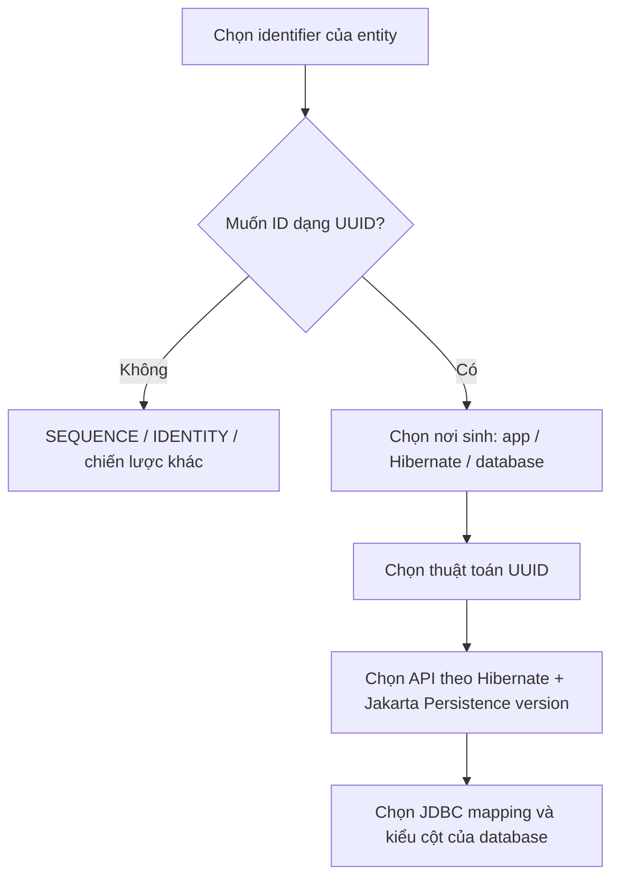

# Bộ sinh UUID và các lựa chọn định danh phù hợp với phiên bản sử dụng

## 1. Định danh entity giải quyết vấn đề gì?

Trong Hibernate ORM, mỗi entity cần một **định danh (identifier)** để Hibernate phân biệt các bản ghi và theo dõi chúng trong persistence context. Định danh thường ánh xạ đến **primary key** của bảng. Khi hai đối tượng có cùng kiểu entity và cùng giá trị định danh trong một persistence context, Hibernate hiểu chúng đại diện cho cùng một bản ghi.

Ví dụ ứng dụng quản lý đơn hàng có thể lưu:

```text
orders
┌──────────────────────────────────────┬──────────────┐
│ id                                   │ status       │
├──────────────────────────────────────┼──────────────┤
│ 550e8400-e29b-41d4-a716-446655440000 │ CREATED    │
│ a2d9d10e-cf0b-4cc6-9781-c8a63f4b1acc │ SHIPPED    │
└──────────────────────────────────────┴──────────────┘
```

Các giá trị định danh bên trên có dạng **UUID (Universally Unique Identifier)**: định danh 128 bit được biểu diễn bằng 32 chữ số hexadecimal, thường chia nhóm thành chuỗi dài 36 ký tự có dấu gạch nối. UUID hữu ích khi nhiều thành phần cần sinh ID độc lập, ví dụ các dịch vụ phân tán, thiết bị hoặc tác vụ nhập dữ liệu có thể tạo bản ghi mà không liên hệ ngay với một bộ đếm ID tập trung.

Nhưng chọn UUID không chỉ là chọn kiểu `UUID` trong Java. Cần xác định rõ:

1. **Ai sinh ID?** Ứng dụng Java, Hibernate generator, database hay một dịch vụ cấp ID riêng?
2. **Thuật toán sinh gì?** UUID ngẫu nhiên, UUID dựa trên thời gian hay kiểu khác?
3. **ID được lưu như thế nào?** Native SQL `uuid`, `binary(16)` hay `varchar(36)`?
4. **Phiên bản đang dùng hỗ trợ annotation nào?** `GenerationType.UUID`, `@UuidGenerator` hay cách khai báo generator cũ?
5. **Hệ thống ưu tiên điều gì?** Tính portable, khả năng sinh offline, tính tuần tự cho index, dễ đọc log hay dễ chuyển đổi schema?

Bài này tập trung vào **các lựa chọn sinh UUID cho khóa định danh entity trong Hibernate ORM** và cách quyết định theo phiên bản Jakarta Persistence/Hibernate sử dụng.

## 2. UUID khác ID dạng số như thế nào?

Hibernate hỗ trợ nhiều chiến lược identifier, không chỉ UUID:

| Lựa chọn | Ví dụ | Nguồn sinh ID thường gặp | Ưu điểm nổi bật | Điều cần cân nhắc |
|---|---|---|---|---|
| `SEQUENCE` | `1001`, `1002` | Database sequence, có thể có cơ chế cấp phát theo khối | Gọn, thuận lợi cho index; Hibernate tối ưu bằng allocation size | Cần sequence hoặc cơ chế cấp phát tập trung phù hợp |
| `IDENTITY` | `1`, `2` | Cột identity/auto-increment ở database | Dễ dùng trên database hỗ trợ | ID thường chỉ biết sau INSERT; có thể ảnh hưởng insert batching |
| `TABLE` | Giá trị số | Bảng phụ lưu bộ đếm | Hoạt động ở nhiều database | Thêm truy cập/điểm tranh chấp; thường ít hấp dẫn hơn sequence |
| UUID do Hibernate sinh | `550e8400-...` | Code Hibernate trước khi INSERT | Không cần round-trip riêng để lấy ID; phù hợp hệ thống phân tán | Kích thước khóa/index lớn hơn `BIGINT`; cách phân bố ID ảnh hưởng hiệu năng |
| UUID do ứng dụng tự sinh | `UUID.randomUUID()` | Service/domain code | Tạo ID trước khi entity được persist, dễ dùng ở nhiều luồng | Ứng dụng phải bảo đảm mọi nơi áp dụng cùng quy tắc |
| UUID do database sinh | `gen_random_uuid()` | Default/function database, tùy DB | Quy tắc sinh ID tập trung ở database | Khác biệt giữa database; mapping để lấy lại ID phải phù hợp |

**UUID là kiểu/định dạng định danh; chiến lược Hibernate là cơ chế tạo ra giá trị ấy.** Ví dụ hai entity cùng dùng kiểu Java `UUID`, nhưng một entity đặt `UUID.randomUUID()` trong application service, còn entity kia dùng `@GeneratedValue(strategy = GenerationType.UUID)`. Chúng có kết quả cùng kiểu nhưng **khác người chịu trách nhiệm sinh ID**.

## 3. UUID version không phải Hibernate version

Hai khái niệm dễ bị nhầm:

- **UUID version**: mô tả thuật toán/cấu trúc định danh, ví dụ UUID phiên bản 4 (random), phiên bản 7 (time-ordered).
- **Hibernate ORM version**: mô tả phiên bản thư viện và API mà dự án hỗ trợ, ví dụ Hibernate ORM 5.x, 6.1, 6.2 hoặc 6.6.



### Một số phiên bản UUID thường gặp

| UUID version | Nguyên tắc | Đặc điểm cần quan tâm |
|---|---|---|
| **v4** | Chủ yếu dựa trên bit ngẫu nhiên | Thích hợp sinh phân tán, phân bố giá trị tương đối ngẫu nhiên |
| **v1** | Có yếu tố thời gian và thông tin định danh node theo mô hình UUID truyền thống | Có thể để lộ thông tin liên quan thời gian/nguồn sinh; cách implementation có thể khác |
| **v6** | Sắp xếp lại biểu diễn UUID dựa trên thời gian, hướng đến khả năng sắp xếp | Cần thư viện/generator thực sự hỗ trợ, không mặc định Hibernate bản nào cũng có |
| **v7** | Sử dụng thành phần timestamp cùng phần biến thiên/ngẫu nhiên | Thường thân thiện hơn với thứ tự tạo bản ghi và index; không bảo đảm thứ tự tuyệt đối trên mọi node |

Các lựa chọn v6/v7 nằm trong chuẩn UUID hiện đại, nhưng **khả năng tạo chúng phải được xác nhận theo phiên bản Hibernate cụ thể hoặc thư viện ID generator được sử dụng**. Không suy luận rằng cứ dùng `@UuidGenerator` là có sẵn mọi phiên bản UUID.

UUID ngẫu nhiên v4 có không gian giá trị rất lớn nên xác suất trùng ngẫu nhiên cực thấp nếu nguồn ngẫu nhiên hoạt động đúng. Tuy vậy, database vẫn nên dùng **primary key/unique constraint**, bởi tính toàn vẹn dữ liệu không được phó mặc hoàn toàn cho xác suất.

## 4. Chọn API theo phiên bản Hibernate và Jakarta Persistence

Đây là phần quan trọng nhất khi đọc tutorial cũ hoặc nâng cấp dự án.

| Môi trường | Cách khai báo nên xem xét | Lưu ý tương thích |
|---|---|---|
| Hibernate ORM **5.x** với JPA cũ (`javax.persistence.*`) | Hibernate-specific `@GenericGenerator` và strategy `"uuid2"`; hoặc ứng dụng tự gán UUID | Không có enum `GenerationType.UUID` của Jakarta Persistence 3.1 |
| Hibernate ORM **6.0–6.1** với Jakarta Persistence 3.0 | Hibernate `@UuidGenerator` kết hợp `@GeneratedValue`; hoặc ứng dụng tự sinh | `GenerationType.UUID` chưa nằm trong Jakarta Persistence 3.0 |
| Hibernate ORM **6.2 trở lên** với Jakarta Persistence **3.1 trở lên** | `@GeneratedValue(strategy = GenerationType.UUID)` khi muốn API chuẩn | Có thể dùng `@UuidGenerator` khi cần kiểm soát thuật toán theo API Hibernate |
| Các phiên bản Hibernate **mới hơn**, tính năng UUID v6/v7 hoặc tùy chỉnh đặc biệt | Kiểm tra API/Javadoc và khả năng generator ở **đúng phiên bản dự án**; nếu cần, dùng generator tùy chỉnh hoặc sinh ID ở ứng dụng | Không mặc định một giá trị enum hoặc thuật toán có ở mọi minor version |

**Đừng sửa ví dụ Hibernate 5.x bằng cách chỉ thay import từ `javax.persistence` thành `jakarta.persistence`.** Việc nâng major version có thể thay đổi type mapping, generator SPI, annotation và cấu hình. Cần đối chiếu tài liệu đúng phiên bản runtime.

Ngoài Hibernate ORM, hãy kiểm tra cả **Jakarta Persistence API version thực tế trên compile classpath**. IDE sẽ không nhận `GenerationType.UUID` nếu dependency Jakarta Persistence đang ở bản chưa có hằng enum đó, dù bạn đã thấy ví dụ dùng nó trong tài liệu mới hơn.

### Cách nhận diện nhanh phiên bản trong một codebase

- `import javax.persistence.GeneratedValue;` thường xuất hiện trong dự án JPA/Hibernate thế hệ cũ.
- `import jakarta.persistence.GeneratedValue;` là namespace Jakarta mới, nhưng **không đủ** để kết luận có `GenerationType.UUID`; cần xem API version.
- `import org.hibernate.annotations.UuidGenerator;` thể hiện đang dùng tính năng Hibernate-specific.
- `@GenericGenerator(name = "...", strategy = "uuid2")` là kiểu khai báo generator truyền thống; một số API `@GenericGenerator` cũ đã được đánh dấu deprecated ở các bản Hibernate hiện đại.

## 5. Phương án chuẩn Jakarta Persistence: GenerationType.UUID

Từ Jakarta Persistence 3.1, có thể khai báo sinh định danh UUID bằng `GenerationType.UUID`:

```java
package com.example.catalog;

import jakarta.persistence.Entity;
import jakarta.persistence.GeneratedValue;
import jakarta.persistence.GenerationType;
import jakarta.persistence.Id;
import jakarta.persistence.Table;

import java.util.UUID;

@Entity
@Table(name = "products")
public class Product {

    @Id
    @GeneratedValue(strategy = GenerationType.UUID)
    private UUID id;

    private String name;

    protected Product() {
        // Constructor cho JPA.
    }

    public Product(String name) {
        this.name = name;
    }

    public UUID getId() {
        return id;
    }

    public String getName() {
        return name;
    }
}
```

### Cơ chế sử dụng

```java
Product product = new Product("Mechanical keyboard");

entityManager.getTransaction().begin();
entityManager.persist(product);
entityManager.getTransaction().commit();

UUID generatedId = product.getId();
```

Đoạn này giả định `EntityManager` được ứng dụng quản lý trực tiếp với resource-local transaction; trong container/framework, transaction có thể được quản lý bên ngoài. Khi entity được persist, Hibernate sử dụng chiến lược identifier để cấp ID trước khi thực hiện INSERT theo cơ chế generator UUID của provider.

**Những điểm cần nhớ:**

1. `GenerationType.UUID` chỉ yêu cầu persistence provider sinh UUID; **đặc tả Jakarta Persistence không bắt buộc một UUID version cụ thể**.
2. Với Hibernate ORM phổ biến, generator mặc định thường tạo UUID ngẫu nhiên, nhưng mã nguồn phụ thuộc nhà cung cấp và phiên bản. Nếu nghiệp vụ yêu cầu chính xác v4/v7, hãy kiểm tra/chỉ rõ thuật toán ở lớp phù hợp.
3. Khai báo generator không có nghĩa database tự chạy một hàm như `gen_random_uuid()`. Trong ví dụ, **Hibernate** chịu trách nhiệm sinh ID.
4. Với UUID sinh trước INSERT, không nhất thiết có một lượt round-trip SQL riêng để lấy ID như một số cách sinh từ database.

### Dùng String làm identifier có được không?

Jakarta Persistence 3.1 cho phép chiến lược UUID với các ID phù hợp, thường gồm `java.util.UUID` và `String`. Ví dụ:

```java
@Id
@GeneratedValue(strategy = GenerationType.UUID)
private String id;
```

Tuy nhiên, khi ứng dụng hoàn toàn kiểm soát model, **`UUID` thường phản ánh ngữ nghĩa định danh rõ hơn**; kiểu `String` có thể hữu ích khi cần tương thích với schema, payload hoặc hệ thống cũ. Dù chọn kiểu nào, phải kiểm tra ánh xạ JDBC/cột thực tế vì `String` và `UUID` không mặc nhiên lưu cùng kiểu cột SQL.

## 6. Phương án chuyên biệt Hibernate: @UuidGenerator

Hibernate ORM cung cấp annotation `org.hibernate.annotations.UuidGenerator` để lựa chọn UUID generator ở mức Hibernate. Dạng phổ biến:

```java
import jakarta.persistence.Entity;
import jakarta.persistence.GeneratedValue;
import jakarta.persistence.Id;

import org.hibernate.annotations.UuidGenerator;
import java.util.UUID;

@Entity
public class EventRecord {
    @Id
    @GeneratedValue
    @UuidGenerator
    private UUID id;

    private String eventType;

    protected EventRecord() {}
}
```

Kết hợp `@GeneratedValue` và `@UuidGenerator` cho biết ID do Hibernate tạo qua UUID generator này. Khi cần chỉ rõ hướng sinh ngẫu nhiên, với các phiên bản hỗ trợ `UuidGenerator.Style.RANDOM`:

```java
@Id
@GeneratedValue
@UuidGenerator(style = UuidGenerator.Style.RANDOM)
private UUID id;
```

`Style.RANDOM` thường được dùng cho UUID ngẫu nhiên, tương ứng lựa chọn UUID v4.

Một số phiên bản Hibernate cung cấp `Style.TIME`:

```java
@Id
@GeneratedValue
@UuidGenerator(style = UuidGenerator.Style.TIME)
private UUID id;
```

Đây là **một lựa chọn time-based trong implementation Hibernate**, không nên mặc định đồng nghĩa với UUID v7. Tùy phiên bản, các chi tiết về thuật toán time-based và mức tương thích chuẩn UUID có thể khác. Khi chọn vì tính thứ tự hay vì yêu cầu pháp lý/kiến trúc, cần đọc Javadoc và quan sát hành vi trên phiên bản dự án.

### Khi nào @UuidGenerator hữu ích hơn GenerationType.UUID?

- Dự án dùng Hibernate API và cần **chỉ rõ style/thuật toán** mà phiên bản hỗ trợ.
- Dự án dùng Hibernate ORM 6.0–6.1, nơi Jakarta Persistence API chưa có `GenerationType.UUID`.
- Dự án đã có generator được cấu hình qua Hibernate và không ưu tiên chuyển sang cú pháp JPA chuẩn.

Đổi lại, mã sẽ phụ thuộc API Hibernate-specific hơn. Nếu mục tiêu chính là **portable giữa các JPA provider**, `GenerationType.UUID` thường dễ mang theo hơn khi môi trường đáp ứng Jakarta Persistence 3.1.

## 7. Hibernate 5.x: @GenericGenerator và uuid2

Trong dự án Hibernate ORM 5.x, cách khai báo thường gặp là dùng generator có tên:

```java
import javax.persistence.Entity;
import javax.persistence.GeneratedValue;
import javax.persistence.Id;

import org.hibernate.annotations.GenericGenerator;
import java.util.UUID;

@Entity
public class LegacyAudit {

    @Id
    @GeneratedValue(generator = "uuid-generator")
    @GenericGenerator(
        name = "uuid-generator",
        strategy = "uuid2"
    )
    private UUID id;

    protected LegacyAudit() {}
}
```

Ở đây:

- `@GenericGenerator` khai báo một generator mang tên `"uuid-generator"` sử dụng chiến lược Hibernate `"uuid2"`.
- `@GeneratedValue(generator = "uuid-generator")` chọn generator đó để sinh ID.
- `UUID` là kiểu Java của thuộc tính định danh.

`"uuid2"` là tên strategy legacy phổ biến để sinh UUID phù hợp phong cách RFC 4122 trong hệ thống Hibernate cũ. Không nhầm nó với một annotation mới tên `@UuidGenerator`; cả hai có thể nhằm đạt kết quả tương tự nhưng là **cơ chế khai báo thuộc các thế hệ API khác nhau**.

### Có nên đưa đoạn legacy sang Hibernate 6.x nguyên vẹn?

Không nên xem đó là hướng thiết kế mặc định cho mã mới. Trong Hibernate hiện đại, cách dùng `@GenericGenerator` với strategy string là API cũ và một số dạng được deprecated. Nếu dự án đã chạy ổn định, việc nâng cấp nên bắt đầu bằng việc xem:

1. Hibernate ORM và Jakarta Persistence version mới sẽ sử dụng.
2. Cách thay thế generator tương đương, ví dụ `@UuidGenerator` hoặc `GenerationType.UUID`.
3. Kiểu Java và SQL column đang lưu ID.
4. Những giả định về kiểu UUID được sinh, serialization, dữ liệu lịch sử và mối quan hệ khóa ngoại.

Thay generator chỉ vì cú pháp mới có thể vô tình đổi **đặc tính UUID sinh ra**, trong khi database hiện có vẫn đòi một định dạng/khả năng sắp xếp cụ thể.

## 8. Phương án ứng dụng tự sinh: UUID.randomUUID()

Nếu muốn entity có ID **trước khi gọi Hibernate**, ứng dụng có thể tự sinh UUID:

```java
import jakarta.persistence.Entity;
import jakarta.persistence.Id;
import java.util.UUID;

@Entity
public class OutboxMessage {

    @Id
    private UUID id;

    private String payload;

    protected OutboxMessage() {}

    public OutboxMessage(String payload) {
        this.id = UUID.randomUUID();
        this.payload = payload;
    }

    public UUID getId() {
        return id;
    }
}
```

Sử dụng:

```java
OutboxMessage message =
    new OutboxMessage("{\"type\":\"ORDER_CREATED\"}");

UUID idBeforeInsert = message.getId();
entityManager.persist(message);
```

`UUID.randomUUID()` của Java sinh UUID phiên bản 4. Trong cách này, **không đặt `@GeneratedValue`**, bởi ID đã được ứng dụng cấp và entity được map theo hướng **assigned identifier**.

### Tình huống áp dụng

- Cần ID để gắn vào sự kiện, liên kết object hoặc log **trước khi mở transaction**.
- Tạo dữ liệu offline rồi đồng bộ sau.
- Nhiều service cần đồng nhất quy tắc sinh ID ngay ở domain/application layer.
- Muốn dùng thư viện sinh ID độc lập Hibernate, chẳng hạn generator UUID v7 cụ thể đã được lựa chọn.

### Điều kiện áp dụng

- Mọi đường tạo mới entity phải bảo đảm ID được gán trước `persist(...)`.
- Database cần primary key hoặc unique constraint để từ chối ID trùng.
- Không dùng chung ID đã cấp cho hai entity khác nhau.
- Cân nhắc `equals()`/`hashCode()`: nếu thiết kế dựa trên ID, việc ID luôn có ngay khi tạo object có thể thuận tiện hơn ID được sinh muộn; vẫn phải kiểm tra định nghĩa equality theo nghiệp vụ.

Việc `UUID.randomUUID()` không cần truy cập database để sinh giá trị không có nghĩa transaction khi lưu entity được bỏ qua: INSERT, foreign key và các cập nhật nghiệp vụ vẫn cần transaction phù hợp.

## 9. Phương án database sinh UUID

Một số database có hàm sinh UUID. Ví dụ trong PostgreSQL, schema có thể được định nghĩa để database gán UUID khi câu INSERT bỏ qua cột `id`:

```sql
CREATE TABLE orders (
    id UUID PRIMARY KEY DEFAULT gen_random_uuid(),
    customer_ref VARCHAR(100) NOT NULL
);
```

Và một câu SQL chủ động bỏ qua `id`:

```sql
INSERT INTO orders (customer_ref)
VALUES ('customer-123')
RETURNING id;
```

Trong ví dụ trên, **database** mới là nơi gọi hàm tạo UUID. Việc dùng `DEFAULT gen_random_uuid()` phụ thuộc phiên bản PostgreSQL/môi trường có hỗ trợ hàm tương ứng.

### Khác biệt quan trọng khi dùng Hibernate

Chỉ thêm `DEFAULT gen_random_uuid()` vào schema **không tự chuyển**:

```java
@GeneratedValue(strategy = GenerationType.UUID)
private UUID id;
```

thành cơ chế sinh ID bởi database. Khi Hibernate đã cấp ID và gửi cột `id` trong INSERT, default phía database sẽ không được gọi để thay thế giá trị đó. Muốn database thực sự là nguồn sinh khóa, cần chọn **mapping generator hỗ trợ database-generated identifier** và cách Hibernate lấy lại giá trị đã tạo, được kiểm chứng với phiên bản Hibernate/dialect/driver hiện tại.

Database-generated UUID có ích khi nhiều ứng dụng/SQL client không dùng Hibernate cũng ghi dữ liệu vào cùng một bảng. Tuy nhiên, nếu ứng dụng cần biết ID trước khi gửi INSERT thì cách này không đáp ứng trực tiếp yêu cầu đó.

## 10. UUID được lưu như thế nào? Java type khác SQL column type

Ba kiểu lưu trữ thường gặp:

| SQL column | Ví dụ | Ưu điểm | Hạn chế cần cân nhắc |
|---|---|---|---|
| Native UUID | PostgreSQL `uuid` | Database hiểu đúng ngữ nghĩa UUID, kích thước phù hợp | Không phải DB nào cũng có tên kiểu `uuid` |
| Binary 16 byte | `BINARY(16)` hoặc kiểu binary thích hợp | Gọn, không cần lưu dấu gạch nối/ký tự hex | Khó đọc trực tiếp, quy tắc chuyển byte và thứ tự byte phải nhất quán |
| Text | `VARCHAR(36)` / `CHAR(36)` | Dễ xem log/SQL, tiện tích hợp legacy | Thường tốn dung lượng hơn, so sánh/index phụ thuộc collation và encoding |

Trong Hibernate ORM hiện đại:

```java
@Id
@GeneratedValue(strategy = GenerationType.UUID)
private UUID id;
```

Hibernate chọn JDBC mapping phù hợp cho `UUID` dựa trên mapping, dialect và cấu hình. Trên PostgreSQL, native UUID là lựa chọn tự nhiên. Trên database khác, Hibernate có thể dùng binary hoặc cách biểu diễn tương ứng.

**Không được suy luận `UUID` ở Java chắc chắn luôn thành `CHAR(36)` hoặc `BINARY(16)`.**

### 10.1. Chỉ định JDBC mapping theo nhu cầu

Với Hibernate ORM 6.x có thể sử dụng `@JdbcTypeCode` để chọn mã JDBC tương ứng:

```java
import org.hibernate.annotations.JdbcTypeCode;
import org.hibernate.type.SqlTypes;

@Id
@GeneratedValue(strategy = GenerationType.UUID)
@JdbcTypeCode(SqlTypes.CHAR)
private UUID id;
```

Ở đây giá trị Java vẫn là `UUID`, nhưng Hibernate được hướng đến JDBC character mapping. Cấu hình cần thống nhất với cột text/varchar thực tế của database. Tùy phiên bản và dialect, độ dài/DDL cũng cần được khai báo hoặc migration quản lý phù hợp.

Một số phiên bản Hibernate 6.x còn cung cấp setting:

```properties
hibernate.type.preferred_uuid_jdbc_type=CHAR
```

Setting này ảnh hưởng **kiểu JDBC ưu tiên khi map UUID** theo khả năng của phiên bản đang dùng. Đây là lựa chọn cấu hình toàn cục; khi chỉ một cột legacy phải lưu chuỗi, annotation trên chính field có thể giảm tác động tới những entity khác.

### 10.2. columnDefinition không thay thế JDBC mapping

Ví dụ:

```java
@Column(columnDefinition = "uuid")
private UUID id;
```

`columnDefinition` chủ yếu ảnh hưởng cú pháp DDL do Hibernate sinh ra. Nó không tự đảm bảo mọi driver sẽ bind một `UUID` vào một cột `varchar` hoặc ngược lại. Khi gặp lỗi mismatch, hãy kiểm tra **Java type → Hibernate JdbcType → database column type** thay vì chỉ đổi tên kiểu ở annotation.

### 10.3. UUID và index

Với `BIGINT` tăng dần, B-tree index thường nhận khóa mới ở vùng gần cuối, thuận lợi cho tính cục bộ. UUID v4 ngẫu nhiên phân tán vị trí chèn trên index, có thể làm tăng page split, phân mảnh hoặc áp lực I/O khi khối lượng ghi lớn.

UUID có thành phần thời gian như v7 có thể mang lợi ích về **thứ tự tương đối của các ID được tạo**, nhưng hiệu quả thực tế còn phụ thuộc:

- Cách database lưu/so sánh kiểu UUID hoặc binary.
- Cách generator mã hóa timestamp và byte order.
- Nhiều node sinh ID đồng thời, độ lệch đồng hồ, hệ thống concurrency.
- Loại index, mức độ đồng thời và cơ chế lưu trữ.

Không chọn v7 chỉ từ việc thấy tên “time-ordered”; cần xác minh ID sinh ra được **database sắp xếp theo cách mong muốn** và đo trên workload thật.

## 11. Lựa chọn định danh theo kiến trúc hệ thống

### 11.1. Monolith CRUD với một database quan hệ

Khi bảng rất lớn và yêu cầu không đòi tạo ID độc lập, `SEQUENCE` thường là lựa chọn hiệu quả, dễ quản lý:

```java
@Id
@GeneratedValue(strategy = GenerationType.SEQUENCE,
                generator = "order_seq")
@SequenceGenerator(
    name = "order_seq",
    sequenceName = "order_sequence",
    allocationSize = 50
)
private Long id;
```

Với database có sequence và schema phù hợp, Hibernate có thể cấp phát ID theo khối để giảm truy vấn lấy sequence. Không cần chuyển sang UUID nếu khóa số đã đáp ứng nghiệp vụ.

### 11.2. Dịch vụ phân tán cần tạo bản ghi độc lập

Nếu nhiều service tạo entity với ID duy nhất mà không hỏi một sequence chung, UUID là lựa chọn tự nhiên. Khi dùng Hibernate ORM 6.2+ / Jakarta Persistence 3.1+, có thể bắt đầu từ `GenerationType.UUID`; nếu service cần tạo ID trước persistence, chọn tự sinh ở ứng dụng.

### 11.3. Ghi dữ liệu tốc độ cao, index là nút thắt

Cân nhắc UUID time-ordered (ví dụ v7) **khi có generator tương thích được xác minh**, hoặc ID sequence/snowflake theo hạ tầng thực tế. Đừng giả định Hibernate `Style.TIME` bất kỳ phiên bản nào là UUID v7. Quyết định sau khi kiểm tra tốc độ chèn, kích thước index, cache hit và độ phân mảnh.

### 11.4. API công khai sử dụng ID

UUID có thể khiến ID khó đoán hơn số tăng tuần tự, nhưng **không phải cơ chế phân quyền**. Mọi endpoint như `GET /orders/{id}` vẫn phải kiểm tra quyền truy cập đối tượng. UUID v7 có thể để lộ thông tin liên quan thời gian tạo; UUID nói chung không được xem là bí mật.

### 11.5. Tích hợp với cơ sở dữ liệu hiện hữu

Đừng thay đổi kiểu `BIGINT` primary key sang UUID chỉ để đồng nhất API. Có thể giữ khóa nội bộ dạng số và thêm **external ID** dạng UUID có unique constraint để trao đổi với bên ngoài:

```java
@Id
@GeneratedValue(strategy = GenerationType.SEQUENCE)
private Long id;

@Column(name = "public_id", nullable = false, unique = true)
private UUID publicId;
```

Với external ID, cần gán giá trị trong constructor/domain service hoặc cấu hình generator dành riêng cho thuộc tính non-ID nếu phiên bản hỗ trợ. Chiến lược này giữ nguyên các quan hệ khóa ngoại nội bộ trong khi vẫn cung cấp định danh ổn định cho API.

## 12. Ví dụ đầy đủ với Hibernate ORM 6.2+ và PostgreSQL

### Entity

```java
package com.example.orders;

import jakarta.persistence.Column;
import jakarta.persistence.Entity;
import jakarta.persistence.GeneratedValue;
import jakarta.persistence.GenerationType;
import jakarta.persistence.Id;
import jakarta.persistence.Table;

import java.util.UUID;

@Entity
@Table(name = "orders")
public class Order {

    @Id
    @GeneratedValue(strategy = GenerationType.UUID)
    private UUID id;

    @Column(name = "customer_ref", nullable = false, length = 100)
    private String customerRef;

    protected Order() {}

    public Order(String customerRef) {
        this.customerRef = customerRef;
    }

    public UUID getId() {
        return id;
    }

    public String getCustomerRef() {
        return customerRef;
    }
}
```

### Schema PostgreSQL

Với schema do migration quản lý:

```sql
CREATE TABLE orders (
    id UUID PRIMARY KEY,
    customer_ref VARCHAR(100) NOT NULL
);
```

Không cần `DEFAULT gen_random_uuid()` ở đây vì ID do Hibernate tạo. Khi ORM gửi INSERT, nó truyền ID đã sinh qua JDBC đến cột `uuid`.

### Ghi và đọc bằng native Hibernate Session

```java
import org.hibernate.Session;
import org.hibernate.SessionFactory;
import org.hibernate.Transaction;

import java.util.UUID;

public class OrderRepository {

    private final SessionFactory sessionFactory;

    public OrderRepository(SessionFactory sessionFactory) {
        this.sessionFactory = sessionFactory;
    }

    public UUID create(String customerRef) {
        try (Session session = sessionFactory.openSession()) {
            Transaction tx = session.beginTransaction();
            try {
                Order order = new Order(customerRef);
                session.persist(order);
                tx.commit();
                return order.getId();
            } catch (RuntimeException ex) {
                if (tx.isActive()) {
                    tx.rollback();
                }
                throw ex;
            }
        }
    }

    public Order findById(UUID id) {
        try (Session session = sessionFactory.openSession()) {
            Transaction tx = session.beginTransaction();
            try {
                Order order = session.find(Order.class, id);
                tx.commit();
                return order; // Entity trở thành detached khi Session đóng.
            } catch (RuntimeException ex) {
                if (tx.isActive()) {
                    tx.rollback();
                }
                throw ex;
            }
        }
    }
}
```

Ứng dụng phải bootstrap `SessionFactory` với mapping `Order.class`, datasource và driver PostgreSQL tương thích. Ví dụ minh họa chiến lược ID và transaction; trong một ứng dụng framework, session/transaction có thể được framework quản lý.

### Nếu đổi kiểu cột sang VARCHAR(36)?

Bạn cần thống nhất toàn bộ mapping và migration. Không chỉ đổi câu `CREATE TABLE`; còn phải xác định cách Hibernate bind/read `UUID` qua JDBC text, ví dụ dùng `@JdbcTypeCode(SqlTypes.CHAR)` khi phiên bản/dialect hỗ trợ và điều chỉnh DDL/column length thích hợp.

## 13. Các lỗi thường gặp khi chuyển phiên bản Hibernate

### 13.1. Không tìm thấy GenerationType.UUID

**Triệu chứng:** IDE báo `UUID` không tồn tại trong enum `GenerationType`.

**Nguyên nhân có thể:** Dự án đang compile với Jakarta Persistence API thấp hơn 3.1, hoặc vẫn dùng `javax.persistence.GenerationType`.

**Hướng xử lý:** xem dependency tree/BOM của framework; nếu chưa thể nâng cấp lên API tương thích, dùng generator Hibernate-specific được version hiện tại hỗ trợ hoặc assigned ID. Không “vá” bằng cách thêm Jakarta Persistence API mới mà bỏ qua tương thích của runtime Hibernate/framework.

### 13.2. Không nhận @UuidGenerator hoặc Style nào đó

**Nguyên nhân:** Hibernate ORM version chưa có annotation/enum value đó, hoặc import sai package.

**Hướng xử lý:** kiểm tra artifact `hibernate-core` và Javadoc cùng phiên bản. Không trộn snippet từ Hibernate 7.x/6.x/5.x mà không đối chiếu.

### 13.3. Database báo column type mismatch

Ví dụ Java:

```java
@Id
private UUID id;
```

nhưng schema cũ:

```sql
id VARCHAR(36) PRIMARY KEY
```

Hibernate có thể mong đợi JDBC UUID/native mapping trong khi JDBC metadata báo cột character. Cần quyết định **giữ schema text và sửa JDBC mapping**, hoặc **migration sang native UUID** nếu database hỗ trợ và dữ liệu có thể chuyển đổi an toàn.

### 13.4. Trùng định danh khi import

UUID ít khả năng trùng ngẫu nhiên, nhưng trùng vẫn có thể do replay event, import lại dữ liệu, clone test fixtures hoặc lỗi ứng dụng gán lại ID cũ. Database primary key/unique constraint và idempotency vẫn cần thiết.

### 13.5. Identifier chưa có giá trị lúc dùng

Với assigned ID, ứng dụng phải gán ID trước khi persist. Với generator Hibernate, thời điểm ID có giá trị chịu ảnh hưởng cơ chế generator và lifecycle. Không giả định mọi `@GeneratedValue` đều biết giá trị ngay ở constructor; khi thực sự cần ID ngay khi tạo object, cân nhắc assigned UUID.

### 13.6. UUID version không như mong đợi

`GenerationType.UUID` không cam kết luôn là v4 hay v7 theo đặc tả. Nếu một hệ thống ngoài kiểm tra version cụ thể, việc chỉ nhận ra ID có 36 ký tự là chưa đủ. Cần xác định thuật toán và generator sử dụng trong runtime.

### 13.7. Tưởng UUID giúp tối ưu mọi truy vấn

UUID hỗ trợ sinh ID phân tán, nhưng không làm SQL JOIN, index scan hoặc lookup tự nhanh hơn. Khóa rộng hơn có thể tăng dung lượng các index liên quan, nhất là khi UUID được dùng làm foreign key trên bảng lớn. Hãy chọn theo nhu cầu thật.

## 14. Migration từ ID số hoặc chuỗi sang UUID

Thay đổi primary key của bảng đang hoạt động thường ảnh hưởng foreign key, ORM mapping, API, cache, log, các hệ thống tích hợp và dữ liệu lịch sử. Vì vậy không nên thay `Long id` bằng `UUID id` rồi chạy schema update với kỳ vọng dữ liệu tự được chuyển an toàn.

Một quy trình chuyển đổi có kiểm soát:

1. **Xác định phạm vi:** các bảng foreign key, bảng liên kết, API, external integration và nơi lưu ID.
2. **Chọn chiến lược:** đổi hẳn khóa chính hay thêm một public UUID bên cạnh khóa số.
3. **Bổ sung cột và backfill:** tạo UUID duy nhất cho dữ liệu cũ; giữ mapping giữa old ID và new ID.
4. **Cập nhật luồng ghi mới:** đảm bảo bản ghi mới luôn có ID mới theo chiến lược đã chọn.
5. **Di chuyển quan hệ:** nếu đổi primary key, backfill khóa ngoại, cập nhật constraint và index trong thứ tự migration an toàn.
6. **Chuyển dần truy vấn/API:** hỗ trợ giai đoạn tương thích nếu cần; xác minh tính nhất quán dữ liệu.
7. **Hoàn tất chuyển đổi:** chỉ xóa cột/contract cũ sau khi mọi consumer đã được chuyển và kế hoạch rollback rõ ràng.

Trong nhiều hệ thống, thêm `public_id UUID UNIQUE NOT NULL` là phương án ít xáo trộn hơn việc đổi toàn bộ khóa chính, nhất là khi dữ liệu có nhiều quan hệ.

### Migration từ UUID dạng text sang native UUID

Nếu hiện có cột `varchar(36)` chứa các UUID hợp lệ, PostgreSQL cho phép chuyển đổi kiểu dữ liệu bằng cast phù hợp. Tuy vậy, dữ liệu lỗi định dạng, khóa ngoại, index, downtime và app deployment phải được giải quyết trước. Không dùng một câu `ALTER TABLE` trong môi trường production mà không chuẩn bị đầy đủ cơ chế migration/rollback.

## 15. Chọn chiến lược qua các câu hỏi quyết định

| Câu hỏi | Nếu câu trả lời là... | Lựa chọn nên xem xét |
|---|---|---|
| Có cần sinh ID bên ngoài database? | Có | UUID do app/Hibernate sinh |
| Có cần ID ngay khi tạo domain object? | Có | Assigned UUID trong app |
| Đang dùng Jakarta Persistence 3.1+ và Hibernate hỗ trợ? | Có | `GenerationType.UUID` |
| Đang dùng Hibernate 6.0–6.1? | Có | `@UuidGenerator`, đúng API version |
| Đang duy trì Hibernate 5.x chưa nâng? | Có | `@GenericGenerator(..., strategy = "uuid2")` hoặc ID do app sinh |
| Cần UUID v7 để ưu tiên tính thứ tự index? | Có | Generator v7 **được version xác nhận**, hoặc thư viện sinh UUID v7 dùng assigned ID |
| Database dùng native UUID? | Có | Ưu tiên Java `UUID` và mapping JDBC tương ứng |
| Schema cũ lưu ID dạng text? | Có | Mapping JDBC character nhất quán hoặc migration có kiểm soát |
| Không có nhu cầu sinh ID phân tán và bảng rất lớn? | Có | Đánh giá `SEQUENCE`/`BIGINT` trước khi quyết định |
| Muốn ID khó đoán cho URL? | Có | UUID có thể phù hợp; vẫn bắt buộc kiểm tra quyền đối tượng |

### Hướng dẫn nhanh theo phiên bản

**Hibernate ORM 5.x / JPA namespace cũ:**

```java
@Id
@GeneratedValue(generator = "uuid2")
@GenericGenerator(name = "uuid2", strategy = "uuid2")
private UUID id;
```

**Hibernate ORM 6.0–6.1:**

```java
@Id
@GeneratedValue
@UuidGenerator
private UUID id;
```

**Hibernate ORM 6.2+ với Jakarta Persistence 3.1+:**

```java
@Id
@GeneratedValue(strategy = GenerationType.UUID)
private UUID id;
```

**Độc lập ORM, cần ID ngay ở ứng dụng:**

```java
@Id
private UUID id = UUID.randomUUID();
```

Ví dụ cuối minh họa assigned identifier bằng UUID v4. Trong hệ thống thực tế có yêu cầu quản lý lifecycle, có thể gán ID trong constructor/factory method thay vì khởi tạo field trực tiếp, miễn là tất cả đường tạo entity mới đều tuân thủ thiết kế đó.

## 16. Ghi nhớ

- **UUID là định danh 128 bit; UUID version là cấu trúc/thuật toán; Hibernate version quyết định API generator có sẵn.**
- **`GenerationType.UUID`** là lựa chọn Jakarta Persistence chuẩn từ 3.1, thuận tiện cho code muốn giữ tính portable; **không chỉ rõ bắt buộc UUID v4 hay v7**.
- **`@UuidGenerator`** là lựa chọn Hibernate-specific cho các dự án cần điều khiển generator; kiểm tra các `Style` được hỗ trợ bởi đúng phiên bản.
- **`@GenericGenerator` + `"uuid2"`** thuộc phong cách Hibernate 5.x/legacy và cần được cân nhắc khi nâng cấp.
- **`UUID.randomUUID()`** cho ứng dụng tự cấp UUID v4 trước persistence, nhưng không thay thế transaction và uniqueness ở database.
- **Kiểu Java `UUID` không quyết định duy nhất kiểu cột SQL.** JDBC mapping, dialect và schema phải thống nhất.
- **UUID v4 có thể làm phân bố chèn index ngẫu nhiên; UUID v7 có xu hướng thuận tiện hơn về thứ tự**, nhưng chỉ nên chọn sau khi xác nhận implementation và workload thực tế.
- **ID không phải cơ chế bảo mật.** Mọi thao tác trên tài nguyên vẫn cần xác thực và phân quyền.

Khi bắt đầu thiết kế, hãy quyết định **ai sinh ID**, **cần đặc tính UUID nào**, sau đó mới chọn **annotation phù hợp với Hibernate/Jakarta Persistence version** và kiểm tra **kiểu cột database**. Cách tiếp cận này giúp tránh nhiều lỗi khó phát hiện trong nâng cấp framework và migration dữ liệu.

### Tài liệu tham khảo chính thức

- [Hibernate ORM — trang dự án và tài liệu theo phiên bản](https://hibernate.org/orm/)
- [Hibernate ORM User Guide — Identifiers](https://docs.jboss.org/hibernate/orm/current/userguide/html_single/Hibernate_User_Guide.html#identifiers)
- [Hibernate ORM Javadocs — UuidGenerator](https://docs.jboss.org/hibernate/orm/current/javadocs/org/hibernate/annotations/UuidGenerator.html)
- [Hibernate ORM Javadocs — JdbcTypeCode](https://docs.jboss.org/hibernate/orm/current/javadocs/org/hibernate/annotations/JdbcTypeCode.html)
- [Jakarta Persistence 3.1](https://jakarta.ee/specifications/persistence/3.1/)
- [RFC 9562 — Universally Unique IDentifiers (UUIDs)](https://www.rfc-editor.org/rfc/rfc9562.html)
