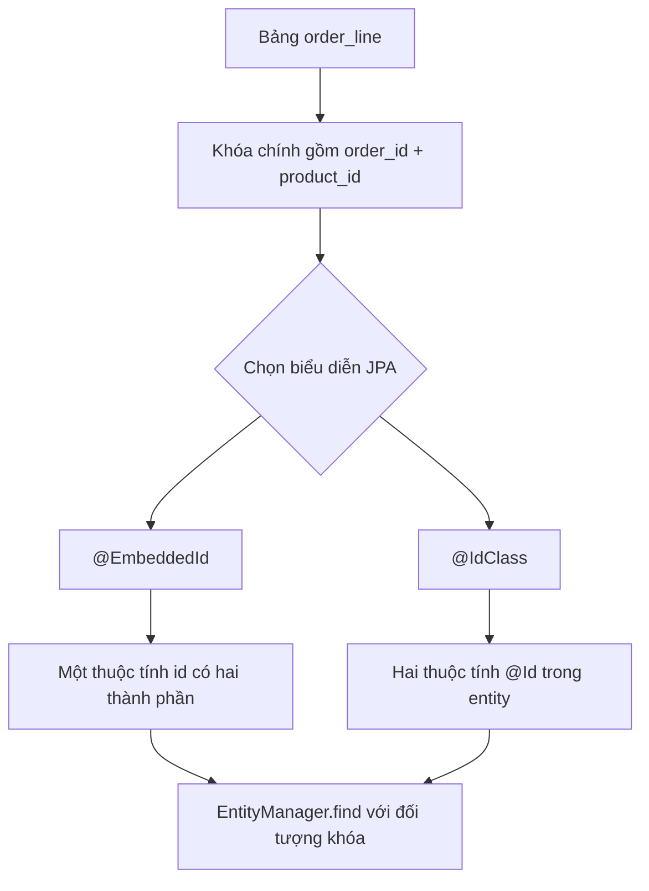

# Khóa ghép bằng `@EmbeddedId` hoặc `@IdClass` trong Hibernate

Trong cơ sở dữ liệu quan hệ, **khóa chính ghép** (*composite primary key*) là khóa chính được tạo từ **hai hoặc nhiều cột**. Hibernate/JPA cho phép ánh xạ loại khóa này vào entity Java bằng hai cách thông dụng: `@EmbeddedId` và `@IdClass`.

Ví dụ, bảng `order_line` lưu các sản phẩm thuộc đơn hàng. Một đơn hàng có thể chứa nhiều sản phẩm và một sản phẩm có thể thuộc nhiều đơn hàng, nhưng mỗi cặp `(order_id, product_id)` chỉ nên có một dòng:

```sql
CREATE TABLE order_line (
    order_id   BIGINT NOT NULL,
    product_id BIGINT NOT NULL,
    quantity   INTEGER NOT NULL,
    CONSTRAINT pk_order_line PRIMARY KEY (order_id, product_id)
);
```

Ở đây, `order_id` đơn lẻ không xác định duy nhất một dòng; `product_id` đơn lẻ cũng không đủ. **Cặp giá trị** mới định danh một bản ghi:

| `order_id` | `product_id` | `quantity` |
|---:|---:|---:|
| 1001 | 51 | 2 |
| 1001 | 52 | 1 |
| 1002 | 51 | 5 |

Bảng trên cho phép `(1001, 51)` và `(1002, 51)` cùng tồn tại, nhưng không cho phép lặp lại `(1001, 51)`. Hibernate cần một cách biểu diễn thống nhất cặp khóa này để tìm, theo dõi, cập nhật và xóa entity.

## 1. Tại sao Hibernate cần xác định đúng composite identifier?

Mỗi entity được quản lý trong một Hibernate `Session` hoặc JPA `EntityManager` có **định danh (identifier)** để framework phân biệt các bản ghi.

Với khóa đơn:

```java
@Entity
public class Product {
    @Id
    private Long id;
}
```

Một đối tượng `Product` có khóa chính như `51L`. Với khóa ghép, định danh của `OrderLine` phải chứa cả `orderId` và `productId`.



Cả hai phương án đều có thể ánh xạ đến **cùng một cấu trúc SQL**. Sự khác biệt chủ yếu nằm ở mô hình Java, cách khai báo mapping và cách truy cập các thành phần của khóa trong JPQL/HQL.

Khóa ghép là lựa chọn hợp lý khi bộ cột đã mang ý nghĩa định danh ổn định, chẳng hạn bảng liên kết có thuộc tính bổ sung, dữ liệu định danh bởi `(country_code, local_number)` hoặc một khóa nghiệp vụ đa thành phần được ràng buộc ở database. Tuy nhiên, khóa ghép cũng làm quan hệ ngoại khóa, URL/API và việc thay đổi identifier phức tạp hơn. Khi thiết kế schema mới, cần cân nhắc thêm phương án khóa thay thế (*surrogate key*) và unique constraint trên bộ cột nghiệp vụ.

## 2. Hai cách ánh xạ JPA đặt cạnh nhau

| Đặc điểm | `@EmbeddedId` | `@IdClass` |
|---|---|---|
| Thuộc tính định danh trong entity | Một thuộc tính chứa object khóa | Các thành phần khóa là các thuộc tính `@Id` trực tiếp |
| Lớp khóa | Thường được đánh dấu `@Embeddable` | Khai báo qua `@IdClass(KeyClass.class)` |
| Truy cập trong Java | `line.getId().getOrderId()` | `line.getOrderId()` |
| Đường dẫn trong JPQL/HQL | `line.id.orderId` | `line.orderId` |
| Tìm bằng `EntityManager.find` | Truyền instance của lớp khóa | Truyền instance của lớp khóa |
| Ràng buộc database | `PRIMARY KEY(order_id, product_id)` | Tương tự |
| Phù hợp khi | Muốn gom identifier thành một value object | Muốn thành phần ID nằm trực tiếp trên entity |
| Điểm cần giữ nhất quán | Mapping bên trong `@Embeddable` | Tên và kiểu thuộc tính của `IdClass` phải khớp entity |

**Không sử dụng `@EmbeddedId` và `@IdClass` đồng thời để định nghĩa cùng một khóa chính theo hai cách cạnh tranh.** Chọn một mô hình rồi dùng nhất quán trong persistence unit.

Các ví dụ tiếp theo dùng `jakarta.persistence.*`, phù hợp với những dự án Hibernate/JPA hiện đại. Dự án dùng JPA cũ có thể sử dụng package `javax.persistence.*`; không trộn hai namespace trong cùng bộ mapping.

## 3. Cách 1: `@EmbeddedId` gom các thành phần khóa thành một object

### 3.1. Khai báo lớp khóa với `@Embeddable`

Tạo `OrderLineId` để biểu diễn cặp `(orderId, productId)`:

```java
import jakarta.persistence.Column;
import jakarta.persistence.Embeddable;
import java.io.Serializable;
import java.util.Objects;

@Embeddable
public class OrderLineId implements Serializable {

    private static final long serialVersionUID = 1L;

    @Column(name = "order_id", nullable = false)
    private Long orderId;

    @Column(name = "product_id", nullable = false)
    private Long productId;

    protected OrderLineId() {
        // JPA cần constructor không tham số.
    }

    public OrderLineId(Long orderId, Long productId) {
        this.orderId = orderId;
        this.productId = productId;
    }

    public Long getOrderId() {
        return orderId;
    }

    public Long getProductId() {
        return productId;
    }

    @Override
    public boolean equals(Object other) {
        if (this == other) {
            return true;
        }
        if (!(other instanceof OrderLineId)) {
            return false;
        }
        OrderLineId that = (OrderLineId) other;
        return Objects.equals(orderId, that.orderId)
            && Objects.equals(productId, that.productId);
    }

    @Override
    public int hashCode() {
        return Objects.hash(orderId, productId);
    }
}
```

Các điểm cần hiểu:

- `@Embeddable` mô tả một kiểu giá trị có thể được nhúng vào mapping của entity.
- `Serializable` là yêu cầu phổ biến và được quy định đối với lớp primary key truyền thống trong JPA.
- Constructor không tham số cho phép provider tạo đối tượng khi đọc dữ liệu. Constructor nhận đầy đủ thành phần khóa giúp ứng dụng tạo identifier.
- `equals()` và `hashCode()` phải dựa trên **các thành phần định danh**, có ngữ nghĩa phù hợp với cách database so sánh khóa.
- `@Column` điều khiển tên cột được dùng khi thành phần khóa được nhúng trong bảng entity.

Lớp khóa có thể có getter và constructor hữu ích, nhưng **không nên có setter dùng để thay đổi identifier tùy ý sau khi entity đã được lưu**. Identifier nên được xem là bất biến về mặt nghiệp vụ.

### 3.2. Khai báo entity dùng `@EmbeddedId`

```java
import jakarta.persistence.Column;
import jakarta.persistence.EmbeddedId;
import jakarta.persistence.Entity;
import jakarta.persistence.Table;

@Entity
@Table(name = "order_line")
public class OrderLine {

    @EmbeddedId
    private OrderLineId id;

    @Column(name = "quantity", nullable = false)
    private int quantity;

    protected OrderLine() {
    }

    public OrderLine(OrderLineId id, int quantity) {
        this.id = id;
        this.quantity = quantity;
    }

    public OrderLineId getId() {
        return id;
    }

    public int getQuantity() {
        return quantity;
    }

    public void changeQuantity(int quantity) {
        this.quantity = quantity;
    }
}
```

Trong entity này, `@EmbeddedId` đánh dấu **một thuộc tính khóa** có kiểu `OrderLineId`. Bên trong đó là hai cột `order_id` và `product_id`. Không cần thêm `@Id` vào từng trường trong `OrderLineId`.

Sử dụng:

```java
OrderLineId id = new OrderLineId(1001L, 51L);
OrderLine line = new OrderLine(id, 2);

entityManager.persist(line);
```

Hibernate sẽ dùng hai thành phần ID khi thực thi SQL tương ứng:

```sql
INSERT INTO order_line (order_id, product_id, quantity)
VALUES (1001, 51, 2);
```

Cú pháp SQL chính xác, cách dùng tham số và thứ tự cột tùy Hibernate/Dialect; câu trên chỉ minh họa ý nghĩa ánh xạ.

### 3.3. Tìm entity bằng khóa ghép

```java
OrderLineId key = new OrderLineId(1001L, 51L);

OrderLine found = entityManager.find(OrderLine.class, key);

if (found != null) {
    System.out.println(found.getQuantity());
}
```

Đối số thứ hai của `find` là **một đối tượng `OrderLineId`**, không phải mảng hai số hay chuỗi `"1001:51"`.

Với Spring Data JPA:

```java
import org.springframework.data.jpa.repository.JpaRepository;

public interface OrderLineRepository
        extends JpaRepository<OrderLine, OrderLineId> {
}
```

Phần generic thứ hai của `JpaRepository` là kiểu ID `OrderLineId`. Do vậy:

```java
OrderLineId key = new OrderLineId(1001L, 51L);

Optional<OrderLine> line = orderLineRepository.findById(key);
boolean exists = orderLineRepository.existsById(key);
```

Các ví dụ repository giả định đã có cấu hình Spring Data JPA và entity được quản lý phù hợp.

## 4. Cách 2: `@IdClass` đặt các thành phần ID trực tiếp trong entity

Với `@IdClass`, entity khai báo nhiều thuộc tính `@Id`. Lớp khóa ngoài đóng vai trò biểu diễn định danh cho JPA.

### 4.1. Khai báo lớp `OrderLinePk`

```java
import java.io.Serializable;
import java.util.Objects;

public class OrderLinePk implements Serializable {

    private static final long serialVersionUID = 1L;

    private Long orderId;
    private Long productId;

    public OrderLinePk() {
    }

    public OrderLinePk(Long orderId, Long productId) {
        this.orderId = orderId;
        this.productId = productId;
    }

    public Long getOrderId() {
        return orderId;
    }

    public Long getProductId() {
        return productId;
    }

    @Override
    public boolean equals(Object other) {
        if (this == other) {
            return true;
        }
        if (!(other instanceof OrderLinePk)) {
            return false;
        }
        OrderLinePk that = (OrderLinePk) other;
        return Objects.equals(orderId, that.orderId)
            && Objects.equals(productId, that.productId);
    }

    @Override
    public int hashCode() {
        return Objects.hash(orderId, productId);
    }
}
```

Khác với lớp khóa ở `@EmbeddedId`, `OrderLinePk` **không cần `@Embeddable`** để dùng với `@IdClass`.

### 4.2. Khai báo entity với nhiều `@Id`

```java
import jakarta.persistence.Column;
import jakarta.persistence.Entity;
import jakarta.persistence.Id;
import jakarta.persistence.IdClass;
import jakarta.persistence.Table;

@Entity
@Table(name = "order_line")
@IdClass(OrderLinePk.class)
public class OrderLineIdClassEntity {

    @Id
    @Column(name = "order_id")
    private Long orderId;

    @Id
    @Column(name = "product_id")
    private Long productId;

    @Column(name = "quantity", nullable = false)
    private int quantity;

    protected OrderLineIdClassEntity() {
    }

    public OrderLineIdClassEntity(
            Long orderId,
            Long productId,
            int quantity) {
        this.orderId = orderId;
        this.productId = productId;
        this.quantity = quantity;
    }

    public Long getOrderId() {
        return orderId;
    }

    public Long getProductId() {
        return productId;
    }

    public int getQuantity() {
        return quantity;
    }
}
```

Ví dụ `OrderLine` dùng `@EmbeddedId` và `OrderLineIdClassEntity` dùng `@IdClass` là **hai phương án độc lập để học**; không nhất thiết ánh xạ cả hai lên cùng bảng trong cùng ứng dụng.

### 4.3. Quy tắc khớp tên và kiểu khi dùng `@IdClass`

Một quy tắc đặc biệt quan trọng:

**Mỗi thuộc tính khóa trong `IdClass` phải tương ứng theo tên và kiểu với thuộc tính `@Id` trong entity.**

Với ví dụ này:

| `OrderLinePk` | `OrderLineIdClassEntity` |
|---|---|
| `Long orderId` | `@Id Long orderId` |
| `Long productId` | `@Id Long productId` |

Các lỗi phổ biến:

- Lớp `OrderLinePk` dùng `orderID` nhưng entity dùng `orderId`.
- Một bên dùng `Long`, bên kia dùng `String`.
- Quên đánh dấu một thành phần khóa bằng `@Id`.
- Thiếu constructor không tham số hoặc thiếu `equals/hashCode`.
- Khai báo thêm một thành phần ID trong `IdClass` nhưng entity không có thành phần tương ứng.

**Trường hợp entity có `@Id` đặt trên quan hệ `@ManyToOne` hoặc `@OneToOne` là một quy tắc đặc biệt:** kiểu thuộc tính tương ứng trong `IdClass` thường là **kiểu khóa chính của entity được tham chiếu**, thay vì kiểu entity đó. Không áp dụng máy móc quy tắc “cùng kiểu” của thuộc tính đơn giản cho trường hợp quan hệ; cần đối chiếu mapping derived identity.

### 4.4. Tìm entity với `@IdClass`

```java
OrderLinePk key = new OrderLinePk(1001L, 51L);

OrderLineIdClassEntity found =
        entityManager.find(OrderLineIdClassEntity.class, key);
```

Mặc dù entity có hai thuộc tính `@Id` trực tiếp, `find` vẫn nhận **một đối tượng `OrderLinePk`**.

Spring Data JPA cũng khai báo kiểu ID:

```java
public interface OrderLineIdClassRepository
        extends JpaRepository<OrderLineIdClassEntity, OrderLinePk> {
}
```

## 5. Sự khác biệt khi viết JPQL/HQL và repository

Cả hai phương án có cùng khóa SQL, nhưng đường dẫn thuộc tính Java khác nhau.

**`@EmbeddedId`:**

```java
List<OrderLine> lines = entityManager.createQuery(
    "select l from OrderLine l " +
    "where l.id.orderId = :orderId",
    OrderLine.class
)
.setParameter("orderId", 1001L)
.getResultList();
```

**`@IdClass`:**

```java
List<OrderLineIdClassEntity> lines = entityManager.createQuery(
    "select l from OrderLineIdClassEntity l " +
    "where l.orderId = :orderId",
    OrderLineIdClassEntity.class
)
.setParameter("orderId", 1001L)
.getResultList();
```

Dấu chấm trong JPQL phản ánh **cấu trúc object Java**, không phải cấu trúc tên bảng SQL.

Với Spring Data JPA, derived query có thể được khai báo theo đường dẫn thuộc tính:

```java
// Repository cho @EmbeddedId
List<OrderLine> findByIdOrderId(Long orderId);

// Repository cho @IdClass
List<OrderLineIdClassEntity> findByOrderId(Long orderId);
```

Những method này nằm trong repository tương ứng với từng entity, không phải cùng một interface. Khi tên thuộc tính có thể gây nhập nhằng, có thể dùng `@Query` với JPQL rõ ràng thay vì phụ thuộc vào cơ chế phân tích tên method.

## 6. Ràng buộc với bảng cha: `@MapsId` cho khóa vừa là FK vừa là PK

Trong hệ thống thực tế, `order_id` và `product_id` thường đồng thời là **foreign key** tham chiếu bảng `purchase_order` và `product`. Khóa ghép của `order_line` do đó cũng là một ví dụ của *derived identity*: danh tính dòng chi tiết phụ thuộc vào danh tính hai entity cha.

Schema có thể như sau:

```sql
CREATE TABLE purchase_order (
    id BIGINT PRIMARY KEY
);

CREATE TABLE product (
    id BIGINT PRIMARY KEY
);

CREATE TABLE order_line (
    order_id   BIGINT NOT NULL,
    product_id BIGINT NOT NULL,
    quantity   INTEGER NOT NULL,

    CONSTRAINT pk_order_line
        PRIMARY KEY (order_id, product_id),

    CONSTRAINT fk_order_line_order
        FOREIGN KEY (order_id)
        REFERENCES purchase_order(id),

    CONSTRAINT fk_order_line_product
        FOREIGN KEY (product_id)
        REFERENCES product(id)
);
```

Nếu entity `OrderLine` chỉ chứa `orderId` và `productId`, ứng dụng phải tự tải đối tượng cha khi cần. Hibernate cho phép khai báo quan hệ `@ManyToOne` và đồng bộ với thành phần khóa qua `@MapsId`.

### 6.1. Hai entity cha

Ví dụ rút gọn:

```java
import jakarta.persistence.Entity;
import jakarta.persistence.Id;
import jakarta.persistence.Table;

@Entity
@Table(name = "purchase_order")
public class PurchaseOrder {

    @Id
    private Long id;

    protected PurchaseOrder() {
    }

    public Long getId() {
        return id;
    }
}

@Entity
@Table(name = "product")
public class Product {

    @Id
    private Long id;

    protected Product() {
    }

    public Long getId() {
        return id;
    }
}
```

Trong ví dụ, các entity cha đã có khóa `Long` được cấp trước khi tạo `OrderLine`. Cách tạo hoặc sinh khóa cha tùy thiết kế ứng dụng; phần minh họa tập trung vào quan hệ và khóa ghép của entity con.

### 6.2. Entity con dùng `@EmbeddedId` và hai `@MapsId`

Tái sử dụng lớp `OrderLineId` ở mục 3:

```java
import jakarta.persistence.Column;
import jakarta.persistence.EmbeddedId;
import jakarta.persistence.Entity;
import jakarta.persistence.FetchType;
import jakarta.persistence.JoinColumn;
import jakarta.persistence.ManyToOne;
import jakarta.persistence.MapsId;
import jakarta.persistence.Table;

@Entity
@Table(name = "order_line")
public class OrderLine {

    @EmbeddedId
    private OrderLineId id;

    @MapsId("orderId")
    @ManyToOne(fetch = FetchType.LAZY, optional = false)
    @JoinColumn(name = "order_id", nullable = false)
    private PurchaseOrder order;

    @MapsId("productId")
    @ManyToOne(fetch = FetchType.LAZY, optional = false)
    @JoinColumn(name = "product_id", nullable = false)
    private Product product;

    @Column(name = "quantity", nullable = false)
    private int quantity;

    protected OrderLine() {
    }

    public OrderLine(
            PurchaseOrder order,
            Product product,
            int quantity) {
        this.order = order;
        this.product = product;
        this.id = new OrderLineId(order.getId(), product.getId());
        this.quantity = quantity;
    }

    public OrderLineId getId() {
        return id;
    }

    public PurchaseOrder getOrder() {
        return order;
    }

    public Product getProduct() {
        return product;
    }
}
```

Đây là **biến thể mở rộng của entity ở mục 3**, thay thế cho phiên bản chỉ chứa `@EmbeddedId` khi cần mapping quan hệ cha.

Giải thích các annotation:

- `@EmbeddedId` giữ khóa ghép gồm `orderId` và `productId`.
- `@MapsId("orderId")` ánh xạ khóa của `PurchaseOrder` vào thành phần `orderId` của `OrderLineId`.
- `@MapsId("productId")` ánh xạ khóa của `Product` vào thành phần `productId`.
- `@JoinColumn(name = ...)` xác định cột foreign key cũng tham gia primary key.
- `FetchType.LAZY` diễn đạt ý định chỉ tải entity cha khi cần; thời điểm tải thực tế có thể phụ thuộc enhancement, proxy và ngữ cảnh truy cập.

`@MapsId` giúp Hibernate hiểu quan hệ giữa các cột khóa và entity cha. Không cần ánh xạ mỗi cột khóa bằng hai thuộc tính cơ bản có quyền ghi độc lập rồi thủ công đặt `insertable = false, updatable = false` ở nhiều nơi, trừ khi có lý do mapping đặc biệt.

### 6.3. Tạo một dòng chi tiết

Giả sử `order` và `product` là các entity cha đã được lưu, có ID hợp lệ và tồn tại trong database:

```java
PurchaseOrder order = entityManager.find(
    PurchaseOrder.class, 1001L);

Product product = entityManager.find(
    Product.class, 51L);

OrderLine line = new OrderLine(order, product, 2);
entityManager.persist(line);
```

Vì constructor tạo `OrderLineId` từ hai ID cha, khóa ghép được thiết lập nhất quán ngay khi tạo entity.

Nếu ID của cha được sinh bởi database và chưa có tại thời điểm xây dựng entity con, ứng dụng cần lựa chọn vòng đời lưu hợp lệ để có ID hoặc để cơ chế derived identity hoạt động đúng theo provider. Không đọc `null` rồi coi như một thành phần khóa hợp lệ.

Nếu thay `order` hoặc `product` sau khi entity con đã được persist, ý nghĩa của primary key cũng thay đổi. Thường nên **xóa dòng cũ và tạo dòng mới** theo transaction/constraint phù hợp thay vì sửa primary key của entity đang được quản lý.

### 6.4. Khi dùng `@IdClass` với quan hệ cha

Một phương án khác là đánh dấu association bằng `@Id` kết hợp `@ManyToOne` và khai báo `@IdClass` phù hợp. Ở trường hợp này, primary key class phải mô tả **giá trị khóa chính của entity cha** cho thuộc tính association tương ứng.

Ví dụ ý tưởng:

```java
@Entity
@IdClass(OrderLineRelationPk.class)
@Table(name = "order_line")
public class OrderLineRelation {

    @Id
    @ManyToOne
    @JoinColumn(name = "order_id")
    private PurchaseOrder order;

    @Id
    @ManyToOne
    @JoinColumn(name = "product_id")
    private Product product;

    // Các thuộc tính khác...
}
```

Lớp `OrderLineRelationPk` tương ứng cần có **thuộc tính tên `order` và `product`**, với **kiểu khóa** của hai entity cha (ở đây là `Long`), chứ không phải `PurchaseOrder` và `Product`:

```java
public class OrderLineRelationPk implements java.io.Serializable {
    private Long order;
    private Long product;

    public OrderLineRelationPk() {
    }

    // Cần triển khai equals/hashCode và các phương thức hữu ích.
}
```

Đây là minh họa quy tắc `IdClass` cho association; đoạn lớp khóa rút gọn chưa triển khai đầy đủ. Nếu muốn mô hình hóa identifier như một value object rõ ràng, `@EmbeddedId` cùng `@MapsId` thường dễ theo dõi hơn trong trường hợp hai foreign key tạo thành primary key.

## 7. Những yêu cầu quan trọng của lớp khóa

Một composite key hoạt động đúng phụ thuộc lớn vào chất lượng lớp khóa. Các yêu cầu theo cách dùng JPA phổ biến gồm:

### 7.1. Có thể khởi tạo và tuần tự hóa

Lớp khóa cần phù hợp với cơ chế khởi tạo của JPA: kiểu lớp phù hợp, constructor không tham số có khả năng truy cập theo yêu cầu của provider và khả năng `Serializable` trong mô hình key class truyền thống. Các ví dụ trên dùng một lớp Java thông thường, constructor không tham số và `implements Serializable` để tương thích rộng rãi.

Không nên khai báo kiểu khóa là một anonymous class, dùng những phụ thuộc của service trong constructor hoặc chỉ tồn tại dưới dạng đối tượng không thể tạo khi Hibernate đọc dữ liệu.

### 7.2. Có `equals()` và `hashCode()` đúng

Xét hai đối tượng khóa:

```java
OrderLineId first = new OrderLineId(1001L, 51L);
OrderLineId second = new OrderLineId(1001L, 51L);
```

Chúng là hai object Java khác nhau, nhưng biểu diễn **cùng một primary key**.

```java
System.out.println(first == second);      // false
System.out.println(first.equals(second)); // true
```

Nếu không ghi đè `equals/hashCode`, lớp khóa có thể so sánh theo danh tính object thay vì giá trị hai cột. Điều đó ảnh hưởng đến cache, collection, phép so sánh định danh, repository và hành vi mong đợi của JPA.

Nguyên tắc:

- So sánh **đầy đủ** các thành phần khóa.
- Dùng cùng bộ trường trong `equals` và `hashCode`.
- Đảm bảo các kiểu dữ liệu có ngữ nghĩa so sánh phù hợp với database.
- Với giá trị số có dạng đặc biệt (như `BigDecimal`), cần chú ý sự khác biệt giữa `equals` ở Java và cách database coi hai giá trị là bằng nhau.
- Không thêm các trường như `quantity`, `updatedAt` hoặc collection quan hệ vào `equals/hashCode` của lớp khóa.

### 7.3. Không sửa khóa khi entity đang được quản lý

Khi entity đã được persist, Hibernate sử dụng identifier để theo dõi identity của object trong persistence context. Ví dụ hành vi sau rất nguy hiểm:

```java
OrderLine line = entityManager.find(
    OrderLine.class, new OrderLineId(1001L, 51L));

// Tránh kiểu thiết kế cho phép sửa ID đã persist:
// line.getId().setProductId(52L);
```

Việc sửa primary key của managed entity không phải một cách hợp lệ, ổn định để “chuyển” dòng sang định danh mới. Điều đó có thể làm hỏng giả định identity map, truy vấn hoặc collection. Nếu nghiệp vụ phải thay cặp `order_id/product_id`, hãy xử lý như thay đổi định danh: kiểm tra ràng buộc, xóa bản ghi cũ và thêm bản ghi mới khi phù hợp.

Với `Set` hoặc `Map`, nếu một object được dùng làm key và `hashCode` của nó thay đổi trong lúc đang ở collection, việc tìm hoặc xóa phần tử có thể trở nên sai lệch. Vì vậy lớp khóa nên được xem là **value object bất biến về mặt sử dụng**, dù JPA cần khả năng khởi tạo nó.

### 7.4. Không chứa thành phần null khi persist

Primary key SQL không cho phép các thành phần null. Do vậy:

```java
new OrderLineId(null, 51L) // Không phải khóa chính hợp lệ để lưu.
```

Cần bảo đảm dữ liệu khóa hợp lệ trước khi gọi `persist` và dựa vào constraint database để chặn trường hợp sai lọt xuống tầng JDBC. Trong mô hình dùng `@MapsId`, bảo đảm entity cha đã có khóa và quan hệ cần thiết đã được thiết lập.

## 8. Tên cột và `@AttributeOverride` cho `@EmbeddedId`

Lớp `@Embeddable` có thể được tái sử dụng hoặc cần đặt tên cột khác tại vị trí nhúng. JPA cung cấp `@AttributeOverride` để ghi đè mapping cột của các thành phần trong embeddable.

Giả sử `OrderLineId` khai báo các thuộc tính `orderId` và `productId`. Tại entity có schema cũ dùng tên cột khác:

```java
import jakarta.persistence.AttributeOverride;
import jakarta.persistence.AttributeOverrides;
import jakarta.persistence.Column;
import jakarta.persistence.EmbeddedId;
import jakarta.persistence.Entity;
import jakarta.persistence.Table;

@Entity
@Table(name = "legacy_order_line")
public class LegacyOrderLine {

    @EmbeddedId
    @AttributeOverrides({
        @AttributeOverride(
            name = "orderId",
            column = @Column(name = "ord_no")),
        @AttributeOverride(
            name = "productId",
            column = @Column(name = "prd_no"))
    })
    private OrderLineId id;

    protected LegacyOrderLine() {
    }
}
```

Khi đó `OrderLineId.orderId` ánh xạ tới `ord_no` và `OrderLineId.productId` ánh xạ tới `prd_no` trong bảng `legacy_order_line`.

Tên trong `@AttributeOverride(name = "orderId")` là **tên thuộc tính Java trong embeddable**, còn `@Column(name = "ord_no")` là **tên cột SQL**. Nếu dùng chiến lược đặt tên vật lý (*PhysicalNamingStrategy*), tên cuối cùng vẫn phụ thuộc vào chiến lược và cách quote identifier.

Đối với association được khai báo bên trong một embeddable, JPA cũng có `@AssociationOverride` để ghi đè join column. Cách kết hợp annotation cần theo đúng cấu trúc mapping thực tế; không nhầm override tên thuộc tính với việc đổi định danh nghiệp vụ.

## 9. Thao tác CRUD và vòng đời của entity có khóa ghép

### 9.1. Thêm bản ghi

```java
OrderLine line = new OrderLine(
    new OrderLineId(1001L, 51L),
    2
);

entityManager.persist(line);
```

Trong ví dụ tối giản, ứng dụng tự cung cấp identifier. Hibernate không cần sinh một ID đơn `Long` cho `OrderLine`. Cấu trúc SQL tương ứng có `PRIMARY KEY(order_id, product_id)` và giá trị của cả hai cột.

### 9.2. Đọc bản ghi

```java
OrderLine found = entityManager.find(
    OrderLine.class,
    new OrderLineId(1001L, 51L)
);
```

Nếu entity đang được quản lý trong persistence context với cùng khóa, Hibernate có thể trả lại instance đang quản lý mà không nhất thiết phải truy vấn lại. Khóa ghép được coi là **một identifier logic**, dù gồm nhiều cột vật lý.

### 9.3. Cập nhật thuộc tính ngoài khóa

```java
OrderLine line = entityManager.find(
    OrderLine.class,
    new OrderLineId(1001L, 51L)
);

if (line != null) {
    line.changeQuantity(4);
}
```

Trong transaction đang hoạt động, Hibernate có thể đồng bộ thay đổi `quantity` khi flush/commit. Các cột `order_id` và `product_id` vẫn giữ nguyên.

### 9.4. Xóa bản ghi

```java
OrderLine line = entityManager.find(
    OrderLine.class,
    new OrderLineId(1001L, 51L)
);

if (line != null) {
    entityManager.remove(line);
}
```

SQL xóa thường cần kiểm tra cả hai cột định danh:

```sql
DELETE FROM order_line
WHERE order_id = ? AND product_id = ?;
```

Các thao tác ghi/xóa phải chạy trong transaction phù hợp; đối với Spring Data JPA, việc mở và kết thúc transaction thường do framework đảm nhiệm thông qua `@Transactional` hoặc cấu hình repository.

## 10. Lựa chọn giữa khóa ghép và khóa thay thế

Khóa ghép phản ánh dữ liệu và ràng buộc tự nhiên, nhưng không phải lúc nào cũng là lựa chọn tối ưu cho mọi bảng.

### 10.1. Khóa ghép làm primary key

```sql
CREATE TABLE order_line (
    order_id BIGINT NOT NULL,
    product_id BIGINT NOT NULL,
    quantity INT NOT NULL,
    PRIMARY KEY (order_id, product_id)
);
```

Ưu điểm:

- Database trực tiếp bảo vệ tính duy nhất của cặp khóa.
- Không cần một cột ID thay thế chỉ để xác định dòng.
- Phù hợp khi cặp khóa ổn định và là identity thực sự của dữ liệu.

Đánh đổi:

- Bảng khác tham chiếu `order_line` phải mang đủ các cột của composite foreign key.
- Đường dẫn entity và repository có phần phức tạp hơn.
- Nếu thành phần khóa thay đổi theo nghiệp vụ, thao tác cập nhật identifier khó và rủi ro.
- Index/foreign key có thể lớn hơn so với khóa đơn, tùy kiểu dữ liệu và DBMS.

### 10.2. Khóa thay thế cộng unique constraint

```sql
CREATE TABLE order_line (
    id BIGINT PRIMARY KEY,
    order_id BIGINT NOT NULL,
    product_id BIGINT NOT NULL,
    quantity INT NOT NULL,
    CONSTRAINT uq_order_line_order_product
        UNIQUE (order_id, product_id)
);
```

Tại Java có thể dùng `@Id Long id`, còn cặp `(orderId, productId)` được bảo vệ bởi `UNIQUE`.

Ưu điểm:

- Khóa đơn có thể đơn giản hơn cho quan hệ tham chiếu, API và repository.
- Việc thay đổi thành phần nghiệp vụ không nhất thiết thay primary key.
- Có thể tổ chức metadata và lịch sử độc lập với cặp khóa nghiệp vụ.

Đánh đổi:

- Cần quản lý thêm cột định danh và ràng buộc unique riêng.
- Không được bỏ `UNIQUE(order_id, product_id)` nếu nghiệp vụ yêu cầu mỗi cặp là duy nhất.
- Mã ứng dụng phải phân biệt ID thay thế với cặp giá trị nghiệp vụ.

**`@NaturalId` của Hibernate không tương đương với `@Id` hoặc khóa chính SQL.** Nếu dùng natural ID để tra cứu theo trường nghiệp vụ, vẫn cần một primary key đúng và constraint dữ liệu tương ứng.

## 11. Những lỗi cấu hình thường gặp

| Triệu chứng | Khả năng nguyên nhân | Cách tiếp cận |
|---|---|---|
| Hibernate/JPA báo sai lớp identifier | Truyền `Long` thay cho `OrderLineId`/`OrderLinePk` | `find` và repository phải dùng đúng kiểu khóa ghép |
| Lỗi mapping `IdClass` | Tên/kiểu trường không khớp entity, thiếu `@Id` | Đối chiếu từng thuộc tính ID ở hai lớp |
| Hai khóa có cùng giá trị nhưng `equals()` trả `false` | Lớp khóa chưa triển khai equality theo giá trị | Ghi đè `equals/hashCode` bằng đầy đủ thành phần khóa |
| DB báo duplicate key | Cặp `(order_id, product_id)` đã tồn tại | Kiểm tra dữ liệu/nghiệp vụ; dùng constraint và cách xử lý trùng phù hợp |
| DB báo cannot insert null into PK column | Một thành phần khóa hoặc ID cha là null | Thiết lập đầy đủ ID và association trước khi lưu |
| Lỗi repeated column mapping | Cùng cột FK/PK được ánh xạ thành nhiều thuộc tính ghi độc lập | Xem lại `@MapsId` hoặc điều chỉnh quyền ghi của mapping |
| Truy vấn JPQL báo không tìm thấy thuộc tính | Viết `l.orderId` với `@EmbeddedId` hoặc `l.id.orderId` với `@IdClass` | Dùng đường dẫn Java đúng với mô hình |
| Lazy proxy và `equals/hashCode` gây truy vấn ngoài ý muốn | Entity equality dựa vào quan hệ/collection | Tách equality của lớp khóa khỏi object graph |
| Sửa thành phần ID rồi flush thất bại | Thay đổi identifier của managed entity | Giữ ID ổn định; mô hình hóa thay đổi bằng xóa/tạo |
| Khóa SQL đúng nhưng dữ liệu từ API đọc sai | Tầng API tự ghép/giải mã hai phần khóa không nhất quán | Dùng DTO và quy tắc serialize/deserialize khóa rõ ràng |

Khi chẩn đoán, cần phân biệt hai loại lỗi:

1. **Lỗi metadata/mapping**: Hibernate không khởi tạo được persistence unit vì lớp khóa hoặc annotation không hợp lệ.
2. **Lỗi dữ liệu/constraint**: mapping khởi động được nhưng thao tác SQL bị database từ chối do trùng, null, khóa ngoại hoặc quy tắc schema.

Không sửa lỗi mapping bằng cách xóa primary key ở database, vì như vậy mất khả năng bảo đảm danh tính của bản ghi.

## 12. Những chi tiết ít hiển nhiên cần lưu ý

### 12.1. `@GeneratedValue` và khóa ghép

`@GeneratedValue` thường được dùng với khóa đơn, ví dụ `@Id @GeneratedValue Long id`. Với composite key do ứng dụng cung cấp, các thành phần khóa thường được xác định từ nghiệp vụ hoặc từ khóa entity cha.

Một số tính năng sinh một phần composite identifier có thể được Hibernate hỗ trợ trong các cấu hình riêng, nhưng **không nên mặc định đó là mapping JPA di động giữa các provider**. Với khóa được tạo từ foreign key, `@MapsId`/derived identity là cách diễn đạt mối quan hệ rõ ràng hơn.

### 12.2. `@EmbeddedId` không phải entity riêng

`OrderLineId` là value object nhúng; nó không có bảng riêng và không có lifecycle entity độc lập. Không gọi `entityManager.persist(new OrderLineId(...))` để lưu một khóa: phải persist entity sở hữu khóa, ví dụ `OrderLine`.

### 12.3. Composite key không có nghĩa thứ tự cột vô nghĩa ở SQL

Về mặt **tính duy nhất**, `(order_id, product_id)` gồm cùng hai thành phần bất kể cách trình bày. Nhưng với index btree nhiều cột, **thứ tự các cột trong index có thể ảnh hưởng đến tối ưu truy vấn**.

Ví dụ truy vấn thường lọc theo `order_id`:

```sql
SELECT *
FROM order_line
WHERE order_id = 1001;
```

Index trên `(order_id, product_id)` thường phù hợp để hỗ trợ truy vấn có điều kiện trên cột đầu hơn index chỉ có thứ tự ngược trong nhiều DBMS. Tuy nhiên, hiệu quả cụ thể phải xem execution plan và cách DBMS dùng index. Hibernate ánh xạ identifier; tối ưu index là một trách nhiệm thiết kế schema bổ sung.

### 12.4. Composite identifier trong API

Một endpoint như:

```text
GET /orders/1001/lines/51
```

có thể đọc rõ ràng hai thành phần khóa hơn một chuỗi gộp:

```text
GET /order-lines/1001-51
```

Nếu vẫn dùng chuỗi gộp, cần quy ước escape, tách thành phần, validation và xử lý trường hợp thành phần chứa ký tự phân cách. DTO ở tầng API có thể đại diện cho khóa dưới dạng hai trường `orderId` và `productId`, còn tầng persistence sử dụng `OrderLineId`.

Không đưa thẳng biểu diễn của đối tượng `@Embeddable` thành hợp đồng API mà chưa định nghĩa quy tắc ổn định.

## 13. Bài thực hành: thiết kế khóa ghép cho dữ liệu điểm danh

Giả sử bảng `attendance` có ba cột:

```sql
CREATE TABLE attendance (
    student_id BIGINT NOT NULL,
    lesson_id BIGINT NOT NULL,
    attended BOOLEAN NOT NULL,
    PRIMARY KEY (student_id, lesson_id)
);
```

Yêu cầu:

- Mỗi học viên có tối đa một bản ghi điểm danh cho một buổi học.
- Một học viên có thể tham dự nhiều buổi.
- Một buổi có thể có nhiều học viên.
- Có thể cập nhật cột `attended` mà không thay đổi khóa.

### 13.1. Bài giải với `@EmbeddedId`

```java
import jakarta.persistence.Column;
import jakarta.persistence.Embeddable;
import jakarta.persistence.EmbeddedId;
import jakarta.persistence.Entity;
import jakarta.persistence.Table;
import java.io.Serializable;
import java.util.Objects;

@Embeddable
public class AttendanceId implements Serializable {
    private Long studentId;
    private Long lessonId;

    protected AttendanceId() {
    }

    public AttendanceId(Long studentId, Long lessonId) {
        this.studentId = studentId;
        this.lessonId = lessonId;
    }

    public Long getStudentId() {
        return studentId;
    }

    public Long getLessonId() {
        return lessonId;
    }

    @Override
    public boolean equals(Object other) {
        if (this == other) return true;
        if (!(other instanceof AttendanceId)) return false;
        AttendanceId that = (AttendanceId) other;
        return Objects.equals(studentId, that.studentId)
            && Objects.equals(lessonId, that.lessonId);
    }

    @Override
    public int hashCode() {
        return Objects.hash(studentId, lessonId);
    }
}

@Entity
@Table(name = "attendance")
public class Attendance {

    @EmbeddedId
    private AttendanceId id;

    @Column(name = "attended", nullable = false)
    private boolean attended;

    protected Attendance() {
    }

    public Attendance(AttendanceId id, boolean attended) {
        this.id = id;
        this.attended = attended;
    }

    public void markAttended() {
        this.attended = true;
    }
}
```

Trong thiết lập mặc định dùng field access và không có naming strategy khác, `studentId` và `lessonId` có thể được suy ra tên cột không khớp với `student_id` và `lesson_id` của DDL. **Cần ánh xạ tên cột rõ ràng** bằng `@Column(name = "student_id")` và `@Column(name = "lesson_id")` trong `AttendanceId`, hoặc cấu hình physical naming strategy chuyển camel case thành snake case. Ví dụ thực hành giả định dự án đã dùng naming strategy này.

### 13.2. Bài giải với `@IdClass`

```java
@Entity
@Table(name = "attendance")
@IdClass(AttendancePk.class)
public class AttendanceIdClassEntity {

    @Id
    @Column(name = "student_id")
    private Long studentId;

    @Id
    @Column(name = "lesson_id")
    private Long lessonId;

    @Column(name = "attended", nullable = false)
    private boolean attended;

    protected AttendanceIdClassEntity() {
    }
}
```

Với cách này, `AttendancePk` cần triển khai `Serializable`, constructor không tham số, `equals/hashCode` và hai trường `Long studentId`/`Long lessonId` đúng tên và kiểu. Lớp entity ở trên là phương án thay thế `Attendance`, không bắt buộc tồn tại song song.

### 13.3. Câu hỏi củng cố

1. Vì sao dùng duy nhất `student_id` làm primary key sẽ sai với yêu cầu bài toán?
2. Với `@EmbeddedId`, JPQL lọc theo học viên cần viết `a.studentId` hay `a.id.studentId`?
3. Với `@IdClass`, cần đưa `AttendancePk` hay `Long` vào `EntityManager.find`?
4. Nếu chuyển `lesson_id` của một bản ghi đã tồn tại từ 15 sang 16, có nên sửa trực tiếp thành phần ID của managed entity?
5. Khi nào nên thay khóa ghép bằng một cột `id` mới kèm `UNIQUE(student_id, lesson_id)`?

**Đáp án gợi ý:**

1. Một học viên có nhiều buổi học, nên một `student_id` có thể xuất hiện nhiều lần và không định danh duy nhất.
2. `a.id.studentId` vì `studentId` thuộc embeddable key nằm trong `id`.
3. Một đối tượng `AttendancePk` chứa đủ hai giá trị khóa.
4. Không nên. Đổi identifier là thay đổi danh tính; cần xử lý theo quy tắc xóa/tạo hoặc thiết kế khóa thay thế nếu việc “chuyển buổi” xảy ra thường xuyên.
5. Khi cần identifier đơn ổn định để tham chiếu từ bảng khác hoặc khi bộ cột nghiệp vụ có thể thay đổi, nhưng vẫn giữ ràng buộc unique để ngăn trùng.

## 14. Tổng kết quyết định thiết kế

**Chọn `@EmbeddedId`** khi muốn coi khóa ghép là một value object riêng, thuận tiện truyền giữa service/repository và nhất quán với cách diễn đạt các thành phần khóa trong một thuộc tính `id`. Khi khóa được tạo từ foreign key tới entity cha, cân nhắc `@MapsId` để đồng bộ association với thành phần identifier.

**Chọn `@IdClass`** khi muốn mỗi thành phần ID là thuộc tính trực tiếp của entity và truy vấn Java/JPQL theo đường dẫn phẳng. Đổi lại, phải kiểm soát nghiêm ngặt sự tương ứng tên/kiểu giữa `IdClass` và các thuộc tính `@Id` của entity.

Với cả hai cách, **database vẫn cần khai báo primary key trên tất cả cột định danh**, lớp khóa cần equality đúng, các thành phần khóa phải được xác định và ổn định, còn những thay đổi mang tính đổi danh tính nên được xử lý ở cấp nghiệp vụ thay vì sửa trực tiếp ID của entity đang quản lý.

Hãy xem khóa ghép là **một identifier logic có nhiều thành phần vật lý**: Hibernate có thể biểu diễn nó bằng `@EmbeddedId` hoặc `@IdClass`, nhưng tính duy nhất, tính ổn định và ràng buộc tham chiếu của identifier phải được thiết kế nhất quán từ Java tới database.
