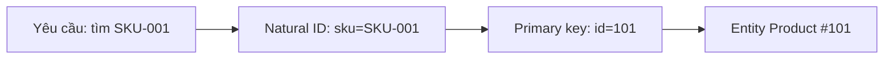
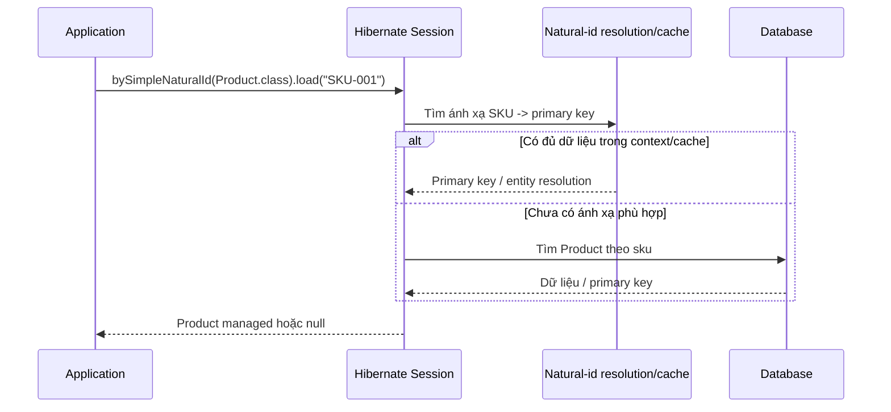
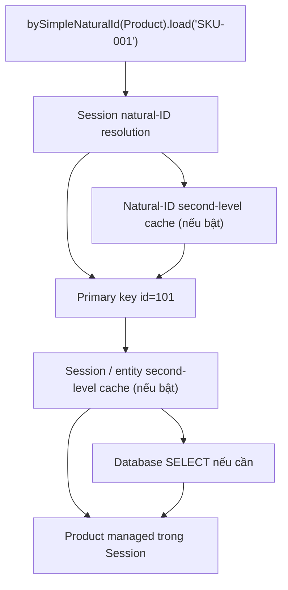

# Khóa tự nhiên với `@NaturalId` và truy vấn theo khóa nghiệp vụ trong Hibernate

## 1. Khóa tự nhiên là gì?

Trong ứng dụng lưu trữ dữ liệu quan hệ, **khóa tự nhiên** (*natural key* hay *natural identifier*) là một hoặc nhiều thuộc tính mang ý nghĩa nghiệp vụ và dùng để nhận diện duy nhất một bản ghi trong phạm vi xác định. Ví dụ: mã sản phẩm `sku`, mã ISO của một quốc gia, hoặc cặp `tenantId` và `externalCode` của đối tượng được đồng bộ từ hệ thống khác.

Khóa tự nhiên khác với **khóa chính** (*primary key*) thường dùng trong ORM. Khóa chính là định danh bền vững của dòng dữ liệu; nó có thể là số được database sinh ra và không mang ý nghĩa nghiệp vụ.

Giả sử bảng sản phẩm:

| id | sku | title |
|---:|---|---|
| 101 | SKU-001 | Bàn phím cơ |
| 102 | SKU-002 | Chuột không dây |
| 103 | SKU-003 | Màn hình 27 inch |

Ở đây:

- `id` là khóa chính mà Hibernate dùng để định danh entity trong persistence context.
- `sku` là khóa nghiệp vụ để bộ phận kho vận, người dùng hoặc API tìm sản phẩm.
- `title` là thuộc tính mô tả; không đủ ổn định hoặc duy nhất để nhận diện sản phẩm.

Hibernate cung cấp annotation **`org.hibernate.annotations.NaturalId`** để khai báo rằng một thuộc tính (hoặc nhóm thuộc tính) tạo thành định danh tự nhiên của entity. Khai báo này cho phép sử dụng API truy vấn theo khóa tự nhiên như `Session.bySimpleNaturalId(...)` và `Session.byNaturalId(...)`; đồng thời Hibernate có cơ chế quản lý ánh xạ từ natural ID sang primary key, và có thể cache ánh xạ đó nếu được cấu hình phù hợp.



**Quy tắc quan trọng:** `@NaturalId` bổ sung một cách nhận diện entity theo nghiệp vụ; nó **không thay thế `@Id`** và không biến giá trị SKU thành tham số hợp lệ cho `EntityManager.find(Product.class, ...)` nếu khóa chính của entity là `Long id`.

## 2. Phân biệt `@Id`, `@NaturalId` và ràng buộc `UNIQUE`

| Khái niệm | Vai trò chính | Thuộc chuẩn Jakarta Persistence? | Hành vi với Hibernate |
|---|---|---|---|
| `@Id` | Khai báo khóa chính của entity. | Có | Dùng cho `EntityManager.find`, `Session.get`/`find` và identity map. |
| `@GeneratedValue` | Mô tả cách sinh giá trị khóa chính. | Có | Có thể dùng identity/sequence và các chiến lược khác. |
| `@NaturalId` | Đánh dấu thuộc tính thuộc khóa tự nhiên. | **Không**; là extension của Hibernate. | Kích hoạt API nạp entity theo natural ID và xử lý ánh xạ natural ID. |
| `@Column(unique = true)` | Gợi ý ràng buộc unique cho một cột khi sinh schema. | Có | Không tự cung cấp API `byNaturalId`. |
| `@Table(uniqueConstraints = ...)` | Khai báo ràng buộc unique ở cấp bảng, phù hợp cả khóa ghép. | Có | Không tự cung cấp API `byNaturalId`. |
| `UNIQUE` trong database | Cưỡng chế tính duy nhất khi ghi dữ liệu. | Thuộc cơ sở dữ liệu | Là lớp bảo vệ cuối cùng trước nhiều transaction hoặc writer cạnh tranh. |

Ví dụ một entity có `@Id` và `@NaturalId` cùng tồn tại:

```java
@Entity
public class Product {

    @Id
    @GeneratedValue(strategy = GenerationType.IDENTITY)
    private Long id;

    @NaturalId
    @Column(nullable = false, updatable = false)
    private String sku;

    // ...
}
```

Một dòng vẫn được Hibernate nhận diện nội bộ chủ yếu bằng `id`. Nhưng ứng dụng có thể tìm theo `sku` mà không cần biết `id` trước.

**Không nên dựa hoàn toàn vào annotation để bảo đảm uniqueness trong production.** Khi Hibernate tự sinh DDL, `@NaturalId` có thể đóng góp ràng buộc unique; tuy nhiên schema thực tế có thể được tạo bằng Flyway, Liquibase hoặc script riêng. Hãy kiểm tra và khai báo ràng buộc `UNIQUE` trong database theo đúng phạm vi nghiệp vụ.

## 3. Khi nào nên chọn một thuộc tính làm natural ID?

Một khóa nghiệp vụ phù hợp thường có các đặc điểm:

1. **Tính duy nhất rõ ràng:** không có hai bản ghi cùng giá trị trong phạm vi đã định nghĩa.
2. **Có ý nghĩa nghiệp vụ:** mã được API, người dùng hoặc hệ thống ngoài sử dụng để tìm đối tượng.
3. **Ổn định:** giá trị ít thay đổi, tốt nhất không đổi sau khi entity ra đời.
4. **Sẵn có:** ứng dụng biết giá trị khi cần tra cứu, không phải thực hiện một quy trình tốn kém để dựng khóa.
5. **Quy tắc so sánh nhất quán:** định nghĩa rõ chữ hoa/thường, khoảng trắng, Unicode, tiền tố, định dạng và phạm vi tenant.

Ví dụ thường gặp:

| Loại dữ liệu | Ứng viên natural ID | Lưu ý |
|---|---|---|
| Sản phẩm kho | `sku` | SKU chỉ phù hợp nếu quy tắc nghiệp vụ đảm bảo duy nhất và đủ ổn định. |
| Quốc gia | `isoCode` | Xác nhận tiêu chuẩn mã và cách xử lý khi mã thay đổi. |
| Mã tài khoản trong tổ chức | `organizationId + accountCode` | Mã có thể trùng giữa các tổ chức; cần khóa ghép. |
| Tài liệu từ đối tác | `partnerId + externalDocumentId` | Khóa duy nhất trong phạm vi đối tác; cần kiểm tra dữ liệu từ bên ngoài. |
| Người dùng | `email` hoặc `username` | Thường **có thể đổi**, cần cân nhắc `mutable = true` và chính sách định danh. |
| Đơn hàng | `orderNumber` | Chỉ phù hợp khi hệ thống bảo đảm không tái sử dụng số đơn. |

Một địa chỉ email không mặc nhiên là natural ID tốt: người dùng có thể thay email, nhiều tài khoản có thể dùng email chung theo nghiệp vụ, hoặc quy tắc chuẩn hóa email của hệ thống có thể thay đổi. Nếu định danh nghiệp vụ không ổn định, tiếp tục dùng khóa chính surrogate và tìm bằng JPQL/Criteria hoặc index unique thông thường có thể đơn giản hơn.

### 3.1. Phạm vi duy nhất quan trọng hơn tên thuộc tính

Giả sử mã `CUS-001` có thể tồn tại ở hai tenant:

```text
Tenant A: customerCode = CUS-001
Tenant B: customerCode = CUS-001
```

Khi đó `customerCode` **không phải** natural ID toàn cục. Khóa đúng có thể là cặp `(tenantId, customerCode)`. Nếu chỉ đánh dấu `customerCode` bằng `@NaturalId`, Hibernate sẽ hiểu sai quy tắc định danh của mô hình.

## 4. Ví dụ hoàn chỉnh: khóa tự nhiên đơn với `@NaturalId`

Ta xây dựng entity `Product` dùng `id` làm primary key và `sku` làm natural ID. Ví dụ dựa trên Jakarta Persistence và Hibernate ORM 6.x, với Java 17.

### 4.1. Định nghĩa entity

```java
package com.example.catalog;

import java.util.Locale;
import java.util.Objects;

import jakarta.persistence.Column;
import jakarta.persistence.Entity;
import jakarta.persistence.GeneratedValue;
import jakarta.persistence.GenerationType;
import jakarta.persistence.Id;
import jakarta.persistence.Table;

import org.hibernate.annotations.NaturalId;

@Entity
@Table(name = "catalog_product")
public class Product {

    @Id
    @GeneratedValue(strategy = GenerationType.IDENTITY)
    private Long id;

    @NaturalId
    @Column(
        name = "sku",
        nullable = false,
        updatable = false,
        length = 64
    )
    private String sku;

    @Column(name = "title", nullable = false, length = 200)
    private String title;

    protected Product() {
        // JPA cần constructor không tham số.
    }

    public Product(String sku, String title) {
        this.sku = normalizeSku(sku);
        this.title = Objects.requireNonNull(title);
    }

    public Long getId() {
        return id;
    }

    public String getSku() {
        return sku;
    }

    public String getTitle() {
        return title;
    }

    public void rename(String newTitle) {
        this.title = Objects.requireNonNull(newTitle);
    }

    public static String normalizeSku(String raw) {
        String normalized = Objects
            .requireNonNull(raw, "sku")
            .trim()
            .toUpperCase(Locale.ROOT);

        // Quy tắc minh họa: SKU dùng tập ký tự ASCII giới hạn.
        if (!normalized.matches("[A-Z0-9_-]{3,64}")) {
            throw new IllegalArgumentException(
                "SKU must contain 3-64 characters: A-Z, 0-9, _ or -"
            );
        }
        return normalized;
    }
}
```

Giải thích:

- `@Id` và `@GeneratedValue` tạo primary key độc lập với quy tắc đặt SKU.
- `@NaturalId` cho Hibernate biết trường `sku` là khóa tự nhiên.
- Mặc định `@NaturalId` là **không thay đổi** (`mutable = false`); `@Column(updatable = false)` củng cố chủ đích trong mapping cột, và entity không cung cấp setter để đổi SKU.
- Phương thức `normalizeSku` thống nhất cách lưu và tra cứu các SKU trong miền ví dụ.
- `title` là dữ liệu có thể thay đổi; không tham gia khóa tự nhiên.

Chính sách chuẩn hóa phải phù hợp với loại mã nghiệp vụ thực tế. Không nên áp dụng máy móc `toUpperCase` cho những định danh mà chữ hoa/thường có ý nghĩa, như một số external token hoặc mã có chuẩn so sánh riêng.

### 4.2. Ràng buộc database

Một lược đồ SQL minh họa:

```sql
CREATE TABLE catalog_product (
    id BIGINT GENERATED BY DEFAULT AS IDENTITY PRIMARY KEY,
    sku VARCHAR(64) NOT NULL,
    title VARCHAR(200) NOT NULL,
    CONSTRAINT uk_catalog_product_sku UNIQUE (sku)
);
```

Cú pháp identity có thể khác giữa H2, PostgreSQL, MySQL và những database khác. Khi tạo schema thật, dùng cú pháp và migration tương thích với database đang triển khai.

**Vì sao `UNIQUE` vẫn cần thiết?** Nếu hai transaction đồng thời kiểm tra “SKU chưa tồn tại” rồi đều `persist` một sản phẩm có cùng SKU, kiểm tra trong Java không thể đảm bảo tính duy nhất. Ràng buộc ở database sẽ chặn ít nhất một lệnh ghi cạnh tranh. `@NaturalId` giúp Hibernate định danh và truy vấn; ràng buộc database bảo vệ tính toàn vẹn dữ liệu.

### 4.3. Persist sản phẩm

Ví dụ ứng dụng Java SE sử dụng transaction `RESOURCE_LOCAL`, `SessionFactory` đã được khởi tạo từ persistence unit:

```java
import org.hibernate.Session;
import org.hibernate.SessionFactory;
import org.hibernate.Transaction;

public void insertProduct(
        SessionFactory sessionFactory,
        String sku,
        String title) {

    try (Session session = sessionFactory.openSession()) {
        Transaction tx = session.beginTransaction();

        try {
            Product product = new Product(sku, title);
            session.persist(product);
            tx.commit();
        } catch (RuntimeException ex) {
            if (tx.isActive()) {
                tx.rollback();
            }
            throw ex;
        }
    }
}
```

Mỗi `Session` có persistence context riêng; transaction được commit hoặc rollback; session được đóng bằng `try-with-resources`. Trong ứng dụng dùng Spring hoặc Jakarta EE, transaction và session có thể do framework/container quản lý, khi đó không nên tự viết vòng đời theo mẫu Java SE này.

## 5. Truy vấn khóa tự nhiên đơn bằng `bySimpleNaturalId`

Hibernate cung cấp `Session.bySimpleNaturalId(EntityClass.class)` khi natural ID chỉ gồm **một thuộc tính**.

```java
try (Session session = sessionFactory.openSession()) {
    Product product = session
        .bySimpleNaturalId(Product.class)
        .load("SKU-001");

    if (product == null) {
        System.out.println("Không tìm thấy sản phẩm");
    } else {
        System.out.println(product.getTitle());
    }
}
```

`load("SKU-001")` trả về entity được quản lý trong session hiện hành nếu tìm thấy; trả về `null` nếu không có bản ghi phù hợp.

Có thể nhìn lời gọi trên theo luồng ý nghĩa sau:



Sơ đồ minh họa cách thức khái niệm. Số lượng SQL thực tế phụ thuộc persistence context, natural-ID cache, entity cache, dialect và cấu hình Hibernate; không được suy luận rằng lời gọi này luôn phát đúng một SQL hay hoàn toàn không phát SQL.

### 5.1. Không dùng `EntityManager.find` với natural ID

Nếu khóa chính là `Long id`:

```java
Product byId = em.find(Product.class, 101L); // Đúng: theo @Id.

// Không đúng với model này:
// Product invalid = em.find(Product.class, "SKU-001");
```

Phương thức `find` của Jakarta Persistence nhận **giá trị primary key**, không nhận một thuộc tính bất kỳ có `UNIQUE` hoặc `@NaturalId`.

### 5.2. `byNaturalId` cũng truy vấn được khóa đơn

Khi muốn gọi API tổng quát của Hibernate:

```java
Product product = session
    .byNaturalId(Product.class)
    .using("sku", "SKU-001")
    .load();
```

`"sku"` là **tên thuộc tính Java được Hibernate mapping**, không phải alias trong SQL hoặc tên cột tùy ý. Trong ví dụ trên tên field và tên cột đều trùng, nhưng ở mapping như `@Column(name = "external_sku") private String sku;`, API `using` vẫn dùng `"sku"`.

Với một natural ID đơn, `bySimpleNaturalId` thường ngắn gọn hơn; với natural ID gồm nhiều thuộc tính, dùng `byNaturalId`.

### 5.3. `getReference` khác `load`

Natural-ID loader còn có `getReference(...)`, tương tự tinh thần của JPA `getReference`: mục tiêu là nhận tham chiếu entity, có thể sử dụng cơ chế proxy/lazy resolution khi điều kiện cho phép.

```java
Product reference = session
    .bySimpleNaturalId(Product.class)
    .getReference("SKU-001");
```

Không giả định `getReference` chắc chắn kiểm tra sự tồn tại ngay tại lời gọi, hoặc chắc chắn không truy cập database. Hibernate có thể cần giải quyết natural ID thành primary key trước khi tạo tham chiếu; các thao tác sau đó có thể làm phát sinh truy vấn hoặc exception nếu bản ghi không tồn tại.

Nếu nghiệp vụ cần “tìm sản phẩm, nếu không có thì trả 404/empty”, dùng `load(...)` dễ thể hiện ý định hơn.

## 6. Natural ID ghép từ nhiều thuộc tính

Giả sử một hệ thống đa tenant nhận mã sản phẩm từ nhiều cửa hàng; cùng mã `P-100` có thể tồn tại ở nhiều tenant. Khóa nghiệp vụ là:

```text
(tenantId, externalCode)
```

Khai báo **`@NaturalId` trên cả hai field** để chúng cùng hình thành một natural ID ghép:

```java
package com.example.catalog;

import jakarta.persistence.Column;
import jakarta.persistence.Entity;
import jakarta.persistence.GeneratedValue;
import jakarta.persistence.GenerationType;
import jakarta.persistence.Id;
import jakarta.persistence.Table;
import jakarta.persistence.UniqueConstraint;

import org.hibernate.annotations.NaturalId;

@Entity
@Table(
    name = "inventory_item",
    uniqueConstraints = @UniqueConstraint(
        name = "uk_inventory_tenant_code",
        columnNames = {"tenant_id", "external_code"}
    )
)
public class InventoryItem {

    @Id
    @GeneratedValue(strategy = GenerationType.IDENTITY)
    private Long id;

    @NaturalId
    @Column(
        name = "tenant_id",
        nullable = false,
        updatable = false
    )
    private Long tenantId;

    @NaturalId
    @Column(
        name = "external_code",
        nullable = false,
        updatable = false,
        length = 80
    )
    private String externalCode;

    @Column(name = "quantity", nullable = false)
    private int quantity;

    protected InventoryItem() {
    }

    public InventoryItem(
            Long tenantId,
            String externalCode,
            int quantity) {

        this.tenantId = tenantId;
        this.externalCode = externalCode;
        this.quantity = quantity;
    }

    public Long getId() {
        return id;
    }

    public Long getTenantId() {
        return tenantId;
    }

    public String getExternalCode() {
        return externalCode;
    }

    public int getQuantity() {
        return quantity;
    }
}
```

Tra cứu:

```java
InventoryItem item = session
    .byNaturalId(InventoryItem.class)
    .using("tenantId", tenantId)
    .using("externalCode", externalCode)
    .load();
```

Hai thuộc tính đều cần được cung cấp để Hibernate nhận diện một natural ID hoàn chỉnh. Không dùng `bySimpleNaturalId` vì entity có **nhiều natural-ID properties**.

Có thể hình dung:

```text
Tenant A + P-100  -> InventoryItem #17
Tenant B + P-100  -> InventoryItem #82
Tenant A + P-200  -> InventoryItem #93
```

Chỉ tra cứu `P-100` mà không biết tenant có thể cho nhiều kết quả. Phạm vi tenant phải được xử lý ở mọi điểm đọc/ghi dữ liệu, kể cả API, validation và database constraint.

**Lưu ý:** ràng buộc unique ghép phải phù hợp với ngữ nghĩa của thuộc tính null và soft delete. Ví dụ nhiều database cho phép nhiều hàng có `NULL` trong cột tham gia unique constraint; nên đặt `NOT NULL` nếu natural ID bắt buộc có giá trị. Nếu một mã chỉ cần duy nhất trong các bản ghi đang hoạt động, thiết kế chỉ mục unique có điều kiện hoặc chính sách tái sử dụng mã cần được thống nhất với database.

## 7. Truy vấn khóa nghiệp vụ bằng JPQL/JPA

`@NaturalId` là một API **riêng của Hibernate**. Khi muốn repository sử dụng API chuẩn Jakarta Persistence hoặc ứng dụng chưa quyết định dùng natural-ID mapping, bạn vẫn có thể truy vấn một thuộc tính nghiệp vụ bằng JPQL:

```java
import java.util.Optional;

import jakarta.persistence.EntityManager;
import jakarta.persistence.NoResultException;

public Optional<Product> findBySkuJpa(
        EntityManager em,
        String rawSku) {

    String sku = Product.normalizeSku(rawSku);

    try {
        Product product = em.createQuery(
                """
                select p
                from Product p
                where p.sku = :sku
                """,
                Product.class
            )
            .setParameter("sku", sku)
            .getSingleResult();

        return Optional.of(product);
    } catch (NoResultException ex) {
        return Optional.empty();
    }
}
```

JPQL sử dụng **tên entity và thuộc tính Java**, không phải tên bảng SQL. Nếu có hai dòng cùng SKU do dữ liệu bị hỏng hoặc schema thiếu uniqueness, `getSingleResult()` có thể ném `NonUniqueResultException`; ở đây ta chủ động không biến lỗi dữ liệu thành kết quả “lấy đại một dòng”.

Cùng một entity `Product` có thể hỗ trợ **cả hai** hình thức tra cứu:

| Yêu cầu | Ví dụ | Tính portable |
|---|---|---|
| Tìm theo primary key | `em.find(Product.class, id)` | Chuẩn Jakarta Persistence |
| Tìm theo thuộc tính nghiệp vụ | JPQL với `where p.sku = :sku` | Chuẩn Jakarta Persistence |
| Tìm theo natural ID đơn | `session.bySimpleNaturalId(Product.class).load(sku)` | Hibernate-specific |
| Tìm theo natural ID ghép | `session.byNaturalId(...).using(...).load()` | Hibernate-specific |

Các truy vấn JPQL có thể hoạt động hoàn toàn bình thường với một cột `UNIQUE` **không có `@NaturalId`**. Lợi ích của `@NaturalId` nằm ở việc khai báo mô hình định danh nghiệp vụ cho Hibernate và sử dụng cơ chế tra cứu/cache tự nhiên của Hibernate, không phải khả năng truy vấn cột duy nhất nói chung.

## 8. Dùng `@NaturalId` qua `EntityManager` trong ứng dụng JPA

Nếu code nghiệp vụ nhận `EntityManager` nhưng provider bên dưới là Hibernate, sử dụng `unwrap` khi cần API natural ID:

```java
import jakarta.persistence.EntityManager;
import org.hibernate.Session;

public Product loadWithNaturalId(
        EntityManager em,
        String rawSku) {

    Session session = em.unwrap(Session.class);

    return session
        .bySimpleNaturalId(Product.class)
        .load(Product.normalizeSku(rawSku));
}
```

`em.unwrap(Session.class)` giúp truy cập API Hibernate của phiên làm việc tương ứng. **Không cần mở một session thứ hai** nếu EntityManager hiện tại đã thuộc transaction/persistence context của nghiệp vụ.

Trong môi trường Spring:

```java
import java.util.Optional;

import jakarta.persistence.EntityManager;
import jakarta.persistence.PersistenceContext;

import org.hibernate.Session;
import org.springframework.stereotype.Repository;
import org.springframework.transaction.annotation.Transactional;

@Repository
public class ProductLookupRepository {

    @PersistenceContext
    private EntityManager em;

    @Transactional(readOnly = true)
    public Optional<Product> findBySku(String rawSku) {
        Session session = em.unwrap(Session.class);

        Product product = session
            .bySimpleNaturalId(Product.class)
            .load(Product.normalizeSku(rawSku));

        return Optional.ofNullable(product);
    }
}
```

Ở ví dụ này, Spring quản lý transaction và entity manager; không tự `close()` đối tượng được inject qua `@PersistenceContext`. `@Transactional(readOnly = true)` là một chỉ dẫn tối ưu hóa/ý định với transaction manager, **không được coi là cơ chế bảo vệ tuyệt đối chống ghi dữ liệu**.

Dùng `unwrap` khiến đoạn repository phụ thuộc vào Hibernate. Nếu yêu cầu thay provider trong tương lai, có thể chọn JPQL hoặc Criteria API cho phương thức tra cứu đó.

## 9. Natural ID bất biến và có thể thay đổi

Annotation `@NaturalId` hỗ trợ thuộc tính `mutable`:

```java
@NaturalId // Tương đương @NaturalId(mutable = false).
private String sku;
```

Mặc định, khóa tự nhiên được coi là **immutable**. Đó thường là lựa chọn tốt, vì thay đổi định danh nghiệp vụ dễ làm mất tính nhất quán giữa URL, cache, hệ thống ngoài và các bản ghi liên quan.

### 9.1. Vì sao nên ưu tiên khóa tự nhiên bất biến?

Giả sử SKU được in trên tem hàng, truyền qua API và dùng để đối chiếu giữa hệ thống kho và thương mại điện tử. Nếu SKU thay đổi liên tục:

- Bản ghi đã đồng bộ ở hệ thống ngoài có thể tiếp tục tham chiếu mã cũ.
- Các URL hoặc message lưu SKU có thể trở nên không còn hợp lệ.
- Các khóa cache ứng dụng phải được cập nhật hoặc vô hiệu hóa.
- Người dùng có thể nhầm sản phẩm cũ và mới khi tra cứu.
- Cần quyết định mã cũ có được tái sử dụng hay không.

Nếu nghiệp vụ có định danh ổn định, tốt nhất không cung cấp setter cho natural ID. Với `mutable = false`, Hibernate dự kiến giá trị này không thay đổi sau khi entity được persist; cố gắng cập nhật một natural ID immutable có thể bị phát hiện và từ chối trong quá trình flush.

`@Column(updatable = false)` chủ yếu ảnh hưởng cách Hibernate tạo câu UPDATE, còn `@NaturalId(mutable = false)` mô tả tính bất biến ở mức mô hình natural ID. Không nên xem một annotation hoặc một tầng là biện pháp bảo vệ duy nhất trước thay đổi ngoài ORM; hãy thiết kế API và ràng buộc dữ liệu phù hợp.

### 9.2. Khi nghiệp vụ yêu cầu natural ID thay đổi

Ví dụ tên đăng nhập có thể đổi:

```java
import jakarta.persistence.Column;
import jakarta.persistence.Entity;
import jakarta.persistence.Id;
import jakarta.persistence.Version;
import org.hibernate.annotations.NaturalId;

@Entity
public class UserAccount {

    @Id
    private Long id;

    @NaturalId(mutable = true)
    @Column(name = "login_name", nullable = false, length = 80)
    private String loginName;

    @Version
    private Long version;

    protected UserAccount() {
    }

    public String getLoginName() {
        return loginName;
    }

    public void renameLogin(String newName) {
        this.loginName = newName;
    }
}
```

Cập nhật trong transaction:

```java
try (Session session = sessionFactory.openSession()) {
    Transaction tx = session.beginTransaction();

    try {
        UserAccount account = session
            .bySimpleNaturalId(UserAccount.class)
            .load("OLD_LOGIN");

        if (account == null) {
            throw new IllegalArgumentException(
                "Account does not exist"
            );
        }

        account.renameLogin("NEW_LOGIN");

        // Hibernate đồng bộ natural-ID mapping trong context
        // và cập nhật DB khi flush/commit theo chính sách đã chọn.
        tx.commit();
    } catch (RuntimeException ex) {
        if (tx.isActive()) {
            tx.rollback();
        }
        throw ex;
    }
}
```

Khi natural ID có thể thay đổi, Hibernate phải đồng bộ ánh xạ natural ID với trạng thái hiện tại của managed entities. Mặc định, khi nạp theo mutable natural ID, Hibernate có thể kiểm tra các thay đổi chưa được flush trong persistence context để phân giải giá trị chính xác.

Có tùy chọn:

```java
UserAccount account = session
    .bySimpleNaturalId(UserAccount.class)
    .setSynchronizationEnabled(false)
    .load("NEW_LOGIN");
```

**Chỉ sử dụng khi thật sự biết rằng không có thay đổi natural ID chưa được đồng bộ trong session.** Tắt synchronization có thể làm kết quả tra cứu không phản ánh giá trị natural ID vừa thay đổi trong persistence context. Đây là tùy chọn tối ưu hóa mang tính tình huống, không phải cấu hình mặc định nên bật cho mọi repository.

### 9.3. `@Version` giải quyết vấn đề gì?

`@Version` cho phép Hibernate dùng **optimistic locking** để phát hiện một số cập nhật cạnh tranh lên cùng bản ghi. Nó hữu ích khi hai transaction đồng thời sửa user hoặc natural ID.

Tuy vậy, `@Version` không thay thế ràng buộc `UNIQUE`. Nếu hai transaction cố tạo **hai bản ghi mới** có cùng `loginName`, chúng chưa chia sẻ một version row để xung đột; chính database unique constraint phải chặn trùng khóa nghiệp vụ.

## 10. Natural-ID cache: ánh xạ từ khóa nghiệp vụ sang primary key

Một lý do dùng `@NaturalId` là Hibernate có thể quản lý **natural-ID resolution**, tức ánh xạ:

```text
(Product, sku = "SKU-001")  -->  id = 101
```

Hãy phân biệt ba loại cơ chế:

1. **Persistence context / first-level cache**: phạm vi của một `Session`/`EntityManager`; quản lý các entity đang loaded và trạng thái định danh.
2. **Natural-ID cache**: nếu được cấu hình và kích hoạt, có thể lưu ánh xạ từ natural ID sang primary key giữa nhiều session.
3. **Entity second-level cache**: nếu được cấu hình, có thể cache trạng thái entity theo primary key giữa nhiều session.

Hai cache cấp hai ở điểm 2 và 3 có mục đích khác nhau. Cache ánh xạ `SKU-001 -> 101` **không đồng nghĩa** đã có đầy đủ dữ liệu `Product #101` trong entity cache. Sau khi tìm ra primary key, Hibernate vẫn có thể phải truy vấn database để lấy entity.



### 10.1. Bật natural-ID cache

Hibernate cung cấp `@NaturalIdCache` trên entity:

```java
import org.hibernate.annotations.NaturalIdCache;

@Entity
@NaturalIdCache
public class Product {
    // ...
}
```

Đây là **một phần cấu hình**, chưa đủ để bảo đảm có cache cấp hai hoạt động. Ứng dụng còn cần chọn và cấu hình một second-level cache provider phù hợp với phiên bản Hibernate (chẳng hạn tích hợp JCache cùng nhà cung cấp cache cụ thể) và bật các thiết lập cache cần thiết.

Nếu còn muốn cache trạng thái entity theo primary key, có thể dùng annotation Hibernate `@Cache` với chiến lược phù hợp:

```java
import org.hibernate.annotations.Cache;
import org.hibernate.annotations.CacheConcurrencyStrategy;
import org.hibernate.annotations.NaturalIdCache;

@Entity
@NaturalIdCache
@Cache(usage = CacheConcurrencyStrategy.READ_WRITE)
public class Product {
    // ...
}
```

Đoạn code trên chỉ minh họa **annotation thêm vào entity**, không phải một entity thứ hai độc lập. `READ_WRITE` là một chiến lược cache; lựa chọn phụ thuộc nhu cầu cập nhật và năng lực provider. Không phải mọi provider đều hỗ trợ mọi chiến lược giống nhau.

**Không cần bật query cache để chỉ dùng natural-ID cache.** Query cache của Hibernate là một cơ chế khác, dùng cho kết quả truy vấn theo cấu hình riêng.

### 10.2. Khi nào natural-ID cache có ích?

Natural-ID cache đặc biệt có ý nghĩa khi:

- Ứng dụng thường xuyên nhận SKU/khóa nghiệp vụ từ request hoặc message.
- Khóa tự nhiên ổn định, ít đổi.
- Nhiều session lặp lại cùng một phép tra cứu.
- Cấu hình second-level cache thật sự phù hợp với workload và mô hình triển khai.

Ngược lại, nếu natural ID thay đổi liên tục, số lượng khóa rất lớn và ít lặp hoặc chi phí cache vượt lợi ích, dùng JPQL với unique index có thể đủ hiệu quả.

### 10.3. Nhất quán cache khi dữ liệu thay đổi ngoài Hibernate

Khi thay đổi natural ID thông qua phiên Hibernate và transaction đúng quy tắc, Hibernate có cơ chế cập nhật/invalidating cache liên quan theo cấu hình. Nhưng nếu một dịch vụ khác, batch SQL, stored procedure hoặc công cụ DBA sửa trực tiếp giá trị khóa nghiệp vụ, Hibernate **không thể mặc nhiên biết** để cập nhật mọi cache hiện có.

Cần xác định chính sách invalidate/evict cache, TTL hoặc cách kiểm soát writer. Với dữ liệu thay đổi ngoài ORM, hãy kiểm tra thiết kế cache thay vì mặc định một lookup theo natural ID luôn mới nhất.

## 11. Cách Hibernate xử lý uniqueness và concurrency

### 11.1. Kiểm tra trước rồi insert vẫn có race condition

Mẫu sau dễ gây hiểu lầm:

```java
Product existing = session
    .bySimpleNaturalId(Product.class)
    .load(sku);

if (existing == null) {
    session.persist(new Product(sku, title));
}
```

Nếu hai transaction cùng chạy đoạn code này, cả hai đều có thể đọc rằng SKU chưa tồn tại trước khi một transaction commit. Đây là **check-then-insert race**. Việc dùng `@NaturalId` không làm thao tác trở thành atomic.

Cách thiết kế đúng phải bao gồm:

- `UNIQUE` constraint thực tế ở database.
- Transaction và chiến lược xử lý exception khi một giao dịch vi phạm constraint.
- Chính sách nghiệp vụ khi gặp trùng: trả lỗi “SKU đã tồn tại”, đọc lại bản ghi, hoặc áp dụng upsert có kiểm soát nếu nghiệp vụ cho phép.

Sau một exception constraint violation tại `flush` hoặc `commit`, transaction/session có thể ở trạng thái lỗi. **Không nên tiếp tục xử lý như chưa có gì xảy ra trong cùng transaction**. Rollback rồi tạo một đơn vị công việc mới nếu cần đọc lại hoặc retry.

### 11.2. Upsert và natural ID là hai vấn đề khác nhau

`@NaturalId` hỗ trợ định danh và nạp entity theo khóa nghiệp vụ, nhưng bản thân `Session.byNaturalId(...)` không phải API “insert nếu chưa tồn tại, update nếu có” nguyên tử.

Nếu cần upsert ở tải cạnh tranh cao, cân nhắc lệnh chuyên biệt của database như PostgreSQL `INSERT ... ON CONFLICT` kết hợp transaction/idempotency, nhưng lưu ý các thao tác SQL trực tiếp có thể bỏ qua persistence context và cache của Hibernate. Sau bulk/native SQL, cần xác định cách đồng bộ context và cache liên quan.

### 11.3. Quy tắc phân biệt chữ hoa/thường

Có thể xảy ra khác biệt:

- Ứng dụng xem `sku-001` và `SKU-001` là cùng một mã.
- Database collation lại coi chúng là hai giá trị khác nhau, hoặc ngược lại.
- Dữ liệu từ API khác sử dụng Unicode normalization khác.

Một thiết kế nhất quán nên chọn **canonical representation** khi ghi và đọc, đồng thời bảo đảm unique constraint/index của database có cùng ngữ nghĩa. Đôi khi cần cột normalized riêng hoặc functional unique index như `lower(...)`, tùy database và yêu cầu nghiệp vụ.

Không chỉ `trim()` hoặc `toLowerCase()` tùy hứng ở nơi tra cứu; mọi đường ghi dữ liệu, import và migration phải tuân theo cùng quy tắc.

## 12. Natural ID và `equals()/hashCode()`

`@NaturalId` **không tự động sinh** `equals()` hoặc `hashCode()`. Đây là hai vấn đề liên quan nhưng khác nhau:

- Hibernate natural ID mô tả một cách tra cứu/định danh entity theo nghiệp vụ.
- Java `equals/hashCode` mô tả cách các object so sánh bằng nhau và cách tham gia `HashSet`/`HashMap`.

Một số entity dùng **khóa tự nhiên bất biến** làm cơ sở cho `equals/hashCode`, nhất là khi khóa được gán trước khi persist và giữ nguyên suốt vòng đời.

Ví dụ nguyên tắc:

```java
@Override
public boolean equals(Object other) {
    if (this == other) {
        return true;
    }
    if (!(other instanceof Product product)) {
        return false;
    }
    return sku != null && sku.equals(product.getSku());
}

@Override
public int hashCode() {
    return sku == null ? 0 : sku.hashCode();
}
```

Đây là ví dụ minh họa đơn giản, **không phải implementation bắt buộc cho mọi entity**. Trong ứng dụng thật, cần cân nhắc Hibernate proxy, inheritance, null trước persist và domain identity. Không thêm implementation như trên chỉ vì có `@NaturalId`.

**Đặc biệt tránh dùng natural ID mutable trong `hashCode` của object đã nằm trong `HashSet`.** Nếu `username` đổi từ `OLD` sang `NEW`, mã hash thay đổi, làm collection có thể không tìm lại phần tử đúng cách.

Một surrogate primary key, một immutable business key, hoặc một chiến lược equality riêng đều có trade-off. Chọn theo vòng đời entity và quy tắc miền dữ liệu, không dựa vào annotation đơn lẻ.

## 13. Lưu ý khi dùng khóa tự nhiên trong hệ thống thực tế

### 13.1. Khóa nghiệp vụ không nhất thiết là khóa chính

Nên giữ surrogate `@Id` trong nhiều trường hợp vì:

- Khóa chính ngắn và ổn định giúp xây dựng foreign key, join và identity map thuận tiện.
- Natural ID có thể dài, ghép nhiều trường hoặc bị thay đổi do quy trình nghiệp vụ.
- Một entity có thể có nhiều candidate key theo nghiệp vụ; Hibernate `@NaturalId` mô tả natural ID được chọn, không thay cho mọi unique constraint khác.
- Dùng `@Id` độc lập giúp migration khi định dạng business code thay đổi dễ hơn.

Việc natural ID có ý nghĩa nghiệp vụ không buộc mọi foreign key phải trỏ vào nó. Phần lớn quan hệ JPA vẫn nên dựa vào primary key; business code được dùng ở biên API và tra cứu.

### 13.2. Không để natural ID mang dữ liệu bí mật

Tránh dùng token xác thực, mã khôi phục mật khẩu hoặc thông tin nhạy cảm có thể bị đoán làm natural ID để truy vấn/ghi log trực tiếp. Nếu nghiệp vụ cần tra cứu theo token, thiết kế hash hoặc lookup key an toàn phù hợp với mục đích xác thực. Natural ID có thể xuất hiện trong log, cache key, chỉ mục và debug output.

### 13.3. Natural ID với entity có soft delete

Giả sử chỉ một sản phẩm **đang hoạt động** được sở hữu SKU, nhưng sản phẩm đã ngừng bán có thể được giữ trong bảng. Cần quyết định:

- SKU có được tái sử dụng sau soft delete không?
- Một truy vấn by-natural-id có nên trả entity đã bị đánh dấu deleted không?
- Database unique constraint áp dụng cho mọi dòng hay chỉ dòng active?

`@NaturalId` tự nó không biểu diễn đầy đủ các điều kiện duy nhất theo trạng thái soft delete. Nếu yêu cầu là unique chỉ ở các bản ghi active, cần thiết kế index/constraint có điều kiện và semantics truy vấn rõ ràng. Đừng tự động tái sử dụng SKU khi các tham chiếu lịch sử vẫn còn dựa vào mã đó.

### 13.4. Trong hệ thống nhiều tenant

Nếu SKU chỉ unique trong một tenant, hãy chọn natural ID ghép phù hợp hoặc sử dụng cơ chế tenant isolation của hệ thống một cách nhất quán. Lớp quản lý dữ liệu và các khóa cache phải tôn trọng tenant context; đừng tạo natural-ID cache/key chỉ dựa vào mã không có phạm vi.

### 13.5. Index và hiệu năng tra cứu

Một `UNIQUE` constraint thường được database thực thi bằng một unique index hoặc cơ chế tương đương. Truy vấn tìm đúng bằng SKU có thể sử dụng index đó, nhưng kế hoạch thực thi còn phụ thuộc kích thước bảng, thống kê và SQL do Hibernate tạo.

Nếu cần tối ưu, xem SQL và execution plan trên database thật. Không mặc định natural-ID loader luôn nhanh hơn một JPQL query có điều kiện unique khi cả hai cuối cùng đều dựa trên cùng một index. Lợi ích cache và persistence context phụ thuộc cách sử dụng thực tế.

## 14. Ví dụ luồng nghiệp vụ: nhận yêu cầu cập nhật giá theo SKU

Giả sử API nhận dữ liệu từ hệ thống thương mại:

```json
{
  "sku": "sku-001",
  "newPrice": 1250000
}
```

Bước xử lý đề xuất:

1. Chuẩn hóa SKU theo quy tắc đã thống nhất.
2. Mở transaction và persistence context phù hợp.
3. Tra cứu sản phẩm bằng `bySimpleNaturalId` hoặc repository JPA.
4. Nếu không tồn tại, trả lỗi rõ ràng hoặc áp dụng chính sách tạo mới đã được định nghĩa.
5. Nếu tồn tại, kiểm tra quyền cập nhật/tenant, sửa các thuộc tính nghiệp vụ được phép.
6. Commit transaction; xử lý xung đột optimistic locking hoặc dữ liệu không hợp lệ nếu xảy ra.

Một service dùng Hibernate API:

```java
import java.math.BigDecimal;

import org.hibernate.Session;
import org.hibernate.SessionFactory;
import org.hibernate.Transaction;

public class ProductPriceService {

    private final SessionFactory sessionFactory;

    public ProductPriceService(SessionFactory sessionFactory) {
        this.sessionFactory = sessionFactory;
    }

    public void changePrice(String rawSku, BigDecimal newPrice) {
        String sku = Product.normalizeSku(rawSku);

        try (Session session = sessionFactory.openSession()) {
            Transaction tx = session.beginTransaction();

            try {
                Product product = session
                    .bySimpleNaturalId(Product.class)
                    .load(sku);

                if (product == null) {
                    throw new IllegalArgumentException(
                        "Unknown SKU: " + sku
                    );
                }

                // Giả sử entity thực tế có thuộc tính price
                // và method changePrice(BigDecimal).
                product.changePrice(newPrice);

                // Dirty checking ghi UPDATE vào transaction.
                tx.commit();
            } catch (RuntimeException ex) {
                if (tx.isActive()) {
                    tx.rollback();
                }
                throw ex;
            }
        }
    }
}
```

Đoạn service trên **minh họa kiến trúc**; để chạy nguyên vẹn, bổ sung `price` và `changePrice(BigDecimal)` vào entity `Product` ở mục 4, cùng schema/migration tương ứng.

Không cần gọi `session.update(product)` với entity được `load` trong cùng session; entity đó đã managed. Hibernate thực hiện dirty checking khi flush/commit. Nếu cần nhận biết xung đột cập nhật giá trong nhiều transaction, thêm `@Version` cho entity và xây dựng chính sách retry hoặc thông báo lỗi.

## 15. Khi nào nên dùng `@NaturalId` và khi nào chỉ cần JPQL?

**`@NaturalId` thích hợp** khi một định danh nghiệp vụ thực sự ổn định, được truy vấn lặp lại, có quy tắc unique rõ ràng và ứng dụng chấp nhận dùng extension Hibernate. Với một hệ thống truy cập rất nhiều lần bằng SKU, API nạp theo natural ID cộng với natural-ID cache được cấu hình đúng có thể hữu ích.

**JPQL hoặc Spring Data repository thông thường thích hợp** khi ứng dụng cần độc lập provider, natural key biến động thường xuyên, truy vấn liên quan nhiều tiêu chí hoặc unique constraint chỉ là một quy tắc dữ liệu mà không cần cơ chế natural-ID riêng.

| Tình huống | Lựa chọn thường hợp lý |
|---|---|
| Lấy entity theo surrogate primary key | `EntityManager.find` / `Session.find` |
| Lấy entity theo SKU immutable trong ứng dụng Hibernate | `@NaturalId` + `bySimpleNaturalId` |
| Lấy entity theo cặp tenant + external code | `@NaturalId` trên cả hai field + `byNaturalId` |
| Truy vấn nghiệp vụ portable | JPQL/Criteria API hoặc repository JPA |
| Chỉ cần database từ chối mã trùng | Unique constraint/index; `@NaturalId` là tùy chọn |
| Khóa nghiệp vụ phải đổi thường xuyên | Cân nhắc JPQL với unique index hoặc `@NaturalId(mutable = true)` nếu lợi ích thực sự rõ |
| Dữ liệu phải được upsert cạnh tranh cao | Transaction + unique constraint + chiến lược upsert, **không chỉ** `@NaturalId` |
| Lookup được dùng nhiều giữa các session | Cân nhắc `@NaturalIdCache` và second-level cache provider thực tế |

## 16. Những nhầm lẫn phổ biến

| Hiểu lầm | Hiểu đúng |
|---|---|
| `@NaturalId` có nghĩa Hibernate không cần `@Id`. | Entity vẫn cần định danh primary key theo mô hình JPA/Hibernate. |
| `@NaturalId` và `@Column(unique = true)` là một. | Một bên mô tả natural ID trong ORM; bên kia khai báo uniqueness cho DDL. |
| Có unique constraint thì tự gọi được `bySimpleNaturalId`. | Phải khai báo `@NaturalId` để Hibernate nhận diện natural ID. |
| `EntityManager.find(Product.class, sku)` tìm theo natural ID. | `find` luôn tìm theo primary key. |
| `bySimpleNaturalId` dùng được với hai field natural ID. | Khóa ghép phải dùng `byNaturalId(...).using(...).load()`. |
| `@NaturalIdCache` tự động có cache giữa session. | Cần cấu hình second-level cache provider và cơ chế cache tương ứng. |
| Cache natural ID đã có là không cần SQL để tải entity. | Cache ánh xạ natural ID sang PK khác với cache trạng thái entity. |
| `mutable = true` tự giải quyết mọi vấn đề khi đổi mã nghiệp vụ. | Vẫn cần transaction, unique constraint, xử lý cache và tham chiếu ngoài hệ thống. |
| Kiểm tra không tồn tại trước khi insert sẽ ngăn mã trùng. | Hai transaction có thể cùng thấy “chưa tồn tại”; DB unique constraint mới chặn race. |
| `@NaturalId` tự định nghĩa `equals()/hashCode()`. | Equality Java phải được thiết kế riêng theo domain và vòng đời entity. |
| Một mã unique trong tenant là unique toàn cục. | Phải đặt phạm vi tenant vào key hoặc dùng chiến lược isolation phù hợp. |

## 17. Bài tập thực hành

**Bài A — Tìm sản phẩm theo SKU.** Tạo một `Product` với `sku = "sku-001"`, persist vào database thử nghiệm và dùng `bySimpleNaturalId` để tìm lại. Quan sát giá trị `id` và xác nhận entity đang nằm trong persistence context mới.

**Bài B — Khóa ghép.** Tạo hai `InventoryItem` cùng `externalCode = "P-100"` nhưng khác `tenantId`. Dùng `byNaturalId(...).using("tenantId", ...).using("externalCode", ...)` để tìm chính xác từng item.

**Bài C — Vi phạm uniqueness.** Thử insert hai `Product` có cùng SKU trong hai transaction khác nhau. Quan sát exception tại thời điểm `flush` hoặc `commit`, rollback transaction lỗi và thiết kế kết quả phù hợp cho API.

**Bài D — Natural ID mutable.** Khai báo `@NaturalId(mutable = true)` cho tên đăng nhập, thay tên trong một transaction và thử tra cứu bằng tên mới trước/sau `flush` để hiểu cơ chế synchronization.

**Bài E — Natural-ID cache.** Cấu hình second-level cache provider phù hợp rồi bật `@NaturalIdCache`. So sánh số lượng SQL giữa các lần truy vấn từ **các session khác nhau**, đồng thời phân biệt natural-ID lookup và entity load.

**Bài F — Tính portable.** Viết lại hàm tìm SKU bằng JPQL hoặc Criteria API, không sử dụng `unwrap(Session.class)`, và so sánh trách nhiệm của hai API.

## 18. Ghi nhớ

- Khóa tự nhiên là **định danh theo nghiệp vụ**; `@NaturalId` giúp Hibernate nhận biết và truy vấn bằng định danh đó.
- `@Id` vẫn là **khóa chính**, phù hợp cho identity map và quan hệ ORM; natural ID là một con đường tra cứu bổ sung.
- Dùng `bySimpleNaturalId` cho **một field**, `byNaturalId` với `using(...)` cho **nhiều field**.
- Ưu tiên natural ID **bất biến**, chuẩn hóa dữ liệu và xác định rõ phạm vi uniqueness (đặc biệt với nhiều tenant).
- Đảm bảo ràng buộc `UNIQUE` thực sự tồn tại ở database; `@NaturalId` không thay thế bảo vệ dữ liệu trước race condition.
- `@NaturalIdCache` có thể tăng hiệu quả lookup giữa nhiều session khi đã cấu hình second-level cache, nhưng nó không phải entity cache hay query cache.
- Khi cần tính độc lập provider hoặc truy vấn theo điều kiện linh hoạt, JPQL/Criteria vẫn là lựa chọn hợp lệ.

### Tài liệu tham khảo

- [Hibernate ORM User Guide — Natural Ids](https://docs.jboss.org/hibernate/orm/6.6/userguide/html_single/Hibernate_User_Guide.html#naturalid)
- [Hibernate ORM JavaDoc — `NaturalId`](https://docs.jboss.org/hibernate/orm/6.6/javadocs/org/hibernate/annotations/NaturalId.html)
- [Hibernate ORM JavaDoc — `NaturalIdCache`](https://docs.jboss.org/hibernate/orm/6.6/javadocs/org/hibernate/annotations/NaturalIdCache.html)
- [Jakarta Persistence Specification — Entity identity và queries](https://jakarta.ee/specifications/persistence/3.1/jakarta-persistence-spec-3.1)

