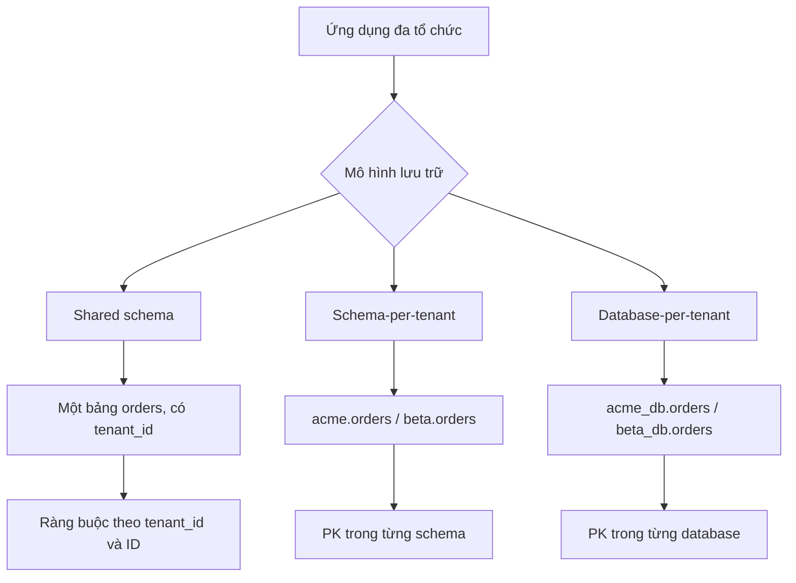
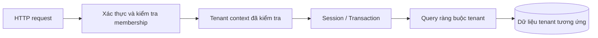

# Định danh trong mô hình nhiều tổ chức và phạm vi duy nhất với JPA/Hibernate

Trong một hệ thống phục vụ **nhiều tổ chức** (*multi-tenant application*), một bản ghi không chỉ thuộc về một thực thể nghiệp vụ như `Order` hay `Invoice` mà còn thuộc về một **tenant**: công ty, đơn vị kinh doanh, workspace hoặc tổ chức sử dụng phần mềm. Vì vậy, câu hỏi “ID này có duy nhất không?” chưa đủ rõ. Cần xác định **ID duy nhất trong toàn hệ thống hay chỉ duy nhất trong một tenant**.

Ví dụ, hai tổ chức `ACME` và `BETA` đều có đơn hàng mang số `SO-001`. Điều này hoàn toàn hợp lệ nếu mã đơn hàng chỉ cần duy nhất **trong từng tổ chức**. Ngược lại, nếu hai tenant cùng chia sẻ bảng với khóa chính đơn cột `id`, giá trị của primary key đó thường phải duy nhất **trên toàn bảng**.

Trong kiến trúc Hibernate, phạm vi duy nhất ảnh hưởng trực tiếp đến thiết kế `@Id`, `@EmbeddedId`, `@GeneratedValue`, unique constraint, foreign key, Hibernate Session, truy vấn JPQL, sinh khóa và chiến lược phân vùng dữ liệu. Bài học này hướng dẫn cách xác định những phạm vi đó và bảo vệ tính nhất quán dữ liệu khi nhiều tổ chức cùng sử dụng một ứng dụng.

## 1. Khái niệm tenant, identifier và phạm vi duy nhất

Một **tenant** là đơn vị dữ liệu hoặc đơn vị khách hàng mà ứng dụng phải phân biệt khi lưu trữ và truy cập dữ liệu. Tenant có thể là một công ty, tổ chức, workspace hoặc môi trường khách hàng, tùy thiết kế hệ thống.

Một **identifier (ID)** là giá trị nhận diện một entity trong mô hình persistence. Trong bảng quan hệ, `@Id` thường ánh xạ tới primary key hoặc một phần khóa chính.

**Phạm vi duy nhất (*uniqueness scope*)** là miền dữ liệu mà trong đó một giá trị không được trùng.

Xét dữ liệu:

| tenant_id | order_number | customer |
| --- | --- | --- |
| `ACME` | `SO-001` | Công ty A |
| `ACME` | `SO-002` | Công ty B |
| `BETA` | `SO-001` | Công ty C |

Giá trị `SO-001` lặp lại là hợp lệ vì hai dòng thuộc tenant khác nhau. Nhưng cặp `(tenant_id, order_number)` phải khác nhau giữa các đơn hàng.

Chúng ta có ít nhất ba khái niệm:

- **ID duy nhất toàn cục (*globally unique ID*):** một giá trị ID chỉ đại diện cho một bản ghi trong toàn bộ miền hệ thống được thiết kế.
- **ID duy nhất theo tenant (*tenant-scoped ID*):** ID có thể trùng giữa các tenant; cặp `(tenantId, id)` mới nhận diện duy nhất một bản ghi.
- **Mã nghiệp vụ duy nhất theo tenant (*tenant-scoped business key*):** primary key có thể duy nhất toàn cục nhưng mã hóa đơn, username, mã sản phẩm hoặc số đơn hàng chỉ phải duy nhất theo tenant.

Ví dụ:

```text
Tenant ACME: orderNumber = SO-001
Tenant BETA: orderNumber = SO-001

Hai orderNumber giống nhau -> hợp lệ.
Hai cặp (tenantId, orderNumber) khác nhau -> duy nhất.
```

Cần phân biệt **primary key** và **business key**: một bảng có thể dùng primary key `id` duy nhất toàn cục, đồng thời đặt `UNIQUE (tenant_id, order_number)` để thực thi quy tắc nghiệp vụ.

### “Duy nhất toàn cục” cũng phải xác định miền

Một ID tăng từ một sequence của database có thể duy nhất trong **một database** hoặc **một cụm sinh ID**; điều đó chưa tự bảo đảm duy nhất khi gộp dữ liệu từ nhiều database độc lập. UUID được sinh phân tán có thể cho xác suất đụng nhau rất thấp, nhưng hệ thống vẫn phải dựa vào ràng buộc database và chính sách xử lý lỗi.

Vì vậy, hãy xác định rõ phạm vi “toàn cục” là toàn bảng, toàn database, toàn cụm dịch vụ hay toàn bộ sản phẩm, trước khi chọn generator.

## 2. Vì sao mô hình nhiều tổ chức khiến thiết kế ID khác đi?

Trong hệ thống một tổ chức, câu lệnh:

```sql
SELECT *
FROM orders
WHERE id = 42;
```

thường có thể đủ để tìm một dòng.

Trong hệ thống nhiều tổ chức dùng chung bảng, nếu `id` chỉ duy nhất theo tenant, câu trên có thể trả về nhiều dòng. Kể cả khi `id` là khóa chính duy nhất toàn cục, câu truy vấn thiếu tenant vẫn có thể đọc dữ liệu mà người dùng hiện tại không được phép truy cập.

Tình huống cần xét đồng thời:

1. **Định danh:** phải phân biệt hai bản ghi cùng mã của hai tenant.
2. **Ràng buộc duy nhất:** duplicate có bị cấm trong cùng tenant hay trên toàn hệ thống?
3. **Quan hệ:** đơn hàng của tenant A không được vô tình tham chiếu khách hàng của tenant B.
4. **Truy vấn:** mọi lượt đọc/ghi phải tìm đúng vùng dữ liệu.
5. **Persistence Context:** entity đang được quản lý phải thuộc đúng ngữ cảnh tenant.
6. **Sinh ID:** các tenant có dùng chung bộ phát khóa hay có bộ phát khóa riêng?
7. **Nhập/xuất và di chuyển dữ liệu:** nếu gộp hoặc tách tenant, ID có còn không trùng không?

Những vấn đề này liên quan nhưng **không đồng nghĩa**. Một primary key được tạo đúng vẫn không tự ngăn lộ dữ liệu nếu truy vấn không giới hạn tenant.

## 3. Ba mô hình lưu trữ multi-tenancy phổ biến

Thiết kế định danh chịu ảnh hưởng lớn bởi cách phân chia dữ liệu vật lý.

### 3.1. Shared database, shared schema — cùng bảng, có cột tenant

Nhiều tenant dùng chung bảng:

```sql
CREATE TABLE orders (
    id BIGINT GENERATED BY DEFAULT AS IDENTITY PRIMARY KEY,
    tenant_id VARCHAR(64) NOT NULL,
    order_number VARCHAR(40) NOT NULL,
    CONSTRAINT uk_orders_tenant_number
        UNIQUE (tenant_id, order_number)
);
```

Dữ liệu:

| id | tenant_id | order_number |
| ---: | --- | --- |
| 101 | `ACME` | `SO-001` |
| 102 | `BETA` | `SO-001` |
| 103 | `ACME` | `SO-002` |

Ở đây:

- `id` là primary key toàn bảng.
- `tenant_id` chỉ tổ chức sở hữu dòng.
- `order_number` không cần duy nhất toàn bảng.
- `(tenant_id, order_number)` phải duy nhất.

**Ưu điểm:** vận hành một bộ bảng, dễ mở thêm tenant với quy mô vừa và nhỏ; tận dụng chung connection pool, schema và migration.

**Đánh đổi:** ứng dụng, Hibernate mapping và database constraints phải bảo đảm cách ly tenant một cách nhất quán. Các truy vấn thiếu điều kiện tenant có thể đi qua dữ liệu của nhiều tổ chức nếu không có cơ chế cô lập bổ sung.

### 3.2. Shared database, separate schema — mỗi tenant một schema

Ví dụ:

```text
Database app_db
├── acme.orders
│   └── id = 42
└── beta.orders
    └── id = 42
```

Hai bảng `acme.orders` và `beta.orders` có thể cùng chứa ID 42. Vì mỗi schema có bảng và primary key riêng, tính duy nhất thường được cưỡng chế trong từng bảng, không tự mở rộng sang schema khác.

**Ưu điểm:** có ranh giới cấu trúc rõ; phù hợp khi tenant cần quản lý schema hoặc migration theo phạm vi riêng.

**Đánh đổi:** routing schema và migration cho nhiều tenant phức tạp hơn. Hibernate cần liên kết Session với tenant/schema đúng; tên bảng giống nhau không đủ để xác định nguồn dữ liệu.

### 3.3. Separate database — mỗi tenant một database

Ví dụ:

```text
Database acme_db -> orders(id = 42)
Database beta_db -> orders(id = 42)
```

Vì primary key tồn tại trong hai database độc lập, ID 42 hoàn toàn có thể được cấp cho hai đơn hàng khác nhau. Nếu cần một định danh công khai cho phép gom báo cáo nhiều database, phải dùng cặp `(tenantId, id)` hoặc thêm một khóa toàn cục.

**Ưu điểm:** phạm vi tài nguyên, backup, quota và cô lập vận hành có thể tách theo tenant.

**Đánh đổi:** nhiều connection pools, routing, migration và tổng hợp dữ liệu phức tạp hơn. Hệ thống cần bảo đảm chọn đúng database theo tenant của request.



| Kiến trúc | ID số 42 có thể tồn tại ở hai tenant? | Khóa dùng để nhận diện liên tenant |
| --- | --- | --- |
| Shared schema, `id` là PK đơn cột | Không trong cùng bảng | `id` đủ để phân biệt dòng, nhưng vẫn phải kiểm tra tenant |
| Shared schema, PK `(tenant_id, id)` | Có | `(tenant_id, id)` |
| Schema riêng từng tenant | Có | `(tenantId, id)` khi đi qua ranh giới schema |
| Database riêng từng tenant | Có | `(tenantId, id)` khi đi qua ranh giới database |

Dù cấu trúc nào được chọn, **phân quyền theo tenant vẫn cần được thực thi** ở điểm truy cập dữ liệu.

## 4. Phương án A: ID toàn cục và business key duy nhất theo tenant

Đây là một thiết kế thường dễ triển khai với shared schema: bảng có `id` sinh tự động làm primary key, còn mọi mã nghiệp vụ có phạm vi tenant được bảo vệ bằng unique constraint kết hợp `tenant_id`.

### Schema

Ví dụ PostgreSQL:

```sql
CREATE TABLE tenant_orders (
    id BIGINT GENERATED BY DEFAULT AS IDENTITY PRIMARY KEY,
    tenant_id VARCHAR(64) NOT NULL,
    order_number VARCHAR(40) NOT NULL,
    description VARCHAR(200),
    CONSTRAINT uk_tenant_orders_number
        UNIQUE (tenant_id, order_number)
);
```

Hai câu lệnh này hợp lệ:

```sql
INSERT INTO tenant_orders (tenant_id, order_number, description)
VALUES ('ACME', 'SO-001', 'Đơn hàng của ACME');

INSERT INTO tenant_orders (tenant_id, order_number, description)
VALUES ('BETA', 'SO-001', 'Đơn hàng của BETA');
```

Nhưng nếu tiếp tục:

```sql
INSERT INTO tenant_orders (tenant_id, order_number, description)
VALUES ('ACME', 'SO-001', 'Đơn hàng trùng trong ACME');
```

database sẽ từ chối vì vi phạm `UNIQUE (tenant_id, order_number)`.

### Entity JPA

```java
import jakarta.persistence.Column;
import jakarta.persistence.Entity;
import jakarta.persistence.GeneratedValue;
import jakarta.persistence.GenerationType;
import jakarta.persistence.Id;
import jakarta.persistence.Table;
import jakarta.persistence.UniqueConstraint;

@Entity
@Table(
    name = "tenant_orders",
    uniqueConstraints = @UniqueConstraint(
        name = "uk_tenant_orders_number",
        columnNames = {"tenant_id", "order_number"}
    )
)
public class TenantOrder {

    @Id
    @GeneratedValue(strategy = GenerationType.IDENTITY)
    private Long id;

    @Column(name = "tenant_id", nullable = false, updatable = false)
    private String tenantId;

    @Column(name = "order_number", nullable = false)
    private String orderNumber;

    @Column(name = "description")
    private String description;

    protected TenantOrder() {}

    public TenantOrder(
            String tenantId,
            String orderNumber,
            String description) {
        this.tenantId = tenantId;
        this.orderNumber = orderNumber;
        this.description = description;
    }

    public Long getId() {
        return id;
    }

    public String getTenantId() {
        return tenantId;
    }

    public String getOrderNumber() {
        return orderNumber;
    }
}
```

Ở đây:

- `id` do database sinh và duy nhất trên bảng.
- `tenantId` là thuộc tính xác định tenant; code tạo mới phải lấy nó từ **ngữ cảnh tenant đã được xác thực**.
- `orderNumber` có thể trùng giữa các tenant khác nhau.
- `@UniqueConstraint` mô tả ràng buộc tương ứng khi JPA tạo schema; trong sản phẩm vận hành bằng migration, phải đảm bảo DDL thật có constraint.

**Lưu ý:** mapping này chỉ dùng `@Column` cho tenant. Nó **chưa tự động thêm điều kiện tenant** cho mọi truy vấn. Phải thực thi lọc bằng application/service hoặc dùng cơ chế multi-tenancy chuyên biệt, được cấu hình và kiểm soát đúng.

### Truy vấn phải ràng buộc tenant

```java
public TenantOrder findByIdForTenant(
        EntityManager em,
        String currentTenantId,
        Long orderId) {
    return em.createQuery(
            "select o from TenantOrder o " +
            "where o.id = :orderId and o.tenantId = :tenantId",
            TenantOrder.class)
        .setParameter("orderId", orderId)
        .setParameter("tenantId", currentTenantId)
        .getResultStream()
        .findFirst()
        .orElse(null);
}
```

Điều kiện `o.tenantId = :tenantId` không chỉ để tránh trùng ID; nó thực thi ranh giới truy cập theo tenant. Nếu có `find(TenantOrder.class, orderId)` không kèm cơ chế lọc tenant tự động, ứng dụng có thể tải một đơn hàng thuộc tenant khác nếu biết hoặc đoán được ID của nó.

### Tại sao ID toàn cục vẫn cần tenant?

Vì **ID không phải cơ chế phân quyền**. Một khóa chính `id = 101` xác định duy nhất một dòng nhưng không trả lời liệu người đang gọi API có thuộc tenant sở hữu dòng đó hay không. Kiểm tra tenant và quyền trên tài nguyên vẫn cần có ở tầng phù hợp.

## 5. Phương án B: khóa chính tổng hợp theo tenant

Nếu mã đơn hàng hoặc một số thứ tự chỉ duy nhất trong tenant, có thể thiết kế primary key trực tiếp bằng cặp `(tenant_id, order_number)`.

### Schema

```sql
CREATE TABLE tenant_invoices (
    tenant_id VARCHAR(64) NOT NULL,
    invoice_number VARCHAR(40) NOT NULL,
    total_amount DECIMAL(14, 2) NOT NULL,
    PRIMARY KEY (tenant_id, invoice_number)
);
```

Dữ liệu hợp lệ:

| tenant_id | invoice_number | total_amount |
| --- | --- | ---: |
| `ACME` | `INV-2026-001` | 1200 |
| `BETA` | `INV-2026-001` | 900 |

Cặp `(tenant_id, invoice_number)` là khóa chính, nên không thể có hai dòng trùng cả hai thành phần.

### Dùng `@EmbeddedId`

JPA có `@EmbeddedId` để mô hình hóa khóa tổng hợp qua một kiểu giá trị `@Embeddable`.

```java
import java.io.Serializable;
import java.util.Objects;
import jakarta.persistence.Column;
import jakarta.persistence.Embeddable;

@Embeddable
public class TenantInvoiceId implements Serializable {

    @Column(name = "tenant_id", nullable = false)
    private String tenantId;

    @Column(name = "invoice_number", nullable = false)
    private String invoiceNumber;

    protected TenantInvoiceId() {}

    public TenantInvoiceId(String tenantId, String invoiceNumber) {
        this.tenantId = tenantId;
        this.invoiceNumber = invoiceNumber;
    }

    public String getTenantId() {
        return tenantId;
    }

    public String getInvoiceNumber() {
        return invoiceNumber;
    }

    @Override
    public boolean equals(Object other) {
        if (this == other) return true;
        if (!(other instanceof TenantInvoiceId)) return false;
        TenantInvoiceId that = (TenantInvoiceId) other;
        return Objects.equals(tenantId, that.tenantId)
            && Objects.equals(invoiceNumber, that.invoiceNumber);
    }

    @Override
    public int hashCode() {
        return Objects.hash(tenantId, invoiceNumber);
    }
}
```

Entity:

```java
import java.math.BigDecimal;
import jakarta.persistence.EmbeddedId;
import jakarta.persistence.Entity;
import jakarta.persistence.Table;

@Entity
@Table(name = "tenant_invoices")
public class TenantInvoice {

    @EmbeddedId
    private TenantInvoiceId id;

    private BigDecimal totalAmount;

    protected TenantInvoice() {}

    public TenantInvoice(TenantInvoiceId id, BigDecimal totalAmount) {
        this.id = id;
        this.totalAmount = totalAmount;
    }

    public TenantInvoiceId getId() {
        return id;
    }

    public BigDecimal getTotalAmount() {
        return totalAmount;
    }
}
```

Tạo và tìm theo khóa:

```java
TenantInvoiceId key =
    new TenantInvoiceId("ACME", "INV-2026-001");

TenantInvoice invoice =
    new TenantInvoice(key, new BigDecimal("1200.00"));

entityManager.persist(invoice);

TenantInvoice loaded =
    entityManager.find(TenantInvoice.class, key);
```

JPQL để truy cập các thành phần của `@EmbeddedId`:

```java
List<TenantInvoice> results = entityManager.createQuery(
        "select i from TenantInvoice i " +
        "where i.id.tenantId = :tenantId " +
        "and i.id.invoiceNumber = :number",
        TenantInvoice.class)
    .setParameter("tenantId", "ACME")
    .setParameter("number", "INV-2026-001")
    .getResultList();
```

Ở mô hình này, **ID của Hibernate chính là object `TenantInvoiceId`**, không phải riêng chuỗi `INV-2026-001`. Cùng số hóa đơn ở tenant khác là một identifier khác.

### Những điều cần cân nhắc với composite ID

- ID phải có đầy đủ thành phần cần thiết trước khi persist, nếu sử dụng khóa do ứng dụng cấp.
- Lớp khóa cần xử lý `equals()` và `hashCode()` nhất quán; những thành phần khóa không nên thay đổi trong vòng đời entity.
- Khóa ngoại tới entity này thường phải chứa cả `tenant_id` và `invoice_number`.
- Đường dẫn JPQL, khóa trong repository và DTO có thể phức tạp hơn khóa `Long` đơn cột.
- Phần ID phát sinh tự động trong composite key có giới hạn portability với JPA và có thể đòi tính năng Hibernate riêng.

Đừng tự động chọn composite ID cho mọi hệ thống nhiều tenant. Nếu doanh nghiệp cần ID nội bộ đơn giản nhưng mã nghiệp vụ riêng tenant, **surrogate ID toàn cục + unique constraint theo tenant** thường dễ sử dụng hơn.

## 6. Phân biệt global ID với tenant-scoped business key

Hai mô hình này có thể cho cùng trải nghiệm nghiệp vụ nhưng khác thiết kế persistence.

| Vấn đề | Global surrogate ID + mã theo tenant | Composite primary key theo tenant |
| --- | --- | --- |
| Khóa chính | `id` | `(tenant_id, local_id)` |
| Mã nghiệp vụ | `UNIQUE (tenant_id, code)` | Có thể là một phần khóa chính |
| JPA `find` | `find(Entity.class, id)` | `find(Entity.class, new CompositeId(...))` |
| Quan hệ khóa ngoại | Thường đơn giản hơn nhưng cần kiểm soát tenant | FK thường chứa nhiều cột |
| Di chuyển dữ liệu sang database khác | Cần quản lý xung đột global ID | Cặp khóa vẫn mang tenant, nhưng mã tenant cũng phải ổn định |
| Thay đổi mã nghiệp vụ | Không ảnh hưởng primary key nếu code không nằm trong PK | Đổi thành phần khóa chính khó hơn |
| Chia sẻ dữ liệu giữa hệ thống | Global ID tiện nếu thật sự duy nhất toàn miền | Cần truyền cặp tenant + local ID |

**Ví dụ dễ nhớ:** một đơn hàng có `id = 12000081` và `orderNumber = SO-001`. `id` là khóa nội bộ của hệ thống, còn `orderNumber` là mã hiển thị duy nhất trong `ACME`. Khách hàng ở `BETA` vẫn có thể dùng `SO-001`, nhưng không được trùng `id` nếu cùng bảng shared schema có primary key đơn cột.

## 7. Unique constraint phải phản ánh chính xác phạm vi nghiệp vụ

Một lỗi phổ biến là đặt unique trên cột đơn trong khi quy tắc nghiệp vụ chỉ yêu cầu duy nhất theo tenant:

```java
// Sai về yêu cầu nếu orderNumber có thể trùng giữa các tenant.
@Column(name = "order_number", unique = true)
private String orderNumber;
```

Ràng buộc `UNIQUE (order_number)` ngăn tenant B dùng số đơn hàng đã có ở tenant A.

Đúng hơn:

```java
@Entity
@Table(
    name = "orders",
    uniqueConstraints = {
        @UniqueConstraint(
            name = "uk_orders_tenant_number",
            columnNames = {"tenant_id", "order_number"}
        )
    }
)
public class Order {
    // ...
}
```

với DDL tương ứng:

```sql
ALTER TABLE orders
ADD CONSTRAINT uk_orders_tenant_number
UNIQUE (tenant_id, order_number);
```

Cần kiểm tra **ràng buộc thực trong database**; annotation tự nó không đảm bảo database production đã cập nhật schema.

### NULL và unique constraint

Nếu `tenant_id` hoặc mã nghiệp vụ cho phép `NULL`, quy tắc unique đối với `NULL` có thể khác nhau theo DBMS. Khi cặp giá trị là định danh bắt buộc, nên dùng `NOT NULL` và ràng buộc unique hoặc primary key thích hợp, thay vì dựa vào ý nghĩa NULL mặc định.

### Chữ hoa, khoảng trắng và chuẩn hóa mã

Giả sử tenant tạo mã `so-001` và `SO-001`. Chúng có được xem là trùng không? Điều này phụ thuộc quy tắc nghiệp vụ, collation và cách chuẩn hóa dữ liệu.

Nếu cần mã không phân biệt hoa/thường, phải thống nhất cách chuẩn hóa (ví dụ lưu normalized code) hoặc sử dụng index/collation phù hợp database. Unique constraint trên giá trị nguyên gốc chỉ thực thi đúng nghĩa của database đối với việc so sánh các giá trị ấy.

### Soft delete và tái sử dụng mã

Khi bản ghi có `deleted_at` hoặc `is_deleted`, doanh nghiệp có thể muốn cho phép tái sử dụng mã sau khi xóa mềm. Unique constraint `(tenant_id, code)` lúc này vẫn ngăn trùng với dòng đã soft delete.

Một số DBMS hỗ trợ partial/filtered unique index để áp dụng uniqueness chỉ cho dòng đang hoạt động; cách triển khai phụ thuộc database và chính sách lưu lịch sử. Không nên tùy tiện bỏ unique constraint chỉ vì thêm soft delete.

## 8. Quan hệ giữa entity phải bảo vệ ranh giới tenant

Giả sử bảng `orders` và `order_items` dùng chung cho nhiều tenant.

Nếu chỉ có khóa ngoại:

```sql
FOREIGN KEY (order_id) REFERENCES orders(id)
```

và `id` là PK toàn cục, ràng buộc này bảo đảm order tồn tại, **nhưng không tự bảo đảm rằng `order_items.tenant_id` bằng `orders.tenant_id`**.

Ví dụ sai cần ngăn:

| item_id | item.tenant_id | order_id | order.tenant_id |
| ---: | --- | ---: | --- |
| 501 | `BETA` | 101 | `ACME` |

Đây là quan hệ chéo tenant: item thuộc BETA nhưng liên kết đến order của ACME.

### Dùng foreign key kết hợp tenant

Với một bảng order có global ID:

```sql
CREATE TABLE orders (
    id BIGINT PRIMARY KEY,
    tenant_id VARCHAR(64) NOT NULL,
    order_number VARCHAR(40) NOT NULL,
    CONSTRAINT uk_orders_tenant_number
        UNIQUE (tenant_id, order_number),
    CONSTRAINT uk_orders_tenant_id
        UNIQUE (tenant_id, id)
);

CREATE TABLE order_items (
    id BIGINT PRIMARY KEY,
    tenant_id VARCHAR(64) NOT NULL,
    order_id BIGINT NOT NULL,
    item_name VARCHAR(150) NOT NULL,
    CONSTRAINT fk_item_order_same_tenant
        FOREIGN KEY (tenant_id, order_id)
        REFERENCES orders (tenant_id, id)
);
```

Tại đây `orders.id` vẫn là primary key toàn cục. Ràng buộc phụ `UNIQUE (tenant_id, id)` giúp cặp cột làm đích của composite foreign key theo các quy tắc khóa được database hỗ trợ.

Một item của tenant BETA không thể tham chiếu order của ACME, vì cặp `(BETA, 101)` không tồn tại trong bảng `orders` nếu order 101 thuộc ACME.

Đây là một **ràng buộc toàn vẹn tham chiếu tại database**, độc lập với việc service có lọc tenant hay không.

### Nếu dùng composite primary key

Với `orders` có `PRIMARY KEY (tenant_id, local_order_id)`, bảng con nên tham chiếu đủ cả hai trường:

```sql
CREATE TABLE orders (
    tenant_id VARCHAR(64) NOT NULL,
    local_order_id BIGINT NOT NULL,
    title VARCHAR(120) NOT NULL,
    PRIMARY KEY (tenant_id, local_order_id)
);

CREATE TABLE order_items (
    tenant_id VARCHAR(64) NOT NULL,
    local_order_id BIGINT NOT NULL,
    line_number INTEGER NOT NULL,
    description VARCHAR(200),
    PRIMARY KEY (tenant_id, local_order_id, line_number),
    FOREIGN KEY (tenant_id, local_order_id)
        REFERENCES orders (tenant_id, local_order_id)
);
```

Trong mô hình này, một order của ACME có `local_order_id = 42` và một order của BETA có `local_order_id = 42` là hợp lệ. Cặp tenant + local ID được mang xuyên qua cả bảng cha và bảng con.

### Mapping quan hệ trong JPA

Khi một foreign key chứa cả cột tenant và ID của entity liên quan, mapping JPA có thể dùng `@JoinColumns`; với `@EmbeddedId`, một số thiết kế còn dùng `@MapsId` để đồng bộ thành phần ID với quan hệ.

Cần bảo đảm không vô tình ánh xạ cùng cột hai lần với quyền ghi trái nhau. Cách tổ chức `insertable/updatable`, `@MapsId` và việc gán khóa phải phản ánh rõ ai quản lý giá trị tenant. Dù mapping ORM đúng, hãy giữ ràng buộc foreign key tương ứng trong DDL để database cũng ngăn tham chiếu chéo tenant.

## 9. Hibernate Persistence Context và danh tính trong multi-tenancy

Trong một `Session` stateful, Hibernate duy trì **Persistence Context** nhằm bảo đảm mỗi định danh entity chỉ có một managed instance trong context. Với multi-tenancy, cần hiểu **phiên nào thuộc tenant nào**.

Một Session được cấu hình tenant ACME không nên tự thay đổi tenant giữa chừng để tiếp tục xử lý dữ liệu của BETA. Hibernate multi-tenancy được thiết kế dựa trên tenant context của session và cơ chế routing/filtering tương ứng.

```text
Session A (tenant = ACME)
    -> Order có ID 42 thuộc ACME

Session B (tenant = BETA)
    -> Order có ID 42 thuộc BETA

Dù dùng cùng SessionFactory:
    Hai Session có Persistence Context riêng.
    Hai bản ghi có thể cùng local ID nhưng khác tenant.
```

**L1 cache (first-level cache)** thuộc Persistence Context của session; việc chia sẻ một `SessionFactory` giữa hai tenant không biến chúng thành một bộ entity managed chung.

### Có thể dùng `find(Entity.class, id)` không?

Câu trả lời phụ thuộc mapping ID và cơ chế multi-tenancy:

- Với **composite ID** `(tenantId, localId)`, `find` phải nhận đúng đối tượng khóa tổng hợp.
- Với **global ID và lọc tenant thủ công**, `find` theo global ID tự nó không buộc thêm tenant; phải xác minh quyền sở hữu bằng truy vấn theo tenant hoặc cơ chế thực thi tenant ở tầng persistence.
- Với **Hibernate multi-tenancy tích hợp**, session đã có tenant identifier và provider có thể áp dụng routing/lọc theo loại chiến lược đang dùng. Vẫn cần đảm bảo tenant context được lấy từ nguồn đáng tin cậy.

Với một ứng dụng chỉ dùng `@Column(name = "tenant_id")` và không có cơ chế tự động nào khác, đừng giả định Hibernate sẽ tự thêm `WHERE tenant_id = ...`.

### L2 cache và phạm vi tenant

Cache cấp hai, nếu được bật, có phạm vi dùng chung giữa nhiều session trong một `SessionFactory`. Cơ chế multi-tenancy của Hibernate phải bảo đảm cache key và cách phân biệt dữ liệu được thiết kế phù hợp để tránh trộn tenant.

Không nên tự tạo một cache key ứng dụng chỉ gồm `orderId` khi `orderId` chỉ duy nhất theo tenant. Khóa cache phải phản ánh đầy đủ identity của bản ghi:

```text
cacheKey = (entityType, tenantId, localId)
```

Với ID thật sự duy nhất toàn cục, cache key có thể chỉ cần global ID cho mục tiêu xác định bản ghi, nhưng **quyền truy cập theo tenant vẫn phải được thực thi** ở lớp truy cập dữ liệu.

## 10. Hibernate multi-tenancy: tenant identifier được gắn vào Session

Hibernate cung cấp những cơ chế multi-tenancy tùy phiên bản, ví dụ tenant-aware session, routing kết nối theo tenant và phân tách dữ liệu bằng cột tenant.

Một Session có thể được mở với tenant identifier đã xác định:

```java
try (Session session = sessionFactory
        .withOptions()
        .tenantIdentifier("ACME")
        .openSession()) {

    // Mọi thao tác được thực hiện trong tenant context đã chọn
    // theo cấu hình multi-tenancy của SessionFactory.
}
```

Chỉ truyền chuỗi `"ACME"` vào Session **không tự biến mapping chung thành an toàn** nếu ứng dụng chưa cấu hình chiến lược multi-tenancy tương ứng. Tenant identifier cần được tiêu thụ bởi cơ chế mapping/routing/filtering thích hợp.

### 10.1. Separate schema/database: routing kết nối

Trong cấu hình Hibernate multi-tenancy dành cho schema hoặc database riêng, các khái niệm như `MultiTenantConnectionProvider` và `CurrentTenantIdentifierResolver` có thể tham gia:

- `CurrentTenantIdentifierResolver` giải quyết tenant hiện hành dựa trên context của request/transaction.
- `MultiTenantConnectionProvider` cấp kết nối đúng database hoặc schema cho tenant.
- `Session` được gắn tenant identifier khi làm việc với persistence unit.

Cách chọn schema hoặc database tùy chiến lược và provider, có thể thông qua connection pool riêng, thiết lập schema trên connection, hoặc data source routing.

Điểm cần đảm bảo: **connection đã dùng cho tenant A không được trả lại pool với trạng thái schema A rồi cấp cho tenant B mà không được reset/định tuyến đúng cách**. Đây là vấn đề cấu hình quản lý kết nối, không phải chỉ vấn đề annotation `@Id`.

### 10.2. Shared schema: `@TenantId` trong Hibernate

Ở các phiên bản Hibernate hỗ trợ (đặc biệt Hibernate 6 trở lên), `org.hibernate.annotations.TenantId` cho phép đánh dấu thuộc tính lưu tenant identifier trong mô hình phân tách theo cột.

Ví dụ dành riêng cho mô hình dùng Hibernate có hỗ trợ `@TenantId`:

```java
import jakarta.persistence.Column;
import jakarta.persistence.Entity;
import jakarta.persistence.GeneratedValue;
import jakarta.persistence.GenerationType;
import jakarta.persistence.Id;
import jakarta.persistence.Table;
import org.hibernate.annotations.TenantId;

@Entity
@Table(name = "tenant_tasks")
public class TenantTask {

    @Id
    @GeneratedValue(strategy = GenerationType.IDENTITY)
    private Long id;

    @TenantId
    @Column(name = "tenant_id")
    private String tenantId;

    @Column(name = "task_title", nullable = false)
    private String title;

    protected TenantTask() {}

    public TenantTask(String title) {
        this.title = title;
    }

    public Long getId() {
        return id;
    }

    public String getTenantId() {
        return tenantId;
    }
}
```

Khi mở Session gắn tenant ACME, Hibernate có thể quản lý việc đặt và ràng buộc tenant identifier cho entity theo cơ chế `@TenantId`. Đây là **tính năng riêng của Hibernate**, không phải annotation chuẩn Jakarta Persistence; cú pháp và điều kiện áp dụng phải phù hợp phiên bản thư viện.

**Không trộn hai chiến lược một cách ngẫu nhiên:** nếu đã dùng `@TenantId` để Hibernate quản lý tenant field, code nghiệp vụ không nên tùy tiện gán hoặc sửa `tenantId` như một thuộc tính bình thường. Nếu dự án dùng cơ chế lọc thủ công, `@Filter`, row-level security hoặc routing theo schema/database, cách cấu hình sẽ khác.

### Giới hạn của cơ chế ORM tenant filtering

Cơ chế lọc ở mức ORM không thể được hiểu như một bảo đảm chung cho mọi đường truy cập:

- Native SQL, JDBC thuần hoặc các batch SQL tự viết có thể không tự được thêm điều kiện tenant như truy vấn entity qua Hibernate.
- Công việc chạy ngoài request như job nền cần tenant context riêng.
- Đường truy cập dữ liệu qua service khác hoặc thao tác quản trị cần chính sách rõ.
- Cache ứng dụng và báo cáo SQL tổng hợp cũng phải có khóa/phạm vi phù hợp.

Đối với shared schema, database row-level security (nếu hệ quản trị hỗ trợ và được cấu hình đúng) có thể bổ sung một lớp thực thi. Nó không thay thế việc xác định tenant đáng tin cậy và mapping/routing chính xác trong ứng dụng.

## 11. Tenant identifier phải lấy từ đâu?

Không nên lấy tenant identifier từ một tham số do client gửi rồi coi ngay đó là tenant có quyền truy cập.

Ví dụ:

```text
GET /orders/42?tenantId=ACME
```

Nếu người dùng đang thuộc BETA chỉ cần thay `tenantId=ACME` để đọc đơn hàng của ACME, việc lọc theo tenant vẫn không mang lại cách ly thực sự.

Một quy trình thường có:

1. **Xác thực** người dùng/service.
2. **Xác định tổ chức hiện hành** từ membership, token đã được xác thực hoặc lựa chọn tenant đã được kiểm tra quyền.
3. **Gắn tenant context** vào đơn vị công việc.
4. **Mở/lấy Session phù hợp** và thực thi truy vấn.
5. **Dọn context** khi xử lý kết thúc, tránh vô tình mang tenant cũ sang request tiếp theo.



### Thread-local và xử lý bất đồng bộ

Một số hệ thống truyền tenant context bằng thread-local trong luồng xử lý request. Nếu chuyển công việc sang thread khác (`@Async`, executor, message consumer, job scheduler), thread-local không tự bảo đảm tenant context được truyền đúng.

Khi thực hiện async, cần thiết kế cơ chế truyền tenant identifier, kiểm tra quyền/ngữ cảnh và dọn context ở thread nhận việc. Không giữ một stateful `Session` dùng chung giữa hai thread để “mang theo tenant”; `Session` không được thiết kế cho truy cập đồng thời.

### Tenant context và transaction

Tenant thường nên được xác định trước khi transaction/persistence context bắt đầu. Đổi tenant giữa cùng một Session hoặc giữa chừng một transaction có thể khiến các entity đang managed và kết nối database không còn phù hợp với mục tiêu công việc.

Nếu một tác vụ quản trị phải xử lý nhiều tenant, tách thành các đơn vị công việc với tenant context riêng, trừ khi kiến trúc có cơ chế cross-tenant rõ ràng, được kiểm soát và kiểm chứng.

## 12. Sinh định danh trong môi trường multi-tenant

Phạm vi của bộ phát ID không nhất thiết giống phạm vi khóa nghiệp vụ.

### 12.1. Một global sequence cho shared schema

Giả sử `tenant_orders.id` do một sequence hoặc identity trên bảng chung sinh ra. Khi tenant ACME tạo bản ghi, ID nhận 101; BETA tạo tiếp nhận 102. Các ID không cần liên tiếp **trong từng tenant**.

```text
ACME -> id 101
BETA -> id 102
ACME -> id 103
BETA -> id 104
```

Nếu `id` là primary key toàn bảng, đây là hành vi phù hợp. Mỗi tenant có thể có mã đơn hàng hiển thị `SO-001` riêng, do hệ thống cấp theo nghiệp vụ.

**Không suy ra thứ tự hoặc số lượng đơn hàng của một tenant từ ID toàn hệ thống.** Bên cạnh đó, gap do rollback/sequence allocation khiến ID thường không liên tiếp ngay cả trong mô hình một tenant.

### 12.2. Local ID trong từng schema hoặc database

Khi mỗi tenant dùng database hoặc schema riêng, các sequence/identity riêng có thể cùng sinh ID 1, 2, 3... Mỗi bản ghi có thể được nhận diện bằng:

```text
(tenantId = ACME, id = 42)
(tenantId = BETA, id = 42)
```

Nếu sau này gom dữ liệu vào một bảng chung với primary key `id` đơn cột, hai dòng `id = 42` sẽ xung đột. Cần chuẩn bị ánh xạ ID mới, composite key hoặc global UUID trong quy trình di chuyển.

### 12.3. Local ID theo tenant trong cùng một bảng

Nếu bảng chung dùng khóa `PRIMARY KEY (tenant_id, local_id)`, ứng dụng phải có cơ chế cấp `local_id` riêng theo tenant, nếu business yêu cầu mỗi tenant có dãy độc lập.

**Không dùng `SELECT MAX(local_id) + 1 WHERE tenant_id = ?` trong nhiều writer mà không có cơ chế đồng bộ**. Hai transaction cùng tenant có thể đọc cùng MAX và cố chèn cùng giá trị.

Có thể thiết kế:

- Bảng cấp số theo tenant, với mỗi tenant một dòng được cập nhật trong transaction có khóa phù hợp.
- Generator tùy chỉnh được kiểm soát concurrency.
- Sequence riêng theo schema/tenant nếu kiến trúc cho phép.
- Mã được cấp bên ngoài và kiểm tra unique.

Không nên kỳ vọng `@GeneratedValue(strategy = IDENTITY)` tiêu chuẩn sẽ tự sinh một dãy tăng độc lập cho **mỗi tenant trong cùng một cột của bảng shared schema**. `IDENTITY` thường thuộc về cột hoặc bảng tại database, còn yêu cầu local counter theo tenant là một bài toán khác.

### 12.4. UUID toàn hệ thống

UUID có thể tạo ID trước khi lưu, hữu ích khi nhiều dịch vụ độc lập hoặc nhiều database phải trao đổi sự kiện.

```java
import java.util.UUID;

UUID globalId = UUID.randomUUID();
```

Nếu ứng dụng gán giá trị này vào `@Id`, đó là **assigned identifier**. Nếu sử dụng `@GeneratedValue(strategy = GenerationType.UUID)` với phiên bản Jakarta Persistence hỗ trợ, provider sinh giá trị UUID. UUID hạn chế nguy cơ collision khi dữ liệu được tạo phân tán, nhưng ràng buộc primary key ở database vẫn cần tồn tại.

Ngay cả với global UUID, endpoint truy cập dữ liệu vẫn cần xác minh tenant sở hữu entity; UUID khó đoán không phải một phương thức phân quyền.

### Bảng lựa chọn

| Kiến trúc và mục tiêu | Cách cấp ID thường hợp lý |
| --- | --- |
| Shared schema, PK toàn bảng, cần CRUD đơn giản | `IDENTITY` hoặc `SEQUENCE` chung |
| Shared schema, cần insert batching cao | `SEQUENCE`/generator cấp trước INSERT khi DB hỗ trợ |
| Shared schema, ID cục bộ từng tenant | Composite PK + cơ chế cấp local ID an toàn |
| Schema/database riêng, không yêu cầu ID dùng chung | Sequence/identity cục bộ từng tenant |
| Dữ liệu sẽ được gộp từ nhiều database | Global UUID hoặc thiết kế mapping ID lại khi hợp nhất |
| Mã hóa đơn cần tăng tuần tự theo tenant | Bộ cấp số nghiệp vụ riêng, không suy ra từ primary key toàn cục |

## 13. Định danh nghiệp vụ và số chứng từ theo tenant

Một **invoice number** khác với primary key nội bộ.

Ví dụ:

```text
Tenant ACME:
    Invoice ID (global): 912104
    Invoice number: INV-2026-0001

Tenant BETA:
    Invoice ID (global): 912105
    Invoice number: INV-2026-0001
```

Hai invoice number trùng nhau giữa tenants là hợp lệ. Unique constraint cần là:

```sql
UNIQUE (tenant_id, invoice_number)
```

Nếu muốn số chứng từ tăng theo tenant và năm, phải xác định cả ba phần của phạm vi:

```text
(tenant_id, fiscal_year, sequence_number)
```

Hệ thống có thể đặt unique trên các cột riêng hoặc trên mã đã chuẩn hóa theo quy tắc nghiệp vụ. Nhưng **primary key** không cần trực tiếp là số chứng từ. Khi số chứng từ bị hủy, được lưu nháp hoặc chỉ cấp lúc phát hành, quy trình nghiệp vụ thường khác thời điểm tạo entity.

Trong một số ngành có quy định đánh số hóa đơn không có lỗ hổng, sequence database thông thường có thể không đáp ứng. Rollback, caching và allocation có thể làm ID bị nhảy số. Đây là lý do nên tách **định danh kỹ thuật** khỏi **số thứ tự nghiệp vụ** nếu yêu cầu pháp lý/vận hành khác nhau.

## 14. Truy vấn, repository và thao tác cập nhật đúng tenant

Với shared schema và lọc tenant thủ công, repository nên diễn đạt phạm vi trong câu truy vấn.

### Truy vấn entity

```java
public interface TenantOrderRepository
        extends JpaRepository<TenantOrder, Long> {

    Optional<TenantOrder> findByIdAndTenantId(
        Long id,
        String tenantId
    );

    boolean existsByTenantIdAndOrderNumber(
        String tenantId,
        String orderNumber
    );
}
```

Ở đây `findByIdAndTenantId` thể hiện ý định lấy order thuộc một tenant cụ thể. Cơ chế Spring Data tạo query theo tên property của entity.

Nếu dùng `findById(id)` của repository trong mô hình không có tenant filtering tích hợp, phải nhận thức rằng nó chỉ tìm theo ID. Nếu global ID đủ xác định record, truy vấn có thể trả về order của bất kỳ tenant nào khi caller biết ID.

### Cập nhật theo tenant

```java
@Transactional
public void renameOrder(
        Long orderId,
        String trustedTenantId,
        String newNumber) {

    TenantOrder order = entityManager.createQuery(
            "select o from TenantOrder o " +
            "where o.id = :id and o.tenantId = :tenantId",
            TenantOrder.class)
        .setParameter("id", orderId)
        .setParameter("tenantId", trustedTenantId)
        .getResultStream()
        .findFirst()
        .orElseThrow(() ->
            new IllegalArgumentException("Order không tồn tại"));

    order.changeOrderNumber(newNumber);
}
```

Ví dụ giả định `TenantOrder` có phương thức domain `changeOrderNumber(String)` được cài đặt để thay đổi `orderNumber` và kiểm tra định dạng. Vì entity đang managed, Hibernate dirty checking có thể ghi thay đổi khi flush; unique constraint của database vẫn kiểm soát trường hợp số đơn hàng mới bị trùng trong tenant.

### Bulk update và delete

Với JPQL bulk operation hoặc native SQL, câu lệnh phải ràng buộc tenant nếu cơ chế ORM hiện tại không tự áp dụng phạm vi:

```java
int affected = entityManager.createQuery(
        "update TenantOrder o " +
        "set o.description = :description " +
        "where o.tenantId = :tenantId and o.id = :id")
    .setParameter("description", "Đã xác nhận")
    .setParameter("tenantId", trustedTenantId)
    .setParameter("id", orderId)
    .executeUpdate();
```

Bulk update/delete có thể bỏ qua trạng thái entity managed và dirty checking từng object. Sau bulk operation, managed entities đã tải có thể giữ giá trị cũ; cần chọn cách refresh/clear phù hợp và kiểm soát transaction.

### Native SQL và báo cáo tổng hợp

Các báo cáo kiểu:

```sql
SELECT COUNT(*)
FROM orders;
```

có ý nghĩa toàn hệ thống. Nếu người dùng chỉ được xem dữ liệu tenant ACME, truy vấn phải có phạm vi phù hợp:

```sql
SELECT COUNT(*)
FROM orders
WHERE tenant_id = :tenant_id;
```

Khi dùng native SQL, JDBC thuần hoặc công cụ BI, điều kiện tenant phải được bảo đảm bằng truy vấn, row-level security hoặc kiến trúc cách ly tương ứng. Không mặc định Hibernate entity filtering sẽ áp dụng cho mọi SQL.

## 15. Unique constraint và vấn đề đồng thời

Kiểm tra “chưa có mã” trong service có thể cho phản hồi thân thiện, nhưng **không thay thế unique constraint**.

Giả sử tenant ACME chưa có order `SO-010`:

```text
Transaction A: exists(ACME, SO-010) -> false
Transaction B: exists(ACME, SO-010) -> false
Transaction A: INSERT ACME / SO-010 -> thành công
Transaction B: INSERT ACME / SO-010 -> bị DB từ chối
```

Cả hai lượt kiểm tra trước đó đều đúng tại thời điểm đọc, nhưng không thể ngăn race condition. Database phải giữ:

```sql
UNIQUE (tenant_id, order_number)
```

Sau đó ứng dụng xử lý lỗi constraint theo ngữ cảnh:

- Nếu người dùng tạo trùng mã, trả về lỗi nghiệp vụ phù hợp.
- Nếu tác vụ có thể sinh mã khác, phát mã mới và thử lại trong transaction/đơn vị công việc hợp lệ.
- Nếu sự kiện được gửi lặp, thiết kế idempotency key hoặc deduplication có phạm vi tenant phù hợp.

Đừng dựa vào `synchronized` của một JVM để giữ unique cho hệ thống có nhiều instance.

### Optimistic locking và uniqueness là hai bài toán khác

`@Version` giúp phát hiện cập nhật đồng thời trên **cùng một entity**, còn unique constraint ngăn **hai entity khác nhau** trùng business key trong tenant.

```java
@Version
private Long version;
```

Một entity có thể vừa dùng version để chống lost update, vừa dùng `UNIQUE (tenant_id, order_number)` để chống duplicate. Hai cơ chế bổ sung cho nhau.

## 16. Ranh giới tenant trong khóa ngoại, index và phân vùng

Các ràng buộc không nên chỉ được thiết kế ở bảng chính mà bỏ qua đường dẫn truy cập quan hệ.

### Khóa ngoại

Với shared schema:

- Nếu khóa đích theo tenant, FK phải mang tenant cùng local ID.
- Nếu khóa đích global, FK đơn cột có thể đủ để xác nhận tồn tại nhưng không ngăn bảng con ghi tenant khác. Có thể thêm composite FK để bảo vệ ranh giới như phần trước.
- Nếu một quan hệ được phép cross-tenant (ví dụ danh mục chung), phải biểu diễn rõ loại quan hệ này và quyền truy cập thay vì vô tình dùng điều kiện tenant cho mọi bảng.

### Chỉ mục

Các truy vấn phổ biến:

```sql
SELECT *
FROM orders
WHERE tenant_id = ?
  AND order_number = ?;
```

thường được hưởng lợi từ index bắt đầu bằng `tenant_id` hoặc unique index theo cặp `(tenant_id, order_number)`. Tuy nhiên thứ tự cột trong composite index cần xét selectivity, mẫu truy vấn và đặc điểm database; không có một thứ tự tốt nhất cho mọi workload.

### Partitioning và sharding

Khi bảng rất lớn, ứng dụng có thể partition/shard dữ liệu theo tenant hoặc nhóm tenant. Lúc đó:

- Global ID phải được tạo sao cho không đụng giữa shard, nếu các shard sau này có thể hợp nhất.
- Local ID phải luôn đi kèm tenant/shard key khi được truyền qua API hoặc message.
- Foreign key liên shard có thể không được database bảo vệ như cùng một database; ứng dụng cần quy tắc toàn vẹn dữ liệu và xử lý lỗi.
- Unique constraint trong database phân vùng có thể có yêu cầu riêng về partition key, tùy DBMS.

Các quyết định sharding nên đến từ nhu cầu mở rộng thực tế, không chỉ do muốn sử dụng một kiểu `@Id` cụ thể.

## 17. Di chuyển tenant: đổi mô hình lưu trữ và định danh

Giả sử ban đầu mỗi tenant có database riêng:

```text
ACME.orders(id=1)
BETA.orders(id=1)
```

Sau này muốn gộp vào một bảng `orders` có `id BIGINT PRIMARY KEY`. Nếu import cả hai dòng với `id=1`, sẽ vi phạm khóa chính.

### Ba cách xử lý thường gặp

**Cách A: chuyển sang composite key**

Tạo khóa `(tenant_id, local_id)`. Khi gộp:

```text
(ACME, 1)
(BETA, 1)
```

là hai khóa khác nhau. Nhưng phải sửa mapping Hibernate, khóa ngoại, repository API và các hệ thống tham chiếu ID.

**Cách B: cấp global surrogate ID mới**

Khi nhập, tạo global ID mới:

```text
ACME/local 1 -> global 10001
BETA/local 1 -> global 20001
```

Lưu bảng ánh xạ từ `(tenantId, oldId)` đến `globalId` để cập nhật foreign keys và tham chiếu từ hệ thống khác.

**Cách C: sử dụng UUID toàn hệ thống từ đầu**

Nếu UUID được sinh theo chính sách toàn cục ngay từ trước, việc hợp nhất có thể giảm nguy cơ xung đột ID. Dù vậy vẫn phải xử lý schema, quan hệ và kiểm tra tính toàn vẹn.

### Điều cần tính trước khi migrate

1. Các tenant có được phép trùng mã nghiệp vụ không?
2. Những cột nào là primary key; cột nào chỉ là business key?
3. Foreign key hiện tại có bao gồm tenant không?
4. Có ID nào đang được đưa ra ngoài qua URL, message queue hoặc file export?
5. Dữ liệu lịch sử có lưu tenant identifier ổn định không?
6. Đích mới có bảo vệ được các unique constraints tương ứng không?
7. Sau import, sequence/identity generator có được đưa vượt qua ID lớn nhất hoặc tái cấu hình đúng chưa?

Đổi `@Id` trong Java mà không di chuyển dữ liệu và khóa ngoại không giải quyết được việc gộp tenant.

## 18. Ví dụ tổng hợp: hệ thống bán hàng cho nhiều tổ chức

Giả sử một SaaS có ba yêu cầu:

- Mỗi đơn hàng có global ID nội bộ để các service trao đổi.
- Mỗi tổ chức được dùng số đơn hàng riêng, ví dụ cả ACME và BETA đều có `SO-0001`.
- Một order item không được trỏ sang order thuộc tenant khác.

Thiết kế shared schema:

```sql
CREATE TABLE sales_orders (
    id BIGINT GENERATED BY DEFAULT AS IDENTITY PRIMARY KEY,
    tenant_id VARCHAR(64) NOT NULL,
    order_number VARCHAR(40) NOT NULL,
    status VARCHAR(24) NOT NULL,
    version BIGINT NOT NULL DEFAULT 0,
    CONSTRAINT uk_sales_order_tenant_number
        UNIQUE (tenant_id, order_number),
    CONSTRAINT uk_sales_order_tenant_id
        UNIQUE (tenant_id, id)
);

CREATE TABLE sales_order_items (
    id BIGINT GENERATED BY DEFAULT AS IDENTITY PRIMARY KEY,
    tenant_id VARCHAR(64) NOT NULL,
    order_id BIGINT NOT NULL,
    sku VARCHAR(60) NOT NULL,
    quantity INTEGER NOT NULL,
    CONSTRAINT fk_item_same_tenant_order
        FOREIGN KEY (tenant_id, order_id)
        REFERENCES sales_orders (tenant_id, id)
);
```

Entity đơn hàng:

```java
import jakarta.persistence.Column;
import jakarta.persistence.Entity;
import jakarta.persistence.GeneratedValue;
import jakarta.persistence.GenerationType;
import jakarta.persistence.Id;
import jakarta.persistence.Table;
import jakarta.persistence.UniqueConstraint;
import jakarta.persistence.Version;

@Entity
@Table(
    name = "sales_orders",
    uniqueConstraints = {
        @UniqueConstraint(
            name = "uk_sales_order_tenant_number",
            columnNames = {"tenant_id", "order_number"}
        ),
        @UniqueConstraint(
            name = "uk_sales_order_tenant_id",
            columnNames = {"tenant_id", "id"}
        )
    }
)
public class SalesOrder {

    @Id
    @GeneratedValue(strategy = GenerationType.IDENTITY)
    private Long id;

    @Column(name = "tenant_id", nullable = false, updatable = false)
    private String tenantId;

    @Column(name = "order_number", nullable = false)
    private String orderNumber;

    @Column(name = "status", nullable = false)
    private String status;

    @Version
    private Long version;

    protected SalesOrder() {}

    public SalesOrder(String tenantId, String orderNumber) {
        this.tenantId = tenantId;
        this.orderNumber = orderNumber;
        this.status = "DRAFT";
    }

    public Long getId() {
        return id;
    }

    public String getTenantId() {
        return tenantId;
    }

    public String getOrderNumber() {
        return orderNumber;
    }
}
```

Với schema và mapping này:

- Global ID giúp mỗi order có PK duy nhất trong bảng chung.
- `UNIQUE (tenant_id, order_number)` thể hiện phạm vi mã nghiệp vụ.
- `UNIQUE (tenant_id, id)` làm khóa đích cho FK kết hợp tenant.
- `sales_order_items` không thể liên kết sang order khác tenant nếu database bảo đảm constraint.
- `@Version` hỗ trợ phát hiện sửa đồng thời trong các transaction.
- Truy vấn service vẫn phải lọc hoặc ràng buộc tenant vì `@Column` không tự bảo đảm isolation.

### Luồng tạo đơn hàng

```text
1. Người dùng được xác thực, có quyền làm việc ở ACME.
2. Ứng dụng chọn trustedTenantId = ACME.
3. Tạo SalesOrder(ACME, SO-0001).
4. persist; Hibernate/database cấp global ID.
5. INSERT có tenant_id = ACME.
6. DB kiểm tra UNIQUE (tenant_id, order_number).
7. Transaction commit.
```

### Luồng truy cập đơn hàng

```text
1. Request yêu cầu order ID 101.
2. Hệ thống lấy trustedTenantId từ context đã xác thực.
3. Query theo (id=101, tenant_id=ACME).
4. Nếu không có dòng phù hợp, trả về kết quả không tìm thấy/không được phép
   theo chính sách API.
5. Nếu có, xử lý entity trong transaction và persistence context phù hợp.
```

### Luồng tạo order item

```text
1. Xác định order thuộc tenant ACME.
2. INSERT item với tenant_id=ACME và order_id=101.
3. Composite foreign key bảo đảm (ACME, 101) tồn tại trong sales_orders.
4. Nếu cố gán item tenant BETA tới order 101 của ACME,
   database từ chối vì không có khóa đích (BETA, 101).
```

Cách phối hợp này sử dụng ràng buộc ở **nhiều lớp**: request tenant context, câu truy vấn ORM, unique constraint, foreign key và transaction. Mỗi lớp giải quyết một phần vấn đề khác nhau.

## 19. Những lỗi thường gặp khi định danh đa tổ chức

### Lỗi 1: đánh đồng global ID với quyền truy cập toàn cục

Có global ID `id=101` không có nghĩa tenant nào cũng có quyền đọc record 101. Cần lọc tenant và kiểm tra quyền, ngay cả khi identifier không trùng.

### Lỗi 2: dùng unique đơn cột cho mã chỉ duy nhất theo tenant

`UNIQUE (order_number)` vô tình chặn hai tenant dùng cùng `SO-0001`. Sửa phạm vi bằng `UNIQUE (tenant_id, order_number)` và migration tương ứng.

### Lỗi 3: khóa ngoại chỉ kiểm tra order tồn tại

`FOREIGN KEY (order_id) REFERENCES orders(id)` không tự ngăn item của tenant B liên kết order của tenant A nếu hai bảng có tenant column riêng. Cân nhắc FK kết hợp tenant.

### Lỗi 4: chỉ thêm field `tenantId` vào entity rồi cho rằng Hibernate tự lọc

`@Column(name = "tenant_id")` là mapping cột, không phải cơ chế multitenancy tự động. Truy vấn và thao tác cập nhật phải ràng buộc tenant, hoặc cấu hình Hibernate tenant filtering/routing phù hợp.

### Lỗi 5: giữ Session và đổi tenant identifier giữa chừng

Entity và cache cấp một đã gắn với context hiện tại. Không tái sử dụng stateful Session của ACME như Session của BETA. Tạo/lấy session đúng tenant cho đơn vị công việc mới.

### Lỗi 6: tạo local ID bằng `MAX(id) + 1`

Hai giao dịch song song trong cùng tenant có thể tạo cùng ID. Dùng bộ cấp số concurrency-safe và primary key/unique constraint.

### Lỗi 7: chuyển data sang shared schema mà không ánh xạ lại ID

Hai database tenant đều có ID 42; gộp vào một bảng với `PRIMARY KEY (id)` sẽ va chạm. Cần một kế hoạch composite key, remap hoặc global ID.

### Lỗi 8: cache ứng dụng chỉ dùng local ID

Nếu cache `Order#42` bằng key `"42"` mà bỏ tenant, BETA có thể nhận dữ liệu được cache từ ACME. Dùng key đủ tenant và entity identity; kiểm soát cả các cache ngoài Hibernate.

### Lỗi 9: bulk SQL hoặc báo cáo không ràng buộc tenant

Cơ chế Hibernate có thể bảo vệ một số thao tác entity, nhưng JDBC thuần/native SQL hoặc công cụ báo cáo chưa chắc theo cùng luật. Kiểm tra đầy đủ các đường đọc/ghi, nhất là công việc nền và admin tools.

### Lỗi 10: tenant ID được client tự quyết

Nếu API tin giá trị `tenantId` từ query/header mà không xác minh membership, người dùng có thể chuyển tổ chức chỉ bằng thay chuỗi. Tenant hiện hành phải được xác định từ ngữ cảnh đã xác thực và kiểm tra quyền.

### Lỗi 11: bỏ qua unique constraint khi có `exists...`

Hai request có thể cùng kiểm tra chưa tồn tại rồi cùng insert. Ràng buộc database vẫn cần có để bảo vệ dưới concurrency; ứng dụng xử lý lỗi thích hợp.

### Lỗi 12: cho phép đổi `tenantId` của entity đã persist

Chuyển một entity giữa tenant không phải cập nhật trường thông thường. Nó có thể ảnh hưởng ID composite, FK, membership và dữ liệu con. Nên xem việc chuyển sở hữu tenant là một quy trình nghiệp vụ riêng, có kiểm soát và có migration/transaction tương ứng.

## 20. Câu hỏi tình huống

**Câu 1.** Bảng dùng `id BIGINT PRIMARY KEY` và `tenant_id`. Tenant ACME có đơn `id=100`. Tenant BETA có được tạo đơn khác cũng mang `id=100` trong cùng bảng không?

**Trả lời:** Không, vì primary key `id` duy nhất trên toàn bảng. Nếu cần ID cục bộ theo tenant, phải thay mô hình khóa hoặc dùng bảng/schema/database tách biệt.

**Câu 2.** Hai tenant cùng có `invoice_number=INV-001` có phải lỗi không?

**Trả lời:** Chỉ lỗi nếu quy tắc nghiệp vụ yêu cầu mã hóa đơn duy nhất toàn hệ thống. Nếu mỗi tenant có sổ hóa đơn riêng, unique theo `(tenant_id, invoice_number)` là hợp lý.

**Câu 3.** Có `@Id Long id` sinh từ sequence chung thì có thể bỏ điều kiện tenant khi `find` không?

**Trả lời:** Không thể suy ra như vậy. Global ID giải quyết tính duy nhất của dòng, không xác định quyền truy cập của người dùng. Truy vấn hoặc cơ chế persistence phải bảo đảm tenant isolation.

**Câu 4.** `@EmbeddedId` gồm `tenantId` và `localOrderId` khác gì `@Id Long id`?

**Trả lời:** Composite ID lấy toàn bộ cặp làm định danh Hibernate/JPA. Hai bản ghi khác tenant được phép có cùng `localOrderId`. Với `@Id Long id` trên bảng chung, khóa chính đơn cột phải duy nhất toàn bảng.

**Câu 5.** Nếu foreign key chỉ trỏ `order_id` tới global `orders.id`, dữ liệu có tự an toàn giữa các tenant không?

**Trả lời:** FK đó chỉ xác nhận order tồn tại, không đảm bảo hai dòng cùng tenant. Có thể bổ sung composite FK `(tenant_id, order_id)` tới khóa đích `(tenant_id, id)`.

**Câu 6.** Với schema-per-tenant, `Order#42` ở ACME và `Order#42` ở BETA có thể cùng tồn tại không?

**Trả lời:** Có. Chúng nằm ở hai bảng thuộc hai schema khác nhau. Định danh xuyên tenant cần thêm ngữ cảnh tenant.

**Câu 7.** Có thể tự tăng local ID bằng `MAX(local_id)+1` theo tenant không?

**Trả lời:** Không nên trong hệ thống nhiều transaction đồng thời nếu không có cơ chế khóa và cấp số đúng. Hai transaction có thể phát cùng một số. Bộ cấp ID riêng có đồng bộ và unique constraint là cần thiết.

**Câu 8.** Đã bật Hibernate L2 cache, liệu hai tenant có thể dùng chung dữ liệu entity cùng local ID không?

**Trả lời:** Cache phải phân biệt tenant theo cấu hình multi-tenancy đúng. Cache ứng dụng tự xây cũng phải mang đủ identity, tránh key chỉ gồm local ID; quyền truy cập tenant vẫn cần được bảo vệ.

**Câu 9.** Một API cho phép client gửi `tenantId` tùy ý rồi lấy entity bằng `find` có đủ an toàn không?

**Trả lời:** Không. Tenant ID phải được xác minh dựa trên người dùng, membership hoặc cơ chế phân quyền đáng tin cậy trước khi gắn vào Persistence Context hoặc truy vấn.

**Câu 10.** Khi tách một tenant khỏi shared schema sang database riêng, cần kiểm tra những gì?

**Trả lời:** Dữ liệu tenant và quan hệ của nó, primary/unique keys, foreign keys, sequence/identity, các external references, routing, cache, migration và tính nhất quán sau khi chuyển.

## 21. Nguyên tắc thiết kế bền vững

1. **Ghi rõ phạm vi duy nhất** cho mọi identifier và business key: toàn bảng, toàn tenant, toàn schema, toàn database hoặc toàn hệ thống.
2. **Chọn primary key theo mô hình lưu trữ.** Global surrogate ID dễ dùng với bảng chung; composite key phù hợp khi tenant là một phần định danh.
3. **Đặt unique constraint đúng phạm vi.** Mã đơn hàng duy nhất theo tenant cần `UNIQUE (tenant_id, order_number)`.
4. **Kiểm soát quan hệ xuyên tenant.** Khóa ngoại kết hợp tenant có thể bảo vệ database khỏi liên kết sai tổ chức.
5. **Không đánh đồng ID với quyền truy cập.** Tất cả truy vấn/tác vụ cần tenant context đã được xác thực và cơ chế cách ly phù hợp.
6. **Hiểu phạm vi Session và cache.** Session/Context phải gắn tenant đúng; L2 hoặc cache ứng dụng cần khóa đủ identity.
7. **Cấp ID theo concurrency thực tế.** Không dùng `MAX+1` tùy tiện; phân biệt global sequence, local sequence, UUID và bộ số nghiệp vụ.
8. **Giữ thiết kế ORM khớp database.** Annotation và migration phải nhất quán, nhất là các ràng buộc PK, UNIQUE, FK và cách routing.
9. **Tính đến gộp/tách tenant từ sớm.** Khi ID chỉ duy nhất cục bộ, phải mang `tenantId` theo mọi reference vượt qua ranh giới ấy.
10. **Đưa phạm vi tenant vào bài toán thiết kế dữ liệu**, không chỉ thêm một câu điều kiện `WHERE` vào cuối cùng.

Trong mô hình multi-tenant với Hibernate, một định danh đầy đủ là **giá trị nhận diện entity trong đúng miền dữ liệu mà ứng dụng đã xác định**. Có hệ thống chỉ cần global ID để phân biệt bản ghi; có hệ thống cần cặp `(tenantId, localId)`. Dù dùng cách nào, uniqueness, foreign keys, tenant-aware queries và transaction boundaries phải cùng diễn đạt một quy tắc nhất quán: **dữ liệu của mỗi tổ chức được nhận diện đúng và không bị lẫn với tổ chức khác**.
