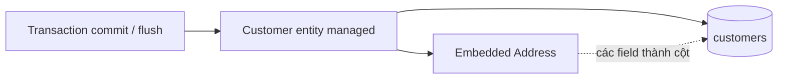

# `@Embeddable` và `@Embedded` cho đối tượng giá trị trong Hibernate

Trong thiết kế hướng đối tượng, nhiều khái niệm của nghiệp vụ có **giá trị riêng** nhưng không cần một định danh hay vòng đời độc lập. Một địa chỉ giao hàng gồm số nhà, đường và thành phố; một khoảng tiền gồm số tiền và đơn vị tiền tệ; một khoảng thời gian gồm thời điểm bắt đầu và kết thúc. Chúng thường được mô hình hóa thành **value object**: phần dữ liệu được nhận diện bằng nội dung và thuộc về một đối tượng khác.

Hibernate và Jakarta Persistence cung cấp `@Embeddable` và `@Embedded` để đưa các value object như vậy vào mô hình ORM mà không bắt buộc tạo bảng hay entity riêng cho chúng. Bài này giải thích cách khai báo, bố trí cột, dùng lại một kiểu nhúng nhiều lần, ánh xạ đối tượng lồng nhau và tập hợp, cũng như những giới hạn quan trọng về danh tính, null, dirty checking và thiết kế schema.

Các ví dụ sử dụng `jakarta.persistence.*` và cách ánh xạ Hibernate ORM 6.x. Những API đặc thù như JSON aggregate hoặc khả năng dùng Java `record` làm embeddable phụ thuộc phiên bản Hibernate và provider; **mapping tiêu chuẩn** được trình bày trước để có thể áp dụng rộng rãi.

## 1. Entity và value object giải quyết hai bài toán khác nhau

Xét một đơn hàng có địa chỉ giao hàng. Hai đơn hàng có thể cùng lưu địa chỉ "12 Lê Lợi, Quận 1", nhưng điều đó không có nghĩa chúng đang tham chiếu tới **cùng một bản ghi địa chỉ có danh tính riêng**.

| Đặc điểm | Entity (`@Entity`) | Value object nhúng (`@Embeddable`) |
| --- | --- | --- |
| Danh tính | Có định danh để phân biệt các instance nghiệp vụ, thường qua `@Id` | Không có định danh entity riêng theo mô hình embedded |
| Vòng đời | Có thể tồn tại và được truy cập độc lập theo thiết kế | Thường tồn tại như một phần của entity sở hữu |
| Ví dụ | `Customer`, `PurchaseOrder`, `Product` | `Address`, `Money`, `Dimensions` |
| Cách ánh xạ thông thường | Entity mapping, bảng/các bảng tùy inheritance và cấu hình | Các thuộc tính được trải vào các cột của bảng entity chứa nó |
| Quan hệ giữa hai đối tượng | Có thể tham chiếu bằng foreign key | Không cần foreign key cho chính giá trị nhúng |
| Tái sử dụng một instance | Có thể có nhiều quan hệ tham chiếu cùng entity | Nên xem các lần sử dụng là các giá trị độc lập |
| Truy vấn | Truy vấn entity theo định danh, quan hệ và thuộc tính | Truy vấn qua đường dẫn thuộc tính của entity sở hữu |

**Điểm cốt lõi:** `@Embeddable` là một **loại mapping**, không phải quy tắc ngôn ngữ Java bắt buộc một lớp phải immutable. Tuy nhiên, nếu mô hình hóa đúng tinh thần value object, bất biến hoặc hạn chế thay đổi và so sánh theo giá trị thường là lựa chọn tốt.

Một lớp được đánh dấu `@Embeddable` không trở thành một entity được quản lý độc lập. Không thể dùng `entityManager.find(Address.class, id)` để tải một địa chỉ nhúng như entity riêng. Muốn một địa chỉ có vòng đời, danh tính, quyền sở hữu và chia sẻ độc lập (ví dụ sổ địa chỉ của khách hàng), hãy cân nhắc `@Entity`.

## 2. Ví dụ tối thiểu: nhúng `Address` vào `Customer`

### 2.1. Khai báo lớp giá trị

```java
import jakarta.persistence.Column;
import jakarta.persistence.Embeddable;

@Embeddable
public class Address {

    @Column(name = "street", length = 200)
    private String street;

    @Column(name = "city", length = 100)
    private String city;

    @Column(name = "postal_code", length = 20)
    private String postalCode;

    protected Address() {
        // JPA/Hibernate có thể cần constructor không tham số.
    }

    public Address(String street, String city, String postalCode) {
        this.street = street;
        this.city = city;
        this.postalCode = postalCode;
    }

    public String getStreet() { return street; }
    public String getCity() { return city; }
    public String getPostalCode() { return postalCode; }
}
```

Annotation `@Embeddable` cho biết Hibernate có thể xem các thuộc tính persistent của `Address` như **các thành phần của một giá trị nhúng**. Bản thân lớp này không khai báo `@Id`. Constructor không tham số được giữ để tương thích với mô hình JPA phổ biến; ví dụ dùng field access, Hibernate đọc/ghi các field persistent.

### 2.2. Đưa giá trị vào entity

```java
import jakarta.persistence.Embedded;
import jakarta.persistence.Entity;
import jakarta.persistence.GeneratedValue;
import jakarta.persistence.GenerationType;
import jakarta.persistence.Id;
import jakarta.persistence.Table;

@Entity
@Table(name = "customers")
public class Customer {

    @Id
    @GeneratedValue(strategy = GenerationType.IDENTITY)
    private Long id;

    private String name;

    @Embedded
    private Address address;

    protected Customer() {}

    public Customer(String name, Address address) {
        this.name = name;
        this.address = address;
    }

    public Long getId() { return id; }
    public Address getAddress() { return address; }
    public void changeAddress(Address newAddress) {
        this.address = newAddress;
    }
}
```

Khi cấu hình naming như trong ví dụ và tạo schema tương ứng, bảng có thể có các cột:

```sql
create table customers (
    id bigint generated by default as identity primary key,
    name varchar(255),
    street varchar(200),
    city varchar(100),
    postal_code varchar(20)
);
```

Đây là **DDL minh họa**, cú pháp identity, tên kiểu SQL và độ dài mặc định tùy `Dialect`/DBMS. Quan trọng hơn là ba field của `Address` được trải vào **cùng bảng** `customers`, không tự phát sinh bảng `addresses` chỉ vì có `@Embeddable`.

```text
Customer (entity)
├── id: Long                  -> customers.id
├── name: String              -> customers.name
└── address: Address
    ├── street: String        -> customers.street
    ├── city: String          -> customers.city
    └── postalCode: String    -> customers.postal_code
```

Một thao tác lưu có thể viết:

```java
Customer customer = new Customer(
    "Mai",
    new Address("12 Le Loi", "Ho Chi Minh City", "700000")
);

entityManager.getTransaction().begin();
entityManager.persist(customer);
entityManager.getTransaction().commit();
```

Ví dụ giả sử ứng dụng đang dùng `EntityManager` kiểu resource-local có transaction được quản lý trực tiếp; trong Spring/JTA, transaction thường do framework kiểm soát. Hibernate xử lý insert/update cho entity `Customer`; nó không phát một insert độc lập cho `Address`.

### 2.3. Có phải lúc nào cũng cần `@Embedded`?

Với thuộc tính có kiểu đã được nhận diện là embeddable, JPA/Hibernate có thể suy ra kiểu ánh xạ embedded ngay cả khi không ghi `@Embedded` trong một số ngữ cảnh. Tuy nhiên, khai báo tường minh thường làm mô hình dễ đọc, đặc biệt khi thêm `@AttributeOverride` hoặc phân biệt với converter/basic mapping đặc thù.

Hai annotation có vai trò khác nhau:

- `@Embeddable` đặt trên **lớp định nghĩa value type**.
- `@Embedded` đặt tại **vị trí sử dụng** value type trong entity hoặc embeddable khác.

Một lớp `Address` có thể tái sử dụng ở nhiều owner mà không phải sao chép định nghĩa các thành phần của địa chỉ.

## 3. Vòng đời: embedded value thuộc về owner

Khi `Customer` được đưa vào persistence context, Hibernate theo dõi trạng thái các trường persistent bên trong `Address` như **một phần của trạng thái Customer**. Embedded object không có persistence context entry với entity ID riêng.



Điều này dẫn tới các quy tắc thực hành:

1. **Persist owner:** lưu entity chứa giá trị; không gọi `persist(address)` riêng.
2. **Update owner:** gán một `Address` mới hoặc sửa field được quản lý đúng cách; Hibernate phát hiện thay đổi của owner khi flush theo mapping.
3. **Delete owner:** nếu hàng entity bị xóa thì các cột chứa embedded value bị xóa cùng hàng; không có entity `Address` độc lập để cascade remove.
4. **Detach owner:** nếu entity tách khỏi persistence context, phần dữ liệu nhúng đi theo trạng thái detached của entity; đừng kỳ vọng một `Address` được quản lý riêng.
5. **Không dùng một instance mutable làm giá trị dùng chung:** hai entity trỏ cùng một Java `Address` có thể cùng nhìn thấy thay đổi bộ nhớ, dù không có relationship DB giữa chúng.

Ví dụ thiết kế giảm khả năng chia sẻ nhầm:

```java
public void changeAddress(String street, String city, String postalCode) {
    this.address = new Address(street, city, postalCode);
}
```

Thay toàn bộ value object bằng một instance mới thường giúp người đọc code hiểu rằng địa chỉ là **một giá trị mới**. Tuy nhiên, khi nào Hibernate phát `UPDATE` và cột nào được cập nhật còn phụ thuộc dirty checking, bytecode enhancement, dynamic update và cấu hình thực tế.

## 4. Dùng cùng một kiểu nhúng nhiều lần với `@AttributeOverride`

Một đơn hàng thường có **địa chỉ lập hóa đơn** và **địa chỉ giao hàng** cùng cấu trúc. Nếu dùng hai thuộc tính `Address`, tên cột suy ra có thể xung đột. Cách chuẩn của JPA là **ghi đè mapping cột tại từng vị trí nhúng**.

```java
import jakarta.persistence.AttributeOverride;
import jakarta.persistence.AttributeOverrides;
import jakarta.persistence.Column;
import jakarta.persistence.Embedded;
import jakarta.persistence.Entity;
import jakarta.persistence.GeneratedValue;
import jakarta.persistence.GenerationType;
import jakarta.persistence.Id;
import jakarta.persistence.Table;

@Entity
@Table(name = "purchase_orders")
public class PurchaseOrder {

    @Id
    @GeneratedValue(strategy = GenerationType.IDENTITY)
    private Long id;

    @Embedded
    @AttributeOverrides({
        @AttributeOverride(name = "street",
            column = @Column(name = "billing_street", length = 200)),
        @AttributeOverride(name = "city",
            column = @Column(name = "billing_city", length = 100)),
        @AttributeOverride(name = "postalCode",
            column = @Column(name = "billing_postal_code", length = 20))
    })
    private Address billingAddress;

    @Embedded
    @AttributeOverrides({
        @AttributeOverride(name = "street",
            column = @Column(name = "shipping_street", length = 200)),
        @AttributeOverride(name = "city",
            column = @Column(name = "shipping_city", length = 100)),
        @AttributeOverride(name = "postalCode",
            column = @Column(name = "shipping_postal_code", length = 20))
    })
    private Address shippingAddress;

    protected PurchaseOrder() {}
}
```

Schema logic tương ứng:

| Thuộc tính Java | Cột trong `purchase_orders` |
| --- | --- |
| `billingAddress.street` | `billing_street` |
| `billingAddress.city` | `billing_city` |
| `billingAddress.postalCode` | `billing_postal_code` |
| `shippingAddress.street` | `shipping_street` |
| `shippingAddress.city` | `shipping_city` |
| `shippingAddress.postalCode` | `shipping_postal_code` |

**`@AttributeOverride.name` là tên thuộc tính Java trong embeddable**, không phải tên cột SQL mà `@Column` đã khai báo trước đó. Vì vậy `name = "postalCode"` hợp lệ, trong khi `name = "postal_code"` thường không trỏ tới đúng thuộc tính.

Trong Hibernate còn có cơ chế `ImplicitNamingStrategy` và `PhysicalNamingStrategy` để suy ra/chuyển tên cột. Một số chiến lược đặt tên dành cho component có thể giảm các annotation cần thiết, nhưng **không nên phụ thuộc vào naming mặc định** khi hai embedded value có thể sinh tên trùng. `@AttributeOverride` diễn đạt rõ hợp đồng schema và hữu ích cho dự án có migration được quản lý.

### 4.1. Override không chỉ đổi tên cột

`@Column` bên trong `@AttributeOverride` còn có thể mô tả `nullable`, `length`, `precision`, `scale`, `insertable` hoặc `updatable` tùy nhu cầu mapping:

```java
@Embedded
@AttributeOverride(
    name = "postalCode",
    column = @Column(name = "billing_zip", length = 12, nullable = false)
)
private Address billingAddress;
```

Đoạn này giả định các cột khác trong `Address` không xung đột ở nơi nhúng. Tùy trường hợp, annotation ghi đè phải khai báo đầy đủ các thuộc tính cột cần giữ vì nó là **mô tả cột thay thế** cho vị trí đó, không nên suy đoán mọi thông số cũ được gộp tự động.

`nullable = false` nói về mapping/ràng buộc cột; nó **không phải** kiểm tra đầu vào đầy đủ ở tầng Java. Ràng buộc nghiệp vụ có thể dùng constructor, logic domain, Jakarta Bean Validation và database constraints.

## 5. Embedded value lồng nhau

Value object có thể được cấu thành từ các value object nhỏ hơn. Ví dụ `Address` chứa tọa độ `GeoPoint`.

```java
import jakarta.persistence.Column;
import jakarta.persistence.Embeddable;
import jakarta.persistence.Embedded;

@Embeddable
public class GeoPoint {

    @Column(name = "latitude")
    private Double latitude;

    @Column(name = "longitude")
    private Double longitude;

    protected GeoPoint() {}

    public GeoPoint(Double latitude, Double longitude) {
        this.latitude = latitude;
        this.longitude = longitude;
    }
}

@Embeddable
public class Location {

    private String city;

    @Embedded
    private GeoPoint point;

    protected Location() {}

    public Location(String city, GeoPoint point) {
        this.city = city;
        this.point = point;
    }
}
```

Trong entity:

```java
@Embedded
@AttributeOverrides({
    @AttributeOverride(name = "city",
        column = @Column(name = "pickup_city")),
    @AttributeOverride(name = "point.latitude",
        column = @Column(name = "pickup_latitude")),
    @AttributeOverride(name = "point.longitude",
        column = @Column(name = "pickup_longitude"))
})
private Location pickupLocation;
```

Tên đường dẫn `point.latitude` và `point.longitude` chỉ **đi qua tên property** của component lồng nhau. Hibernate ánh xạ chúng tới các cột trong bảng owner; không tạo bảng riêng cho `GeoPoint` hoặc `Location` theo mapping thông thường.

Mô hình lồng sâu quá mức sẽ tạo nhiều cột và cấu hình override khó hiểu. Nếu một component có vòng đời hoặc quan hệ truy vấn riêng, hãy xem liệu nó nên là entity hoặc bảng phụ thay vì thêm các tầng `@Embedded`.

## 6. `@AssociationOverride`: khi embeddable chứa relationship

Một embeddable **có thể chứa association đến entity** theo quy định mapping áp dụng. Ví dụ một địa chỉ gồm đường/phố và tham chiếu tới entity `Country` dùng chung:

```java
import jakarta.persistence.Embeddable;
import jakarta.persistence.FetchType;
import jakarta.persistence.JoinColumn;
import jakarta.persistence.ManyToOne;

@Embeddable
public class MailingAddress {

    private String street;
    private String city;

    @ManyToOne(fetch = FetchType.LAZY)
    @JoinColumn(name = "country_id")
    private Country country;

    protected MailingAddress() {}
}

@Entity
@Table(name = "countries")
public class Country {

    @Id
    private Long id;

    private String name;

    protected Country() {}
}
```

Nếu một entity có hai `MailingAddress`, cần phân biệt **cả tên cột basic lẫn tên join column**:

```java
@Embedded
@AttributeOverrides({
    @AttributeOverride(name = "street",
        column = @Column(name = "billing_street")),
    @AttributeOverride(name = "city",
        column = @Column(name = "billing_city"))
})
@AssociationOverride(
    name = "country",
    joinColumns = @JoinColumn(name = "billing_country_id")
)
private MailingAddress billingAddress;

@Embedded
@AttributeOverrides({
    @AttributeOverride(name = "street",
        column = @Column(name = "shipping_street")),
    @AttributeOverride(name = "city",
        column = @Column(name = "shipping_city"))
})
@AssociationOverride(
    name = "country",
    joinColumns = @JoinColumn(name = "shipping_country_id")
)
private MailingAddress shippingAddress;
```

Phân biệt:

- `@AttributeOverride` ghi đè mapping **basic column** của thuộc tính thuộc embeddable.
- `@AssociationOverride` ghi đè **join column/join table** của association do embeddable khai báo.

`MailingAddress` vẫn không có identity riêng. `Country` là **entity độc lập**, được trỏ tới qua foreign key trong bảng owner. Không được hiểu rằng vì `Country` nằm trong một embedded value nên Hibernate sẽ tự `cascade = ALL` tới mọi `Country`.

Với association, còn phải xét fetch strategy, tính hợp lệ của foreign key và lifecycle. Đừng thiết lập cascade remove từ địa chỉ sang dữ liệu dùng chung như quốc gia; xóa owner không nên tự xóa một `Country` mà các owner khác cũng dùng.

## 7. Quy tắc truy cập field/property và constructor

Hibernate phải biết đọc thuộc tính từ **field** hay **getter/setter**. Ở JPA, access strategy thường được xác định bởi vị trí annotation xác định ID trên entity (hoặc `@Access` được khai báo tường minh). Điều này ảnh hưởng cách các thành phần embedded được nhận diện.

Ví dụ field access nhất quán:

```java
@Entity
@Access(AccessType.FIELD)
public class Account {
    @Id
    private Long id;

    @Embedded
    private ProfileName name;

    protected Account() {}
}

@Embeddable
@Access(AccessType.FIELD)
public class ProfileName {
    @Column(name = "first_name")
    private String firstName;

    @Column(name = "last_name")
    private String lastName;

    protected ProfileName() {}
}
```

Với property access, đặt annotation tại getter theo quy ước phù hợp. Tránh đặt `@Column` trên field rồi để `@Id` ở getter trong cùng hierarchy mà không chỉ định `@Access`; Hibernate có thể không nhìn nhận property theo cách mong đợi.

Về tạo object:

- Cách tương thích JPA truyền thống là **lớp concrete có constructor không tham số** ít nhất `protected`, để provider khởi tạo khi hydrate dữ liệu.
- Các field không bắt buộc phải `public`; với field access, Hibernate có thể truy cập field trực tiếp theo mô hình mapping.
- Embeddable có thể có phương thức nghiệp vụ, validation trong constructor/factory, `equals` và `hashCode`; không cần giống DTO chỉ có getter/setter.
- **Khả năng instantiate immutable class, Java record hoặc constructor binding** là phần phụ thuộc Hibernate/version. Một số phiên bản Hibernate 6 hỗ trợ record embeddable hoặc custom instantiator, nhưng không nên áp đặt một ví dụ record lên mọi JPA provider nếu tính di động là yêu cầu.
- Không gán ý nghĩa persistence cho các field `static`, `transient` hay `@Transient`; Hibernate không lưu chúng như thuộc tính persistent thông thường.

Đối với domain object bất biến, một cách đơn giản và tương thích hơn là không cung cấp setter công khai, tạo object mới khi giá trị thay đổi, nhưng vẫn giữ constructor không tham số cho ORM và hiểu rằng provider có thể điền các field qua reflection/bytecode.

## 8. Giá trị, equality, `hashCode` và tính bất biến

Một value object được xem là bằng nhau khi **những thành phần nghiệp vụ quan trọng** của nó bằng nhau. Điều này khác entity có identity lâu dài. Ví dụ:

```java
import jakarta.persistence.Embeddable;
import java.util.Objects;

@Embeddable
public class Money {
    private java.math.BigDecimal amount;
    private String currency;

    protected Money() {}

    public Money(java.math.BigDecimal amount, String currency) {
        if (amount == null || currency == null || currency.isBlank()) {
            throw new IllegalArgumentException("Invalid money value");
        }
        this.amount = amount;
        this.currency = currency;
    }

    public java.math.BigDecimal getAmount() { return amount; }
    public String getCurrency() { return currency; }

    @Override
    public boolean equals(Object other) {
        if (this == other) return true;
        if (!(other instanceof Money money)) return false;
        return Objects.equals(amount, money.amount)
                && Objects.equals(currency, money.currency);
    }

    @Override
    public int hashCode() {
        return Objects.hash(amount, currency);
    }
}
```

Ví dụ cố ý so sánh `BigDecimal` bằng `equals()`; trong Java, `new BigDecimal("1.0")` và `new BigDecimal("1.00")` không bằng nhau theo `equals()` dù `compareTo()` trả về 0. Khi thiết kế `Money`, hãy **chọn quy tắc chuẩn hóa/so sánh số tiền có chủ đích**, và bảo đảm `hashCode()` phù hợp. Ngoài ra phải xác định currency chính xác và giới hạn precision/scale ở schema.

Nếu một value object xuất hiện trong `HashSet` hoặc làm khóa `HashMap`, việc thay đổi field ảnh hưởng `equals/hashCode` sau khi đưa vào collection có thể làm cấu trúc băm hoạt động không đúng. Vì vậy **ưu tiên bất biến** đặc biệt quan trọng với embeddable dùng làm phần tử của `Set`, key của `Map` hoặc composite identifier.

Hibernate có cơ chế dirty checking theo mapping; việc một class cài `equals` không đồng nghĩa toàn bộ thay đổi nested mutable state sẽ luôn được nhận diện trong mọi cấu hình. Với một embeddable chứa list mutable không được ánh xạ đúng, đừng kỳ vọng ORM tự snapshot sâu tất cả object con tùy ý.

## 9. Embedded value và `@ElementCollection`: một giá trị so với tập giá trị

Một entity có **một địa chỉ giao hàng**:

```java
@Embedded
private Address shippingAddress;
```

Còn một khách hàng có **nhiều số điện thoại, mỗi số là một value object**. Khi mỗi phần tử cần lưu thành một hàng của bảng phụ, dùng `@ElementCollection`:

```java
import jakarta.persistence.Column;
import jakarta.persistence.CollectionTable;
import jakarta.persistence.ElementCollection;
import jakarta.persistence.Embeddable;
import jakarta.persistence.Entity;
import jakarta.persistence.Id;
import jakarta.persistence.JoinColumn;
import java.util.HashSet;
import java.util.Set;

@Embeddable
public class PhoneNumber {

    @Column(name = "country_code", length = 8)
    private String countryCode;

    @Column(name = "local_number", length = 30)
    private String localNumber;

    protected PhoneNumber() {}

    public PhoneNumber(String countryCode, String localNumber) {
        this.countryCode = countryCode;
        this.localNumber = localNumber;
    }

    // Với Set<PhoneNumber>, cung cấp equals/hashCode dựa trên giá trị.
}

@Entity
public class CustomerContact {

    @Id
    private Long id;

    @ElementCollection
    @CollectionTable(
        name = "customer_phone_numbers",
        joinColumns = @JoinColumn(name = "customer_id")
    )
    private Set<PhoneNumber> phoneNumbers = new HashSet<>();

    protected CustomerContact() {}
}
```

Schema logic:

```text
customer_contact
  id (PK)

customer_phone_numbers
  customer_id (FK -> customer_contact.id)
  country_code
  local_number
```

Ở đây `PhoneNumber` là embeddable; **collection table** chứa nhiều giá trị của một owner, không tạo entity `PhoneNumber` có `@Id` riêng. Nếu cần từng số điện thoại có trạng thái xác minh, lịch sử, độc lập được tham chiếu và thao tác bởi hệ thống khác, entity riêng có thể hợp lý hơn.

| Trường hợp | Mapping gợi ý |
| --- | --- |
| Mỗi đơn hàng có một `Address` | `@Embedded Address` trong entity đơn hàng |
| Mỗi khách hàng có nhiều `PhoneNumber`, mỗi phần tử chỉ là giá trị | `@ElementCollection Set<PhoneNumber>` |
| Mỗi địa chỉ có danh tính, được phân quyền, chia sẻ giữa nhiều đối tượng | `@Entity AddressEntity` và association |
| Một tập giá trị nhỏ cần lưu trong một cột JSON/ARRAY | Basic JSON/ARRAY mapping của Hibernate khi phiên bản và `Dialect` hỗ trợ |

### 9.1. Ghi đè cột trong collection element

Có thể ghi đè tên cột của một embeddable nằm trong `@ElementCollection`:

```java
@ElementCollection
@CollectionTable(
    name = "customer_phone_numbers",
    joinColumns = @JoinColumn(name = "customer_id")
)
@AttributeOverride(
    name = "localNumber",
    column = @Column(name = "phone_number", length = 30)
)
private Set<PhoneNumber> phoneNumbers = new HashSet<>();
```

`name` ở `@AttributeOverride` tiếp tục là thuộc tính trong `PhoneNumber`. Một số trường hợp với collection `Map` có các cú pháp đường dẫn áp dụng cho key/value riêng; cần dựa vào quy tắc mapping của phiên bản JPA/Hibernate và không suy ra bằng cách đổi tên ngẫu nhiên.

### 9.2. Collection value khác relationship giữa entity

`@ElementCollection` dành cho basic/embeddable values do owner quản lý. Không dùng nó để thay cho `@OneToMany` khi phần tử là một entity có danh tính riêng. Tương tự, một `@Embedded` đơn lẻ cũng không tự thể hiện quan hệ many-to-one giữa hai entity.

Khi dùng `Set<PhoneNumber>`, quy tắc `equals/hashCode` của phần tử phải ổn định. Nếu thường xuyên chỉnh sửa từng phần tử có thể thay đổi khóa băm, hãy cân nhắc thay object bằng giá trị mới hoặc dùng cách lưu/collection semantics thích hợp.

## 10. Truy vấn thuộc tính của embeddable bằng JPQL và Criteria

Vì embedded fields thuộc model của owner, có thể truy vấn chúng qua **đường dẫn thuộc tính Java**.

Ví dụ với `PurchaseOrder.shippingAddress.city`:

```java
List<PurchaseOrder> orders = entityManager.createQuery(
    """
    select o
    from PurchaseOrder o
    where o.shippingAddress.city = :city
    order by o.id
    """,
    PurchaseOrder.class
)
.setParameter("city", "Da Nang")
.getResultList();
```

Mặc dù câu query viết `o.shippingAddress.city`, SQL được Hibernate sinh ra tham chiếu **cột** tương ứng trong bảng `purchase_orders`, chẳng hạn `shipping_city`. Không viết tên cột SQL trực tiếp vào đường dẫn JPQL.

Ví dụ Criteria khi cần xây dựng truy vấn động:

```java
CriteriaBuilder cb = entityManager.getCriteriaBuilder();
CriteriaQuery<PurchaseOrder> cq = cb.createQuery(PurchaseOrder.class);
Root<PurchaseOrder> order = cq.from(PurchaseOrder.class);

cq.select(order)
  .where(cb.equal(
      order.get("shippingAddress").get("city"),
      "Da Nang"
  ));

List<PurchaseOrder> result = entityManager.createQuery(cq).getResultList();
```

Các import tương ứng gồm `jakarta.persistence.criteria.CriteriaBuilder`, `CriteriaQuery` và `Root`. Với static metamodel có thể giảm lỗi do gõ nhầm tên property. Với database lớn, điều kiện trên cột embedded vẫn cần index thích hợp nếu truy vấn thường xuyên; `@Embedded` không tự tạo một index cho mọi field.

### 10.1. Partial update và số lượng cột

Thay một thành phần embedded làm Hibernate nhận diện entity bị dirty. Câu `UPDATE` thực tế có thể bao gồm **nhiều cột hơn trường vừa đổi** theo chiến lược cập nhật của entity; trong một số cấu hình, `@DynamicUpdate` có thể giúp giới hạn cột trong update statement. Đừng suy ra từ object graph rằng SQL sẽ luôn chỉ cập nhật `shipping_city`.

Lựa chọn này liên quan tới SQL batching, statement plan cache và hành vi dirty tracking; cần hiểu cấu hình và tác động tới database trước khi tối ưu.

## 11. `null` và giá trị nhúng rỗng: ranh giới cần định nghĩa

Xét một entity có:

```java
@Embedded
private Address address;
```

Hai trường hợp trong Java khác nhau:

```java
customer.changeAddress(null);

customer.changeAddress(new Address(null, null, null));
```

Nhưng khi trải vào bảng, cả hai có thể cùng dẫn tới **các cột địa chỉ đều mang SQL `NULL`**. Khi Hibernate đọc hàng có tất cả cột của component đều `NULL`, provider và cấu hình có thể chọn đại diện Java là `null` cho embeddable thay vì một instance có toàn field `null`. Đừng thiết kế nghiệp vụ phụ thuộc việc Hibernate phân biệt hai trường hợp chỉ nhờ các cột đều rỗng.

Nếu nghiệp vụ cần phân biệt "chưa có địa chỉ" và "địa chỉ đã tạo nhưng không điền thông tin", hãy có **trường trạng thái riêng**, ít nhất một giá trị có ý nghĩa, hoặc mô hình lưu trữ khác biểu đạt rõ sự khác biệt.

Cũng cần phân biệt:

- `@Column(nullable = false)`: yêu cầu mapping/ràng buộc cột ở database nếu schema được tạo phù hợp.
- `@NotNull` của Jakarta Bean Validation: ràng buộc có thể được validator áp dụng trong quá trình chạy, tùy tích hợp và nhóm validation.
- Kiểm tra trong constructor/factory: quy tắc bất biến domain do ứng dụng tự bảo vệ.

Ví dụ có thể áp dụng validation lồng nhau:

```java
import jakarta.validation.Valid;
import jakarta.validation.constraints.NotNull;

@NotNull
@Valid
@Embedded
private Address shippingAddress;
```

Để validation đi vào các field bên trong `Address`, cần thêm các constraint tương ứng trên embeddable và có Bean Validation provider được cấu hình. `@Valid` không thay thế `NOT NULL` cho từng cột trong database. Các annotation trên còn tùy cách framework tích hợp validation vào JPA lifecycle.

## 12. `@EmbeddedId`: trường hợp đặc biệt dùng value object làm khóa tổng hợp

Ngoài `@Embedded` để chứa dữ liệu nghiệp vụ thông thường, JPA dùng `@EmbeddedId` để khai báo **khóa chính gồm nhiều thành phần**.

Ví dụ: một dòng chi tiết đơn hàng được xác định bằng `orderId` và `lineNo`.

```java
import jakarta.persistence.Column;
import jakarta.persistence.Embeddable;
import java.io.Serializable;
import java.util.Objects;

@Embeddable
public class OrderLineId implements Serializable {

    @Column(name = "order_id")
    private Long orderId;

    @Column(name = "line_no")
    private Integer lineNo;

    protected OrderLineId() {}

    public OrderLineId(Long orderId, Integer lineNo) {
        this.orderId = orderId;
        this.lineNo = lineNo;
    }

    @Override
    public boolean equals(Object other) {
        if (this == other) return true;
        if (!(other instanceof OrderLineId id)) return false;
        return Objects.equals(orderId, id.orderId)
                && Objects.equals(lineNo, id.lineNo);
    }

    @Override
    public int hashCode() {
        return Objects.hash(orderId, lineNo);
    }
}
```

Entity dùng khóa đó:

```java
@Entity
@Table(name = "order_lines")
public class OrderLine {

    @EmbeddedId
    private OrderLineId id;

    @Column(name = "quantity", nullable = false)
    private int quantity;

    protected OrderLine() {}
}
```

`OrderLineId` là một value type nhưng đảm nhiệm vai trò **entity identifier**. Nó cần quy tắc equality/hashCode tương thích với khóa DB, khả năng serialize theo yêu cầu JPA cho composite key và giá trị khóa nên ổn định sau khi entity đã được persist. Nếu entity có relationship đến `PurchaseOrder` và khóa dùng chung `order_id`, `@MapsId` có thể phối hợp association với thành phần của embedded ID; đó là bài toán identity mapping chuyên biệt, không phải yêu cầu của mọi `@Embedded`.

Không gán `@Id` trên từng field trong `OrderLineId` chỉ vì nó là embeddable. Với dạng này `@EmbeddedId` trên owner xác định toàn bộ composite ID.

## 13. Khác biệt giữa `@Embeddable`, `@Convert` và JSON aggregate

Đôi khi cùng một kiểu domain có thể được lưu theo nhiều cách. Ví dụ `Money` gồm `amount` và `currency`:

| Hướng ánh xạ | Hình thức lưu | Phù hợp khi | Đánh đổi |
| --- | --- | --- | --- |
| `@Embedded Money` | Hai cột `amount` và `currency` trong bảng owner | Cần lọc/sắp xếp theo số tiền, dùng constraint/index SQL, giữ mô hình giá trị rõ ràng | Cột tăng theo số component và vị trí nhúng |
| `@Convert` sang `String` | Một cột text do converter mã hóa | Đã có định dạng text ổn định, ít cần truy vấn thành phần | Cần tự định nghĩa serialization; query/constraint khó hơn |
| Hibernate JSON aggregate | Một cột JSON chứa object có cấu trúc | Dữ liệu lồng nhau, cần đọc/ghi cả tài liệu, DB hỗ trợ | Phụ thuộc Hibernate version, `Dialect` và format mapper; query/index JSON đặc thù |
| `@Entity MoneyRecord` và association | Bảng và ID riêng | Giá trị thực sự cần danh tính/lifecycle/chia sẻ | Quan hệ và chi phí quản lý cao hơn |

Cách phổ biến:

```java
@Embeddable
public class Money {
    @Column(name = "amount", precision = 19, scale = 2)
    private BigDecimal amount;

    @Column(name = "currency_code", length = 3)
    private String currency;
}

@Entity
public class Invoice {
    @Id
    private Long id;

    @Embedded
    private Money total;
}
```

Đối với bài toán chỉ cần tính toán và báo cáo số tiền theo currency, hai cột quan hệ thường là cách dễ dùng và kiểm soát nhất. Một custom `AttributeConverter<Money, String>` sẽ mất khả năng truy vấn số tiền trực tiếp trừ khi viết logic truy vấn phụ thuộc biểu diễn lưu trữ.

Hibernate 6 có hỗ trợ các dạng **aggregate embeddable mapping** sang JSON/XML/SQL structured type trong những phiên bản và điều kiện nhất định. Khi dùng cách đó, một `@Embedded` có thể được chứa trong **một cột aggregate** thay vì trải ra các cột thông thường. Đây là khả năng Hibernate-specific: cần xác nhận chính xác API, hỗ trợ loại dữ liệu lồng bên trong, `Dialect` và migration schema; không được xem đó là hành vi mặc định của JPA `@Embeddable`.

## 14. Đặt ranh giới mô hình cho một value object

Không phải cứ nhóm ba field lại thì nên thêm `@Embeddable`. Một value object tốt biểu đạt **khái niệm nghiệp vụ có quy tắc nhất quán**.

Ví dụ `DateRange`:

```java
import jakarta.persistence.Embeddable;
import java.time.LocalDate;
import java.util.Objects;

@Embeddable
public class DateRange {
    private LocalDate startDate;
    private LocalDate endDate;

    protected DateRange() {}

    public DateRange(LocalDate startDate, LocalDate endDate) {
        Objects.requireNonNull(startDate);
        Objects.requireNonNull(endDate);
        if (endDate.isBefore(startDate)) {
            throw new IllegalArgumentException("End date is before start date");
        }
        this.startDate = startDate;
        this.endDate = endDate;
    }

    public boolean contains(LocalDate date) {
        return date != null
                && !date.isBefore(startDate)
                && !date.isAfter(endDate);
    }
}
```

Chúng ta đưa quy tắc "ngày kết thúc không trước ngày bắt đầu" vào type thay vì lặp lại ở controller/repository. Nhưng do ORM có thể tạo instance qua constructor không tham số và điền field khi đọc, **chỉ đặt validation ở constructor không bảo đảm dữ liệu có sẵn trong database luôn hợp lệ**. Phải có validation/migration/constraint tương ứng nếu đây là invariant bắt buộc của toàn hệ thống.

Một cách thiết kế hiệu quả là để entity sử dụng API giá trị:

```java
public void schedule(LocalDate start, LocalDate end) {
    this.activePeriod = new DateRange(start, end);
}
```

Điều này giúp hạn chế trường hợp người gọi sửa `startDate` mà quên sửa `endDate`, đồng thời làm rõ ranh giới thay đổi giá trị.

## 15. Những vấn đề dễ gặp khi triển khai và cách nhận diện

| Dấu hiệu | Nguyên nhân thường gặp | Hướng xử lý |
| --- | --- | --- |
| `Repeated column in mapping` hoặc lỗi cột bị trùng | Hai `@Embedded` cùng kiểu dùng tên cột mặc định giống nhau | Ghi đè từng cột bằng `@AttributeOverride(s)` hoặc chiến lược đặt tên phù hợp |
| `Unknown path/property` khi query | Dùng tên SQL column thay tên Java property hoặc sai đường dẫn nested | JPQL/Criteria truy cập theo `owner.embedded.property` |
| Đọc lại địa chỉ thành `null` | Mọi cột component đều `NULL` hoặc cách Hibernate tái tạo all-null embeddable | Xác định semantics null và schema, tránh phụ thuộc phân biệt "null" với "object rỗng" |
| Đổi tên field làm schema lệch | Implicit naming hoặc annotation override đổi tên cột nhưng migration chưa chạy | Dùng migration có phiên bản, so metadata và schema thật |
| Tưởng phải `persist(address)` | Nhầm value object với entity | `persist` owner; không quản lý embedded value như một entity |
| Sửa giá trị trong `HashSet` rồi tìm/xóa không được | `equals/hashCode` phụ thuộc field mutable đã thay đổi | Sử dụng value object bất biến hoặc thay phần tử bằng remove/add phù hợp |
| Update không hiện ngay trong DB | Hibernate flush theo transaction/flush mode | Kiểm tra ranh giới transaction, dirty checking và thời điểm flush |
| Hai vị trí nhúng cùng Java object bị đổi theo nhau | Vô tình chia sẻ một instance mutable | Tạo các giá trị riêng, hạn chế setter, áp dụng copy khi cần |
| `LazyInitializationException` với association trong embeddable | Association liên kết tới entity và cần persistence context để tải | Thiết kế fetch plan/DTO trong transaction; không nghĩ mọi embedded field đều là scalar |
| `@Column(nullable = false)` mà vẫn tạo dữ liệu invalid | Annotation không thay toàn bộ validation nghiệp vụ | Constraint DB, Bean Validation và phương thức tạo domain hợp lệ |
| Đổi từ `@Embedded` sang `@Entity` cần sửa nhiều code | Hai cách lưu có identity/lifecycle khác hẳn | Thiết kế migration, khóa ngoại, truy vấn và domain API, không chỉ đổi annotation |

### 15.1. Một lời nhắc về equality của entity và value object

Việc override `equals/hashCode` của `Address` hay `Money` để so sánh theo nội dung thường phù hợp; áp dụng y nguyên cho entity có `@GeneratedValue` lại là một vấn đề khác vì entity có danh tính thay đổi trong vòng đời. Đừng xem hai chiến lược như công thức dùng chung.

### 15.2. Một lời nhắc về hiệu suất

Nhiều cột embedded thường không làm tăng số bảng phải join, vì các cột nằm ngay trong bảng owner. Nhưng một entity có hàng trăm cột từ nhiều lớp embeddable cũng tạo tác động tới độ rộng row, kích thước index, cấu trúc query và migration. Không nhất thiết nhúng mọi thứ chỉ để tránh join; quyết định cần dựa vào access pattern và trách nhiệm nghiệp vụ.

Với association bên trong embeddable, fetch liên quan có thể tạo SQL bổ sung hoặc join tùy mapping/query. Không suy ra "embedded = không bao giờ truy vấn thêm" trong mọi trường hợp.

## 16. Từ schema cũ sang `@Embeddable`

Giả sử bảng `customers` hiện có các cột `street`, `city`, `postal_code` và entity đang khai báo ba trường chuỗi rời rạc. Tái cấu trúc sang `Address` **có thể không cần thay đổi dữ liệu DB** nếu mapping cột giữ nguyên:

Trước:

```java
@Column(name = "street")
private String street;

@Column(name = "city")
private String city;

@Column(name = "postal_code")
private String postalCode;
```

Sau:

```java
@Embedded
private Address address;
```

Với điều kiện các cột trong `Address` được khai báo đúng tên, độ dài và ràng buộc, đây là **refactor mô hình Java** giữ nguyên schema về mặt nguyên tắc. Tuy nhiên, phải cập nhật code truy cập từ `customer.getCity()` thành `customer.getAddress().getCity()`, JPQL path, DTO mapping và code xử lý null; không được chỉ nhìn vào tên cột SQL.

Ngược lại, nếu trước đó có bảng `addresses` được entity tham chiếu qua foreign key, chuyển thành `@Embedded` có nghĩa **chuyển dữ liệu từ bảng phụ vào các cột owner**, xử lý quan hệ chia sẻ và dữ liệu trùng lặp. Đây là thay đổi mô hình lưu trữ thực sự, cần migration và chiến lược rollback.

Một lộ trình chuyển đổi hợp lý:

1. Xác nhận địa chỉ có hay không **danh tính nghiệp vụ và chia sẻ độc lập**; nếu có, giữ entity.
2. Xác nhận cột SQL sẽ nằm ở bảng nào, tên và constraints thế nào.
3. Viết value type với quy tắc hợp lệ và equality rõ ràng.
4. Ánh xạ một vị trí nhúng, sau đó áp dụng `@AttributeOverride` nếu có nhiều vị trí.
5. Đồng bộ migration/schema và đường dẫn truy vấn với tên field mới.
6. Đánh giá null, dirty checking, value immutability và DTO ở ranh giới transaction.

## 17. Tình huống luyện tập

### Bài tập A — Hai địa chỉ trong một đơn hàng

Cho entity `PurchaseOrder` có `Address billingAddress` và `Address shippingAddress`. Hãy thiết kế mapping sao cho database có:

```text
billing_street, billing_city, billing_postal_code
shipping_street, shipping_city, shipping_postal_code
```

Cách giải trực tiếp là hai `@Embedded` cùng kiểu và hai bộ `@AttributeOverrides`. Không cần bảng `address` nếu hai địa chỉ chỉ là snapshot thuộc đơn hàng.

### Bài tập B — Tập số điện thoại

Một tài khoản có nhiều số điện thoại, mỗi số gồm mã quốc gia và số nội hạt; không có ID riêng. Dùng `@Embeddable PhoneNumber` và `@ElementCollection` để lưu ở bảng riêng. Hãy cân nhắc xem nên dùng `List` (có thứ tự và có thể trùng) hay `Set` (không trùng theo `equals/hashCode`), và đặt constraint DB thế nào để chống dữ liệu trùng khi có concurrent update.

### Bài tập C — Giá trị tiền và khóa tổng hợp

Một đơn hàng có tổng tiền (`Money`) và nhiều chi tiết được xác định bằng `(order_id, line_no)`. Đối với tổng tiền, dùng `@Embedded Money`. Với khóa chi tiết, dùng `@EmbeddedId OrderLineId` nếu composite key là lựa chọn đã chốt. Hai type đều là embeddable nhưng có **vai trò hoàn toàn khác nhau trong mapping**.

## 18. Kết luận về trách nhiệm mapping

`@Embeddable` diễn đạt **cấu trúc và ngữ nghĩa của một giá trị**; `@Embedded` khai báo **nơi giá trị đó thuộc về entity khác**. Hibernate theo dõi giá trị nhúng thông qua owner và, trong mapping quan hệ tiêu chuẩn, trải các thuộc tính thành cột ở bảng owner. Khi một kiểu được sử dụng nhiều lần, `@AttributeOverride` và `@AssociationOverride` làm rõ vị trí các cột và khóa ngoại. Khi có nhiều giá trị, `@ElementCollection` mô tả collection table; khi giá trị làm khóa tổng hợp, `@EmbeddedId` mô tả một identifier chuyên biệt.

Chọn `@Embeddable` khi **danh tính riêng không có ý nghĩa và các trường tạo thành một khái niệm giá trị thống nhất**. Giữ quy tắc equality, null, bất biến, tên cột và vòng đời dữ liệu nhất quán từ domain tới schema. Khi dữ liệu thực sự cần tham chiếu, quyền sở hữu hoặc vòng đời độc lập, một entity riêng thường phản ánh nghiệp vụ chính xác hơn.
