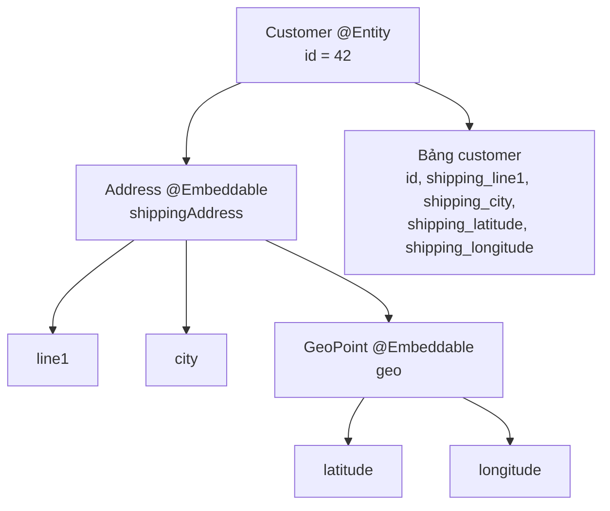

# Giá trị nhúng nhiều tầng và cách xử lý `null` trong Hibernate

Trong Hibernate/JPA, `@Embeddable` và `@Embedded` cho phép gom nhiều thuộc tính có liên quan thành một **giá trị có cấu trúc** (*value object*) mà vẫn lưu chúng trong bảng của entity sở hữu. Một giá trị nhúng cũng có thể chứa **một giá trị nhúng khác**, tạo thành cấu trúc nhiều tầng.

Ví dụ, một khách hàng có địa chỉ giao hàng; địa chỉ bao gồm tên đường, thành phố và tọa độ địa lý; tọa độ lại gồm vĩ độ, kinh độ:

```text
Customer (entity)
└── shippingAddress: Address (@Embedded)
    ├── line1: String
    ├── city: String
    └── geo: GeoPoint (@Embedded)
        ├── latitude: BigDecimal
        └── longitude: BigDecimal
```

Ở phía Java, mô hình có nhiều lớp; trong kiểu ánh xạ `@Embedded` truyền thống, **tất cả các trường cơ bản này vẫn có thể nằm trong cùng một hàng của bảng `customer`**. Điều cần đặc biệt chú ý là cơ sở dữ liệu chỉ thấy từng cột và các giá trị `NULL`, còn chương trình Java phân biệt đối tượng nhúng bằng `null` với đối tượng đã khởi tạo nhưng có các thành phần bằng `null`. Sự phân biệt này không phải lúc nào cũng giữ nguyên được khi đọc lại một hàng từ database.

Bài này đi từ cách ánh xạ các tầng nhúng, cách đặt tên cột, đến quy tắc xử lý `null` ở tầng Java, Hibernate, validation và schema SQL.

## 1. Giá trị nhúng khác entity như thế nào?

Một **entity** có định danh riêng và được Hibernate theo dõi trong persistence context. Ví dụ `Customer` có khóa chính `id`.

Một **embeddable** mô tả một nhóm thuộc tính thuộc về entity:

- Không có định danh entity riêng chỉ vì được gắn `@Embeddable`.
- Không cần bảng riêng trong cách ánh xạ `@Embedded` thông thường.
- Được lưu, cập nhật và xóa theo vòng đời của entity chứa nó.
- Có thể xuất hiện nhiều lần trong một entity hoặc được lồng vào một embeddable khác.
- Có thể có quy tắc giá trị như `equals()`/`hashCode()`, nhưng việc xác định identity của hàng dữ liệu vẫn nằm ở entity chủ.



Không gọi `entityManager.persist(address)` cho một `Address` nhúng đơn thuần. Ứng dụng persist hoặc cập nhật `Customer`, và Hibernate đồng bộ các cột của `Address`/`GeoPoint` theo mapping.

Cần phân biệt với `@ElementCollection`: nếu entity chứa **danh sách** các giá trị nhúng, JPA thường sử dụng collection table riêng. Phần chính của bài này tập trung vào một thuộc tính `@Embedded` đơn lẻ có các tầng giá trị bên trong.

## 2. Ví dụ hoàn chỉnh: `Customer → Address → GeoPoint`

Ba lớp dưới đây minh họa một entity sở hữu hai tầng embeddable. Chúng sử dụng Jakarta Persistence và kiểu dữ liệu `BigDecimal` phù hợp để biểu diễn tọa độ có độ chính xác xác định.

### 2.1. Tầng trong cùng: `GeoPoint`

```java
import jakarta.persistence.Column;
import jakarta.persistence.Embeddable;
import java.math.BigDecimal;
import java.util.Objects;

@Embeddable
public class GeoPoint {

    @Column(name = "latitude", precision = 10, scale = 7)
    private BigDecimal latitude;

    @Column(name = "longitude", precision = 10, scale = 7)
    private BigDecimal longitude;

    protected GeoPoint() {
        // Cho Hibernate/JPA khởi tạo object khi đọc dữ liệu.
    }

    public GeoPoint(BigDecimal latitude, BigDecimal longitude) {
        this.latitude = latitude;
        this.longitude = longitude;
    }

    public BigDecimal getLatitude() {
        return latitude;
    }

    public BigDecimal getLongitude() {
        return longitude;
    }

    @Override
    public boolean equals(Object obj) {
        if (this == obj) return true;
        if (!(obj instanceof GeoPoint)) return false;
        GeoPoint other = (GeoPoint) obj;
        return Objects.equals(latitude, other.latitude)
            && Objects.equals(longitude, other.longitude);
    }

    @Override
    public int hashCode() {
        return Objects.hash(latitude, longitude);
    }
}
```

`GeoPoint` không có `@Entity`, `@Id` hay repository riêng. Nó chỉ biểu diễn hai giá trị.

`equals/hashCode` có thể hữu ích nếu muốn so sánh hai value object theo nội dung. Khi dùng `BigDecimal`, cần ý thức rằng `BigDecimal.equals` còn xét cả `scale` (ví dụ `1.0` khác `1.00` về `equals`); nếu nghiệp vụ cần xem chúng bằng nhau, phải chuẩn hóa giá trị hoặc lựa chọn quy tắc equality nhất quán. Đây là quyết định của domain, không phải cơ chế tự động của `@Embeddable`.

### 2.2. Tầng giữa: `Address` chứa `GeoPoint`

```java
import jakarta.persistence.Column;
import jakarta.persistence.Embeddable;
import jakarta.persistence.Embedded;
import java.util.Objects;

@Embeddable
public class Address {

    @Column(name = "line1", length = 200)
    private String line1;

    @Column(name = "city", length = 100)
    private String city;

    @Embedded
    private GeoPoint geo;

    protected Address() {
    }

    public Address(String line1, String city, GeoPoint geo) {
        this.line1 = line1;
        this.city = city;
        this.geo = geo;
    }

    public String getLine1() {
        return line1;
    }

    public String getCity() {
        return city;
    }

    public GeoPoint getGeo() {
        return geo;
    }

    @Override
    public boolean equals(Object obj) {
        if (this == obj) return true;
        if (!(obj instanceof Address)) return false;
        Address other = (Address) obj;
        return Objects.equals(line1, other.line1)
            && Objects.equals(city, other.city)
            && Objects.equals(geo, other.geo);
    }

    @Override
    public int hashCode() {
        return Objects.hash(line1, city, geo);
    }
}
```

`Address` có một trường `geo` cũng là embeddable. Vì vậy, từ entity có thể đi theo đường dẫn Java `customer.getShippingAddress().getGeo().getLatitude()`, nhưng chỉ khi các giá trị trung gian khác `null`.

### 2.3. Tầng ngoài: `Customer` chứa `Address`

```java
import jakarta.persistence.AttributeOverride;
import jakarta.persistence.AttributeOverrides;
import jakarta.persistence.Column;
import jakarta.persistence.Embedded;
import jakarta.persistence.Entity;
import jakarta.persistence.Id;
import jakarta.persistence.Table;

@Entity
@Table(name = "customer")
public class Customer {

    @Id
    private Long id;

    @Embedded
    @AttributeOverrides({
        @AttributeOverride(
            name = "line1",
            column = @Column(name = "shipping_line1", length = 200)),
        @AttributeOverride(
            name = "city",
            column = @Column(name = "shipping_city", length = 100)),
        @AttributeOverride(
            name = "geo.latitude",
            column = @Column(
                name = "shipping_latitude", precision = 10, scale = 7)),
        @AttributeOverride(
            name = "geo.longitude",
            column = @Column(
                name = "shipping_longitude", precision = 10, scale = 7))
    })
    private Address shippingAddress;

    protected Customer() {
    }

    public Customer(Long id, Address shippingAddress) {
        this.id = id;
        this.shippingAddress = shippingAddress;
    }

    public Long getId() {
        return id;
    }

    public Address getShippingAddress() {
        return shippingAddress;
    }

    public void changeShippingAddress(Address shippingAddress) {
        this.shippingAddress = shippingAddress;
    }
}
```

`@Embedded` nói rằng `Address` là một giá trị được nhúng trong `Customer`. `@AttributeOverrides` đặt tên cột ở **bảng chứa cuối cùng**. Những chuỗi `"geo.latitude"` và `"geo.longitude"` là **đường dẫn thuộc tính lồng nhau**, không phải tên cột có dấu chấm.

Ví dụ Java:

```java
GeoPoint coordinates = new GeoPoint(
    new BigDecimal("10.7769000"),
    new BigDecimal("106.7009000")
);

Address address = new Address(
    "12 Nguyen Hue",
    "Ho Chi Minh City",
    coordinates
);

Customer customer = new Customer(42L, address);
entityManager.persist(customer);
```

Bảng đích có thể được tạo tương đương như sau:

```sql
CREATE TABLE customer (
    id                  BIGINT PRIMARY KEY,
    shipping_line1      VARCHAR(200),
    shipping_city       VARCHAR(100),
    shipping_latitude   NUMERIC(10, 7),
    shipping_longitude  NUMERIC(10, 7)
);
```

Dữ liệu một hàng:

| `id` | `shipping_line1` | `shipping_city` | `shipping_latitude` | `shipping_longitude` |
|---:|---|---|---:|---:|
| 42 | 12 Nguyen Hue | Ho Chi Minh City | 10.7769000 | 106.7009000 |

**Có ba lớp Java nhưng vẫn chỉ một hàng của bảng `customer`.** Tầng lồng trong không tự tạo foreign key, khóa chính hoặc bảng `geo_point`.

## 3. Mapping nhiều tầng hoạt động ra sao?

Khi khởi động persistence unit, Hibernate đọc metadata từ `@Entity`, `@Embedded` và `@Embeddable` để xác định tập các thuộc tính có thể lưu xuống database.

Với ví dụ trên:

```text
Customer.id                              -> customer.id
Customer.shippingAddress.line1           -> customer.shipping_line1
Customer.shippingAddress.city            -> customer.shipping_city
Customer.shippingAddress.geo.latitude    -> customer.shipping_latitude
Customer.shippingAddress.geo.longitude   -> customer.shipping_longitude
```

Lưu ý về hai không gian tên:

1. **Đường dẫn Java** dùng trong domain và JPQL: `shippingAddress.geo.latitude`.
2. **Tên cột SQL** dùng trong database: `shipping_latitude`.

Cách đặt tên cột cuối cùng còn có thể bị ảnh hưởng bởi physical naming strategy, quote identifier và Hibernate Dialect. Việc dùng `@Column`/`@AttributeOverride` tường minh giúp xác định ý định mapping, nhưng cần kiểm tra quy ước đặt tên thực tế của dự án.

Hibernate theo dõi các thuộc tính của entity và đồng bộ chúng qua `flush`/transaction. Một giá trị nhúng được thay thế có thể dẫn đến cập nhật những cột tương ứng của bảng entity chủ; không có lệnh `INSERT` riêng cho embeddable đơn lẻ.

## 4. `@AttributeOverride` với cấu trúc nhiều tầng

Khi một embeddable được dùng ở nhiều vị trí, các tên cột mặc định có thể va chạm. Chẳng hạn `Customer` đồng thời có địa chỉ giao hàng và địa chỉ thanh toán:

```java
@Embedded
private Address shippingAddress;

@Embedded
private Address billingAddress;
```

Cả hai `Address` cùng có `line1`, `city`, `geo.latitude` và `geo.longitude`. Nếu Hibernate suy ra tên cột giống nhau cho hai vị trí, có thể xảy ra lỗi trùng mapping cột hoặc chúng ánh xạ sai ý định.

### 4.1. Ghi đè độc lập cho từng vị trí nhúng

Một cách rõ ràng là đặt tên cho từng vị trí:

```java
@Embedded
@AttributeOverrides({
    @AttributeOverride(
        name = "line1",
        column = @Column(name = "shipping_line1")),
    @AttributeOverride(
        name = "city",
        column = @Column(name = "shipping_city")),
    @AttributeOverride(
        name = "geo.latitude",
        column = @Column(name = "shipping_latitude")),
    @AttributeOverride(
        name = "geo.longitude",
        column = @Column(name = "shipping_longitude"))
})
private Address shippingAddress;

@Embedded
@AttributeOverrides({
    @AttributeOverride(
        name = "line1",
        column = @Column(name = "billing_line1")),
    @AttributeOverride(
        name = "city",
        column = @Column(name = "billing_city")),
    @AttributeOverride(
        name = "geo.latitude",
        column = @Column(name = "billing_latitude")),
    @AttributeOverride(
        name = "geo.longitude",
        column = @Column(name = "billing_longitude"))
})
private Address billingAddress;
```

Bảng `customer` khi đó có hai nhóm cột độc lập, mặc dù chúng dùng cùng lớp Java `Address`. Đoạn code là phần mapping đặt trong entity, cần bổ sung những import như `Embedded`, `AttributeOverrides`, `AttributeOverride` và `Column` theo các ví dụ trước.

### 4.2. Đường dẫn trong `@AttributeOverride`

Đối với hai tầng embeddable:

```text
Address
└── geo: GeoPoint
    └── latitude
```

Khi đặt override trên thuộc tính `Address` được nhúng vào `Customer`:

```java
@AttributeOverride(
    name = "geo.latitude",
    column = @Column(name = "shipping_latitude")
)
```

Giá trị `name` bắt đầu từ **bên trong embeddable đang được ghi đè**. Không viết `name = "shippingAddress.geo.latitude"` ngay trên chính field `shippingAddress`, vì đây không phải đường dẫn tương đối đúng tại vị trí đó.

Nếu muốn ghi đè ngay tại field `geo` bên trong `Address`, đường dẫn có thể chỉ cần `"latitude"`:

```java
@Embedded
@AttributeOverrides({
    @AttributeOverride(
        name = "latitude",
        column = @Column(name = "address_latitude")),
    @AttributeOverride(
        name = "longitude",
        column = @Column(name = "address_longitude"))
})
private GeoPoint geo;
```

Cách này phù hợp khi mọi vị trí sử dụng `Address` cần chung tên cột cho `geo`. Nếu entity nhúng nhiều `Address` vào cùng bảng, vẫn cần xử lý va chạm tên tại các vị trí tương ứng.

### 4.3. Tên cột và chiến lược đặt tên

Hibernate có thể dùng implicit naming strategy và physical naming strategy để tạo tên cột từ đường dẫn thuộc tính. Tuy nhiên, mức độ “bao gồm tên thuộc tính cha trong tên cột” phụ thuộc chiến lược đã chọn. Nếu database có schema hiện hữu hoặc cần giữ tên cột qua nhiều phiên bản ứng dụng, khai báo override rõ ràng thường dễ theo dõi hơn việc trông chờ vào tên suy diễn.

Một lỗi phổ biến là đổi tên `geo` thành `coordinates` trong Java mà không để ý các cấu hình `@AttributeOverride(name = "geo.latitude")` cần cập nhật theo đường dẫn mới.

## 5. `null` ở từng cấp có ý nghĩa khác nhau

Đây là trọng tâm của giá trị nhúng nhiều tầng. Xét ba trạng thái Java sau:

**Trạng thái A — Không có địa chỉ:**

```java
Customer c = new Customer(42L, null);
```

**Trạng thái B — Có `Address` nhưng không có tọa độ:**

```java
Customer c = new Customer(
    42L,
    new Address("12 Nguyen Hue", "Ho Chi Minh City", null)
);
```

**Trạng thái C — Có `GeoPoint` nhưng hai trường bên trong bằng `null`:**

```java
Customer c = new Customer(
    42L,
    new Address(
        "12 Nguyen Hue",
        "Ho Chi Minh City",
        new GeoPoint(null, null)
    )
);
```

Các trạng thái này khác nhau trong Java, nhưng khi ghi xuống bảng theo mô hình cột phẳng, chúng có thể có biểu diễn giống nhau ở một số cột.

| Trạng thái Java | `shipping_line1` | `shipping_city` | `shipping_latitude` | `shipping_longitude` |
|---|---|---|---|---|
| A: `shippingAddress == null` | `NULL` | `NULL` | `NULL` | `NULL` |
| B: `shippingAddress != null`, `geo == null` | Có giá trị | Có giá trị | `NULL` | `NULL` |
| C: `geo = new GeoPoint(null, null)` | Có giá trị | Có giá trị | `NULL` | `NULL` |

**B và C có thể trở thành chính xác cùng một hàng SQL.** Tại thời điểm đọc lại, Hibernate không có một cột riêng nào cho biết trước đó `geo` là `null` hay là một object có hai trường `null`.

Điều này dẫn đến quy tắc thiết kế quan trọng: **đừng dựa vào khác biệt giữa “không có embeddable” và “embeddable rỗng hoàn toàn” nếu mô hình lưu trữ không có thông tin để phân biệt**.

### 5.1. Khi tất cả cột của một embeddable là `NULL`

Trong những cấu hình Hibernate truyền thống, một nhóm cột nhúng đều `NULL` có thể được dựng thành thuộc tính embeddable bằng `null` khi tải từ database. Hành vi cụ thể có thể phụ thuộc phiên bản Hibernate, kiểu embeddable, instantiator và các chi tiết mapping.

Ví dụ:

```java
Customer loaded = entityManager.find(Customer.class, 42L);

// Không nên giả định getShippingAddress() luôn khác null.
Address address = loaded.getShippingAddress();
```

JPA không cung cấp một cột mặc định đánh dấu object nhúng có hiện diện hay không. Vì vậy, không thiết kế nghiệp vụ phụ thuộc vào việc Hibernate bắt buộc giữ lại một instance rỗng với mọi trường `null` sau vòng đọc/ghi database.

Với trường nhúng nhiều tầng, vấn đề xuất hiện **ở từng tầng**: `Address` có dữ liệu nhưng `GeoPoint` toàn cột `NULL` có thể dẫn đến `address.getGeo() == null` sau khi tải.

### 5.2. Khi chỉ một số cột bằng `NULL`

Giả sử cột địa chỉ có `shipping_line1 = '12 Nguyen Hue'` nhưng `shipping_city = NULL`. Database đã biểu diễn một địa chỉ **thiếu thông tin**. Nếu domain yêu cầu thành phố bắt buộc, đây là trạng thái không hợp lệ cần bị chặn bằng validation và constraint.

Tương tự, `shipping_latitude = 10.7769` nhưng `shipping_longitude = NULL` có thể biểu diễn một tọa độ thiếu cặp còn lại. Hibernate không tự hiểu quy tắc “hai giá trị phải cùng tồn tại hoặc cùng vắng mặt”; muốn có quy tắc đó phải thể hiện ở domain/schema.

### 5.3. Vì sao `@Embedded` không giống `Optional<Address>`?

Không nên tùy tiện khai báo trường entity là `Optional<Address>` để giải quyết vấn đề null. `Optional` chủ yếu là kiểu biểu diễn kết quả có thể vắng mặt ở API Java; nó không phải một đảm bảo rằng Hibernate/JPA sẽ có mapping trực tiếp ổn định cho mọi trường `@Embedded Optional<T>`.

Một cách đơn giản là giữ field `Address shippingAddress` có thể `null` và cung cấp method đọc phù hợp:

```java
public java.util.Optional<Address> shippingAddress() {
    return java.util.Optional.ofNullable(shippingAddress);
}
```

Ở đây, field được Hibernate mapping vẫn là `Address`, còn method trả `Optional` là API tiện ích cho mã nghiệp vụ.

## 6. Cách truy cập an toàn khi các tầng có thể `null`

Đoạn code sau có thể ném `NullPointerException`:

```java
BigDecimal latitude = customer
    .getShippingAddress()
    .getGeo()
    .getLatitude();
```

Nếu không có địa chỉ hoặc chưa có tọa độ, một getter trung gian trả `null`.

### 6.1. Kiểm tra từng tầng

```java
Address address = customer.getShippingAddress();

if (address != null) {
    GeoPoint geo = address.getGeo();

    if (geo != null && geo.getLatitude() != null) {
        BigDecimal latitude = geo.getLatitude();
        System.out.println(latitude);
    }
}
```

### 6.2. Trả một giá trị có thể vắng mặt

```java
public static java.util.Optional<BigDecimal> latitudeOf(Customer customer) {
    return java.util.Optional.ofNullable(customer)
        .map(Customer::getShippingAddress)
        .map(Address::getGeo)
        .map(GeoPoint::getLatitude);
}
```

Khi dùng:

```java
BigDecimal latitude = latitudeOf(customer).orElse(null);
```

Đoạn code này chỉ xử lý khả năng vắng mặt ở **tầng Java**; nó không thay đổi cách Hibernate lưu `NULL` trong database.

### 6.3. “Null Object” không phải lúc nào cũng phù hợp

Có thể tạo một `Address.empty()` hay `GeoPoint.unknown()` để tránh việc phải kiểm tra `null`. Nhưng phải xác định liệu object rỗng đó:

- Có ngữ nghĩa nghiệp vụ riêng hay không.
- Có thể lưu và đọc lại mà không mất thông tin “đã khởi tạo” hay không.
- Có tương thích với các constraint và cách Hibernate tái dựng embeddable hay không.

Nếu toàn bộ thuộc tính của object rỗng được ghi là SQL `NULL`, thông tin khác biệt có thể mất. Trả một object giả định `GeoPoint(0, 0)` cũng không phù hợp nếu `(0, 0)` là một tọa độ địa lý hợp lệ, chứ không phải giá trị “không biết”.

## 7. Thiết kế quy tắc null: tùy chọn hoàn toàn hay bắt buộc đủ phần?

Không có một quy tắc null thích hợp cho tất cả embeddable. Nên bắt đầu từ ý nghĩa nghiệp vụ rồi phản ánh vào Java và SQL.

### 7.1. Trường hợp địa chỉ là tùy chọn

Một khách hàng mới có thể chưa có địa chỉ giao hàng:

```text
shippingAddress = null
  -> các cột địa chỉ được phép NULL
```

Khi địa chỉ hiện diện, domain có thể yêu cầu `line1` và `city` khác `null`, còn `geo` vẫn được phép vắng mặt.

Với trường hợp này, có thể dùng Bean Validation:

```java
import jakarta.validation.Valid;
import jakarta.validation.constraints.NotBlank;

// Trong Customer:
@Valid
@Embedded
private Address shippingAddress;

// Trong Address:
@NotBlank
private String line1;

@NotBlank
private String city;

@Valid
@Embedded
private GeoPoint geo;
```

`@Valid` yêu cầu validation đi sâu vào object được lồng khi việc kiểm tra được kích hoạt. Nếu `shippingAddress == null`, việc cascade validation không tự coi đó là lỗi; muốn bắt buộc có địa chỉ, cần thêm `@NotNull` trên field tương ứng.

Các annotation validation như `@NotBlank` đòi hỏi Jakarta Bean Validation implementation và cơ chế kích hoạt validation phù hợp. **Không xem annotation validation là thay thế hoàn toàn cho constraint database.**

### 7.2. Trường hợp địa chỉ là bắt buộc

Nếu mọi khách hàng phải có địa chỉ, mô hình có thể khai báo:

```java
@NotNull
@Valid
@Embedded
private Address shippingAddress;
```

Và trong `Address`:

```java
@NotBlank
private String line1;

@NotBlank
private String city;
```

Ở database, nên có constraint tương ứng trên những cột bắt buộc:

```sql
CREATE TABLE customer (
    id BIGINT PRIMARY KEY,
    shipping_line1 VARCHAR(200) NOT NULL,
    shipping_city VARCHAR(100) NOT NULL,
    shipping_latitude NUMERIC(10, 7),
    shipping_longitude NUMERIC(10, 7)
);
```

Đặt `@Column(nullable = false)` ở các field cần thiết giúp mô tả yêu cầu schema; còn ràng buộc `NOT NULL` thực tế trong database mới bảo vệ dữ liệu trước mọi đường ghi, kể cả SQL trực tiếp ngoài Hibernate.

### 7.3. Trường hợp “có đủ bộ hoặc không có gì”

Một yêu cầu khác: nếu có địa chỉ thì phải có cả dòng địa chỉ và thành phố; còn nếu chưa có địa chỉ, cả hai cột được phép `NULL`.

Trong PostgreSQL và những DBMS hỗ trợ `CHECK` tương tự, có thể dùng:

```sql
ALTER TABLE customer
ADD CONSTRAINT ck_shipping_address_complete
CHECK (
    (shipping_line1 IS NULL AND shipping_city IS NULL)
    OR
    (shipping_line1 IS NOT NULL AND shipping_city IS NOT NULL)
);
```

Điều này ngăn trạng thái “có địa chỉ nhưng thiếu một trong hai phần” ở mức SQL. Nếu còn yêu cầu chuỗi không được rỗng hoặc chỉ chứa khoảng trắng, cần thêm kiểm tra phù hợp. `NOT NULL` chỉ kiểm tra `NULL`, không tự cấm chuỗi rỗng.

Với tọa độ tùy chọn, cặp vĩ độ/kinh độ có thể được ràng buộc tương tự:

```sql
ALTER TABLE customer
ADD CONSTRAINT ck_shipping_geo_pair
CHECK (
    (shipping_latitude IS NULL AND shipping_longitude IS NULL)
    OR
    (shipping_latitude IS NOT NULL AND shipping_longitude IS NOT NULL)
);
```

Muốn kiểm tra miền tọa độ, có thể bổ sung:

```sql
ALTER TABLE customer
ADD CONSTRAINT ck_shipping_latitude_range
CHECK (
    shipping_latitude IS NULL
    OR shipping_latitude BETWEEN -90 AND 90
);

ALTER TABLE customer
ADD CONSTRAINT ck_shipping_longitude_range
CHECK (
    shipping_longitude IS NULL
    OR shipping_longitude BETWEEN -180 AND 180
);
```

Các DDL trên chỉ minh họa. Cần áp dụng theo hệ quản trị, dialect, migration tool và quy tắc dữ liệu của dự án.

## 8. Những điểm khác nhau giữa Java null và SQL NULL

Giả sử thực hiện:

```java
Customer customer = entityManager.find(Customer.class, 42L);
customer.changeShippingAddress(null);
```

Trong một transaction hợp lệ, khi Hibernate flush những thay đổi, các cột thuộc giá trị nhúng có thể được cập nhật thành `NULL`:

```sql
UPDATE customer
SET shipping_line1 = NULL,
    shipping_city = NULL,
    shipping_latitude = NULL,
    shipping_longitude = NULL
WHERE id = 42;
```

SQL thực tế được Hibernate sinh có thể khác, chẳng hạn cập nhật thêm các cột khác tùy cấu hình dirty checking/dynamic update. Điểm cần hiểu là **không có “bản ghi Address” riêng để xóa** khi dùng `@Embedded` trong cùng bảng.

Ngược lại, nếu đọc các cột địa chỉ đều `NULL`, không có một cờ mặc định cho biết ở lần ghi trước Java dùng `shippingAddress = null` hay `new Address(null, null, null)`.

| Khái niệm | Trong Java | Trong SQL của một bảng phẳng |
|---|---|---|
| Không có object địa chỉ | `shippingAddress == null` | Các cột địa chỉ thường là `NULL` |
| Có object địa chỉ, mọi field null | `new Address(null, null, null)` | Cũng có thể là tất cả cột `NULL` |
| Có địa chỉ, chưa có tọa độ | `address.getGeo() == null` | Hai cột tọa độ thường là `NULL` |
| Có GeoPoint với hai field null | `new GeoPoint(null, null)` | Hai cột tọa độ cũng là `NULL` |
| Có cặp tọa độ | `new GeoPoint(lat, lon)` | Hai cột nhận giá trị cụ thể |

Muốn bảo tồn sự khác biệt giữa những trạng thái Java trùng biểu diễn, cần thêm **thông tin lưu trữ** hoặc thay đổi mô hình.

### 8.1. Dùng cột trạng thái hiện diện khi thật sự cần phân biệt

Nếu nghiệp vụ yêu cầu phân biệt “chưa khai báo địa chỉ” và “đã khai báo địa chỉ nhưng dữ liệu đang trống”, một giải pháp là lưu thông tin trạng thái tường minh.

Ví dụ ý tưởng:

```sql
ALTER TABLE customer
ADD COLUMN shipping_address_state VARCHAR(20) NOT NULL
DEFAULT 'ABSENT';
```

Những giá trị nghiệp vụ có thể là `ABSENT`, `DRAFT`, `COMPLETE`. Đối tượng Java nên có trường trạng thái tương ứng và kiểm tra nó cùng các trường địa chỉ.

Lưu ý: chỉ thêm cờ **ở entity** không tự khiến Hibernate giữ một instance `Address` rỗng sau khi tải. Cờ giúp ứng dụng **biết ý nghĩa nghiệp vụ** và tái tạo DTO/value object khi cần; cơ chế dựng embeddable từ toàn bộ cột `NULL` vẫn phụ thuộc mapping/provider.

Nếu sự tồn tại và vòng đời độc lập của “địa chỉ nháp” có ý nghĩa mạnh, một entity `AddressRecord` với khóa riêng và quan hệ `@OneToOne`/`@ManyToOne` có thể phù hợp hơn việc ép toàn bộ trạng thái vào một embeddable phẳng.

## 9. Truy vấn JPQL/HQL qua nhiều tầng nhúng

JPQL sử dụng tên entity và đường dẫn thuộc tính Java, không sử dụng tên cột SQL.

Với `Customer.shippingAddress.geo.latitude`:

```java
List<Customer> customers = entityManager.createQuery(
    "select c from Customer c " +
    "where c.shippingAddress.city = :city",
    Customer.class
)
.setParameter("city", "Ho Chi Minh City")
.getResultList();
```

Hibernate có thể sinh SQL tương đương về mặt điều kiện:

```sql
SELECT ...
FROM customer c
WHERE c.shipping_city = ?;
```

Lọc theo giá trị nested:

```java
List<Customer> inNorth = entityManager.createQuery(
    "select c from Customer c " +
    "where c.shippingAddress.geo.latitude > :minimum",
    Customer.class
)
.setParameter("minimum", new BigDecimal("10.0"))
.getResultList();
```

### 9.1. Kiểm tra null trong JPQL

Để tìm khách hàng chưa có thành phố giao hàng:

```java
List<Customer> noCity = entityManager.createQuery(
    "select c from Customer c " +
    "where c.shippingAddress.city is null",
    Customer.class
).getResultList();
```

Biểu thức kiểm tra ở đây là **thuộc tính cơ bản** `city`, tương ứng một cột SQL. Điều kiện sẽ khớp cả những hàng có địa chỉ hoàn toàn trống và những hàng địa chỉ thiếu thành phố.

Nếu muốn tìm khách hàng chưa có **bất kỳ cột địa chỉ** nào, có thể lọc các thuộc tính cơ bản:

```java
List<Customer> noAddressColumns = entityManager.createQuery(
    "select c from Customer c " +
    "where c.shippingAddress.line1 is null " +
    "and c.shippingAddress.city is null " +
    "and c.shippingAddress.geo.latitude is null " +
    "and c.shippingAddress.geo.longitude is null",
    Customer.class
).getResultList();
```

Đây là một định nghĩa theo **giá trị các cột**; nó không chứng minh rằng trước đó Java đã đặt `shippingAddress = null`. Hơn nữa, với dữ liệu cho phép toàn bộ field null như một trạng thái “địa chỉ nháp”, điều kiện này sẽ không phân biệt được “nháp” với “không có”.

Không nên dựa vào cách viết `c.shippingAddress is null` như một phép kiểm tra di động cho toàn bộ embeddable khi chưa xác minh khả năng hỗ trợ và ngữ nghĩa trên provider/phiên bản Hibernate đang dùng. So sánh toàn bộ embeddable có thể có giới hạn hoặc quy tắc khác với so sánh thuộc tính cơ bản.

### 9.2. Criteria API

Có thể đi qua từng tầng trong Criteria API:

```java
CriteriaBuilder cb = entityManager.getCriteriaBuilder();
CriteriaQuery<Customer> query = cb.createQuery(Customer.class);
Root<Customer> root = query.from(Customer.class);

query.select(root).where(
    cb.equal(
        root.get("shippingAddress").get("city"),
        "Ho Chi Minh City"
    )
);

List<Customer> result =
        entityManager.createQuery(query).getResultList();
```

Để dùng đoạn này, ứng dụng cần import các kiểu `CriteriaBuilder`, `CriteriaQuery` và `Root` từ `jakarta.persistence.criteria`. Với metamodel sinh tự động, có thể dùng các thuộc tính metamodel để giảm lỗi do viết nhầm tên String.

## 10. Cập nhật giá trị nhúng nhiều tầng

### 10.1. Thay toàn bộ value object

Một cách thiết kế dễ hiểu là tạo một `Address` mới khi có thay đổi:

```java
Customer customer = entityManager.find(Customer.class, 42L);

GeoPoint newLocation = new GeoPoint(
    new BigDecimal("10.7800000"),
    new BigDecimal("106.6900000")
);

Address newAddress = new Address(
    "45 Le Loi",
    "Ho Chi Minh City",
    newLocation
);

customer.changeShippingAddress(newAddress);
```

Nếu entity đang được quản lý trong transaction, Hibernate có thể phát hiện thay đổi và đồng bộ các cột phù hợp ở thời điểm flush.

Cách thay toàn bộ value object giúp tránh việc một `Address`/`GeoPoint` có thể biến đổi rồi vô tình được chia sẻ giữa nhiều entity. Đồng thời nó cho phép constructor/factory kiểm soát invariant như “vĩ độ và kinh độ cùng có hoặc cùng vắng”.

### 10.2. Thay riêng tầng bên trong

Nếu muốn đổi tọa độ mà giữ nguyên thông tin đường/phố, có thể xây dựng lại `Address` với cùng dữ liệu cơ bản:

```java
Address oldAddress = customer.getShippingAddress();

if (oldAddress != null) {
    Address updated = new Address(
        oldAddress.getLine1(),
        oldAddress.getCity(),
        new GeoPoint(
            new BigDecimal("10.7800000"),
            new BigDecimal("106.6900000")
        )
    );

    customer.changeShippingAddress(updated);
}
```

Mô hình này phù hợp khi bạn chủ động thiết kế value object bất biến về ngữ nghĩa. Nếu dùng setter để sửa trực tiếp `customer.getShippingAddress().getGeo().setLatitude(...)`, cần kiểm tra null ở từng tầng và bảo đảm Hibernate nhận ra thay đổi của kiểu dữ liệu liên quan; với các kiểu cơ bản chuẩn, Hibernate có cơ chế dirty checking, nhưng không nên lạm dụng object mutable được chia sẻ.

### 10.3. Thay `Address` bằng `null` là một thay đổi dữ liệu

```java
customer.changeShippingAddress(null);
```

Tại lần đồng bộ sau, Hibernate sẽ phải phản ánh việc vắng mặt giá trị nhúng vào các cột tương ứng, trong phạm vi constraint cho phép. Nếu database đánh dấu `shipping_line1 NOT NULL`, thao tác sẽ bị từ chối khi các cột bắt buộc bị đặt `NULL`. Đó là vấn đề **bất nhất giữa chính sách nullable Java và schema** cần xử lý trước khi triển khai.

### 10.4. Không dùng `merge` như cách “sửa null”

`EntityManager.merge` xử lý trạng thái detached entity theo quy tắc JPA. Nó không phải công cụ bảo đảm “không ghi những field null”. Nếu object detached chứa `shippingAddress = null`, tùy mapping và dữ liệu, `merge` có thể đồng bộ sự vắng mặt đó lên managed entity.

Khi cập nhật một phần từ HTTP PATCH hoặc form nhập liệu, nên phân biệt rõ:

- Trường **không được gửi lên**: giữ giá trị cũ.
- Trường được gửi với **`null` có chủ đích**: xóa giá trị nếu được phép.
- Trường được gửi với object cụ thể: cập nhật theo quy tắc domain.

Không thể phân biệt ba trạng thái này chỉ bằng DTO có các field nullable thông thường nếu lớp transport không giữ thông tin “field có xuất hiện trong request hay không”.

## 11. Validation nhiều tầng và thứ tự kiểm soát dữ liệu

Giả sử quy tắc nghiệp vụ:

- `shippingAddress` có thể vắng mặt.
- Nếu có `shippingAddress`, `line1` và `city` phải có nội dung.
- `geo` có thể vắng mặt.
- Nếu có `geo`, hai giá trị tọa độ phải tồn tại đồng thời và nằm trong miền hợp lệ.

Có thể dùng validation cascade:

```java
// Trong Customer:
@Valid
@Embedded
private Address shippingAddress;

// Trong Address:
@NotBlank
private String line1;

@NotBlank
private String city;

@Valid
@Embedded
private GeoPoint geo;

// Trong GeoPoint:
@NotNull
@DecimalMin("-90.0")
@DecimalMax("90.0")
private BigDecimal latitude;

@NotNull
@DecimalMin("-180.0")
@DecimalMax("180.0")
private BigDecimal longitude;
```

Các annotation `@NotBlank`, `@NotNull`, `@DecimalMin` và `@DecimalMax` thuộc `jakarta.validation.constraints`. `@Valid` thuộc `jakarta.validation`.

Nếu một `GeoPoint` hiện diện, validation sẽ đi sâu đến `latitude`/`longitude` để kiểm tra. Nếu `geo == null` và không có `@NotNull` trên field `geo`, validator có thể bỏ qua object vắng mặt, đúng với yêu cầu “tọa độ tùy chọn”.

Các tầng bảo vệ dữ liệu có vai trò bổ sung:

| Tầng | Ví dụ | Bảo đảm |
|---|---|---|
| Constructor/factory của value object | Từ chối tọa độ thiếu một thành phần | Bảo vệ dữ liệu được tạo qua domain API |
| Bean Validation | `@Valid`, `@NotBlank`, `@NotNull` | Phát hiện sai trước hoặc trong chu kỳ persist khi được kích hoạt |
| Mapping JPA | `@Column(nullable = false)` | Khai báo ý định schema, có thể ảnh hưởng DDL/kiểm tra theo provider |
| Constraint SQL | `NOT NULL`, `CHECK` | Bảo vệ dữ liệu cả khi có tác nhân ghi trực tiếp ngoài ứng dụng |
| Migration | Đồng bộ cột và constraint giữa môi trường | Giữ schema triển khai phù hợp với mô hình đã chọn |

Không để toàn bộ quy tắc phụ thuộc vào validator Java nếu database còn được ghi từ job, API hoặc công cụ quản trị khác.

## 12. Nguy cơ của cấu trúc nhúng quá sâu

Nhúng hai hay ba tầng thường phù hợp khi mỗi tầng thực sự là một nhóm giá trị rõ nghĩa. Nhưng quá nhiều tầng có thể gây một số vấn đề:

1. **Đường dẫn dài:** `customer.getProfile().getContact().getAddress().getGeo().getLatitude()` đòi hỏi kiểm tra null ở nhiều vị trí.
2. **Va chạm tên cột:** dùng cùng embeddable nhiều lần có thể cần nhiều `@AttributeOverride`.
3. **Quy tắc nullable khó kiểm soát:** không rõ tầng nào được phép vắng mặt, tầng nào bắt buộc đủ các trường.
4. **Migration rủi ro:** thay đổi cấu trúc Java có thể kéo theo nhiều tên cột hoặc đường dẫn mapping.
5. **Giới hạn của bảng phẳng:** cột ngày càng nhiều, nhiều nhóm cột `NULL`; quan hệ hoặc collection có thể phù hợp hơn.
6. **Tái sử dụng quá mức:** hai value object dùng chung lớp nhưng khác quy tắc nullable hoặc vòng đời có thể phải tách thành kiểu/domain riêng.

Ví dụ, nếu `GeoPoint` xuất hiện trong `ShippingAddress`, `BillingAddress` và `WarehouseAddress`, hãy xác định liệu cả ba có cùng ngữ nghĩa và ràng buộc hay không trước khi dùng chung một lớp và tập mapping.

Một dấu hiệu nên xem lại thiết kế là khi nhóm “giá trị nhúng” cần:

- Một khóa chính hoặc version riêng.
- Được tham chiếu từ nhiều entity khác bằng foreign key.
- Có vòng đời độc lập với entity cha.
- Có danh sách nhiều phần tử hoặc lịch sử thay đổi riêng.

Khi đó, mô hình `@Entity` + quan hệ, hoặc `@ElementCollection` nếu phù hợp, có thể phản ánh cấu trúc dữ liệu tốt hơn.

## 13. Vấn đề phiên bản Hibernate và khả năng tạo embeddable rỗng

Hibernate có các cơ chế khởi tạo embeddable khác nhau qua từng phiên bản. Có những tùy chọn và tính năng triển khai riêng từng được dùng để tác động cách provider tạo object nhúng khi tất cả cột là `NULL`. Không nên mặc định một property cũ còn hiệu lực hoặc hành vi cụ thể là chuẩn Jakarta Persistence cho mọi phiên bản.

Một số phiên bản Hibernate hiện đại cho phép tùy chỉnh cách khởi tạo embeddable (*embeddable instantiator*) trong những tình huống cần thiết, nhưng đây là phần mở rộng đặc thù của Hibernate và phải đối chiếu với đúng phiên bản đang chạy. Nếu ứng dụng cần phân biệt object vắng mặt với object rỗng **về mặt nghiệp vụ**, việc thêm dữ liệu trạng thái ở schema/domain thường rõ ràng và bền vững hơn chỉ dựa vào cơ chế khởi tạo object của provider.

Tương tự, khả năng sử dụng Java `record` hoặc constructor đặc biệt cho `@Embeddable` thay đổi theo phiên bản Hibernate và tính di động JPA. Các ví dụ trong bài dùng lớp Java thường với constructor không tham số để diễn đạt cách ánh xạ dễ áp dụng rộng rãi.

## 14. Phân biệt nested embeddable với JSON, quan hệ và collection

| Cách lưu | Ví dụ Java | Biểu diễn SQL thường gặp | Khi phù hợp |
|---|---|---|---|
| `@Embedded` đơn | `Customer.address` | Các cột của `customer` | Giá trị có cấu trúc, gắn vòng đời với entity |
| Nested `@Embedded` | `Customer.address.geo` | Cột phẳng của `customer` | Nhóm nhiều tầng, ít thay đổi cấu trúc |
| `@ElementCollection` của embeddable | `Customer.previousAddresses` | Một collection table | Nhiều phần tử không cần identity entity riêng |
| `@OneToOne` đến entity | `Customer.addressRecord` | Bảng liên quan với FK | Đối tượng có vòng đời/identity riêng |
| JSON column | `Customer.extraSettings` | Một cột JSON/JSONB tùy DBMS | Dữ liệu tài liệu/cấu trúc linh hoạt khi dialect hỗ trợ |

Không suy ra rằng có **nhiều tầng Java** đồng nghĩa với **nhiều bảng SQL**. Với giá trị nhúng tiêu chuẩn, cấu trúc lớp và cấu trúc database là hai mô hình khác nhau: lớp có thể lồng sâu trong khi các cột được trải phẳng ra bảng của entity.

Khi dùng `@ElementCollection` với embeddable, các vấn đề tên cột và null vẫn cần được thiết kế, nhưng collection có bảng và lifecycle riêng nên cách truy vấn, cập nhật và constraint khác với một `@Embedded` trực tiếp.

## 15. Chẩn đoán những lỗi thường gặp

| Triệu chứng | Nguyên nhân có thể xảy ra | Hướng xử lý |
|---|---|---|
| `NullPointerException` khi truy cập `address.geo.latitude` | `address` hoặc `geo` có thể `null` sau khi tải | Kiểm tra từng tầng, thiết kế API vắng mặt rõ ràng |
| Object nhúng rỗng trước khi lưu nhưng thành `null` sau khi đọc lại | Các cột liên quan đều SQL `NULL`, không có dấu hiệu hiện diện riêng | Xác định nhu cầu phân biệt; bổ sung trạng thái lưu trữ nếu cần |
| Hibernate báo trùng tên cột khi nhúng hai `Address` | Hai embeddable ánh xạ cùng cột | Dùng `@AttributeOverrides` tại từng vị trí hoặc đổi naming strategy |
| Lỗi không nhận diện đường dẫn override | Viết sai `"geo.latitude"` hoặc đổi tên field Java | Sửa đường dẫn tương đối đúng theo cấu trúc embeddable |
| `NOT NULL` violation khi xóa địa chỉ | Database cấm giá trị `NULL` nhưng Java cho phép `shippingAddress = null` | Thống nhất domain và constraint, migrate schema nếu thay đổi yêu cầu |
| Tọa độ có latitude nhưng longitude null | Thiếu kiểm tra toàn bộ cặp giá trị | Validation ở domain và SQL `CHECK` |
| Truy vấn JPQL không tìm thấy property | Dùng tên cột SQL thay đường dẫn Java | Viết `c.shippingAddress.geo.latitude` |
| Cập nhật từ DTO làm mất địa chỉ cũ | DTO field không có dữ liệu bị diễn giải thành `null` và ghi đè | Phân biệt absent field với explicit null trong cập nhật một phần |
| Đổi tên property Java làm query hoặc override lỗi | Mapping trỏ đường dẫn cũ | Cập nhật đồng bộ annotation, repository và JPQL |
| Schema validator báo cột không khớp | Tên kiểu/cột được suy ra khác DDL hiện có | Kiểm tra naming strategy, override, migration và dialect |

Một chuỗi kiểm tra thực tế:

1. Xác định object Java đang có trạng thái gì ở từng tầng trước khi persist hoặc flush.
2. Xem mapping `@Embedded` và các `@AttributeOverride` để tìm ra cột đích.
3. Kiểm tra giá trị thực tế của từng cột bằng SQL.
4. Phân biệt dữ liệu thiếu với hành vi khởi tạo embeddable khi đọc.
5. Xác nhận constraint, validation và quy tắc “đủ bộ hoặc vắng mặt” đã thống nhất.
6. Nếu lỗi chỉ xuất hiện sau lần nâng cấp Hibernate, xem sự khác biệt trong behavior của phiên bản cụ thể.

Tránh kết luận rằng `@Embedded` “làm mất dữ liệu” chỉ vì một getter trả `null`. Cần kiểm tra **giá trị các cột** và cách ứng dụng suy diễn ý nghĩa của những giá trị đó.

## 16. Bài thực hành: thông tin liên hệ nhiều tầng

Bài toán: mỗi `Employee` có thông tin liên hệ tùy chọn. Liên hệ chứa email và địa chỉ; địa chỉ chứa vị trí địa lý. Cơ sở dữ liệu mong muốn:

```text
employee
  id
  contact_email
  contact_street
  contact_city
  contact_latitude
  contact_longitude
```

Một mô hình Java:

```java
@Embeddable
public class ContactDetails {
    private String email;

    @Embedded
    private Address address;
}

@Entity
public class Employee {
    @Id
    private Long id;

    @Embedded
    private ContactDetails contact;
}
```

`Address` ở đây là lớp chứa `line1`, `city` và `GeoPoint geo` được giới thiệu ở trên; cần bổ sung constructor, accessor và mapping thích hợp trong mã ứng dụng thực tế.

### Yêu cầu

1. Cấu hình tên cột `contact_email`, `contact_street`, `contact_city`, `contact_latitude`, `contact_longitude` bằng override.
2. Cho phép `Employee.contact = null`, nhưng khi `contact` tồn tại thì email không được rỗng.
3. Nếu địa chỉ có tọa độ, latitude và longitude phải cùng tồn tại.
4. Viết JPQL tìm nhân viên có `contact.address.city = "Da Nang"`.
5. Giải thích vì sao `contact = null` và `new ContactDetails(null, null)` có thể đọc lại giống nhau nếu mọi cột SQL liên quan đều `NULL`.

### Gợi ý giải

Đặt override trên trường `contact` trong `Employee`:

```java
@Embedded
@AttributeOverrides({
    @AttributeOverride(
        name = "email",
        column = @Column(name = "contact_email")),
    @AttributeOverride(
        name = "address.line1",
        column = @Column(name = "contact_street")),
    @AttributeOverride(
        name = "address.city",
        column = @Column(name = "contact_city")),
    @AttributeOverride(
        name = "address.geo.latitude",
        column = @Column(name = "contact_latitude")),
    @AttributeOverride(
        name = "address.geo.longitude",
        column = @Column(name = "contact_longitude"))
})
private ContactDetails contact;
```

Đối với email, dùng `@Valid` trên `Employee.contact` và `@NotBlank` trên `ContactDetails.email`. Muốn validation tiếp tục vào `ContactDetails.address` và `Address.geo`, thêm `@Valid` tại các field tương ứng. Để ràng buộc cặp tọa độ, có thể dùng `@NotNull` trên từng giá trị bên trong `GeoPoint` (khi object `geo` có mặt) và constraint SQL kiểm tra cặp cùng có/cùng không.

JPQL:

```java
List<Employee> employees = entityManager.createQuery(
    "select e from Employee e " +
    "where e.contact.address.city = :city",
    Employee.class
).setParameter("city", "Da Nang")
 .getResultList();
```

Với yêu cầu số 5, nếu mọi cột `contact_*` đều `NULL`, SQL không có cột mặc định phân biệt object `ContactDetails` có được khởi tạo trong Java hay không. Nếu phải duy trì sự phân biệt đó trong dữ liệu lâu dài, cần lưu thêm trạng thái ở schema/domain và quyết định cách tái tạo object khi đọc.

## 17. Những nguyên tắc cần nhớ

- **`@Embeddable` có thể chứa `@Embedded` khác**, tạo mô hình giá trị nhúng nhiều tầng mà không nhất thiết tạo thêm bảng.
- **Đường dẫn Java và tên cột SQL là hai thứ khác nhau.** Dùng `@AttributeOverride` với đường dẫn lồng nhau như `"geo.latitude"` khi cần đổi tên cột.
- **Dùng chung cùng một embeddable ở nhiều vị trí** đòi hỏi xử lý khả năng trùng tên cột.
- **`null` có thể xuất hiện ở nhiều cấp:** toàn bộ `Address`, một `GeoPoint` bên trong hoặc từng field của `GeoPoint`.
- **Các object Java khác nhau có thể cho cùng một biểu diễn SQL.** Đặc biệt, embeddable rỗng toàn bộ không có cờ hiện diện mặc định.
- **Không giả định Hibernate sẽ tái tạo một object nhúng rỗng theo đúng hình dạng Java ban đầu** khi tất cả cột của nó đều `NULL`.
- **Xác định chính sách nullable bằng nghiệp vụ**, rồi phản ánh nhất quán trong constructor/factory, Bean Validation, mapping và constraint database.
- **Truy cập nested value phải xử lý nullable ở các tầng trung gian** để tránh `NullPointerException`.
- **Đổi giá trị nhúng là đổi các cột của entity chủ**; cần thực hiện trong transaction và vòng đời persistence context phù hợp.
- **Khi cần định danh hoặc vòng đời riêng**, cân nhắc entity/relationship thay cho việc lồng embeddable quá sâu.

Cách tiếp cận bền vững là mô hình hóa rõ: **tầng nào là một giá trị có nghĩa, tầng nào được phép vắng mặt, thông tin nào cần giữ sau khi ghi và đọc database**. Sau đó mới chọn annotation, đường dẫn override và constraint. Khi những quyết định này nhất quán, Hibernate có thể ánh xạ các value object nhiều tầng một cách dễ hiểu mà không làm nhập nhằng ý nghĩa của `null`.
