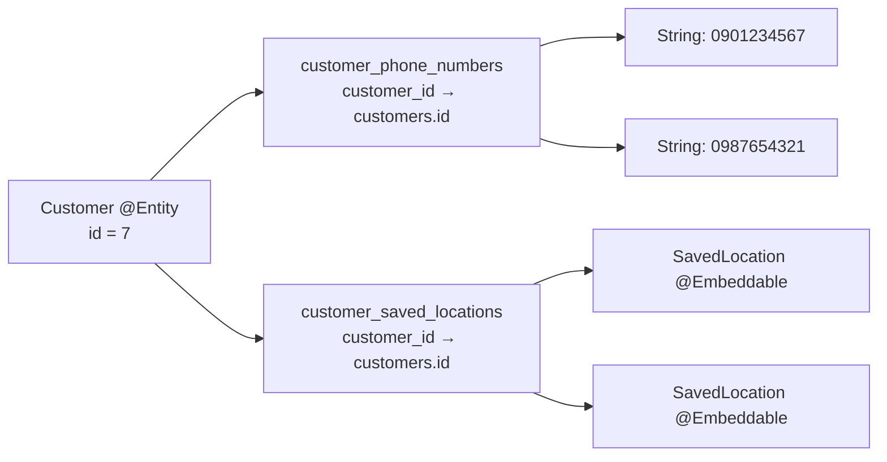

# Collection table, cột liên kết và vòng đời dữ liệu thành phần

## 1. Vì sao một tập hợp giá trị cần bảng riêng?

Trong mô hình đối tượng Java, một entity có thể chứa nhiều giá trị cùng loại:

```java
private Set<String> phoneNumbers;
private List<SavedLocation> savedLocations;
private Map<String, String> preferences;
```

Chẳng hạn, một khách hàng có nhiều số điện thoại, nhiều địa chỉ thường dùng và nhiều tùy chọn hiển thị. Các phần tử này **thuộc về khách hàng**, không nhất thiết có định danh nghiệp vụ độc lập hoặc tồn tại tách khỏi khách hàng. Hibernate ORM gọi đây là **collection of values** hay **element collection**.

Trong cơ sở dữ liệu quan hệ, nếu cứ thêm các cột `phone1`, `phone2`, `phone3` vào bảng `customers`, số lượng phần tử sẽ bị giới hạn và việc truy vấn rất khó mở rộng. Vì vậy, một phương án thông thường là đặt các phần tử vào **bảng riêng**, mỗi hàng đại diện cho một phần tử và mang **khóa ngoại trỏ về entity sở hữu**.

Ví dụ:

```text
customers                              customer_phone_numbers
┌────┬───────────────┐                 ┌─────────────┬────────────────┐
│ id │ full_name     │                 │ customer_id │ phone_number   │
├────┼───────────────┤                 ├─────────────┼────────────────┤
│  7 │ Lan Nguyen    │ ◄────────────── │      7      │ 0901234567     │
│  8 │ Minh Tran     │ ◄────────────── │      8      │ 0912345678     │
└────┴───────────────┘                 │      7      │ 0987654321     │
                                     └─────────────┴────────────────┘
```

Ở đây, bảng `customer_phone_numbers` có **cột liên kết `customer_id`** và cột giá trị `phone_number`. Hibernate có thể quản lý cả hai thông qua ánh xạ `@ElementCollection`, `@CollectionTable` và `@JoinColumn`.

Bài này giải thích cách cấu hình ba annotation đó, cấu trúc bảng sinh ra, khác biệt giữa tập hợp giá trị với tập hợp entity, và điều gì xảy ra khi phần tử được thêm, cập nhật hoặc xóa trong vòng đời entity sở hữu.

## 2. Ba khái niệm nền tảng

| Khái niệm | Ý nghĩa | Thường khai báo bằng |
|---|---|---|
| **Entity sở hữu (owner)** | Thực thể có định danh riêng, ví dụ `Customer` | `@Entity`, `@Id` |
| **Phần tử giá trị (value element)** | Dữ liệu thuộc owner, ví dụ số điện thoại `String` hoặc địa chỉ `@Embeddable` | `@ElementCollection` |
| **Bảng tập hợp (collection table)** | Bảng lưu các phần tử, có khóa ngoại chỉ tới owner | `@CollectionTable`, `@JoinColumn` |

Trong JPA/Hibernate, phần tử giá trị **không phải một entity độc lập**. Nó có thể là kiểu basic như `String`, `Integer`, `BigDecimal`, enum hoặc một kiểu embeddable `@Embeddable`. Các phần tử không được quản lý như những entity có primary key riêng; vòng đời của chúng phụ thuộc vào owner.

Sơ đồ:



Khi owner được persist, thay đổi hoặc remove, Hibernate sử dụng mapping để đồng bộ những hàng tương ứng trong collection table theo lifecycle của owner.

## 3. @ElementCollection: khai báo tập hợp giá trị

`@ElementCollection` thuộc Jakarta Persistence, dùng trên trường hoặc property kiểu collection chứa **basic values hoặc embeddable values**.

Ví dụ đơn giản:

```java
import jakarta.persistence.ElementCollection;
import jakarta.persistence.Entity;
import jakarta.persistence.GeneratedValue;
import jakarta.persistence.Id;
import java.util.HashSet;
import java.util.Set;

@Entity
public class Customer {
    @Id
    @GeneratedValue
    private Long id;

    @ElementCollection
    private Set<String> phoneNumbers = new HashSet<>();

    protected Customer() {}
}
```

Ở đây, mỗi số điện thoại chỉ là một `String` trong tập hợp thuộc `Customer`. Chúng không có entity class riêng và không có `@Id`.

Theo Jakarta Persistence, `@ElementCollection` mặc định dùng `fetch = FetchType.LAZY`. Hibernate thông thường tải tập hợp khi code thực sự truy cập; tuy nhiên cần nhớ đây là **fetch hint/contract được provider hiện thực theo khả năng**, và cách truy vấn/fetch plan có thể làm nó được nạp sớm.

Việc khai báo `@ElementCollection` không phải là cách biến mọi collection Java thành một bảng. Nếu tập hợp gồm các đối tượng cần tồn tại độc lập, có khóa định danh riêng, hoặc được nhiều owner tham chiếu, đó có thể là một **entity relationship** như `@OneToMany` hoặc `@ManyToMany`.

## 4. @CollectionTable: xác định bảng lưu collection

`@CollectionTable` mô tả bảng của một element collection, bao gồm tên bảng, schema/catalog và thông tin liên kết tới owner.

Ví dụ khai báo rõ:

```java
import jakarta.persistence.CollectionTable;
import jakarta.persistence.Column;
import jakarta.persistence.ElementCollection;
import jakarta.persistence.FetchType;
import jakarta.persistence.JoinColumn;
import jakarta.persistence.UniqueConstraint;

import java.util.HashSet;
import java.util.Set;

@ElementCollection(fetch = FetchType.LAZY)
@CollectionTable(
    name = "customer_phone_numbers",
    joinColumns = @JoinColumn(
        name = "customer_id",
        referencedColumnName = "id"
    ),
    uniqueConstraints = @UniqueConstraint(
        columnNames = {"customer_id", "phone_number"}
    )
)
@Column(name = "phone_number", nullable = false, length = 20)
private Set<String> phoneNumbers = new HashSet<>();
```

Đoạn code này đặt **bên trong entity `Customer`**; entity phải có trường `id` được ánh xạ làm khóa chính.

Giải thích từng phần:

- `@ElementCollection`: định nghĩa đây là tập hợp giá trị do `Customer` sở hữu.
- `@CollectionTable(name = "...")`: các phần tử nằm ở bảng `customer_phone_numbers`.
- `@JoinColumn(name = "customer_id")`: cột `customer_id` nằm **trong bảng tập hợp**; nó lưu ID của owner.
- `referencedColumnName = "id"`: cột được tham chiếu trên bảng owner là `customers.id`. Nếu bỏ qua, Hibernate thường tham chiếu primary key của owner theo quy tắc mặc định.
- `@Column(name = "phone_number")`: cột **giá trị phần tử `String`** là `phone_number`.
- `@UniqueConstraint`: yêu cầu uniqueness của cặp `(customer_id, phone_number)` khi tạo schema; cùng khách hàng không được lưu cùng số điện thoại hai lần.

**Phân biệt hai vị trí cột:** `@JoinColumn` chỉ tới **owner**, còn `@Column` trên basic element chỉ định **giá trị phần tử**. Cả hai cột đều ở collection table, không nằm trong bảng `customers`.

### SQL tương ứng

Một schema PostgreSQL minh họa:

```sql
CREATE TABLE customers (
    id BIGINT GENERATED BY DEFAULT AS IDENTITY PRIMARY KEY,
    full_name VARCHAR(150) NOT NULL
);

CREATE TABLE customer_phone_numbers (
    customer_id BIGINT NOT NULL,
    phone_number VARCHAR(20) NOT NULL,
    CONSTRAINT fk_customer_phone_owner
        FOREIGN KEY (customer_id)
        REFERENCES customers(id),
    CONSTRAINT uk_customer_phone
        UNIQUE (customer_id, phone_number)
);
```

Đây là thiết kế schema tương ứng về **ngữ nghĩa**. Tên constraint, thứ tự DDL, kiểu cột và việc tạo khóa chính riêng cho collection table phụ thuộc schema migration, dialect và cách Hibernate sinh DDL.

### Có bắt buộc viết @CollectionTable không?

Không. `@ElementCollection` có thể được dùng mà không khai báo `@CollectionTable`; provider sẽ áp dụng quy tắc đặt tên bảng/cột mặc định theo metadata và naming strategy. Tuy nhiên, với dự án thực tế, việc **đặt tên tường minh** thường giúp đọc schema dễ hơn, giảm bất ngờ khi nâng cấp hoặc thay đổi naming strategy và đồng bộ với migration.

## 5. @JoinColumn: cột liên kết tới owner

`@JoinColumn` trong `@CollectionTable(joinColumns = ...)` xác định khóa ngoại từ bảng collection đến entity sở hữu. Đặt biệt danh là “cột liên kết” không có nghĩa phần tử đang trở thành entity riêng.

```text
customer_phone_numbers.customer_id  ───►  customers.id
            foreign key                      primary key
```

Một số thuộc tính thường gặp của `@JoinColumn`:

| Thuộc tính | Tác dụng |
|---|---|
| `name` | Tên cột khóa ngoại trên collection table |
| `referencedColumnName` | Tên cột được tham chiếu ở bảng owner |
| `nullable` | Mong muốn nullability của cột liên kết trong schema |
| `foreignKey` | Khai báo thông tin constraint FK khi sinh schema theo JPA |
| `columnDefinition` | Cú pháp DDL tùy database cho cột, làm giảm tính portable |

Trong collection table bình thường, khóa ngoại nên là **NOT NULL** vì một giá trị không nên tồn tại thiếu owner. Đồng thời database nên có **foreign key constraint** thực sự; annotation không thay thế trách nhiệm bảo đảm schema migration đã tạo đúng constraint.

### Owner có khóa chính kép thì sao?

Nếu owner dùng khóa chính nhiều cột, bảng tập hợp có thể cần nhiều cột FK:

```java
@ElementCollection
@CollectionTable(
    name = "warehouse_tags",
    joinColumns = {
        @JoinColumn(
            name = "warehouse_region",
            referencedColumnName = "region"
        ),
        @JoinColumn(
            name = "warehouse_code",
            referencedColumnName = "code"
        )
    }
)
@Column(name = "tag")
private Set<String> tags = new HashSet<>();
```

Ví dụ giả định entity sở hữu `Warehouse` đã được ánh xạ bằng composite primary key gồm `region` và `code`. Hai cột liên kết phải cùng tham chiếu đúng khóa của owner. Việc đặt tên và referenced column sai sẽ khiến metadata/schema không phù hợp.

### Khác gì @JoinTable?

- `@CollectionTable` dùng cho **collection của basic hoặc embeddable values**.
- `@JoinTable` thường dùng cho quan hệ giữa **entity với entity**, chẳng hạn many-to-many hoặc association được ánh xạ bằng bảng liên kết.

Hai annotation đều có thể dẫn tới một bảng mang FK, nhưng chúng diễn đạt **ngữ nghĩa đối tượng và vòng đời khác nhau**.

## 6. Ví dụ đầy đủ với giá trị cơ bản và @Embeddable

Một hệ thống lưu khách hàng có số điện thoại và nhiều địa chỉ giao nhận ưu tiên:

### 6.1. Embeddable value object

```java
package com.example.customer;

import jakarta.persistence.Column;
import jakarta.persistence.Embeddable;

@Embeddable
public class SavedLocation {
    @Column(name = "location_label", length = 60, nullable = false)
    private String label;

    @Column(name = "city", length = 100, nullable = false)
    private String city;

    protected SavedLocation() {}

    public SavedLocation(String label, String city) {
        this.label = label;
        this.city = city;
    }

    public String getLabel() {
        return label;
    }

    public String getCity() {
        return city;
    }
}
```

`SavedLocation` có hai trường dữ liệu nhưng **không có `@Entity` và `@Id`**. Nó biểu diễn một giá trị thành phần trong cấu trúc khách hàng.

### 6.2. Entity sở hữu hai collection

```java
package com.example.customer;

import jakarta.persistence.CollectionTable;
import jakarta.persistence.Column;
import jakarta.persistence.ElementCollection;
import jakarta.persistence.Entity;
import jakarta.persistence.FetchType;
import jakarta.persistence.GeneratedValue;
import jakarta.persistence.GenerationType;
import jakarta.persistence.Id;
import jakarta.persistence.JoinColumn;
import jakarta.persistence.OrderColumn;
import jakarta.persistence.Table;
import jakarta.persistence.UniqueConstraint;

import java.util.ArrayList;
import java.util.HashSet;
import java.util.List;
import java.util.Set;

@Entity
@Table(name = "customers")
public class Customer {

    @Id
    @GeneratedValue(strategy = GenerationType.IDENTITY)
    private Long id;

    @Column(name = "full_name", nullable = false, length = 150)
    private String fullName;

    @ElementCollection(fetch = FetchType.LAZY)
    @CollectionTable(
        name = "customer_phone_numbers",
        joinColumns = @JoinColumn(name = "customer_id"),
        uniqueConstraints = @UniqueConstraint(
            columnNames = {"customer_id", "phone_number"}
        )
    )
    @Column(name = "phone_number", nullable = false, length = 20)
    private Set<String> phoneNumbers = new HashSet<>();

    @ElementCollection(fetch = FetchType.LAZY)
    @CollectionTable(
        name = "customer_saved_locations",
        joinColumns = @JoinColumn(name = "customer_id")
    )
    @OrderColumn(name = "sort_position")
    private List<SavedLocation> savedLocations = new ArrayList<>();

    protected Customer() {}

    public Customer(String fullName) {
        this.fullName = fullName;
    }

    public Long getId() {
        return id;
    }

    public Set<String> getPhoneNumbers() {
        return phoneNumbers;
    }

    public List<SavedLocation> getSavedLocations() {
        return savedLocations;
    }
}
```

Các điểm khác nhau giữa hai tập hợp:

| `phoneNumbers` | `savedLocations` |
|---|---|
| Phần tử `String` đơn giản | Phần tử `SavedLocation` là `@Embeddable` |
| `Set` biểu diễn các giá trị không trùng nhau theo `equals/hashCode` | `List` biểu diễn các vị trí theo thứ tự |
| `@Column` xác định cột chứa chuỗi | Các field trong `@Embeddable` xác định nhiều cột |
| Có unique constraint trên owner và số điện thoại | Có `@OrderColumn` lưu thứ tự phần tử |

### 6.3. SQL schema tham khảo

```sql
CREATE TABLE customer_saved_locations (
    customer_id BIGINT NOT NULL,
    sort_position INTEGER NOT NULL,
    location_label VARCHAR(60) NOT NULL,
    city VARCHAR(100) NOT NULL,
    CONSTRAINT fk_saved_location_owner
        FOREIGN KEY (customer_id)
        REFERENCES customers(id),
    CONSTRAINT pk_saved_location
        PRIMARY KEY (customer_id, sort_position)
);
```

`@OrderColumn` hướng Hibernate lưu vị trí list trong cột `sort_position` (thường chỉ số dựa trên 0 theo mặc định). Một schema có khóa chính kết hợp `(customer_id, sort_position)` là cách bảo vệ không có hai phần tử ở cùng vị trí cho cùng owner, nhưng chi tiết constraint trên thuộc về thiết kế DDL/migration thực tế.

### Tại sao không khai báo SavedLocation là Entity?

Trong ví dụ, một địa chỉ lưu sẵn chỉ có ý nghĩa khi thuộc một khách hàng. Nếu khách hàng bị xóa, các địa chỉ đó cũng không còn ý nghĩa. Ngược lại, nếu một địa điểm là bản ghi chuẩn dùng chung cho hàng nghìn khách hàng, cần được truy vấn/cập nhật độc lập và có ID riêng, nó thường phù hợp làm **entity** với một association `@OneToMany` hoặc `@ManyToMany` tùy miền nghiệp vụ.

## 7. Ánh xạ Map thành collection table

`@ElementCollection` còn có thể ánh xạ `Map<K, V>` khi key/value được hỗ trợ như giá trị cơ bản hoặc embeddable theo các quy tắc mapping tương ứng.

Ví dụ một khách hàng có các tùy chọn:

```java
import jakarta.persistence.CollectionTable;
import jakarta.persistence.Column;
import jakarta.persistence.ElementCollection;
import jakarta.persistence.JoinColumn;
import jakarta.persistence.MapKeyColumn;
import java.util.HashMap;
import java.util.Map;

@ElementCollection
@CollectionTable(
    name = "customer_preferences",
    joinColumns = @JoinColumn(name = "customer_id")
)
@MapKeyColumn(name = "preference_key", length = 50)
@Column(name = "preference_value", length = 200)
private Map<String, String> preferences = new HashMap<>();
```

DDL có thể là:

```sql
CREATE TABLE customer_preferences (
    customer_id BIGINT NOT NULL REFERENCES customers(id),
    preference_key VARCHAR(50) NOT NULL,
    preference_value VARCHAR(200),
    CONSTRAINT uq_customer_preference_key
        UNIQUE (customer_id, preference_key)
);
```

`@MapKeyColumn` chỉ định **cột chứa key**, còn `@Column` chỉ định **cột chứa value**. Vì Java `Map` có một giá trị cho mỗi key, thiết kế database thường cần uniqueness cho cặp `(owner_id, map_key)` để tránh có hai hàng mâu thuẫn về cùng một khóa.

Ví dụ dữ liệu:

```text
customer_preferences
customer_id | preference_key | preference_value
------------|----------------|-----------------
7           | language       | vi
7           | theme          | dark
8           | language       | en
```

Khi chỉnh `customer.getPreferences().put("theme", "light")` trong một Session đang quản lý owner, Hibernate có thể cập nhật collection table để phản ánh giá trị mới. SQL cụ thể tùy loại collection, khóa hàng, mapping và chiến lược dirty checking.

## 8. Vòng đời dữ liệu thành phần phụ thuộc owner

**Phần tử giá trị không có lifecycle độc lập như entity.** Khi owner được persist, các giá trị trong `@ElementCollection` sẽ được lưu cùng với owner trong transaction thích hợp. Khi owner bị remove, các hàng collection gắn với owner cũng thuộc phạm vi cần được xóa. Đó là ngữ nghĩa vòng đời quan trọng nhất của value collection.

Xét đoạn sử dụng native Hibernate:

```java
import org.hibernate.Session;
import org.hibernate.SessionFactory;
import org.hibernate.Transaction;

public class CustomerService {

    private final SessionFactory sessionFactory;

    public CustomerService(SessionFactory sessionFactory) {
        this.sessionFactory = sessionFactory;
    }

    public Long createCustomer() {
        try (Session session = sessionFactory.openSession()) {
            Transaction tx = session.beginTransaction();
            try {
                Customer customer = new Customer("Lan Nguyen");
                customer.getPhoneNumbers().add("0901234567");
                customer.getPhoneNumbers().add("0987654321");
                customer.getSavedLocations().add(
                    new SavedLocation("Nhà", "Hà Nội")
                );

                session.persist(customer);
                tx.commit();

                return customer.getId();
            } catch (RuntimeException ex) {
                if (tx.isActive()) {
                    tx.rollback();
                }
                throw ex;
            }
        }
    }
}
```

Khi commit, Hibernate đồng bộ dữ liệu khách hàng và các hàng thành phần cần thiết. Trong schema minh họa, kết quả có thể là:

```text
customers:
  id = 7, full_name = 'Lan Nguyen'

customer_phone_numbers:
  (7, '0901234567')
  (7, '0987654321')

customer_saved_locations:
  (7, 0, 'Nhà', 'Hà Nội')
```

ID `7` chỉ minh họa; giá trị thực tế tùy cách sinh khóa.

### Thêm phần tử

Khi `Customer` đang managed:

```java
Customer customer = session.find(Customer.class, customerId);
customer.getPhoneNumbers().add("0933000000");
```

Hibernate theo dõi thay đổi của collection và khi flush sẽ đưa các thay đổi cần thiết xuống database theo mapping. Với một `Set<String>` có khóa giá trị rõ ràng, ORM có thể xử lý phần thêm dưới dạng insert hàng tương ứng.

### Xóa một phần tử

```java
Customer customer = session.find(Customer.class, customerId);
customer.getPhoneNumbers().remove("0987654321");
```

Tác vụ này có nghĩa **xóa giá trị khỏi collection của owner**. Nó không phải gọi `entityManager.remove(...)` trên một entity con, vì `String` không phải entity.

### Sửa thuộc tính trong embeddable

Với `SavedLocation`, Hibernate có thể phát hiện sự thay đổi của các giá trị thành phần trong collection:

```java
Customer customer = session.find(Customer.class, customerId);
SavedLocation location = customer.getSavedLocations().get(0);

// Nếu SavedLocation có method thay đổi giá trị hợp lệ:
location.setCity("Đà Nẵng");
```

Ví dụ này giả định ứng dụng đã bổ sung `setCity(...)` vào `SavedLocation`. Với value object ưu tiên bất biến, có thể **thay phần tử bằng một instance mới** thay vì sửa tại chỗ:

```java
customer.getSavedLocations().set(
    0,
    new SavedLocation("Nhà", "Đà Nẵng")
);
```

Việc SQL cuối cùng là `UPDATE` hàng, `DELETE` rồi `INSERT`, hay các lệnh khác phụ thuộc mapping, khả năng xác định phần tử và implementation Hibernate. Đừng mặc định một thay đổi nhỏ trên Java collection luôn chỉ sinh đúng một lệnh SQL.

### Xóa toàn bộ collection

```java
Customer customer = session.find(Customer.class, customerId);
customer.getPhoneNumbers().clear();
```

Trong transaction, thao tác này làm collection rỗng và Hibernate sẽ đồng bộ trạng thái cần lưu. Đó là thao tác đối với **các hàng của bảng giá trị**, không phải xóa entity owner.

### Xóa owner

```java
Customer customer = session.find(Customer.class, customerId);
session.remove(customer);
```

Về mặt ánh xạ, các element collection phụ thuộc owner và không được giữ lại như các thực thể độc lập. Hibernate thường sắp xếp việc xóa hàng collection phù hợp để không vi phạm foreign key. Nếu cần database tự xóa các hàng khi owner bị xóa bằng SQL trực tiếp, phải kiểm tra **ON DELETE CASCADE thực sự tồn tại ở database** hoặc có quy trình cleanup khác; annotation JPA đơn thuần không bảo đảm mọi thao tác SQL ngoài Hibernate được cascade giống nhau.

## 9. Vì sao @ElementCollection không có cascade và orphanRemoval như @OneToMany?

Với một association entity:

```java
@OneToMany(
    mappedBy = "order",
    cascade = CascadeType.ALL,
    orphanRemoval = true
)
private List<OrderLine> lines;
```

`OrderLine` là **entity** có ID và lifecycle riêng. Vì vậy, `cascade` và `orphanRemoval` là các lựa chọn điều khiển hành vi lan truyền thao tác và xử lý entity bị tách khỏi quan hệ.

Ngược lại:

```java
@ElementCollection
private Set<String> phoneNumbers;
```

`String` là **giá trị thành phần**. `@ElementCollection` không có thuộc tính `cascade` hay `orphanRemoval`; khi xóa giá trị khỏi collection, Hibernate xử lý dữ liệu hàng tương ứng theo lifecycle của owner. Không cần, và cũng không thể áp `orphanRemoval = true` trực tiếp vào `@ElementCollection`.

Điểm khác biệt này rất quan trọng khi chuyển một thiết kế từ **value collection** sang **entity association**. Chỉ cần một phần tử trở thành entity có ID, các quy tắc liên kết, cascade, orphan removal và quyền sở hữu quan hệ sẽ phải được xem xét lại.

## 10. Set, List, bag và Map ảnh hưởng đến schema và SQL

Java collection type cho Hibernate biết các quy tắc về phần tử, thứ tự và tính trùng nhau.

| Collection | Đặc điểm Java | Điều cần xem trong mapping |
|---|---|---|
| `Set<E>` | Không có phần tử trùng theo `equals/hashCode` | Uniqueness ở database vẫn nên được khai báo nếu đó là invariant |
| `List<E>` có `@OrderColumn` | Có vị trí phần tử được lưu | Bảng cần cột vị trí; chèn/xóa giữa list có thể cập nhật nhiều vị trí |
| `List<E>` không có cột thứ tự | Có thể được Hibernate coi là bag hoặc áp semantics theo cấu hình | Không bảo đảm giữ thứ tự database như mong đợi nếu không có mapping rõ ràng |
| `Map<K,V>` | Mỗi key ánh xạ đến một value | Cột key qua `@MapKeyColumn`; uniqueness `(owner, key)` |
| `Collection<E>` / bag | Có thể cho phép phần tử trùng, không có vị trí riêng | ORM có thể cần xóa và tạo lại các hàng khi thay đổi để đồng bộ |

### @OrderColumn khác @OrderBy

**`@OrderColumn`** lưu **vị trí thực tế trong danh sách**:

```java
@ElementCollection
@CollectionTable(
    name = "customer_saved_locations",
    joinColumns = @JoinColumn(name = "customer_id")
)
@OrderColumn(name = "sort_position")
private List<SavedLocation> savedLocations = new ArrayList<>();
```

Nếu đổi vị trí phần tử bằng `Collections.swap(...)`, Hibernate cần phản ánh trật tự mới lên dữ liệu cột `sort_position` khi flush.

**`@OrderBy`** mô tả **sắp xếp khi truy vấn** theo thuộc tính/giá trị phần tử, không phải lưu vị trí tùy ý của người dùng:

```java
@ElementCollection
@CollectionTable(
    name = "customer_saved_locations",
    joinColumns = @JoinColumn(name = "customer_id")
)
@OrderBy("city ASC")
private List<SavedLocation> savedLocations = new ArrayList<>();
```

Nếu yêu cầu là “người dùng kéo thả địa chỉ theo thứ tự ưu tiên”, `@OrderColumn` thường phù hợp hơn. Nếu yêu cầu “luôn hiển thị theo tên thành phố”, `@OrderBy` thể hiện đúng mục tiêu hơn.

### Lưu ý với nhiều bag được fetch join

Khi join fetch đồng thời hai collection nhiều phần tử, kết quả SQL có thể tạo **tích Descartes** giữa các hàng và khiến số dòng tăng mạnh. Hibernate còn có thể báo `MultipleBagFetchException` khi fetch đồng thời nhiều bag. Để tránh chi phí và giới hạn này, có thể:

- Truy vấn theo nhu cầu từng collection thay vì fetch tất cả cùng lúc.
- Dùng truy vấn DTO/projection cho màn hình đọc cần ít trường.
- Thiết kế collection type, batch fetching hoặc fetch plan phù hợp.

Không đổi từ `List` sang `Set` chỉ để “tắt lỗi fetch” nếu nghiệp vụ thực sự cần thứ tự hay phần tử trùng.

## 11. @AttributeOverride cho @Embeddable trong collection table

Một `@Embeddable` có thể được tái sử dụng ở nhiều nơi. Khi mỗi bảng cần tên cột khác nhau, có thể override mapping tại vị trí dùng.

Ví dụ value object:

```java
@Embeddable
public class Address {
    private String street;
    private String city;

    protected Address() {}

    public Address(String street, String city) {
        this.street = street;
        this.city = city;
    }
}
```

Trong entity:

```java
@ElementCollection
@CollectionTable(
    name = "customer_addresses",
    joinColumns = @JoinColumn(name = "customer_id")
)
@AttributeOverrides({
    @AttributeOverride(
        name = "street",
        column = @Column(name = "address_street", length = 150)
    ),
    @AttributeOverride(
        name = "city",
        column = @Column(name = "address_city", length = 100)
    )
})
private Set<Address> addresses = new HashSet<>();
```

Các field `street` và `city` của phần tử được ánh xạ vào hai cột `address_street`, `address_city` trong bảng `customer_addresses`. Đây là cách điều chỉnh **cột giá trị**; cột `customer_id` vẫn là cột owner được khai báo bằng `@JoinColumn`.

Với `Set<Address>`, `equals()` và `hashCode()` của value object cần được định nghĩa nhất quán với ngữ nghĩa giá trị và quy tắc bất biến. Nếu dự án cần giữ nhiều địa chỉ có nội dung giống hệt nhau, hoặc cần chỉnh sửa địa chỉ độc lập, `Set<Embeddable>` có thể không phải lựa chọn đúng.

## 12. Vấn đề hiệu năng và hành vi SQL khi collection thay đổi

Hibernate không nhất thiết luôn có một khóa định danh ổn định cho **mỗi phần tử** trong một value collection. Với bag không có cột thứ tự hoặc cột khóa riêng, ORM có thể khó xác định chính xác hàng nào tương ứng với phần tử đã bị thay đổi. Trong một số mapping, Hibernate chọn cách **xóa toàn bộ hàng của collection của owner rồi chèn lại những phần tử còn tồn tại**.

Ví dụ:

```text
Trước:
  (customer_id=7, value=A)
  (customer_id=7, value=B)
  (customer_id=7, value=C)

Sau khi xóa B:
  Collection trong Java: [A, C]

Một số mapping có thể tạo:
  DELETE FROM collection_table WHERE customer_id=7
  INSERT (7, A)
  INSERT (7, C)

Các mapping khác có thể xóa chính xác hàng của B.
```

Vì vậy cần đánh giá **số lượng phần tử**, **kiểu collection**, **các cột xác định hàng** và SQL thực tế. Với hàng nghìn phần tử được cập nhật thường xuyên, một bảng entity con có ID ổn định đôi khi hiệu quả và dễ truy vấn hơn một element collection.

### Một số chiến lược thực tế

1. **Collection nhỏ, thuộc chặt chẽ owner:** `@ElementCollection` thường phù hợp, dễ đọc domain.
2. **Collection rất lớn hoặc cập nhật từng phần tử thường xuyên:** đánh giá tạo entity con `@OneToMany` với khóa riêng, index và transaction phù hợp.
3. **Chỉ cần danh sách hiển thị:** cân nhắc query projection thay vì luôn tải entity và toàn bộ collection.
4. **Hay truy vấn theo giá trị phần tử:** tạo index trong collection table, ví dụ `customer_id` hoặc cặp `(customer_id, phone_number)`.
5. **Ghi nhiều hàng:** quan sát SQL, JDBC batching và transaction size; không giả định API collection nhất định tương ứng một statement.

### N+1 và lazy fetching

Với default LAZY, code sau có thể phát sinh một truy vấn collection cho **mỗi** khách hàng:

```java
List<Customer> customers = session.createQuery(
    "from Customer",
    Customer.class
).getResultList();

for (Customer c : customers) {
    System.out.println(c.getPhoneNumbers().size());
}
```

Đó là dạng N+1 query khi duyệt nhiều owner. Có thể giải quyết bằng fetch join có chọn lọc, batch fetching, subselect fetching hoặc truy vấn chuyên biệt tùy bối cảnh.

Ví dụ fetch join một collection:

```java
Customer customer = session.createQuery(
    "select distinct c from Customer c " +
    "left join fetch c.phoneNumbers " +
    "where c.id = :id",
    Customer.class
).setParameter("id", customerId)
 .getSingleResult();
```

Truy vấn này nạp `phoneNumbers` trong phạm vi Session, hữu ích khi service cần chuyển dữ liệu sang DTO trước khi đóng Session. Không fetch join hàng loạt nhiều collection nếu không cần chúng.

## 13. Session, transaction và entity detached

Một `@ElementCollection` thuộc persistence context của owner. Khi Session đã đóng, collection vẫn có thể chưa được khởi tạo nếu nó được ánh xạ LAZY.

Ví dụ:

```java
Customer customer;

try (Session session = sessionFactory.openSession()) {
    Transaction tx = session.beginTransaction();
    try {
        customer = session.find(Customer.class, customerId);
        tx.commit();
    } catch (RuntimeException e) {
        if (tx.isActive()) {
            tx.rollback();
        }
        throw e;
    }
}

// Session đã đóng; nếu collection chưa tải,
// thao tác bên dưới có thể ném LazyInitializationException:
int count = customer.getPhoneNumbers().size();
```

Cách an toàn là truy cập collection trong transaction/session còn mở hoặc trả DTO:

```java
public record CustomerContactDto(
    Long id,
    Set<String> phoneNumbers
) {}

public CustomerContactDto findContacts(long customerId) {
    try (Session session = sessionFactory.openSession()) {
        Transaction tx = session.beginTransaction();
        try {
            Customer customer = session.find(Customer.class, customerId);
            if (customer == null) {
                throw new IllegalArgumentException(
                    "Customer not found: " + customerId
                );
            }

            CustomerContactDto dto = new CustomerContactDto(
                customer.getId(),
                Set.copyOf(customer.getPhoneNumbers())
            );

            tx.commit();
            return dto;
        } catch (RuntimeException ex) {
            if (tx.isActive()) {
                tx.rollback();
            }
            throw ex;
        }
    }
}
```

DTO sao chép dữ liệu ra khỏi persistence context, giúp tầng HTTP/serialization không vô tình phát SQL khi response được tạo. Đoạn code sử dụng Java phiên bản có `record` và `Set.copyOf`; với môi trường Java cũ hơn có thể thay bằng DTO class và `new HashSet<>(...)`.

## 14. Ràng buộc cơ sở dữ liệu: FK, uniqueness, index và delete

Annotation mô tả ý định mapping, nhưng **schema thực tế** quyết định việc database bảo vệ dữ liệu khi có những tác nhân ghi ngoài Hibernate.

### Foreign key

```sql
ALTER TABLE customer_phone_numbers
ADD CONSTRAINT fk_customer_phone_owner
FOREIGN KEY (customer_id)
REFERENCES customers(id);
```

Constraint này ngăn một hàng số điện thoại tham chiếu tới khách hàng không tồn tại.

### Uniqueness

```sql
ALTER TABLE customer_phone_numbers
ADD CONSTRAINT uq_customer_phone
UNIQUE (customer_id, phone_number);
```

Nó bảo vệ tính duy nhất của giá trị theo từng owner, kể cả khi dữ liệu được nhập trực tiếp bằng SQL. Một `Set` phía Java chỉ bảo đảm tính không trùng trong **collection Java theo quy tắc equality**, không tự tạo database uniqueness một cách phổ quát.

### Index

```sql
CREATE INDEX ix_customer_phone_owner
    ON customer_phone_numbers(customer_id);
```

Index trên cột FK hữu ích khi thường xuyên tải các số điện thoại theo customer ID. Cần lưu ý một unique index/constraint đã tồn tại trên `(customer_id, phone_number)` có thể phục vụ nhiều truy vấn theo `customer_id`; việc tạo thêm index riêng cần dựa vào query plan và workload, tránh dư thừa.

### ON DELETE CASCADE

```sql
ALTER TABLE customer_phone_numbers
ADD CONSTRAINT fk_customer_phone_owner
FOREIGN KEY (customer_id)
REFERENCES customers(id)
ON DELETE CASCADE;
```

Đây là **phương án thay thế khi tạo FK**, không chạy cùng ví dụ `ADD CONSTRAINT fk_customer_phone_owner` phía trên nếu constraint đó đã tồn tại. Khi bật `ON DELETE CASCADE` trong schema, database xóa hàng collection khi owner bị xóa, kể cả với SQL trực tiếp. Hibernate vẫn có quy tắc quản lý collection riêng; cần kiểm tra cách phối hợp ORM với DDL thực tế để tránh giả định không đúng về thời điểm/xuất phát của các lệnh DELETE.

## 15. Khi nào nên chọn entity con thay vì element collection?

Giả sử một đơn hàng có danh sách dòng hàng với số lượng, đơn giá, trạng thái giao hàng và lịch sử chỉnh sửa. Mặc dù `OrderLine` có thể trông như một “thành phần của Order”, nó thường cần được xác định riêng để cập nhật, audit hoặc tham chiếu.

| Tiêu chí | `@ElementCollection` | `@OneToMany` đến entity con |
|---|---|---|
| Phần tử có `@Id` riêng? | Không | Có |
| Tự quản lý vòng đời phần tử? | Không, phụ thuộc owner | Có thể; dùng cascade/orphan removal theo yêu cầu |
| Truy vấn trực tiếp theo ID phần tử? | Không có entity ID | Có |
| Dữ liệu được chia sẻ giữa nhiều owner? | Không phải mô hình phù hợp | Có thể thiết kế quan hệ entity phù hợp |
| Thay đổi một phần tử trong tập hợp lớn | Có thể gây nhiều SQL tùy mapping | Có thể cập nhật entity xác định bằng ID |
| Mô hình giá trị nhỏ, không có identity | Phù hợp | Có thể làm domain phức tạp quá mức |
| Cần audit, soft delete, version riêng của phần tử | Thường không phù hợp | Phù hợp hơn |

**Ví dụ nên là element collection:** số điện thoại bổ sung, chuỗi nhãn nhỏ, lựa chọn ngôn ngữ/hiển thị, địa chỉ dạng value object riêng của từng user.

**Ví dụ nên là entity:** `OrderLine` cần ID riêng; `Comment` có tác giả và trạng thái moderation; `Attachment` có lifecycle, URL, quyền truy cập và soft delete; một `Category` dùng chung giữa nhiều sản phẩm.

Không quyết định chỉ theo số lượng cột của phần tử: một embeddable có năm cột vẫn có thể là value object; một phần tử chỉ có tên và ID nhưng cần truy vấn độc lập vẫn có thể là entity.

## 16. Lỗi thường gặp và cách nhận biết

### “Dùng @OneToMany để lưu Set<String>”

`@OneToMany` dành cho quan hệ với **entity target**, không phải tập các chuỗi đơn giản. Với `Set<String>`, dùng `@ElementCollection`.

### “Đã có @CollectionTable thì khỏi cần @ElementCollection”

`@CollectionTable` chỉ là metadata của collection table; cần khai báo rõ đây là **element collection** bằng `@ElementCollection`.

### “@JoinColumn được tạo trong bảng Customer”

Không. Trong `@CollectionTable`, cột `customer_id` nằm **trong bảng collection** và trỏ tới owner.

### “Xóa số điện thoại bằng entityManager.remove(phone)”

Sai về mô hình đối tượng: `String` không phải entity. Thay đổi collection đang managed bằng `remove(...)` và commit transaction.

### “Element collection cần orphanRemoval=true”

Không có thuộc tính `orphanRemoval` ở `@ElementCollection`. Vòng đời phần tử giá trị phụ thuộc owner theo định nghĩa mapping.

### “Set tự bảo đảm UNIQUE ở database”

Không thể dựa vào tính chất `Set` của Java để thay thế unique constraint DB; dữ liệu có thể được ghi bởi các chương trình khác. Đặt constraint theo invariant cần bảo vệ.

### “List luôn giữ đúng thứ tự sau khi đọc lại”

Không chắc. Nếu thứ tự là phần dữ liệu cần lưu, khai báo `@OrderColumn`. `@OrderBy` chỉ định thứ tự truy vấn theo giá trị, mang ngữ nghĩa khác.

### “Đổi một giá trị chỉ phát đúng một UPDATE”

SQL có thể là UPDATE, DELETE/INSERT hoặc xóa và chèn lại nhiều hàng tùy cấu trúc collection. Cần xem SQL/log ở hệ thống thật khi tối ưu hiệu năng.

### “Xóa owner bằng SQL vẫn xóa giá trị như khi Hibernate remove”

Chỉ đúng nếu schema có **ON DELETE CASCADE** hoặc ứng dụng/DB thực hiện cleanup khác. Hibernate không thể quản lý vòng đời cho một lệnh DELETE trực tiếp chạy ngoài Hibernate nếu không có cơ chế phối hợp.

### “Collection có thể lazy load sau khi đóng Session”

Nếu collection chưa initialized, truy cập ngoài Session thường dẫn tới `LazyInitializationException`. Tải dữ liệu cần thiết trong service và trả DTO hoặc có fetch plan rõ ràng.

## 17. Bài thực hành: tài khoản và phương thức liên hệ

Yêu cầu:

- `Account` có ID số, tên đăng nhập và nhiều email phụ.
- Email phụ chỉ tồn tại trong phạm vi tài khoản.
- Không cho phép lưu hai email phụ giống nhau cho cùng một tài khoản.
- Email được lưu trong bảng `account_emails`, có cột FK `account_id` và cột giá trị `email_address`.
- Khi xóa một email khỏi Set trong transaction, hàng liên quan không còn trong bảng sau khi thay đổi được đồng bộ.

Một mapping tham khảo:

```java
import jakarta.persistence.CollectionTable;
import jakarta.persistence.Column;
import jakarta.persistence.ElementCollection;
import jakarta.persistence.Entity;
import jakarta.persistence.GeneratedValue;
import jakarta.persistence.Id;
import jakarta.persistence.JoinColumn;
import jakarta.persistence.Table;
import jakarta.persistence.UniqueConstraint;
import java.util.HashSet;
import java.util.Set;

@Entity
@Table(name = "accounts")
public class Account {

    @Id
    @GeneratedValue
    private Long id;

    @Column(name = "username", nullable = false, unique = true)
    private String username;

    @ElementCollection
    @CollectionTable(
        name = "account_emails",
        joinColumns = @JoinColumn(
            name = "account_id",
            referencedColumnName = "id"
        ),
        uniqueConstraints = @UniqueConstraint(
            columnNames = {"account_id", "email_address"}
        )
    )
    @Column(name = "email_address", nullable = false, length = 254)
    private Set<String> secondaryEmails = new HashSet<>();

    protected Account() {}

    public Account(String username) {
        this.username = username;
    }

    public Set<String> getSecondaryEmails() {
        return secondaryEmails;
    }
}
```

Một transaction thao tác với collection:

```java
try (Session session = sessionFactory.openSession()) {
    Transaction tx = session.beginTransaction();
    try {
        Account account = session.find(Account.class, accountId);
        if (account == null) {
            throw new IllegalArgumentException("Account not found");
        }

        account.getSecondaryEmails().add("support@example.test");
        account.getSecondaryEmails().remove("old@example.test");

        tx.commit();
    } catch (RuntimeException e) {
        if (tx.isActive()) {
            tx.rollback();
        }
        throw e;
    }
}
```

Database schema phù hợp:

```sql
CREATE TABLE account_emails (
    account_id BIGINT NOT NULL,
    email_address VARCHAR(254) NOT NULL,
    FOREIGN KEY (account_id) REFERENCES accounts(id),
    UNIQUE (account_id, email_address)
);
```

Ví dụ DDL giả định `accounts(id)` đã tồn tại với kiểu `BIGINT` và unique constraint trên `username` được thiết lập theo yêu cầu. Kiểm tra thực tế cần bao gồm đường đi tạo owner, thêm email, xóa email và xóa tài khoản; khi schema do migration quản lý, không dựa hoàn toàn vào DDL auto-generation.

## 18. Các nguyên tắc thiết kế cần nhớ

1. **Dùng `@ElementCollection` cho tập hợp kiểu basic hoặc `@Embeddable`** khi các phần tử là giá trị thuộc owner và không có identity độc lập.
2. **`@CollectionTable` xác định bảng lưu giá trị; `@JoinColumn` xác định FK từ bảng đó về owner; `@Column` hoặc các cột của embeddable mô tả giá trị phần tử.**
3. **Collection table là bảng quan hệ thực sự**: cần cân nhắc foreign key, uniqueness, index, nullability, vị trí list và schema migration.
4. **Thay đổi collection trong Session đang quản lý owner**, rồi flush/commit theo transaction; phần tử giá trị không có `EntityManager.remove()` độc lập.
5. **Vòng đời collection gắn với owner.** Xóa owner thông qua ORM kéo theo xử lý collection; xóa bằng SQL bên ngoài cần database cascade hoặc cleanup phù hợp.
6. **Kiểu collection ảnh hưởng semantics.** `Set` kiểm soát trùng theo Java equality, `List` có thể cần `@OrderColumn`, `Map` cần cột key.
7. **Không đoán SQL từ một thao tác Java.** Hibernate có thể phát nhiều lệnh DELETE/INSERT/UPDATE, đặc biệt với bag hoặc cấu trúc không có khóa hàng ổn định.
8. **Cân nhắc entity con khi thành phần lớn lên về nghiệp vụ.** Nếu cần ID, audit, soft delete, cập nhật độc lập hoặc nhiều owner cùng tham chiếu, hãy đánh giá relationship giữa entity.

Sự khác biệt quan trọng nhất là **bảng collection chỉ là cách lưu trữ cho những giá trị thuộc một entity**, còn **entity association biểu diễn quan hệ giữa các thực thể có định danh và vòng đời riêng**. Khi phân biệt được hai trường hợp này, bạn sẽ chọn đúng mapping và kiểm soát tốt hơn tính toàn vẹn dữ liệu, transaction và hiệu năng của Hibernate ORM.

### Tài liệu chính thức để đọc thêm

- [Hibernate ORM User Guide — Collections](https://docs.jboss.org/hibernate/orm/current/userguide/html_single/Hibernate_User_Guide.html#collections)
- [Hibernate ORM User Guide — Collections of basic values and embeddables](https://docs.jboss.org/hibernate/orm/current/userguide/html_single/Hibernate_User_Guide.html#collections-value)
- [Hibernate ORM User Guide — Embeddable values](https://docs.jboss.org/hibernate/orm/current/userguide/html_single/Hibernate_User_Guide.html#embeddables)
- [Jakarta Persistence — specification](https://jakarta.ee/specifications/persistence/)
