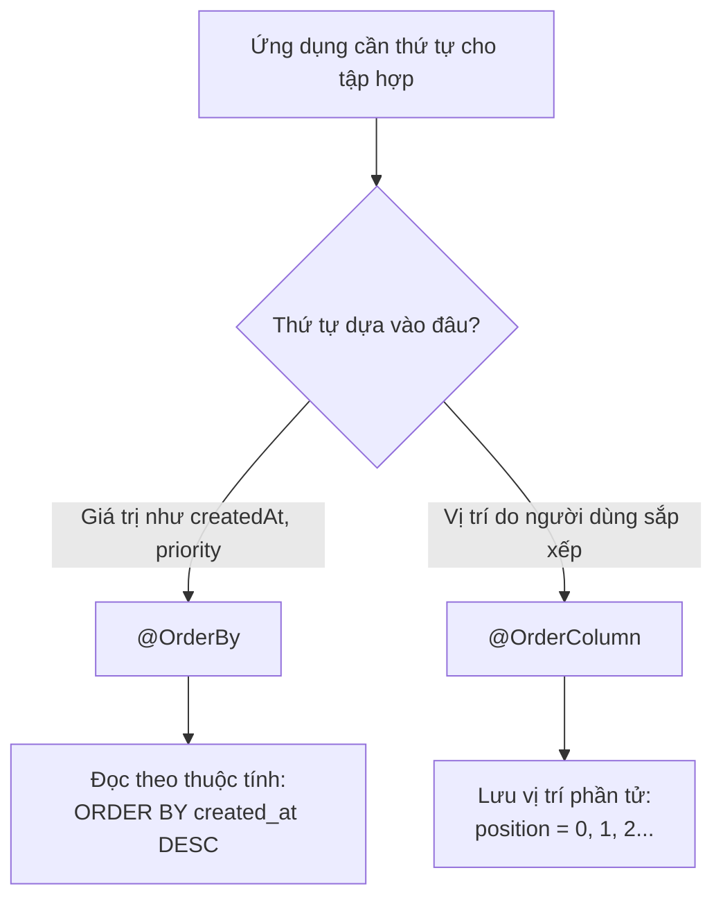

# @OrderBy khác với @OrderColumn trong Hibernate

Khi ánh xạ một tập hợp trong entity Hibernate, hai annotation **`@OrderBy`** và **`@OrderColumn`** đều có thể khiến phần tử được đọc ra theo một thứ tự rõ ràng. Tuy nhiên, chúng diễn đạt **hai quy tắc khác nhau**:

- **`@OrderBy`:** sắp xếp phần tử **theo giá trị thuộc tính của chính phần tử**, thường bằng mệnh đề `ORDER BY` khi đọc dữ liệu. Nó không tạo hoặc quản lý một cột vị trí chỉ để ghi nhớ thứ tự của danh sách.
- **`@OrderColumn`:** ghi nhớ **vị trí của mỗi phần tử trong `List`** bằng một cột thứ tự trong bảng quan hệ hoặc bảng tập hợp. Hibernate quản lý giá trị cột này khi thêm, xóa hoặc di chuyển phần tử.

Ví dụ, một trang bài viết cần bình luận **mới nhất xuất hiện trước**: sắp xếp theo `createdAt DESC` là quy tắc của `@OrderBy`. Một playlist cần người dùng **tự kéo thả bài hát lên xuống** và giữ thứ tự sau khi tải lại: lưu `position` là quy tắc của `@OrderColumn`.

Hai annotation thuộc **Jakarta Persistence (JPA)** và có thể được Hibernate triển khai. Mục tiêu bài học là lựa chọn đúng loại thứ tự khi ánh xạ entity association và element collection.

## 1. Hai loại thứ tự thường bị nhầm lẫn

### 1.1. Thứ tự được suy ra từ dữ liệu (*value-based ordering*)

Giả sử bảng `comments` có:

| id | post_id | author | created_at |
|---:|---:|---|---|
| 10 | 5 | An | 2026-11-01 09:00 |
| 11 | 5 | Bình | 2026-11-03 15:00 |
| 12 | 5 | Chi | 2026-11-02 10:00 |

Nếu muốn bình luận mới nhất trước, kết quả khi đọc phải là **11 → 12 → 10**. Thứ tự này được tính từ `created_at`.

Không cần thêm cột `position`, vì thứ tự có thể suy ra từ giá trị ngày tạo. Nếu `created_at` của một bản ghi đổi, thứ tự ở lần tải mới cũng có thể đổi.

Một cách diễn đạt bằng SQL:

```sql
SELECT id, author, created_at
FROM comments
WHERE post_id = ?
ORDER BY created_at DESC, id DESC;
```

`@OrderBy("createdAt DESC, id DESC")` diễn đạt quy tắc tương tự ở mức mapping entity.

### 1.2. Thứ tự là dữ liệu nghiệp vụ (*position-based ordering*)

Giả sử người dùng có playlist:

| playlist_id | position | track_title |
|---:|---:|---|
| 7 | 0 | Opening |
| 7 | 1 | Main Theme |
| 7 | 2 | Ending |

Thứ tự **Opening → Main Theme → Ending** không suy ra được từ tên bài hát hay thời gian tạo. Người dùng có thể đổi vị trí thành **Ending → Opening → Main Theme** mà không đổi nội dung của bất kỳ bài hát nào.

Để lưu thứ tự này, database phải lưu một dạng vị trí hoặc thứ tự nghiệp vụ. Với `@OrderColumn(name = "position")`, Hibernate quản lý chỉ số của các phần tử trong một `List`.



Sự khác biệt quan trọng nhất: **`@OrderBy` xác định cách *sắp xếp kết quả*, còn `@OrderColumn` xác định cách *lưu thứ tự danh sách*.**

## 2. So sánh trực tiếp @OrderBy và @OrderColumn

| Tiêu chí | `@OrderBy` | `@OrderColumn` |
|---|---|---|
| Ý nghĩa | Sắp xếp theo thuộc tính của phần tử | Lưu vị trí phần tử trong `List` |
| Địa chỉ import | `jakarta.persistence.OrderBy` | `jakarta.persistence.OrderColumn` |
| Dữ liệu lưu thêm | Thường không cần cột vị trí mới | Cần một cột số nguyên lưu index |
| Tham số chính | Biểu thức thứ tự như `"createdAt DESC"` | Tên cột như `"position"` |
| Khi đọc | Hibernate áp dụng thứ tự dựa trên thuộc tính | Hibernate dựng lại thứ tự theo chỉ số lưu trong DB |
| Khi đổi vị trí bằng `List.add/remove` | Không biểu diễn thao tác “di chuyển” thành thứ tự bền vững | Sự thay đổi index có thể được ghi xuống DB |
| Khi đổi giá trị sort key | Thứ tự lần tải sau có thể đổi | Thứ tự vị trí vẫn do `position` quyết định |
| Phạm vi sử dụng thường gặp | `@OneToMany`, `@ManyToMany`, `@ElementCollection` phù hợp | `List` trong các quan hệ hoặc element collection phù hợp |
| Hiệu năng ghi | Không cần update chỉ số vị trí vì sort key | Chèn/xóa/đổi chỗ có thể cần nhiều update chỉ số |
| Hiệu năng đọc | Có thể cần sort và index trên các cột được ORDER BY | Có thể cần index theo khóa cha và cột vị trí |
| Ý nghĩa nghiệp vụ | “Bình luận mới nhất trước”, “sản phẩm ưu tiên cao trước” | “Thứ tự bước hướng dẫn”, “playlist do người dùng sắp xếp” |

Không nên chọn annotation chỉ vì muốn một `List` “có thứ tự”. Cần hỏi **thứ tự có được tính lại từ thuộc tính hay là trạng thái riêng phải được lưu**.

## 3. @OrderBy: sắp xếp theo thuộc tính của phần tử

### 3.1. Khai báo cơ bản

Ví dụ một bài viết có nhiều bình luận. Bình luận cần được hiển thị theo ngày tạo mới nhất; nếu cùng ngày tạo, dùng ID làm tiêu chí phụ để kết quả ổn định.

```java
import jakarta.persistence.*;
import java.util.ArrayList;
import java.util.List;

@Entity
@Table(name = "blog_posts")
public class BlogPost {
    @Id
    @GeneratedValue(strategy = GenerationType.IDENTITY)
    private Long id;

    @OneToMany(
        mappedBy = "post",
        cascade = CascadeType.ALL,
        orphanRemoval = true
    )
    @OrderBy("createdAt DESC, id DESC")
    private List<Comment> comments = new ArrayList<>();

    protected BlogPost() {}

    public List<Comment> getComments() {
        return comments;
    }

    public void addComment(Comment comment) {
        comments.add(comment);
        comment.attachTo(this);
    }
}
```

Entity phần tử:

```java
import jakarta.persistence.*;
import java.time.Instant;

@Entity
@Table(name = "comments")
public class Comment {
    @Id
    @GeneratedValue(strategy = GenerationType.IDENTITY)
    private Long id;

    @ManyToOne(fetch = FetchType.LAZY, optional = false)
    @JoinColumn(name = "post_id", nullable = false)
    private BlogPost post;

    @Column(name = "created_at", nullable = false)
    private Instant createdAt;

    @Column(name = "body", nullable = false)
    private String body;

    protected Comment() {}

    public Comment(String body, Instant createdAt) {
        this.body = body;
        this.createdAt = createdAt;
    }

    void attachTo(BlogPost post) {
        this.post = post;
    }

    public Instant getCreatedAt() {
        return createdAt;
    }
}
```

Khi Hibernate khởi tạo collection `blogPost.getComments()` từ database, nó có thể phát SQL theo dạng:

```sql
SELECT c.id, c.post_id, c.created_at, c.body
FROM comments c
WHERE c.post_id = ?
ORDER BY c.created_at DESC, c.id DESC;
```

Đây là SQL **minh họa**, không phải cam kết mọi phiên bản Hibernate sẽ phát đúng một câu lệnh với alias/cấu trúc như trên. Fetch strategy, query và Dialect có thể ảnh hưởng câu SQL thực tế.

**Điều `@OrderBy` làm:** yêu cầu sắp xếp kết quả theo thuộc tính của `Comment`.

**Điều `@OrderBy` không làm:** tự thêm cột thứ tự, tự ghi một chỉ số cho từng phần tử, hoặc biến việc kéo thả trong Java list thành thứ tự persisted.

### 3.2. Cú pháp @OrderBy trong JPA

`@OrderBy` nhận chuỗi gồm một hoặc nhiều thuộc tính với hướng sắp xếp:

```java
@OrderBy("createdAt DESC")
private List<Comment> comments;

@OrderBy("priority ASC, createdAt DESC, id ASC")
private List<Task> tasks;

@OrderBy("name ASC")
private List<Category> categories;
```

Các điểm cần chú ý:

- Tên như `createdAt` hay `priority` là **tên thuộc tính trong mô hình entity**, không nhất thiết trùng tên cột SQL như `created_at`.
- Có thể dùng `ASC` (tăng dần) hoặc `DESC` (giảm dần). Khi bỏ hướng, mặc định thường là `ASC`.
- Với quan hệ tới entity, nếu để chuỗi thứ tự rỗng, specification quy định thứ tự theo khóa chính của entity liên quan; tuy nhiên nên khai rõ tiêu chí khi kết quả đó có ý nghĩa nghiệp vụ.
- Có thể kết hợp nhiều tiêu chí để giảm trường hợp bằng nhau (*ties*).
- `@OrderBy` là **cú pháp ordering của JPA**. Không mặc định được đưa các biểu thức SQL vendor-specific tùy ý như `LOWER(name)` vào đây; muốn dùng hàm SQL đặc thù phải cân nhắc query riêng hoặc chức năng riêng của Hibernate với tài liệu đúng version.

Ví dụ nếu database dùng tên cột `created_at` nhưng entity dùng `createdAt`, annotation vẫn viết:

```java
@OrderBy("createdAt DESC")
```

Không viết chuỗi SQL thô theo tên cột nếu nó không phải tên thuộc tính theo mapping JPA.

### 3.3. @OrderBy không lưu thứ tự của thao tác reorder trong Java

Giả sử bình luận hiện được đọc ra theo thứ tự mới nhất trước:

```java
List<Comment> comments = post.getComments();

// Đổi thứ tự phần tử trong List ở bộ nhớ.
Comment first = comments.remove(0);
comments.add(first);
```

Lệnh trên khiến Java list đổi thứ tự trong RAM, nhưng với `@OrderBy("createdAt DESC")`, **thứ tự được định nghĩa bởi `createdAt`**. Không có cột `position` để Hibernate ghi lại ý định “đưa bình luận đầu tiên xuống cuối”.

Khi load collection lại từ database, Hibernate sẽ sắp xếp theo `createdAt` và bạn có thể thấy thứ tự cũ trở lại.

Nếu mục tiêu là đổi thứ tự dài hạn, cần hoặc:

1. Thay đổi thuộc tính thực sự dùng làm sort key, chẳng hạn `priority`; **hoặc**
2. Dùng mô hình lưu vị trí riêng như `@OrderColumn`; **hoặc**
3. Thiết kế một cột thứ tự nghiệp vụ được ứng dụng quản lý và sắp xếp bằng `@OrderBy` nếu cần kiểm soát index theo quy tắc riêng.

Lựa chọn (3) có thể phù hợp với hệ thống dùng số thứ tự thưa như 100, 200, 300 để giảm số dòng phải cập nhật, nhưng lúc đó ứng dụng phải tự quản lý giá trị thứ tự; `@OrderBy` không làm thay.

### 3.4. Khi thay đổi sort key, thứ tự Java list đang load có tự đảo ngay không?

Không nên suy luận rằng cứ sửa `createdAt` là Hibernate lập tức sắp xếp lại `List` đã khởi tạo trong bộ nhớ.

```java
BlogPost post = entityManager.find(BlogPost.class, postId);
List<Comment> comments = post.getComments();

// Giả sử list đã được khởi tạo.
Comment comment = comments.get(0);
// Nếu thay đổi thuộc tính dùng để sort,
// Java List đang có không nhất thiết được sắp xếp lại tức thì.
```

`@OrderBy` thường được áp dụng khi **tải collection từ database**. Nếu cần trình bày dữ liệu vừa sửa trong cùng persistence context, ứng dụng có thể sắp xếp trong bộ nhớ theo comparator hoặc tải lại ở một thời điểm phù hợp. Gọi `find` lại cùng ID trong cùng persistence context có thể trả chính entity managed hiện tại mà không tải lại collection.

### 3.5. Tính ổn định của @OrderBy

Nếu chỉ có:

```java
@OrderBy("createdAt DESC")
```

và nhiều bản ghi có cùng timestamp, thứ tự tương đối giữa chúng có thể không được đảm bảo. Với giao diện phân trang hoặc yêu cầu hiển thị ổn định, nên bổ sung thuộc tính có khả năng phân biệt, thường là ID:

```java
@OrderBy("createdAt DESC, id DESC")
```

Đối với query phân trang, bản thân việc thêm tie-breaker chưa giải quyết toàn bộ vấn đề khi dữ liệu thay đổi đồng thời, nhưng giúp có thứ tự xác định hơn trong từng truy vấn. Việc phân trang nhiều collection bằng fetch join còn có những hạn chế riêng cần thiết kế theo use case.

## 4. @OrderColumn: lưu vị trí của phần tử trong List

`@OrderColumn` dùng cho **ordered list có thứ tự được persist**. Hibernate lưu một chỉ số cho từng phần tử để có thể dựng lại cùng thứ tự khi entity được tải vào lần sau.

### 4.1. Ví dụ playlist với @ElementCollection

Một playlist gồm các tên bài hát và thứ tự do người dùng quyết định. Vì đây là ví dụ về những giá trị `String`, dùng `@ElementCollection` giúp thấy rõ cột index.

```java
import jakarta.persistence.*;
import java.util.ArrayList;
import java.util.List;

@Entity
@Table(name = "playlists")
public class Playlist {
    @Id
    @GeneratedValue(strategy = GenerationType.IDENTITY)
    private Long id;

    @ElementCollection
    @CollectionTable(
        name = "playlist_tracks",
        joinColumns = @JoinColumn(name = "playlist_id")
    )
    @OrderColumn(name = "position")
    @Column(name = "track_title", nullable = false)
    private List<String> tracks = new ArrayList<>();

    protected Playlist() {}

    public Playlist(List<String> initialTracks) {
        this.tracks.addAll(initialTracks);
    }

    public List<String> getTracks() {
        return tracks;
    }

    public void addTrack(String title) {
        tracks.add(title);
    }

    public void moveTrack(int fromIndex, int toIndex) {
        String title = tracks.remove(fromIndex);
        tracks.add(toIndex, title);
    }

    public void removeTrack(int index) {
        tracks.remove(index);
    }
}
```

Các thành phần mapping:

- `@ElementCollection`: các phần tử `String` là giá trị thuộc tập hợp của `Playlist`, không phải entity độc lập.
- `@CollectionTable`: phần tử nằm ở bảng `playlist_tracks`, liên kết về owner bằng `playlist_id`.
- `@OrderColumn(name = "position")`: lưu thứ tự bằng cột `position` trong bảng tập hợp.
- `@Column(name = "track_title")`: lưu giá trị `String` của mỗi phần tử.

Ví dụ dữ liệu:

| playlist_id | position | track_title |
|---:|---:|---|
| 7 | 0 | Opening |
| 7 | 1 | Main Theme |
| 7 | 2 | Ending |

Khi tải playlist 7, `tracks.get(0)` là `"Opening"` và `tracks.get(2)` là `"Ending"`.

### 4.2. Vị trí trong @OrderColumn bắt đầu từ 0

JPA quy định cột thứ tự do provider quản lý sử dụng **số nguyên không âm, liên tiếp, bắt đầu từ 0** trong phạm vi từng list.

```text
Java List                      Bảng playlist_tracks
---------                      --------------------
tracks.get(0) = "Opening"  --> position = 0
tracks.get(1) = "Theme"    --> position = 1
tracks.get(2) = "Ending"   --> position = 2
```

Đừng dùng `@OrderColumn` để biểu diễn hạng tổng quát kiểu 100, 200, 300 hoặc thứ tự có khoảng trống được ứng dụng tự quản lý. Mô hình đó thích hợp hơn với một thuộc tính nghiệp vụ như `sortRank` và một cách query/`@OrderBy` theo rank, nếu yêu cầu cho phép.

**Cột position không nhất thiết được ánh xạ thành field của phần tử**. Hibernate quản lý nó như metadata của collection: mỗi phần tử ở vị trí nào trong danh sách owner.

### 4.3. Khi thêm/xóa/di chuyển phần tử

Giả sử danh sách ban đầu:

```text
0: Opening
1: Main Theme
2: Ending
```

Nếu gọi:

```java
playlist.moveTrack(2, 0);
```

danh sách trở thành:

```text
0: Ending
1: Opening
2: Main Theme
```

Khi flush, Hibernate phải phản ánh vị trí mới trong database. Nó có thể thực hiện các thao tác update, delete hoặc insert trên collection table tùy mapping và chiến lược lưu collection. Không nên giả định chắc chắn sẽ phát đúng một câu `UPDATE` cho mỗi phần tử; SQL cụ thể phụ thuộc Hibernate version, mapping và Dialect.

Điểm cốt lõi là: **thứ tự đã đổi là trạng thái persistent cần được lưu**. Khi đọc lại, danh sách giữ thứ tự mới.

Thêm ở đầu list:

```java
playlist.getTracks().add(0, "Intro");
```

có thể khiến nhiều phần tử phía sau cần cập nhật vị trí. Xóa ở giữa cũng có thể phải đánh số lại. Với các danh sách dài thường xuyên kéo thả, chi phí ghi có thể tăng đáng kể.

### 4.4. Ví dụ cấu trúc bảng có cột thứ tự

Một schema minh họa cho PostgreSQL:

```sql
CREATE TABLE playlists (
    id BIGINT GENERATED BY DEFAULT AS IDENTITY PRIMARY KEY
);

CREATE TABLE playlist_tracks (
    playlist_id BIGINT NOT NULL
        REFERENCES playlists(id),
    position INTEGER NOT NULL,
    track_title VARCHAR(255) NOT NULL,
    PRIMARY KEY (playlist_id, position)
);
```

Đây là **schema minh họa**, không phải DDL bắt buộc do mọi Hibernate configuration sinh ra. Ràng buộc `PRIMARY KEY (playlist_id, position)` thể hiện mong muốn một playlist không có hai phần tử cùng index.

Khi dùng khóa duy nhất trên cột position, phải kiểm thử các trường hợp reorder theo cách Hibernate ghi các thay đổi: tùy database, thứ tự thực hiện từng `UPDATE` có thể gây xung đột unique tạm thời trước khi toàn bộ thao tác hoàn thành. Không giả định constraint này luôn tương thích với mọi thuật toán reorder và chiến lược flush. Chọn migration, constraint và phương án update phù hợp với DBMS.

### 4.5. @OrderColumn với association giữa entity

`@OrderColumn` cũng có thể áp dụng cho `List` của các association phù hợp, ví dụ một chương học có danh sách bài theo thứ tự do người biên tập sắp xếp. Khi đó mỗi phần tử có thể là entity `Lesson` và thứ tự được lưu trong một bảng quan hệ hoặc bảng chứa khóa ngoại, tùy mapping.

Ví dụ với bảng nối của một association một-nhiều đơn hướng:

```java
@Entity
@Table(name = "courses")
public class Course {
    @Id
    private Long id;

    @OneToMany
    @JoinTable(
        name = "course_lessons",
        joinColumns = @JoinColumn(name = "course_id"),
        inverseJoinColumns = @JoinColumn(name = "lesson_id")
    )
    @OrderColumn(name = "lesson_position")
    private List<Lesson> lessons = new ArrayList<>();

    protected Course() {}

    public void moveLesson(int from, int to) {
        Lesson moved = lessons.remove(from);
        lessons.add(to, moved);
    }
}
```

Ở mô hình trên, cột `lesson_position` nằm trong bảng nối `course_lessons` để mô tả vị trí của lesson đối với course. Entity `Lesson` không cần có field `lessonPosition` chỉ để Hibernate quản lý list.

Nếu một `Lesson` có thể được dùng trong nhiều `Course` khác nhau với vị trí khác nhau, thứ tự là đặc điểm của **mối quan hệ giữa course và lesson**, không phải thuộc tính toàn cục của lesson. Khi đó thiết kế bảng nối có cột thứ tự thường dễ hiểu hơn việc đặt một field `position` duy nhất trên `Lesson`.

Khi lựa chọn kiểu association, cần cân nhắc ownership, cascade, orphan removal, khóa ngoại và ràng buộc dữ liệu. `@OrderColumn` giải quyết thứ tự, không tự quyết định vòng đời entity.

## 5. Tại sao dùng List chưa đủ để lưu thứ tự?

Trong Java, `List` bảo toàn thứ tự phần tử khi thao tác trong bộ nhớ:

```java
List<String> tasks = new ArrayList<>();
tasks.add("Design");
tasks.add("Implement");
tasks.add("Review");

System.out.println(tasks.get(0)); // Design
```

Nhưng quan hệ trong database là tập các hàng; không có một thứ tự mặc định đáng tin cậy nếu không có quy tắc sắp xếp hoặc cột vị trí. Vì vậy, chỉ khai:

```java
@ElementCollection
private List<String> tasks = new ArrayList<>();
```

**không phải lời hứa portable theo JPA rằng thứ tự reorder của list được lưu lại**. Cách Hibernate xử lý list không có ordering annotation còn phụ thuộc mapping, phiên bản và những cấu hình liên quan. Có những collection được Hibernate xử lý theo bag semantics, tức không có chỉ số thứ tự persistent.

Để diễn đạt rõ contract:

- Muốn sắp xếp theo dữ liệu: `@OrderBy`.
- Muốn lưu lại index của `List`: `@OrderColumn`.

Một số cấu hình Hibernate có thể tạo list-index mapping ngầm cho trường hợp nhất định, nhưng khi việc lưu thứ tự là yêu cầu nghiệp vụ, mapping tường minh rõ ràng hơn và tránh phụ thuộc vào thiết lập mặc định.

## 6. Không trộn lẫn @OrderBy với @OrderColumn trên cùng collection

Hai annotation đại diện cho hai nguồn thứ tự khác nhau. Nếu đồng thời yêu cầu “sort theo ngày tạo” và “sort theo vị trí do người dùng xếp” trên **cùng một collection**, sẽ xuất hiện câu hỏi không có một câu trả lời đơn giản: nguồn nào mới là thứ tự chính thức?

Theo ngữ nghĩa JPA, `@OrderBy` không được dùng để quyết định thứ tự khi đã có `@OrderColumn` trên collection đó. Vì vậy **không nên kết hợp cả hai để cố tạo hai lớp sắp xếp**.

Ví dụ nên tránh:

```java
@OneToMany
@OrderBy("createdAt DESC")
@OrderColumn(name = "position")
private List<Comment> comments;
```

Thay vào đó, chọn một trong các hướng thiết kế:

**Trường hợp A — Danh sách chuẩn luôn theo thời điểm tạo:** dùng `@OrderBy("createdAt DESC, id DESC")` và không lưu vị trí riêng.

**Trường hợp B — Thứ tự do người dùng sắp xếp:** dùng `@OrderColumn`, có thể cho người dùng bấm “sắp xếp theo thời gian” trên UI như một **cách hiển thị tạm thời**, không thay thế thứ tự đã persist.

**Trường hợp C — Cần nhiều chế độ đọc:** lưu dữ liệu/position theo một quy tắc, rồi dùng **truy vấn riêng** hoặc projection có `ORDER BY` thích hợp cho từng màn hình, thay vì đòi một collection mapping biểu diễn nhiều cách sắp xếp cùng lúc.

## 7. @OrderBy không thay thế ORDER BY của mọi truy vấn

Một mapping:

```java
@OneToMany(mappedBy = "post")
@OrderBy("createdAt DESC")
private List<Comment> comments;
```

chủ yếu mô tả thứ tự khi Hibernate tải collection này qua mapping. Nếu ứng dụng chạy một JPQL query trả trực tiếp `Comment`:

```java
List<Comment> comments = entityManager.createQuery(
    "select c from Comment c where c.post.id = :postId",
    Comment.class)
    .setParameter("postId", postId)
    .getResultList();
```

không nên giả định query tự thừa hưởng thứ tự của association `BlogPost.comments`. Khi kết quả query cần thứ tự xác định, hãy viết rõ:

```java
List<Comment> comments = entityManager.createQuery(
    "select c from Comment c " +
    "where c.post.id = :postId " +
    "order by c.createdAt desc, c.id desc",
    Comment.class)
    .setParameter("postId", postId)
    .getResultList();
```

Sự phân biệt này đặc biệt quan trọng với phân trang:

```java
List<Comment> page = entityManager.createQuery(
    "select c from Comment c " +
    "where c.post.id = :postId " +
    "order by c.createdAt desc, c.id desc",
    Comment.class)
    .setParameter("postId", postId)
    .setFirstResult(0)
    .setMaxResults(20)
    .getResultList();
```

Nếu cần 20 bình luận mới nhất, thường nên query trực tiếp `Comment` với `ORDER BY` và pagination hơn là lấy toàn bộ collection `BlogPost.comments` rồi cắt một đoạn trong Java.

## 8. @OrderBy có dùng được với Set không?

`@OrderBy` phù hợp khi một association hoặc element collection cần thứ tự duyệt theo thuộc tính, và không nhất thiết phải có danh sách chỉ số. Trong Hibernate, có thể thấy mapping kiểu `Set` kết hợp `@OrderBy`:

```java
@OneToMany(mappedBy = "department")
@OrderBy("lastName ASC, id ASC")
private Set<Employee> employees = new LinkedHashSet<>();
```

Mục tiêu ở đây là sắp xếp thứ tự trả về khi collection được tải, chứ **không tạo vị trí 0, 1, 2 cho Set**. Set có semantics không chứa phần tử trùng theo equality; thao tác `add`, `remove` không diễn đạt “chèn vào index 3”.

Với `Set`, cách collection thực tế bảo toàn thứ tự duyệt khi Hibernate hydrate còn phụ thuộc collection implementation và provider. Không dùng thứ tự iteration của một `HashSet` thuần Java làm contract bền vững. Nếu thứ tự là yêu cầu quan trọng, cần kiểm chứng mapping cụ thể hoặc dùng một query có `ORDER BY` trả dữ liệu phù hợp.

Ngược lại, `@OrderColumn` có ý nghĩa với một `List` có index; nó **không phù hợp để tạo thứ tự index cho `Set`**.

## 9. @OrderBy với @ElementCollection và kiểu giá trị

Ngoài association tới entity, `@OrderBy` còn có thể xuất hiện trên element collection khi cách sắp xếp dựa vào giá trị hoặc thuộc tính của embeddable.

Giả sử địa chỉ liên hệ là embeddable:

```java
@Embeddable
public class ContactMethod {
    @Column(name = "kind")
    private String kind;

    @Column(name = "contact_value")
    private String value;

    protected ContactMethod() {}
}
```

Entity:

```java
@Entity
@Table(name = "people")
public class Person {
    @Id
    private Long id;

    @ElementCollection
    @CollectionTable(
        name = "person_contacts",
        joinColumns = @JoinColumn(name = "person_id")
    )
    @OrderBy("kind ASC")
    private List<ContactMethod> contacts = new ArrayList<>();
}
```

Thứ tự contact được tính từ `kind`; đổi chỗ hai item trong Java list không tạo ra vị trí persisted. Nếu cần thứ tự tùy chỉnh của từng contact, dùng `@OrderColumn` trên `List` thay cho `@OrderBy`.

Với element collection của **basic type** như `String`, cú pháp sắp xếp không có thuộc tính entity để gọi tên như `createdAt`. Jakarta Persistence có quy tắc `@OrderBy` riêng cho basic elements; cách viết và khả năng được provider hỗ trợ cần đối chiếu đúng phiên bản. Khi nhu cầu đơn giản là sắp xếp chuỗi theo chữ cái, một query rõ `ORDER BY` hoặc xử lý hiển thị riêng có thể dễ kiểm soát hơn. Không đưa bừa tên cột bảng như `"track_title ASC"` vào `@OrderBy` và mong đó là JPQL property path.

## 10. Thứ tự trong DB và hiệu năng

### 10.1. @OrderBy: chi phí đọc và index

Để database trả các bình luận theo:

```sql
WHERE post_id = ?
ORDER BY created_at DESC, id DESC
```

có thể cân nhắc index tương ứng với pattern filter/sort, ví dụ trên PostgreSQL:

```sql
CREATE INDEX ix_comments_post_created
ON comments (post_id, created_at DESC, id DESC);
```

Index có thể hỗ trợ query tránh hoặc giảm sort, nhưng hiệu quả tùy số lượng dữ liệu, độ chọn lọc, query plan và thống kê database. Hibernate annotation không tự đảm bảo index tối ưu. Với bảng rất lớn, cần xem `EXPLAIN` hoặc công cụ tương ứng của DBMS.

Nếu sort theo thuộc tính không được index phù hợp, mỗi lần load collection có thể tốn chi phí sắp xếp. Nếu một entity cha có hàng chục nghìn phần tử, chỉ áp dụng `@OrderBy` không thay thế được thiết kế pagination hoặc query chọn lọc.

### 10.2. @OrderColumn: chi phí ghi khi đổi vị trí

Với list 1.000 phần tử, chèn một phần tử ở đầu có thể khiến nhiều index phía sau phải dịch chuyển. Hibernate có thể cần phát nhiều SQL statement hoặc tái tạo một phần collection tùy mapping.

Mô hình chi phí khái quát:

| Thao tác | `@OrderBy` | `@OrderColumn` |
|---|---|---|
| Load collection | Sort theo thuộc tính; có thể dùng index | Tải theo vị trí đã lưu |
| Gán một sort key mới | Update thuộc tính, thứ tự lần load sau đổi | Không tự đổi vị trí nếu không reorder list |
| Đổi chỗ hai phần tử trong RAM | Thường không persist được “thứ tự mới” nếu sort key không đổi | Có thể cần update vị trí |
| Chèn cuối danh sách | Không cần cập nhật cột index | Gán vị trí mới, thường ít dịch chuyển hơn |
| Chèn đầu danh sách | Không có cột index cần dịch chuyển | Có thể đánh lại nhiều vị trí |
| Xóa phần tử ở giữa | Không cần compact index riêng | Có thể cần cập nhật vị trí còn lại |

Với một playlist chỉ có 10–30 bài và người dùng ít đổi thứ tự, `@OrderColumn` thường dễ hiểu và phù hợp. Với danh sách cực dài được reorder thường xuyên, nên cân nhắc một **mô hình vị trí nghiệp vụ khác** như sort key có khoảng trống hoặc bảng quan hệ riêng quản lý rank, rồi kiểm thử concurrency và index.

### 10.3. Index cho OrderColumn

Một pattern đọc phổ biến là:

```sql
SELECT position, track_title
FROM playlist_tracks
WHERE playlist_id = ?
ORDER BY position;
```

Index trên `(playlist_id, position)` có thể hỗ trợ việc đọc. Trong ví dụ schema có khóa chính composite như trên, database thường đã có index phù hợp, nhưng đặc điểm index phụ thuộc engine.

Tránh thêm index giống hệt nhau mà không xem schema và kế hoạch truy vấn. Khi thiết kế cột position, cũng cần bảo đảm rằng giá trị không trùng hoặc bị bỏ khoảng trống do thao tác ngoài Hibernate nếu application contract yêu cầu list liên tiếp.

## 11. Đồng thời: hai người cùng kéo thả danh sách

Một tình huống đáng lưu ý: hai request cùng đọc playlist có thứ tự:

```text
[A, B, C]
```

Request 1 đổi thành:

```text
[C, A, B]
```

Request 2 đổi thành:

```text
[A, C, B]
```

Nếu cả hai cùng ghi mà không có biện pháp xử lý xung đột, request ghi sau có thể ghi đè thứ tự của request trước. `@OrderColumn` giúp lưu vị trí **nhưng không tự quyết định chiến lược concurrency nghiệp vụ**.

Có thể sử dụng những cơ chế thích hợp tùy mapping:

- **Optimistic locking** trên aggregate owner hoặc entity quản lý thứ tự bằng `@Version`, bảo đảm cách cập nhật collection kích hoạt kiểm tra version như mong muốn qua integration test.
- **Pessimistic locking** khi thao tác reorder cần tuần tự hóa rõ ràng.
- **Version của tài nguyên** trong request API, ví dụ yêu cầu client gửi version đã đọc và trả xung đột khi tài nguyên thay đổi.
- Transaction và unique constraint phù hợp để tránh position trùng.
- Retry có kiểm soát khi được chứng minh an toàn; không tự động retry vô hạn hoặc bỏ qua reorder của người khác.

Không nên suy luận rằng chỉ cần gắn `@Version` vào entity cha thì mọi bulk SQL, native update hoặc mọi loại collection mapping luôn được bảo vệ. Điều này cần xác nhận với đường ghi thực tế.

Với `@OrderBy`, concurrency liên quan thay đổi các **thuộc tính dùng để sort**, không liên quan một cột index tự quản lý. Nếu hai giao dịch cập nhật `priority` của cùng hoặc nhiều phần tử, ứng dụng vẫn cần chiến lược đồng thời theo quy tắc nghiệp vụ.

## 12. Lưu ý về ownership, orphanRemoval và cascade

### 12.1. OrderBy không thay đổi phía sở hữu quan hệ

Trong ví dụ:

```java
@OneToMany(mappedBy = "post")
@OrderBy("createdAt DESC")
private List<Comment> comments;
```

`mappedBy = "post"` cho biết `Comment.post` là phía sở hữu khóa ngoại của quan hệ. `@OrderBy` chỉ thay đổi cách sắp xếp khi tải collection, **không thay đổi ownership**.

Nếu code chỉ thêm bình luận vào `post.getComments()` nhưng không cập nhật `comment.post`, quan hệ trong DB có thể không đúng. Vì vậy ví dụ trước có helper `addComment` cập nhật cả hai phía.

### 12.2. OrderColumn cần cột index nằm ở chỗ hợp lý

Với `@ElementCollection`, cột index nằm trong collection table. Với association, cột index có thể ở bảng nối hoặc bảng target tùy thiết kế quan hệ.

Khi thiết kế hai chiều (`@OneToMany` / `@ManyToOne`), phải xem quy tắc phía sở hữu, vị trí cột và mapping provider. Không tự đặt `@OrderColumn` lên cả hai phía hoặc khai hai mapping cùng ghi vào một cột position rồi hy vọng Hibernate tự hòa giải.

### 12.3. Reorder không đồng nghĩa xóa entity

Trong `List` có `@OrderColumn`, di chuyển một phần tử bằng `remove(index)` rồi `add(index, element)` trong cùng transaction là thao tác thay đổi thứ tự. Với collection có `orphanRemoval = true`, remove thực sự có thể mang ý nghĩa xóa entity bị tách khỏi owner nếu nó không được gắn lại đúng lifecycle.

Các helper của aggregate cần thể hiện rõ khác biệt giữa:

- Xóa phần tử khỏi collection để **xóa khỏi quan hệ/aggregate**.
- Di chuyển phần tử mà **vẫn giữ cùng quan hệ và cùng entity**.
- Thêm entity mới và quản lý cascade/persist.

Với `ElementCollection`, các phần tử là giá trị phụ thuộc owner, nên hành vi delete/reinsert có thể khác so với association tới entity có identity riêng.

### 12.4. Mỗi danh sách có phạm vi vị trí riêng

Nếu một hệ thống cho phép dùng cùng `Lesson` trong nhiều course, position cần được xác định **theo course**. Một số thứ tự là cục bộ theo aggregate/owner, nên bảng nối chứa `course_id`, `lesson_id`, `position` thường phù hợp hơn thuộc tính position toàn cục của `Lesson`.

Nếu bài học chỉ thuộc đúng một course, position có thể nằm trong bảng lesson theo FK tới course, miễn mapping và ownership phù hợp. `@OrderColumn` không áp đặt một thiết kế bảng duy nhất.

## 13. Cách xác minh bằng thao tác lưu và tải lại

Khi muốn biết mapping có đáp ứng yêu cầu, cần phân biệt **Java list đang có** với **list được đọc lại từ database**.

### 13.1. Kiểm tra OrderBy

Tình huống:

1. Tạo bài viết và các bình luận với thời điểm tạo không theo thứ tự.
2. Persist và commit.
3. Mở persistence context mới, tải bài viết và khởi tạo collection.
4. Quan sát thứ tự theo `createdAt DESC, id DESC`.
5. Trong một transaction khác, sửa sort key của một bình luận và commit.
6. Tải lại trong context mới để quan sát thứ tự mới.

Nếu chỉ đổi thứ tự của `List` bằng `Collections.swap` mà không đổi sort key, thứ tự đó không được `@OrderBy` lưu như một vị trí persisted.

### 13.2. Kiểm tra OrderColumn

Tình huống:

1. Tạo playlist với `["A", "B", "C"]`.
2. Persist và commit.
3. Tải lại, xác nhận các phần tử ở index 0, 1, 2.
4. Trong transaction, chuyển `"C"` lên đầu bằng `moveTrack(2, 0)`.
5. Flush/commit.
6. Mở persistence context mới, xác nhận `["C", "A", "B"]`.

Ví dụ thao tác JPA ở mức khái niệm:

```java
// Trong transaction đang hoạt động:
Playlist playlist =
    entityManager.find(Playlist.class, playlistId);

playlist.moveTrack(2, 0);

// Khi flush/commit, Hibernate ghi thứ tự mới.
entityManager.flush();

// Muốn kiểm tra kết quả persisted,
// tải lại ở persistence context/transaction phù hợp.
```

Nếu chỉ gọi `entityManager.find(Playlist.class, playlistId)` lần nữa trong cùng persistence context, Hibernate có thể trả lại object managed đang giữ trong bộ nhớ. Cách đó chưa chứng minh database đã lưu đúng thứ tự.

### 13.3. Quan sát SQL thay vì đếm lời gọi method

Bật SQL logging ở môi trường kiểm soát, ví dụ Spring Boot:

```properties
logging.level.org.hibernate.SQL=DEBUG
```

Quan sát:

- Với `@OrderBy`, câu truy vấn collection có điều kiện sắp xếp như mong muốn hay không.
- Với `@OrderColumn`, bảng association/collection có cột position không và SQL ghi có cập nhật cột đó sau reorder không.
- Khi thêm/xóa/reorder nhiều phần tử, số statement và hành vi flush ra sao.
- Khi rollback, thứ tự mới có được commit không.

Không bật logging giá trị tham số nhạy cảm trong production chỉ để chẩn đoán thứ tự.

## 14. Các lỗi thường gặp và cách nhận diện

| Hiện tượng | Nguyên nhân có thể | Hướng xử lý |
|---|---|---|
| List luôn trở lại thứ tự cũ sau khi kéo thả | Dùng `@OrderBy` theo sort key nên không lưu vị trí | Dùng `@OrderColumn` hoặc model position riêng |
| List ban đầu có vẻ đúng, lúc khác đổi thứ tự | Không có ordering contract rõ ràng | Khai thứ tự theo thuộc tính hoặc vị trí |
| `@OrderBy` không sắp xếp đúng | Dùng tên cột SQL thay cho tên property, sort key chưa rõ, các giá trị bằng nhau | Kiểm tra mapping; thêm tie-breaker; xem SQL |
| Sửa `createdAt` nhưng list đang loaded không tự đảo | Collection chỉ được sắp theo giá trị tại thời điểm load | Sắp xếp tại Java hoặc reload ở context phù hợp |
| Reorder `@OrderColumn` phát nhiều UPDATE | Phải dịch chuyển nhiều index hoặc collection được ghi lại | Đo SQL; cân nhắc mô hình thứ tự khác cho list lớn |
| Cột position có duplicate/gap | Ghi trực tiếp ngoài Hibernate, migration chưa chuẩn hoặc race condition | Thiết kế constraint, transaction, chuẩn hóa dữ liệu và kiểm thử |
| Query lấy entity riêng không được sắp theo `@OrderBy` | Annotation thuộc mapping collection, không phải mọi JPQL query | Thêm `ORDER BY` trực tiếp vào query |
| Đã chọn `List` mà không persist reorder | List Java chưa đủ khẳng định có order column | Khai mapping thứ tự tường minh |
| Hai request ghi đè thứ tự | Không kiểm tra concurrency/version | Thiết kế optimistic/pessimistic locking phù hợp |
| Reorder dẫn đến delete ngoài ý muốn | Helper thao tác collection xung đột với ownership/orphanRemoval | Tách thao tác move khỏi thao tác xóa; kiểm tra lifecycle |

### 14.1. Lỗi “sắp xếp theo field không có trong entity”

Ví dụ:

```java
@Column(name = "created_at")
private Instant createdAt;
```

Nhưng khai:

```java
@OrderBy("created_at DESC")
```

có thể sai vì `created_at` là tên cột SQL, còn `createdAt` mới là property name trong entity. Với JPA `@OrderBy`, phải dùng cú pháp thuộc tính mà provider hỗ trợ:

```java
@OrderBy("createdAt DESC")
```

### 14.2. Lỗi “ORDER BY một field không đủ ổn định”

`@OrderBy("priority ASC")` có thể trả nhiều phần tử cùng priority theo thứ tự không xác định. Đặt thêm ID hoặc tiêu chí duy nhất phù hợp:

```java
@OrderBy("priority ASC, id ASC")
```

Cần lưu ý rằng `priority` có thể `NULL`; cách sắp xếp null mặc định tùy database. Nếu cần quy tắc nulls first/last xác định, cân nhắc xử lý trong query hoặc thiết kế dữ liệu để không cho null.

### 14.3. Lỗi “position là thứ tự hiển thị bất kỳ”

`@OrderColumn` quản lý vị trí **liên tiếp từ 0**. Nếu ứng dụng có quy tắc “gắn thứ tự 10, 20, 30 và cho phép bỏ trống số”, đó là một **sort rank nghiệp vụ**, không phải index List theo semantics `@OrderColumn`.

Có thể mô hình hóa `rank` như field của entity và dùng `@OrderBy("rank ASC, id ASC")`, đồng thời tự xử lý trường hợp rank trùng, quy tắc di chuyển và concurrency. Mô hình này không tự động giảm mọi chi phí ghi; việc cập nhật rank phụ thuộc thuật toán ứng dụng.

## 15. Khi nào chọn cách nào?

### Chọn @OrderBy khi:

- Thứ tự suy ra được từ **thuộc tính**: thời gian tạo, mức ưu tiên, tên, điểm số.
- Không có yêu cầu người dùng lưu một thứ tự tùy ý độc lập với thuộc tính.
- Thứ tự cần tự thay đổi khi sort key đổi ở lần tải mới.
- Muốn tránh việc ORM quản lý thêm một cột index của list.
- Cần sorted collection phục vụ hiển thị, nhưng với danh sách lớn vẫn nên dùng query có pagination.

Ví dụ:

```java
@OneToMany(mappedBy = "project")
@OrderBy("priority DESC, createdAt ASC, id ASC")
private List<Task> tasks = new ArrayList<>();
```

### Chọn @OrderColumn khi:

- Thứ tự trong `List` là **trạng thái phải lưu**.
- Người dùng kéo thả phần tử, thay đổi thứ tự các bước hoặc sắp xếp nội dung thủ công.
- Phần tử không có thuộc tính nào đủ để suy ra thứ tự.
- Chấp nhận việc thêm/xóa/di chuyển có thể tạo thêm SQL cập nhật index.
- Mỗi danh sách có một phạm vi vị trí rõ theo owner.

Ví dụ:

```java
@ElementCollection
@CollectionTable(
    name = "workflow_steps",
    joinColumns = @JoinColumn(name = "workflow_id"))
@OrderColumn(name = "step_index")
@Column(name = "instruction")
private List<String> instructions = new ArrayList<>();
```

### Cân nhắc mô hình sort rank riêng khi:

- Danh sách rất lớn và thường có chèn/reorder ở giữa.
- Cần nhiều cách hiển thị thứ tự khác nhau.
- Thứ tự phải là một giá trị nghiệp vụ độc lập, có thể hiển thị/chỉnh trực tiếp.
- Có nhiều người cùng sửa thứ tự và cần giải thuật xử lý xung đột riêng.
- Cần di chuyển item giữa nhiều owner với quy tắc rank đặc thù.

Khi đó, một entity association như `CourseLesson` hoặc `PlaylistEntry` có thuộc tính `sortRank` riêng có thể phù hợp hơn `@OrderColumn`. Hibernate vẫn có thể dùng `@OrderBy("sortRank ASC")` để tải theo rank, còn ứng dụng tự duy trì sort rank.

## 16. Bài tập tư duy: chọn annotation cho từng yêu cầu

| Yêu cầu | Đề xuất | Lý do |
|---|---|---|
| Danh sách bình luận mới nhất trước | `@OrderBy("createdAt DESC, id DESC")` | Thứ tự suy ra từ timestamp |
| Danh sách bài hát được kéo thả theo ý thích | `@OrderColumn(name = "position")` | Cần lưu vị trí riêng |
| Các bước hướng dẫn 1 → 2 → 3 có thể chèn bước giữa | `@OrderColumn` hoặc sort rank nghiệp vụ | Thứ tự là dữ liệu có ý nghĩa |
| Sản phẩm xếp theo tên A → Z | `@OrderBy("name ASC, id ASC")` hoặc query riêng | Giá trị tên là sort key |
| Các bài học có điểm ưu tiên 100, 200, 300 được ứng dụng kiểm soát | Thuộc tính `sortRank` + `@OrderBy` | Thứ tự không bắt buộc index liên tiếp từ 0 |
| Mỗi người dùng lưu danh sách mục yêu thích theo thứ tự riêng | `@OrderColumn` hoặc entity liên kết có rank | Thứ tự thuộc từng danh sách owner |
| Màn hình tìm kiếm có nhiều tùy chọn sort và pagination | JPQL/Criteria query riêng | Mapping collection không biểu diễn mọi thứ tự động |
| Một `Set` cần duyệt theo tên | `@OrderBy` với mapping hỗ trợ hoặc query riêng | Không có index List để lưu bằng `@OrderColumn` |

### Câu hỏi tự kiểm tra

**1.** Một `List<Comment>` dùng `@OrderBy("createdAt DESC")`. Người dùng kéo bình luận thứ ba lên đầu, không sửa `createdAt`. Sau khi tải lại, thứ tự có giữ không?

**Đáp án:** Không có cơ sở để giữ thứ tự kéo thả. Collection vẫn được sắp theo `createdAt`; nếu muốn ghi lại vị trí phải có mô hình vị trí.

**2.** Một `List<String>` dùng `@OrderColumn`. Chèn phần tử ở index 0 ảnh hưởng những phần tử nào?

**Đáp án:** Những phần tử phía sau có thể phải đổi index; tùy mapping, Hibernate có thể phát nhiều SQL ghi để phản ánh thứ tự mới.

**3.** Đã có `@OrderBy("priority DESC")`, có cần `ORDER BY` trong query `select t from Task t` khi cần kết quả phân trang ổn định không?

**Đáp án:** Có. Thứ tự ở mapping collection không có nghĩa mọi query trả `Task` sẽ được sort. Query phân trang cần `ORDER BY` cụ thể và tie-breaker thích hợp.

**4.** Một danh sách thứ tự 0, 1, 2 được ghi ở DB. Sau khi xóa phần tử 1, phải làm gì?

**Đáp án:** Với `@OrderColumn`, Hibernate quản lý việc đồng bộ các vị trí còn lại theo semantics chỉ số list. Nếu thao tác SQL trực tiếp ngoài ORM, ứng dụng phải đảm bảo không để dữ liệu index sai/gap so với contract khi tải lại.

**5.** Một `Lesson` xuất hiện trong hai course với thứ tự khác nhau. Có nên đặt một `position` toàn cục trên `Lesson` không?

**Đáp án:** Không nếu vị trí phụ thuộc course. Nên lưu position ở quan hệ course–lesson hoặc một association entity, để mỗi course có thứ tự riêng.

## 17. Các điểm cần ghi nhớ

`@OrderBy` và `@OrderColumn` nhìn giống nhau ở phần tên nhưng khác nhau ở **nguồn dữ liệu định nghĩa thứ tự**:

- **`@OrderBy`:** SQL sắp xếp theo thuộc tính, không ghi vị trí list. Sort key đổi thì thứ tự ở lần tải mới có thể đổi; đổi chỗ trong Java list không trở thành thứ tự persisted.
- **`@OrderColumn`:** Hibernate quản lý cột thứ tự và vị trí trong `List`, bắt đầu từ index 0. Thêm/xóa/di chuyển phần tử có thể làm Hibernate ghi lại các vị trí.
- **`List` không tự bảo đảm persist thứ tự** khi mapping không có cơ chế thứ tự rõ ràng.
- **Ordering mapping khác ordering query**: JPQL/Criteria trả danh sách độc lập vẫn cần `ORDER BY` khi kết quả yêu cầu thứ tự cụ thể.
- **Đổi thứ tự có chi phí và cạnh tranh**: với danh sách lớn hoặc reorder đồng thời, cần thiết kế index, transaction, locking và quy tắc nghiệp vụ tương ứng.

Hãy chọn **`@OrderBy` khi thứ tự được *tính từ dữ liệu*** và **`@OrderColumn` khi thứ tự *chính là dữ liệu cần lưu***.

### Tài liệu tham khảo

- [Jakarta Persistence API: OrderBy](https://jakarta.ee/specifications/persistence/3.2/apidocs/jakarta.persistence/jakarta/persistence/orderby) — ý nghĩa và cú pháp chỉ định thứ tự theo thuộc tính.
- [Jakarta Persistence API: OrderColumn](https://jakarta.ee/specifications/persistence/3.2/apidocs/jakarta.persistence/jakarta/persistence/ordercolumn) — semantics cột vị trí của list, index do provider quản lý.
- [Hibernate ORM User Guide](https://docs.jboss.org/hibernate/orm/current/userguide/html_single/Hibernate_User_Guide.html) — các mục `@OneToMany`, `@ManyToMany`, element collection và ordered collections.

Khi triển khai, sử dụng tài liệu tương ứng với phiên bản Jakarta Persistence, Hibernate ORM và database đang chạy vì SQL sinh ra, cách cập nhật collection và những hỗ trợ riêng của provider có thể khác nhau.
