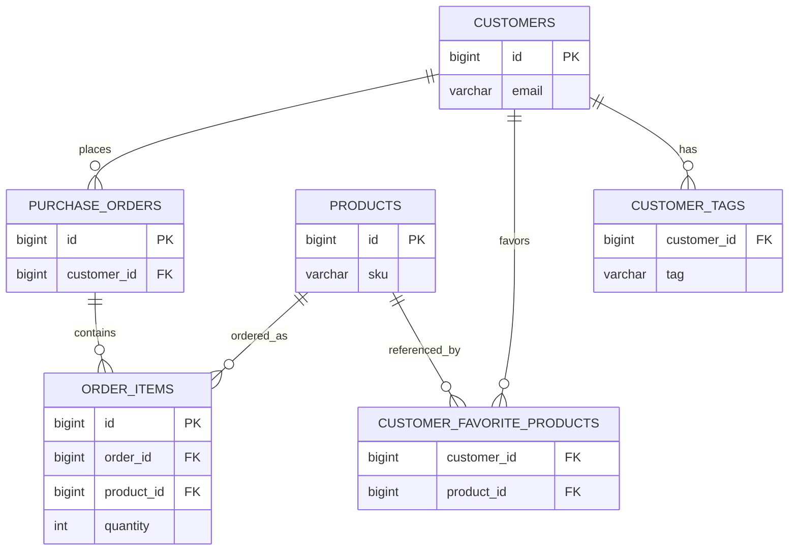
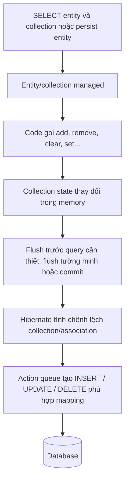

# Thay đổi tập hợp và SQL `UPDATE` hoặc `DELETE` được Hibernate sinh

## 1. Vấn đề: một thao tác Java nhỏ có thể tạo nhiều câu SQL

Trong Java, thay đổi một collection có vẻ rất đơn giản:

```java
customer.getTags().remove("vip");
order.getItems().remove(item);
order.getItems().add(newItem);
```

Nhưng với Hibernate ORM, ba thao tác này có thể tạo ra **những tập câu lệnh SQL khác nhau**: `DELETE` một hàng trong bảng tập hợp, `DELETE` một entity con, `UPDATE` khóa ngoại, hoặc xóa toàn bộ các hàng liên kết rồi `INSERT` lại những phần tử còn giữ. Một thao tác đổi thứ tự trong `List` cũng có thể sinh nhiều `UPDATE` dù bản thân đối tượng con không thay đổi nội dung.

Bài học này tập trung vào **cách Hibernate theo dõi các tập hợp được ánh xạ và quyết định câu `INSERT`, `UPDATE`, `DELETE` khi flush**. Ngữ cảnh là Hibernate ORM 6.x, Jakarta Persistence (`jakarta.persistence.*`), Java 17+ và cơ sở dữ liệu quan hệ như PostgreSQL. Các SQL trong bài mang tính **minh họa hình dạng thao tác**; số câu lệnh, thứ tự, tên alias và khả năng tối ưu phụ thuộc Hibernate version, dialect, cấu hình, mapping và trạng thái persistence context.

Sau bài học, bạn có thể:

- Phân biệt **collection chứa giá trị** (`@ElementCollection`) với **collection chứa entity** (`@OneToMany`, `@ManyToMany`).
- Hiểu Hibernate phát hiện thay đổi collection managed qua snapshot/wrapper, rồi đồng bộ khi flush/commit.
- Dự đoán khi nào thêm/xóa phần tử là thêm/xóa **hàng liên kết**, khi nào là thay đổi **khóa ngoại**, và khi nào là xóa **entity**.
- Giải thích vì sao `List` kiểu bag, `Set`, `List` có `@OrderColumn` và collection có khóa riêng có chi phí cập nhật khác nhau.
- Tổ chức helper method đồng bộ hai phía quan hệ, sử dụng `orphanRemoval`/`cascade` đúng mục đích và tránh `DELETE` ngoài ý muốn.
- Bật SQL log và Hibernate Statistics để quan sát thay vì suy luận số lượng truy vấn từ số dòng Java.

> Quy tắc nền tảng: **`collection.remove(x)` không đồng nghĩa chung với `DELETE FROM table_of_x`.** SQL phụ thuộc phần tử là giá trị hay entity, bảng nào sở hữu liên kết và quy tắc vòng đời của quan hệ.

## 2. Ba kiểu tập hợp quan trọng trong ORM

Giả sử một ứng dụng có `Customer`, `PurchaseOrder`, `OrderItem` và `Product`:

- `Customer.tags`: tập hợp các nhãn chuỗi như `vip`, `newsletter`. Đây là **giá trị**, không có danh tính entity riêng.
- `PurchaseOrder.items`: các dòng hàng có ID, số lượng, đơn giá và khóa ngoại về đơn. Đây là **entity con** có vòng đời gắn với đơn.
- `Customer.favoriteProducts`: danh sách sản phẩm yêu thích. Cả khách lẫn sản phẩm là entity độc lập; quan hệ được biểu diễn trong một **bảng nối**.



| Ánh xạ Java | Loại phần tử | Nơi thường lưu quan hệ | Khi xóa một phần tử khỏi collection |
|---|---|---|---|
| `@ElementCollection Set<String>` | Basic value | Bảng collection (`customer_tags`) | Xóa hàng chứa giá trị; không có entity riêng để xóa. |
| `@ElementCollection List<Address>` | Embeddable value | Bảng collection (`customer_addresses`) | Xóa hoặc tổ chức lại hàng giá trị; có thể nhiều SQL. |
| `@OneToMany(mappedBy = "order")` | Entity (`OrderItem`) | FK `order_items.order_id` | Có thể chỉ cập nhật FK, hoặc xóa entity nếu bật `orphanRemoval`. |
| `@ManyToMany` | Entity độc lập (`Product`) | Bảng nối (`customer_favorite_products`) | Xóa hàng nối; sản phẩm vẫn tồn tại. |

Điểm đầu tiên cần xác định khi đọc một mapping là **đơn vị nào có danh tính độc lập và đơn vị nào thực sự cần bị xóa**.

## 3. Persistence context, collection wrapper và thời điểm sinh SQL

Hibernate theo dõi thay đổi của những entity đang ở trạng thái **managed** trong một persistence context. Đối với collection persistent, provider thường thay collection Java gốc bằng hoặc quản lý qua wrapper của Hibernate, chẳng hạn những triển khai thuộc họ `PersistentSet`, `PersistentBag`, `PersistentList`. Wrapper kết hợp với snapshot của trạng thái cũ giúp Hibernate xác định collection đã thay đổi ra sao.



Ví dụ:

```java
@Transactional
public void removeTag(Long customerId) {
    Customer customer = entityManager.find(Customer.class, customerId);
    customer.removeTag("vip");
    // Không bắt buộc gọi save(customer) nếu entity vẫn managed.
    // SQL được đồng bộ khi Hibernate flush/commit.
}
```

**Thay đổi object trong Java** và **SQL đã thực thi** không phải cùng một sự kiện. Hibernate có thể flush trước một query, khi gọi `entityManager.flush()` hoặc trước commit, tùy flush mode và bối cảnh. Với một số chiến lược sinh ID như `IDENTITY`, `INSERT` có thể diễn ra sớm để lấy ID; nhưng điều đó không thay đổi nguyên tắc giải thích thay đổi collection.

Các hệ quả thực hành:

- Collection thay đổi trong **managed entity** mới được dirty checking tự động. Sửa detached object ngoài transaction không tự cập nhật DB.
- Một collection `LAZY` có thể phải nạp từ DB trước khi thực hiện một số thao tác sửa; cấu hình đặc biệt hoặc DML trực tiếp có thể thay đổi điều đó.
- SQL Hibernate sinh ra dựa trên mapping và trạng thái mà nó quan sát ở thời điểm flush. Một chuỗi `add` rồi `remove` cùng phần tử trước flush có thể không cần SQL cho phần tử đó, nhưng đừng giả định mọi thao tác luôn được tối ưu như nhau.
- Wrapper quản lý collection có ý nghĩa: **giữ và sửa chính collection đang managed** thường an toàn hơn gán thay nó bằng object `new ArrayList<>()` trong mỗi request.

## 4. `@ElementCollection`: khi phần tử là giá trị

`@ElementCollection` dùng cho collection gồm kiểu basic (`String`, `Integer`, enum...) hoặc embeddable (`Address`, `Money`...), không phải những entity có ID riêng. Bảng tập hợp chứa khóa ngoại về owner và các cột biểu diễn giá trị.

### 4.1. Ví dụ `Set<String>` nhãn khách hàng

```java
import jakarta.persistence.*;
import java.util.Collections;
import java.util.HashSet;
import java.util.Set;

@Entity
@Table(name = "customers")
public class Customer {
    @Id
    @GeneratedValue(strategy = GenerationType.IDENTITY)
    private Long id;

    @Column(nullable = false, unique = true)
    private String email;

    @ElementCollection(fetch = FetchType.LAZY)
    @CollectionTable(
        name = "customer_tags",
        joinColumns = @JoinColumn(name = "customer_id"),
        uniqueConstraints = @UniqueConstraint(
            columnNames = {"customer_id", "tag"}))
    @Column(name = "tag", nullable = false, length = 80)
    private Set<String> tags = new HashSet<>();

    protected Customer() {}

    public Customer(String email) { this.email = email; }

    public void addTag(String tag) {
        if (tag == null || tag.isBlank()) {
            throw new IllegalArgumentException("Tag không hợp lệ");
        }
        tags.add(tag.trim().toLowerCase(java.util.Locale.ROOT));
    }

    public void removeTag(String tag) {
        if (tag != null) {
            tags.remove(tag.trim().toLowerCase(java.util.Locale.ROOT));
        }
    }

    public Set<String> getTags() {
        return Collections.unmodifiableSet(tags);
    }

    public Long getId() { return id; }
}
```

Bảng PostgreSQL tương ứng có thể là:

```sql
CREATE TABLE customer_tags (
    customer_id BIGINT NOT NULL REFERENCES customers(id),
    tag VARCHAR(80) NOT NULL,
    PRIMARY KEY (customer_id, tag)
);
```

Giả sử ban đầu có ba hàng:

| customer_id | tag |
|---:|---|
| 10 | `vip` |
| 10 | `newsletter` |
| 10 | `wholesale` |

Khi ứng dụng gọi `customer.removeTag("vip")`, Hibernate có thể xác định chính xác hàng ứng với phần tử cần xóa nhờ khóa owner và giá trị phần tử. Hình dạng SQL thường là:

```sql
DELETE FROM customer_tags
WHERE customer_id = ? AND tag = ?;
-- Bind: 10, 'vip'
```

Khi thêm nhãn `priority`:

```sql
INSERT INTO customer_tags (customer_id, tag)
VALUES (?, ?);
-- Bind: 10, 'priority'
```

**Tại sao Set có thể thuận lợi?** Với giá trị có equality rõ ràng và hàng có thể nhận diện duy nhất, Hibernate có cơ sở để thêm hoặc xóa từng hàng. Không có nghĩa mọi `Set<Embeddable>` luôn dùng một SQL riêng: `NULL` ở nhiều cột, cấu trúc element, khóa/constraint và thuật toán diff có thể khiến provider phải xử lý khác. Hãy kiểm tra SQL trên mapping thực tế.

### 4.2. `clear()` một Set có nghĩa gì?

```java
customer.clearTags();
```

Về mặt nghiệp vụ, owner không còn nhãn nào. Hibernate có thể xóa nhiều hàng riêng rẽ hoặc dùng một câu:

```sql
DELETE FROM customer_tags WHERE customer_id = ?;
```

Chi tiết tùy provider/phiên bản/mapping. Dù dạng SQL nào, **không có entity `Tag` độc lập bị xóa**: chỉ các hàng giá trị thuộc collection của `Customer` biến mất.

## 5. `List` kiểu bag: vì sao xóa một phần tử có thể xóa cả collection rồi thêm lại?

Một `List` Java bảo đảm thứ tự iteration trong memory. Nhưng `@ElementCollection List<String>` **không có `@OrderColumn`** có thể được Hibernate ánh xạ như **bag**: các phần tử có thể trùng nhau và bảng không lưu vị trí index của từng phần tử.

```java
@ElementCollection
@CollectionTable(name = "customer_aliases",
                 joinColumns = @JoinColumn(name = "customer_id"))
@Column(name = "alias", nullable = false)
private List<String> aliases = new ArrayList<>();
```

Giả sử bảng có:

```text
customer_id | alias
------------+--------
10          | An
10          | Anna
10          | An
```

Nếu code gọi `aliases.remove(0)`, sau thao tác collection Java còn `Anna, An`. Nhưng SQL muốn xóa **đúng phần tử ở index 0** phải nhận diện được hàng nào đại diện cho phần tử đó. Bag không có cột index hoặc ID của hàng; hai hàng `An` là giống nhau. Một chiến lược Hibernate có thể sử dụng là:

```sql
DELETE FROM customer_aliases WHERE customer_id = ?;

INSERT INTO customer_aliases (customer_id, alias) VALUES (?, 'Anna');
INSERT INTO customer_aliases (customer_id, alias) VALUES (?, 'An');
```

Tức là **xóa các hàng collection của owner rồi thêm lại các phần tử còn tồn tại**. Với 1.000 phần tử, việc loại bỏ một phần tử có thể tốn nhiều DML hơn ta tưởng.

### 5.1. Vì sao dùng `List` không tự làm database biết index?

Vì `List` là khái niệm Java; nếu database chỉ có `(customer_id, alias)`, nó không chứa thông tin vị trí. Thêm `@OrderBy` chỉ yêu cầu sắp xếp dữ liệu khi truy vấn, **không tạo cột index thể hiện thứ tự chèn trong Java**. Muốn quản lý vị trí persisted, cần `@OrderColumn`.

### 5.2. Có phải mọi `List` đều là bag?

Không. Điều này phụ thuộc mapping và cấu hình Hibernate. Một `List` gắn `@OrderColumn` là indexed list; một `List` không có index có thể mang bag semantics. Hibernate có cấu hình hỗ trợ ngữ nghĩa danh sách mặc định trong những trường hợp nhất định, nên không nên dựa duy nhất vào tên interface Java để dự đoán schema/SQL. Hãy kiểm tra annotation, DDL thực tế và SQL log.

**Bài học thiết kế:** nếu phần tử trùng nhau là hợp lệ nhưng cần xóa/sửa từng phần tử hiệu quả, cân nhắc tạo entity con có ID riêng hoặc dùng cấu trúc tập hợp có khóa phù hợp. Không đổi bag sang Set một cách máy móc nếu nghiệp vụ thực sự cần giữ phần tử trùng.

## 6. `List` với `@OrderColumn`: thứ tự được lưu trong database

Giả sử mỗi khách có nhiều địa chỉ nhận hàng và người dùng muốn kéo thả để đổi thứ tự ưu tiên. `List<Address>` có `@OrderColumn` lưu vị trí trong một cột riêng:

```java
import jakarta.persistence.*;

@Embeddable
public class Address {
    @Column(name = "street", nullable = false)
    private String street;

    @Column(name = "city", nullable = false)
    private String city;

    protected Address() {}

    public Address(String street, String city) {
        this.street = java.util.Objects.requireNonNull(street);
        this.city = java.util.Objects.requireNonNull(city);
    }

    public String getStreet() { return street; }
    public String getCity() { return city; }
}
```

```java
@ElementCollection(fetch = FetchType.LAZY)
@CollectionTable(name = "customer_addresses",
                 joinColumns = @JoinColumn(name = "customer_id"))
@OrderColumn(name = "position")
private List<Address> addresses = new ArrayList<>();
```

Một schema minh họa:

```sql
CREATE TABLE customer_addresses (
    customer_id BIGINT NOT NULL REFERENCES customers(id),
    position INTEGER NOT NULL,
    street VARCHAR(255) NOT NULL,
    city VARCHAR(255) NOT NULL,
    PRIMARY KEY (customer_id, position)
);
```

Ví dụ ban đầu:

| customer_id | position | street |
|---:|---:|---|
| 10 | 0 | Địa chỉ A |
| 10 | 1 | Địa chỉ B |
| 10 | 2 | Địa chỉ C |

Sau `addresses.remove(0)`, danh sách còn B ở index 0, C ở index 1. Hibernate cần **xóa một hàng và điều chỉnh vị trí** cho những hàng còn lại, ví dụ:

```sql
DELETE FROM customer_addresses
WHERE customer_id = ? AND position = ?;

UPDATE customer_addresses
SET position = ?
WHERE customer_id = ? AND position = ?;
```

Hoặc Hibernate có thể ghi lại nội dung các hàng theo từng vị trí thay vì đổi key trực tiếp. Với constraint `(customer_id, position)` duy nhất, việc cập nhật thứ tự còn phải xét thứ tự câu lệnh để tránh xung đột tạm thời. **Không lấy SQL minh họa trên làm cam kết về câu SQL chính xác**: mapping giá trị, nullable column, unique constraint, dialect và phiên bản có thể khiến Hibernate chọn cách khác.

Điểm quan trọng là **thay đổi thứ tự có chi phí ghi vào DB**. Di chuyển phần tử ở đầu `List` dài có thể kéo theo nhiều `UPDATE`, ngay cả khi dữ liệu `Address` không đổi.

### 6.1. `@OrderBy` khác `@OrderColumn`

```java
@ElementCollection
@OrderBy("city ASC")
private List<Address> sortedAddresses;
```

`@OrderBy` yêu cầu Hibernate tạo `ORDER BY` khi lấy dữ liệu dựa trên thuộc tính/cột liên quan. Nó **không định nghĩa vị trí bền vững do người dùng kéo thả**. Nếu người dùng sửa thứ tự trong Java nhưng không sửa các giá trị dùng để sort, lần load tiếp theo thường sẽ lại theo thứ tự của `ORDER BY`.

| Đặc điểm | `@OrderBy` | `@OrderColumn` |
|---|---|---|
| Lưu index của phần tử | Không | Có, qua cột vị trí. |
| Nguồn thứ tự | Thuộc tính/cột dùng sắp xếp | Vị trí phần tử trong list managed. |
| Kéo thả đổi thứ tự | Chưa đủ để persist thứ tự | Có thể persist, nhưng có chi phí SQL cập nhật. |
| SQL khi đọc | Có `ORDER BY` | Hibernate dùng index theo mapping. |
| SQL khi reorder | Không nhất thiết ghi gì nếu state dữ liệu không đổi | Có thể nhiều `UPDATE`/`DELETE`/`INSERT`. |

Nếu cần thứ tự ưu tiên thay đổi thường xuyên với tập hợp lớn, cân nhắc thiết kế một entity quan hệ có `position` hoặc `sortKey` riêng, cùng chiến lược cập nhật vị trí hiệu quả và đảm bảo unique/index trong DB.

## 7. `@OneToMany`: xóa liên kết khác xóa entity con

Với `@OneToMany`, mỗi phần tử là một **entity có định danh riêng**. Điều đó làm kết quả của `remove()` khác `@ElementCollection`.

Giả sử đơn hàng chứa các dòng hàng:

```java
import jakarta.persistence.*;
import java.util.ArrayList;
import java.util.Collections;
import java.util.List;

@Entity
@Table(name = "purchase_orders")
public class PurchaseOrder {
    @Id
    @GeneratedValue(strategy = GenerationType.IDENTITY)
    private Long id;

    @OneToMany(mappedBy = "order", cascade = CascadeType.ALL,
               orphanRemoval = true)
    private List<OrderItem> items = new ArrayList<>();

    protected PurchaseOrder() {}

    public void addItem(Product product, int quantity) {
        OrderItem item = new OrderItem(this, product, quantity);
        items.add(item);
    }

    public void removeItem(OrderItem item) {
        if (items.remove(item)) {
            item.detachOrder();
        }
    }

    public List<OrderItem> getItems() {
        return Collections.unmodifiableList(items);
    }
}
```

```java
import jakarta.persistence.*;

@Entity
@Table(name = "order_items")
public class OrderItem {
    @Id
    @GeneratedValue(strategy = GenerationType.IDENTITY)
    private Long id;

    @ManyToOne(fetch = FetchType.LAZY, optional = false)
    @JoinColumn(name = "order_id", nullable = false)
    private PurchaseOrder order;

    @ManyToOne(fetch = FetchType.LAZY, optional = false)
    @JoinColumn(name = "product_id", nullable = false)
    private Product product;

    @Column(nullable = false)
    private int quantity;

    protected OrderItem() {}

    OrderItem(PurchaseOrder order, Product product, int quantity) {
        if (quantity <= 0) {
            throw new IllegalArgumentException("Số lượng phải lớn hơn 0");
        }
        this.order = java.util.Objects.requireNonNull(order);
        this.product = java.util.Objects.requireNonNull(product);
        this.quantity = quantity;
    }

    void detachOrder() { this.order = null; }

    public Long getId() { return id; }
    public Product getProduct() { return product; }
}
```

Đây là quan hệ **hai chiều**. `OrderItem.order` là phía sở hữu foreign key; `PurchaseOrder.items` có `mappedBy = "order"` là phía nghịch đảo. Helper method cập nhật cả hai hướng in-memory, tránh trạng thái graph không nhất quán.

### 7.1. Thêm dòng hàng

Khi `PurchaseOrder` được managed và `addItem()` thêm entity mới, `cascade = ALL` cho phép Hibernate persist `OrderItem` cùng aggregate khi phù hợp:

```sql
INSERT INTO order_items (order_id, product_id, quantity)
VALUES (?, ?, ?);
```

Vì `OrderItem.order` giữ FK, Hibernate có thể ghi `order_id` đúng ngay trong câu `INSERT`; không cần một bảng nối chỉ để thể hiện quan hệ này.

### 7.2. Xóa dòng hàng với `orphanRemoval = true`

```java
order.removeItem(item);
```

Vì `OrderItem` được coi là con thuộc vòng đời đơn hàng, bỏ nó khỏi `PurchaseOrder.items` kích hoạt ngữ nghĩa **xóa orphan** khi flush:

```sql
DELETE FROM order_items WHERE id = ?;
```

Đây là xóa **bản ghi entity `OrderItem`**. Bản ghi `Product` mà nó tham chiếu **vẫn phải tồn tại**. `cascade = ALL` trên `PurchaseOrder.items` không đồng nghĩa xóa `Product`, vì `Product` không nằm trong quan hệ cascade này.

### 7.3. Bỏ `orphanRemoval` thì chuyện gì xảy ra?

Nếu quan hệ chỉ khai báo:

```java
@OneToMany(mappedBy = "order")
private List<OrderItem> items;
```

thì `items.remove(item)` chỉ thay đổi phía nghịch đảo trong bộ nhớ. Nếu **không sửa `item.order` ở phía sở hữu**, database có thể **không thay đổi foreign key**. Nếu muốn ngắt liên kết trong mô hình cho phép nullable FK, cần cập nhật phía sở hữu:

```java
item.changeOrder(null); // Chỉ hợp lệ khi quan hệ cho phép NULL.
```

Khi đó có thể sinh:

```sql
UPDATE order_items SET order_id = NULL WHERE id = ?;
```

Nhưng trong schema ví dụ `order_id NOT NULL`, việc này sẽ lỗi constraint. Vì `OrderItem` không có ý nghĩa độc lập khi không thuộc đơn nào, `orphanRemoval = true` là lựa chọn phù hợp hơn cho ví dụ này.

**Cần phân biệt:** `orphanRemoval = true` kích hoạt xóa con khi bị loại khỏi quan hệ cha-con; `CascadeType.REMOVE` lan truyền thao tác xóa **cha** sang con khi gọi `remove(parent)` hoặc theo vòng đời tương ứng. Hai cơ chế thường đi cùng nhưng giải quyết các thời điểm khác nhau.

### 7.4. Khi nào không bật `orphanRemoval`?

Nếu một `Employee` chuyển từ `Department A` sang `Department B`, employee vẫn là entity độc lập. Việc loại khỏi `departmentA.employees` không có nghĩa xóa người đó khỏi hệ thống; thay đổi FK `department_id` hoặc dịch chuyển quan hệ là đúng hơn. `orphanRemoval` không phù hợp với entity có quyền tồn tại độc lập hoặc có thể chuyển owner thường xuyên.

## 8. So sánh `@OneToMany` hai chiều, một chiều và bảng nối

Ánh xạ quan hệ ảnh hưởng lớn đến SQL phát sinh.

### 8.1. Hai chiều với `mappedBy` và FK ở entity con

```java
// PurchaseOrder:
@OneToMany(mappedBy = "order", cascade = CascadeType.ALL, orphanRemoval = true)
private List<OrderItem> items;

// OrderItem:
@ManyToOne(fetch = FetchType.LAZY)
@JoinColumn(name = "order_id", nullable = false)
private PurchaseOrder order;
```

Bảng `order_items` giữ `order_id`. Hibernate có thể thêm một dòng bằng `INSERT` và xóa một dòng bằng `DELETE` (khi orphan removal), vì entity con có ID riêng và quan hệ sở hữu rõ ràng.

### 8.2. Một chiều sử dụng bảng nối mặc định

```java
@OneToMany(cascade = CascadeType.ALL, orphanRemoval = true)
private List<OrderItem> items = new ArrayList<>();
```

Với mapping unidirectional không chỉ rõ join column, Hibernate có thể dùng **bảng liên kết** giữa cha và con, dạng `purchase_order_order_item(order_id, item_id)`. Khi xóa một association trong collection, Hibernate có thể xóa các hàng liên kết theo owner rồi tạo lại những hàng còn giữ:

```sql
DELETE FROM purchase_order_order_item WHERE purchase_order_id = ?;
INSERT INTO purchase_order_order_item (purchase_order_id, items_id)
VALUES (?, ?);
-- Lặp lại cho các phần tử vẫn còn.
```

Nếu có `orphanRemoval`, Hibernate còn có thể xóa entity con không còn thuộc cha:

```sql
DELETE FROM order_items WHERE id = ?;
```

Lý do chi phí khác biệt không nằm ở chữ `List` đơn thuần, mà ở **cách liên kết được lưu** và khả năng Hibernate xác định hàng nào cần thay đổi. Với quan hệ cha-con thông thường, mapping hai chiều FK ở con hoặc một chiều `@JoinColumn` được thiết kế cẩn thận thường giúp SQL rõ nghĩa hơn một join table không cần thiết.

### 8.3. Một chiều với `@JoinColumn`

```java
@OneToMany(cascade = CascadeType.ALL, orphanRemoval = true)
@JoinColumn(name = "order_id")
private List<OrderItem> items = new ArrayList<>();
```

Ở đây FK vẫn nằm ở bảng con nhưng chỉ mapping từ phía cha. Hibernate phải quản lý FK thông qua collection; tùy ID strategy và thứ tự flush, có thể phát sinh `UPDATE order_items SET order_id=?` ngoài `INSERT` entity con. Vì vậy cần kiểm tra SQL thực tế và constraint/nullability khi chọn mẫu này.

| Mapping | Ai quản lý FK/association trong object? | Dạng SQL đáng quan tâm |
|---|---|---|
| Bidirectional `mappedBy` + `@ManyToOne` | Phía `@ManyToOne` ở con | `INSERT` con có FK, `DELETE` orphan hoặc `UPDATE` FK. |
| Unidirectional `@OneToMany` mặc định | Collection ở cha, thường qua bảng nối | Có thể `DELETE`/`INSERT` nhiều hàng join table khi sửa collection. |
| Unidirectional `@OneToMany @JoinColumn` | Collection ở cha quản lý FK con | Có thể có `UPDATE` FK riêng, phụ thuộc cách insert và flush. |

Không nên quyết định mapping chỉ dựa vào sự tiện lợi của getter Java. Hãy bắt đầu từ **FK và vòng đời thật** trong relational model.

## 9. `@ManyToMany`: xóa hàng nối, không xóa entity liên quan

Giả sử khách hàng đánh dấu sản phẩm yêu thích. `Customer` và `Product` đều tồn tại độc lập:

```java
@ManyToMany
@JoinTable(
    name = "customer_favorite_products",
    joinColumns = @JoinColumn(name = "customer_id"),
    inverseJoinColumns = @JoinColumn(name = "product_id")
)
private Set<Product> favoriteProducts = new HashSet<>();
```

Schema:

```sql
CREATE TABLE customer_favorite_products (
    customer_id BIGINT NOT NULL REFERENCES customers(id),
    product_id BIGINT NOT NULL REFERENCES products(id),
    PRIMARY KEY (customer_id, product_id)
);
```

Khi khách bỏ yêu thích sản phẩm 20:

```java
customer.getFavoriteProducts().remove(product);
```

SQL phù hợp là:

```sql
DELETE FROM customer_favorite_products
WHERE customer_id = ? AND product_id = ?;
```

**Không nên có**:

```sql
DELETE FROM products WHERE id = ?;
```

Vì các khách khác vẫn có thể mua/yêu thích sản phẩm đó. Do vậy **không sử dụng `CascadeType.REMOVE` hoặc `CascadeType.ALL` vô điều kiện** trên `@ManyToMany` giữa các entity độc lập. Nếu cascade xóa entity được chia sẻ, bạn có thể xóa dữ liệu mà bản ghi khác vẫn cần hoặc nhận lỗi foreign key.

### 9.1. `Set` và `List` ở ManyToMany có thể tạo SQL khác nhau

`Set<Product>` cùng bảng nối có khóa `(customer_id, product_id)` giúp xác định một association duy nhất. Với `List<Product>` dạng bag không lưu index/identity của từng liên kết, xóa một phần tử có thể dẫn tới xử lý xóa tất cả association của owner rồi thêm lại những liên kết còn giữ.

Khi mối quan hệ có dữ liệu riêng như `added_at`, `quantity`, `rank`, `note` hoặc `status`, **không dùng `@ManyToMany` thuần** mà tạo entity bảng nối có ID hoặc khóa ghép, ví dụ `FavoriteProduct` hay `OrderItem`. Khi đó từng quan hệ có danh tính để cập nhật/xóa và có thể sở hữu metadata riêng.

### 9.2. Owning side trong quan hệ hai chiều

Nếu thêm collection nghịch đảo ở `Product`:

```java
@ManyToMany(mappedBy = "favoriteProducts")
private Set<Customer> favoredBy = new HashSet<>();
```

`Customer.favoriteProducts` (có `@JoinTable`) là owning side. Chỉ sửa phía `mappedBy` thường không đủ để ORM ghi đúng bảng nối. Nên có helper đồng bộ hai hướng nếu cả hai phía được sử dụng:

```java
public void favorite(Product product) {
    favoriteProducts.add(product);
    product.addFavoringCustomer(this); // Phương thức package-private ở Product.
}
```

Đừng công khai hai collection mutable và để controller tự sửa tùy tiện; nó dễ tạo hai chiều object graph bất đồng với owning side mà Hibernate sử dụng.

## 10. Collection `Map<K,V>`: cập nhật giá trị hay đổi khóa?

Hibernate/JPA hỗ trợ ánh xạ `Map`, chẳng hạn các cài đặt nhỏ thuộc riêng một khách hàng:

```java
@ElementCollection
@CollectionTable(name = "customer_preferences",
                 joinColumns = @JoinColumn(name = "customer_id"))
@MapKeyColumn(name = "preference_key")
@Column(name = "preference_value")
private Map<String, String> preferences = new HashMap<>();
```

Schema có thể dùng khóa `(customer_id, preference_key)`:

```sql
CREATE TABLE customer_preferences (
    customer_id BIGINT NOT NULL REFERENCES customers(id),
    preference_key VARCHAR(100) NOT NULL,
    preference_value VARCHAR(255),
    PRIMARY KEY (customer_id, preference_key)
);
```

Với:

```java
preferences.put("locale", "vi-VN");
preferences.put("theme", "dark");
preferences.remove("theme");
```

Hibernate có thể tạo SQL tương tự:

```sql
UPDATE customer_preferences
SET preference_value = ?
WHERE customer_id = ? AND preference_key = ?;

DELETE FROM customer_preferences
WHERE customer_id = ? AND preference_key = ?;
```

Khi **đổi key**, `Map` Java thường thực hiện `remove(oldKey)` rồi `put(newKey, value)`; ở DB điều này thường tương ứng xóa hàng cũ và thêm hàng mới thay vì một operation “rename key” trừ khi có logic SQL riêng. Nếu `Map` chứa entity làm value hoặc dùng `@MapKey` trỏ đến thuộc tính entity, việc cập nhật khóa còn phụ thuộc mapping và state của entity. Đừng suy luận mọi loại `Map` sẽ có cùng SQL như map basic value ở trên.

## 11. Một bảng tổng hợp: thao tác nào thường sinh SQL gì?

| Mapping và thao tác | SQL thường gặp khi flush | Entity nào bị xóa? |
|---|---|---|
| `@ElementCollection Set<String>`, `add` | `INSERT` một hàng bảng collection | Không. |
| `@ElementCollection Set<String>`, `remove` | `DELETE` một hàng theo owner + element (khi nhận diện được) | Không. |
| `@ElementCollection List<String>` dạng bag, `remove` | Có thể `DELETE` tất cả theo owner và `INSERT` lại phần còn lại | Không. |
| `@ElementCollection List<Address>` với `@OrderColumn`, reorder | Có thể nhiều `UPDATE` vị trí/nội dung, đôi khi `DELETE`/`INSERT` | Không. |
| Bidirectional `@OneToMany`, thêm child mới | `INSERT` child có FK | Không. |
| `@OneToMany` với `orphanRemoval=true`, remove child | `DELETE` hàng entity child | Có, child. |
| `@OneToMany` không orphan, đổi owner có nullable FK | `UPDATE` FK ở child | Không. |
| Unidirectional `@OneToMany` qua join table, remove | Có thể xóa/tạo lại nhiều hàng association; orphan removal có thể xóa child | Tùy `orphanRemoval`. |
| `@ManyToMany Set<Product>`, remove | `DELETE` hàng join table | Không xóa `Product`. |
| `@ElementCollection Map`, đổi value của key | Có thể `UPDATE` hàng giá trị | Không. |
| Xóa owner có collection value | Xóa các hàng collection theo FK, rồi xóa owner, theo mapping/cascade/DB | Owner; không có value entity riêng. |

Bảng này là **bản đồ định hướng**, không phải hợp đồng về số câu SQL. Hibernate còn quyết định thứ tự thực thi để bảo vệ FK/unique, batching, bulk collection action và chiến lược flush. Một số collection có thể được optimized theo mapping/version; cần xác nhận với log.

## 12. Những thao tác Java dễ gây SQL ngoài mong muốn

### 12.1. Thay cả collection thay vì sửa collection managed

Không nên viết setter thay field collection bằng instance mới một cách tùy tiện:

```java
public void setItems(List<OrderItem> newItems) {
    this.items = new ArrayList<>(newItems); // Có thể làm mất wrapper managed.
}
```

Với collection `orphanRemoval = true`, Hibernate có thể thông báo rằng collection được cấu hình all-delete-orphan không còn được tham chiếu bởi entity owner; trong trường hợp khác, nó có thể hiểu toàn bộ collection đã thay đổi và phát sinh hàng loạt DML. Thay reference cũng làm mất tracking state của wrapper đã nạp.

Giải pháp là **giữ collection hiện có và thực hiện thay đổi có kiểm soát**:

```java
public void replaceItems(List<OrderItem> replacements) {
    for (OrderItem old : new ArrayList<>(items)) {
        removeItem(old);
    }
    for (OrderItem next : replacements) {
        addExistingItem(next);
    }
}
```

Đây chỉ là minh họa việc giữ wrapper; trong domain thực tế, thay toàn bộ vẫn có thể gây nhiều DELETE/INSERT và còn có vấn đề nếu `replacements` chứa chính object cũ. Tốt hơn là **so sánh theo ID hoặc business key**, chỉ thêm/xóa/sửa những phần tử thực sự thay đổi. Đừng áp dụng đoạn code trên như một thuật toán diff tối ưu.

Với collection giá trị đơn giản, API có thể là:

```java
public void updateTags(Set<String> requested) {
    tags.removeIf(existing -> !requested.contains(existing));
    for (String value : requested) {
        addTag(value);
    }
}
```

Nếu normalize tag thành lowercase, cũng cần normalize `requested` trước khi so sánh để tránh xóa/thêm không cần thiết. Điểm chính vẫn là **mutate wrapper** thay vì thay tham chiếu collection.

### 12.2. `clear()` rồi `addAll()` để “cập nhật”

```java
order.getItems().clear();
order.getItems().addAll(requestedItems);
```

Đối với `orphanRemoval`, thao tác đầu có thể đánh dấu **toàn bộ child cũ để xóa**, sau đó thao tác sau thêm entity mới. Ngay cả khi dữ liệu đầu vào gần giống dữ liệu cũ, Hibernate có thể tạo nhiều `DELETE` và `INSERT` hoặc gặp lỗi nếu entity đã bị đánh dấu xóa rồi được gắn lại.

Đừng dùng `clear` rồi add all làm cách cập nhật mặc định cho aggregate lớn. Hãy xác định phần tử bằng ID, xử lý update quantity trên child đang managed, xóa child không còn và thêm child mới. Nếu danh sách ít phần tử và nghiệp vụ thực sự muốn thay thế toàn bộ, chấp nhận chi phí đó một cách có chủ đích.

### 12.3. Sửa phía nghịch đảo nhưng quên phía sở hữu

```java
purchaseOrder.getItems().add(item); // Nếu items có mappedBy, chỉ làm vậy chưa đủ.
```

Nếu `item.order` vẫn là `null` hoặc trỏ sang đơn khác, ORM có thể không ghi đúng FK, hoặc nhận lỗi constraint. Luôn dùng `purchaseOrder.addItem(...)` đặt `item.order = purchaseOrder` cùng lúc. Có thể chọn không public mutable getter để buộc code đi qua helper.

### 12.4. `Set` với `equals/hashCode` không ổn định

Một `Set` xác định phần tử đã tồn tại hay chưa qua `equals`/`hashCode`. Nếu phần tử là entity có ID do DB sinh, kiểu so sánh chỉ dựa trên ID nhưng `hashCode` thay đổi từ lúc `id=null` đến lúc persist có thể làm `HashSet` không tìm được phần tử nữa.

Tương tự, một mutable embeddable đặt trong `Set` và được sửa các field tham gia `hashCode` cũng có thể làm thao tác `remove` thất bại. Các nguyên tắc:

- Với **value object** dùng trong `Set`, nên bất biến về mặt nghiệp vụ và có equality theo toàn bộ giá trị ổn định.
- Với **entity**, cần chiến lược equality nhất quán qua transient/managed/detached/proxy; không tự sinh `equals/hashCode` đi qua toàn bộ quan hệ.
- Tránh thay đổi các trường tham gia `hashCode` khi đối tượng đang ở trong `HashSet`.

Lỗi `Set.remove()` không tìm thấy phần tử có thể làm **không có SQL DELETE nào được sinh**, dù developer nghĩ đã xóa. Đây là lý do phải kiểm tra kết quả thao tác Java trước khi suy luận ORM.

### 12.5. Sửa collection detached rồi `merge`

`EntityManager.merge(detachedOrder)` sao chép state vào một entity managed được trả về. Nếu detached object mang collection thiếu phần tử do DTO mapper hoặc request chỉ gửi một phần dữ liệu, Hibernate có thể hiểu đó là yêu cầu xóa các liên kết/con. Với `orphanRemoval`, hậu quả có thể rất nghiêm trọng.

Đối với cập nhật từng phần, ưu tiên:

```java
@Transactional
public void updateOrder(Long id, UpdateOrderRequest request) {
    PurchaseOrder managed = entityManager.find(PurchaseOrder.class, id);
    if (managed == null) throw new IllegalArgumentException("Không có đơn");

    // Gọi các business method trên managed entity theo đúng field/request.
    // Không merge trực tiếp request DTO thành cả graph entity.
}
```

Chỉ sử dụng `merge` khi hiểu đầy đủ graph detached và quy tắc cascade/collection state. `merge` trả về **managed instance**, đối tượng detached ban đầu không tự biến thành managed.

## 13. `orphanRemoval`, cascade, foreign key và `ON DELETE CASCADE`

Ba cơ chế khác nhau thường được nhắc cùng nhau:

| Cơ chế | Ai thực hiện? | Trường hợp chính |
|---|---|---|
| `CascadeType.REMOVE` | ORM lan truyền thao tác xóa entity | Xóa `PurchaseOrder` thì xóa các `OrderItem` theo cascade. |
| `orphanRemoval = true` | ORM xóa entity con bị loại khỏi quan hệ owner | `order.removeItem(item)` xóa `OrderItem` không còn thuộc đơn. |
| FK `ON DELETE CASCADE` | Database tự xóa hàng tham chiếu khi hàng cha bị xóa | SQL xóa đơn tự kéo theo hàng liên quan theo cấu hình FK. |

`ON DELETE CASCADE` xảy ra **ở database**, có thể giảm số SQL do ORM gửi khi xóa owner, nhưng Hibernate phải biết rõ mapping và cache/persistence context để không giữ giả định sai về các entity đã bị DB xóa. Hibernate có annotation riêng như `@OnDelete(action = OnDeleteAction.CASCADE)` cho một số use case, song cần xác nhận schema FK thật và tác động đến các event/callback/cache.

Đừng kết hợp cơ chế một cách ngẫu nhiên rồi giả định Hibernate sẽ gọi lifecycle callback trên tất cả những bản ghi được database cascade xóa. Callback của entity không nhất thiết được kích hoạt cho các hàng chỉ do FK của DB loại bỏ.

Với `@ElementCollection`, bảng giá trị thường có FK về owner. Khi owner bị xóa, Hibernate hoặc database cần dọn các hàng tập hợp tương ứng để bảo toàn referential integrity. Với `@ManyToMany`, xóa một entity phải dọn hàng nối liên quan; **không vì vậy mà cascade xóa entity bên kia**.

## 14. Collection `LAZY` và chi phí SELECT trước khi sửa

Không phải chỉ SQL ghi mới ảnh hưởng hiệu năng. Khi collection được cấu hình `LAZY`, Hibernate có thể cần đọc toàn bộ collection trước khi tính phần tử cần xóa hoặc bảo đảm trạng thái Java nhất quán.

```java
@Transactional
public void removeItem(Long orderId, Long itemId) {
    PurchaseOrder order = entityManager.find(PurchaseOrder.class, orderId);
    OrderItem target = order.getItems().stream()
        .filter(i -> i.getId().equals(itemId))
        .findFirst()
        .orElseThrow();
    order.removeItem(target);
}
```

Trong nhiều mapping, `order.getItems().stream()` gây `SELECT` toàn bộ items của order, sau đó `DELETE` một child khi flush. Đối với đơn có vài dòng hàng đây thường là hợp lý; đối với collection có hàng triệu phần tử, chiến lược này khó mở rộng.

Các lựa chọn cho collection lớn:

- Dùng repository/query tìm đúng child theo `orderId` và `itemId`, kiểm tra quyền sở hữu rồi xóa theo use case; lưu ý đồng bộ persistence context và callbacks/cascade.
- Mô hình child thành aggregate độc lập nếu vòng đời cho phép, thay vì luôn đòi load toàn bộ collection.
- Dùng batch processing hoặc bulk DML có kiểm soát cho tác vụ quản trị; bulk JPQL/native delete thường **bỏ qua lifecycle/cascade ở mức entity** và có thể khiến state managed/cache cũ.
- Dùng projection cho màn hình danh sách để không vô tình load mọi collection trong quá trình serialize JSON.

Tính năng lazy, extra-lazy và các phương thức tối ưu là phụ thuộc phiên bản/cấu hình Hibernate; không nên mặc định `collection.remove()` luôn có O(1) thao tác database.

## 15. SQL log và Statistics: quan sát thay vì đoán

Ở Spring Boot dùng Hibernate ORM 6.x, có thể bật log tại môi trường phát triển:

```yaml
spring:
  jpa:
    open-in-view: false
    show-sql: false
    properties:
      hibernate:
        format_sql: true
        generate_statistics: true

logging:
  level:
    org.hibernate.SQL: DEBUG
    org.hibernate.orm.jdbc.bind: TRACE
```

- `org.hibernate.SQL` hiển thị SQL, bao gồm `DELETE`, `UPDATE`, `INSERT` tác động lên bảng collection/entity.
- `org.hibernate.orm.jdbc.bind` ở mức `TRACE` trong Hibernate 6 hiển thị giá trị bind; nó có thể lộ thông tin nhạy cảm và tạo nhiều log, chỉ bật tạm thời trong môi trường phù hợp.
- `hibernate.generate_statistics=true` bật thống kê hoạt động Hibernate.
- `show-sql: false` tránh SQL in trực tiếp ra standard output và trùng với logging khi đã dùng logger.

Để lấy thống kê programmatically:

```java
import jakarta.persistence.EntityManagerFactory;
import org.hibernate.SessionFactory;
import org.hibernate.stat.Statistics;

SessionFactory sessionFactory = emf.unwrap(SessionFactory.class);
Statistics stats = sessionFactory.getStatistics();

long beforeStatements = stats.getPrepareStatementCount();
long beforeDeletes = stats.getEntityDeleteCount();
long beforeCollectionUpdates = stats.getCollectionUpdateCount();
long beforeCollectionRecreates = stats.getCollectionRecreateCount();
long beforeCollectionRemoves = stats.getCollectionRemoveCount();

// Thực hiện một transaction đổi collection và flush/commit.

long statementDelta = stats.getPrepareStatementCount() - beforeStatements;
long entityDeleteDelta = stats.getEntityDeleteCount() - beforeDeletes;
long collectionUpdateDelta =
    stats.getCollectionUpdateCount() - beforeCollectionUpdates;
long collectionRecreateDelta =
    stats.getCollectionRecreateCount() - beforeCollectionRecreates;
long collectionRemoveDelta =
    stats.getCollectionRemoveCount() - beforeCollectionRemoves;
```

Đoạn này minh họa với biến `emf` là `EntityManagerFactory` được inject/khởi tạo ở lớp thực hành. Những bộ đếm là **tích lũy ở `SessionFactory`**, không tự dành riêng cho request hiện tại. Khi có traffic đồng thời, phép lấy hiệu có thể bao gồm công việc của request khác. Để đo một thao tác cụ thể, tạo môi trường test cô lập, chuẩn bị dữ liệu trước và kiểm soát thời điểm flush.

Quan trọng: `getCollectionUpdateCount()` và `getCollectionRecreateCount()` đếm **sự kiện collection theo cách Hibernate thống kê**, không phải số hàng SQL bị sửa. Một collection recreate có thể gắn với hàng chục hay hàng nghìn câu `INSERT`; muốn biết SQL thực tế cần xem log, JDBC metrics hoặc kiểm tra database.

### 15.1. Cách ghi lại kết quả thực nghiệm

| Thao tác | SQL đọc phát sinh | SQL ghi phát sinh | Số hàng bị tác động | Ghi chú |
|---|---:|---:|---:|---|
| `Set<String>.remove("vip")` | Đo thực tế | Đo thực tế | Đo thực tế | Quan sát có `DELETE ... AND tag=?` không. |
| `List<String>` dạng bag `remove(0)` | Đo thực tế | Đo thực tế | Đo thực tế | Có xóa/tạo lại các hàng của owner không? |
| `List<Address>` reorder | Đo thực tế | Đo thực tế | Đo thực tế | Bao nhiêu index bị đổi? |
| `order.removeItem(item)` | Đo thực tế | Đo thực tế | Đo thực tế | Có orphan removal và DELETE child không? |
| `favorites.remove(product)` | Đo thực tế | Đo thực tế | Đo thực tế | Chỉ xóa association hay xóa Product? |

Không ghi kết quả giả định thành “đã chạy”. Đây là **mẫu bảng cho bài thực hành**, số liệu được người học điền sau khi chạy trên schema và phiên bản tương ứng.

## 16. Batching và thứ tự thực thi SQL khi sửa nhiều phần tử

Nếu một transaction thêm nhiều `OrderItem`, Hibernate có thể thực thi nhiều câu `INSERT`. JDBC batching gộp một số thao tác tương thích để giảm round-trip khi driver và mapping hỗ trợ:

```yaml
spring:
  jpa:
    properties:
      hibernate:
        jdbc:
          batch_size: 30
        order_inserts: true
        order_updates: true
```

Các flag này chỉ giúp trong tình huống phù hợp, không biến một collection bag cần xóa và tạo lại thành một cập nhật nhỏ. `GenerationType.IDENTITY` thường hạn chế khả năng batch insert các entity dùng IDENTITY vì Hibernate cần biết ID từ kết quả insert. Hãy đo tác động trên workload thật; batch quá lớn cũng có thể tăng sử dụng bộ nhớ và lock contention.

Hibernate dùng action queue để sắp xếp các thao tác flush; **thứ tự SQL không bắt buộc trùng thứ tự lệnh Java**. Ví dụ code xóa một child rồi thêm child có cùng natural key trong cùng transaction có thể chạm unique constraint nếu thứ tự thực thi hoặc ràng buộc DB không phù hợp. Tại các trường hợp cần bảo đảm thứ tự, cân nhắc phân tách bước flush trong transaction, cập nhật thay vì xóa-thêm, hoặc thay đổi schema/constraint theo nghiệp vụ. `flush()` **không phải commit** và có thể gây SQL sớm, nên chỉ gọi khi có lý do rõ ràng.

Khi xóa hàng loạt parent/child, số SQL còn phụ thuộc `cascade`, `orphanRemoval`, FK constraints, batch size và việc collection đã được load hay chưa. Trong nhiều trường hợp, thiết kế mapping hợp lý mang lại lợi ích lớn hơn việc chỉ bật batching.

## 17. Tính nhất quán và cập nhật đồng thời collection

Hai request cùng sửa collection của một owner có thể ghi đè hoặc xung đột theo cách phụ thuộc mapping và isolation level:

```text
Transaction A: đọc Customer tags = {vip, newsletter}
Transaction B: đọc Customer tags = {vip, newsletter}
Transaction A: xóa vip
Transaction B: thêm wholesale
```

Nếu Hibernate xử lý collection bằng cách xóa-tạo lại toàn bộ hàng theo owner, hai transaction có thể gây contention hoặc kết quả không như ứng dụng mong đợi. Với các thao tác DML trên từng hàng, unique key và transaction isolation vẫn quan trọng để tránh trùng/chồng chéo thay đổi.

`@Version` trên entity owner có thể tham gia cơ chế optimistic locking cho một số thay đổi collection thuộc entity theo cách Hibernate quản lý; nhưng **không nên giả định mọi collection update đều tự tăng version và bảo vệ mọi thao tác đồng thời**. Điều đó phụ thuộc ownership, mapping và cách sửa dữ liệu (bulk/native SQL có thể bỏ qua version). Nếu yêu cầu không mất thay đổi giữa nhiều người dùng, cần xác định chính sách:

- Kiểm tra optimistic version của owner trong use case nếu collection là một phần aggregate cần quản lý nhất quán.
- Dùng transaction và constraint DB (UNIQUE/FK) để chống trạng thái bất hợp lệ.
- Khi xung đột, retry **toàn bộ transaction** hoặc trả lỗi rõ ràng; đừng retry riêng một câu SQL mà không kiểm tra lại state.
- Dùng lock theo hàng owner hoặc thiết kế thao tác cập nhật từng association có chủ đích nếu hệ thống có mức tranh chấp cao.

**Bài kiểm thử đồng thời:** mở hai transaction, cùng đọc một collection, thay đổi mỗi bên, commit theo thứ tự thay đổi; đối chiếu kết quả cuối cùng, version owner và SQL logs trên PostgreSQL. Đừng dùng kết quả một test H2 để khẳng định đầy đủ về locking/isolation của PostgreSQL hoặc MySQL.

## 18. Cách thiết kế API cập nhật collection

Một REST API nhận `List<OrderItemRequest>` có thể mang hai ngữ nghĩa rất khác nhau:

1. **Thay thế toàn bộ danh sách:** tất cả child không có trong payload phải bị xóa hoặc bỏ liên kết.
2. **Cập nhật một phần:** chỉ các child được nêu có thay đổi; child không xuất hiện phải được giữ nguyên.

Nếu không quy định rõ, controller dễ `clear()` rồi `addAll()` hoặc merge một detached graph, từ đó gây hàng loạt `DELETE` không mong muốn. Nên công bố contract và xử lý ở service:

```java
public record ItemChange(Long itemId, Long productId, int quantity) {}
```

Với request cập nhật một phần:

- `itemId` có giá trị: tìm đúng child hiện hữu, xác minh nó thuộc order và cập nhật field qua method như `changeQuantity`.
- `itemId` thiếu/null theo contract: thêm dòng mới nếu dữ liệu hợp lệ.
- Xóa dòng: dùng thao tác riêng như `removeItem(itemId)` hoặc một danh sách `removedIds` rõ nghĩa.

Với request thay toàn bộ danh sách, xây dựng tập ID có trong payload và so sánh với tập hiện có, **chỉ xóa những ID vắng mặt**, sửa những ID chung và thêm những phần tử mới. Điều này tiết kiệm SQL và giảm nguy cơ làm mất bản ghi có ID/stored history.

Để tránh client tác động child của order khác, service phải kiểm tra membership/ownership ngay trong transaction, không chỉ tin `itemId` client gửi. Điều này cũng áp dụng cho xóa association ManyToMany.

## 19. Bài thực hành tổng hợp với dữ liệu cụ thể

Tạo một dự án Spring Boot + Hibernate 6 + PostgreSQL (có thể dùng Testcontainers) và tối thiểu bốn bảng chính: `customers`, `products`, `purchase_orders`, `order_items`. Bổ sung các bảng collection `customer_tags`, `customer_aliases`, `customer_addresses`, `customer_favorite_products`. Dùng schema/migration phù hợp với mapping của từng phần.

### Bước A — Value Set

1. Tạo khách ID 10, tags `{vip, newsletter, wholesale}`.
2. Load khách trong transaction mới, gọi `removeTag("vip")`, flush.
3. Quan sát SQL: có thể xóa đúng hàng `(10, vip)` hay Hibernate dùng chiến lược khác?
4. Gọi `addTag("priority")` và thử add một tag đã có, ghi số câu `INSERT`.

**Điểm cần giải thích:** phần tử `String` không có ID entity; uniqueness trong Set và khóa bảng tập hợp giúp DB biểu diễn đúng giá trị không trùng.

### Bước B — Bag so với indexed List

1. Tạo `aliases = ["An", "Anna", "An"]` với `@ElementCollection List<String>` không `@OrderColumn`.
2. Xóa một phần tử `An`; ghi SQL xóa/thêm lại (nếu có) và số hàng thực sự tác động.
3. Tạo `addresses = [A, B, C]` với `@OrderColumn` rồi xóa A và đổi vị trí C lên trước B.
4. Quan sát `UPDATE` index, constraint `(customer_id, position)`, và khác biệt giữa `@OrderColumn` với `@OrderBy`.

**Điểm cần giải thích:** Java `List` có thứ tự nhưng không nhất thiết có cột vị trí trong SQL; khả năng nhận diện từng hàng quyết định chi phí cập nhật.

### Bước C — Entity con và orphan removal

1. Tạo `PurchaseOrder` có ba `OrderItem` và `cascade = ALL, orphanRemoval = true`.
2. Trong transaction mới, loại một item bằng helper method cập nhật hai phía.
3. Kiểm tra SQL xóa đúng entity con, xác nhận `Product` còn tồn tại.
4. Thử cấu hình bỏ `orphanRemoval` trong một nhánh thực hành để thấy ngữ nghĩa tháo liên kết khác xóa con; chỉ dùng nullable FK nếu phép thử cần cập nhật FK thành NULL.

**Điểm cần giải thích:** owning side là `OrderItem.order`; `mappedBy` không tự ghi foreign key khi chỉ sửa phía nghịch đảo.

### Bước D — ManyToMany

1. Tạo khách yêu thích hai sản phẩm, rồi bỏ yêu thích một sản phẩm.
2. Quan sát bảng nối `customer_favorite_products` và `products`.
3. Xác minh liên kết bị xóa nhưng sản phẩm vẫn còn; không bật `CascadeType.REMOVE` sang sản phẩm.

**Điểm cần giải thích:** association row khác entity được liên kết; xóa mối quan hệ không đồng nghĩa xóa đối tượng.

### Bước E — Hiệu năng và đồng thời

1. Tạo một bag có vài trăm phần tử, xóa một phần tử, đo số SQL và hàng bị tác động.
2. So sánh với `Set` có khóa phần tử và một collection entity con có ID riêng trong tình huống nghiệp vụ tương đương.
3. Chạy hai transaction sửa cùng collection/owner, quan sát khả năng xung đột, version và constraint trên DB thực tế.
4. Ghi kết quả bằng bảng đo như phần 15, giải thích điểm khác nhau bằng mapping, không chỉ bằng loại collection Java.

## 20. Những lỗi thường gặp và cách khắc phục

| Triệu chứng | Nguyên nhân có thể | Hướng xử lý |
|---|---|---|
| Xóa một phần tử mà log có hàng trăm `INSERT` | Bag thiếu row identity/index; Hibernate xóa và tạo lại nhiều association/value rows. | Dùng Set/indexed list hoặc entity con có ID phù hợp với nghiệp vụ. |
| `remove()` không tạo SQL | Entity detached; `Set.remove` trả false; chỉ sửa phía `mappedBy`; chưa flush. | Kiểm tra state managed, equality, owning side và flush/log. |
| Xóa khỏi List gây `UPDATE` nhiều hàng | `@OrderColumn` cần cập nhật vị trí của phần tử còn lại. | Đánh giá lại yêu cầu giữ thứ tự và cách lưu sort key. |
| Xóa item khỏi order nhưng DB vẫn giữ item | Thiếu `orphanRemoval` trong mô hình muốn xóa child, hoặc FK owning side chưa thay đổi. | Xác định vòng đời child và cấu hình/helper đúng. |
| Bỏ favorite làm mất cả Product | Cascade REMOVE/ALL sai hướng ở ManyToMany. | Không cascade xóa entity chia sẻ; chỉ xóa join row. |
| Gặp `deleted object would be re-saved by cascade` | Child bị đánh dấu xóa rồi lại được gắn/cascade trong cùng graph. | Thiết kế helper/transaction tránh xóa-rồi-gắn-lại cùng object. |
| Lỗi all-delete-orphan collection no longer referenced | Thay instance collection managed bằng collection mới. | Giữ wrapper và mutate collection cũ. |
| `HashSet` không tìm được entity sau persist | `hashCode` phụ thuộc ID đổi từ null sang giá trị mới. | Thiết kế equality/hash ổn định theo vòng đời entity. |
| Sửa collection gây `LazyInitializationException` | Duyệt/sửa collection lazy ngoài session hợp lệ. | Xử lý trong service transaction, fetch đúng quan hệ cần dùng. |
| Cập nhật toàn bộ graph làm mất nhiều child | Merge detached object/payload thiếu phần tử bị hiểu là yêu cầu xóa. | Dùng request DTO có semantics rõ và cập nhật entity managed có chọn lọc. |
| SQL thứ tự khác lệnh Java | Action queue/flush và dependency FK/unique. | Xem SQL và constraint; tổ chức cập nhật/flush hợp lý. |
| Hibernate Statistics ít nhưng SQL log nhiều | Collection count là sự kiện ORM, không phải số hàng DML. | Kết hợp SQL log, statement count và row count DB. |

## 21. Kết luận thực hành

Khi nhìn một collection entity trong Hibernate, hãy xác định theo thứ tự:

1. **Phần tử là value hay entity?** `@ElementCollection` quản lý giá trị thuộc owner; `@OneToMany`/`@ManyToMany` liên kết các entity có identity.
2. **DB nhận diện một phần tử bằng gì?** Khóa `(owner, value)`, `(owner, index)`, ID của entity con, khóa bảng nối hay không có row identity? Đây là yếu tố quan trọng dẫn đến `DELETE` một hàng hay xóa/tạo lại nhiều hàng.
3. **Ai sở hữu quan hệ?** Với `mappedBy`, phía còn lại mới quản lý FK; helper method cần giữ hai phía object graph nhất quán.
4. **Loại khỏi collection có xóa entity hay không?** Kiểm tra `orphanRemoval`, `cascade`, FK và vòng đời thực của đối tượng, đặc biệt khi có entity dùng chung như `Product`.
5. **Collection đang managed hay detached, có bị thay reference không?** Dirty checking và SQL synchronization gắn với persistence context; mutate wrapper managed theo use case.
6. **SQL thực tế là gì?** Quan sát log tại flush, số statement và tác động DB. Không suy luận chắc chắn về hiệu năng từ `add()`/`remove()` của Java.

Hiểu sáu câu hỏi này giúp thiết kế mapping collection có chủ đích, tránh tình trạng sửa một phần tử mà Hibernate phải xóa cả bảng liên kết của owner, và quan trọng hơn là tránh xóa nhầm entity nghiệp vụ do dùng `cascade` hoặc `orphanRemoval` sai ngữ nghĩa.
