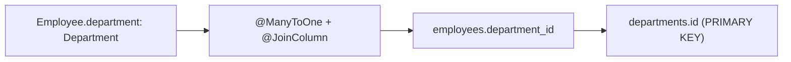
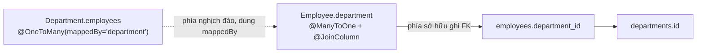

# `@ManyToOne`, khóa ngoại và phía quản lý liên kết trong Hibernate

## 1. Bản chất của quan hệ nhiều-một

Trong mô hình quan hệ, quan hệ **nhiều-một** (*many-to-one*) mô tả nhiều bản ghi ở một bảng có thể tham chiếu tới cùng một bản ghi ở bảng khác.

Ví dụ: một nhân viên thuộc **một** phòng ban, trong khi một phòng ban có thể có **nhiều** nhân viên.

```text
departments                            employees
+----+-------------+                   +----+--------+---------------+
| id | name        |                   | id | name   | department_id |
+----+-------------+                   +----+--------+---------------+
| 10 | Engineering | <---------------- |  1 | An     |            10 |
| 20 | Sales       | <---------------- |  3 | Chi    |            20 |
+----+-------------+               +-- |  2 | Bình   |            10 |
                                    |   +----+--------+---------------+
                                    +--- department_id = 10
```

Trong ví dụ này:

- Bảng `departments` có **khóa chính** `id`.
- Bảng `employees` chứa cột `department_id` tham chiếu `departments.id`.
- Nhiều dòng `employees` có thể cùng mang `department_id = 10`.
- Một bản ghi `Employee` có thuộc tính tham chiếu tới một `Department` duy nhất ở một thời điểm.

Ở Java, Hibernate biểu diễn quan hệ đó bằng `@ManyToOne`:

```java
@ManyToOne
private Department department;
```

Đây là một **liên kết đơn trị**: mỗi đối tượng `Employee` chứa một tham chiếu `Department`, khác với `@OneToMany` giữ một tập hợp nhiều đối tượng.

Quan hệ giữa Java và SQL được hình dung như sau:



Điều quan trọng nhất cần hiểu là **bên giữ khóa ngoại là phía quản lý liên kết** (*owning side*) trong mô hình `@ManyToOne` thông thường. Trong quan hệ hai chiều giữa `Employee` và `Department`, đó chính là field `Employee.department`.

## 2. `@ManyToOne` và `@JoinColumn` đảm nhiệm việc gì?

Hai annotation xuất hiện cùng nhau nhưng có trách nhiệm khác nhau:

- `@ManyToOne` cho ORM biết **bản chất liên kết giữa hai entity**: nhiều `Employee` liên kết tới một `Department`.
- `@JoinColumn` mô tả **cột join** trong bảng của phía sở hữu, thường là cột khóa ngoại như `department_id`.

Ví dụ entity phía phòng ban:

```java
package com.example.company;

import jakarta.persistence.Column;
import jakarta.persistence.Entity;
import jakarta.persistence.GeneratedValue;
import jakarta.persistence.GenerationType;
import jakarta.persistence.Id;
import jakarta.persistence.Table;

@Entity
@Table(name = "departments")
public class Department {

    @Id
    @GeneratedValue(strategy = GenerationType.IDENTITY)
    private Long id;

    @Column(name = "name", nullable = false, length = 120)
    private String name;

    protected Department() {
        // Dành cho Hibernate/JPA.
    }

    public Department(String name) {
        this.name = name;
    }

    public Long getId() {
        return id;
    }

    public String getName() {
        return name;
    }
}
```

Entity nhân viên với liên kết tới phòng ban:

```java
package com.example.company;

import jakarta.persistence.Column;
import jakarta.persistence.Entity;
import jakarta.persistence.FetchType;
import jakarta.persistence.ForeignKey;
import jakarta.persistence.GeneratedValue;
import jakarta.persistence.GenerationType;
import jakarta.persistence.Id;
import jakarta.persistence.JoinColumn;
import jakarta.persistence.ManyToOne;
import jakarta.persistence.Table;

@Entity
@Table(name = "employees")
public class Employee {

    @Id
    @GeneratedValue(strategy = GenerationType.IDENTITY)
    private Long id;

    @Column(name = "full_name", nullable = false, length = 120)
    private String fullName;

    @ManyToOne(fetch = FetchType.LAZY, optional = false)
    @JoinColumn(
        name = "department_id",
        referencedColumnName = "id",
        nullable = false,
        foreignKey = @ForeignKey(name = "fk_employee_department")
    )
    private Department department;

    protected Employee() {
    }

    public Employee(String fullName, Department department) {
        this.fullName = fullName;
        this.department = department;
    }

    public Long getId() {
        return id;
    }

    public String getFullName() {
        return fullName;
    }

    public Department getDepartment() {
        return department;
    }

    public void transferTo(Department newDepartment) {
        if (newDepartment == null) {
            throw new IllegalArgumentException(
                "Department is required"
            );
        }
        this.department = newDepartment;
    }
}
```

### 2.1. Ý nghĩa của từng thuộc tính

| Cấu hình | Ý nghĩa |
|---|---|
| `@ManyToOne` | Mỗi employee có tham chiếu tới một department; nhiều employee có thể cùng department. |
| `fetch = FetchType.LAZY` | Yêu cầu Hibernate trì hoãn việc tải department khi có thể. |
| `optional = false` | Quan hệ bắt buộc ở mức mô hình object: employee phải có department. |
| `@JoinColumn(name = "department_id")` | Cột FK thuộc bảng `employees`. |
| `referencedColumnName = "id"` | Cột được tham chiếu ở bảng `departments` là `id`. |
| `nullable = false` | Gợi ý tạo cột `department_id NOT NULL` khi ORM sinh schema. |
| `@ForeignKey(name = "fk_employee_department")` | Cung cấp tên cho FK constraint trong DDL được Hibernate/JPA sinh ra nếu môi trường hỗ trợ. |

`referencedColumnName = "id"` có thể bỏ qua nếu ta chỉ tham chiếu đến **primary key mặc định** của `Department`. Dùng tường minh trong ví dụ giúp thấy rõ hướng khóa ngoại.

### 2.2. SQL tương ứng

Một cách tạo schema minh họa:

```sql
CREATE TABLE departments (
    id BIGINT GENERATED BY DEFAULT AS IDENTITY PRIMARY KEY,
    name VARCHAR(120) NOT NULL
);

CREATE TABLE employees (
    id BIGINT GENERATED BY DEFAULT AS IDENTITY PRIMARY KEY,
    full_name VARCHAR(120) NOT NULL,
    department_id BIGINT NOT NULL,
    CONSTRAINT fk_employee_department
        FOREIGN KEY (department_id)
        REFERENCES departments(id)
);

CREATE INDEX idx_employee_department
    ON employees(department_id);
```

Cú pháp sinh ID là minh họa; PostgreSQL, MySQL, Oracle, SQL Server và H2 có khác biệt về DDL. Index ở `department_id` giúp nhiều truy vấn lọc/join theo FK, nhưng nhu cầu index cụ thể còn phụ thuộc database và workload.

`@ForeignKey` và `nullable = false` hỗ trợ sinh DDL, song **khi schema do Flyway/Liquibase hoặc DBA quản lý, constraint thực tế trong database mới quyết định tính toàn vẹn**. Không giả định các annotation đã tự động cập nhật mọi môi trường production.

### 2.3. Vì sao FK nằm ở `employees`?

Mỗi dòng nhân viên chỉ cần lưu một giá trị `department_id`. Nếu chuyển một nhân viên từ Engineering sang Sales, ta cập nhật một dòng:

```sql
UPDATE employees
SET department_id = 20
WHERE id = 1;
```

Không cần tạo thêm cột `employee_id_1`, `employee_id_2` trong bảng phòng ban. Điều này thể hiện cách cơ sở dữ liệu quan hệ mô hình hóa liên kết nhiều-một bằng một FK ở phía “nhiều”.

**Không đặt ràng buộc `UNIQUE(department_id)`** cho quan hệ nhiều-một thông thường: uniqueness trên `employees.department_id` sẽ khiến một phòng ban chỉ được tham chiếu bởi tối đa một nhân viên và làm thay đổi cardinality thực tế thành một-một.

## 3. Phía quản lý liên kết (*owning side*) là gì?

Trong Hibernate/Jakarta Persistence, **phía quản lý liên kết** là phía mà thay đổi của nó được ORM dùng để quản lý giá trị liên kết trong database, tức cột khóa ngoại hoặc cấu trúc join tương ứng.

Với quan hệ một chiều:

```java
@Entity
class Employee {
    @ManyToOne
    @JoinColumn(name = "department_id")
    private Department department;
}
```

`Employee.department` là bên sở hữu. Thay đổi giá trị field này trên một `Employee` đang managed có thể làm Hibernate phát `UPDATE employees SET department_id = ...` khi flush/commit.

**Lưu ý:** owning side không nhất thiết là entity có “quyền nghiệp vụ” đối với entity khác. Đây là thuật ngữ kỹ thuật nói về **quyền ghi mapping quan hệ**, không phải quyền truy cập của người dùng, quyền sở hữu dữ liệu hay vai trò domain aggregate.

### 3.1. Cập nhật FK bằng cách thay đổi phía sở hữu

Giả sử `employee` là entity managed và `newDepartment` cũng là entity có tồn tại trong database:

```java
Employee employee = em.find(Employee.class, employeeId);
Department newDepartment = em.find(Department.class, newDepartmentId);

employee.transferTo(newDepartment);

// Tại flush/commit, Hibernate có thể sinh:
// UPDATE employees SET department_id = ? WHERE id = ?
```

Nếu muốn bảo đảm FK trỏ đúng một department hợp lệ, có thể truy vấn nó trước hoặc dùng `getReference` khi biết ID hợp lệ và chấp nhận rằng lỗi FK/existence có thể xuất hiện muộn. Với dữ liệu từ request ngoài, nên xác minh tồn tại và quyền sử dụng của department theo nghiệp vụ.

### 3.2. “Sở hữu liên kết” không đồng nghĩa cascade

`@ManyToOne` quyết định bên ghi FK, còn `cascade` quy định **thao tác vòng đời nào lan từ entity này sang entity liên kết**. Đây là hai cơ chế độc lập.

Một nhân viên có thể **sở hữu FK** `department_id` mà hoàn toàn **không** được phép xóa phòng ban khi xóa nhân viên. Việc cấu hình cascade phải theo quy tắc vòng đời thực tế của domain.

## 4. Quan hệ một chiều: chỉ cần `@ManyToOne`

Nếu nghiệp vụ chỉ cần từ nhân viên tìm ra phòng ban, không cần từ phòng ban duyệt toàn bộ nhân viên, model một chiều là đủ:

```text
Employee  --- @ManyToOne --->  Department
```

```java
Employee employee = em.find(Employee.class, 1L);
String departmentName = employee.getDepartment().getName();
```

`Department` không cần field `List<Employee>`. Database vẫn có FK `employees.department_id` và có thể tìm tất cả nhân viên của phòng ban bằng JPQL:

```java
List<Employee> employees = em.createQuery(
        """
        select e
        from Employee e
        where e.department.id = :departmentId
        order by e.id
        """,
        Employee.class
    )
    .setParameter("departmentId", 10L)
    .getResultList();
```

Quan hệ một chiều giúp model đơn giản khi không cần collection phía ngược. Không nhất thiết phải viết hai chiều chỉ vì quan hệ có thể được nhìn từ hai phía.

## 5. Quan hệ hai chiều: `@ManyToOne` và `@OneToMany(mappedBy = ...)`

Khi cần từ `Department` lấy danh sách `Employee`, thêm phía ngược bằng `@OneToMany`.

```java
import java.util.ArrayList;
import java.util.List;

import jakarta.persistence.Entity;
import jakarta.persistence.Id;
import jakarta.persistence.OneToMany;

@Entity
public class Department {
    @Id
    private Long id;

    @OneToMany(mappedBy = "department")
    private List<Employee> employees = new ArrayList<>();

    // Các thuộc tính, constructor, getter khác.
}
```

Trên `Employee` vẫn giữ:

```java
@ManyToOne(fetch = FetchType.LAZY, optional = false)
@JoinColumn(name = "department_id", nullable = false)
private Department department;
```

Sơ đồ:



**Chỉ `Employee.department` là owning side của FK.** `Department.employees` là **phía nghịch đảo** (*inverse side*), tức đối tượng biểu diễn quan hệ theo chiều ngược lại.

### 5.1. `mappedBy` phải là tên thuộc tính Java

```java
@OneToMany(mappedBy = "department")
private List<Employee> employees;
```

Giá trị `"department"` trỏ tới **tên field/property** `Employee.department` đã được mapping với `@ManyToOne`. Nó **không phải** tên cột `department_id` và cũng không phải tên entity `Department`.

Ví dụ sai:

```java
// Sai: department_id là tên cột SQL, không phải property Java.
@OneToMany(mappedBy = "department_id")
private List<Employee> employees;
```

Sai khác: khai báo cả hai phía như hai quan hệ sở hữu riêng, khiến ORM có thể hiểu thành hai mapping không đồng nhất hoặc cần cấu trúc join ngoài ý muốn. Khi đã chọn mô hình hai chiều với FK tại `Employee`, khai báo `@JoinColumn` ở owning side `@ManyToOne`; đặt `mappedBy` ở phía `@OneToMany`.

### 5.2. Tại sao chỉ sửa collection có thể không cập nhật FK?

Đoạn mã sau thay đổi collection trong bộ nhớ:

```java
Department dept = em.find(Department.class, 10L);
Employee employee = em.find(Employee.class, 1L);

// Không đủ để đổi khóa ngoại của Employee:
dept.getEmployees().add(employee);
```

Nếu `Employee.department` vẫn trỏ tới một department khác, bạn đã tạo ra **hai phía Java không nhất quán**. Với mapping `mappedBy` thông thường, Hibernate xem `Employee.department` là nguồn điều khiển cập nhật FK; chỉ thêm vào collection nghịch đảo không phải cách đáng tin cậy để đổi `employees.department_id`.

Ví dụ đúng về quan hệ:

```java
Department dept = em.find(Department.class, 10L);
Employee employee = em.find(Employee.class, 1L);

employee.transferTo(dept); // Cập nhật owning side.
```

Tuy nhiên, khi có quan hệ hai chiều và collection đã được tải trong cùng persistence context, chỉ đổi owning side có thể khiến `Department.employees` vẫn giữ ảnh chụp cũ **trong bộ nhớ Java** cho tới khi đồng bộ lại object graph. Vì vậy, ứng dụng nên duy trì nhất quán **cả hai phía** bằng helper method.

## 6. Helper method đồng bộ hai phía

Ví dụ sau thiết kế một cặp entity đầy đủ hơn. `Department.addEmployee(...)` sẽ đồng bộ collection và thuộc tính owning side:

```java
package com.example.company;

import java.util.ArrayList;
import java.util.Collections;
import java.util.List;
import java.util.Objects;

import jakarta.persistence.Column;
import jakarta.persistence.Entity;
import jakarta.persistence.GeneratedValue;
import jakarta.persistence.GenerationType;
import jakarta.persistence.Id;
import jakarta.persistence.OneToMany;
import jakarta.persistence.Table;

@Entity
@Table(name = "departments")
public class Department {

    @Id
    @GeneratedValue(strategy = GenerationType.IDENTITY)
    private Long id;

    @Column(nullable = false)
    private String name;

    @OneToMany(mappedBy = "department")
    private List<Employee> employees = new ArrayList<>();

    protected Department() {
    }

    public Department(String name) {
        this.name = Objects.requireNonNull(name);
    }

    public Long getId() {
        return id;
    }

    public String getName() {
        return name;
    }

    // Chỉ cho code bên ngoài đọc collection qua view.
    public List<Employee> getEmployees() {
        return Collections.unmodifiableList(employees);
    }

    public void addEmployee(Employee employee) {
        Objects.requireNonNull(employee);

        if (employee.getDepartment() == this) {
            if (!employees.contains(employee)) {
                employees.add(employee);
            }
            return;
        }

        Department old = employee.getDepartment();

        if (old != null) {
            old.employees.remove(employee);
        }

        employee.setDepartmentInternal(this);

        if (!employees.contains(employee)) {
            employees.add(employee);
        }
    }
}
```

Entity `Employee` tương ứng:

```java
package com.example.company;

import java.util.Objects;

import jakarta.persistence.Column;
import jakarta.persistence.Entity;
import jakarta.persistence.FetchType;
import jakarta.persistence.GeneratedValue;
import jakarta.persistence.GenerationType;
import jakarta.persistence.Id;
import jakarta.persistence.JoinColumn;
import jakarta.persistence.ManyToOne;
import jakarta.persistence.Table;

@Entity
@Table(name = "employees")
public class Employee {

    @Id
    @GeneratedValue(strategy = GenerationType.IDENTITY)
    private Long id;

    @Column(name = "full_name", nullable = false)
    private String fullName;

    @ManyToOne(fetch = FetchType.LAZY, optional = false)
    @JoinColumn(name = "department_id", nullable = false)
    private Department department;

    protected Employee() {
    }

    public Employee(String fullName) {
        this.fullName = Objects.requireNonNull(fullName);
    }

    public Long getId() {
        return id;
    }

    public String getFullName() {
        return fullName;
    }

    public Department getDepartment() {
        return department;
    }

    // Package-private: việc thay đổi quan hệ đi qua helper của Department.
    void setDepartmentInternal(Department department) {
        this.department = department;
    }
}
```

Sử dụng:

```java
Department engineering = new Department("Engineering");
Employee employee = new Employee("An");

// Thiết lập cả hai chiều trước khi persist.
engineering.addEmployee(employee);

em.persist(engineering);
em.persist(employee);
```

Hibernate xem `employee.department` là owning side, từ đó ghi `department_id` trong câu `INSERT employees`. Collection `engineering.employees` được cập nhật đồng bộ để domain model trong bộ nhớ cũng phản ánh quan hệ mới.

### 6.1. Chuyển nhân viên giữa hai phòng ban

```java
Department sales = em.find(Department.class, salesDepartmentId);
Employee employee = em.find(Employee.class, employeeId);

sales.addEmployee(employee);
```

Helper sẽ:

1. Lấy department cũ của employee.
2. Gỡ employee khỏi collection đã được đồng bộ của department cũ.
3. Gán `employee.department = sales`, tức thay đổi owning side.
4. Thêm employee vào collection của department mới.
5. Để Hibernate đồng bộ FK trong lúc `flush/commit`.

Đoạn helper này minh họa object graph hai chiều với entity đang làm việc trong cùng một context hợp lệ. Trong ứng dụng production cần quan tâm thêm nghiệp vụ chuyển phòng ban, equality của entity và cách thực hiện với collection rất lớn/chưa tải. Helper gọi `contains` hoặc `remove` có thể khởi tạo collection lazy và gây SQL không cần thiết; đôi khi chỉ cập nhật owning side và làm mới/đọc lại collection tại ranh giới thích hợp sẽ hiệu quả hơn.

### 6.2. Vì sao không có `removeEmployee` trong ví dụ?

Liên kết trên được khai báo **bắt buộc**:

```java
@ManyToOne(optional = false)
@JoinColumn(nullable = false)
private Department department;
```

Nếu gọi `employee.setDepartmentInternal(null)` rồi flush, bản ghi vi phạm yêu cầu `department_id NOT NULL` (hoặc vi phạm quy tắc object model). Xóa nhân viên khỏi phòng ban cần một trong các quyết định nghiệp vụ:

- **Chuyển sang phòng ban khác:** đổi FK sang department mới.
- **Cho phép nhân viên không có phòng ban:** đổi mapping `optional = true`, cột `nullable = true` và quy tắc nghiệp vụ tương ứng.
- **Xóa entity nhân viên:** thực hiện xóa nhân viên theo transaction và lifecycle được thiết kế; không mặc định rằng gỡ collection sẽ tự xóa.

Vì vậy không nên viết helper `removeEmployee` gán `null` trong mô hình có FK bắt buộc mà chưa làm rõ nghiệp vụ.

## 7. Ví dụ transaction Java SE với Jakarta Persistence

Giả sử `EntityManagerFactory emf` đã được tạo và quản lý theo vòng đời ứng dụng. Với persistence unit có `transaction-type="RESOURCE_LOCAL"`:

```java
import jakarta.persistence.EntityManager;
import jakarta.persistence.EntityManagerFactory;
import jakarta.persistence.EntityTransaction;

public class EmployeeService {

    private final EntityManagerFactory emf;

    public EmployeeService(EntityManagerFactory emf) {
        this.emf = emf;
    }

    public Long hire(String employeeName, Long departmentId) {
        EntityManager em = emf.createEntityManager();

        try {
            EntityTransaction tx = em.getTransaction();

            try {
                tx.begin();

                Department department =
                    em.find(Department.class, departmentId);

                if (department == null) {
                    throw new IllegalArgumentException(
                        "Department does not exist"
                    );
                }

                Employee employee = new Employee(employeeName);

                // Cập nhật hai phía nếu model có collection.
                department.addEmployee(employee);

                // Department đã managed, Employee vẫn là new.
                em.persist(employee);

                tx.commit();
                return employee.getId();
            } catch (RuntimeException ex) {
                if (tx.isActive()) {
                    tx.rollback();
                }
                throw ex;
            }
        } finally {
            em.close();
        }
    }

    public void transfer(Long employeeId, Long newDepartmentId) {
        EntityManager em = emf.createEntityManager();

        try {
            EntityTransaction tx = em.getTransaction();

            try {
                tx.begin();

                Employee employee =
                    em.find(Employee.class, employeeId);

                Department destination =
                    em.find(Department.class, newDepartmentId);

                if (employee == null || destination == null) {
                    throw new IllegalArgumentException(
                        "Employee or department does not exist"
                    );
                }

                destination.addEmployee(employee);
                tx.commit();
            } catch (RuntimeException ex) {
                if (tx.isActive()) {
                    tx.rollback();
                }
                throw ex;
            }
        } finally {
            em.close();
        }
    }
}
```

Ở đây:

- `Department` được `find` là entity managed trong context hiện tại.
- `Employee` mới được `persist`, chứa FK thông qua field `department`.
- Khi chuyển phòng ban, `employee` đang managed nên Hibernate **dirty-check** và cập nhật FK khi flush/commit; không cần `persist` lại employee.
- Hai phía Java được đồng bộ bằng helper, trong khi SQL FK được quyết định bởi owning side.
- `commit()` kết thúc transaction; `flush()` riêng không thay thế `commit()`.

Trong Spring/Jakarta EE với transaction do framework/container quản lý, có thể dùng `@Transactional` và entity manager được inject thay cho tự mở/đóng mỗi transaction như trên.

## 8. Tại sao `@ManyToOne` mặc định EAGER và nên cân nhắc LAZY?

Theo mặc định của Jakarta Persistence, `@ManyToOne` có `fetch = FetchType.EAGER`. Điều này thể hiện yêu cầu provider phải tải associated entity, nhưng **không bảo đảm nó dùng đúng một SQL join**. Hibernate có thể chọn join hoặc truy vấn bổ sung tùy tình huống.

Ví dụ:

```java
@ManyToOne
private Department department;
```

Mặc định tương đương về chính sách fetch:

```java
@ManyToOne(fetch = FetchType.EAGER)
private Department department;
```

Trong nhiều ứng dụng, nên cân nhắc khai báo:

```java
@ManyToOne(fetch = FetchType.LAZY)
@JoinColumn(name = "department_id")
private Department department;
```

`FetchType.LAZY` trong JPA là **gợi ý cho provider**. Hibernate hỗ trợ lazy nhiều-một qua proxy hoặc bytecode enhancement tùy mapping, final class/method, cấu hình và khả năng proxy của entity. Không nên giả định mọi trường hợp đều trì hoãn tải thành công nếu chưa xem SQL/behavior thực tế.

### 8.1. Truy cập một liên kết lazy

```java
Employee employee = em.find(Employee.class, employeeId);

// Có thể chưa tải đầy đủ Department tại đây.
Department dept = employee.getDepartment();

// Truy cập field có thể khiến Hibernate khởi tạo proxy.
String deptName = dept.getName();
```

Nếu `EntityManager` đã đóng và `Department` chưa được khởi tạo, thao tác truy cập có thể gây `LazyInitializationException`. Vì vậy:

- Lấy dữ liệu cần thiết khi persistence context còn hợp lệ.
- Chọn fetch plan tường minh trong truy vấn hoặc projection sang DTO.
- Không dựa vào việc kéo dài session vô hạn hoặc truyền lazy proxy ra worker để sửa lỗi.

### 8.2. Vấn đề N+1

Giả sử tải 100 nhân viên rồi lặp lấy tên phòng ban:

```java
List<Employee> employees = em.createQuery(
        "select e from Employee e",
        Employee.class
    )
    .getResultList();

for (Employee employee : employees) {
    System.out.println(employee.getDepartment().getName());
}
```

Nếu department chưa được tải và không được cache, Hibernate có thể phát:

- Một truy vấn lấy danh sách employee.
- Nhiều truy vấn bổ sung để lấy các department được truy cập.

Số truy vấn phụ thuộc số department khác nhau, persistence context, cache, batch fetch và cấu hình; “N+1” mô tả dạng vấn đề, không nhất thiết đúng bằng 101 truy vấn trong mọi lần chạy.

### 8.3. Giải pháp `JOIN FETCH` cho truy vấn cần department

```java
List<Employee> employees = em.createQuery(
        """
        select e
        from Employee e
        join fetch e.department
        where e.id in :employeeIds
        """,
        Employee.class
    )
    .setParameter("employeeIds", employeeIds)
    .getResultList();
```

`join fetch e.department` hướng dẫn JPA/Hibernate tải `Department` cùng khi tải employee trong truy vấn đó. Trong mapping department bắt buộc, inner join là phù hợp; nếu quan hệ optional, có thể dùng `left join fetch` để không bỏ các employee chưa có department.

Các kỹ thuật khác:

- `@EntityGraph` hoặc entity graph do ứng dụng tạo.
- DTO projection chỉ lấy các cột cần thiết.
- Hibernate batch fetching khi tải lazy association nhiều lần.
- Tối ưu truy vấn theo mục đích thay vì bật EAGER toàn cục.

`JOIN FETCH` nhiều-một thường dễ kiểm soát hơn việc fetch đồng thời nhiều collection; khi có phân trang hoặc collection fetch cần xem thêm giới hạn cụ thể của ORM.

### 8.4. Chỉ lấy vài cột bằng DTO projection

Khi chỉ cần tên nhân viên và tên phòng ban, không nhất thiết phải tải cả graph entity:

```java
public record EmployeeView(
        Long employeeId,
        String employeeName,
        String departmentName
) {}
```

```java
List<EmployeeView> views = em.createQuery(
        """
        select new com.example.company.EmployeeView(
            e.id, e.fullName, d.name
        )
        from Employee e
        join e.department d
        """,
        EmployeeView.class
    )
    .getResultList();
```

Cách này chỉ ánh xạ giá trị truy vấn vào DTO. Package/class phải khớp với class thật trên classpath, và constructor của DTO phải nhận đúng kiểu/thứ tự giá trị.

## 9. `optional`, `nullable` và trường hợp FK có thể null

Có hai lớp quy tắc liên quan:

- `@ManyToOne(optional = false)` khai báo rằng ở mức mô hình ORM, associated entity phải có giá trị.
- `@JoinColumn(nullable = false)` hướng dẫn DDL cột join không cho phép `NULL`.
- `NOT NULL` thực tế trong database là ràng buộc được database kiểm tra.

Ví dụ quan hệ bắt buộc:

```java
@ManyToOne(fetch = FetchType.LAZY, optional = false)
@JoinColumn(name = "department_id", nullable = false)
private Department department;
```

Ví dụ quan hệ tùy chọn:

```java
@ManyToOne(fetch = FetchType.LAZY, optional = true)
@JoinColumn(name = "mentor_id", nullable = true)
private Employee mentor;
```

Trong trường hợp mentor, một nhân viên có thể chưa có người hướng dẫn, nên `employees.mentor_id` được phép null. Nếu null và association được truy cập:

```java
if (employee.getMentor() != null) {
    System.out.println(employee.getMentor().getFullName());
}
```

**Không nhầm giữa việc FK nullable và không có FK constraint**: cột có thể cho phép null, nhưng giá trị **khác null** vẫn phải tham chiếu bản ghi tồn tại nếu có constraint.

### 9.1. Tham chiếu đến bản ghi chưa được lưu

Đoạn code sau có thể không hợp lệ nếu `department` là transient và không cấu hình cascade persist:

```java
Department transientDepartment = new Department("Engineering");
Employee employee = new Employee("An");
transientDepartment.addEmployee(employee);

em.persist(employee);
// Nếu department chưa persisted và không cascade,
// Hibernate có thể báo unsaved transient instance lúc flush.
```

Cách làm chủ động:

```java
em.persist(transientDepartment);
em.persist(employee);
```

Trong một context/transaction, Hibernate có thể sắp xếp thứ tự SQL để đáp ứng constraint. Nếu department đã tồn tại, tải nó qua `em.find(...)` hoặc lấy reference thích hợp trước khi gán.

## 10. Cascade: điều gì nên lan từ Employee sang Department?

`CascadeType` điều khiển việc một số thao tác persistence **lan theo association**:

```java
@ManyToOne(cascade = CascadeType.PERSIST)
private Department department;
```

Điều này có nghĩa: khi persist employee, thao tác persist có thể được chuyển tiếp tới department. Tuy nhiên, trong quan hệ nhiều-một phổ biến, **Department là đối tượng dùng chung** giữa nhiều employee và thường có vòng đời độc lập. Do đó, không nên áp dụng `CascadeType.ALL` vô điều kiện.

### 10.1. Nguy hiểm của `CascadeType.REMOVE` bên `@ManyToOne`

Ví dụ **không nên** với mô hình nhân viên/phòng ban:

```java
@ManyToOne(cascade = CascadeType.ALL)
private Department department;
```

`ALL` gồm `REMOVE`. Khi xóa một employee, cascade remove có thể yêu cầu xóa department đang được nhiều nhân viên khác dùng, dẫn tới lỗi FK hoặc hành vi xóa ngoài ý muốn.

Thiết kế thường an toàn hơn:

```java
@ManyToOne(fetch = FetchType.LAZY, optional = false)
@JoinColumn(name = "department_id", nullable = false)
private Department department;
```

Ở đây không khai báo cascade; `Department` được tạo/quản lý riêng. Nếu domain có đối tượng phía “một” hoàn toàn phụ thuộc vào phía “nhiều” (hiếm đối với quan hệ thực sự many-to-one), cần phân tích lifecycle thật kỹ trước khi thêm cascade.

### 10.2. Cascade từ `Department` sang `employees`

Với quan hệ hai chiều, có thể cấu hình một số cascade trên `@OneToMany` nếu department sở hữu vòng đời của các employee theo nghiệp vụ, ví dụ:

```java
@OneToMany(
    mappedBy = "department",
    cascade = {CascadeType.PERSIST, CascadeType.MERGE}
)
private List<Employee> employees = new ArrayList<>();
```

Điều này cho phép lan `persist`/`merge` từ department sang các employee tương ứng. **Nó không đổi owning side của FK**: `Employee.department` vẫn quyết định giá trị `department_id`.

Không đặt cascade chỉ nhằm “làm Hibernate tự cập nhật quan hệ” khi bạn chỉ sửa collection nghịch đảo. Điều đúng là cập nhật owning side và giữ hai phía nhất quán.

### 10.3. `orphanRemoval` không phải lựa chọn mặc định cho mọi nhân viên

`orphanRemoval = true` có ý nghĩa khi một entity con **thuộc vòng đời của entity cha** và bị xóa khỏi collection thì nên bị xóa khỏi database:

```java
@OneToMany(
    mappedBy = "department",
    orphanRemoval = true
)
private List<Employee> employees = new ArrayList<>();
```

Với mô hình phòng ban/nhân viên, việc chuyển nhân viên sang phòng ban khác **không nên được hiểu là xóa người đó khỏi hệ thống**. Vì vậy thường không sử dụng `orphanRemoval = true` trong trường hợp này. Nó phù hợp hơn với các entity phụ thuộc thật sự như `Order` và `OrderLine` theo những quy tắc phù hợp.

## 11. FK và xóa bản ghi ở phía được tham chiếu

Giả sử phòng ban `id = 10` đang có nhân viên:

```sql
DELETE FROM departments WHERE id = 10;
```

Database có constraint:

```sql
FOREIGN KEY (department_id) REFERENCES departments(id)
```

Nếu không có chính sách xóa đặc biệt, database thường từ chối xóa vì các dòng `employees` vẫn tham chiếu tới phòng ban đó.

Ứng dụng phải chọn quy tắc nghiệp vụ:

1. **Ngăn xóa phòng ban** khi còn nhân viên.
2. **Chuyển nhân viên** sang phòng ban khác trong transaction trước khi xóa.
3. **Cho phép bỏ trống department** và set FK null, nhưng phải đổi schema/mapping thành nullable.
4. **Xóa các nhân viên phụ thuộc**, chỉ khi nghiệp vụ thực sự cho phép và đã thiết kế cascade hoặc thao tác xóa có kiểm soát.

Database cũng có các chính sách `ON DELETE CASCADE`, `ON DELETE SET NULL`,... tùy hệ quản trị. Những chính sách này không giống Hibernate `CascadeType`: một bên là hành vi database trên FK, một bên là lan truyền thao tác entity trong ORM. Nếu dùng database-level cascade, cần lưu ý trạng thái persistence context/cache của Hibernate khi database thay đổi ngoài các thao tác ORM đang theo dõi.

## 12. `@JoinColumn` có thể tham chiếu tới cột không phải PK không?

Mapping thông thường của `@ManyToOne` tham chiếu **primary key** của entity bên kia. Có trường hợp cần liên kết qua một business key/unique column:

```java
@Entity
@Table(name = "departments")
public class Department {
    @Id
    private Long id;

    @Column(name = "code", nullable = false, unique = true)
    private String code;
}
```

```java
@ManyToOne(fetch = FetchType.LAZY)
@JoinColumn(
    name = "department_code",
    referencedColumnName = "code"
)
private Department department;
```

Cách này yêu cầu cột đích có tính duy nhất và FK/schema phù hợp với database. Mapping tham chiếu non-PK có những chi tiết đặc thù Hibernate/dialect và có thể gây phức tạp khi mã nghiệp vụ được phép đổi. Với đa số ứng dụng, **tham chiếu PK ổn định** giúp mô hình và migration dễ kiểm soát hơn.

### 12.1. Khóa ngoại ghép

Khi entity đích có khóa chính ghép, có thể sử dụng `@JoinColumns` để ánh xạ nhiều cột FK:

```java
@ManyToOne(fetch = FetchType.LAZY)
@JoinColumns({
    @JoinColumn(
        name = "office_country",
        referencedColumnName = "country_code"
    ),
    @JoinColumn(
        name = "office_code",
        referencedColumnName = "office_code"
    )
})
private Office office;
```

Đoạn code giả định `Office` thực sự có khóa ghép tương ứng, được mapping bằng `@EmbeddedId` hoặc `@IdClass` và schema có đủ hai cột tham chiếu. Thứ tự, tên cột và constraint phải phù hợp. Đây là mở rộng của `@ManyToOne` thông thường, không phải hai association riêng biệt.

## 13. Dùng `@ManyToOne` với Spring Data JPA

Trong ứng dụng Spring, các bean repository/service thường nhận entity manager được framework quản lý. Cùng nguyên tắc owning side vẫn áp dụng:

```java
import jakarta.persistence.EntityManager;
import jakarta.persistence.PersistenceContext;

import org.springframework.stereotype.Service;
import org.springframework.transaction.annotation.Transactional;

@Service
public class EmployeeAssignmentService {

    @PersistenceContext
    private EntityManager em;

    @Transactional
    public void transfer(
            Long employeeId,
            Long targetDepartmentId) {

        Employee employee =
            em.find(Employee.class, employeeId);

        Department target =
            em.find(Department.class, targetDepartmentId);

        if (employee == null || target == null) {
            throw new IllegalArgumentException(
                "Employee or department not found"
            );
        }

        // Đổi owning side, đồng bộ cả object graph qua helper.
        target.addEmployee(employee);
    }
}
```

Ở đây transaction do Spring quản lý. Hibernate dirty-check entity đang managed và phát SQL khi transaction flush/commit. Không bắt buộc gọi `employeeRepository.save(employee)` chỉ để dirty-check một managed entity đang trong transaction; tuy nhiên Spring Data có các quy ước sử dụng repository riêng tùy kiến trúc codebase.

### 13.1. Hạn chế khi nhận entity trực tiếp từ request

Không nên deserialize nguyên một JSON object chứa `department` rồi gọi `merge`/`save` mà không kiểm tra ID và quyền cập nhật. Client có thể gửi department không tồn tại, thuộc tenant khác hoặc một đồ thị entity không mong muốn.

Một API an toàn và dễ quản lý hơn dùng DTO:

```java
public record TransferEmployeeRequest(Long departmentId) {}
```

Service nhận `departmentId`, kiểm tra entity đích trong transaction, rồi gán liên kết. Ranh giới này thể hiện rõ quyết định nghiệp vụ và giúp tránh vô tình cascade dữ liệu do client cung cấp.

## 14. Hiểu rõ việc dùng ID, entity và reference

Trong entity, field association nên là **`Department`**, không chỉ một `Long departmentId`, nếu cần tận dụng mapping liên kết của ORM:

```java
@ManyToOne
@JoinColumn(name = "department_id")
private Department department;
```

Khi đó Hibernate sẽ quản lý phép join và giá trị FK dựa vào định danh của `department`.

Nếu service chỉ có ID và biết chắc bản ghi tồn tại, có thể dùng:

```java
Department reference =
    em.getReference(Department.class, departmentId);

employee.transferTo(reference);
```

`getReference` có thể trả proxy và trì hoãn truy vấn lấy trạng thái. Nó **không bảo đảm** bản ghi có tồn tại ngay lúc gọi; lỗi có thể xuất hiện khi truy cập hoặc khi database kiểm tra FK lúc flush/commit. Với input chưa tin cậy hoặc cần báo lỗi “phòng ban không tồn tại” ngay, `find` thường dễ kiểm soát hơn.

### 14.1. Có nên mapping cả `departmentId` và `department`?

Đôi khi code cần đọc raw FK mà không tải association. Có thể ánh xạ hai thuộc tính tới cùng cột, nhưng phải tránh việc cả hai cùng cố ghi một cột:

```java
@ManyToOne(fetch = FetchType.LAZY)
@JoinColumn(name = "department_id")
private Department department;

@Column(
    name = "department_id",
    insertable = false,
    updatable = false
)
private Long departmentId;
```

Đây là mapping nâng cao. `department` tiếp tục sở hữu cập nhật FK; `departmentId` là view chỉ đọc của cột. Cần cẩn trọng với giá trị trong bộ nhớ sau khi thay `department` nhưng chưa flush/refresh: field đọc-only có thể chưa đồng bộ tức thì theo kỳ vọng. Không nên bổ sung mapping kép chỉ để tránh việc hiểu/lập kế hoạch fetch.

## 15. Vấn đề đồng thời khi chuyển liên kết

Hai transaction có thể cùng chuyển một nhân viên sang hai phòng ban khác nhau:

```text
Transaction A                    Transaction B
  load Employee #1                 load Employee #1
  set Department #10               set Department #20
  commit                           commit
```

Nếu không có cơ chế phát hiện cạnh tranh, cập nhật cuối có thể ghi đè cập nhật trước (*lost update*) tùy cách SQL và mức isolation được dùng.

Có thể thêm `@Version`:

```java
import jakarta.persistence.Version;

@Version
private Long version;
```

Khi Hibernate cập nhật entity có version, nó kiểm tra version dự kiến để phát hiện một số thay đổi đồng thời và báo xung đột optimistic locking. Ứng dụng cần quyết định trả lỗi, yêu cầu người dùng tải lại hoặc retry có kiểm soát. `@Version` không thay thế FK constraint: FK vẫn bảo đảm department đích có tồn tại; version bảo vệ cập nhật cạnh tranh trên employee.

### 15.1. Nhất quán khi chuyển giữa các phòng ban

Helper Java cập nhật collection trong một persistence context. Trong hệ thống nhiều request, collection `department.employees` của context khác có thể đã được tải trước và chưa phản ánh thay đổi mới. Không nên giả định mọi collection đang managed ở mọi session đều tự thay đổi sau commit từ session khác. Dùng transaction, caching policy và làm mới/query lại dữ liệu khi cần trạng thái mới nhất.

## 16. Khi nào Hibernate phát `INSERT`, `UPDATE` và `SELECT`?

Ví dụ:

```java
Department department = em.find(Department.class, 10L);

Employee employee = new Employee("Lan");
department.addEmployee(employee);

em.persist(employee);
```

Có thể phát:

```sql
INSERT INTO employees (full_name, department_id)
VALUES ('Lan', 10);
```

Với entity đã tồn tại:

```java
Employee employee = em.find(Employee.class, 1L);
Department target = em.find(Department.class, 20L);

target.addEmployee(employee);
```

Khi `flush/commit`:

```sql
UPDATE employees
SET department_id = 20
WHERE id = 1;
```

Đây là SQL **minh họa logic**, không phải cam kết chính xác số query/cột. Hibernate có thể thêm các cột version, auditing, các field được mapping, thực hiện select cho lazy association hoặc tối ưu khác tùy dialect và cấu hình. Khi dùng `GenerationType.IDENTITY`, insert cũng có thể xảy ra sớm để lấy ID.

### 16.1. `flush()` khác `commit()`

`flush()` yêu cầu đồng bộ các thay đổi của persistence context với database; `commit()` kết thúc transaction thành công. Câu `UPDATE` FK có thể đã chạy trong lúc flush nhưng nếu transaction rollback, thay đổi không trở thành kết quả commit.

### 16.2. Bulk update bỏ qua dirty checking thông thường

JPQL bulk update:

```java
em.createQuery(
        """
        update Employee e
        set e.department = :target
        where e.id = :id
        """
    )
    .setParameter("target", target)
    .setParameter("id", employeeId)
    .executeUpdate();
```

Có thể tác động trực tiếp tới database mà **không đồng bộ tự động toàn bộ entity/collection đã được tải trong persistence context**. Nếu trộn bulk update với object graph đang managed, cần thiết kế cách flush/clear/refresh phù hợp và cân nhắc cache. Với thao tác chuyển một nhân viên đang managed, đổi `employee.department` trong transaction thường dễ hiểu hơn.

## 17. Những nhầm lẫn phổ biến về `@ManyToOne`

| Nhầm lẫn | Cách hiểu đúng |
|---|---|
| Quan hệ nhiều-một bắt buộc tạo collection `List<Employee>` ở `Department`. | Không. Mapping một chiều chỉ cần `@ManyToOne` ở `Employee`. |
| Phòng ban có nhiều nhân viên, nên `Department` là owning side. | Owning side của FK thông thường là `Employee.department` vì cột `department_id` nằm ở `employees`. |
| `mappedBy = "department_id"` vì đó là tên cột SQL. | `mappedBy` trỏ tới **tên thuộc tính Java** `department` trên owning entity. |
| Chỉ `department.getEmployees().add(employee)` là Hibernate sẽ luôn đổi FK. | Cần cập nhật `employee.department`, là owning side, và giữ object graph nhất quán. |
| `@ManyToOne` tương đương `@OneToOne` nếu có một field tham chiếu. | Một employee có một department, nhưng nhiều employee có thể cùng department. FK thông thường không unique. |
| `fetch = LAZY` luôn bảo đảm không SELECT association. | LAZY là hint; hành vi còn phụ thuộc provider/mapping và lúc ứng dụng truy cập dữ liệu. |
| Mặc định `@ManyToOne` là LAZY. | Mặc định JPA là `EAGER`; nên chọn fetch plan có chủ đích. |
| `@JoinColumn(nullable = false)` đủ để database production có NOT NULL. | Database schema thực tế phải có constraint tương ứng; annotation hỗ trợ sinh DDL. |
| `optional = false` khiến ứng dụng không cần kiểm tra department tồn tại. | Cần bảo đảm FK trỏ tới row hợp lệ, xử lý lỗi business và database constraint. |
| `CascadeType.ALL` bên `@ManyToOne` là cách tốt để tự lưu department. | Bao gồm `REMOVE`; dễ gây xóa entity dùng chung. Chọn cascade theo lifecycle. |
| `orphanRemoval = true` khi chuyển employee sang phòng ban khác sẽ tự hiểu đây là “chuyển”. | Có thể dẫn tới xóa employee vì không còn thuộc collection cũ; không dùng khi nghiệp vụ chỉ thay FK. |
| FK constraint và cascade của ORM là một. | FK là tính toàn vẹn ở DB; cascade của JPA/Hibernate là lan truyền thao tác entity. |
| Chuyển `employee.department` sẽ khiến collection ở mọi session được cập nhật lập tức. | Những persistence context khác không tự cập nhật object graph đang nắm giữ. |
| `@Version` thay cho FK. | Version hỗ trợ phát hiện cạnh tranh; FK bảo đảm tham chiếu hợp lệ. |

## 18. Bài tập thực hành

**Bài 1 — Ánh xạ một chiều.** Tạo hai bảng `departments` và `employees`, định nghĩa `Employee.department` bằng `@ManyToOne` và `@JoinColumn(name = "department_id")`. Persist hai nhân viên cùng department và kiểm tra hai hàng cùng tham chiếu một FK.

**Bài 2 — Chuyển phòng ban.** Trong một transaction, tải `Employee` và `Department` mới rồi cập nhật owning side. Quan sát SQL `UPDATE employees SET department_id = ...` lúc flush/commit.

**Bài 3 — Thêm chiều ngược.** Khai báo `Department.employees` với `@OneToMany(mappedBy = "department")`. Thử chỉ sửa collection rồi kiểm tra lại FK trong database; sau đó dùng helper đồng bộ hai phía và so sánh.

**Bài 4 — Quan hệ bắt buộc.** Đặt `optional = false` và `nullable = false`. Thử persist employee không có department và quan sát exception tại thời điểm validate/flush/commit phù hợp.

**Bài 5 — N+1.** Tải danh sách employee, lặp truy cập `getDepartment().getName()` rồi so sánh lượng SQL với JPQL có `join fetch e.department`.

**Bài 6 — Cascade.** Thử cấu hình cascade persist có chủ đích; giải thích vì sao không nên bật `CascadeType.REMOVE` cho employee trỏ tới department được nhiều người dùng chung.

**Bài 7 — Concurrency.** Thêm `@Version` vào `Employee`, mô phỏng hai transaction cùng chuyển phòng ban và xây dựng chính sách xử lý xung đột.

## 19. Ghi nhớ

- `@ManyToOne` mô tả liên kết **nhiều entity phía con tới một entity phía cha/đích**; `@JoinColumn` mô tả cột FK thường nằm trên bảng phía “nhiều”.
- Ở mapping hai chiều thông thường, field `Employee.department` là **owning side**; collection `Department.employees` có `mappedBy = "department"` là **inverse side**.
- **Đổi owning side để Hibernate ghi FK**, đồng thời đồng bộ phía collection trong bộ nhớ nếu object graph hai chiều cần nhất quán.
- `@ManyToOne` mặc định `EAGER` theo JPA. `LAZY` và các truy vấn `join fetch`/entity graph/DTO projection giúp kiểm soát việc tải dữ liệu tùy tình huống.
- `optional` nói về yêu cầu association, `nullable` hỗ trợ DDL; FK/NOT NULL thực tế ở database mới thực thi toàn vẹn dữ liệu.
- Cascade và orphan removal là **quy tắc vòng đời**, độc lập với bên sở hữu FK. Không dùng `CascadeType.ALL` hoặc `orphanRemoval` chỉ để sửa mapping quan hệ.
- Transaction, constraint và optimistic locking phối hợp bảo vệ các thao tác chuyển liên kết khi có nhiều request đồng thời.

### Tài liệu tham khảo

- [Jakarta Persistence Specification 3.1 — Relationship mappings](https://jakarta.ee/specifications/persistence/3.1/jakarta-persistence-spec-3.1)
- [Jakarta Persistence API — `ManyToOne`](https://jakarta.ee/specifications/persistence/3.1/apidocs/jakarta.persistence/jakarta/persistence/ManyToOne.html)
- [Jakarta Persistence API — `JoinColumn`](https://jakarta.ee/specifications/persistence/3.1/apidocs/jakarta.persistence/jakarta/persistence/JoinColumn.html)
- [Hibernate ORM 6.6 User Guide — Associations](https://docs.jboss.org/hibernate/orm/6.6/userguide/html_single/Hibernate_User_Guide.html#associations)

