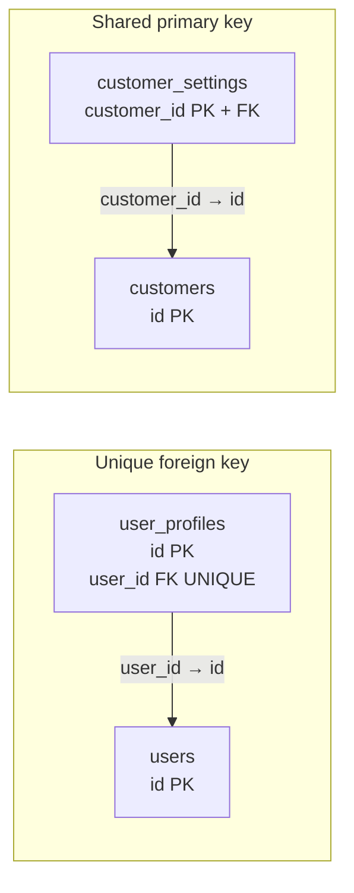
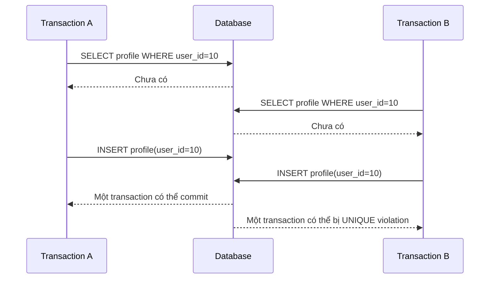
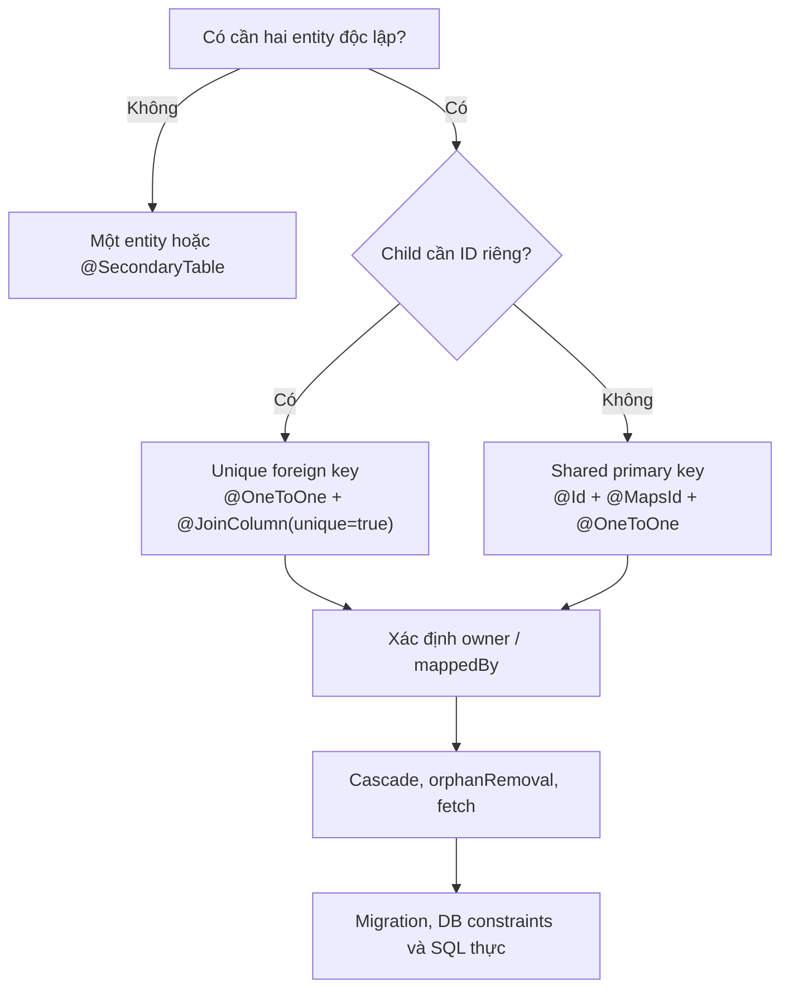

# @OneToOne với khóa ngoại duy nhất hoặc khóa chính dùng chung

Trong Hibernate ORM, `@OneToOne` biểu diễn một **quan hệ đơn trị một–một** giữa hai entity: mỗi bản ghi phía A liên hệ với tối đa một bản ghi phía B và ngược lại. Ví dụ, một tài khoản có thể có một hồ sơ cá nhân, hoặc một khách hàng có thể có một bản ghi tùy chọn thông báo.

Điều quan trọng là **quan hệ một–một trong Java không chỉ được quyết định bằng kiểu thuộc tính**. Hai entity vẫn có thể khai báo `@OneToOne` nhưng dữ liệu trong database bị trùng nếu thiếu khóa hoặc constraint thích hợp. Quan hệ một–một thường được lưu bằng một trong hai cấu trúc:

- **Khóa ngoại duy nhất (unique foreign key):** bảng phụ có khóa chính riêng; cột foreign key trỏ tới bảng chính và được ràng buộc `UNIQUE`.
- **Khóa chính dùng chung (shared primary key):** khóa chính của bảng phụ cũng chính là khóa ngoại tới bảng chính; trong JPA/Hibernate, `@MapsId` thường được dùng để ánh xạ derived identifier này.

Hai lựa chọn nhìn tương tự khi gọi object Java, nhưng khác nhau về schema, identity, lưu/xóa dữ liệu, khả năng thay đổi owner và hiệu năng tải association. Bài học phân tích từng cách, bắt đầu từ ràng buộc quan hệ rồi tới Hibernate mapping.

## 1. Quan hệ một–một thực chất được ràng buộc ở đâu?

Giả sử có các bảng:

```text
users                         user_profiles
+----+----------+             +-----+--------------+---------+
| id | username |             | id  | display_name | user_id |
+----+----------+             +-----+--------------+---------+
| 10 | alice    |             | 500 | Alice        | 10      |
| 20 | bob      |             +-----+--------------+---------+
+----+----------+
```

`user_profiles.user_id` là foreign key tới `users.id`. Nếu không có `UNIQUE` trên `user_id`, database vẫn có thể chứa cả:

| profile.id | profile.user_id |
|---:|---:|
| 500 | 10 |
| 501 | 10 |

Khi đó một user có hai profile, dù Java đang khai báo `@OneToOne`. Bởi vậy, khóa ngoại phải được ràng buộc duy nhất nếu muốn cấu trúc bảo đảm cardinality:

```sql
alter table user_profiles
add constraint uk_user_profiles_user unique (user_id);
```

Từ góc nhìn database:

- `FOREIGN KEY` bảo đảm giá trị `user_id` tham chiếu một user hợp lệ.
- `UNIQUE(user_id)` bảo đảm không có hai profile cùng tham chiếu một user.
- `NOT NULL(user_id)` bảo đảm một profile phải thuộc về một user.
- `PRIMARY KEY(profile.id)` bảo đảm mỗi profile có một định danh riêng.

**Khóa chính dùng chung** sẽ đạt uniqueness bằng cách để `user_id` đồng thời là `PRIMARY KEY` của profile, nên không cần thêm một khóa chính `profile.id` khác.



## 2. Phân biệt owning side, inverse side và parent

Trong Hibernate, quan hệ có thể có **một chiều** hoặc **hai chiều**.

**Owning side** là phía khai báo liên kết với database, thường chứa `@JoinColumn`. Việc thay đổi tham chiếu trên owning side quyết định giá trị FK cần ghi khi flush.

**Inverse side** là phía khai báo `mappedBy` để Hibernate hiểu đây là mặt ngược của **cùng quan hệ**, chứ không phải một quan hệ mới. `mappedBy` chứa **tên thuộc tính Java** ở owning side, không phải tên cột SQL.

**Parent và child** phản ánh ý nghĩa nghiệp vụ và vòng đời: ví dụ account là parent, profile là child. Những từ này không tự quyết định owning side; trong các ví dụ dưới đây child sở hữu FK dù parent có thể được persist trước và cascade sang child.

Ba khái niệm khác cần tách:

| Cấu hình | Điều nó quyết định |
|---|---|
| `cascade` | Truyền thao tác `persist`, `merge`, `remove`... giữa các entity |
| `orphanRemoval` | Xóa child khi nó bị loại khỏi association theo semantics ORM |
| `fetch` | Hibernate có tải association ngay hay cố trì hoãn |
| `optional` | Association ở phía khai báo có được thiếu hay không |
| `nullable` | Metadata về khả năng nhận NULL của cột FK |
| `unique` | Metadata yêu cầu tính duy nhất của cột/schema |

Chúng có liên quan nhưng không thể thay thế nhau. Đặc biệt, `cascade = ALL` không tạo `UNIQUE` ở database và `optional = false` không tự bảo đảm chiều parent → child luôn có row child.

## 3. Cách thứ nhất: one-to-one bằng khóa ngoại duy nhất

Xét entity `UserAccount` và `UserProfile`. Profile có ID độc lập; mỗi profile trỏ tới đúng một tài khoản, mỗi tài khoản có tối đa một profile.

### 3.1. DDL mục tiêu

```sql
-- SQL minh họa; cú pháp identity phụ thuộc DBMS.
create table user_accounts (
    id bigint generated by default as identity primary key,
    username varchar(80) not null unique
);

create table user_profiles (
    id bigint generated by default as identity primary key,
    display_name varchar(150) not null,
    avatar_url varchar(500),
    user_id bigint not null,

    constraint fk_user_profiles_user
        foreign key (user_id) references user_accounts(id),
    constraint uk_user_profiles_user unique (user_id)
);
```

Bảng `user_profiles` có **hai cột định danh với vai trò khác nhau**: `id` nhận diện profile, còn `user_id` nhận diện account mà profile thuộc về. Giá trị ID không cần bằng nhau: profile ID 500 hoàn toàn có thể thuộc account ID 10.

Đây là quan hệ **mỗi profile có đúng một account** nhưng **mỗi account có 0 hoặc 1 profile**. User không có profile vẫn hợp lệ vì database không bắt buộc mọi row trong bảng `user_accounts` phải được tham chiếu bởi `user_profiles`.

### 3.2. Java entity phía tài khoản

```java
import jakarta.persistence.*;

@Entity
@Table(name = "user_accounts")
public class UserAccount {
    @Id
    @GeneratedValue(strategy = GenerationType.IDENTITY)
    private Long id;

    @Column(nullable = false, length = 80, unique = true)
    private String username;

    protected UserAccount() {}

    public UserAccount(String username) {
        this.username = username;
    }

    public Long getId() { return id; }
    public String getUsername() { return username; }
}
```

### 3.3. Java entity phía hồ sơ: owning side

```java
import jakarta.persistence.*;
import java.util.Objects;

@Entity
@Table(name = "user_profiles")
public class UserProfile {
    @Id
    @GeneratedValue(strategy = GenerationType.IDENTITY)
    private Long id;

    @Column(name = "display_name", nullable = false, length = 150)
    private String displayName;

    @Column(name = "avatar_url", length = 500)
    private String avatarUrl;

    @OneToOne(fetch = FetchType.LAZY, optional = false)
    @JoinColumn(
        name = "user_id",
        nullable = false,
        unique = true,
        foreignKey = @ForeignKey(name = "fk_user_profiles_user")
    )
    private UserAccount user;

    protected UserProfile() {}

    public UserProfile(UserAccount user, String displayName) {
        this.user = Objects.requireNonNull(user);
        this.displayName = Objects.requireNonNull(displayName);
    }

    public Long getId() { return id; }
    public UserAccount getUser() { return user; }
    public String getDisplayName() { return displayName; }

    void assignUser(UserAccount user) {
        this.user = user;
    }
}
```

Ý nghĩa quan trọng:

```java
@OneToOne(fetch = FetchType.LAZY, optional = false)
@JoinColumn(name = "user_id", nullable = false, unique = true)
private UserAccount user;
```

- `@OneToOne` nói với ORM rằng `UserProfile.user` là một association một–một.
- `@JoinColumn(name = "user_id")` chỉ đúng cột FK trong bảng `user_profiles`.
- `unique = true` định hướng Hibernate tạo uniqueness khi sinh schema.
- `nullable = false` định hướng cột `NOT NULL`; `optional = false` mô tả association bắt buộc.
- `fetch = LAZY` yêu cầu tải trì hoãn khi provider có thể đáp ứng.

Mã Java có metadata uniqueness **không chứng minh production đã có constraint**. Nếu schema được quản lý bằng Flyway/Liquibase, cần migration tạo unique/FK tương ứng. Ngay cả khi Hibernate sinh DDL, SQL thực tế phụ thuộc dialect và cấu hình schema management.

### 3.4. Persist hai entity

```java
try (Session session = sessionFactory.openSession()) {
    Transaction tx = session.beginTransaction();

    try {
        UserAccount account = new UserAccount("alice");
        session.persist(account);

        UserProfile profile =
            new UserProfile(account, "Alice Nguyen");
        session.persist(profile);

        tx.commit();
    } catch (RuntimeException ex) {
        if (tx.isActive()) {
            tx.rollback();
        }
        throw ex;
    }
}
```

Chưa khai báo cascade, nên ví dụ persist từng entity. Khi flush/commit, Hibernate quản lý việc ghi account và profile theo thông tin mapping, identifier generation và FK. Với `GenerationType.IDENTITY`, INSERT lấy ID có thể được thực hiện sớm hơn flush cuối transaction.

Tại runtime, việc tạo `new UserProfile(account, ...)` chỉ tạo object Java. Nó không ngay lập tức chèn row; phải có `persist` hoặc một thao tác truyền persistence phù hợp.

### 3.5. Tra cứu từ profile đến account

```java
UserProfile profile = session.find(UserProfile.class, 500L);
String username = profile.getUser().getUsername();
```

Khi đọc hàng profile, Hibernate biết `user_id` và có thể tạo reference/proxy để trì hoãn tải account. Tuy nhiên, số SQL thực tế phụ thuộc `fetch`, tình trạng persistence context, cache và các yêu cầu fetch khác. Không nên khẳng định mọi phép gọi trên tạo chính xác một SQL.

## 4. Quan hệ hai chiều và cách dùng `mappedBy`

Trong ví dụ trên, code chỉ đi từ `UserProfile` sang `UserAccount`. Nếu nghiệp vụ cần `account.getProfile()`, thêm inverse side trong `UserAccount`:

```java
// Thêm vào UserAccount:
@OneToOne(
    mappedBy = "user",
    fetch = FetchType.LAZY,
    cascade = CascadeType.ALL,
    orphanRemoval = true
)
private UserProfile profile;

public UserProfile getProfile() {
    return profile;
}

public void attachProfile(UserProfile newProfile) {
    if (this.profile != null) {
        throw new IllegalStateException("Account đã có profile");
    }
    this.profile = java.util.Objects.requireNonNull(newProfile);
    newProfile.assignUser(this);
}
```

`mappedBy = "user"` trỏ đến trường **`UserProfile.user`** chứ không phải cột SQL `user_id`. Hibernate biết field inverse và owning cùng mô tả một quan hệ.

Không thêm `@JoinColumn(name = "user_id")` ở cả hai phía nếu đang cố ánh xạ **một cột FK duy nhất tại `UserProfile`**. Khi hai phía đều được cấu hình như owner, schema ORM có thể có hai quan hệ hoặc cột join không như dự kiến.

### Đồng bộ hai phía trong object graph

Đây là lý do cần helper `attachProfile`:

```java
UserAccount account = new UserAccount("alice");
UserProfile profile = new UserProfile(account, "Alice Nguyen");

account.attachProfile(profile);
session.persist(account); // CascadeType.ALL bao gồm PERSIST.
```

Khi cập nhật một quan hệ hai chiều, nên luôn giữ `account.profile` và `profile.user` nhất quán. Hibernate dùng owning side làm nguồn cập nhật FK; chỉ thay inverse side không phải cách tin cậy để ghi quan hệ.

`CascadeType.ALL` ở parent là ví dụ phù hợp nếu profile thật sự phụ thuộc tài khoản. Đừng đặt `CascadeType.REMOVE` từ `UserProfile.user` lên `UserAccount` một cách tùy tiện: xóa profile mà xóa luôn account thường trái ý định nghiệp vụ.

## 5. `orphanRemoval` và thao tác thay profile

Với quan hệ:

```java
@OneToOne(
    mappedBy = "user",
    cascade = CascadeType.ALL,
    orphanRemoval = true
)
private UserProfile profile;
```

`orphanRemoval = true` thể hiện rằng profile bị gỡ khỏi account sẽ được xóa theo lifecycle ORM. Helper có thể viết:

```java
// Trong UserAccount:
public void removeProfile() {
    UserProfile old = this.profile;
    if (old == null) {
        return;
    }

    this.profile = null;
    old.assignUser(null);
}
```

Lưu ý `user_id` của profile là `NOT NULL`. Khi orphan removal hoạt động, mục tiêu là **DELETE hàng profile**, chứ không phải giữ profile với `user_id NULL`. Trạng thái trung gian trong object graph chỉ phục vụ quản lý vòng đời trước flush.

`orphanRemoval` khác với cascade REMOVE:

| Cơ chế | Khi nào có ý nghĩa? |
|---|---|
| `CascadeType.REMOVE` | Xóa parent và truyền xóa sang child theo mapping |
| `orphanRemoval = true` | Child bị loại khỏi association và được xem là cần xóa |
| `ON DELETE CASCADE` ở FK | Database tự xóa child khi parent bị DELETE theo constraint, không gọi Java callbacks |

Có thể cần một hoặc nhiều cơ chế tùy nghiệp vụ; chúng không tương đương và không luôn có cùng cách cập nhật cache, lifecycle callbacks hay trạng thái managed entity.

### Tại sao thay profile cũ bằng profile mới có thể lỗi?

Giả sử account 10 đã có profile A. Service gỡ A rồi thêm profile B trong cùng transaction. Nếu SQL chèn B với `user_id = 10` **trước khi xóa A**, database gặp `UNIQUE(user_id)`.

Thứ tự INSERT/UPDATE/DELETE khi flush phụ thuộc Hibernate và action queue, không nên giả định orphan removal tự làm mọi trường hợp thay thế thành công. Một vài lựa chọn:

- Nếu về nghiệp vụ vẫn là cùng hồ sơ, **sửa entity profile A**.
- Nếu thực sự là entity mới, thiết kế rõ trình tự xóa, flush và tạo; lưu ý rollback của toàn transaction nếu thao tác thất bại.
- Nếu nghiệp vụ có lịch sử nhiều profile qua thời gian, cân nhắc liệu quan hệ hiện tại có thực sự là one-to-one vĩnh viễn hay cần mô hình lịch sử/active record riêng.

## 6. Những gì unique FK bảo vệ và không bảo vệ

Một FK `NOT NULL UNIQUE` từ profile sang account tạo ra:

- Mỗi profile có một account hợp lệ (nếu constraint FK đang được thi hành).
- Không có hai profile trỏ cùng account.
- Không có profile với `user_id NULL`.
- Một account **vẫn có thể không có profile**.

Do đó, một quan hệ one-to-one thường có **0..1** theo hướng parent → child, dù child → parent là 1.

Một annotation trên inverse side:

```java
@OneToOne(mappedBy = "user", optional = false)
private UserProfile profile;
```

không tự tạo một ràng buộc database yêu cầu mọi account phải có child row. Muốn **exactly one**, cần thiết kế thêm: tạo cả hai trong một transaction, thực thi quy tắc nghiệp vụ và/hoặc cơ chế database phù hợp. FK một chiều không thể tự thi hành sự tồn tại từ parent sang child.

Nếu cho phép FK NULL và chỉ đặt `UNIQUE`, nhiều DBMS cho phép nhiều hàng có NULL trong cột unique; chi tiết khác nhau theo hệ quản trị. Khi đó những profile không thuộc account có thể cùng tồn tại. Nếu domain cấm, cần `NOT NULL` rõ ràng.

## 7. Cách thứ hai: one-to-one với khóa chính dùng chung

Bây giờ xét `Customer` và `CustomerSettings`. Settings chỉ tồn tại trong phạm vi một customer, không cần ID độc lập và không có ý nghĩa chuyển settings sang customer khác.

Schema mong muốn:

```sql
create table customers (
    id bigint generated by default as identity primary key,
    full_name varchar(150) not null
);

create table customer_settings (
    customer_id bigint primary key,
    email_enabled boolean not null,
    theme varchar(20) not null,

    constraint fk_customer_settings_customer
        foreign key (customer_id) references customers(id)
);
```

`customer_settings.customer_id` vừa là **PRIMARY KEY** vừa là **FOREIGN KEY**. Nó unique vì là PK, nên không cần `UNIQUE(customer_id)` riêng. Không có `settings.id` độc lập.

```text
customers:
  id = 42
  full_name = "An"

customer_settings:
  customer_id = 42   ← PK và FK
  email_enabled = true
  theme = "DARK"
```

Cùng giá trị 42 nhận diện customer trong bảng chính và settings trong bảng con. Nhưng chúng vẫn là **hai entity khác nhau**, cùng ID số học không có nghĩa cùng Java object.

### 7.1. Entity `Customer`

```java
import jakarta.persistence.*;

@Entity
@Table(name = "customers")
public class Customer {
    @Id
    @GeneratedValue(strategy = GenerationType.IDENTITY)
    private Long id;

    @Column(name = "full_name", nullable = false, length = 150)
    private String fullName;

    protected Customer() {}

    public Customer(String fullName) {
        this.fullName = fullName;
    }

    public Long getId() { return id; }
    public String getFullName() { return fullName; }
}
```

### 7.2. Entity `CustomerSettings` với `@MapsId`

```java
import jakarta.persistence.*;
import java.util.Objects;

@Entity
@Table(name = "customer_settings")
public class CustomerSettings {
    @Id
    @Column(name = "customer_id")
    private Long customerId;

    @MapsId
    @OneToOne(fetch = FetchType.LAZY, optional = false)
    @JoinColumn(
        name = "customer_id",
        nullable = false,
        foreignKey = @ForeignKey(
            name = "fk_customer_settings_customer"
        )
    )
    private Customer customer;

    @Column(name = "email_enabled", nullable = false)
    private boolean emailEnabled;

    @Column(name = "theme", nullable = false, length = 20)
    private String theme;

    protected CustomerSettings() {}

    public CustomerSettings(
        Customer customer, boolean emailEnabled, String theme
    ) {
        this.customer = Objects.requireNonNull(customer);
        this.emailEnabled = emailEnabled;
        this.theme = Objects.requireNonNull(theme);
    }

    public Long getCustomerId() { return customerId; }
    public Customer getCustomer() { return customer; }
    public boolean isEmailEnabled() { return emailEnabled; }
    public String getTheme() { return theme; }

    public void changeTheme(String newTheme) {
        this.theme = Objects.requireNonNull(newTheme);
    }
}
```

Phần cốt lõi:

```java
@Id
@Column(name = "customer_id")
private Long customerId;

@MapsId
@OneToOne(fetch = FetchType.LAZY, optional = false)
@JoinColumn(name = "customer_id")
private Customer customer;
```

**`@MapsId` cho Hibernate biết ID child được dẫn xuất từ ID của association parent.** Child không cần `@GeneratedValue`, vì định danh của child đến từ `customer.id`.

Nếu đặt `@GeneratedValue` trên `CustomerSettings.customerId`, ta lại yêu cầu child sinh ID độc lập, mâu thuẫn với mục đích dùng chung khóa.

### 7.3. Persist với `@MapsId`

```java
try (Session session = sessionFactory.openSession()) {
    Transaction tx = session.beginTransaction();

    try {
        Customer customer = new Customer("Nguyễn An");
        session.persist(customer);

        CustomerSettings settings =
            new CustomerSettings(customer, true, "DARK");
        session.persist(settings);

        tx.commit();
    } catch (RuntimeException ex) {
        if (tx.isActive()) {
            tx.rollback();
        }
        throw ex;
    }
}
```

Về mặt SQL, Hibernate có thể thực hiện gần tương đương:

```sql
insert into customers (full_name)
values ('Nguyễn An');

-- Giả sử DB trả id = 42.
insert into customer_settings
    (customer_id, email_enabled, theme)
values (42, true, 'DARK');
```

Ví dụ SQL chỉ nhằm giải thích. Cách sinh ID, trả khóa và thứ tự cột thực tế phụ thuộc dialect, identifier strategy và Hibernate version.

Khi child được persist, Hibernate dùng association `customer` để xác định derived identifier. Không tự đặt `settings.customerId = 42` trong lúc chưa có `Customer` tương ứng chỉ để “khớp dữ liệu”.

### 7.4. Truy vấn child bằng chính ID parent

```java
CustomerSettings settings =
    session.find(CustomerSettings.class, customerId);
```

Đây là điểm mạnh của shared PK: **ID của child cũng là ID của parent**. Nếu không cần điều hướng `customer.getSettings()`, chỉ cách truy vấn này đã đủ cho nhiều service mà không cần mapping hai chiều.

```java
Customer customer = settings.getCustomer();
```

Với một settings hợp lệ, `settings.getCustomerId()` và `customer.getId()` phải chỉ cùng identifier.

## 8. Shared primary key hai chiều

Nếu cần gọi `customer.getSettings()`, thêm inverse association trong `Customer`:

```java
// Trong Customer:
@OneToOne(
    mappedBy = "customer",
    fetch = FetchType.LAZY,
    cascade = CascadeType.ALL,
    orphanRemoval = true
)
private CustomerSettings settings;

public CustomerSettings getSettings() {
    return settings;
}

public void installSettings(boolean emails, String theme) {
    if (this.settings != null) {
        throw new IllegalStateException("Đã có settings");
    }
    this.settings = new CustomerSettings(this, emails, theme);
}
```

`mappedBy = "customer"` trỏ đúng field `CustomerSettings.customer` là owning side. Khi persist parent với cascade:

```java
Customer customer = new Customer("Nguyễn An");
customer.installSettings(true, "DARK");
session.persist(customer);
```

Hibernate có thể cascade persist child và dùng `@MapsId` để đồng bộ ID. Nếu thiếu việc gán `CustomerSettings.customer`, `@MapsId` không có association để lấy identifier.

Việc gỡ settings khỏi customer với `orphanRemoval = true` có thể khiến settings bị DELETE lúc flush. Nếu chỉ muốn chuyển theme, hãy cập nhật entity managed hiện có thay vì tạo một settings mới mang cùng primary key.

### Shared PK vẫn có thể là quan hệ tùy chọn

Dù `CustomerSettings.customer` bắt buộc, một row `Customer` không nhất thiết có `CustomerSettings`. DB cho phép:

```text
customers(id = 42) tồn tại
customer_settings(customer_id = 42) không có
```

Đây vẫn là one-to-one kiểu parent có 0..1 child. Shared PK/FK không tự biến association thành exactly-one từ cả hai phía.

## 9. `@MapsId` khác `@PrimaryKeyJoinColumn`

Trong các ví dụ Hibernate cũ, có thể gặp `@PrimaryKeyJoinColumn` dùng để ánh xạ join qua các cột primary key.

| Annotation | Ý nghĩa |
|---|---|
| `@MapsId` | Nói rằng toàn bộ hoặc một phần identifier của entity được lấy từ identifier của association |
| `@PrimaryKeyJoinColumn` | Mô tả cột join liên quan primary key, nhưng không tự thay thế toàn bộ cơ chế derived identifier của `@MapsId` |

Với nhu cầu “child dùng chính ID của parent”, `@MapsId` thường là cách diễn đạt rõ và ít phải tự quản lý ID nhất trong Hibernate/JPA hiện đại.

Với khóa chính ghép (`@EmbeddedId`), `@MapsId("attributeName")` còn có thể dùng để ánh xạ một phần identifier được dẫn xuất từ association. Bài toán đó phức tạp hơn vì phải định nghĩa embedded key, các cột và equality của identifier class. Đối với shared PK một cột như ví dụ, `@MapsId` không tham số là đủ.

## 10. So sánh trực tiếp hai chiến lược

| Khía cạnh | Unique foreign key | Shared primary key |
|---|---|---|
| Bảng child có ID riêng? | Có | Không, ID lấy từ parent |
| Cột FK | Cột riêng, ví dụ `user_id` | Chính cột PK, ví dụ `customer_id` |
| Constraint uniqueness | `UNIQUE(fk)` | `PRIMARY KEY(fk)` |
| Mapping chính | `@OneToOne` + `@JoinColumn(unique=true)` | `@Id` + `@MapsId` + `@OneToOne` |
| Child ID có thể khác parent ID? | Có | Không |
| Dùng parent ID trực tiếp để `find(child)`? | Không bảo đảm | Có |
| Child chuyển sang parent khác? | Về cấu trúc có thể, tùy nghiệp vụ | Không phù hợp vì sẽ đổi PK |
| Cascade theo vòng đời | Quyết định độc lập | Thường tự nhiên nếu child phụ thuộc parent |
| Parent có thể thiếu child? | Có | Có |
| Thích hợp khi | Child cần identity riêng | Child là phần mở rộng theo cùng identity |

Không có một chiến lược luôn tốt hơn về hiệu năng. Shared PK tiết kiệm một cột ID độc lập, nhưng unique FK có lợi nếu child cần lifecycle hoặc định danh riêng. Phải xem domain, workload, index, caching và chính sách schema.

## 11. Default fetch của `@OneToOne` là EAGER

Trong Jakarta Persistence, `@OneToOne` mặc định có `fetch = FetchType.EAGER`. Nghĩa là khai báo:

```java
@OneToOne
private UserProfile profile;
```

không có nghĩa Hibernate chắc chắn sẽ chờ tới lúc gọi getter mới tải profile.

Nhiều ứng dụng chủ động đặt:

```java
@OneToOne(fetch = FetchType.LAZY)
private UserProfile profile;
```

nhưng **lazy one-to-one có các giới hạn đặc biệt**, nhất là phía inverse.

### 11.1. Owning side có sẵn FK

Khi Hibernate tải `UserProfile`, row trong database có `user_id`. Nó biết association trỏ đến `UserAccount#10`, nên trong nhiều mapping có thể giữ proxy/reference và chỉ chạy SELECT user khi thực sự cần.

### 11.2. Inverse side có thể phải kiểm tra sự tồn tại

Khi Hibernate tải `UserAccount#10`, row account **không có cột chứa profile ID**. Hibernate không thể biết chỉ từ row parent rằng profile có tồn tại hay không. Với bidirectional `@OneToOne(mappedBy = "user")`, việc xác định null hay child có thể gây thêm SELECT, tùy Hibernate version, optionality và cơ chế bytecode enhancement.

Shared PK giúp biết **identifier nếu child tồn tại** (child ID bằng parent ID), nhưng không tự chứng minh child row có tồn tại. Vì vậy đừng kỳ vọng mọi trường hợp `fetch = LAZY` sẽ tự loại bỏ SELECT phụ ở inverse side.

### 11.3. Bytecode enhancement và phiên bản Hibernate

Hibernate hỗ trợ bytecode enhancement cho một số hành vi lazy attribute và khả năng quản lý entity. Những ví dụ cũ có thể dùng annotation/hướng dẫn đặc biệt để tải inverse one-to-one lazy. Khả năng này thay đổi theo phiên bản và cấu hình; hãy đo SQL trên Hibernate thực tế đang dùng, thay vì giả định một câu giải thích áp dụng cho mọi bản.

## 12. N+1 có thể xảy ra ngay cả với one-to-one

Giả sử API liệt kê 100 tài khoản:

```java
List<UserAccount> accounts =
    session.createSelectionQuery(
        "from UserAccount a order by a.id",
        UserAccount.class
    ).getResultList();

for (UserAccount a : accounts) {
    UserProfile p = a.getProfile();
    if (p != null) {
        System.out.println(p.getDisplayName());
    }
}
```

Nếu mỗi lần tra cứu inverse profile phát sinh SQL riêng, ứng dụng có thể chạy 1 truy vấn lấy accounts cộng nhiều truy vấn profile. Trong một số cấu hình, những truy vấn phụ xảy ra sớm để ORM xác định association có tồn tại.

### Chủ động fetch theo nhu cầu

```java
List<UserAccount> accounts =
    session.createSelectionQuery("""
        select a
        from UserAccount a
        left join fetch a.profile
        order by a.id
        """, UserAccount.class)
    .getResultList();
```

`left join fetch` giữ lại tài khoản không có profile. Nếu dùng inner `join fetch`, account không có profile thường bị loại khỏi kết quả.

SQL minh họa:

```sql
select a.id, a.username,
       p.id, p.user_id, p.display_name, p.avatar_url
from user_accounts a
left join user_profiles p
  on p.user_id = a.id
order by a.id;
```

Do FK unique, mỗi account join tối đa một profile; không có việc nhân dòng kiểu collection one-to-many. Tuy vậy SELECT có thể vẫn đọc nhiều cột không cần thiết, nên với màn hình đơn giản có thể dùng DTO projection.

```java
public record AccountCard(
    Long id, String username, String displayName
) {}
```

```java
List<AccountCard> cards = session.createSelectionQuery("""
    select new com.example.AccountCard(
        a.id, a.username, p.displayName
    )
    from UserAccount a
    left join a.profile p
    order by a.id
    """, AccountCard.class)
    .getResultList();
```

Record và package phải được định nghĩa thật trong dự án. DTO giúp tránh phụ thuộc vào lazy association sau khi Session đóng và giảm dữ liệu được hydrate nếu giao diện chỉ cần vài trường.

EntityGraph là lựa chọn khác khi muốn cấu hình fetch cho một use case mà không lặp `join fetch` trong các câu HQL.

## 13. Shared PK không khiến hai entity thành một

`Customer#42` và `CustomerSettings#42` dùng cùng giá trị ID nhưng Hibernate vẫn quản lý chúng là hai entity identity khác nhau:

```text
(Customer, 42)
(CustomerSettings, 42)
```

Cả hai có state, lifecycle callbacks, dirty checking và khả năng quản lý phiên bản riêng.

Nếu đặt `@Version` trên cả parent và child, việc sửa settings không tự bảo đảm tăng version parent trong mọi mapping. Cần thiết kế transaction, optimistic locking và các invariant liên quan nếu nghiệp vụ yêu cầu phối hợp thay đổi của cả hai.

Nếu dữ liệu phụ thực sự chỉ là một nhóm cột thuộc **cùng một entity logic**, `@SecondaryTable` có thể là lựa chọn khác:

```java
@Entity
@Table(name = "customers")
@SecondaryTable(
    name = "customer_details",
    pkJoinColumns = @PrimaryKeyJoinColumn(name = "customer_id")
)
public class Customer {
    @Id
    private Long id;

    @Column(table = "customer_details")
    private String biography;
}
```

Ở đây vẫn chỉ có **một entity `Customer`** trải trên nhiều bảng, khác với `Customer` và `CustomerSettings` là hai entity liên hệ `@OneToOne + @MapsId`. Không nên chọn hai entity chỉ vì schema hiện có hai bảng nếu phần dữ liệu thực sự không có lifecycle riêng.

## 14. Xóa parent và xử lý khóa ngoại

Giả sử account có profile. Nếu database chỉ có FK thường, xóa account trước khi xóa profile có thể bị lỗi vì row child vẫn tham chiếu parent.

ORM có thể xử lý bằng cascade remove thích hợp:

```java
@OneToOne(
    mappedBy = "user",
    cascade = CascadeType.ALL,
    orphanRemoval = true
)
private UserProfile profile;
```

Nhưng cascade là **quy tắc object lifecycle của ORM**. Nếu một script SQL trực tiếp xóa parent, Java cascade không chạy. Muốn database tự xóa child trên thao tác SQL, FK phải có `ON DELETE CASCADE` phù hợp. Đó là cơ chế khác với `CascadeType.REMOVE` và có ảnh hưởng khác tới lifecycle callbacks/cache.

Đừng cascade REMOVE từ child lên parent nếu profile chỉ là thành phần phụ; xóa hồ sơ mà xóa tài khoản thường là lỗi nghiêm trọng về nghiệp vụ.

Với shared PK, xóa child không đồng nghĩa phải xóa parent. Xóa parent có child vẫn chịu FK constraint như unique FK và cần chiến lược cascade/xóa phù hợp.

## 15. Khi nào shared PK gây bất tiện?

Giả sử có yêu cầu chuyển profile từ user 10 sang user 20.

**Unique FK:**

```text
profile.id = 500
profile.user_id = 10

chuyển thành
profile.id = 500
profile.user_id = 20
```

Về cấu trúc, có thể cập nhật FK nếu account 20 chưa có profile và domain cho phép. Profile vẫn giữ ID 500.

**Shared PK:**

```text
settings.customer_id = 10 (PK + FK)
```

Muốn gắn settings với customer 20 thì phải thay primary key từ 10 sang 20. **Identifier của managed entity không được xem như một field thông thường có thể đổi tùy tiện.** Điều này có thể đòi xóa entity cũ và tạo entity mới, với những rủi ro về identity và tính toàn vẹn.

Vì vậy, nếu child có khả năng đổi parent, hoặc có các hệ thống bên ngoài tham chiếu ID child, unique FK với ID riêng thường linh hoạt hơn.

Ngoài ra, trong một persistence context, tạo hai instance child khác nhau cùng shared ID có thể gây conflict entity identity. Khi chỉ thay theme hoặc vài thuộc tính, cập nhật managed child hiện hữu phù hợp hơn:

```java
CustomerSettings settings =
    session.find(CustomerSettings.class, 42L);

if (settings != null) {
    settings.changeTheme("LIGHT");
}
```

## 16. Concurrency: unique constraint không thể chỉ thay bằng pre-check

Giả sử hai request đồng thời muốn tạo profile cho account 10:



Truy vấn “đã tồn tại chưa?” tại service chỉ giúp trả thông báo sớm, không loại race condition. Schema phải có `UNIQUE(user_id)` hoặc `PRIMARY KEY(user_id)` theo thiết kế. Nếu không có constraint thực, hai giao dịch có thể ghi ra dữ liệu trái mô hình.

Lỗi có thể xuất hiện khi JDBC thực hiện INSERT, lúc flush hoặc commit tùy DBMS/constraint. Sau lỗi ghi, cần rollback và kết thúc unit of work bị thất bại; không tiếp tục dùng Session như thể persistence context còn nhất quán.

Nếu dùng optimistic locking `@Version` trên account, nó có thể hỗ trợ phát hiện cập nhật cạnh tranh **trên cùng hàng account**, nhưng không thay thế uniqueness giữa hai profile độc lập.

## 17. Debug lỗi mapping và hiệu năng

Để chẩn đoán one-to-one, cần xem cả **entity mapping**, **DDL thực tế** và **SQL Hibernate đã chạy**.

### 17.1. Bật SQL logging khi cần

Với Hibernate ORM 6+ trong Spring Boot:

```properties
logging.level.org.hibernate.SQL=DEBUG
logging.level.org.hibernate.orm.jdbc.bind=TRACE
```

Không nên bật bind TRACE lâu dài ở production vì dữ liệu nhạy cảm có thể xuất hiện trong log. Phiên bản Hibernate cũ có thể dùng tên logger bind khác.

### 17.2. Kiểm tra schema database

Với unique FK, cần xác nhận:

```text
user_profiles.id       : PRIMARY KEY
user_profiles.user_id  : FOREIGN KEY users(id)
user_profiles.user_id  : UNIQUE
user_profiles.user_id  : NOT NULL (nếu profile bắt buộc có user)
```

Với shared PK:

```text
customer_settings.customer_id : PRIMARY KEY
customer_settings.customer_id : FOREIGN KEY customers(id)
```

Đừng dựa vào `@JoinColumn(unique = true)` để kết luận production có constraint. Nếu schema generation bị tắt, annotation chỉ là metadata Hibernate. Một migration chưa được chạy hoặc schema drift có thể phá cardinality. `hbm2ddl.auto=validate` cũng không phải công cụ kiểm toán toàn diện mọi unique/FK constraint ở mọi dialect.

### 17.3. Bảng lỗi thường gặp

| Triệu chứng | Giải thích khả dĩ | Điểm cần kiểm tra |
|---|---|---|
| Một user có hai profile trong DB | Thiếu unique FK thực | DDL và migration |
| Thêm profile báo unique constraint | User đã có profile hoặc race | Giá trị `user_id`, transaction |
| `PropertyValueException` khi flush | Owning side null dù association bắt buộc | Helper gán child.user, nullability |
| `TransientPropertyValueException` | Child tham chiếu parent transient chưa được persist | Thứ tự persist/cascade |
| `@MapsId` không tạo child ID như mong đợi | Chưa gán parent hoặc mapping ID sai | `@Id`, `@MapsId`, `@JoinColumn` |
| `LazyInitializationException` | Truy cập association sau Session đóng | Fetch plan và transaction boundary |
| Nhiều SELECT khi đọc list account | Inverse one-to-one/fetch chưa phù hợp | SQL log, DTO, join fetch |
| Xóa account báo FK violation | Child còn tham chiếu | Cascade/xóa child/ON DELETE |
| Thay child gặp lỗi unique/PK | Child cũ chưa xóa hoặc trùng identity | Quy trình replace và flush |
| SQL join tạo nhiều row hơn mong đợi | Schema đã vi phạm uniqueness hoặc join không đúng | Constraint và dữ liệu thực |

Hibernate/driver/framework có thể bọc lỗi DB trong nhiều exception khác nhau. Nên xem nguyên nhân gốc, SQLSTATE và tên constraint thay vì chỉ khớp nội dung message.

## 18. Chọn cách thiết kế theo tình huống

**Tình huống A: hồ sơ có định danh riêng.**

Yêu cầu có API `/profiles/{profileId}`, lưu lịch sử độc lập, có thể chuyển profile giữa tài khoản. Chọn **unique FK**:

```text
user_accounts(id PK)
user_profiles(id PK, user_id FK UNIQUE NOT NULL)
```

**Tình huống B: settings phụ thuộc hoàn toàn vào customer.**

Không có lý do cấp ID riêng, không chuyển settings qua customer khác; chỉ cần tải theo customer ID. Chọn **shared PK**:

```text
customers(id PK)
customer_settings(customer_id PK + FK)
```

**Tình huống C: thông tin phụ chỉ là các cột của cùng entity.**

Không cần lifecycle entity riêng, nhưng schema muốn tách một số cột. Có thể cân nhắc `@SecondaryTable` thay vì tạo một entity mới với `@OneToOne`.

**Tình huống D: mỗi account có nhiều hồ sơ phiên bản lịch sử.**

Nếu một account được phép có profile cũ và profile mới, quan hệ toàn bộ tập hồ sơ **không còn là one-to-one**. Có thể mô hình one-to-many cho lịch sử và một tham chiếu tới hồ sơ hiện hành, hoặc một unique constraint có điều kiện trên bản ghi active tùy DBMS. Đừng áp `@OneToOne` lên một quan hệ thực chất là one-to-many theo thời gian.

## 19. Quy trình thiết kế quan hệ một–một

1. **Xác định cardinality:** mỗi parent có 0..1 hay bắt buộc 1 child? Child có bắt buộc thuộc parent?
2. **Xác định identity:** child cần ID riêng hay dùng ID parent?
3. **Thiết kế DDL:** unique FK hoặc shared PK/FK; thêm nullability và FK constraint đúng.
4. **Chỉ định owning side:** nơi khai báo `@JoinColumn`; nếu hai chiều, inverse dùng `mappedBy` đúng field Java.
5. **Thiết kế helper:** giữ cả hai reference Java đồng bộ khi tạo/gỡ quan hệ.
6. **Chọn cascade và orphan removal:** theo vòng đời nghiệp vụ, tránh xóa ngược parent ngoài ý muốn.
7. **Chọn fetch:** nhìn vào truy vấn thực tế và trường nào UI cần; không mặc định inverse LAZY sẽ không có SQL phụ.
8. **Đặt transaction boundary:** persist/update/delete dưới giao dịch phù hợp; xử lý uniqueness race.
9. **Kiểm tra schema production và SQL:** Hibernate metadata không thay thế migration.



## 20. Những nhầm lẫn điển hình

| Nhận định | Cách hiểu đúng |
|---|---|
| “Khai báo `@OneToOne` là database không thể có hai child.” | Cần unique FK hoặc shared primary key thực ở DB. |
| “`mappedBy` là tên cột SQL.” | Đó là tên property Java trên owning side. |
| “Owning side là bên gọi `persist()` trước.” | Owning side là bên ánh xạ FK; thứ tự persist không quyết định. |
| “`optional=false` ở parent khiến mọi parent có child.” | FK một chiều không tự bảo đảm chiều tồn tại ngược lại. |
| “`nullable=false` và `unique=true` giống nhau.” | Chúng bảo vệ hai điều khác nhau. |
| “Shared PK cũng cần child `@GeneratedValue`.” | Child lấy ID qua `@MapsId` từ parent. |
| “Cùng ID nghĩa là cùng entity Java.” | Identity còn bao gồm entity type; hai lớp vẫn riêng. |
| “`CascadeType.ALL` nên đặt ở cả hai phía.” | Cascade cần theo vòng đời; xóa từ child lên parent rất nguy hiểm. |
| “`fetch=LAZY` chắc chắn không có SELECT phụ.” | Inverse one-to-one có thể cần truy vấn xác định child. |
| “`orphanRemoval` luôn thay child mới trong một flush an toàn.” | Thứ tự SQL có thể đụng UNIQUE hoặc PK. |
| “Có thể đổi parent của child dùng shared PK bằng setter.” | Đổi parent làm thay identifier child, không phải cập nhật FK thường. |
| “`@SecondaryTable` là một cách viết khác của hai entity one-to-one.” | `@SecondaryTable` vẫn chỉ có một entity trải trên nhiều bảng. |

## 21. Ghi nhớ bằng hai đoạn mapping

**Unique foreign key:**

```java
@Entity
class UserProfile {
    @Id @GeneratedValue
    Long id;

    @OneToOne(fetch = FetchType.LAZY, optional = false)
    @JoinColumn(name = "user_id", nullable = false, unique = true)
    UserAccount user;
}
```

```text
user_profiles.id       = PK riêng của profile
user_profiles.user_id  = FK tới users.id
user_profiles.user_id  = UNIQUE
```

**Shared primary key:**

```java
@Entity
class CustomerSettings {
    @Id
    Long customerId;

    @MapsId
    @OneToOne(fetch = FetchType.LAZY, optional = false)
    @JoinColumn(name = "customer_id")
    Customer customer;
}
```

```text
customer_settings.customer_id = PK của settings
customer_settings.customer_id = FK tới customers.id
```

Cách quyết định ngắn gọn:

- Nếu child **cần identity độc lập**, dùng unique FK.
- Nếu child **được nhận diện hoàn toàn bởi parent**, dùng shared PK với `@MapsId`.
- Nếu quan hệ có **hai chiều**, một phía là owning side và phía còn lại dùng `mappedBy`.
- Nếu child **phụ thuộc vòng đời** vào parent, cân nhắc cascade/orphanRemoval theo đúng hướng.
- Nếu cần tối ưu đọc, quan sát lazy behavior và dùng join fetch/DTO khi phù hợp.
- Trong mọi trường hợp, kiểm tra **DDL thực tế và database constraints** để bảo đảm Hibernate mapping và dữ liệu lưu trữ phản ánh cùng một quan hệ một–một.

Một thiết kế đáng tin cậy bắt đầu từ câu hỏi nghiệp vụ: **“Phần dữ liệu phụ có định danh riêng hay nó chính là phần mở rộng của parent?”** Trả lời câu đó sẽ dẫn tới khóa ngoại duy nhất hoặc khóa chính dùng chung, rồi mới hoàn thiện annotation, transaction và chiến lược fetch tương ứng.
