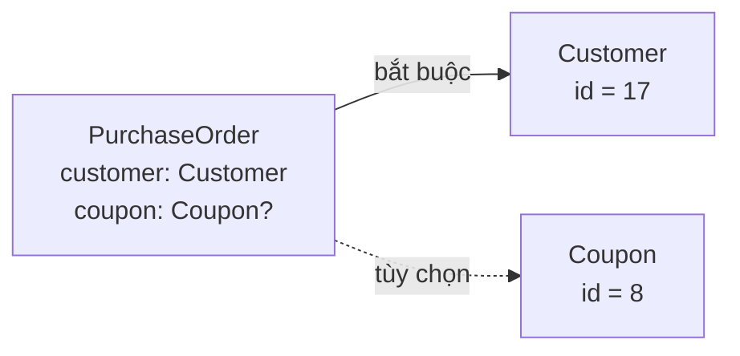

# Quan hệ tùy chọn và sự khác nhau giữa optional với nullable

## 1. Quan hệ đơn trị có thể tồn tại hoặc vắng mặt

Trong Hibernate ORM, **quan hệ đơn trị** (*to-one association*) là thuộc tính entity tham chiếu tới tối đa một entity khác. Hai kiểu phổ biến là:

- **`@ManyToOne`:** nhiều entity nguồn có thể trỏ tới cùng một entity đích. Ví dụ nhiều đơn hàng cùng thuộc một khách hàng.
- **`@OneToOne`:** mỗi entity nguồn liên kết tối đa một entity đích và ngược lại, tùy vai trò sở hữu của hai phía. Ví dụ một nhân viên có tối đa một thẻ ra vào.

Không phải quan hệ nào cũng bắt buộc. Một đơn hàng **phải** có khách hàng, nhưng **có thể** không dùng mã giảm giá. Một nhân viên mới **có thể** chưa có thẻ ra vào. Sự khác biệt này ảnh hưởng cách khai báo mapping ở Java, cách Hibernate xử lý trạng thái entity và cách thiết kế khóa ngoại trong database.

Hai thuộc tính hay xuất hiện gần nhau là:

```java
@ManyToOne(optional = false)
@JoinColumn(nullable = false)
private Customer customer;
```

Thoạt nhìn, `optional = false` và `nullable = false` có vẻ nói cùng một điều: “không được trống”. Thực tế, chúng có **trọng tâm khác nhau**:

> **`optional` diễn đạt tính bắt buộc của mối liên kết ở mô hình đối tượng/persistence; `nullable` mô tả khả năng nhận `NULL` của cột liên kết khi ánh xạ ra schema quan hệ.**

Để thiết kế đúng, cần hiểu **ràng buộc ở tầng mapping**, **giá trị của khóa ngoại trong bảng**, và **constraint thật sự có trong database**. Ba thứ này phải nhất quán với quy tắc nghiệp vụ.

## 2. Nhìn một quan hệ qua mô hình Java và database

Giả sử entity `PurchaseOrder` có hai liên kết:

```java
private Customer customer; // Bắt buộc.
private Coupon coupon;     // Tùy chọn.
```

Trong Java, `customer` và `coupon` đều là **tham chiếu object**; mỗi tham chiếu có thể mang `null` về mặt cú pháp của ngôn ngữ. Hibernate/JPA cần metadata để biết quan hệ nào về mặt mô hình **được phép thiếu**, và ở database cần lưu trạng thái đó như thế nào.



Trong schema:

```sql
CREATE TABLE customers (
    id BIGINT PRIMARY KEY,
    full_name VARCHAR(120) NOT NULL
);

CREATE TABLE coupons (
    id BIGINT PRIMARY KEY,
    code VARCHAR(40) NOT NULL
);

CREATE TABLE purchase_orders (
    id BIGINT PRIMARY KEY,
    customer_id BIGINT NOT NULL,
    coupon_id BIGINT NULL,
    CONSTRAINT fk_order_customer
        FOREIGN KEY (customer_id) REFERENCES customers(id),
    CONSTRAINT fk_order_coupon
        FOREIGN KEY (coupon_id) REFERENCES coupons(id)
);
```

Ví dụ dữ liệu:

| purchase_orders.id | customer_id | coupon_id | Ý nghĩa |
|---|---|---|---|
| 101 | 17 | `NULL` | Đơn hàng có khách, không dùng mã giảm giá |
| 102 | 17 | 8 | Đơn hàng có khách và mã giảm giá số 8 |

Ở đây:

- Cột `customer_id NOT NULL` thể hiện đơn hàng **luôn phải lưu một khóa khách hàng**.
- Cột `coupon_id NULL` cho phép **không có khóa mã giảm giá**.
- Các **foreign key constraint** kiểm tra rằng ID khác `NULL` phải tham chiếu đến bản ghi đích hợp lệ.
- Dấu `NULL` trong `coupon_id` là **sự vắng mặt của liên kết**, khác với việc lưu ID không tồn tại.

Với foreign key thông thường, `NULL` được cho phép khi cột nullable; còn giá trị không-null bị kiểm tra tồn tại ở bảng được tham chiếu. Nếu cột không có FK constraint thật sự, database có thể chứa một ID “mồ côi”, điều này **không phải** ý nghĩa của quan hệ tùy chọn.

## 3. @ManyToOne(optional = ...): quan hệ bắt buộc hay tùy chọn

Khai báo ví dụ:

```java
import jakarta.persistence.FetchType;
import jakarta.persistence.JoinColumn;
import jakarta.persistence.ManyToOne;

@ManyToOne(fetch = FetchType.LAZY, optional = false)
@JoinColumn(name = "customer_id", nullable = false)
private Customer customer;

@ManyToOne(fetch = FetchType.LAZY, optional = true)
@JoinColumn(name = "coupon_id", nullable = true)
private Coupon coupon;
```

`@ManyToOne(optional = true)` cho phép association không có entity đích. `@ManyToOne(optional = false)` tuyên bố association là **bắt buộc** trong mô hình persistence.

Giá trị mặc định của `optional` đối với `@ManyToOne` là **`true`**. Nghĩa là nếu chỉ viết:

```java
@ManyToOne
private Coupon coupon;
```

thì về mặt annotation, liên kết được xem là tùy chọn trừ khi các yếu tố mapping/cấu hình khác quy định ngược lại. Tuy nhiên, trong code thực tế, **khai báo tường minh** thường rõ nghĩa hơn, nhất là với association bắt buộc.

### Tác động của optional=false

Khi đánh dấu quan hệ bắt buộc:

1. **Mô hình:** entity hợp lệ được kỳ vọng phải có tham chiếu tới entity đích.
2. **Hibernate ORM:** provider có thể sử dụng thông tin này trong xử lý mapping, flush và một số quyết định tối ưu association/fetch.
3. **Schema generation:** provider có thể suy ra nullability không cho phép `NULL` khi sinh schema, ngay cả khi các thuộc tính khác trên cột chưa được khai báo đầy đủ.
4. **Dữ liệu thực tế:** để bảo vệ ngay cả những lệnh SQL chạy ngoài ORM, schema phải thực sự có `NOT NULL` và FK phù hợp.

**`optional = false` không biến Java thành ngôn ngữ không-null.** Vẫn có thể viết `order.setCustomer(null)` nếu setter cho phép; lỗi có thể chỉ xuất hiện khi validation/flush/database kiểm tra.

### Tác động của optional=true

Quan hệ được khai báo tùy chọn có thể hợp lệ ở trạng thái:

```java
order.setCoupon(null);
```

Nếu `coupon_id` được phép `NULL` trong schema và entity đang managed, Hibernate có thể cập nhật FK thành `NULL` khi flush/commit. Điều này **không xóa entity `Coupon`**; nó chỉ gỡ liên kết của đơn hàng.

Với quan hệ tùy chọn, hãy xác định rõ ý nghĩa nghiệp vụ của `null`. Chẳng hạn “không có coupon” khác “coupon đã hết hạn” hoặc “coupon có ID nhưng đã bị xóa khỏi database”. Các trạng thái đó không nên bị trộn lẫn.

## 4. @OneToOne(optional = ...): thêm ràng buộc tính duy nhất

`@OneToOne` cũng có thuộc tính `optional`, mặc định **`true`**.

Ví dụ một nhân viên có thể chưa được cấp thẻ ra vào:

```java
import jakarta.persistence.Entity;
import jakarta.persistence.GeneratedValue;
import jakarta.persistence.Id;
import jakarta.persistence.JoinColumn;
import jakarta.persistence.OneToOne;

@Entity
public class Employee {
    @Id
    @GeneratedValue
    private Long id;

    @OneToOne(optional = true)
    @JoinColumn(name = "access_card_id", nullable = true, unique = true)
    private AccessCard accessCard;

    protected Employee() {}
}
```

Về mô hình quan hệ, bảng `employee` (hoặc tên bảng thực tế theo naming strategy) có thể chứa:

```sql
access_card_id BIGINT NULL UNIQUE
```

và khóa ngoại `access_card_id` tham chiếu `access_cards(id)`.

Ở đây có **hai ràng buộc độc lập**:

- **Optionality:** `access_card_id` có thể `NULL` vì nhân viên chưa có thẻ.
- **Uniqueness:** nếu có thẻ, một thẻ không được gắn cho nhiều nhân viên trong quan hệ one-to-one.

Hành vi của unique constraint đối với nhiều giá trị `NULL` có thể khác giữa các hệ quản trị. Chẳng hạn, PostgreSQL mặc định cho phép nhiều giá trị `NULL` trong một unique constraint thông thường; một số hệ thống cần cú pháp/index thích hợp để hiện thực quy tắc mong muốn. Vì vậy cần kiểm tra **DDL thực tế của database**, thay vì suy luận từ `unique = true`.

### optional=false trong @OneToOne

Nếu mỗi nhân viên bắt buộc có thẻ:

```java
@OneToOne(optional = false)
@JoinColumn(name = "access_card_id", nullable = false, unique = true)
private AccessCard accessCard;
```

Mô hình yêu cầu mỗi nhân viên có liên kết đến một thẻ và mỗi thẻ chỉ gắn với tối đa một nhân viên. Tuy nhiên, **quan hệ một-một không tự động yêu cầu mọi thẻ đều phải có nhân viên**; đó là quy tắc chiều ngược lại cần thiết kế riêng.

### @OneToOne và @ManyToOne khác nhau ở đâu?

Một `@ManyToOne` cho phép nhiều đơn hàng dùng chung coupon. Một `@OneToOne` gắn với một cột FK có uniqueness để ngăn nhiều owner trỏ cùng entity đích. **`optional` hoạt động tương tự về ý nghĩa thiếu liên kết, còn one-to-one bổ sung ràng buộc về tính đơn nhất**.

## 5. @JoinColumn(nullable = ...): mô tả nullability của khóa ngoại

`@JoinColumn` ánh xạ cột dùng để liên kết hai bảng. Đối với quan hệ đơn trị mà entity nguồn sở hữu FK:

```java
@ManyToOne
@JoinColumn(name = "customer_id", nullable = false)
private Customer customer;
```

`nullable = false` biểu thị cột `customer_id` không được `NULL` khi Hibernate sử dụng thông tin đó để sinh schema. Giá trị mặc định của `JoinColumn.nullable` là **`true`**.

**Điều cần phân biệt:**

- `@JoinColumn(nullable = false)` nói về **đặc tính cột nối ở database/DDL**.
- `@ManyToOne(optional = false)` hoặc `@OneToOne(optional = false)` nói về **tính bắt buộc của association trong mô hình**.
- Cột chỉ có constraint `NOT NULL` mà không có **FOREIGN KEY** vẫn có thể chứa số ID không tồn tại ở bảng đích.

Trong JPA, `@JoinColumn` còn có `name`, `referencedColumnName`, `unique`, `foreignKey` và các thuộc tính khác để diễn đạt cấu trúc quan hệ. Hãy đặt `nullable` ở đúng **phía sở hữu cột FK**, không đặt nhầm ở một phía chỉ có `mappedBy`.

### Khác @Column(nullable) như thế nào?

`@Column(nullable = false)` thông thường áp dụng cho **cột chứa giá trị cơ bản**:

```java
@Column(name = "order_number", nullable = false)
private String orderNumber;
```

`@JoinColumn(nullable = false)` áp dụng cho **cột FK nối tới entity khác**:

```java
@ManyToOne(optional = false)
@JoinColumn(name = "customer_id", nullable = false)
private Customer customer;
```

Đừng dùng `@Column` thay cho `@JoinColumn` để diễn tả association entity. Hai annotation ánh xạ những loại dữ liệu khác nhau.

## 6. Ma trận optional và nullable

Về khái niệm, ta có thể hình dung bốn trường hợp:

| `optional` trên association | `nullable` trên join column | Ý nghĩa mong muốn | Đánh giá |
|---|---|---|---|
| `true` | `true` | Có thể vắng liên kết; FK có thể `NULL` | **Nhất quán** cho quan hệ tùy chọn |
| `false` | `false` | Phải có liên kết; FK không được `NULL` | **Nhất quán** cho quan hệ bắt buộc |
| `true` | `false` | Java mapping cho phép thiếu liên kết nhưng DB yêu cầu FK | **Mâu thuẫn**, có thể thất bại khi lưu `null` |
| `false` | `true` | Mapping yêu cầu liên kết nhưng mô tả cột cho phép `NULL` | **Mâu thuẫn**, dễ tạo dữ liệu sai nếu DB thiếu constraint |

Đây là **ma trận khái niệm để nhận ra yêu cầu nghiệp vụ**. Kết quả DDL thực tế khi khai báo hai giá trị mâu thuẫn **không được bảo đảm là phép kết hợp máy móc**: Hibernate có thể suy ra non-nullability từ `optional = false` hoặc những ràng buộc mapping khác, tùy version và cấu trúc association. Vì vậy không nên kỳ vọng cấu hình `optional = false, nullable = true` chắc chắn sinh cột nullable.

### Trường hợp mâu thuẫn 1: optional=true nhưng DB NOT NULL

Giả sử mapping:

```java
@ManyToOne(optional = true)
@JoinColumn(name = "customer_id", nullable = false)
private Customer customer;
```

và database có `customer_id NOT NULL`. Ứng dụng vẫn có thể gán `customer = null` trong Java, nhưng khi insert/update Hibernate/database có thể từ chối vì cột FK bắt buộc. Mã Java nói “có thể không có customer”, trong khi schema nói “luôn phải có ID”. Kết quả là hợp đồng dữ liệu không nhất quán.

### Trường hợp mâu thuẫn 2: optional=false nhưng schema thực tế nullable

Giả sử:

```java
@ManyToOne(optional = false)
@JoinColumn(name = "customer_id", nullable = true)
private Customer customer;
```

Ngay cả khi annotation chứa `nullable = true`, Hibernate vẫn có thể quyết định cột cần `NOT NULL` khi sinh DDL, vì `optional = false` thể hiện association bắt buộc. Nếu schema được tạo **bên ngoài Hibernate** và vẫn cho phép `NULL`, có nguy cơ những công cụ SQL khác ghi ra hàng dữ liệu không hợp lệ theo mô hình ORM.

Giải pháp không phải đoán xem annotation nào “thắng”, mà là **thống nhất ý nghĩa nghiệp vụ**, chỉnh mapping và đưa **schema thực tế** về cùng quy tắc bằng migration.

### Vì sao thường khai báo cả hai?

Ví dụ:

```java
@ManyToOne(optional = false, fetch = FetchType.LAZY)
@JoinColumn(name = "customer_id", nullable = false)
private Customer customer;
```

Khai báo song song giúp người đọc code hiểu cả hai mục đích:

1. Association phải có entity đích trong mô hình persistence.
2. Cột FK phải có giá trị trên database.

Trong ứng dụng có migration, thông tin này cũng là **tài liệu sống** để đối chiếu với `NOT NULL` và FK constraint thực tế.

## 7. Ví dụ hoàn chỉnh: đơn hàng có khách hàng bắt buộc và coupon tùy chọn

Ví dụ sau dùng Hibernate ORM với annotation Jakarta Persistence. Mã tập trung vào association; constructor, getter và setter được thêm ở mức cần thiết để thực hành.

### 7.1. Customer

```java
package com.example.orders;

import jakarta.persistence.Column;
import jakarta.persistence.Entity;
import jakarta.persistence.GeneratedValue;
import jakarta.persistence.GenerationType;
import jakarta.persistence.Id;
import jakarta.persistence.Table;

@Entity
@Table(name = "customers")
public class Customer {
    @Id
    @GeneratedValue(strategy = GenerationType.IDENTITY)
    private Long id;

    @Column(name = "name", nullable = false, length = 120)
    private String name;

    protected Customer() {}

    public Customer(String name) {
        this.name = name;
    }

    public Long getId() {
        return id;
    }
}
```

### 7.2. Coupon

```java
package com.example.orders;

import jakarta.persistence.Column;
import jakarta.persistence.Entity;
import jakarta.persistence.GeneratedValue;
import jakarta.persistence.GenerationType;
import jakarta.persistence.Id;
import jakarta.persistence.Table;

@Entity
@Table(name = "coupons")
public class Coupon {
    @Id
    @GeneratedValue(strategy = GenerationType.IDENTITY)
    private Long id;

    @Column(name = "code", nullable = false, unique = true, length = 40)
    private String code;

    protected Coupon() {}

    public Coupon(String code) {
        this.code = code;
    }

    public Long getId() {
        return id;
    }
}
```

### 7.3. PurchaseOrder

```java
package com.example.orders;

import jakarta.persistence.Entity;
import jakarta.persistence.FetchType;
import jakarta.persistence.GeneratedValue;
import jakarta.persistence.GenerationType;
import jakarta.persistence.Id;
import jakarta.persistence.JoinColumn;
import jakarta.persistence.ManyToOne;
import jakarta.persistence.Table;

@Entity
@Table(name = "purchase_orders")
public class PurchaseOrder {
    @Id
    @GeneratedValue(strategy = GenerationType.IDENTITY)
    private Long id;

    @ManyToOne(fetch = FetchType.LAZY, optional = false)
    @JoinColumn(name = "customer_id", nullable = false)
    private Customer customer;

    @ManyToOne(fetch = FetchType.LAZY, optional = true)
    @JoinColumn(name = "coupon_id", nullable = true)
    private Coupon coupon;

    protected PurchaseOrder() {}

    public PurchaseOrder(Customer customer) {
        if (customer == null) {
            throw new IllegalArgumentException(
                "A purchase order must have a customer"
            );
        }
        this.customer = customer;
    }

    public void applyCoupon(Coupon coupon) {
        this.coupon = coupon; // null nghĩa là bỏ coupon.
    }

    public Long getId() {
        return id;
    }

    public Customer getCustomer() {
        return customer;
    }

    public Coupon getCoupon() {
        return coupon;
    }
}
```

Ý nghĩa mapping:

- `PurchaseOrder.customer` là `@ManyToOne` **bắt buộc**; Hibernate ánh xạ vào `customer_id` không-null.
- `PurchaseOrder.coupon` là `@ManyToOne` **tùy chọn**; khóa ngoại `coupon_id` được phép null.
- `fetch = FetchType.LAZY` điều khiển chiến lược nạp tham chiếu, **không quyết định tính tùy chọn**.
- Không khai báo `cascade = CascadeType.ALL` cho các liên kết này. `Customer` và `Coupon` thường là entity có vòng đời riêng, có thể được nhiều đơn hàng tham chiếu.

### 7.4. Persist một đơn hàng không có coupon

Giả sử `Customer` có ID 17 đã được lưu:

```java
try (Session session = sessionFactory.openSession()) {
    Transaction tx = session.beginTransaction();
    try {
        Customer customer = session.getReference(Customer.class, 17L);

        PurchaseOrder order = new PurchaseOrder(customer);
        // order.getCoupon() == null là hợp lệ.
        session.persist(order);

        tx.commit();
    } catch (RuntimeException ex) {
        if (tx.isActive()) {
            tx.rollback();
        }
        throw ex;
    }
}
```

`getReference(...)` có thể tạo proxy/tham chiếu chưa thực sự truy vấn bản ghi; ví dụ giả định customer ID 17 **có tồn tại**. Nếu không tồn tại, việc tham chiếu có thể gây lỗi khi truy cập proxy hoặc lúc database kiểm tra FK. `getReference` không phải phương thức bảo đảm ID hợp lệ.

Kết quả mong đợi trong bảng `purchase_orders`:

```text
id    customer_id    coupon_id
...   17             NULL
```

### 7.5. Gắn rồi gỡ coupon

Giả sử đơn hàng và coupon đều đã tồn tại:

```java
try (Session session = sessionFactory.openSession()) {
    Transaction tx = session.beginTransaction();
    try {
        PurchaseOrder order =
            session.find(PurchaseOrder.class, orderId);
        Coupon coupon = session.find(Coupon.class, couponId);

        if (order == null || coupon == null) {
            throw new IllegalArgumentException(
                "Order or coupon does not exist"
            );
        }

        order.applyCoupon(coupon);
        tx.commit();
    } catch (RuntimeException ex) {
        if (tx.isActive()) {
            tx.rollback();
        }
        throw ex;
    }
}
```

Để gỡ coupon ở một transaction khác:

```java
PurchaseOrder order =
    session.find(PurchaseOrder.class, orderId);
order.applyCoupon(null);
// Commit transaction đang bao quanh thao tác này.
```

Vì `coupon_id` nullable, Hibernate có thể cập nhật FK thành `NULL`. **Bản ghi Coupon không bị xóa**: những đơn hàng khác vẫn có thể dùng nó.

## 8. @NotNull, @Basic(optional=false) và nullable có giống nhau không?

Có nhiều annotation “không cho phép null”, nhưng chúng thuộc những tầng khác nhau:

| Khai báo | Dùng cho | Tác dụng chính |
|---|---|---|
| `@ManyToOne(optional = false)` | To-one association | Quan hệ tới entity đích là bắt buộc trong mapping |
| `@OneToOne(optional = false)` | To-one association | Liên kết một-một là bắt buộc ở phía thuộc tính |
| `@JoinColumn(nullable = false)` | FK column | Mô tả nullability cột liên kết cho mapping/schema |
| `@Basic(optional = false)` | Basic attribute | Thuộc tính basic là bắt buộc theo mapping JPA |
| `@Column(nullable = false)` | Basic column | Mô tả nullability cột dữ liệu cho schema |
| `@NotNull` | Bean/field/property được validation | Kiểm tra đối tượng khi Jakarta Validation được kích hoạt |
| SQL `NOT NULL` | Cột ở database | Ràng buộc database từ chối `NULL` khi insert/update |
| SQL `FOREIGN KEY` | Cột FK | Kiểm tra giá trị không-null trỏ tới bản ghi đích hợp lệ |

Ví dụ basic attribute:

```java
@Basic(optional = false)
@Column(name = "order_number", nullable = false)
private String orderNumber;
```

Ví dụ entity association:

```java
@ManyToOne(optional = false)
@JoinColumn(name = "customer_id", nullable = false)
private Customer customer;
```

Hai đoạn có hình thức giống nhau nhưng khác đối tượng được ánh xạ: **giá trị cơ bản** và **tham chiếu entity**.

### @NotNull của Jakarta Validation

Có thể thêm:

```java
import jakarta.validation.constraints.NotNull;

@NotNull
@ManyToOne(optional = false, fetch = FetchType.LAZY)
@JoinColumn(name = "customer_id", nullable = false)
private Customer customer;
```

Khi validation được gọi, `@NotNull` báo vi phạm nếu `customer` là `null`. Trong những cấu hình có tích hợp Hibernate Validator, validation có thể được kích hoạt trước các sự kiện persist/update.

Tuy nhiên:

- Chỉ thêm `@NotNull` **không chứng minh** database đã có `NOT NULL`.
- `@NotNull` kiểm tra tham chiếu có null hay không; nó **không thay thế FK** để bảo đảm customer ID tồn tại trong database.
- Cấu hình tích hợp validation, nhóm validation và thời điểm chạy có thể khác nhau.
- Database constraint vẫn là lớp bảo vệ cuối cùng khi dữ liệu được ghi qua SQL hoặc ứng dụng khác.

Đối với quan hệ bắt buộc, có thể kết hợp kiểm tra ngay ở constructor/service, mapping `optional=false` và constraint database. Mỗi tầng giải quyết một nhiệm vụ khác nhau.

## 9. Optional không đồng nghĩa với FetchType.LAZY

Hai khai báo sau nói về hai chiều hoàn toàn khác nhau:

```java
@ManyToOne(fetch = FetchType.LAZY, optional = false)
private Customer customer;

@ManyToOne(fetch = FetchType.EAGER, optional = true)
private Coupon coupon;
```

- `optional`: **Có thể vắng entity đích hay không?**
- `fetch`: **Hibernate dự định nạp dữ liệu liên kết khi nào?**

Một quan hệ bắt buộc vẫn có thể lazy, và một quan hệ tùy chọn vẫn có thể eager.

Khi truy cập một association lazy ngoài Session đã đóng, bạn có thể gặp `LazyInitializationException` nếu proxy/collection cần truy vấn. Việc `optional=false` không bảo đảm association đã được tải. Ngược lại, `optional=true` không bắt Hibernate luôn phát một `LEFT JOIN` trong mọi truy vấn.

### One-to-one optional và lazy loading

`@OneToOne` có những trường hợp lazy loading phức tạp hơn `@ManyToOne`, nhất là ở phía **không sở hữu FK** (`mappedBy`). Nếu Hibernate chưa biết phía kia có bản ghi liên kết hay không, nó có thể cần truy vấn để xác định “có entity đích” hay “null”, hoặc cần hỗ trợ bytecode enhancement/proxy thích hợp.

Trong một số cấu hình và phiên bản, `optional=false` cho phép Hibernate dựa trên bảo đảm tồn tại để tối ưu cách tạo proxy. Điều này **không có nghĩa** chỉ đổi `optional=false` là mọi `@OneToOne(fetch=LAZY)` đều tự động lazy theo đúng kỳ vọng. Cần kiểm tra SQL, fetch plan và hành vi thật theo phiên bản Hibernate đang dùng.

Quan trọng hơn, không khai báo `optional=false` chỉ để tối ưu lazy loading khi nghiệp vụ **thực sự cho phép vắng quan hệ**. Làm vậy sẽ khiến metadata không còn diễn đạt đúng domain.

## 10. Phía sở hữu và phía inverse trong quan hệ hai chiều

Với `@OneToOne` hai chiều, **phía sở hữu** thường là phía có cột FK và khai báo `@JoinColumn`; phía còn lại dùng `mappedBy`.

Ví dụ `Employee` là owner của FK `access_card_id`:

```java
@Entity
public class Employee {
    @Id
    private Long id;

    @OneToOne(optional = true)
    @JoinColumn(name = "access_card_id", unique = true)
    private AccessCard accessCard;
}
```

Phía inverse:

```java
@Entity
public class AccessCard {
    @Id
    private Long id;

    @OneToOne(mappedBy = "accessCard")
    private Employee employee;
}
```

Đây là đoạn mapping rút gọn tập trung vào quan hệ. Trong một ứng dụng thực tế cần constructor và lifecycle hợp lệ.

**Phía nào quyết định FK?** Trong ví dụ, `Employee.accessCard` quyết định giá trị `employee.access_card_id`. Chỉ sửa `accessCard.setEmployee(employee)` trên phía inverse, nếu không cập nhật phía sở hữu, chưa bảo đảm Hibernate cập nhật FK như mong muốn.

### Optional ở phía inverse có ý nghĩa gì?

Giả sử một thẻ có thể chưa được cấp cho nhân viên. Trên `AccessCard.employee`, `optional=true` diễn đạt “thẻ này có thể chưa có employee”. Nó **không tự tạo ra cột `employee_id` trong bảng `access_cards`**, vì cột FK đang nằm ở bảng `employee`.

Khi cần đảm bảo một thẻ **bắt buộc được cấp cho một nhân viên**, không thể chỉ chỉnh `optional=false` ở phía inverse rồi kỳ vọng database tự tạo đủ ràng buộc. Đây là một invariant giữa hai bảng; cần xem lại **vị trí FK, uniqueness, NOT NULL và cách tạo dữ liệu**. Một FK `employee.access_card_id NOT NULL` bảo đảm mỗi employee có thẻ, nhưng **không bảo đảm mỗi access card có employee**.

Quy tắc cần nhớ: **`optional` diễn đạt quan hệ trên thuộc tính; nullability của FK phụ thuộc cột thực tế và phía sở hữu.**

## 11. @OneToOne với khóa chính chia sẻ (@MapsId)

Một kiểu ánh xạ một-một khác là dùng khóa chính của entity con đồng thời làm khóa ngoại tới entity cha. Ví dụ `UserProfile` không có ID độc lập: `user_profiles.user_id` vừa là PK vừa là FK đến `users.id`.

```java
@Entity
@Table(name = "user_profiles")
public class UserProfile {
    @Id
    private Long id;

    @MapsId
    @OneToOne(optional = false, fetch = FetchType.LAZY)
    @JoinColumn(name = "user_id", nullable = false)
    private User user;

    protected UserProfile() {}

    public UserProfile(User user) {
        this.user = user;
    }
}
```

Schema minh họa:

```sql
CREATE TABLE user_profiles (
    user_id BIGINT PRIMARY KEY,
    CONSTRAINT fk_profile_user
        FOREIGN KEY (user_id) REFERENCES users(id)
);
```

Trong thiết kế này, `user_id` là **primary key** nên đương nhiên không được `NULL`. `@MapsId` cho biết identity của profile phụ thuộc user được tham chiếu. Quan hệ từ **profile tới user** là bắt buộc.

Nhưng **chiều ngược lại** lại có thể tùy chọn: không phải user nào cũng đã tạo profile.

```java
// Bên trong entity User:
@OneToOne(mappedBy = "user", fetch = FetchType.LAZY, optional = true)
private UserProfile profile;
```

Việc một `UserProfile` bắt buộc có `User` **không suy ra** mỗi `User` bắt buộc có `UserProfile`. Khi đọc optionality, hãy hỏi rõ “đang xét thuộc tính ở **chiều nào**?”.

**Ghi chú:** Ví dụ giả định `User` là entity có khóa chính `Long id` và đã được khai báo trong dự án; các import annotation JPA tương ứng được lược bớt ở phần code này để tập trung vào mapping.

## 12. Optional, JOIN và các truy vấn SQL

Một quan hệ tùy chọn khiến việc chọn loại JOIN có ý nghĩa rõ rệt. Giả sử query tìm đơn hàng và coupon.

### INNER JOIN loại bỏ đơn hàng không có coupon

```java
List<PurchaseOrder> ordersWithCoupon =
    session.createQuery(
        "select o from PurchaseOrder o join o.coupon c",
        PurchaseOrder.class
    ).getResultList();
```

Về ngữ nghĩa quan hệ, `join o.coupon` là **inner join**. Những đơn hàng có `coupon_id = NULL` sẽ không có hàng coupon khớp và không nằm trong kết quả.

### LEFT JOIN giữ cả đơn hàng không có coupon

```java
List<PurchaseOrder> allOrders =
    session.createQuery(
        "select distinct o from PurchaseOrder o " +
        "left join o.coupon c",
        PurchaseOrder.class
    ).getResultList();
```

`left join` giữ những đơn hàng không có coupon. `distinct` trong ví dụ là không bắt buộc vì association đơn trị không nhân số dòng theo cùng cách một collection join có thể làm; nó được dùng để minh họa một cú pháp truy vấn hợp lệ.

### Truy vấn đơn hàng không có coupon

```java
List<PurchaseOrder> withoutCoupon =
    session.createQuery(
        "from PurchaseOrder o where o.coupon is null",
        PurchaseOrder.class
    ).getResultList();
```

Khi association dùng FK đơn giản như ví dụ, biểu thức `is null` giúp tìm các hàng có liên kết vắng mặt. Hibernate chuyển biểu thức này thành SQL thích hợp theo mapping và dialect.

### optional=false có khiến mọi truy vấn dùng INNER JOIN?

Không có bảo đảm đơn giản như vậy. `optional` là metadata của association; loại join thực tế do **câu query, fetch plan, đường truy cập dữ liệu và chiến lược tối ưu của Hibernate** quyết định. Chọn `JOIN` hay `LEFT JOIN` trong truy vấn theo mục tiêu dữ liệu, không dựa hoàn toàn vào annotation.

## 13. Gán null, xóa entity đích và xóa owner là ba việc khác nhau

Xét `PurchaseOrder.coupon`:

### Gán null cho association

```java
order.applyCoupon(null);
```

Ý nghĩa là **gỡ liên kết**. Khi Hibernate đồng bộ và FK nullable, `coupon_id` được cập nhật thành `NULL`. Bản ghi `Coupon` vẫn tồn tại.

### Xóa Coupon

```java
session.remove(coupon);
```

Đây là yêu cầu **xóa entity Coupon**. Nếu còn đơn hàng tham chiếu tới nó và database có FK, thao tác có thể thất bại. Việc cột `coupon_id` nullable **không có nghĩa** database tự đặt tất cả FK thành `NULL` khi xóa coupon.

Muốn database tự gỡ liên kết khi xóa entity đích, schema phải có cơ chế phù hợp, ví dụ `ON DELETE SET NULL` trên FK mà database hỗ trợ, hoặc ứng dụng phải chủ động cập nhật các bản ghi tham chiếu. Mọi chính sách này cần được thiết kế nhất quán với ORM.

### Xóa PurchaseOrder

```java
session.remove(order);
```

Xóa owner không mặc nhiên xóa `Customer` hoặc `Coupon` mà nó tham chiếu. Với `@ManyToOne`, **đặc biệt tránh `CascadeType.REMOVE` bừa bãi**: một customer hoặc coupon có thể đang được nhiều đơn hàng sử dụng.

### @OneToOne và orphanRemoval

`@OneToOne` hỗ trợ `orphanRemoval = true` khi entity đích thực sự là **thành phần phụ thuộc vòng đời của owner**, ví dụ một profile không được phép tồn tại độc lập. Nhưng `orphanRemoval` không có nghĩa giống `optional`:

- `optional` mô tả **liên kết có thể vắng mặt hay không**.
- `orphanRemoval` mô tả **có xóa entity con khi bị gỡ khỏi association hay không**.

Không bật `orphanRemoval` cho một entity được chia sẻ hoặc cần tồn tại độc lập.

## 14. Trường hợp database có dữ liệu lỗi hoặc cấu hình cũ

Một association nullable không có nghĩa chấp nhận FK không hợp lệ:

```text
purchase_orders:
  id = 103, coupon_id = 9999

coupons:
  không có coupon id = 9999
```

Nếu database có foreign key constraint thực sự, trạng thái trên sẽ bị ngăn chặn. Nếu constraint bị thiếu hoặc vô hiệu, Hibernate có thể gặp lỗi khi tải liên kết, tùy cách fetch và dữ liệu.

Một số cấu hình Hibernate-specific, chẳng hạn `@NotFound(action = NotFoundAction.IGNORE)`, có thể hướng provider diễn giải broken reference thành `null` trong một vài trường hợp. Đây là cơ chế xử lý dữ liệu không toàn vẹn với những tác động tới fetch/SQL, **không phải cách thông thường để thể hiện optional association**. Dữ liệu có FK “mồ côi” nên được xử lý tại nguyên nhân: schema constraint, migration và quy trình ghi dữ liệu.

### Trường hợp soft delete

Đôi khi quan hệ `customer_id` vẫn khác `NULL` nhưng entity `Customer` đã được đánh dấu `deleted = true` và bị filter khỏi truy vấn. Đây là vấn đề **khả năng hiển thị của entity theo quy tắc nghiệp vụ**, không tự chuyển association thành optional. Khi thiết kế soft delete, cần quy định rõ liệu dữ liệu lịch sử vẫn được tham chiếu và cách filter tác động đến việc tải association.

## 15. Các lỗi thường gặp khi thiết kế quan hệ tùy chọn

### Lỗi 1: Chỉ khai báo optional=false và bỏ quên schema

```java
@ManyToOne(optional = false)
private Customer customer;
```

Mapping diễn đạt đúng ý định, nhưng nếu schema tồn tại từ trước và cho phép `NULL`, một ứng dụng khác vẫn có thể ghi hàng thiếu customer. Cần đối chiếu migration và ràng buộc trong database thật.

### Lỗi 2: Dùng @Column(nullable=false) trên association

```java
// Không phải cách khai báo cột FK của @ManyToOne:
@ManyToOne
@Column(nullable = false)
private Customer customer;
```

Sử dụng `@JoinColumn(nullable = false)` để mô tả FK của to-one association.

### Lỗi 3: optional=true nhưng code giả định luôn khác null

```java
String couponCode = order.getCoupon().getCode();
```

Nếu order không dùng coupon, `getCoupon()` có thể trả `null` và đoạn code ném `NullPointerException`. Cần xử lý nhánh không có coupon:

```java
Coupon coupon = order.getCoupon();
String couponCode = coupon == null ? null : coupon.getCode();
```

`optional=true` không tự biến thuộc tính thành `java.util.Optional<Coupon>`; association thường vẫn là tham chiếu `Coupon`, có thể `null`.

### Lỗi 4: Hiểu nullable=true là cho phép FK trỏ tới bản ghi không tồn tại

`nullable=true` chỉ cho phép giá trị `NULL` trong cột. FK không-null phải hợp lệ nếu database đang thực thi ràng buộc tham chiếu.

### Lỗi 5: Gỡ association nhưng lại xóa entity dùng chung

Nếu muốn bỏ coupon khỏi đơn hàng, cập nhật `coupon_id` thành `NULL`; đừng `remove(coupon)` trừ khi nghiệp vụ thực sự muốn xóa coupon khỏi hệ thống và đã xử lý mọi tham chiếu.

### Lỗi 6: Đánh đồng optional với cascade

Một association bắt buộc **không có nghĩa** persist owner sẽ tự persist entity đích mới. Ví dụ tạo `PurchaseOrder` trỏ tới `Customer` transient mà không persist customer trước hoặc không cấu hình cascade phù hợp vẫn có thể gây lỗi. Optionality và cascade giải quyết hai câu hỏi khác nhau.

### Lỗi 7: Nghĩ @OneToOne với unique FK là hai chiều đều bắt buộc

Unique FK + `NOT NULL` bảo đảm **owner** có liên kết tới đúng một đối tượng đích và mỗi đích được tối đa một owner tham chiếu. Nó chưa bảo đảm **mọi đối tượng đích** đều có owner.

### Lỗi 8: Dùng optional=false để ép lazy loading

Nếu association thực sự có thể vắng mặt, khai báo `false` tạo metadata sai và có thể gây lỗi dữ liệu. Hãy tối ưu fetch bằng lựa chọn mapping/query/enhancement đúng phiên bản, không sửa ý nghĩa nghiệp vụ để có được một chiến lược nạp dữ liệu.

## 16. Thay đổi từ quan hệ tùy chọn sang bắt buộc bằng migration

Ban đầu, mỗi đơn hàng có thể chưa được phân cho nhân viên phụ trách:

```sql
assignee_id BIGINT NULL
```

Sau thay đổi nghiệp vụ, mọi đơn hàng mới và dữ liệu hiện tại cần có nhân viên. Chỉ đổi annotation thành:

```java
@ManyToOne(optional = false)
@JoinColumn(name = "assignee_id", nullable = false)
private Employee assignee;
```

**chưa đủ** nếu database cũ đã chứa `NULL`. Thường cần quy trình chuyển đổi:

1. **Xác định dữ liệu cũ:** có bao nhiêu hàng `assignee_id IS NULL`, liệu có FK không hợp lệ không.
2. **Lập quy tắc gán lại:** chọn nhân viên hợp lệ cho từng bản ghi hoặc quy tắc xử lý những bản ghi không thể gán.
3. **Cập nhật luồng ghi:** API/service từ chối đơn hàng mới thiếu assignee.
4. **Backfill dữ liệu:** cập nhật các hàng cũ để không còn thiếu liên kết.
5. **Áp constraint:** thêm `NOT NULL` trên FK, xác nhận foreign key constraint và chỉ số cần thiết.
6. **Đồng bộ mapping:** đổi `optional=false`, `nullable=false`, validation và dữ liệu thử nghiệm phù hợp.
7. **Triển khai theo trình tự:** với hệ thống có nhiều instance/service cùng ghi, bảo đảm không có luồng cũ tiếp tục tạo hàng `NULL` trong lúc migration chạy.

Ví dụ PostgreSQL **sau khi** đã backfill đầy đủ:

```sql
ALTER TABLE purchase_orders
    ALTER COLUMN assignee_id SET NOT NULL;
```

Lệnh trên minh họa thay đổi nullability, giả định cột `assignee_id` đã tồn tại. Nếu dữ liệu cũ còn `NULL`, database sẽ không cho áp ràng buộc `NOT NULL`.

### Đổi từ bắt buộc sang tùy chọn

Ngược lại, nếu nghiệp vụ cho phép thiếu assignee, quy trình có thể gồm:

1. Đổi domain/service để chấp nhận trạng thái chưa phân công.
2. Đổi mapping thành `optional=true` và `nullable=true`.
3. Migration bỏ ràng buộc `NOT NULL` trên cột.
4. Điều chỉnh query, xử lý null và báo cáo: inner join có thể loại bản ghi chưa phân công.

Khi nới constraint, cần kiểm tra logic cũ vốn giả định mọi order luôn có assignee để tránh `NullPointerException` hoặc sai số liệu.

## 17. Truy vấn, hiệu năng và tính nhất quán

### 17.1. Nullable FK và query plan

Database vẫn có thể dùng index trên FK nullable. Có nên tạo index riêng cho `coupon_id` hay `customer_id` phụ thuộc workload:

- Thường truy vấn `WHERE customer_id = ?`: index trên `customer_id` có thể hữu ích.
- Thường join vào `coupons`: index FK giúp một số kiểu truy vấn.
- `WHERE coupon_id IS NULL`: hiệu quả index phụ thuộc hệ quản trị, phân bố dữ liệu và thống kê.

`nullable=true` không tự định nghĩa index. `unique=true` trong one-to-one lại có thể ảnh hưởng cấu trúc index/constraint, cần đọc schema thật.

### 17.2. Validation sớm và constraint muộn

Việc một constructor kiểm tra `customer != null` giúp báo lỗi gần nguồn dữ liệu:

```java
public PurchaseOrder(Customer customer) {
    this.customer = Objects.requireNonNull(
        customer, "customer is required"
    );
}
```

Nhưng giá trị có thể bị thay đổi qua những đường cập nhật khác, reflection hoặc dữ liệu từ bên ngoài. Schema `NOT NULL` + FK vẫn là lớp bảo vệ bắt buộc để duy trì tính toàn vẹn khi có nhiều tác nhân ghi dữ liệu.

### 17.3. Trạng thái persistence context và flush

Trong Session đang quản lý `PurchaseOrder`:

```java
PurchaseOrder order = session.find(PurchaseOrder.class, orderId);
order.applyCoupon(null);
```

Hibernate có thể phát SQL `UPDATE purchase_orders SET coupon_id = NULL ...` tại thời điểm flush. `flush()` **không phải commit**; nếu transaction rollback, thay đổi chưa được xác nhận sẽ bị hủy ở database.

Với quan hệ bắt buộc, việc tạm thời để association null trong đối tượng có thể không lỗi ngay ở dòng gán nhưng thất bại khi ORM/validation/database kiểm tra ở thời điểm thích hợp. Không dựa vào “chưa có exception” để kết luận trạng thái đã hợp lệ.

### 17.4. Optionality không bảo đảm entity đích được eager load

Nếu service cần trả thông tin khách hàng hoặc coupon trong JSON response, hãy chủ động dùng fetch plan, join fetch hoặc DTO projection thích hợp. Đóng Session rồi truy cập proxy lazy có thể dẫn tới lỗi khởi tạo. Việc mapping bắt buộc hay tùy chọn chỉ giải quyết sự tồn tại liên kết, không quyết định dữ liệu đã được nạp chưa.

## 18. Bài thực hành: quan hệ bắt buộc và tùy chọn trong một hệ thống

Thiết kế ứng dụng hỗ trợ khách hàng có ba entity:

- `SupportTicket`: một ticket **bắt buộc** thuộc một `Customer`.
- `SupportTicket`: một ticket **có thể chưa được phân công** cho `Agent`.
- `Agent`: mỗi agent **có thể** có một `Workstation` riêng, và mỗi workstation chỉ được gắn tối đa một agent.

### Yêu cầu về mapping

1. `SupportTicket.customer` là `@ManyToOne(optional=false)`, khóa ngoại `customer_id NOT NULL`.
2. `SupportTicket.assignee` là `@ManyToOne(optional=true)`, khóa ngoại `assignee_id NULL`.
3. `Agent.workstation` là `@OneToOne(optional=true)`, khóa ngoại nullable và unique.
4. Database có FK constraint, kể cả trên cột nullable.
5. Query lấy ticket chưa phân công cần tìm được cả bản ghi có `assignee_id NULL`.

### Gợi ý mapping

```java
@Entity
public class SupportTicket {
    @Id
    @GeneratedValue
    private Long id;

    @ManyToOne(fetch = FetchType.LAZY, optional = false)
    @JoinColumn(name = "customer_id", nullable = false)
    private Customer customer;

    @ManyToOne(fetch = FetchType.LAZY, optional = true)
    @JoinColumn(name = "assignee_id", nullable = true)
    private Agent assignee;
}
```

```java
@Entity
public class Agent {
    @Id
    @GeneratedValue
    private Long id;

    @OneToOne(fetch = FetchType.LAZY, optional = true)
    @JoinColumn(
        name = "workstation_id",
        nullable = true,
        unique = true
    )
    private Workstation workstation;
}
```

Hai đoạn trên rút gọn constructor/getter để tập trung vào annotation; các class `Customer` và `Workstation` được giả định là entity đã ánh xạ khóa chính phù hợp.

Truy vấn ticket chưa phân công:

```java
List<SupportTicket> unassigned =
    session.createQuery(
        "from SupportTicket t where t.assignee is null",
        SupportTicket.class
    ).getResultList();
```

Khi muốn lấy cả ticket chưa phân công lẫn thông tin agent đã phân công:

```java
List<SupportTicket> tickets =
    session.createQuery(
        "select t from SupportTicket t " +
        "left join fetch t.assignee",
        SupportTicket.class
    ).getResultList();
```

Ở đây `left join fetch` cho phép giữ ticket không có agent và chủ động nạp association cho các ticket đã phân công. Kế hoạch fetch thực tế vẫn cần được thiết kế phù hợp khi dữ liệu lớn hoặc còn nhiều association khác.

### Câu hỏi tự kiểm tra

1. Nếu đặt `@ManyToOne(optional=true)` cho `customer` nhưng `customer_id NOT NULL` thì hai tầng có thống nhất không?
2. Nếu gỡ `assignee` khỏi một ticket, entity `Agent` có bị xóa không?
3. Nếu thêm `@NotNull` trên `customer`, điều đó có thay thế FK constraint không?
4. Nếu `workstation_id` nullable và unique, mỗi agent có thể thiếu workstation không? Một workstation có thể gắn với hai agent không?
5. Vì sao query dùng inner join với `assignee` có thể làm mất các ticket chưa phân công?

**Đáp án định hướng:** (1) Không; (2) không, chỉ FK của ticket thay đổi; (3) không; (4) có thể thiếu, nhưng workstation không được cấp đồng thời cho hai agent nếu uniqueness được áp dụng; (5) inner join loại các hàng không có bản ghi đích tương ứng.

## 19. Nguyên tắc thiết kế cần ghi nhớ

1. **`@ManyToOne(optional = false)` và `@OneToOne(optional = false)`** nói association là bắt buộc theo mô hình persistence.
2. **`@JoinColumn(nullable = false)`** nói cột FK không được `NULL` trong schema, khi ràng buộc được áp dụng thật sự.
3. **Khớp thông tin mapping với schema:** quan hệ bắt buộc thường cần cả `optional=false` và FK `NOT NULL`; quan hệ tùy chọn thường dùng `optional=true` và FK nullable.
4. **FK nullable vẫn cần foreign key constraint:** `NULL` là không có liên kết; ID không tồn tại là dữ liệu tham chiếu sai.
5. **One-to-one thêm uniqueness, không tự đồng nghĩa bắt buộc hai chiều.** Hãy phân biệt phía sở hữu FK và phía `mappedBy`.
6. **Optionality không quyết định cascade, orphan removal hay lazy/eager fetching.** Đây là các cơ chế độc lập.
7. **Gỡ tham chiếu không phải xóa entity đích.** `setCoupon(null)` và `remove(coupon)` là hai hành động có tác động khác nhau.
8. **Validation bổ sung, schema bảo vệ:** constructor, `@NotNull`, `optional=false`, `NOT NULL` và `FOREIGN KEY` cùng góp phần giữ dữ liệu hợp lệ ở các tầng.
9. **Khi đổi quy tắc nghiệp vụ, phải migration dữ liệu và schema.** Annotation Java không tự sửa dữ liệu lịch sử.

Khi nhìn một association đơn trị, hãy đặt hai câu hỏi theo thứ tự: **“Về nghiệp vụ, thuộc tính này có được phép không có entity đích không?”** để chọn `optional`; sau đó **“Trong bảng, khóa ngoại có được phép NULL không và constraint đã bảo vệ đúng chưa?”** để chọn `nullable`, FK và migration. Trả lời riêng hai câu hỏi giúp mô hình Java và database luôn cùng thể hiện một quy tắc.

### Tài liệu tham khảo

- [Hibernate ORM User Guide — Associations](https://docs.jboss.org/hibernate/orm/current/userguide/html_single/Hibernate_User_Guide.html#associations)
- [Hibernate ORM User Guide — Many-to-one](https://docs.jboss.org/hibernate/orm/current/userguide/html_single/Hibernate_User_Guide.html#associations-many-to-one)
- [Hibernate ORM User Guide — One-to-one](https://docs.jboss.org/hibernate/orm/current/userguide/html_single/Hibernate_User_Guide.html#associations-one-to-one)
- [Jakarta Persistence — Specification](https://jakarta.ee/specifications/persistence/)
- [Jakarta Persistence API — ManyToOne](https://jakarta.ee/specifications/persistence/3.1/apidocs/jakarta.persistence/jakarta/persistence/ManyToOne)
- [Jakarta Persistence API — JoinColumn](https://jakarta.ee/specifications/persistence/3.1/apidocs/jakarta.persistence/jakarta/persistence/JoinColumn)
