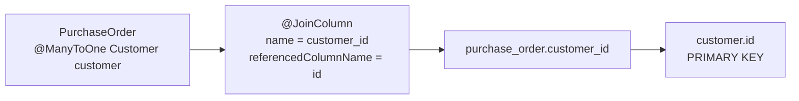
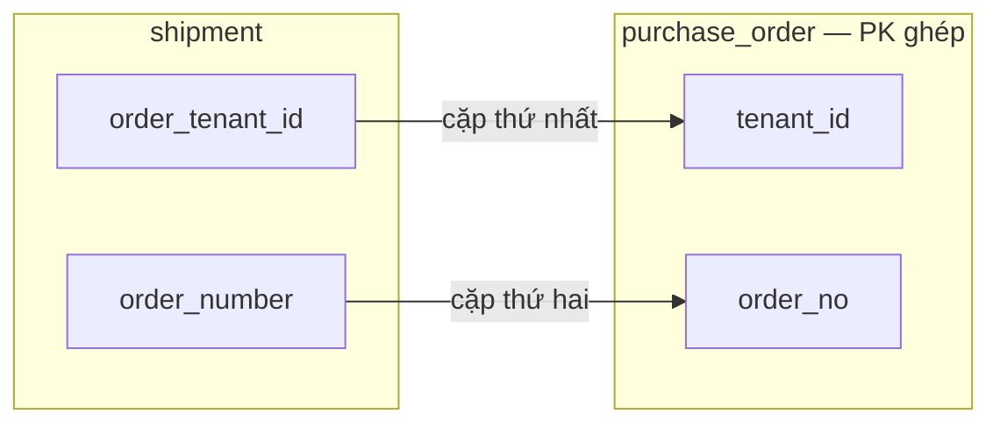

# `@JoinColumn`, `@JoinColumns` và tham chiếu khóa ghép trong Hibernate

Trong kiến trúc ORM của Hibernate, quan hệ đơn trị (*to-one association*) cho phép một entity giữ tham chiếu đến **một** entity khác. Hai annotation JPA thường gặp là `@ManyToOne` và `@OneToOne`. Khi chuyển mối quan hệ này xuống mô hình quan hệ, Hibernate phải biết **cột khóa ngoại nằm ở đâu** và **những cột nào của bảng đích được tham chiếu**.

`@JoinColumn` mô tả một cột tham gia phép nối. `@JoinColumns` tập hợp nhiều `@JoinColumn` để biểu diễn phép nối gồm **nhiều cặp cột**, đặc biệt khi entity đích dùng **khóa chính ghép** (*composite primary key*).

Một quan hệ đúng phải nhất quán ở ba tầng:

1. **Java:** thuộc tính tham chiếu có kiểu entity và được gắn annotation quan hệ.
2. **Hibernate/JPA:** metadata xác định các cặp cột để kết nối hai bảng.
3. **Database:** các cột tồn tại, kiểu dữ liệu tương thích và ràng buộc foreign key/unique phù hợp.

Bài học dùng ví dụ Java với `jakarta.persistence.*` và SQL quan hệ. Các tên bảng, cột và truy vấn SQL được minh họa theo cách dễ quan sát; SQL thực tế Hibernate phát ra phụ thuộc Hibernate Dialect, naming strategy và phiên bản DBMS.

## 1. Hình dung `@JoinColumn` nằm ở đâu

Giả sử một khách hàng có nhiều đơn hàng, nhưng **mỗi đơn hàng chỉ thuộc một khách hàng**:

```text
customer
+------+----------+
| id   | name     |
+------+----------+
| 11   | Lan      |
| 12   | Minh     |
+------+----------+

purchase_order
+------+-------------+-------------+
| id   | customer_id | order_code  |
+------+-------------+-------------+
| 201  | 11          | PO-201      |
| 202  | 11          | PO-202      |
| 203  | 12          | PO-203      |
+------+-------------+-------------+
```

Mối quan hệ `PurchaseOrder.customer` là một `@ManyToOne`. Khóa ngoại `customer_id` nằm trong bảng `purchase_order` và tham chiếu `customer.id`.



Trong Java, thay vì giữ một số `customerId` rồi tự truy vấn bảng `customer`, entity có thể tham chiếu trực tiếp đến `Customer`:

```java
import jakarta.persistence.Entity;
import jakarta.persistence.Id;
import jakarta.persistence.JoinColumn;
import jakarta.persistence.ManyToOne;
import jakarta.persistence.Table;

@Entity
@Table(name = "purchase_order")
public class PurchaseOrder {

    @Id
    private Long id;

    @ManyToOne
    @JoinColumn(name = "customer_id", referencedColumnName = "id")
    private Customer customer;
}
```

Hibernate dựa vào mapping để đọc cột `customer_id` và tìm entity `Customer` có `id` tương ứng.

**`@JoinColumn` không tự tạo thuộc tính quan hệ.** Annotation quan hệ, chẳng hạn `@ManyToOne` hoặc `@OneToOne`, quyết định ý nghĩa association; `@JoinColumn` mô tả cách association sử dụng cột SQL.

## 2. Các thuộc tính quan trọng của `@JoinColumn`

Cú pháp tiêu biểu:

```java
@ManyToOne(fetch = FetchType.LAZY, optional = false)
@JoinColumn(
    name = "customer_id",
    referencedColumnName = "id",
    nullable = false,
    foreignKey = @ForeignKey(name = "fk_order_customer")
)
private Customer customer;
```

| Thuộc tính | Chức năng | Ghi chú |
|---|---|---|
| `name` | Tên cột join ở **bảng chứa khóa ngoại** trong ví dụ association thông thường | Ví dụ `purchase_order.customer_id` |
| `referencedColumnName` | Tên cột ở **bảng entity được tham chiếu** | Ví dụ `customer.id` |
| `nullable` | Mô tả cột join có cho phép SQL `NULL` hay không | Cần đồng bộ với constraint đã triển khai |
| `unique` | Yêu cầu ràng buộc duy nhất trên cột join khi sinh DDL | Dùng có cân nhắc, nhất là với `@OneToOne` |
| `insertable` | Cho biết mapping này có tham gia ghi cột trong `INSERT` | Mặc định `true` |
| `updatable` | Cho biết mapping này có tham gia cập nhật cột trong `UPDATE` | Mặc định `true` |
| `columnDefinition` | Định nghĩa SQL tùy biến cho cột, thường phụ thuộc DBMS | Làm mapping kém di động nếu lạm dụng |
| `foreignKey` | Đặt tên hoặc mô tả sinh constraint foreign key khi công cụ tạo schema | Không thay thế một FK thực tế trong DB |
| `table` | Chỉ định bảng sở hữu cột join trong một số mapping nhiều bảng | Thường không cần với bảng chính |

### 2.1. Phân biệt `name` và `referencedColumnName`

Với:

```java
@JoinColumn(
    name = "buyer_ref",
    referencedColumnName = "id"
)
private Customer buyer;
```

ta hiểu:

```text
Bảng đang chứa association: buyer_ref
                                  |
                                  +----> Bảng customer: id
```

Không đảo hai tên. `name` chỉ tới cột ở phía **sở hữu association**, còn `referencedColumnName` chỉ cột ở **phía đích**.

Đây là cách diễn giải thông thường khi association được ánh xạ bằng foreign key trong bảng entity chứa thuộc tính. Một số kiểu mapping như join table hoặc secondary table có cấu hình khác; cần xem annotation và vị trí đặt chúng trong trường hợp cụ thể.

### 2.2. Khi nào bỏ `referencedColumnName`?

Nếu join tham chiếu đến **khóa chính đơn** của entity đích, `referencedColumnName` thường có thể được suy ra. Với entity `Customer` có `@Id Long id`:

```java
@ManyToOne
@JoinColumn(name = "customer_id")
private Customer customer;
```

Khi đó Hibernate hiểu `customer_id` tham chiếu khóa chính của `Customer`. Viết tường minh `referencedColumnName = "id"` có thể giúp người đọc nhận ra cột đích, nhưng không bắt buộc trong ví dụ khóa đơn này.

Đừng suy luận rằng Hibernate luôn có thể tự chọn đúng từng cột trong một khóa ghép nếu chỉ đưa một `@JoinColumn`. Khi khóa đích gồm nhiều cột, thông thường cần mô tả **đầy đủ các cặp cột** bằng `@JoinColumns`.

### 2.3. `optional = false` khác `nullable = false`

`@ManyToOne(optional = false)` diễn đạt yêu cầu association không được vắng mặt ở tầng mô hình JPA. `@JoinColumn(nullable = false)` diễn đạt yêu cầu không chấp nhận `NULL` ở cột khóa ngoại.

Ví dụ:

```java
@ManyToOne(optional = false)
@JoinColumn(name = "customer_id", nullable = false)
private Customer customer;
```

Hai cài đặt hỗ trợ nhau nhưng không hoàn toàn giống nhau:

- `optional = false` nằm ở metadata của association.
- `nullable = false` nằm ở metadata cột join.
- Constraint `NOT NULL` thực tế trong database là tuyến bảo vệ cuối cùng cho mọi đường ghi, kể cả SQL ngoài Hibernate.

Không nên chỉ thay đổi annotation trong Java rồi cho rằng cột database hiện tại tự đổi theo. Nếu schema được quản lý bằng Flyway/Liquibase, cần migration tương ứng.

## 3. Ánh xạ `@ManyToOne` với khóa ngoại đơn

Một ví dụ đầy đủ hơn:

```java
import jakarta.persistence.Entity;
import jakarta.persistence.FetchType;
import jakarta.persistence.Id;
import jakarta.persistence.JoinColumn;
import jakarta.persistence.ManyToOne;
import jakarta.persistence.Table;

@Entity
@Table(name = "customer")
public class Customer {

    @Id
    private Long id;

    private String name;

    protected Customer() {}

    public Long getId() {
        return id;
    }
}

@Entity
@Table(name = "purchase_order")
public class PurchaseOrder {

    @Id
    private Long id;

    @ManyToOne(fetch = FetchType.LAZY, optional = false)
    @JoinColumn(name = "customer_id", nullable = false)
    private Customer customer;

    private String orderCode;

    protected PurchaseOrder() {}

    public Customer getCustomer() {
        return customer;
    }
}
```

DDL tương đương:

```sql
CREATE TABLE customer (
    id BIGINT PRIMARY KEY,
    name VARCHAR(200)
);

CREATE TABLE purchase_order (
    id BIGINT PRIMARY KEY,
    customer_id BIGINT NOT NULL,
    order_code VARCHAR(50),
    CONSTRAINT fk_order_customer
        FOREIGN KEY (customer_id) REFERENCES customer(id)
);
```

Hibernate có thể sinh SQL join:

```sql
SELECT o.id, o.customer_id, c.id, c.name
FROM purchase_order o
JOIN customer c ON o.customer_id = c.id
WHERE o.id = ?;
```

SQL thực tế có thể không join ngay nếu relation được để lazy và chưa được truy cập. `@JoinColumn` chỉ định **điều kiện kết nối logic giữa các bảng**; việc Hibernate khi nào tải association phụ thuộc fetch strategy và câu truy vấn.

## 4. `@OneToOne`: vẫn là join column nhưng cần tính duy nhất

Với quan hệ một-một, một bản ghi `Account` có tối đa một `AccountProfile` và một `AccountProfile` thuộc tối đa một `Account`.

Schema thường đặt foreign key trong bảng profile:

```sql
CREATE TABLE account (
    id BIGINT PRIMARY KEY
);

CREATE TABLE account_profile (
    id BIGINT PRIMARY KEY,
    account_id BIGINT NOT NULL,
    bio VARCHAR(500),
    CONSTRAINT uq_account_profile_account UNIQUE (account_id),
    CONSTRAINT fk_account_profile_account
        FOREIGN KEY (account_id) REFERENCES account(id)
);
```

Mapping phía sở hữu:

```java
@Entity
@Table(name = "account_profile")
public class AccountProfile {

    @Id
    private Long id;

    @OneToOne(fetch = FetchType.LAZY, optional = false)
    @JoinColumn(name = "account_id", nullable = false, unique = true)
    private Account account;
}
```

Ở đây:

- `@OneToOne` mô tả cardinality.
- `account_profile.account_id` là foreign key.
- `UNIQUE(account_id)` giúp database bảo vệ quy tắc mỗi account có tối đa một profile.

Một foreign key **không có UNIQUE** có thể trỏ từ nhiều profile tới cùng account, tức về mặt dữ liệu gần với `many-to-one` dù Java gắn `@OneToOne`.

### 4.1. Sở hữu quan hệ và `mappedBy`

Nếu muốn quan hệ hai chiều:

```java
// Trong AccountProfile — phía sở hữu, có cột FK:
@OneToOne(fetch = FetchType.LAZY)
@JoinColumn(name = "account_id", unique = true)
private Account account;

// Trong Account — phía ngược:
@OneToOne(mappedBy = "account", fetch = FetchType.LAZY)
private AccountProfile profile;
```

`mappedBy = "account"` tham chiếu **tên thuộc tính Java** `AccountProfile.account`. Phía inverse dùng `mappedBy` và không tự khai báo một `@JoinColumn` khác để tạo foreign key thứ hai.

Cần xác định phía nào chứa cột khóa ngoại từ schema trước khi chọn nơi gắn `@JoinColumn`. Nếu ứng dụng dùng quan hệ một chiều, không cần bắt buộc khai báo field inverse.

## 5. Khi entity đích có khóa chính ghép

Xét hệ thống nhiều đơn vị thuê (*tenant*). Mỗi đơn hàng được định danh bằng **cặp** `(tenant_id, order_no)`. Số `order_no` có thể trùng giữa tenant, nên một mình `order_no` không định danh được đơn hàng.

```text
purchase_order
+-----------+----------+-----------+
| tenant_id | order_no | status    |
+-----------+----------+-----------+
| 10        | 1001     | CREATED   |
| 20        | 1001     | PAID      |
| 10        | 1002     | PAID      |
+-----------+----------+-----------+
Primary key: (tenant_id, order_no)
```

Giả sử bảng `shipment` có một khóa chính riêng `id` và hai cột để tham chiếu đúng đơn hàng:

```text
shipment
+----+-----------------+----------------+---------------+
| id | order_tenant_id | order_number   | tracking_code |
+----+-----------------+----------------+---------------+
|  1 | 10              | 1001           | TRK-001       |
|  2 | 20              | 1001           | TRK-002       |
+----+-----------------+----------------+---------------+
Foreign key: (order_tenant_id, order_number)
    -> purchase_order(tenant_id, order_no)
```

Nếu chỉ ghi `order_number = 1001`, hệ thống không biết shipment thuộc tenant 10 hay tenant 20. Phép nối phải dùng **đồng thời cả hai cột**.



## 6. Định nghĩa entity đích với `@EmbeddedId`

Trước khi khai báo association, tạo khóa ghép cho `PurchaseOrder`. Một cách JPA phổ biến là dùng `@Embeddable` kết hợp `@EmbeddedId`.

### 6.1. Lớp `PurchaseOrderId`

```java
import jakarta.persistence.Column;
import jakarta.persistence.Embeddable;
import java.io.Serializable;
import java.util.Objects;

@Embeddable
public class PurchaseOrderId implements Serializable {

    private static final long serialVersionUID = 1L;

    @Column(name = "tenant_id", nullable = false)
    private Long tenantId;

    @Column(name = "order_no", nullable = false)
    private Long orderNo;

    protected PurchaseOrderId() {
        // Cho JPA/Hibernate khởi tạo khóa.
    }

    public PurchaseOrderId(Long tenantId, Long orderNo) {
        this.tenantId = tenantId;
        this.orderNo = orderNo;
    }

    public Long getTenantId() {
        return tenantId;
    }

    public Long getOrderNo() {
        return orderNo;
    }

    @Override
    public boolean equals(Object other) {
        if (this == other) return true;
        if (!(other instanceof PurchaseOrderId)) return false;

        PurchaseOrderId that = (PurchaseOrderId) other;
        return Objects.equals(tenantId, that.tenantId)
            && Objects.equals(orderNo, that.orderNo);
    }

    @Override
    public int hashCode() {
        return Objects.hash(tenantId, orderNo);
    }
}
```

Cả hai trường tham gia `equals/hashCode` để các object khóa có cùng giá trị được xem là cùng một định danh. Trong thực hành, **không tùy ý sửa các thành phần của primary key khi entity đang được Hibernate quản lý**.

### 6.2. Entity `PurchaseOrder`

```java
import jakarta.persistence.Column;
import jakarta.persistence.EmbeddedId;
import jakarta.persistence.Entity;
import jakarta.persistence.Table;

@Entity
@Table(name = "purchase_order")
public class PurchaseOrder {

    @EmbeddedId
    private PurchaseOrderId id;

    @Column(name = "status", length = 30)
    private String status;

    protected PurchaseOrder() {}

    public PurchaseOrder(PurchaseOrderId id, String status) {
        this.id = id;
        this.status = status;
    }

    public PurchaseOrderId getId() {
        return id;
    }

    public String getStatus() {
        return status;
    }
}
```

Ở entity này, Hibernate biết khóa chính là **hai cột** `tenant_id` và `order_no`. Cột `tenant_id` ở bảng đích không phải một khóa chính riêng rẽ; tương tự `order_no` cũng không phải một khóa chính riêng rẽ.

## 7. `@JoinColumns` tham chiếu đủ các thành phần của khóa ghép

Bây giờ ánh xạ `Shipment.order` đến `PurchaseOrder`:

```java
import jakarta.persistence.Entity;
import jakarta.persistence.FetchType;
import jakarta.persistence.GeneratedValue;
import jakarta.persistence.GenerationType;
import jakarta.persistence.Id;
import jakarta.persistence.JoinColumn;
import jakarta.persistence.JoinColumns;
import jakarta.persistence.ManyToOne;
import jakarta.persistence.Table;

@Entity
@Table(name = "shipment")
public class Shipment {

    @Id
    @GeneratedValue(strategy = GenerationType.IDENTITY)
    private Long id;

    @ManyToOne(fetch = FetchType.LAZY, optional = false)
    @JoinColumns({
        @JoinColumn(
            name = "order_tenant_id",
            referencedColumnName = "tenant_id",
            nullable = false
        ),
        @JoinColumn(
            name = "order_number",
            referencedColumnName = "order_no",
            nullable = false
        )
    })
    private PurchaseOrder order;

    private String trackingCode;

    protected Shipment() {}

    public Shipment(PurchaseOrder order, String trackingCode) {
        this.order = order;
        this.trackingCode = trackingCode;
    }

    public PurchaseOrder getOrder() {
        return order;
    }
}
```

Mỗi annotation mô tả **một cặp cột**:

| Cột nằm trong `shipment` — `name` | Cột nằm trong `purchase_order` — `referencedColumnName` |
|---|---|
| `order_tenant_id` | `tenant_id` |
| `order_number` | `order_no` |

Hibernate có thể tạo điều kiện nối tương đương:

```sql
SELECT s.id, s.tracking_code, o.status
FROM shipment s
JOIN purchase_order o
  ON s.order_tenant_id = o.tenant_id
 AND s.order_number = o.order_no;
```

**Không được bỏ cột `tenant_id` khỏi phép nối** khi `order_no` chỉ duy nhất trong phạm vi một tenant. Nếu thiếu một thành phần, phép nối có thể trả nhiều hàng không đúng, hoặc việc khởi tạo mapping sẽ báo lỗi vì không tham chiếu đủ một khóa hợp lệ.

### 7.1. DDL tương ứng

```sql
CREATE TABLE purchase_order (
    tenant_id BIGINT NOT NULL,
    order_no BIGINT NOT NULL,
    status VARCHAR(30),
    CONSTRAINT pk_purchase_order
        PRIMARY KEY (tenant_id, order_no)
);

CREATE TABLE shipment (
    id BIGINT GENERATED BY DEFAULT AS IDENTITY PRIMARY KEY,
    order_tenant_id BIGINT NOT NULL,
    order_number BIGINT NOT NULL,
    tracking_code VARCHAR(100),
    CONSTRAINT fk_shipment_order
        FOREIGN KEY (order_tenant_id, order_number)
        REFERENCES purchase_order (tenant_id, order_no)
);
```

Cú pháp tạo identity column tùy DBMS. Điểm quan trọng của schema là có **một ràng buộc foreign key ghép** gồm hai cột, khớp với khóa của bảng đích.

Ngoài ra, mỗi cặp cột phải tương thích kiểu dữ liệu: `shipment.order_tenant_id` tương thích `purchase_order.tenant_id`; `shipment.order_number` tương thích `purchase_order.order_no`. Sự tương thích không chỉ liên quan kiểu `Long` trong Java mà còn liên quan định nghĩa SQL thực tế.

### 7.2. Vì sao nên khai báo `name` và `referencedColumnName` trên từng cột?

Với `@JoinColumns`, JPA yêu cầu chỉ định rõ **cả `name` và `referencedColumnName` cho từng `@JoinColumn`**. Điều này loại bỏ sự mơ hồ khi nhiều cột phải được ghép cặp.

Ví dụ sai ý định:

```java
// Sai hoặc không đầy đủ cho khóa ghép:
@ManyToOne
@JoinColumns({
    @JoinColumn(name = "order_tenant_id"),
    @JoinColumn(name = "order_number")
})
private PurchaseOrder order;
```

Mapping này thiếu cột đích tương ứng. Nếu bạn dùng tên cột khác nhau ở hai bảng, Hibernate không thể an toàn suy ra ghép cột nào với cột nào dựa chỉ trên vị trí khai báo hoặc tên trường Java.

**`referencedColumnName` dùng tên cột SQL của entity đích**, ví dụ `tenant_id`; không dùng đường dẫn Java `id.tenantId` hoặc tên property `tenantId` khi tên cột được ánh xạ là `tenant_id`.

### 7.3. Thứ tự cặp cột

Thứ tự cột được trình bày trong khai báo nên thống nhất với ràng buộc và schema để người đọc dễ đối chiếu. Điều quyết định **ngữ nghĩa mapping** là mỗi cặp `name ↔ referencedColumnName` đúng.

Ở cấp DDL, foreign key ghép được khai báo với các danh sách cột theo thứ tự tương ứng. Khi thiết kế index và tối ưu truy vấn, thứ tự cột cũng có thể ảnh hưởng hiệu năng, nhất là điều kiện lọc theo tiền tố của một index ghép.

## 8. Truy vấn và sử dụng association đến khóa ghép

Với entity `Shipment`, tầng nghiệp vụ không cần tự kết hợp hai giá trị khóa thành câu SQL để tìm đơn hàng:

```java
Shipment shipment = entityManager.find(Shipment.class, shipmentId);

PurchaseOrder order = shipment.getOrder();
PurchaseOrderId orderId = order.getId();

Long tenantId = orderId.getTenantId();
Long orderNo = orderId.getOrderNo();
```

Việc truy cập `order.getId()` và các thuộc tính khác có thể chịu ảnh hưởng của lazy loading và proxy. Không nên dùng entity đã detach để truy cập dữ liệu lazy chưa được tải nếu không có session phù hợp.

### 8.1. JPQL lọc bằng từng thành phần khóa

```java
List<Shipment> shipments = entityManager.createQuery(
    "select s from Shipment s " +
    "where s.order.id.tenantId = :tenantId " +
    "and s.order.id.orderNo = :orderNo",
    Shipment.class
)
.setParameter("tenantId", 10L)
.setParameter("orderNo", 1001L)
.getResultList();
```

Trong JPQL, `s.order.id.tenantId` là **đường dẫn thuộc tính Java**. Trong SQL Hibernate sinh, phép nối dựa trên các cột đã khai báo trong `@JoinColumns`.

Có thể truy vấn bằng entity nếu muốn diễn đạt trực tiếp association:

```java
PurchaseOrder order = entityManager.find(
    PurchaseOrder.class,
    new PurchaseOrderId(10L, 1001L)
);

List<Shipment> shipments = entityManager.createQuery(
    "select s from Shipment s where s.order = :order",
    Shipment.class
)
.setParameter("order", order)
.getResultList();
```

`@ManyToOne` trong ví dụ này không có cascading mặc định. Khi tạo shipment trỏ đến order, nên tham chiếu một `PurchaseOrder` đã tồn tại hoặc đang được quản lý theo vòng đời hợp lệ; không mặc định rằng `persist(shipment)` sẽ tự persist order.

### 8.2. Fetch join để tải association khi cần

```java
Shipment shipment = entityManager.createQuery(
    "select s from Shipment s " +
    "join fetch s.order " +
    "where s.id = :shipmentId",
    Shipment.class
)
.setParameter("shipmentId", shipmentId)
.getSingleResult();
```

`join fetch` có thể cho Hibernate tải `Shipment` và `PurchaseOrder` trong cùng câu truy vấn. Đây là quyết định về **cách tải dữ liệu**, không thay đổi mapping foreign key đã được `@JoinColumns` định nghĩa.

`FetchType.LAZY` trên to-one association là một lời gợi ý về thời điểm tải; hành vi cụ thể còn phụ thuộc Hibernate, bytecode enhancement/proxy, câu truy vấn và ngữ cảnh transaction.

## 9. Entity đích dùng `@IdClass` thì sao?

`@JoinColumns` không phụ thuộc việc entity đích dùng `@EmbeddedId` hay `@IdClass`. Nó liên kết các **cột SQL**, không trực tiếp liên kết tên class khóa trong Java.

Có thể mô tả khóa đích bằng `@IdClass`:

```java
import java.io.Serializable;
import java.util.Objects;

public class PurchaseOrderPk implements Serializable {
    private Long tenantId;
    private Long orderNo;

    public PurchaseOrderPk() {}

    public PurchaseOrderPk(Long tenantId, Long orderNo) {
        this.tenantId = tenantId;
        this.orderNo = orderNo;
    }

    @Override
    public boolean equals(Object other) {
        if (this == other) return true;
        if (!(other instanceof PurchaseOrderPk)) return false;
        PurchaseOrderPk that = (PurchaseOrderPk) other;
        return Objects.equals(tenantId, that.tenantId)
            && Objects.equals(orderNo, that.orderNo);
    }

    @Override
    public int hashCode() {
        return Objects.hash(tenantId, orderNo);
    }
}
```

```java
import jakarta.persistence.Column;
import jakarta.persistence.Entity;
import jakarta.persistence.Id;
import jakarta.persistence.IdClass;
import jakarta.persistence.Table;

@Entity
@Table(name = "purchase_order")
@IdClass(PurchaseOrderPk.class)
public class PurchaseOrderByIdClass {

    @Id
    @Column(name = "tenant_id")
    private Long tenantId;

    @Id
    @Column(name = "order_no")
    private Long orderNo;

    protected PurchaseOrderByIdClass() {}
}
```

Đây là **một phương án thay thế** cho entity `PurchaseOrder` với `@EmbeddedId`, không bắt buộc khai báo đồng thời hai cách trên cùng bảng.

Nếu `Shipment.order` có kiểu `PurchaseOrderByIdClass`, annotation join vẫn là:

```java
@ManyToOne
@JoinColumns({
    @JoinColumn(
        name = "order_tenant_id",
        referencedColumnName = "tenant_id"
    ),
    @JoinColumn(
        name = "order_number",
        referencedColumnName = "order_no"
    )
})
private PurchaseOrderByIdClass order;
```

Nguyên nhân: cột khóa đích vẫn là `tenant_id` và `order_no`. Sự khác nhau giữa `@EmbeddedId` và `@IdClass` chủ yếu ảnh hưởng đến cách truy cập identifier Java/JPQL, không làm mất nhu cầu join đủ hai cột.

## 10. Quan hệ một-một đến entity có khóa ghép

`@OneToOne` cũng có thể sử dụng `@JoinColumns`. Giả sử một đơn hàng có tối đa một biên bản kiểm tra (`OrderInspection`), còn bản ghi inspection có khóa riêng:

```sql
CREATE TABLE order_inspection (
    id BIGINT PRIMARY KEY,
    order_tenant_id BIGINT NOT NULL,
    order_number BIGINT NOT NULL,
    reviewed_by VARCHAR(100),
    CONSTRAINT fk_inspection_order
        FOREIGN KEY (order_tenant_id, order_number)
        REFERENCES purchase_order(tenant_id, order_no),
    CONSTRAINT uq_inspection_order
        UNIQUE (order_tenant_id, order_number)
);
```

Mapping phía inspection:

```java
@Entity
@Table(name = "order_inspection")
public class OrderInspection {

    @Id
    private Long id;

    @OneToOne(fetch = FetchType.LAZY, optional = false)
    @JoinColumns({
        @JoinColumn(
            name = "order_tenant_id",
            referencedColumnName = "tenant_id",
            nullable = false
        ),
        @JoinColumn(
            name = "order_number",
            referencedColumnName = "order_no",
            nullable = false
        )
    })
    private PurchaseOrder order;
}
```

Hai cột join vẫn như ở `@ManyToOne`. Khác biệt lớn nằm ở **cardinality** và việc database cần bảo vệ rằng mỗi cặp khóa order không thể bị tham chiếu bởi nhiều inspection trong quan hệ một-một.

Với khóa ngoại ghép, cần ràng buộc **`UNIQUE(order_tenant_id, order_number)` cho cả cặp**. Chỉ đặt `unique = true` riêng trên từng `@JoinColumn` có thể tạo hai ràng buộc đơn cột, sai ngữ nghĩa: nhiều order khác nhau có thể cùng `order_tenant_id`, và nhiều tenant có thể có cùng `order_number`.

Vì vậy, với composite one-to-one, ưu tiên thể hiện tính duy nhất của **cả nhóm cột** trong schema/migration. Nếu muốn Hibernate sinh DDL, có thể dùng `@Table(uniqueConstraints = @UniqueConstraint(columnNames = {"order_tenant_id", "order_number"}))` với việc kiểm tra schema thực tế.

## 11. Khóa ngoại ghép và quy tắc `NULL`

Khóa ngoại nhiều cột đặt ra vấn đề đặc biệt nếu quan hệ được phép vắng mặt.

Giả sử một `Shipment` chưa được gắn đơn hàng. Có thể chọn:

```text
order_tenant_id = NULL
order_number    = NULL
```

Đó là một cách biểu diễn sự vắng mặt rõ ràng. Nhưng các trạng thái nửa thiếu như:

```text
order_tenant_id = 10
order_number    = NULL
```

có thể gây lỗi nghiệp vụ hoặc dẫn đến hành vi xử lý khác nhau tùy constraint DBMS.

Trong nhiều DBMS, quy tắc foreign key ghép kiểu `MATCH SIMPLE` có thể không kiểm tra tham chiếu nếu **một thành phần** là `NULL`. Vì vậy một foreign key ghép **không luôn đủ để bảo đảm “cả hai cùng có hoặc cùng vắng”**.

### 11.1. Quan hệ bắt buộc

Nếu mỗi shipment phải có order:

```java
@ManyToOne(optional = false)
@JoinColumns({
    @JoinColumn(
        name = "order_tenant_id",
        referencedColumnName = "tenant_id",
        nullable = false),
    @JoinColumn(
        name = "order_number",
        referencedColumnName = "order_no",
        nullable = false)
})
private PurchaseOrder order;
```

Đồng thời schema nên dùng:

```sql
order_tenant_id BIGINT NOT NULL,
order_number BIGINT NOT NULL,
FOREIGN KEY (order_tenant_id, order_number)
    REFERENCES purchase_order(tenant_id, order_no)
```

Cả hai `NOT NULL` ngăn trạng thái chỉ có một phần khóa và đảm bảo join có ý nghĩa.

### 11.2. Quan hệ tùy chọn

Nếu `Shipment.order` có thể vắng mặt, cho phép cả hai cột nullable và bổ sung constraint kiểm tra tính toàn vẹn nhóm:

```sql
ALTER TABLE shipment
ADD CONSTRAINT ck_shipment_order_pair
CHECK (
    (order_tenant_id IS NULL AND order_number IS NULL)
    OR
    (order_tenant_id IS NOT NULL AND order_number IS NOT NULL)
);
```

Khi đó:

- Hai cột cùng `NULL`: không có association.
- Hai cột cùng khác `NULL`: phải phù hợp foreign key.
- Chỉ một cột `NULL`: bị từ chối bởi check constraint.

Cú pháp SQL minh họa tương thích với PostgreSQL và nhiều DBMS khác; khi áp dụng cần xác nhận hỗ trợ `CHECK`, tính năng foreign key và semantics `NULL` của hệ quản trị cụ thể.

## 12. Dùng `@MapsId` khi foreign key đồng thời là primary key

Đôi khi bảng con dùng **cùng khóa chính ghép** với bảng cha. Đây là trường hợp *shared primary key* hoặc *derived identity*. Chẳng hạn mỗi `PurchaseOrder` có tối đa một `OrderApproval`, và `order_approval` có khóa `(tenant_id, order_no)` chính là foreign key đến `purchase_order`.

Schema:

```sql
CREATE TABLE order_approval (
    tenant_id BIGINT NOT NULL,
    order_no BIGINT NOT NULL,
    approved_by VARCHAR(100) NOT NULL,
    CONSTRAINT pk_order_approval
        PRIMARY KEY (tenant_id, order_no),
    CONSTRAINT fk_approval_order
        FOREIGN KEY (tenant_id, order_no)
        REFERENCES purchase_order (tenant_id, order_no)
);
```

Thay vì ánh xạ riêng hai cột như cả khóa chính và foreign key có quyền ghi cạnh tranh, JPA cung cấp `@MapsId`:

```java
import jakarta.persistence.Column;
import jakarta.persistence.EmbeddedId;
import jakarta.persistence.Entity;
import jakarta.persistence.FetchType;
import jakarta.persistence.JoinColumn;
import jakarta.persistence.JoinColumns;
import jakarta.persistence.MapsId;
import jakarta.persistence.OneToOne;
import jakarta.persistence.Table;

@Entity
@Table(name = "order_approval")
public class OrderApproval {

    @EmbeddedId
    private PurchaseOrderId id;

    @MapsId
    @OneToOne(fetch = FetchType.LAZY, optional = false)
    @JoinColumns({
        @JoinColumn(
            name = "tenant_id",
            referencedColumnName = "tenant_id",
            nullable = false
        ),
        @JoinColumn(
            name = "order_no",
            referencedColumnName = "order_no",
            nullable = false
        )
    })
    private PurchaseOrder order;

    @Column(name = "approved_by", nullable = false)
    private String approvedBy;

    protected OrderApproval() {}

    public OrderApproval(PurchaseOrder order, String approvedBy) {
        this.order = order;
        this.id = order.getId();
        this.approvedBy = approvedBy;
    }
}
```

Ở đây:

- `@EmbeddedId` diễn đạt primary key của `OrderApproval`.
- `@MapsId` diễn đạt rằng association `order` cung cấp định danh cho approval.
- `@JoinColumns` mô tả hai cặp cột giữa bảng con và bảng cha.
- `order_approval.tenant_id` và `order_approval.order_no` là **PK và FK** trong cùng hai cột vật lý.

Khi tạo `OrderApproval`, `PurchaseOrder` được tham chiếu phải có ID hợp lệ. Việc persist entity cha/con và cascade (nếu được cấu hình) vẫn phải tuân theo transaction và thứ tự phù hợp.

### 12.1. `@MapsId("...")` cho một phần của khóa ghép

Một trường hợp khác: entity con có khóa `(orderId, lineNo)`, trong đó `orderId` đến từ quan hệ `@ManyToOne Order`, còn `lineNo` do ứng dụng cung cấp.

Có thể dùng kiểu key:

```java
@Embeddable
public class OrderLineId implements java.io.Serializable {
    private Long orderId;
    private Integer lineNo;

    protected OrderLineId() {}

    // Constructor, getters, equals/hashCode...
}
```

và trong entity:

```java
@EmbeddedId
private OrderLineId id;

@MapsId("orderId")
@ManyToOne(fetch = FetchType.LAZY, optional = false)
@JoinColumn(name = "order_id", referencedColumnName = "id")
private Order order;
```

`@MapsId("orderId")` chỉ ra **thành phần `orderId` bên trong embedded ID** được cấp bởi quan hệ `order`. Đây là một đoạn minh họa khác với ví dụ `PurchaseOrder` có khóa cha ghép; khi parent cũng có khóa ghép, kiểu thành phần trong embedded key và mapping cần phản ánh đúng identifier của parent.

**Không dùng `@MapsId` theo thói quen cho mọi `@JoinColumns`.** Nó dành cho trường hợp định danh của entity con **được dẫn xuất** từ khóa của entity được tham chiếu.

## 13. Trùng cột khi vừa lưu khóa ngoại dạng scalar vừa khai báo association

Một lỗi Hibernate thường gặp xảy ra khi lập trình viên khai báo các cột FK thành thuộc tính `Long` riêng, đồng thời mapping quan hệ `@ManyToOne` vào **cùng các cột** với quyền ghi mặc định.

Ví dụ:

```java
// Trong Shipment:
@Column(name = "order_tenant_id")
private Long orderTenantId;

@Column(name = "order_number")
private Long orderNumber;

@ManyToOne
@JoinColumns({
    @JoinColumn(
        name = "order_tenant_id",
        referencedColumnName = "tenant_id"),
    @JoinColumn(
        name = "order_number",
        referencedColumnName = "order_no")
})
private PurchaseOrder order;
```

Ở đây có **hai mapping cùng muốn ghi** `order_tenant_id` và `order_number`. Hibernate có thể báo repeated column mapping hoặc yêu cầu đánh dấu một phía là read-only.

### 13.1. Ưu tiên một nguồn quản lý foreign key

Nếu nghiệp vụ thao tác theo association, cách dễ hiểu là chỉ khai báo:

```java
@ManyToOne(fetch = FetchType.LAZY)
@JoinColumns({
    @JoinColumn(
        name = "order_tenant_id",
        referencedColumnName = "tenant_id"),
    @JoinColumn(
        name = "order_number",
        referencedColumnName = "order_no")
})
private PurchaseOrder order;
```

Khi cần ID đích, ứng dụng đọc:

```java
PurchaseOrderId id = shipment.getOrder().getId();
Long tenantId = id.getTenantId();
Long orderNo = id.getOrderNo();
```

Cần xử lý `shipment.getOrder() == null` nếu relation cho phép vắng mặt.

### 13.2. Nếu bắt buộc giữ cả scalar và association

Một hướng là cho **các trường scalar là phía ghi**, còn association chỉ đọc:

```java
@Column(name = "order_tenant_id")
private Long orderTenantId;

@Column(name = "order_number")
private Long orderNumber;

@ManyToOne(fetch = FetchType.LAZY)
@JoinColumns({
    @JoinColumn(
        name = "order_tenant_id",
        referencedColumnName = "tenant_id",
        insertable = false,
        updatable = false
    ),
    @JoinColumn(
        name = "order_number",
        referencedColumnName = "order_no",
        insertable = false,
        updatable = false
    )
})
private PurchaseOrder order;
```

Ở mẫu này, **thay `shipment.order` không tự cập nhật FK** vì association không có quyền ghi các cột. Ứng dụng phải quản lý các scalar chính xác và đồng bộ trạng thái trong bộ nhớ theo cách phù hợp; nếu cần thay tham chiếu, có thể phải tải lại entity hoặc làm mới persistence context theo ngữ cảnh.

Một phương án khác là để association là nguồn ghi và các scalar chỉ đọc. Dù chọn cách nào, hãy ghi nhận rõ quyền ghi của từng mapping, tránh mỗi đường cập nhật dùng một nguồn dữ liệu khác nhau.

Trong trường hợp PK của entity con được dẫn xuất từ FK, `@MapsId` thường diễn đạt quan hệ rõ hơn việc tự thêm các bản sao scalar.

## 14. Tham chiếu đến cột không thuộc primary key

`referencedColumnName` thường trỏ đến cột primary key. Tuy nhiên, một số mapping Hibernate còn có thể tham chiếu đến **khóa thay thế duy nhất** (*alternate unique key*), ví dụ mã khách hàng ổn định:

```sql
CREATE TABLE customer (
    id BIGINT PRIMARY KEY,
    customer_code VARCHAR(30) NOT NULL UNIQUE
);

CREATE TABLE support_ticket (
    id BIGINT PRIMARY KEY,
    customer_code VARCHAR(30),
    FOREIGN KEY (customer_code)
        REFERENCES customer(customer_code)
);
```

Mapping ý tưởng:

```java
@ManyToOne(fetch = FetchType.LAZY)
@JoinColumn(
    name = "customer_code",
    referencedColumnName = "customer_code"
)
private Customer customer;
```

Khi `customer_code` không phải PK, cần lưu ý:

- Cột đích phải có ràng buộc phù hợp, thường là `UNIQUE` và `NOT NULL`, để mỗi giá trị xác định tối đa một entity.
- Không tham chiếu một cột **không duy nhất**, vì một giá trị FK có thể ghép tới nhiều hàng.
- Khả năng mapping non-PK association, cách Hibernate tìm entity và mức độ tương thích với JPA provider khác phụ thuộc implementation; tham chiếu đến khóa chính vẫn là phương án đơn giản và di động nhất.
- Nếu mã nghiệp vụ có thể đổi, foreign key đến mã đó tạo thêm chi phí cập nhật và đồng bộ.

Với khóa đích gồm **nhiều cột unique** không phải primary key, quy tắc ánh xạ đầy đủ cặp cột và ràng buộc unique ghép vẫn quan trọng. Không xem việc có `@JoinColumns` là đủ để chứng minh các cột đích tạo ra một identifier duy nhất.

## 15. `@ForeignKey` và tạo constraint SQL

JPA hỗ trợ mô tả foreign key khi framework có nhiệm vụ phát sinh schema. Với join một cột:

```java
@ManyToOne
@JoinColumn(
    name = "customer_id",
    referencedColumnName = "id",
    foreignKey = @ForeignKey(name = "fk_order_customer")
)
private Customer customer;
```

Với join nhiều cột, có thể mô tả constraint ở cấp `@JoinColumns`:

```java
@ManyToOne
@JoinColumns(
    value = {
        @JoinColumn(
            name = "order_tenant_id",
            referencedColumnName = "tenant_id"
        ),
        @JoinColumn(
            name = "order_number",
            referencedColumnName = "order_no"
        )
    },
    foreignKey = @ForeignKey(name = "fk_shipment_order")
)
private PurchaseOrder order;
```

Ở đây `@ForeignKey` thuộc `jakarta.persistence.ForeignKey` và giúp mô tả cách tạo DDL, nhất là tên constraint. Nó **không làm Hibernate tự sửa cấu trúc database hiện có nếu dự án chỉ chạy chế độ `validate`**.

Nếu schema được quản lý bởi migration, nên khai báo foreign key ngay trong migration và giữ mapping Java nhất quán. Cấu hình annotation không thể thay thế việc database thực sự có constraint.

Với ràng buộc khóa ngoại ghép, kiểm tra SQL được tạo có một foreign key gồm **đủ các cột và đúng thứ tự đối ứng**. Không vô tình tạo các FK đơn cột riêng lẻ, vì mỗi cột có thể không đủ để tham chiếu một hàng ở bảng đích.

## 16. Quan hệ hai chiều với khóa ghép

Giả sử một `PurchaseOrder` có nhiều `Shipment`, còn mỗi `Shipment` thuộc một order. Phía shipment đã khai báo `@ManyToOne` với `@JoinColumns`, nên phía order có thể khai báo:

```java
// Trong PurchaseOrder:
@OneToMany(mappedBy = "order")
private java.util.List<Shipment> shipments =
        new java.util.ArrayList<>();
```

`mappedBy = "order"` trỏ đến thuộc tính Java `Shipment.order`. Phía này **không khai báo lại `@JoinColumns`** vì khóa ngoại vật lý đang được quản lý ở `Shipment`.

Khi thay đổi association hai chiều, ứng dụng nên giữ object graph nhất quán:

```java
// Phương thức domain minh họa:
public void addShipment(Shipment shipment) {
    shipments.add(shipment);
    shipment.assignOrder(this);
}
```

Nếu cài đặt `assignOrder`, hãy bảo đảm nó cập nhật field `order` của shipment; không tạo vòng gọi vô hạn giữa hai phía. Phía owning (`Shipment.order`) quyết định giá trị foreign key khi Hibernate đồng bộ SQL.

Đối với `@OneToOne` hai chiều, quy tắc tương tự: phía có `@JoinColumns` là owning side, phía ngược có `mappedBy`. Không khai báo hai bộ foreign key để mô tả cùng một quan hệ nếu schema chỉ có một ràng buộc.

## 17. Những lỗi dễ gặp với tham chiếu khóa ghép

| Triệu chứng | Nguyên nhân phổ biến | Hướng xử lý |
|---|---|---|
| Lỗi mapping khi khởi tạo `SessionFactory` | Thiếu một `@JoinColumn` hoặc thiếu `referencedColumnName` | So sánh số cột của PK đích và số cặp join |
| `referencedColumnName` không tìm thấy cột | Dùng tên field Java `tenantId` thay vì tên cột `tenant_id` | Đối chiếu `@Column`/naming strategy của entity đích |
| Lấy nhầm order thuộc tenant khác | Join chỉ theo `order_no` | Bao gồm `tenant_id` trong cả mapping và foreign key |
| FK constraint bị từ chối khi ghi | Cặp khóa đích không tồn tại | Kiểm tra cả hai giá trị khóa và vòng đời lưu entity cha |
| Lỗi `NOT NULL` ở cột FK | Association bắt buộc nhưng ứng dụng đặt `null` | Khởi tạo association hợp lệ trước persist |
| Dữ liệu chứa một nửa cặp khóa | Cột nullable và constraint chưa ràng buộc tính toàn bộ | Dùng `NOT NULL` hoặc `CHECK` “đủ cặp hoặc rỗng cặp” |
| Lỗi repeated column mapping | Scalar FK và association cùng ghi cột | Chọn một nguồn ghi hoặc cấu hình read-only phù hợp |
| `@OneToOne` nhưng nhiều bản ghi con cùng trỏ một cha | Thiếu unique constraint của **cả cặp** FK | Thêm `UNIQUE(col1, col2)` ở DB |
| Query JPQL báo sai đường dẫn `id` | Nhầm `@EmbeddedId` với `@IdClass` | Dùng đường dẫn Java đúng với mapping |
| Lazy loading exception khi ra khỏi transaction | Association chưa được tải nhưng `Session` đã đóng | Fetch join, entity graph, DTO hoặc đặt ranh giới transaction đúng |
| Migration chạy rồi mapping không khớp | Đổi tên, kiểu hoặc thứ tự khóa trong DB nhưng chưa cập nhật annotation | Đồng bộ DDL, mapping, constraint và dữ liệu |
| Lỗi khi lưu entity con dùng `@MapsId` | Entity cha chưa có identifier hoặc mapping derived identity sai | Đảm bảo cha có ID và liên kết khóa đúng |

### 17.1. Các bước đọc một lỗi join

Khi Hibernate báo lỗi liên quan association, nên bắt đầu từ **DDL hiện hữu** và mapping của hai entity:

1. Xác định chính xác **primary key hoặc unique key** ở bảng đích.
2. Liệt kê các cột foreign key ở bảng nguồn.
3. Với mỗi `@JoinColumn`, đọc cặp `name → referencedColumnName`.
4. Xác nhận tên SQL và kiểu dữ liệu của cả hai đầu.
5. Xem metadata nullable/unique và constraint SQL đã triển khai.
6. Kiểm tra liệu có một mapping thứ hai cũng sở hữu quyền ghi các cột đó.
7. Chạy truy vấn SQL nhỏ để kiểm tra cặp khóa dữ liệu cụ thể khi phát hiện liên kết sai.

Ví dụ SQL chẩn đoán:

```sql
SELECT s.id, s.order_tenant_id, s.order_number,
       o.tenant_id, o.order_no
FROM shipment s
LEFT JOIN purchase_order o
    ON s.order_tenant_id = o.tenant_id
   AND s.order_number = o.order_no
WHERE s.id = 1;
```

Nếu dữ liệu thực tế không tìm được order, xem lại việc nhập cặp khóa, constraint foreign key và dữ liệu bảng cha; không chỉ đổi tên annotation theo phỏng đoán.

## 18. Khi thiết kế schema nhiều tenant

Khóa ghép `(tenant_id, order_no)` thường được dùng để giữ số chứng từ theo từng tenant. Trong bối cảnh này, join đủ cả hai cột còn có ý nghĩa bảo vệ tính toàn vẹn theo tenant.

Giả sử hai tenant đều có order `1001`:

```text
(tenant_id=10, order_no=1001)
(tenant_id=20, order_no=1001)
```

Một `Shipment` của tenant 10 chỉ nên tham chiếu `(10, 1001)`. Nếu bảng shipment có thêm cột tenant riêng, cần thiết kế constraint để tránh trường hợp tenant của shipment khác tenant trong foreign key order. Ví dụ nếu `shipment.tenant_id` chính là thành phần thứ nhất của foreign key, có thể dùng trực tiếp nó trong composite FK thay vì lưu một bản sao độc lập:

```sql
CREATE TABLE shipment (
    id BIGINT PRIMARY KEY,
    tenant_id BIGINT NOT NULL,
    order_no BIGINT NOT NULL,
    FOREIGN KEY (tenant_id, order_no)
        REFERENCES purchase_order(tenant_id, order_no)
);
```

Khi đó annotation sử dụng `name = "tenant_id"` cho phần đầu của join.

Tuy nhiên, **ràng buộc foreign key không phải toàn bộ cơ chế phân quyền tenant**. Ứng dụng vẫn cần cơ chế xác thực, phân quyền, giới hạn truy vấn và/hoặc chiến lược multi-tenancy để không trả dữ liệu tenant khác. Composite FK giúp tránh quan hệ dữ liệu sai giữa tenant, còn quyền truy cập là trách nhiệm riêng.

## 19. Bài thực hành: tham chiếu khóa ghép của đơn đăng ký

Giả sử trường học quản lý `Enrollment` với khóa chính:

```sql
CREATE TABLE enrollment (
    student_id BIGINT NOT NULL,
    course_code VARCHAR(20) NOT NULL,
    enrolled_at TIMESTAMP,
    PRIMARY KEY (student_id, course_code)
);
```

Bảng `certificate` tham chiếu tới một enrollment:

```sql
CREATE TABLE certificate (
    id BIGINT PRIMARY KEY,
    learner_id BIGINT NOT NULL,
    course_ref VARCHAR(20) NOT NULL,
    issued_at TIMESTAMP,
    FOREIGN KEY (learner_id, course_ref)
        REFERENCES enrollment(student_id, course_code)
);
```

Entity đích có khóa nhúng:

```java
@Embeddable
public class EnrollmentId implements java.io.Serializable {

    @Column(name = "student_id")
    private Long studentId;

    @Column(name = "course_code")
    private String courseCode;

    protected EnrollmentId() {}

    // Constructor, getters, equals và hashCode theo hai trường.
}

@Entity
@Table(name = "enrollment")
public class Enrollment {

    @EmbeddedId
    private EnrollmentId id;

    protected Enrollment() {}
}
```

### Yêu cầu

1. Khai báo `Certificate.enrollment` bằng `@ManyToOne` và `@JoinColumns`.
2. Chỉ ra cột nào thuộc bảng `certificate`, cột nào thuộc `enrollment`.
3. Giải thích vì sao `referencedColumnName = "studentId"` sai nếu SQL mapping là `student_id`.
4. Nếu một enrollment chỉ được cấp tối đa một certificate, cần bổ sung constraint gì?
5. Nếu cho phép certificate chưa liên kết enrollment, làm thế nào tránh cặp FK một nửa `NULL`?

### Đáp án tham khảo

```java
import jakarta.persistence.Entity;
import jakarta.persistence.FetchType;
import jakarta.persistence.Id;
import jakarta.persistence.JoinColumn;
import jakarta.persistence.JoinColumns;
import jakarta.persistence.ManyToOne;
import jakarta.persistence.Table;

@Entity
@Table(name = "certificate")
public class Certificate {

    @Id
    private Long id;

    @ManyToOne(fetch = FetchType.LAZY, optional = false)
    @JoinColumns({
        @JoinColumn(
            name = "learner_id",
            referencedColumnName = "student_id",
            nullable = false
        ),
        @JoinColumn(
            name = "course_ref",
            referencedColumnName = "course_code",
            nullable = false
        )
    })
    private Enrollment enrollment;
}
```

Ở đây:

- `certificate.learner_id` tham chiếu `enrollment.student_id`.
- `certificate.course_ref` tham chiếu `enrollment.course_code`.
- `referencedColumnName` là tên **cột SQL** đã ánh xạ trong `EnrollmentId`, không phải tên trường Java.
- Nếu quan hệ thật sự là một-một, cần ràng buộc `UNIQUE(learner_id, course_ref)` cho **cả cặp**, cùng với `@OneToOne` nếu đó là đúng cardinality của mô hình.
- Nếu cho phép vắng enrollment, có thể để cả hai cột nullable và thêm SQL `CHECK` yêu cầu chúng cùng `NULL` hoặc cùng khác `NULL`. Ví dụ `@ManyToOne(optional = true)` cần phù hợp với schema.

Bài tập cho thấy điều quan trọng không phải tên `learner_id` có giống `student_id` hay không: **`@JoinColumns` nêu rõ cặp cột tương ứng**, còn database dùng composite foreign key để bảo vệ tính toàn vẹn.

## 20. Những nguyên tắc cần nhớ

- **`@ManyToOne` và `@OneToOne`** xác định loại quan hệ đơn trị giữa các entity.
- **`@JoinColumn(name = ...)`** thường chỉ cột foreign key ở bảng sở hữu association.
- **`referencedColumnName`** trỏ đến tên cột SQL ở entity đích, không phải tên field Java hoặc đường dẫn JPQL.
- **`@JoinColumns`** mô tả nhiều cột cùng tạo một liên kết; dùng khi entity đích có khóa ghép cần tham chiếu đầy đủ.
- **Một foreign key ghép là một ràng buộc trên cả bộ cột**. Không tách nó thành nhiều foreign key đơn sai ý nghĩa.
- **`@EmbeddedId` hay `@IdClass` ở phía đích** không thay đổi việc phải mô tả chính xác những cặp cột join.
- **`@OneToOne` với khóa ngoại ghép** cần đảm bảo tính duy nhất của **cả bộ cột**, không đặt `unique = true` riêng lẻ trên từng cột một cách máy móc.
- **`optional`, `nullable` và các constraint SQL** cần đồng bộ; chú ý trường hợp chỉ một thành phần composite FK là `NULL`.
- **`@MapsId`** giải quyết trường hợp foreign key đồng thời tham gia hoặc quyết định primary key của entity con.
- **Chọn một mapping sở hữu quyền ghi cột FK** khi entity có cả scalar FK và association để tránh repeated column mapping.
- **Phía inverse dùng `mappedBy`** để trỏ tới thuộc tính owning, không tự khai báo một bộ join columns thứ hai cho cùng relation.

Khi đọc một association Hibernate, hãy lần theo đường đi **entity đang giữ tham chiếu → cột khóa ngoại thực tế → các cột khóa duy nhất của entity đích → constraint database**. Nếu khóa đích có nhiều thành phần, phép nối và ràng buộc phải bao gồm đầy đủ các thành phần đó. Cách tiếp cận này giúp mapping `@JoinColumn` và `@JoinColumns` rõ ràng, đúng cardinality và không liên kết nhầm dữ liệu giữa những bản ghi có phần khóa giống nhau.
