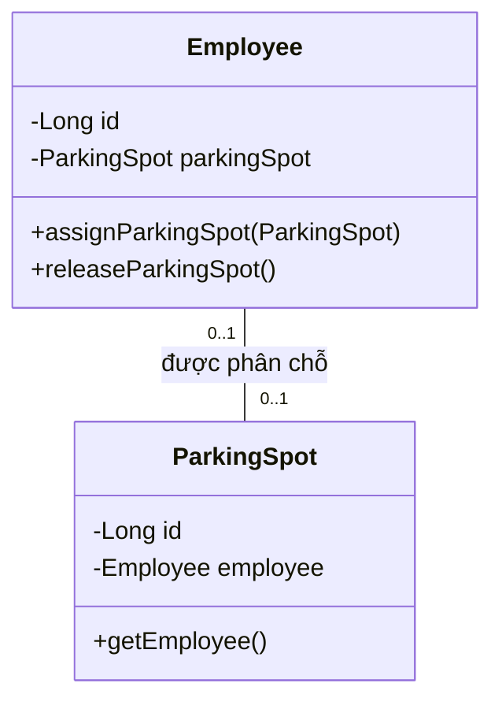
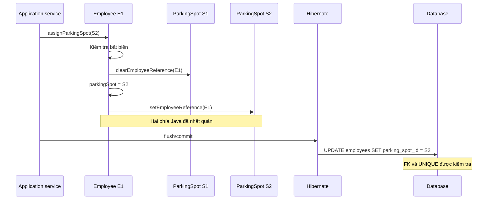
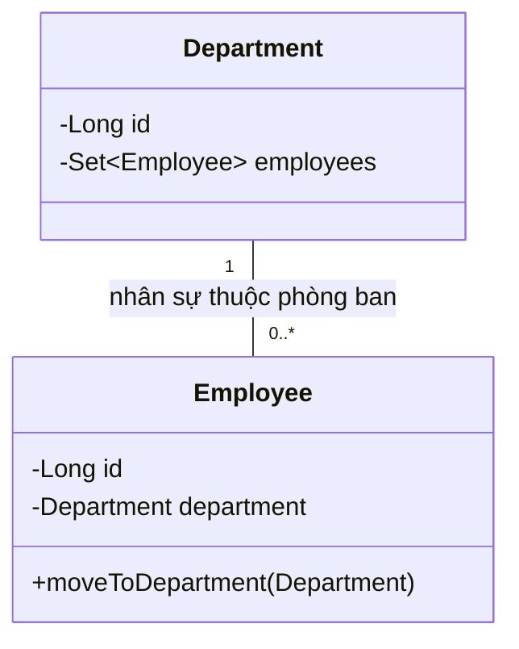

# Đồng bộ hai phía quan hệ bằng phương thức nghiệp vụ trong Hibernate

Trong Hibernate, một quan hệ hai chiều (*bidirectional association*) cho phép đi từ đối tượng A đến đối tượng B và đi ngược từ B về A. Chẳng hạn, một nhân viên có thể được phân một chỗ đỗ xe, còn chỗ đỗ xe có thể cho biết nhân viên đang sử dụng nó:

```java
employee.getParkingSpot();
parkingSpot.getEmployee();
```

Hai lời gọi trên cần mô tả **cùng một quan hệ nghiệp vụ**. Nếu ứng dụng chỉ sửa một phía, đồ thị đối tượng đang nằm trong bộ nhớ có thể tự mâu thuẫn:

```java
employee.setParkingSpot(spotA);

// Nếu không cập nhật phía ngược lại:
employee.getParkingSpot() == spotA; // true
spotA.getEmployee() == employee;     // có thể false
```

Trong khi đó, Hibernate lại phải dựa trên **phía sở hữu quan hệ** (*owning side*) để quyết định giá trị khóa ngoại nào sẽ được ghi vào database. Vì thế, cần phân biệt hai việc:

- **Đồng bộ object graph trong Java:** cập nhật đầy đủ cả hai tham chiếu/collection để code đang chạy thấy quan hệ nhất quán.
- **Đồng bộ dữ liệu trong database:** cập nhật phía sở hữu quan hệ để Hibernate phát sinh SQL thay đổi khóa ngoại hoặc bảng nối khi flush.

Cách tổ chức phổ biến là tạo **phương thức nghiệp vụ** (*business method/helper method*) trong entity, ví dụ `assignParkingSpot(...)`, `releaseParkingSpot()` hoặc `moveToDepartment(...)`. Phương thức này thực hiện một thao tác nghiệp vụ trọn vẹn: kiểm tra điều kiện, ngắt liên kết cũ, tạo liên kết mới và cập nhật hai phía trong một luồng có kiểm soát.

Bài học tập trung vào **quan hệ đơn trị** `@OneToOne` và `@ManyToOne` trong Hibernate/Jakarta Persistence. Với `@ManyToOne` hai chiều, đầu còn lại thường là collection `@OneToMany`; nguyên tắc đồng bộ vẫn tương tự nhưng cần xử lý collection.

## 1. Một quan hệ, hai hướng điều hướng và một phía sở hữu

### 1.1. Quan hệ đơn trị là gì?

Ở phía Java, quan hệ đơn trị (*to-one association*) là thuộc tính tham chiếu tới **một thực thể khác**:

```java
@ManyToOne
private Department department;

@OneToOne
private ParkingSpot parkingSpot;
```

- `@ManyToOne`: nhiều entity có thể cùng tham chiếu một entity đích, ví dụ nhiều nhân viên thuộc một phòng ban.
- `@OneToOne`: mỗi thực thể gắn tối đa một thực thể ở phía còn lại, ví dụ mỗi nhân viên được cấp tối đa một chỗ đỗ và mỗi chỗ đỗ đang được cấp tối đa cho một nhân viên.

Quan hệ có thể là **đơn hướng** (*unidirectional*) hoặc **hai chiều** (*bidirectional*). Khi hai chiều, phía đích có một thuộc tính hay collection để điều hướng ngược về phía nguồn.

Ví dụ mô hình một-một:



Mũi tên điều hướng Java có thể tồn tại ở cả hai hướng, nhưng bản ghi quan hệ trong database thông thường chỉ cần một khóa ngoại.

### 1.2. Owning side quyết định khóa ngoại được ghi

Giả sử database có bảng:

```sql
CREATE TABLE parking_spots (
    id BIGINT PRIMARY KEY,
    code VARCHAR(30) NOT NULL UNIQUE
);

CREATE TABLE employees (
    id BIGINT PRIMARY KEY,
    name VARCHAR(100) NOT NULL,
    parking_spot_id BIGINT UNIQUE,
    CONSTRAINT fk_employee_parking_spot
        FOREIGN KEY (parking_spot_id) REFERENCES parking_spots(id)
);
```

Khóa ngoại `employees.parking_spot_id` biểu diễn nhân viên đang dùng chỗ nào; ràng buộc `UNIQUE` bảo đảm không có hai nhân viên dùng cùng một chỗ theo dữ liệu database. Cột có thể `NULL` khi nhân viên chưa được phân chỗ. Semantics của `UNIQUE` với `NULL` phụ thuộc hệ quản trị; ví dụ chủ yếu nhấn mạnh việc không cho hai khóa ngoại **không null** trùng nhau.

Mapping điển hình:

```java
// Employee: owning side
@OneToOne(fetch = FetchType.LAZY)
@JoinColumn(name = "parking_spot_id", unique = true)
private ParkingSpot parkingSpot;

// ParkingSpot: inverse side
@OneToOne(mappedBy = "parkingSpot", fetch = FetchType.LAZY)
private Employee employee;
```

- `Employee.parkingSpot` là **owning side** vì khai `@JoinColumn` và cột khóa ngoại nằm trong bảng `employees`.
- `ParkingSpot.employee` là **inverse side**, chỉ ra rằng quan hệ được quản lý bằng thuộc tính `parkingSpot` của entity `Employee` thông qua `mappedBy = "parkingSpot"`.
- `mappedBy` nhận **tên thuộc tính Java ở entity đối diện**, không phải tên cột hoặc bảng.
- Mỗi quan hệ hai chiều có cơ chế xác định phía sở hữu rõ ràng; việc thêm `@JoinColumn` cho cả hai phía của cùng một quan hệ thường dẫn đến mapping sai hoặc hai quan hệ khác nhau.

**Chỉ sửa phía inverse không đủ để ghi khóa ngoại.** Nhưng chỉ sửa owning side cũng chưa chắc làm các tham chiếu Java ở hai phía nhất quán. Đó là lý do dùng phương thức nghiệp vụ cập nhật **cả hai**.

## 2. Điều gì xảy ra nếu chỉ sửa một phía?

Đặt tình huống ban đầu:

```text
Employee E1 -> ParkingSpot S1
ParkingSpot S1 -> Employee E1
```

Bây giờ E1 được đổi từ S1 sang S2. Nếu code chỉ làm:

```java
employee.setParkingSpot(spot2);
```

thì trong bộ nhớ có thể xuất hiện trạng thái:

```text
Employee E1 -> ParkingSpot S2   (đã đổi)
ParkingSpot S1 -> Employee E1   (tham chiếu cũ)
ParkingSpot S2 -> null          (chưa được cập nhật)
```

Hệ quả thường gặp:

1. **Code nghiệp vụ đọc dữ liệu không nhất quán.** Một màn hình hiển thị theo `Employee` nói E1 đang ở S2, trong khi màn hình đọc từ `ParkingSpot` nói S1 vẫn có E1.
2. **Validation bị sai.** Một phương thức kiểm tra `spot.getEmployee() == null` có thể kết luận S2 còn trống dù đã có nhân viên được gán ở phía sở hữu.
3. **Serialization/API dễ gây hiểu lầm.** Trả trực tiếp entity qua JSON có thể phơi bày hai nhánh của đồ thị có giá trị không khớp, bên cạnh nguy cơ vòng lặp khi serialize quan hệ hai chiều.
4. **Cascade, orphan removal và collection logic có thể dựa vào state không đồng bộ.** Kết quả ở thời điểm flush có thể khó dự đoán từ những gì code vừa đọc.
5. **Đọc lại sau một persistence context khác cho kết quả khác.** Database có thể đã lưu khóa ngoại đúng nhờ owning side, nhưng object inverse hiện tại vẫn chứa state cũ cho tới khi được refresh/reload.

Ngược lại, nếu chỉ sửa:

```java
spot2.setEmployee(employee);
```

khi `ParkingSpot.employee` là inverse side, ứng dụng **không được kỳ vọng** Hibernate sẽ cập nhật `employees.parking_spot_id` chỉ vì thay đổi phía này.

Một quy tắc rất hữu ích:

> **Phía sở hữu quyết định SQL quan hệ; phương thức nghiệp vụ quyết định tính nhất quán của object graph.**

## 3. Phương thức nghiệp vụ phải làm những gì?

Một phương thức như `assignParkingSpot(next)` nên giải quyết rõ bốn trách nhiệm.

### 3.1. Xác định thao tác có thực sự làm đổi quan hệ

Nếu entity đã trỏ tới đúng object đích, có thể kết thúc sớm:

```java
if (this.parkingSpot == next) {
    return;
}
```

Điều này tránh sửa lại hai phía khi không cần. Phép `==` phù hợp khi code làm việc với những entity managed nhất quán trong **cùng persistence context**, vì Hibernate duy trì identity cho entity đó. Khi trộn detached entity, proxy và các context khác nhau, phải có chính sách rõ về danh tính và việc tải entity chuẩn; không thay `==` bằng so sánh ID một cách tùy tiện khi ID có thể `null`.

### 3.2. Kiểm tra bất biến nghiệp vụ

Ví dụ: một chỗ đỗ không được cấp cho hai nhân viên. Trước khi gán cần kiểm tra `next` đang trống hay đang thuộc chính nhân viên hiện tại.

```java
if (next != null
        && next.getEmployee() != null
        && next.getEmployee() != this) {
    throw new IllegalStateException(
        "Parking spot is assigned to another employee");
}
```

Đây là kiểm tra **trong object graph hiện có**, giúp phát hiện sai từ code Java. Nhưng nó **không thay thế** unique constraint và chiến lược đồng thời ở database khi hai transaction cùng phân chỗ.

### 3.3. Ngắt liên kết cũ ở cả hai phía

Trước khi nối S2, cần bỏ reference ngược của S1:

```java
ParkingSpot previous = this.parkingSpot;

if (previous != null) {
    previous.clearEmployeeReference();
}
```

Trong code hoàn chỉnh, nên chỉ xóa tham chiếu của S1 nếu nó vẫn trỏ đúng tới entity hiện tại. Điều này giúp tránh xóa nhầm một quan hệ đã được thay đổi ở nơi khác trong cùng object graph.

### 3.4. Tạo liên kết mới ở cả hai phía

```java
this.parkingSpot = next;

if (next != null) {
    next.setEmployeeReference(this);
}
```

Phương thức helper ở phía ngược **chỉ cập nhật field nội bộ**; không gọi ngược lại `assignParkingSpot` để tránh hai phương thức liên tục gọi nhau vô hạn.

Sơ đồ thao tác:



Không cần phát SQL riêng để cập nhật `ParkingSpot.employee` vì phía inverse không sở hữu một khóa ngoại khác.

## 4. Ví dụ hoàn chỉnh: Employee và ParkingSpot (@OneToOne)

Ví dụ sau tập trung vào quan hệ, dùng Jakarta Persistence/Hibernate 6+. Entity có thể thêm các thuộc tính và quy tắc khác tùy ứng dụng.

### 4.1. Employee là owning side

```java
import jakarta.persistence.Entity;
import jakarta.persistence.FetchType;
import jakarta.persistence.GeneratedValue;
import jakarta.persistence.GenerationType;
import jakarta.persistence.Id;
import jakarta.persistence.JoinColumn;
import jakarta.persistence.OneToOne;
import jakarta.persistence.Table;

@Entity
@Table(name = "employees")
public class Employee {
    @Id
    @GeneratedValue(strategy = GenerationType.IDENTITY)
    private Long id;

    @OneToOne(fetch = FetchType.LAZY)
    @JoinColumn(name = "parking_spot_id", unique = true)
    private ParkingSpot parkingSpot;

    protected Employee() {
        // Constructor dùng cho JPA.
    }

    public Long getId() {
        return id;
    }

    public ParkingSpot getParkingSpot() {
        return parkingSpot;
    }

    public void assignParkingSpot(ParkingSpot next) {
        if (parkingSpot == next) {
            return;
        }

        // Theo quy tắc nghiệp vụ: không chiếm chỗ đang
        // được cấp cho nhân viên khác.
        if (next != null
                && next.getEmployee() != null
                && next.getEmployee() != this) {
            throw new IllegalStateException(
                "Parking spot is already assigned");
        }

        ParkingSpot previous = this.parkingSpot;

        // Ngắt quan hệ ngược cũ trước.
        if (previous != null
                && previous.getEmployee() == this) {
            previous.setEmployeeReference(null);
        }

        // Cập nhật owning side -> Hibernate ghi khóa ngoại.
        this.parkingSpot = next;

        // Cập nhật inverse side để Java object graph nhất quán.
        if (next != null) {
            next.setEmployeeReference(this);
        }
    }

    public void releaseParkingSpot() {
        assignParkingSpot(null);
    }
}
```

`assignParkingSpot` là điểm vào nghiệp vụ quan trọng:

- Gán cùng một instance không cần thực hiện lại.
- Chặn việc cấp một chỗ cho người thứ hai trong trạng thái Java hiện có.
- Bỏ liên kết cũ để không có hai chỗ cùng chỉ về một nhân viên.
- Cập nhật `Employee.parkingSpot` là owning side.
- Cập nhật `ParkingSpot.employee` là inverse side.
- Cho phép `null` để biểu diễn nhân viên chưa có chỗ đỗ, phù hợp cột khóa ngoại nullable trong ví dụ.

### 4.2. ParkingSpot là inverse side

```java
import jakarta.persistence.Entity;
import jakarta.persistence.FetchType;
import jakarta.persistence.GeneratedValue;
import jakarta.persistence.GenerationType;
import jakarta.persistence.Id;
import jakarta.persistence.OneToOne;
import jakarta.persistence.Table;

@Entity
@Table(name = "parking_spots")
public class ParkingSpot {
    @Id
    @GeneratedValue(strategy = GenerationType.IDENTITY)
    private Long id;

    @OneToOne(mappedBy = "parkingSpot", fetch = FetchType.LAZY)
    private Employee employee;

    protected ParkingSpot() {
        // Constructor cho JPA.
    }

    public Long getId() {
        return id;
    }

    public Employee getEmployee() {
        return employee;
    }

    // Helper nội bộ: không cho caller bên ngoài thay đổi
    // một phía mà không cập nhật owning side.
    void setEmployeeReference(Employee employee) {
        this.employee = employee;
    }

    public void release() {
        if (employee != null) {
            employee.releaseParkingSpot();
        }
    }

    public void assignTo(Employee target) {
        target.assignParkingSpot(this);
    }
}
```

Hai phương thức public `release()` và `assignTo(...)` **ủy quyền cho một điểm điều phối duy nhất** trên `Employee`. Chúng không tự thay mỗi field inverse. Phương thức `setEmployeeReference(...)` được giới hạn quyền truy cập trong package để chỉ code quản lý quan hệ nội bộ sử dụng.

Trong một dự án nhiều package hoặc domain module, có thể thay package-private helper bằng thiết kế aggregate/service phù hợp. Điều thiết yếu là **không mở hai setter public độc lập cho phép caller tạo trạng thái mâu thuẫn**.

Đây là ví dụ mô hình đang dùng chung một persistence context; application service có trách nhiệm tải đúng managed entities. Code có thể cần thêm policy đối với entity detached/proxy, quyền phân chỗ và việc ghi nhận lịch sử điều chuyển.

### 4.3. Sử dụng từ application service

```java
import jakarta.persistence.EntityManager;
import jakarta.persistence.PersistenceContext;
import java.util.NoSuchElementException;
import org.springframework.stereotype.Service;
import org.springframework.transaction.annotation.Transactional;

@Service
public class ParkingAssignmentService {
    @PersistenceContext
    private EntityManager entityManager;

    @Transactional
    public void assign(Long employeeId, Long spotId) {
        Employee employee =
            entityManager.find(Employee.class, employeeId);

        ParkingSpot spot =
            entityManager.find(ParkingSpot.class, spotId);

        if (employee == null || spot == null) {
            throw new NoSuchElementException(
                "Employee or parking spot not found");
        }

        // Tại đây cần bổ sung authorization theo hệ thống.
        employee.assignParkingSpot(spot);

        // Không cần update cả hai entity bằng hai câu SQL.
        // Hibernate sẽ đồng bộ owning side khi flush.
    }

    @Transactional
    public void release(Long employeeId) {
        Employee employee =
            entityManager.find(Employee.class, employeeId);

        if (employee == null) {
            throw new NoSuchElementException(
                "Employee not found");
        }

        employee.releaseParkingSpot();
    }
}
```

Trong transaction, Hibernate theo dõi `Employee` managed. Khi `parkingSpot` đổi, nó có thể sinh SQL tương đương:

```sql
UPDATE employees
SET parking_spot_id = ?
WHERE id = ?;
```

Nếu dùng `@Version`, cấu hình dynamic update hoặc mapping khác, SQL thực tế có thể thêm cột và điều kiện. **Không có SQL thứ hai chỉ để lưu field inverse `ParkingSpot.employee`.**

Với quan hệ một-một, phía inverse có thể phải truy vấn để xác định đối tượng liên kết; việc đặt `fetch = LAZY` không bảo đảm Hibernate luôn trì hoãn được mọi truy vấn trong mọi mapping/phiên bản. Cần đo SQL thực tế.

## 5. Diễn tiến qua các trạng thái nghiệp vụ

Hãy quan sát cùng một ví dụ qua những tình huống.

### 5.1. Gán lần đầu

Ban đầu:

```text
E1.parkingSpot = null
S1.employee    = null
```

Sau:

```java
e1.assignParkingSpot(s1);
```

State trong Java:

```text
E1.parkingSpot = S1
S1.employee    = E1
```

Owning side có thể được flush thành khóa ngoại `employees.parking_spot_id = S1.id`.

### 5.2. Đổi từ S1 sang S2

Ban đầu:

```text
E1.parkingSpot = S1
S1.employee    = E1
S2.employee    = null
```

Sau `e1.assignParkingSpot(s2)`:

```text
E1.parkingSpot = S2
S1.employee    = null
S2.employee    = E1
```

Lưu ý không được chỉ nối S2 mà quên ngắt S1. Một phương thức nghiệp vụ rõ nghĩa giúp mọi caller đều tuân theo đúng trình tự.

### 5.3. Bỏ chỗ đỗ

```java
e1.releaseParkingSpot();
```

State:

```text
E1.parkingSpot = null
S2.employee    = null
```

Hibernate sẽ cần cập nhật FK thành `NULL` khi entity managed được flush. Điều này chỉ hợp lệ vì `parking_spot_id` cho phép nullable. Nếu schema khai `NOT NULL`, phương thức giải phóng sẽ vi phạm constraint; domain và database phải đồng thuận về mô hình.

### 5.4. Gán chỗ đã thuộc người khác

Giả sử S2 hiện đã thuộc E2:

```text
E2.parkingSpot = S2
S2.employee    = E2
```

Khi `e1.assignParkingSpot(s2)`, method từ chối. Đây là **quyết định nghiệp vụ**, không phải một yêu cầu cố định của JPA. Một miền nghiệp vụ khác có thể cho phép “chuyển giao chỗ đỗ” và phải viết method rõ ràng để ngắt E2 trước khi cấp cho E1.

Không nên cho phép việc “chiếm chỗ” xảy ra ngầm trong setter đơn trị.

## 6. Vì sao không viết hai setter gọi qua lại?

Một thiết kế dễ gây lỗi:

```java
// Code minh họa SAI.
class Employee {
    void setParkingSpot(ParkingSpot spot) {
        this.parkingSpot = spot;
        spot.setEmployee(this);
    }
}

class ParkingSpot {
    void setEmployee(Employee employee) {
        this.employee = employee;
        employee.setParkingSpot(this);
    }
}
```

`setParkingSpot` gọi `setEmployee`, rồi `setEmployee` lại gọi `setParkingSpot`, dẫn tới đệ quy vô hạn hoặc `StackOverflowError`. Dù thêm check chống lặp ở cả hai method, việc ngắt liên kết cũ và xử lý null vẫn dễ bị bỏ sót.

Mẫu đơn giản hơn:

- **Một phương thức public làm điều phối**: `Employee.assignParkingSpot`.
- **Helper nội bộ ở phía ngược**: chỉ cập nhật tham chiếu, không gọi ngược phương thức public.
- **Điểm vào public từ phía ngược, nếu cần**: chỉ ủy quyền về phương thức điều phối, ví dụ `ParkingSpot.assignTo(employee)`.
- **Không để caller sửa reference trực tiếp** từ nhiều nơi.

Phương thức nghiệp vụ thường có tên diễn đạt ý định và bất biến rõ hơn `setX`: `assign`, `transfer`, `release`, `attach`, `detach`. Điều này giúp tách hành vi nghiệp vụ khỏi thao tác gán field.

## 7. Khi nào cần xử lý cả phía cũ và phía mới?

Nhiều lỗi không nằm ở gán quan hệ mới mà nằm ở **quên dọn quan hệ cũ**.

Giả sử nhân viên đã có chỗ S1 và chuyển sang S2. Nếu chỉ thực hiện:

```java
employee.parkingSpot = s2;
s2.employee = employee;
```

thì S1 vẫn tham chiếu E1. Một thuật toán đầy đủ cần:

1. Đọc liên kết cũ.
2. Kiểm tra liên kết mới có hợp lệ.
3. Ngắt reference ngược của đối tượng cũ.
4. Gán phía sở hữu sang đối tượng mới.
5. Gán reference ngược của đối tượng mới.
6. Để Hibernate flush trong transaction phù hợp.

Đối với giá trị `null`, bỏ qua bước gán reference ngược mới. Đối với gán lại cùng object, bỏ qua toàn bộ thay đổi để tránh thao tác thừa.

### 7.1. Không được làm mất quan hệ của một nhân viên khác

Nếu có code kiểu:

```java
if (next.getEmployee() != null) {
    next.setEmployeeReference(null);
}
```

nó chỉ xóa **tham chiếu inverse** của S2, không xóa owning side của Employee đang chiếm S2. Kết quả trong Java sẽ bất nhất; database vẫn có FK người cũ và có thể gây lỗi unique constraint khi gán người mới.

Nếu nghiệp vụ cho phép chuyển chỗ từ E2 sang E1, phải thực hiện hành động trọn vẹn qua owning side của E2, ví dụ:

```java
Employee previousOwner = next.getEmployee();

if (previousOwner != null && previousOwner != this) {
    previousOwner.releaseParkingSpot();
}

this.assignParkingSpot(next);
```

Đây chỉ là phác thảo cho chính sách **cho phép chuyển giao**. Trong môi trường đồng thời và DB có unique constraint, cần xét thứ tự flush/lock, kiểm tra quyền và lịch sử chuyển giao. Không dùng phác thảo này nếu nghiệp vụ quy định không được chiếm chỗ đã cấp.

## 8. Mở rộng: @ManyToOne và @OneToMany cũng cần đồng bộ hai phía

Một quan hệ đơn trị phổ biến hơn `@OneToOne` là `@ManyToOne`. Ví dụ mỗi nhân viên thuộc đúng một phòng ban, còn phòng ban có nhiều nhân viên:



Trong database, khóa ngoại nằm ở `employees.department_id`. Do đó:

- `Employee.department` với `@ManyToOne` + `@JoinColumn` là owning side.
- `Department.employees` với `@OneToMany(mappedBy = "department")` là inverse side.
- Hibernate chỉ biết cập nhật FK đúng khi `Employee.department` được thay đổi.
- Collection `Department.employees` vẫn phải được cập nhật trong Java nếu muốn đồ thị nhất quán.

### 8.1. Department bảo vệ collection

```java
import jakarta.persistence.Entity;
import jakarta.persistence.GeneratedValue;
import jakarta.persistence.Id;
import jakarta.persistence.OneToMany;
import java.util.Collections;
import java.util.HashSet;
import java.util.Set;

@Entity
public class Department {
    @Id
    @GeneratedValue
    private Long id;

    @OneToMany(mappedBy = "department")
    private Set<Employee> employees = new HashSet<>();

    protected Department() {}

    public Set<Employee> getEmployees() {
        return Collections.unmodifiableSet(employees);
    }

    // Chỉ dùng từ helper quản lý quan hệ.
    void addEmployeeReference(Employee employee) {
        employees.add(employee);
    }

    void removeEmployeeReference(Employee employee) {
        employees.remove(employee);
    }
}
```

Trả về view `unmodifiableSet` giúp caller bên ngoài không thể gọi `department.getEmployees().add(employee)` rồi bỏ quên cập nhật `employee.department`. Tuy nhiên view không có nghĩa các entity con bất biến; caller vẫn có thể thao tác trên chính object con qua API hợp lệ.

### 8.2. Employee điều phối việc chuyển phòng ban

```java
import jakarta.persistence.Entity;
import jakarta.persistence.FetchType;
import jakarta.persistence.GeneratedValue;
import jakarta.persistence.Id;
import jakarta.persistence.JoinColumn;
import jakarta.persistence.ManyToOne;
import java.util.Objects;

@Entity
public class Employee {
    @Id
    @GeneratedValue
    private Long id;

    @ManyToOne(fetch = FetchType.LAZY, optional = false)
    @JoinColumn(name = "department_id", nullable = false)
    private Department department;

    protected Employee() {}

    public Department getDepartment() {
        return department;
    }

    public void moveToDepartment(Department next) {
        Objects.requireNonNull(next, "department");

        if (department == next) {
            return;
        }

        Department previous = department;
        if (previous != null) {
            previous.removeEmployeeReference(this);
        }

        department = next;
        next.addEmployeeReference(this);
    }
}
```

Phương thức trên cần đặt trong ngữ cảnh model phù hợp với việc tuyển mới/chuyển phòng ban. Vì khóa ngoại được khai `nullable = false`, method không cho phép `null` làm phòng ban đích. Với nhân viên mới, ứng dụng gọi `moveToDepartment` trước khi persist, để đảm bảo có quan hệ bắt buộc.

Từ application service:

```java
@Transactional
public void transfer(Long employeeId, Long departmentId) {
    Employee employee =
        entityManager.find(Employee.class, employeeId);
    Department target =
        entityManager.find(Department.class, departmentId);

    if (employee == null || target == null) {
        throw new NoSuchElementException(
            "Employee or department not found");
    }

    employee.moveToDepartment(target);
}
```

Sau khi gọi, trong Java:

```text
employee.getDepartment() == target                -> true
target.getEmployees().contains(employee)          -> true
oldDepartment.getEmployees().contains(employee)   -> false
```

Hibernate sẽ cập nhật `employees.department_id` theo sở hữu `@ManyToOne`. Việc thêm/xóa khỏi `Set` inverse chỉ giữ Java graph nhất quán; nó không phải lời gọi tạo thêm hai câu SQL điều chỉnh khóa ngoại.

### 8.3. Collection có những đặc tính cần chú ý

Ví dụ dùng `HashSet<Employee>` đơn giản để giải thích, nhưng JPA entity có thể được proxied, detached, chưa có generated ID hoặc override `equals/hashCode`. Nếu `hashCode` thay đổi sau khi entity được thêm vào `HashSet`, thao tác `remove` có thể thất bại.

Vì vậy cần thiết kế identity/equality của entity phù hợp với lifecycle. Không dùng ID chưa được cấp vào `hashCode` thay đổi theo thời gian mà không cân nhắc hậu quả. Với entity managed trong một persistence context, reference identity thường có thể sử dụng để tránh một số nhầm lẫn, nhưng không nên trộn tùy ý bản detached và managed từ các context khác nhau.

Việc đọc `getEmployees()` trên một collection lazy có thể làm Hibernate tải dữ liệu; helper gọi `add/remove` cũng có thể gây truy vấn hoặc ghi nhận thao tác theo wrapper collection tùy mapping. Với tập dữ liệu rất lớn, không nên giả định việc “giữ collection ngược luôn đồng bộ trong Java” không có chi phí. Khi không cần quản lý collection hai chiều trong use case, cân nhắc mapping đơn hướng hoặc thiết kế truy vấn thay thế cho bộ sưu tập quá lớn.

## 9. Quan hệ hai chiều và vòng đời persistence context

### 9.1. Cả hai entity nên được tải và sử dụng đúng trạng thái

Trong trường hợp phổ biến, application service tải cả Employee và ParkingSpot qua cùng một `EntityManager` trong transaction rồi gọi helper:

```java
Employee employee = entityManager.find(Employee.class, employeeId);
ParkingSpot spot = entityManager.find(ParkingSpot.class, spotId);

employee.assignParkingSpot(spot);
```

Cả hai là **managed entities** trong cùng persistence context. Điều này giúp các reference của hai phía biểu diễn cùng đối tượng quản lý tại thời điểm đó.

Nếu một bên là entity detached lấy từ request, việc so sánh bằng `==` có thể không đại diện cho cùng định danh database. Hãy tải lại tham chiếu managed bằng ID hoặc dùng `getReference` khi phù hợp, kiểm tra tồn tại/quyền ở nơi cần, rồi thao tác trên model đã được quản lý nhất quán.

Không dùng trực tiếp object deserialize từ JSON như thể đó là entity managed có thể gắn vào quan hệ.

### 9.2. Không phải cứ gọi helper là SQL chạy ngay

```java
employee.assignParkingSpot(spot);

// Reference Java được cập nhật ngay trong RAM.
// SQL UPDATE có thể chỉ xuất hiện ở flush/commit.
```

Hibernate dirty checking dựa vào trạng thái của entity managed và đồng bộ với database tại thời điểm flush tương ứng. SQL có thể được phát trước commit theo các tình huống flush mode, truy vấn và transaction. `flush` **không phải commit**: transaction có thể rollback.

Nếu code gọi helper trên detached entity rồi không merge/tải managed entity hợp lệ, không thể mong Hibernate tự ghi được quan hệ đó.

### 9.3. Đọc lại cùng entity trong một persistence context

```java
Employee again = entityManager.find(
    Employee.class, employeeId);
```

Trong cùng persistence context, `find` thường trả lại chính entity managed đang được giữ, không nhất thiết tải lại từ DB. Vì thế, nếu object graph từng bị sửa một phía, gọi lại `find` không phải cách sửa đáng tin cậy.

Đồng bộ hai phía **ngay tại thời điểm thay quan hệ** giúp không cần dựa vào các lệnh refresh sau này để giải quyết mâu thuẫn trong RAM.

## 10. Cascade và orphanRemoval không thay thế helper đồng bộ

Có hai annotation thường bị nhầm với chuyện “Hibernate tự sửa quan hệ hai chiều”.

### 10.1. Cascade truyền thao tác lifecycle

Ví dụ:

```java
@OneToOne(mappedBy = "employee",
          cascade = CascadeType.PERSIST)
private EmployeeBadge badge;
```

`cascade = PERSIST` nghĩa là khi persist entity chủ phù hợp, Hibernate có thể propagate thao tác persist đến entity liên quan, theo mapping cụ thể. Nó **không** tự suy luận rằng nếu `employee.badge = badge` thì `badge.employee` đã được cập nhật đúng trong Java.

**Cascade và đồng bộ hai phía là hai cơ chế khác nhau:**

- Cascade quyết định thao tác persist, merge, remove, refresh, detach có thể lan sang entity nào.
- Helper quyết định reference/collection trong object graph Java được cập nhật thế nào.
- Owning side quyết định liên kết DB được ghi ở đâu.

Tránh dùng `CascadeType.ALL` theo thói quen, nhất là từ quan hệ giữa các thực thể có vòng đời độc lập như Employee và ParkingSpot. Việc xóa một nhân viên **không nên tự động xóa chỗ đỗ xe khỏi hệ thống** chỉ vì từng được phân cho người đó.

### 10.2. orphanRemoval biểu diễn chính sách xóa entity con

Ví dụ `@OneToOne(orphanRemoval = true)` có thể phù hợp với entity con thuộc sở hữu vòng đời chặt chẽ, chẳng hạn bản cấu hình chi tiết không được chia sẻ. Khi ngắt quan hệ, Hibernate có thể lên lịch xóa entity con, chứ không đơn thuần đưa khóa ngoại về null.

Không dùng orphan removal cho ParkingSpot độc lập có thể được cấp lại cho nhân viên khác. Nếu chuyển hoặc thay một entity con trong cùng transaction với unique FK, cần cân nhắc **thứ tự SQL**: insert/update có thể vi phạm ràng buộc unique tạm thời trước khi bản ghi cũ được xóa. Có thể cần chọn chiến lược thay thế phù hợp, flush có chủ đích ở ranh giới cần thiết hoặc thiết kế schema khác.

**Đồng bộ graph chính xác chưa đảm bảo mọi thứ tự SQL hợp lệ.** Transaction, cascade, orphan removal và constraint database vẫn cần thiết kế phối hợp.

## 11. Lưu ý riêng với @OneToOne và khóa ngoại UNIQUE

Một-một có nhiều cách lưu trữ:

1. **Foreign key + unique constraint:** một bảng chứa khóa ngoại sang bảng kia, như `employees.parking_spot_id`. Owning side là nơi khai `@JoinColumn`.
2. **Shared primary key với `@MapsId`:** entity phụ dùng cùng định danh với entity chính. Phương thức helper và thời điểm persist cần tuân thủ ràng buộc định danh này.
3. **Join table:** quan hệ được biểu diễn qua bảng liên kết, với các unique constraint phù hợp; phía sở hữu được xác định theo mapping join table.

Không giả định mọi `@OneToOne` đều có cấu trúc giống nhau. Tuy nhiên, nguyên tắc vẫn là **có một owning side, một inverse side nếu bidirectional**, và một phương thức nghiệp vụ có thể cập nhật đầy đủ Java graph.

### 11.1. UNIQUE constraint giúp ngăn trạng thái sai khi có hai giao dịch

Giả sử hai request đồng thời:

```text
T1: đọc S1 đang trống
T2: đọc S1 đang trống
T1: gán E1 -> S1
T2: gán E2 -> S1
```

Cả hai helper trên hai persistence context khác nhau có thể cùng vượt qua kiểm tra Java vì chưa thấy thao tác của nhau. Khi commit, ràng buộc `UNIQUE` của `employees.parking_spot_id` giúp database từ chối trạng thái có hai nhân viên cùng trỏ tới S1.

Ứng dụng cần xử lý lỗi constraint phù hợp để trả về “chỗ đã được cấp”, hoặc chọn chiến lược lock/transaction khi yêu cầu concurrency cao. Tùy trường hợp, có thể dùng pessimistic lock đối với hàng ParkingSpot khi phân chỗ, optimistic locking phù hợp và retry được thiết kế kỹ. Chỉ thêm `@Version` vào một entity chưa chắc bảo vệ được mọi bất biến liên hàng.

### 11.2. Một transaction chưa chắc có SQL theo thứ tự code gán field

Hibernate có cơ chế sắp xếp SQL khi flush. Nếu ứng dụng vừa giải phóng S1 ở E1 vừa gán S1 cho E2, thứ tự SQL có thể quyết định một bước trung gian có vi phạm unique constraint không.

Ví dụ:

```java
e1.releaseParkingSpot();
e2.assignParkingSpot(s1);
```

Về Java graph, kết quả có thể nhất quán. Nhưng không nên suy luận Hibernate sẽ chạy chính xác hai UPDATE theo thứ tự hai lời gọi trên. Nếu thứ tự quan trọng với constraint, hãy thiết kế transaction rõ ràng, kiểm thử với DB thực tế và chỉ dùng flush trung gian khi hiểu hậu quả về hiệu năng và nhất quán.

## 12. Nên đặt phương thức nghiệp vụ ở phía nào?

Có ba lựa chọn thường gặp:

| Cách tổ chức | Phù hợp khi | Điểm cần chú ý |
|---|---|---|
| Helper ở owning side, ví dụ `Employee.assignParkingSpot` | Quan hệ có một chủ thể quyết định hành vi | Dễ nhớ cập nhật FK và phía inverse |
| Helper ở aggregate root | Một root quản lý vòng đời và bất biến của các thành phần liên quan | Phải giữ biên aggregate rõ, tránh gọi qua nhiều aggregate không kiểm soát |
| Domain/application service điều phối nhiều entity | Thao tác cần quyền, tìm kiếm, lock hoặc nhiều quy tắc liên entity | Service có thể quyết định *khi nào* làm; entity helper vẫn hữu ích để giữ graph nhất quán |

Không có quy tắc rằng helper bắt buộc phải nằm ở phía sở hữu. Điều quan trọng là **mọi con đường thay quan hệ đi qua cùng một quy tắc đồng bộ**, và ít nhất một chỗ có trách nhiệm cập nhật owning side.

Ví dụ `ParkingSpot.assignTo(employee)` có thể là API tiện dụng, miễn nó ủy quyền cho `Employee.assignParkingSpot(this)`. Điều cần tránh là hai tập quy tắc song song khác nhau ở hai entity.

### 12.1. Tên phương thức nói lên hành vi

So sánh:

```java
employee.setParkingSpot(spot);
employee.assignParkingSpot(spot);
employee.releaseParkingSpot();
```

`setParkingSpot` nghe giống phép gán field, còn `assignParkingSpot`/`releaseParkingSpot` thể hiện hành vi nghiệp vụ có kiểm tra và cập nhật liên kết cũ. Khi có yêu cầu audit, quyền và xung đột, tên nghiệp vụ giúp code dễ đọc hơn.

### 12.2. Không đặt truy cập database một cách tùy tiện vào entity helper

Một entity helper thường nên thao tác trên state đã được cung cấp, không tự đi tìm repository hay mở transaction. Application service chịu trách nhiệm:

- Nạp entity managed phù hợp.
- Kiểm tra quyền của người gọi.
- Chọn ranh giới transaction và chiến lược đồng thời.
- Gọi phương thức nghiệp vụ.
- Tạo audit/event theo cơ chế đáng tin cậy khi cần.

Nhờ đó entity giữ được logic nhất quán của quan hệ mà không bị phụ thuộc vào controller, repository hoặc container Spring.

## 13. Hệ quả của lazy loading và cách truy cập quan hệ ngược

### 13.1. Mặt inverse của @OneToOne có thể có chi phí tải

Ở `ParkingSpot`, quan hệ `@OneToOne(mappedBy = "parkingSpot", fetch = LAZY)` có thể cần truy vấn để biết thực sự có Employee liên kết không, đặc biệt khi phía inverse không giữ FK trực tiếp. Hibernate có thể dùng bytecode enhancement hoặc các cơ chế khác tùy phiên bản và mapping, nhưng không nên cho rằng mọi inverse one-to-one sẽ luôn lazy đúng như kỳ vọng.

Vì helper `assignParkingSpot` kiểm tra `next.getEmployee()`, nếu inverse chưa được tải, code có thể phát sinh truy vấn. Đây là chi phí cần đo và chấp nhận hoặc tối ưu theo use case.

### 13.2. Truy cập ngoài persistence context

```java
Employee employee = repository.findById(id).orElseThrow();

// Sau khi transaction/context đóng:
employee.getParkingSpot().getCode();
```

Nếu `parkingSpot` là proxy chưa khởi tạo, truy cập có thể gây `LazyInitializationException`. Đó là vấn đề fetch plan và lifecycle, khác với việc helper đã đồng bộ hai phía trong RAM.

Hãy thiết kế việc đọc DTO/projection, join fetch hoặc entity graph trong transaction phù hợp, không chữa bằng cách chuyển toàn bộ quan hệ sang `EAGER`.

### 13.3. Không serialize trực tiếp đồ thị hai chiều nếu không có chủ đích

Quan hệ `Employee.parkingSpot` và `ParkingSpot.employee` tạo chu trình:

```text
Employee -> ParkingSpot -> Employee -> ...
```

Serializer JSON có thể đi vòng lặp, tạo payload quá lớn hoặc kích hoạt lazy loads. Thiết kế DTO trả về những thuộc tính cần cho API, ví dụ `EmployeeDetails(id, parkingSpotCode)`. Việc cấu hình serializer không thay thế helper đồng bộ graph.

## 14. Thiết kế kiểm tra hành vi của helper

Một phương thức nghiệp vụ quan hệ cần được hiểu qua những trường hợp cụ thể. Bảng sau diễn tả trạng thái kỳ vọng:

| Thao tác | Phía owning sau thao tác | Phía inverse sau thao tác | Kết quả DB khi flush |
|---|---|---|---|
| Gán lần đầu E1 → S1 | E1 trỏ S1 | S1 trỏ E1 | FK của E1 trỏ S1 |
| Gán lại E1 → S1 | Không đổi | Không đổi | Không cần UPDATE chỉ vì thao tác này |
| Đổi E1 từ S1 sang S2 | E1 trỏ S2 | S1 về null; S2 trỏ E1 | FK của E1 trỏ S2 |
| Giải phóng E1 | E1 về null | Chỗ cũ về null | FK của E1 về null |
| E1 gán S2 đang thuộc E2 | Không đổi; ném lỗi nghiệp vụ | Không đổi | Không có thay đổi nếu transaction xử lý lỗi phù hợp |
| Chuyển nhân viên sang Department khác | `Employee.department` trỏ phòng mới | Bỏ ở collection cũ; thêm vào mới | FK `department_id` đổi |

Ví dụ kiểm tra object graph trong transaction:

```java
Employee employee = entityManager.find(
        Employee.class, employeeId);
ParkingSpot s1 = entityManager.find(
        ParkingSpot.class, spot1Id);
ParkingSpot s2 = entityManager.find(
        ParkingSpot.class, spot2Id);

employee.assignParkingSpot(s1);
assertSame(s1, employee.getParkingSpot());
assertSame(employee, s1.getEmployee());

employee.assignParkingSpot(s2);
assertSame(s2, employee.getParkingSpot());
assertNull(s1.getEmployee());
assertSame(employee, s2.getEmployee());

employee.releaseParkingSpot();
assertNull(employee.getParkingSpot());
assertNull(s2.getEmployee());
```

Nếu muốn xác minh database, có thể flush, clear persistence context và load lại trong transaction tích hợp:

```java
employee.assignParkingSpot(s2);
entityManager.flush();
entityManager.clear();

Employee reloaded =
        entityManager.find(Employee.class, employeeId);
ParkingSpot reloadedSpot = reloaded.getParkingSpot();

assertNotNull(reloadedSpot);
assertEquals(spot2Id, reloadedSpot.getId());
```

Đoạn code trên minh họa assertions, giả định test fixture đã chuẩn bị employee/spot hợp lệ, transaction hoạt động và các import JUnit/JPA tương ứng đã có. Không nên coi object graph nhất quán trước flush là bằng chứng duy nhất rằng database đã lưu đúng. Cần kiểm tra constraint và mapping thực trên một database tích hợp.

## 15. Những nhầm lẫn thường gặp

### “Hibernate đã có mappedBy nên tự đồng bộ cả hai object”

`mappedBy` xác định inverse side của relationship mapping; nó **không phải lời hứa** Hibernate sẽ tự gọi setter của phía ngược khi Java code đổi field owning side. Ứng dụng phải duy trì object graph bằng helper hoặc một cơ chế model rõ ràng.

### “Chỉ sửa inverse side là đủ vì đó là phía có collection”

Với `@OneToMany(mappedBy = "department")`, thêm vào `department.getEmployees()` không tự cập nhật `employee.department`. Owning side trong ví dụ là `Employee.department`. Nếu cột FK không đổi, quan hệ DB cũng không đổi chỉ nhờ thay collection inverse.

### “Muốn an toàn thì gắn @JoinColumn cho cả hai phía”

Hai phía của một quan hệ hai chiều thông thường **không cùng khai mỗi bên một khóa ngoại**. Một phía sở hữu, phía ngược dùng `mappedBy`. Nếu khai cả hai phía như owning side, ORM có thể hiểu đó là hai quan hệ riêng và tạo schema/SQL không mong muốn.

### “Cứ gọi setA rồi setB là đã xong”

Một quan hệ thay đổi từ object cũ sang object mới còn cần **ngắt phía cũ**. Bỏ qua bước này làm graph có tham chiếu còn sót. Tên phương thức nghiệp vụ giúp buộc mọi caller làm đủ các bước.

### “Hai setter gọi nhau sẽ luôn đồng bộ”

Nếu không có guard và cơ chế delegation đúng, việc gọi qua lại gây đệ quy vô hạn. Một phương thức điều phối và helper gán field nội bộ thường dễ hiểu hơn.

### “CascadeType.ALL sẽ sửa mọi quan hệ”

Cascade chỉ lan truyền thao tác lifecycle theo mapping. Nó không thay cho việc cập nhật hai phía và có thể gây xóa nhầm entity có vòng đời riêng.

### “Không cần UNIQUE vì helper đã chặn chỗ có người”

Helper kiểm tra trạng thái cục bộ trong một transaction, còn transaction khác có thể đang phân cùng chỗ. Constraint database là lớp bảo vệ cuối cùng đối với ràng buộc duy nhất; ứng dụng còn cần thiết kế xử lý xung đột.

### “Gọi find thêm lần nữa sẽ tự sửa graph cũ”

Trong một persistence context, `find` có thể trả cùng managed instance nên không tự tải lại quan hệ inverse đã bị sửa sai. Đồng bộ ngay tại chỗ thay quan hệ dễ kiểm soát hơn.

### “Quan hệ one-to-one luôn lazy vì đã khai fetch = LAZY”

Phía inverse có thể đòi hỏi thêm truy vấn và phụ thuộc mapping/khả năng enhancement. Cần quan sát SQL thực; mục tiêu đồng bộ graph và mục tiêu tối ưu fetch là hai vấn đề riêng.

### “Đối tượng detached từ request có thể gán trực tiếp như managed”

Bản detached và managed có thể đại diện cùng một hàng nhưng là hai Java objects khác nhau. Trộn chúng trong helper dễ sai equality, dirty checking và lazy loading. Application service nên lấy managed instances chuẩn từ persistence context trước khi thao tác.

### “Helper xử lý đúng thì transaction luôn thành công”

Unique/FK/not-null constraint, optimistic locking, transaction isolation và thứ tự SQL vẫn có thể làm flush/commit thất bại. Helper giữ đồ thị Java nhất quán theo quy tắc nghiệp vụ tại thời điểm gọi; database quyết định constraint và kết quả giao dịch cuối cùng.

## 16. Cách áp dụng vào một quan hệ mới

Khi thiết kế quan hệ hai chiều, có thể đi theo trình tự:

1. **Xác định bất biến nghiệp vụ:** một đối tượng có thể liên kết với bao nhiêu đối tượng khác? Có cho phép null, đổi chủ, giải phóng hay xóa liên kết không?
2. **Chọn cấu trúc database:** FK đặt ở bảng nào, có `UNIQUE`/`NOT NULL`/`FOREIGN KEY` nào, có cần shared primary key không?
3. **Xác định owning side:** dùng `@JoinColumn` hoặc mapping chủ sở hữu thích hợp; phía inverse dùng `mappedBy` với tên Java property chính xác.
4. **Chọn một điểm điều phối:** đặt helper có tên nghiệp vụ và đảm bảo mọi thao tác gán/đổi/xóa quan hệ đi qua đó.
5. **Đồng bộ đầy đủ:** kiểm tra điều kiện, ngắt liên kết cũ, cập nhật owning side, cập nhật inverse side và xử lý trường hợp null/gán lại.
6. **Giới hạn setter nguy hiểm:** không phơi bày đường thay đổi một phía khi caller bên ngoài có thể làm graph bất nhất.
7. **Đặt trong transaction thích hợp:** application service tải managed entities, kiểm tra quyền và điều phối concurrency.
8. **Xác minh schema và behavior:** object graph trong Java, FK sau flush/reload, constraint khi có tranh chấp và số truy vấn lazy loading.

Một phương thức như `assignParkingSpot` nên có **một trách nhiệm rõ ràng**: khi nó hoàn tất thành công, các tham chiếu Java của quan hệ phải phù hợp với trạng thái nghiệp vụ mà ứng dụng vừa quyết định. Sau đó Hibernate dùng owning side để thực thi SQL theo mapping, còn database kiểm soát ràng buộc thực tế.

## 17. Kết luận

Trong quan hệ hai chiều của Hibernate, **owning side là nơi quyết định cách ghi khóa ngoại**, còn **inverse side là hướng điều hướng ngược trong object graph**. Chỉ sửa một phía có thể làm các đối tượng Java mâu thuẫn dù SQL vẫn được ghi theo owning side, hoặc làm database hoàn toàn không đổi nếu chỉ sửa phía inverse.

Phương thức nghiệp vụ như `assignParkingSpot`, `releaseParkingSpot` và `moveToDepartment` giúp gói một thao tác liên kết thành một hành vi rõ ràng: **kiểm tra bất biến → ngắt liên kết cũ → gán owning side → cập nhật inverse side**. Khi đi kèm transaction, constraint và chiến lược concurrency phù hợp, mô hình trở nên dễ hiểu và ít lỗi hơn so với các setter cho phép gán tùy tiện từng phía.

### Tài liệu tham khảo

- [Hibernate ORM User Guide](https://docs.jboss.org/hibernate/orm/current/userguide/html_single/Hibernate_User_Guide.html) — mục associations, bidirectional `@OneToOne`, `@ManyToOne`/`@OneToMany`, owning side và cascade.
- [Jakarta Persistence Specification](https://jakarta.ee/specifications/persistence/) — quy tắc `mappedBy`, mapping relationship, entity lifecycle và transaction.
- [Hibernate ORM Javadocs](https://docs.jboss.org/hibernate/orm/current/javadocs/) — tra API association và các thuộc tính mapping phù hợp phiên bản.

Khi áp dụng vào dự án, cần đối chiếu đúng phiên bản Hibernate và cơ sở dữ liệu thực tế, đặc biệt với lazy inverse one-to-one, uniqueness, cascade/orphan removal và thứ tự SQL khi flush.
