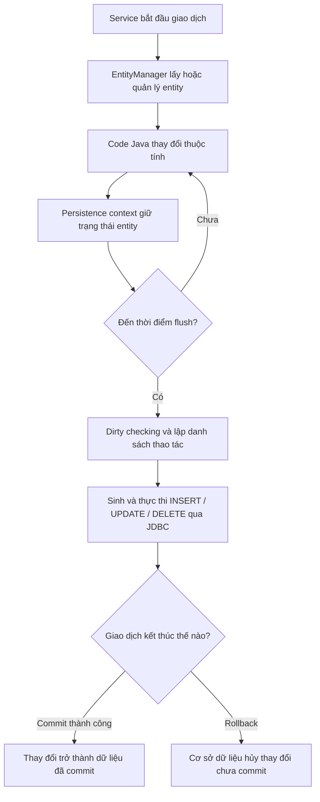
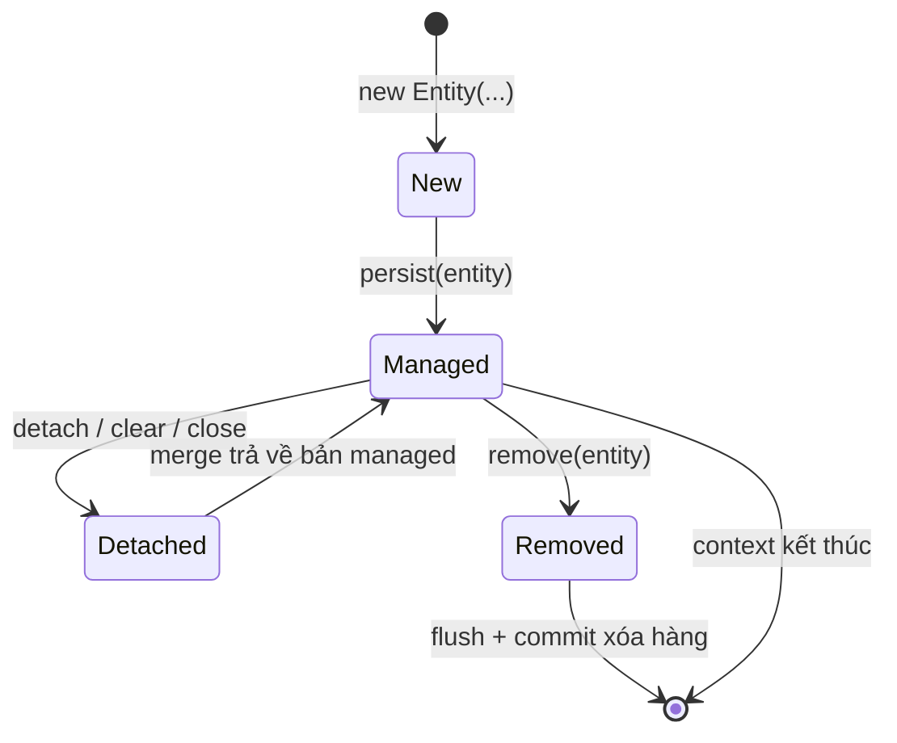
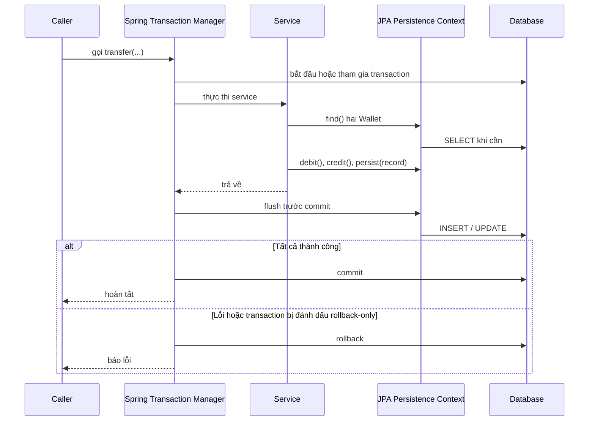
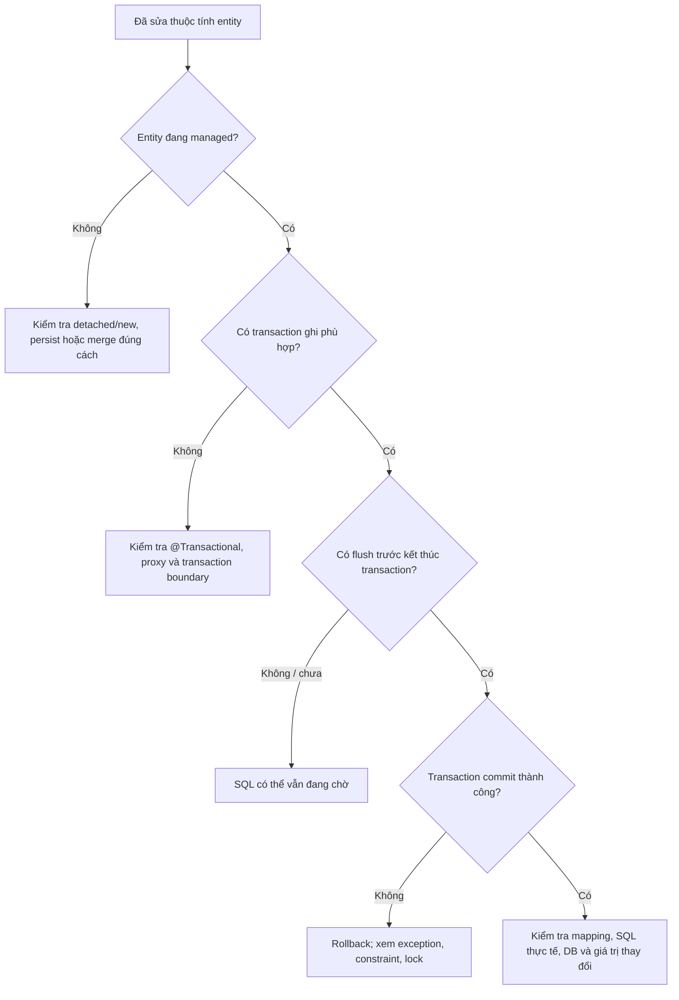

# Luồng xử lý từ thay đổi đối tượng đến câu SQL và giao dịch trong JPA

Khi làm việc với JPA, lập trình viên thường thao tác trên **đối tượng Java**: lấy một entity, gọi setter hoặc phương thức nghiệp vụ, rồi kết thúc phương thức `@Transactional`. Trong nhiều trường hợp, không có dòng code `UPDATE` nào, nhưng cơ sở dữ liệu vẫn được cập nhật. Để hiểu hành vi này, cần phân biệt bốn thời điểm: **đối tượng thay đổi trong bộ nhớ**, **JPA phát hiện thay đổi**, **SQL được gửi tới cơ sở dữ liệu**, và **giao dịch được commit hoặc rollback**.

> Ý tưởng trung tâm: **thay đổi một managed entity không đồng nghĩa với thực thi SQL ngay lập tức; thực thi SQL (`flush`) cũng không đồng nghĩa với commit giao dịch.**

Tài liệu sử dụng **Jakarta Persistence (JPA)** làm chuẩn API, **Hibernate** làm ví dụ về nhà cung cấp JPA và **Spring `@Transactional`** để minh họa cách quản lý giao dịch thường gặp trong ứng dụng Java. Các chi tiết về thời điểm gửi SQL, thứ tự câu lệnh và tối ưu hóa có thể khác nhau giữa các nhà cung cấp, cấu hình và chiến lược sinh khóa.

## 1. Bức tranh toàn cảnh: từ entity tới database

JPA là tầng ánh xạ đối tượng–quan hệ (*Object–Relational Mapping*, ORM): một entity Java có thể tương ứng với một hàng trong bảng; thuộc tính tương ứng với cột; quan hệ đối tượng tương ứng với khóa ngoại và phép nối. JPA quy định API và ngữ nghĩa quản lý entity; Hibernate, EclipseLink hoặc nhà cung cấp khác đảm nhiệm phần triển khai, bao gồm việc tạo và thực thi SQL.



Hai tầng quan trọng cần phân biệt:

- **Persistence context (ngữ cảnh lưu trữ)** theo dõi tập entity đang được quản lý, thường được truy cập qua `EntityManager`. Đây là nơi JPA duy trì danh tính đối tượng và trạng thái cần thiết để đồng bộ thay đổi.
- **Database transaction (giao dịch cơ sở dữ liệu)** xác định các thao tác SQL nào được commit cùng nhau hoặc rollback cùng nhau. Trong Spring, `@Transactional` thường xác định ranh giới giao dịch ở tầng service.

Một persistence context không phải là giao dịch cơ sở dữ liệu. Chúng thường hoạt động cùng nhau trong ứng dụng Spring, nhưng có vòng đời và trách nhiệm khác nhau.

## 2. Những thành phần tham gia vào luồng xử lý

| Thành phần | Vai trò | Điểm cần nhớ |
|---|---|---|
| Entity (`@Entity`) | Biểu diễn dữ liệu và hành vi nghiệp vụ trong Java | Thay đổi field là thao tác trong bộ nhớ trước tiên. |
| `EntityManager` | API JPA để `find`, `persist`, `merge`, `remove`, `flush`, `clear`... | Quản lý entity thông qua persistence context. |
| Persistence context | Duy trì identity map và trạng thái managed entity | Trong cùng context, cùng một định danh entity thường tương ứng với cùng một object instance. |
| Dirty checking | Phát hiện field có thay đổi so với trạng thái được theo dõi | Là cơ sở để tạo `UPDATE` cho managed entity. |
| Flush | Đồng bộ thao tác đang chờ từ persistence context xuống database | Có thể gửi SQL trước khi giao dịch commit. |
| JDBC / connection | Thực thi SQL do provider tạo | Database kiểm tra ràng buộc, khóa và quy tắc giao dịch. |
| Transaction manager | Bắt đầu, commit hoặc rollback giao dịch | Trong Spring thường thông qua `JpaTransactionManager` hoặc cơ chế phù hợp với môi trường. |
| Database | Lưu dữ liệu, điều khiển đồng thời và bảo đảm tính nguyên tử | Trạng thái đã flush vẫn có thể bị rollback. |

### Persistence context và first-level cache

Khi gọi:

```java
Wallet first = entityManager.find(Wallet.class, 101L);
Wallet second = entityManager.find(Wallet.class, 101L);

System.out.println(first == second); // true, trong cùng persistence context
```

Lần `find` thứ hai thường không cần thêm `SELECT` vì entity đã có trong **first-level cache** của persistence context. Cơ chế này duy trì một bản thể Java đại diện cho một cặp `(kiểu entity, khóa chính)` trong cùng context, giúp JPA theo dõi thay đổi nhất quán.

Điều này **không** có nghĩa mọi truy vấn đều bỏ qua database: JPQL, Criteria hoặc truy vấn native vẫn có quy tắc thực thi riêng, và lazy loading có thể phát sinh `SELECT` bổ sung.

## 3. Vòng đời entity quyết định thay đổi có được theo dõi không

| Trạng thái | Ý nghĩa | Điều gì xảy ra nếu sửa thuộc tính? |
|---|---|---|
| **New / transient** | Đối tượng mới tạo, chưa được context quản lý | Chỉ đổi bộ nhớ; chưa có `INSERT` cho tới khi được `persist` hoặc xử lý qua cascade thích hợp. |
| **Managed / persistent** | Đối tượng đang nằm trong persistence context | JPA theo dõi để đồng bộ khi flush. |
| **Detached** | Đối tượng từng được quản lý nhưng đã tách khỏi context | Thay đổi không tự động được ghi xuống database. |
| **Removed** | Managed entity đã được đánh dấu xóa | JPA lên lịch `DELETE`, thường thực thi lúc flush. |



Sơ đồ là mô hình khái quát. `merge` **không làm chính đối tượng detached trở thành managed**: nó trả về một đối tượng managed chứa trạng thái đã được sao chép. Entity ở trạng thái removed có thêm các quy tắc riêng về `persist` và `merge` theo chuẩn JPA.

Ví dụ sự khác biệt:

```java
Wallet wallet = entityManager.find(Wallet.class, 101L); // managed
wallet.credit(new BigDecimal("50.00"));                 // được theo dõi

entityManager.detach(wallet);                            // detached
wallet.credit(new BigDecimal("20.00"));                 // không tự ghi DB

Wallet managedAgain = entityManager.merge(wallet);       // trả về managed instance
managedAgain.credit(new BigDecimal("10.00"));           // được theo dõi
```

Trong thực tế cần một giao dịch phù hợp cho các thao tác ghi; ví dụ trên chỉ tập trung mô tả trạng thái. Không nên coi `merge` là cách bắt buộc để lưu mọi thay đổi: với entity đã managed, dirty checking thường đã đủ.

## 4. Một ví dụ xuyên suốt: chuyển tiền giữa hai ví

Giả sử ứng dụng có bảng `wallets(id, balance, version)` và `transfer_records(id, from_wallet_id, to_wallet_id, amount)`. Nghiệp vụ chuyển tiền cần thực hiện ba thay đổi **trong cùng một giao dịch**: trừ tiền ví nguồn, cộng tiền ví đích và thêm bản ghi lịch sử.

### 4.1. Entity ví: dữ liệu cùng hành vi

```java
// Wallet.java
import jakarta.persistence.*;
import java.math.BigDecimal;

@Entity
@Table(name = "wallets")
public class Wallet {
    @Id
    private Long id;

    @Version
    private long version;

    @Column(nullable = false, precision = 19, scale = 2)
    private BigDecimal balance;

    protected Wallet() {} // JPA cần constructor không tham số

    public void debit(BigDecimal amount) {
        if (balance.compareTo(amount) < 0) {
            throw new IllegalStateException("Insufficient balance");
        }
        balance = balance.subtract(amount);
    }

    public void credit(BigDecimal amount) {
        balance = balance.add(amount);
    }
}
```

Trường `version` có `@Version` giúp phát hiện cập nhật đồng thời theo cơ chế **optimistic locking**. Ví dụ giả định các hàng ví đã tồn tại, nên `id` không sử dụng chiến lược sinh khóa.

### 4.2. Entity lịch sử: thao tác thêm mới

```java
// TransferRecord.java
import jakarta.persistence.*;
import java.math.BigDecimal;

@Entity
@Table(name = "transfer_records")
public class TransferRecord {
    @Id
    @GeneratedValue(
        strategy = GenerationType.SEQUENCE,
        generator = "transfer_record_seq_gen"
    )
    @SequenceGenerator(
        name = "transfer_record_seq_gen",
        sequenceName = "transfer_record_seq",
        allocationSize = 1
    )
    private Long id;

    @Column(name = "from_wallet_id", nullable = false)
    private Long fromWalletId;

    @Column(name = "to_wallet_id", nullable = false)
    private Long toWalletId;

    @Column(nullable = false, precision = 19, scale = 2)
    private BigDecimal amount;

    protected TransferRecord() {}

    public TransferRecord(Long fromWalletId, Long toWalletId,
                          BigDecimal amount) {
        this.fromWalletId = fromWalletId;
        this.toWalletId = toWalletId;
        this.amount = amount;
    }
}
```

`SEQUENCE` được minh họa với hệ quản trị hỗ trợ sequence như PostgreSQL hoặc Oracle. Sequence `transfer_record_seq` phải được tạo và cấu hình phù hợp trên database, chẳng hạn qua công cụ migration. Việc lấy giá trị sequence có thể xảy ra trước lúc flush; **lấy ID không có nghĩa hàng lịch sử đã được insert và commit**.

### 4.3. Service: một ranh giới giao dịch

```java
// WalletTransferService.java
import jakarta.persistence.EntityManager;
import jakarta.persistence.PersistenceContext;
import org.springframework.stereotype.Service;
import org.springframework.transaction.annotation.Transactional;
import java.math.BigDecimal;

@Service
public class WalletTransferService {
    @PersistenceContext
    private EntityManager entityManager;

    @Transactional
    public void transfer(Long fromId, Long toId, BigDecimal amount) {
        if (fromId == null || toId == null || fromId.equals(toId)) {
            throw new IllegalArgumentException("Invalid wallets");
        }
        if (amount == null || amount.signum() <= 0) {
            throw new IllegalArgumentException("Amount must be positive");
        }

        Wallet from = entityManager.find(Wallet.class, fromId);
        Wallet to = entityManager.find(Wallet.class, toId);
        if (from == null || to == null) {
            throw new IllegalArgumentException("Wallet not found");
        }

        from.debit(amount); // sửa managed entity
        to.credit(amount);  // sửa managed entity

        entityManager.persist(new TransferRecord(fromId, toId, amount));
        // Không cần entityManager.merge(from/to) hoặc gọi UPDATE thủ công.
        // Không cần flush/commit thủ công trong flow @Transactional thông thường.
    }
}
```

Ví dụ sử dụng proxy transaction của Spring với lời gọi đến `transfer` từ một bean khác. Mô hình ví tiền ở đây phục vụ việc giải thích JPA; hệ thống tài chính thực tế còn cần thiết kế xử lý idempotency, đối soát và chính sách cạnh tranh phù hợp.

### 4.4. Timeline thực tế

Giả sử ví 101 có `balance = 500.00, version = 3`, ví 202 có `balance = 200.00, version = 7`. Khi gọi `transfer(101L, 202L, 80.00)`:

| Bước | Tầng xử lý | Diễn biến |
|---|---|---|
| 1 | Spring transaction interceptor | Mở hoặc tham gia transaction theo `@Transactional`. |
| 2 | JPA / JDBC | `find` tải ví 101 và 202 bằng `SELECT`, trừ khi entity đã có trong context. |
| 3 | Java / persistence context | `debit` đổi số dư ví 101 thành `420.00`; `credit` đổi ví 202 thành `280.00`. |
| 4 | JPA | `persist` đưa `TransferRecord` mới vào context; provider có thể lấy ID từ sequence. |
| 5 | Spring / JPA | Phương thức service trả về bình thường; transaction manager tiến hành commit, thường yêu cầu flush trước. |
| 6 | Hibernate / JDBC | Dirty checking xác định hai ví thay đổi; SQL `UPDATE` và `INSERT` được gửi xuống database. |
| 7 | Database | Kiểm tra constraint, phiên bản optimistic lock và các quy tắc giao dịch. |
| 8 | Transaction manager / database | Commit thành công: cả ba thao tác cùng trở thành dữ liệu đã commit. Nếu có lỗi: transaction rollback. |

SQL có thể có hình dạng **tương đương** như sau; thứ tự `INSERT`/`UPDATE`, danh sách cột, thời điểm cấp connection và cú pháp lấy sequence không phải hợp đồng chung của JPA:

```sql
-- Trong transaction: các truy vấn đọc
SELECT id, balance, version FROM wallets WHERE id = 101;
SELECT id, balance, version FROM wallets WHERE id = 202;

-- Có thể xảy ra khi persist() để cấp khóa chính
SELECT nextval('transfer_record_seq');

-- Thường xảy ra trong một lần flush trước commit
INSERT INTO transfer_records
    (id, from_wallet_id, to_wallet_id, amount)
VALUES (?, 101, 202, 80.00);

UPDATE wallets
SET balance = 420.00, version = 4
WHERE id = 101 AND version = 3;

UPDATE wallets
SET balance = 280.00, version = 8
WHERE id = 202 AND version = 7;

-- Commit transaction bằng cơ chế transaction của JDBC/database.
```

JPA không yêu cầu ứng dụng tự gửi `BEGIN` hay `COMMIT` thành câu SQL literal trong flow này. Transaction manager và JDBC driver có thể quản lý bắt đầu/kết thúc giao dịch bằng API connection. Phần minh họa dùng giá trị cụ thể cho dễ đọc; câu SQL thật thường sử dụng bind parameters.

## 5. Dirty checking diễn ra như thế nào?

Sau khi `find`, provider giữ đủ thông tin để biết trạng thái entity nào cần đồng bộ. Hibernate thường có **snapshot** trạng thái khi tải entity và so sánh với trạng thái hiện tại lúc flush; trong một số cấu hình có thể sử dụng **bytecode enhancement** để theo dõi thay đổi hiệu quả hơn.

```text
Sau SELECT                      Sau gọi phương thức Java
┌──────────────────────┐         ┌──────────────────────┐
│ snapshot: balance=500 │         │ object: balance=420  │
│ snapshot: version=3   │         │ object: version=3    │
└──────────────────────┘         └──────────────────────┘
              └──────── flush / dirty checking ────────┘
                              │
                              ▼
                   Phát hiện balance thay đổi
                              │
                              ▼
               Tạo UPDATE với điều kiện version
```

Đó là lý do đoạn code này có thể cập nhật database dù không gọi `save`:

```java
@Transactional
public void rename(Long id, String newName) {
    Customer customer = entityManager.find(Customer.class, id);
    customer.setName(newName); // managed: có thể thành UPDATE khi flush
}
```

Đoạn trên giả định entity `Customer` hợp lệ và đã tồn tại. Nếu tên mới bằng tên cũ, provider thường không cần tạo `UPDATE`. Tuy vậy, cần phân biệt *phát hiện entity dirty* với *những cột được đưa vào UPDATE*: Hibernate mặc định có thể tạo câu `UPDATE` chứa nhiều cột có thể cập nhật, trừ khi có cơ chế như `@DynamicUpdate`; chi tiết phụ thuộc mapping và provider.

Các giới hạn đáng chú ý:

- Chỉ **managed entity** đang được theo dõi mới tự động tham gia dirty checking.
- Trường `@Transient` hoặc mapping không cập nhật (`updatable = false`) không tạo cập nhật cột tương ứng theo cách thông thường.
- Dirty checking không đồng nghĩa với lắng nghe mọi setter ngay lúc chúng được gọi; SQL thường được lập ở thời điểm flush.
- Thay đổi quan hệ `@OneToMany`, `@ManyToOne` hoặc collection có thể phát sinh thêm `UPDATE` khóa ngoại, `INSERT`/`DELETE` ở bảng liên kết hoặc orphan removal, tùy mapping.
- `@PreUpdate` và các callback JPA có thời điểm gắn với sự kiện đồng bộ entity, không nên giả định được gọi mỗi khi một setter chạy.

## 6. Flush: ranh giới giữa thay đổi trong bộ nhớ và SQL

`entityManager.flush()` yêu cầu provider **đồng bộ các thay đổi đang chờ xuống database trong transaction hiện tại**. Nó có thể gây `INSERT`, `UPDATE`, `DELETE`, phát hiện xung đột phiên bản hoặc ném lỗi ràng buộc. Nhưng dữ liệu đó vẫn thuộc transaction chưa commit.

```java
@Transactional
public void example(Long id) {
    Wallet wallet = entityManager.find(Wallet.class, id);
    wallet.credit(new BigDecimal("10.00"));

    entityManager.flush(); // UPDATE có thể đã được gửi tới DB

    // Transaction vẫn đang mở; code phía dưới còn có thể thất bại.
}
```

### Khi nào JPA có thể flush?

| Tình huống | Hành vi cần hiểu |
|---|---|
| `entityManager.flush()` | Yêu cầu flush tường minh, cần transaction thích hợp cho việc ghi. |
| Trước commit transaction | Provider thường tự flush để đồng bộ thay đổi trước khi commit. |
| Trước một số truy vấn với `FlushModeType.AUTO` | Provider phải bảo đảm ngữ nghĩa kết quả truy vấn có tính đến các thay đổi liên quan; có thể flush trước query. Quy tắc tối ưu cụ thể tùy provider. |
| `FlushModeType.COMMIT` | Flush chủ yếu gắn với commit; tác động của thay đổi chưa flush đối với truy vấn trước commit không được bảo đảm giống `AUTO`. |
| `saveAndFlush` / `flush` của Spring Data JPA | Yêu cầu đồng bộ SQL sớm; **không phải lệnh commit transaction**. |
| Dùng `GenerationType.IDENTITY` | Provider thường phải thực hiện `INSERT` sớm để nhận ID do database sinh; không nên suy ra mọi `INSERT` đều đợi đến commit. |

Ví dụ: một query có thể quan sát dữ liệu mà code vừa thay đổi khi dùng chế độ `AUTO`:

```java
@Transactional
public long updateThenCount() {
    Product product = entityManager.find(Product.class, 5L);
    product.setActive(true);

    return entityManager.createQuery(
        "select count(p) from Product p where p.active = true",
        Long.class
    ).getSingleResult();
}
```

Nếu cập nhật của `Product` có thể ảnh hưởng kết quả, provider phải đáp ứng ngữ nghĩa của `AUTO` theo chuẩn JPA; Hibernate thường flush trước các query liên quan. Không nên dựa vào một thứ tự câu SQL cố định giữa tất cả loại truy vấn hoặc giữa các provider. Với `COMMIT`, kết quả của query trước commit có thể không phản ánh cập nhật chưa flush.

### Flush không phải commit

```java
@Transactional
public void flushThenFail(Long id) {
    Wallet wallet = entityManager.find(Wallet.class, id);
    wallet.credit(new BigDecimal("25.00"));
    entityManager.flush();

    throw new IllegalStateException("Abort transfer");
}
```

Với cấu hình rollback mặc định của Spring, `IllegalStateException` khiến transaction rollback. Mặc dù `UPDATE` đã gửi đến database, thay đổi số dư **không được commit**. Ngược lại, database có thể đã tiêu thụ một giá trị sequence; sequence tại nhiều hệ quản trị không hoàn tác số đã cấp khi rollback, nên ID bị khuyết là chuyện bình thường.

Flush sớm hữu ích khi cần phát hiện lỗi database trước một bước nghiệp vụ tiếp theo, hoặc cần SQL được thực thi trước một thao tác khác trong cùng transaction. Tuy nhiên flush quá thường xuyên tạo thêm round trip, giảm cơ hội batching và làm phức tạp luồng xử lý.

### `clear` và `detach` không lưu thay đổi thay bạn

```java
@Transactional
public void riskyClear(Long id) {
    Wallet wallet = entityManager.find(Wallet.class, id);
    wallet.credit(new BigDecimal("100.00"));

    entityManager.clear(); // tất cả entity tách khỏi context
    // Nếu chưa flush, thay đổi chỉ nằm trong bộ nhớ có thể bị mất.
}
```

`clear()` làm rỗng persistence context; `detach(entity)` tách một entity. Khi cần đồng bộ dữ liệu trước khi tách, thường phải flush một cách có chủ đích, nhưng vẫn phải xử lý transaction đúng cách. `refresh(entity)` có chiều ngược lại: nạp lại trạng thái từ database và có thể ghi đè các thay đổi chưa flush trên entity được refresh.

## 7. Commit và rollback: ranh giới bảo đảm tính nguyên tử

Transaction bao bọc một nhóm hoạt động để database xử lý theo các thuộc tính ACID. Ở mức thực dụng với JPA:

1. **Begin / join**: Spring transaction interceptor bắt đầu hoặc tham gia giao dịch trước khi service thực hiện logic (theo cấu hình propagation).
2. **Work**: JPA đọc entity, ghi nhận thay đổi và có thể thực thi SQL qua flush.
3. **Commit**: khi code trả về thành công và transaction manager thực sự sở hữu ranh giới commit, provider đồng bộ dữ liệu còn chờ rồi database commit.
4. **Rollback**: khi transaction phải hủy, database hoàn tác các thay đổi SQL chưa commit thuộc transaction đó.

Với ví dụ chuyển tiền, nếu `INSERT transfer_records` hoặc một `UPDATE wallets` bị lỗi, toàn bộ thay đổi database trong **cùng transaction** cần được rollback, tránh tình trạng chỉ trừ tiền mà chưa cộng tiền. Đó là lý do ranh giới transaction nên đặt ở **một đơn vị nghiệp vụ** như `transfer`, thay vì giao dịch riêng lẻ cho từng câu SQL.



**Cần phân biệt** ba mốc thời gian:

| Mốc | Thay đổi trong Java | Trên database | Có thể rollback? |
|---|---|---|---|
| Sau `wallet.debit()` | Object đã đổi | Có thể chưa có `UPDATE` | Có, nếu giao dịch bị hủy; object trong bộ nhớ không tự quay về giá trị cũ. |
| Sau `flush()` | Object đã đổi | SQL có thể đã chạy, dữ liệu chưa commit | Có, bằng database rollback. |
| Sau commit thành công | Object phản ánh trạng thái đã xử lý | Thay đổi đã commit | Không thể dùng rollback của transaction đã kết thúc; cần nghiệp vụ bù trừ nếu muốn đảo tác động. |

Sau rollback, **không nên tiếp tục sử dụng persistence context hoặc entity đang giữ như thể chúng phản ánh trạng thái database**; có thể cần transaction mới và đọc lại. Rollback là thao tác ở database, không phải cơ chế tự động hoàn nguyên mọi đối tượng Java hoặc tác dụng phụ như gửi email, gọi HTTP và ghi file.

### Chú ý với Spring `@Transactional`

- Theo cấu hình mặc định của Spring, `RuntimeException` và `Error` làm transaction rollback; **checked exception** không tự động gây rollback, trừ khi cấu hình `rollbackFor` hoặc có quy tắc khác.
- `@Transactional` thường hoạt động thông qua **Spring proxy**. Một lời gọi từ phương thức này sang phương thức khác bằng `this.method()` trong cùng bean có thể bỏ qua proxy, nên annotation trên phương thức được gọi không tạo ranh giới transaction như mong đợi.
- `Propagation.REQUIRED` (mặc định) tham gia transaction sẵn có; chỉ transaction ở ranh giới ngoài cùng thực sự commit. `REQUIRES_NEW` tạo transaction độc lập, nên kết quả commit của nó không tự động bị rollback cùng transaction bên ngoài.
- `@Transactional(readOnly = true)` là gợi ý tối ưu hóa và có thể ảnh hưởng flush/configuration; **không phải một hàng rào ghi dữ liệu thống nhất** trên mọi database và provider.
- Không nên bắt và nuốt một exception làm transaction đã bị đánh dấu *rollback-only* rồi mặc nhiên kỳ vọng commit sẽ thành công; Spring có thể báo `UnexpectedRollbackException` tại ranh giới ngoài.

Các điều trên là đặc điểm của cách Spring quản lý transaction, tách biệt với API và các bảo đảm do chuẩn JPA quy định.

## 8. `persist`, `merge`, `remove`, `save`: chúng đặt công việc nào vào luồng SQL?

| API / thao tác | Tác động lên persistence context | SQL thường có thể xuất hiện |
|---|---|---|
| `entityManager.persist(newEntity)` | Đưa entity mới vào trạng thái managed | `INSERT` khi flush; có ngoại lệ thời điểm sớm do sinh khóa. |
| Sửa field trên managed entity | Thay đổi trạng thái được theo dõi | `UPDATE` nếu có thay đổi được ánh xạ cần ghi. |
| `entityManager.merge(detached)` | Sao chép trạng thái vào managed instance và trả lại instance đó | Có thể `SELECT` để lấy trạng thái hiện có, rồi `UPDATE`/`INSERT` tùy tình huống. |
| `entityManager.remove(managed)` | Đánh dấu entity để xóa | `DELETE` khi flush, tùy cascade và quan hệ. |
| Spring Data `repository.save(entity)` | Với entity mới thường gọi `persist`; entity được xem là đã tồn tại thường dùng `merge`, phụ thuộc cách nhận diện entity mới | Không hứa SQL hay commit xảy ra ngay khi `save` trả về. |
| Spring Data `repository.saveAndFlush(entity)` | `save` rồi yêu cầu `flush` | Gửi thao tác chờ xuống DB sớm, chưa đồng nghĩa commit. |

Ví dụ một lỗi thường gặp khi dùng `merge`:

```java
@Transactional
public void wrongMergePattern(Customer detached) {
    Customer managed = entityManager.merge(detached);

    detached.setName("A"); // vẫn sửa object detached, không được theo dõi
    managed.setName("B");  // sửa managed object, có thể được UPDATE
}
```

Khi giao dịch đang mở và `Customer` được đọc trực tiếp từ repository / `EntityManager`, `save` thường không cần thiết chỉ để ghi nhận thay đổi field của đối tượng managed. Nhưng `save` vẫn có vai trò phù hợp với entity mới, API repository và các entity đang detached.

### Bulk JPQL update/delete là một luồng khác

```java
int count = entityManager.createQuery(
    "update Product p set p.active = false where p.expired = true"
).executeUpdate();
```

Bulk JPQL `UPDATE`/`DELETE` thực thi trực tiếp ở database và **bỏ qua việc cập nhật trạng thái các managed entity đang nằm trong persistence context**. Nó cũng không áp dụng các callback/lifecycle và cơ chế kiểm tra `@Version` theo từng entity giống cập nhật entity thông thường, trừ khi query chủ động xử lý. Vì vậy sau bulk DML, entity đã load có thể **stale**.

```java
entityManager.flush(); // đồng bộ các thay đổi managed trước bulk DML
entityManager.createQuery(
    "update Product p set p.active = false where p.expired = true"
).executeUpdate();
entityManager.clear(); // bỏ các managed instance có thể đã cũ
```

Việc `clear` sẽ tách mọi entity và có thể bỏ các thay đổi chưa flush; không nên áp dụng máy móc. Tương tự, native SQL do ứng dụng thực thi có thể làm dữ liệu trong database lệch khỏi các object đang được JPA quản lý.

## 9. Thứ tự SQL, khóa chính và ràng buộc: vì sao log có thể gây bất ngờ?

### Không đồng nhất thứ tự gọi Java với thứ tự câu SQL

Trong cùng một transaction, bạn có thể gọi `persist(A)`, sửa `B`, rồi `remove(C)`. Hibernate thường xếp các thao tác trong hàng đợi nội bộ và có thể sắp thứ tự thực thi để xử lý phụ thuộc quan hệ, tối ưu batching và ràng buộc. Vì thế **không được mặc định** SQL sẽ chạy chính xác theo thứ tự câu lệnh Java.

Với các ràng buộc `UNIQUE`, khóa ngoại hoặc thứ tự xóa/phát sinh, đôi khi cần điều chỉnh nghiệp vụ, mapping hoặc flush có chủ đích. Cần kiểm tra hành vi thực tế của database/provider, thay vì xây dựng quy tắc nghiệp vụ dựa vào một thứ tự flush ngẫu nhiên.

### Chiến lược sinh khóa có thể thay đổi thời điểm INSERT

| Chiến lược | Điểm khác biệt thường thấy |
|---|---|
| `GenerationType.SEQUENCE` | Có thể lấy ID từ database sequence trước khi gửi `INSERT`; provider có thể cấp phát theo lô. |
| `GenerationType.IDENTITY` | Thường cần `INSERT` sớm để nhận ID do database tạo ra; có thể hạn chế một số kiểu batch insert. |
| `GenerationType.TABLE` | Dùng bảng hỗ trợ sinh khóa, có thêm thao tác database và đặc điểm cạnh tranh riêng. |
| UUID / khóa do ứng dụng tạo | Có thể có ID trước khi gửi SQL, nhưng ID tồn tại không chứng minh dữ liệu đã commit. |

`GenerationType.AUTO` cho phép provider chọn chiến lược phù hợp theo database và cấu hình; không nên tự suy ra SQL chi tiết từ annotation này.

### Constraint có thể lỗi khi flush hoặc commit

Ví dụ vi phạm `NOT NULL`, `UNIQUE`, foreign key hoặc deadlock có thể được báo khi câu SQL được gửi, nhưng ràng buộc **deferrable** ở một số database có thể chỉ được kiểm tra tại commit. Vì vậy:

```java
entityManager.persist(entity);
// Chưa phát sinh lỗi không có nghĩa dữ liệu chắc chắn hợp lệ.
entityManager.flush();
// Flush thành công vẫn không bảo đảm transaction sẽ commit thành công.
```

Ngoài lỗi ràng buộc, commit còn có thể thất bại do xung đột đồng thời, mất kết nối hoặc quy tắc của hệ quản trị.

### Batching và hiệu năng

Với nhiều entity, Hibernate có thể gom các thao tác tương thích thành JDBC batches nếu cấu hình cho phép. Gọi flush liên tục sau từng vòng lặp thường phá cơ hội gom batch. Ngược lại, khi ghi số lượng cực lớn, có thể cân nhắc xử lý theo đợt `flush()` rồi `clear()` để hạn chế bộ nhớ persistence context; cách làm này cần tính đến thứ tự quan hệ, transaction và dữ liệu còn đang managed.

## 10. Đồng thời: khi hai transaction cùng thay đổi một hàng

Giả sử hai yêu cầu cùng tải ví 101 tại `version = 3`:

```text
Transaction T1                         Transaction T2
-------------------------------        -------------------------------
SELECT ví 101, version = 3             SELECT ví 101, version = 3
balance 500 -> 420                     balance 500 -> 450
UPDATE ... WHERE id=101                UPDATE ... WHERE id=101
AND version=3                           AND version=3
=> thành công, version thành 4          => không còn khớp version=3
COMMIT                                  => lỗi optimistic locking / rollback
```

Với `@Version`, provider đưa phiên bản vào điều kiện cập nhật và tăng phiên bản theo cơ chế optimistic locking. Khi không còn hàng nào khớp version mong đợi, provider phát hiện xung đột và ném ngoại lệ tương ứng (thường `OptimisticLockException` theo JPA hoặc ngoại lệ do Spring chuyển đổi). Thời điểm phát hiện thường ở flush/commit.

`@Version` ngăn một số trường hợp **lost update**, nhưng không tự xử lý mọi bài toán đồng thời. Các quyết định như retry cả nghiệp vụ, dùng khóa bi quan (`LockModeType.PESSIMISTIC_WRITE`), isolation thích hợp, unique constraint hoặc cập nhật có điều kiện phải phù hợp với invariants nghiệp vụ. Nếu retry sau optimistic lock failure, thường cần **transaction và persistence context mới**, đồng thời tránh lặp lại tác dụng phụ bên ngoài database.

Isolation của database (`READ COMMITTED`, `REPEATABLE READ`, `SERIALIZABLE`...) quyết định các hiện tượng đồng thời mà transaction có thể thấy. Persistence context và first-level cache **không thay thế isolation của database**: nó chỉ duy trì identity và trạng thái object trong context hiện tại. Một entity đã managed có thể giữ giá trị cũ dù transaction khác đã commit, cho tới khi có thao tác refresh, lock thích hợp hoặc context mới.

## 11. Quan hệ entity cũng góp phần sinh SQL

Ví dụ `Order` có nhiều `OrderLine`:

```java
@OneToMany(mappedBy = "order", cascade = CascadeType.PERSIST,
           orphanRemoval = true)
private List<OrderLine> lines = new ArrayList<>();
```

Khi `persist(order)`, `CascadeType.PERSIST` có thể làm các `OrderLine` được persist theo; `orphanRemoval = true` có thể tạo `DELETE` khi một line bị loại khỏi quan hệ một cách phù hợp. Việc thêm/xóa quan hệ có sinh `UPDATE` foreign key, thao tác bảng liên kết hay xóa hàng hay không phụ thuộc **owning side**, loại quan hệ và cách mapping. Với quan hệ hai chiều, code nên đồng bộ cả hai phía của mô hình đối tượng để tránh trạng thái gây hiểu lầm.

Đọc quan hệ cũng có thể tạo SQL ngoài dự kiến:

```java
Order order = entityManager.find(Order.class, orderId);
order.getLines().size(); // với LAZY, có thể phát sinh SELECT khi truy cập
```

Nếu truy cập collection lazy sau khi persistence context đã đóng, provider có thể không tải được dữ liệu. Truy vấn nhiều parent rồi lần lượt truy cập collection còn có thể tạo tình huống **N+1 SELECT**. Đây là SQL do **đọc dữ liệu/lazy loading**, không phải SQL do dirty checking; cần phân biệt chúng khi xem log.

## 12. Cách quan sát luồng trong ứng dụng

Để nhìn rõ thời điểm SQL, có thể bật logging SQL và bind parameters của Hibernate ở môi trường phát triển, ví dụ với Spring Boot và Hibernate 6:

```yaml
logging:
  level:
    org.hibernate.SQL: DEBUG
    org.hibernate.orm.jdbc.bind: TRACE
```

Các khóa cấu hình logger có thể khác theo phiên bản provider. Log SQL cho thấy **câu SQL đã được gửi hoặc chuẩn bị để thực thi**, nhưng không tự chứng minh transaction đã commit. Cần quan sát cả transaction boundary, ngoại lệ và trạng thái database sau transaction nếu muốn hiểu kết quả cuối cùng. Log bind values có thể chứa thông tin nhạy cảm nên chỉ bật khi phù hợp và kiểm soát nơi lưu log.

Khi chẩn đoán một câu hỏi như “Tại sao đã gọi setter mà database không đổi?”, có thể lần theo chuỗi nguyên nhân:



Một số tình huống thường gặp:

| Triệu chứng | Giải thích khả dĩ | Hướng tìm hiểu |
|---|---|---|
| Gọi setter nhưng không thấy `UPDATE` | Entity detached, không có thay đổi thực, field không được map để update, chưa flush hoặc transaction không đúng | Kiểm tra trạng thái managed (`contains`), mapping và boundary. |
| Thấy `UPDATE` trên log nhưng DB không giữ giá trị | Transaction rollback hoặc commit thất bại | Xem exception và transaction completion. |
| `persist` đã có ID nhưng chưa thấy `INSERT` | ID được cấp từ sequence/ứng dụng, thao tác insert còn chờ | Kiểm tra chiến lược ID và thời điểm flush. |
| `INSERT` xuất hiện ngay khi `persist` | Có thể dùng `IDENTITY` hoặc provider cần thực thi sớm | Kiểm tra generator và provider. |
| Query chạy thì bất ngờ xuất hiện `UPDATE` | `AUTO` flush để đáp ứng ngữ nghĩa query | Xem flush mode và quan hệ giữa dữ liệu dirty với query. |
| Đã gọi `saveAndFlush` nhưng bên ngoài chưa thấy dữ liệu | SQL đã flush nhưng transaction chưa commit; isolation quyết định khả năng quan sát | Kiểm tra ranh giới transaction. |
| Dữ liệu bị “quay lại” giá trị cũ khi xử lý | Refresh, rollback, clear/detach, bulk DML hoặc context giữ trạng thái cũ | Phân biệt object Java và trạng thái database. |
| Cập nhật đồng thời báo lỗi version | Optimistic locking ngăn ghi đè bản cập nhật khác | Retry toàn bộ nghiệp vụ trong transaction mới nếu phù hợp. |

## 13. Ghép các khái niệm vào một quy tắc làm việc

Trong một ứng dụng JPA thông thường, hãy đặt `@Transactional` quanh **đơn vị nghiệp vụ cần nhất quán**; lấy entity qua `EntityManager` hoặc repository; thao tác trên managed entity bằng phương thức nghiệp vụ; dùng `persist` cho entity mới; và để provider thực hiện dirty checking, flush và đồng bộ SQL theo ranh giới transaction. Sử dụng `flush` tường minh khi có lý do rõ ràng về thứ tự hoặc thời điểm phát hiện lỗi, đồng thời hiểu rằng commit vẫn là bước riêng.

Chuỗi cần ghi nhớ là:

```text
@Transactional bắt đầu
        ↓
find()/query() → managed entity trong persistence context
        ↓
Thay đổi object Java / persist() / remove()
        ↓
Dirty checking + action scheduling tại flush
        ↓
SQL đi qua JDBC đến database, trong transaction hiện tại
        ↓
COMMIT  → dữ liệu được xác nhận
   hoặc
ROLLBACK → hủy thay đổi database chưa commit
```

Ba câu phân biệt cuối cùng rất hữu ích khi đọc code JPA:

1. **Đối tượng đã đổi?** Đây là trạng thái của Java và persistence context.
2. **SQL đã chạy?** Đây là câu hỏi về flush, generator, query và provider.
3. **Dữ liệu đã được xác nhận?** Đây là câu hỏi về transaction commit thành công.

Chỉ khi tách rõ ba lớp này, ta mới giải thích chính xác vì sao JPA có thể cập nhật database mà không có lệnh `UPDATE` trong source code, vì sao thấy SQL nhưng dữ liệu vẫn bị rollback, và vì sao trạng thái entity đang nhìn thấy chưa chắc là trạng thái đã commit trong database.
