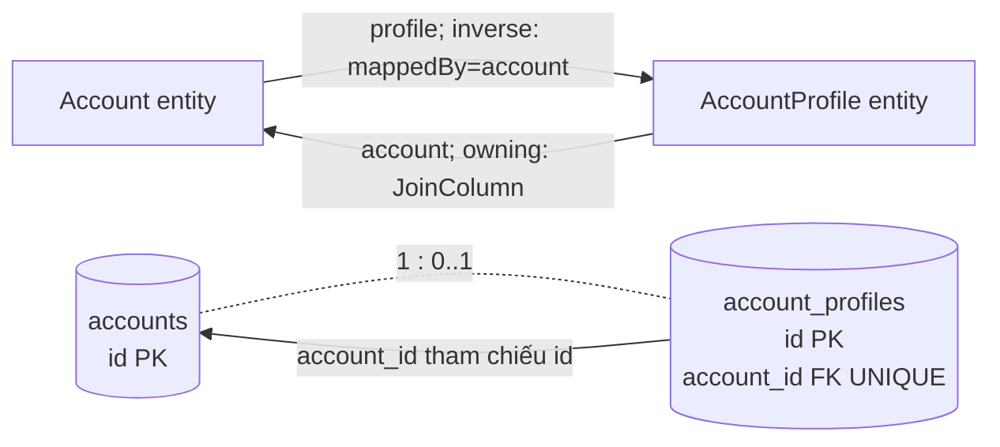

# Lựa chọn phía sở hữu cho quan hệ hai hướng

Trong JPA, quan hệ một-một (`@OneToOne`) biểu diễn việc một entity liên kết với tối đa một entity khác ở phía đối diện. Ví dụ, một `Account` có thể có một `AccountProfile`, và một `AccountProfile` thuộc về đúng một `Account`. Khi mô hình Java cần điều hướng từ **cả hai phía**, ta sử dụng **quan hệ hai hướng** (*bidirectional association*).

Vấn đề quan trọng nhất không phải là viết hai annotation `@OneToOne`. JPA yêu cầu xác định **một phía sở hữu quan hệ** (*owning side*) và **một phía nghịch** (*inverse/non-owning side*). Phía sở hữu quyết định mapping của quan hệ ở database; phía nghịch tham chiếu ngược đến thuộc tính trên phía sở hữu bằng `mappedBy`. Nếu chọn sai hoặc cấu hình hai phía không nhất quán, ứng dụng có thể tạo dư khóa ngoại, đọc dữ liệu không đúng, phát sinh lỗi khi lưu hoặc tưởng đã cập nhật quan hệ nhưng cơ sở dữ liệu không thay đổi.

Bài học này đi từ thiết kế bảng tới code entity, sau đó so sánh các phương án chọn owning side, giải thích cách đồng bộ object graph, cascade, transaction, lazy loading và trường hợp dùng chung khóa chính (`@MapsId`).

## 1. Hiểu đúng “phía sở hữu” trong JPA

Giả sử hai đối tượng Java:

```java
account.getProfile();
profile.getAccount();
```

Hai lời gọi trên cùng diễn đạt **một quan hệ nghiệp vụ**. Ở database quan hệ có thể được lưu bằng một cột khóa ngoại duy nhất, ví dụ `account_profiles.account_id` trỏ tới `accounts.id`. Vì vậy, JPA cần biết mapping nào là nguồn xác định quan hệ để tạo và cập nhật cột khóa ngoại.

**Phía sở hữu** là phía mà JPA sử dụng để quản lý mapping quan hệ. Với quan hệ một-một sử dụng foreign key trực tiếp, đó thường là entity có bảng **chứa cột foreign key**. Phía sở hữu có `@JoinColumn` hoặc khai báo `@JoinTable`, còn **phía nghịch** có `@OneToOne(mappedBy = "...")`.

| Khái niệm | Ý nghĩa | Dấu hiệu trong mapping |
|---|---|---|
| **Owning side** | Phía định nghĩa mapping vật lý dùng để lưu liên kết | `@OneToOne` với `@JoinColumn`/`@JoinTable`, không có `mappedBy` |
| **Inverse side** | Phía điều hướng ngược qua cùng một quan hệ | `@OneToOne(mappedBy = "tênThuộcTính")` |
| **Foreign key** | Cột database tham chiếu hàng ở bảng khác | Ví dụ `account_profiles.account_id` |
| **Uniqueness constraint** | Ràng buộc mỗi hàng cha được tham chiếu tối đa một lần | `UNIQUE(account_id)` hoặc cột đó là PK |
| **Logical owner/aggregate root** | Đối tượng nghiệp vụ quản lý vòng đời hoặc hành vi của đối tượng khác | Không nhất thiết trùng với owning side của JPA |

Điều cần ghi nhớ: **“sở hữu” trong `@OneToOne` là khái niệm ánh xạ ORM**, không phải quyền sở hữu đối tượng theo nghĩa Java, không phải người có quyền sửa dữ liệu, cũng không bắt buộc là aggregate root trong Domain-Driven Design (DDD).

Ví dụ, `Account` có thể là aggregate root và chịu trách nhiệm tạo/xóa `AccountProfile`, trong khi phía owning side về JPA là `AccountProfile.account` vì khóa ngoại nằm trên bảng `account_profiles`.

### Một quan hệ, hai hướng điều hướng



Sơ đồ có hai hướng truy cập trong Java, nhưng chỉ một cột `account_id` trong database lưu quan hệ. `mappedBy` chính là thông tin để provider hiểu hai hướng Java cùng chỉ đến **một** liên kết.

## 2. Trước khi viết annotation: xác định bảng nào chứa foreign key

Đối với quan hệ một-một giữa hai bảng `accounts` và `account_profiles`, có hai phương án foreign key trực tiếp thường gặp.

### Phương án A: foreign key nằm trong bảng profile

```sql
CREATE TABLE accounts (
    id       BIGINT PRIMARY KEY,
    username VARCHAR(100) NOT NULL UNIQUE
);

CREATE TABLE account_profiles (
    id            BIGINT PRIMARY KEY,
    account_id    BIGINT NOT NULL UNIQUE,
    display_name  VARCHAR(200),
    CONSTRAINT fk_profile_account
        FOREIGN KEY (account_id) REFERENCES accounts(id)
);
```

Đặc điểm:

- Mỗi profile bắt buộc có account vì `account_id NOT NULL`.
- Một account có **tối đa một profile** vì `UNIQUE(account_id)`.
- Một account **có thể chưa có profile**; database không bắt buộc phải tồn tại một hàng profile cho mọi account.
- Phía owning side JPA thường là `AccountProfile.account`.
- Phía `Account.profile` là inverse side.

Đây là lựa chọn tự nhiên khi profile là dữ liệu **bổ sung, phụ thuộc vào account** và được tạo sau account.

### Phương án B: foreign key nằm trong bảng account

```sql
CREATE TABLE account_profiles (
    id           BIGINT PRIMARY KEY,
    display_name VARCHAR(200)
);

CREATE TABLE accounts (
    id         BIGINT PRIMARY KEY,
    username   VARCHAR(100) NOT NULL UNIQUE,
    profile_id BIGINT UNIQUE,
    CONSTRAINT fk_account_profile
        FOREIGN KEY (profile_id) REFERENCES account_profiles(id)
);
```

Đặc điểm:

- Account có thể không có profile vì `profile_id` cho phép `NULL`.
- Không thể có hai account cùng tham chiếu một profile vì `UNIQUE(profile_id)` đối với các giá trị khác `NULL`.
- Phía owning side JPA là `Account.profile`.
- Phía `AccountProfile.account` là inverse side.

Mô hình này phù hợp khi khóa ngoại phía account phản ánh đúng schema sẵn có hoặc ngữ nghĩa nghiệp vụ. Tuy nhiên, nếu profile được tạo như phần mở rộng của account và luôn yêu cầu account tồn tại, việc đặt FK ở profile thường thuận tiện hơn.

### Không thể chọn phía sở hữu chỉ theo tên class

Không có quy tắc chung rằng class được gọi là “cha”, “chủ” hoặc “được tạo trước” luôn phải là owning side. Hãy xét:

1. **Cột foreign key đã nằm ở bảng nào?** Nếu database tồn tại, mapping nên phản ánh đúng schema.
2. **Phía nào có thể tồn tại độc lập?** Nếu profile không tồn tại khi thiếu account, FK ở profile biểu đạt tính phụ thuộc rõ ràng.
3. **Phía nào là optional?** Việc FK cho phép `NULL` và có ràng buộc `NOT NULL` cần khớp yêu cầu.
4. **Entity nào được tạo trước và vòng đời thế nào?** Tránh tạo vòng phụ thuộc khó chèn dữ liệu hoặc quản lý cascade.
5. **Có muốn dùng shared primary key?** Trường hợp này thường chọn entity phụ thuộc làm owning side với `@MapsId`.
6. **Có bảng liên kết sẵn không?** Một số schema dùng `@JoinTable`; lúc đó owning side được khai báo ở phía định nghĩa join table.

## 3. Ví dụ đầy đủ: `AccountProfile` là phía sở hữu

Ta chọn Phương án A: bảng `account_profiles` chứa `account_id`. Một account có tối đa một profile, còn profile bắt buộc liên kết với một account.

### 3.1. Entity `Account`: phía nghịch với `mappedBy`

```java
package example.domain;

import jakarta.persistence.CascadeType;
import jakarta.persistence.Column;
import jakarta.persistence.Entity;
import jakarta.persistence.GeneratedValue;
import jakarta.persistence.GenerationType;
import jakarta.persistence.Id;
import jakarta.persistence.OneToOne;
import jakarta.persistence.Table;

@Entity
@Table(name = "accounts")
public class Account {
    @Id
    @GeneratedValue(strategy = GenerationType.IDENTITY)
    private Long id;

    @Column(nullable = false, unique = true, length = 100)
    private String username;

    @OneToOne(
        mappedBy = "account",
        cascade = CascadeType.ALL,
        orphanRemoval = true
    )
    private AccountProfile profile;

    protected Account() {
    }

    public Account(String username) {
        if (username == null || username.isBlank()) {
            throw new IllegalArgumentException("Username is required");
        }
        this.username = username;
    }

    public Long getId() {
        return id;
    }

    public AccountProfile getProfile() {
        return profile;
    }

    public void attachProfile(AccountProfile newProfile) {
        if (newProfile == null) {
            throw new IllegalArgumentException("Profile is required");
        }
        if (this.profile != null) {
            throw new IllegalStateException("Account already has a profile");
        }
        if (newProfile.getAccount() != null) {
            throw new IllegalStateException("Profile already belongs to an account");
        }

        this.profile = newProfile;
        newProfile.attachTo(this);
    }

    public void removeProfile() {
        if (this.profile == null) {
            return;
        }
        AccountProfile old = this.profile;
        this.profile = null;
        old.detachFrom(this);
    }
}
```

Phía inverse có các điểm quan trọng:

- `mappedBy = "account"` trỏ đến **tên field `account` của `AccountProfile`**, không phải cột `account_id`.
- Không đặt `@JoinColumn` trên field `Account.profile` trong mô hình hai hướng này.
- `cascade = CascadeType.ALL` và `orphanRemoval = true` thể hiện **quyết định về vòng đời**: account quản lý việc persist, merge, remove profile và xóa profile khi tách ra khỏi quan hệ theo quy tắc orphan removal.
- Cascade và orphan removal có thể khai báo ở phía nghịch khi phù hợp; chúng **không biến phía nghịch thành owning side**.

Các helper `attachProfile` và `removeProfile` kiểm soát trường hợp nghiệp vụ để tránh gắn một profile vào nhiều account và giữ hai tham chiếu Java nhất quán.

### 3.2. Entity `AccountProfile`: phía sở hữu với `@JoinColumn`

```java
package example.domain;

import jakarta.persistence.Column;
import jakarta.persistence.Entity;
import jakarta.persistence.FetchType;
import jakarta.persistence.GeneratedValue;
import jakarta.persistence.GenerationType;
import jakarta.persistence.Id;
import jakarta.persistence.JoinColumn;
import jakarta.persistence.OneToOne;
import jakarta.persistence.Table;

@Entity
@Table(name = "account_profiles")
public class AccountProfile {
    @Id
    @GeneratedValue(strategy = GenerationType.IDENTITY)
    private Long id;

    @OneToOne(fetch = FetchType.LAZY, optional = false)
    @JoinColumn(
        name = "account_id",
        referencedColumnName = "id",
        nullable = false,
        unique = true
    )
    private Account account;

    @Column(name = "display_name", length = 200)
    private String displayName;

    protected AccountProfile() {
    }

    public AccountProfile(String displayName) {
        this.displayName = displayName;
    }

    public Long getId() {
        return id;
    }

    public Account getAccount() {
        return account;
    }

    void attachTo(Account newAccount) {
        if (newAccount == null) {
            throw new IllegalArgumentException("Account is required");
        }
        if (this.account != null) {
            throw new IllegalStateException("Profile already assigned");
        }
        this.account = newAccount;
    }

    void detachFrom(Account oldAccount) {
        if (this.account != oldAccount) {
            throw new IllegalStateException("Mismatched owning account");
        }
        this.account = null;
    }
}
```

**Đọc mapping theo database:**

- `AccountProfile.account` được đánh dấu `@OneToOne` và **không có `mappedBy`**: đây là owning side.
- `@JoinColumn(name = "account_id")` đặt cột foreign key ở bảng `account_profiles`.
- `referencedColumnName = "id"` trỏ đến `accounts.id`. Nếu tham chiếu khóa chính và không có yêu cầu tên đặc biệt, phần này thường có thể bỏ.
- `unique = true` diễn đạt ràng buộc một-một ở cột FK khi schema được sinh. Trong production, hãy bảo đảm database có `UNIQUE` thật sự.
- `optional = false` cho biết profile phải có account, kết hợp `nullable = false` và `NOT NULL` ở schema.

Trong ví dụ, phương thức package-private `detachFrom` có thể đặt `account = null` tạm thời trong object graph khi xóa profile khỏi parent. Vì `orphanRemoval = true`, provider sẽ xử lý **xóa entity phụ thuộc**, không dùng trạng thái null đó để cố lưu một profile độc lập vi phạm `NOT NULL`. Helper này dành cho luồng remove, không phải một API cho phép chuyển profile sang account khác mà vẫn giữ nguyên row.

### 3.3. Vì sao không đặt `mappedBy` ở cả hai phía?

Hai bên cùng `mappedBy` sẽ không có bên nào chịu trách nhiệm mapping vật lý. Ngược lại, nếu cả hai cùng đặt `@JoinColumn` riêng mà không dùng `mappedBy`, provider có thể xem đó là **hai association độc lập** và tạo hai khóa ngoại.

Mô hình đúng:

```java
// Account — inverse
@OneToOne(mappedBy = "account")
private AccountProfile profile;

// AccountProfile — owning
@OneToOne
@JoinColumn(name = "account_id", unique = true)
private Account account;
```

Mô hình sai thường gặp:

```java
// Account
@OneToOne
@JoinColumn(name = "profile_id")
private AccountProfile profile;

// AccountProfile
@OneToOne
@JoinColumn(name = "account_id")
private Account account;
```

Đây không tự động là “một quan hệ hai hướng”: JPA thấy hai mapping sở hữu độc lập, với hai cột FK khác nhau. Dữ liệu có thể mâu thuẫn: `accounts.profile_id` chỉ một profile, nhưng `account_profiles.account_id` chỉ một account khác.

## 4. `mappedBy` trỏ đến thuộc tính nào?

Giả sử phía sở hữu khai báo:

```java
@OneToOne
@JoinColumn(name = "owner_account_id")
private Account ownerAccount;
```

Phía nghịch phải dùng:

```java
@OneToOne(mappedBy = "ownerAccount")
private AccountProfile profile;
```

**Không dùng**:

```java
@OneToOne(mappedBy = "owner_account_id") // Sai: đây là tên cột SQL.
private AccountProfile profile;
```

`mappedBy` luôn nói đến **tên thuộc tính quan hệ Java ở phía owning side**. Nếu phía owning dùng property access, tên tham chiếu là tên persistent property; chẳng hạn `getOwnerAccount()` tương ứng property `ownerAccount`.

### Một vài cách kiểm tra bằng suy luận mapping

| Câu hỏi | Cách xác định |
|---|---|
| Thuộc tính nào chứa `@JoinColumn`? | Thường là owning side đối với FK mapping |
| Thuộc tính nào chứa `mappedBy`? | Inverse side |
| Giá trị `mappedBy` là tên gì? | Tên field/property quan hệ ở owning side |
| Nếu đổi tên field `ownerAccount`? | Cập nhật `mappedBy = "ownerAccount"` ở phía inverse |
| Nếu đổi tên cột `owner_account_id`? | Cập nhật `@JoinColumn(name = ...)`; `mappedBy` vẫn trỏ tới tên Java |
| Database có hai FK ngược nhau? | Xem lại có đang ánh xạ nhầm hai quan hệ độc lập không |

JPA có thể phát hiện `mappedBy` sai trong lúc khởi tạo metadata hoặc truy cập persistence unit; dạng lỗi và thông báo cụ thể tùy provider.

## 5. Cập nhật quan hệ: owning side quyết định dữ liệu được ghi

JPA quản lý quan hệ trong database dựa trên mapping phía sở hữu. Vì vậy, **chỉ sửa field inverse** không phải một cách cập nhật quan hệ đáng tin cậy.

Ví dụ:

```java
Account account = em.find(Account.class, accountId);
AccountProfile profile = new AccountProfile("Minh");

// Giả sử ứng dụng chỉ gán account.profile = profile.
// profile.account vẫn null.
```

Khi provider chuẩn bị `INSERT` profile, trường `account_id` lấy từ `profile.account`. Nếu chưa thiết lập owning side, cột FK có thể null và vi phạm constraint hoặc quan hệ không được ghi như mong đợi.

Đặt cả hai hướng cùng lúc:

```java
Account account = em.find(Account.class, accountId);
AccountProfile profile = new AccountProfile("Minh");

account.attachProfile(profile); // Helper cập nhật hai phía.
// CascadeType.ALL từ account.profile có thể persist profile khi phù hợp.
```

Nếu muốn code rõ ràng hơn, có thể gọi `em.persist(profile)` khi profile đã được gắn association. Nhưng không cần persist lại `account` đã managed, và không được coi cascade là tự động tồn tại nếu mapping không khai báo nó.

### Phân biệt object graph và database foreign key

Trên Java heap, quan hệ được biểu diễn bằng **hai tham chiếu**:

```text
Account.profile --------> AccountProfile
Account <-------- AccountProfile.account
```

Ở database, chỉ cần:

```text
account_profiles.account_id ---> accounts.id
```

JPA **không tự bảo đảm** rằng khi ta gán field Java phía owning, field inverse trong memory sẽ luôn lập tức được cập nhật (và ngược lại). Provider quản lý persistence nhưng việc giữ hai hướng của object graph đồng nhất là trách nhiệm của code ứng dụng.

### Vì sao helper method đáng dùng?

Helper giúp gom các thao tác có thứ tự:

1. Kiểm tra tính hợp lệ và cardinality của quan hệ.
2. Đặt tham chiếu trên phía owning.
3. Đặt tham chiếu inverse.
4. Nếu có đối tượng cũ, xử lý tháo liên kết/xóa theo quy tắc nghiệp vụ.
5. Bảo đảm code ngoài không được tạo một trạng thái Java mâu thuẫn.

Một helper không thể thay thế unique constraint ở database; vẫn phải chấp nhận việc hai transaction song song có thể tranh nhau gán profile cho cùng account, và database/locking sẽ bảo vệ tính duy nhất.

## 6. Lưu và xóa quan hệ trong transaction

### 6.1. Tạo account cùng profile

Với hai entity như phần 3, có cascade từ `Account.profile`:

```java
EntityManager em = emf.createEntityManager();
try {
    em.getTransaction().begin();

    Account account = new Account("minh");
    AccountProfile profile = new AccountProfile("Minh Nguyen");
    account.attachProfile(profile);

    em.persist(account);
    em.getTransaction().commit();
} catch (RuntimeException ex) {
    if (em.getTransaction().isActive()) {
        em.getTransaction().rollback();
    }
    throw ex;
} finally {
    em.close();
}
```

Vì `cascade = CascadeType.ALL` trên quan hệ `Account.profile`, yêu cầu persist account có thể lan sang profile. Provider phải có ID của account để ghi cột `account_profiles.account_id`. Với `GenerationType.IDENTITY`, lệnh `INSERT` account có thể chạy sớm để lấy khóa; thứ tự thực thi và số lượng statement phụ thuộc provider.

Nếu bỏ cascade, ta có thể:

```java
em.persist(account);
em.persist(profile);
```

Điều kiện quan trọng vẫn là **`profile.account` phải trỏ tới account đúng**. Annotation `mappedBy` không làm Hibernate/EclipseLink tự suy ra liên kết từ một object graph chỉ cập nhật phía inverse.

### 6.2. Xóa profile nhưng giữ account

Nếu phía `Account.profile` có `orphanRemoval = true`:

```java
Account account = em.find(Account.class, accountId);
account.removeProfile();
// Khi đồng bộ trong transaction, provider xử lý xóa profile mồ côi.
```

Đây là lựa chọn nghiệp vụ: profile phụ thuộc hoàn toàn vào account. Nếu profile là dữ liệu độc lập hoặc được phép chuyển sang account khác, `orphanRemoval = true` có thể gây xóa không mong muốn.

Nếu **không bật orphan removal**, chỉ bỏ một phía của quan hệ chưa đủ để xóa bản ghi profile. Với `account_id NOT NULL`, muốn profile không còn thuộc account cũ, ứng dụng phải lựa chọn: **xóa profile**, **chuyển nó sang account khác theo nghiệp vụ**, hoặc **đổi schema để cho phép một profile không có account**. Không thể mong JPA lưu thành công một row mà `account_id` bắt buộc nhưng đang null.

### 6.3. Xóa account và profile

`CascadeType.REMOVE` (bao gồm trong `CascadeType.ALL`) có thể làm lệnh remove account lan sang profile:

```java
Account account = em.find(Account.class, accountId);
em.remove(account);
```

JPA provider sắp xếp các thao tác cần thiết để tuân thủ khóa ngoại trong phạm vi có thể. Nếu database cũng có `ON DELETE CASCADE`, đó là cơ chế riêng ở tầng DB, không đồng nghĩa với cấu hình cascade của JPA. Khi bật cả hai cần hiểu cách provider thực hiện lệnh xóa và trạng thái persistence context.

### 6.4. Thay một profile bằng profile khác

Với một-một phụ thuộc hoàn toàn và unique FK, việc thay profile cũ có thể tạo tình huống hai hàng profile tạm thời cùng tham chiếu một account nếu provider `INSERT` profile mới trước `DELETE` profile cũ. Khi đó, database báo vi phạm `UNIQUE(account_id)`.

Một cách xử lý có chủ đích:

```java
em.getTransaction().begin();

Account account = em.find(Account.class, accountId);
account.removeProfile();
em.flush(); // Đưa thao tác xóa profile cũ tới database trong transaction.

account.attachProfile(new AccountProfile("New profile"));
// Cần persist profile mới theo mapping/cascade và trạng thái managed.

em.getTransaction().commit();
```

Không xem `flush()` là commit: toàn bộ việc xóa và tạo mới vẫn có thể rollback. Trong một số trường hợp, **cập nhật chính profile đang managed** phù hợp hơn tạo hàng mới. Việc thêm flush ở đây chỉ có ý nghĩa khi yêu cầu và schema thực sự đòi hỏi thứ tự xử lý; không gọi flush vô điều kiện trong mọi thao tác.

## 7. `@OneToOne` và ràng buộc uniqueness ở database

Điều gì khiến một quan hệ khác `@ManyToOne`? Với foreign key trực tiếp, yếu tố quyết định ở database là **không có hai hàng owner cùng trỏ tới một hàng được tham chiếu**.

### 7.1. FK chưa unique chỉ đảm bảo nhiều-một

```sql
CREATE TABLE account_profiles (
    id         BIGINT PRIMARY KEY,
    account_id BIGINT NOT NULL,
    FOREIGN KEY (account_id) REFERENCES accounts(id)
);
```

Schema này cho phép:

```text
profile 201 -> account 10
profile 202 -> account 10
```

Nó biểu diễn **nhiều profile cho một account**, dù Java gắn `@OneToOne`. Nếu muốn đúng quan hệ một-một, cần thêm uniqueness:

```sql
ALTER TABLE account_profiles
ADD CONSTRAINT uq_profile_account UNIQUE (account_id);
```

Không thể chỉ dựa vào cú pháp annotation để coi database hiện hữu đã được sửa schema; khi dùng migration thủ công, phải khai báo constraint.

### 7.2. `optional = false` và `nullable = false`

Hai khai báo thường đi cùng nhau nhưng không có cùng phạm vi:

```java
@OneToOne(optional = false)
@JoinColumn(name = "account_id", nullable = false, unique = true)
private Account account;
```

- `optional = false` diễn đạt tính bắt buộc của association trong mô hình JPA.
- `nullable = false` mô tả tính không-null của cột join khi tạo schema.
- `unique = true` mô tả yêu cầu không có hai owner cùng tham chiếu một account.
- Constraint `NOT NULL`, `UNIQUE`, `FOREIGN KEY` trên database là lớp bảo vệ thực thi cuối cùng, kể cả với script SQL ngoài JPA.

Với một account có thể không có profile, `Account.profile` ở phía inverse có thể null; điều này **không mâu thuẫn** với `AccountProfile.account` bắt buộc ở phía owning. Hai nhận định là khác nhau: “profile luôn có account” và “account luôn có profile”.

### 7.3. Optional và giá trị NULL

Trong một số hệ CSDL, unique constraint cho phép nhiều hàng có `NULL` ở cột FK; cách xử lý `NULL` có khác biệt giữa các database. Nếu chủ sở hữu quan hệ được phép thiếu target, cần xem lại semantics của `UNIQUE` và nullable trong schema cụ thể.

Đừng dùng cùng một schema cho mọi database mà không kiểm tra yêu cầu uniqueness với các giá trị `NULL`.

## 8. Khi nào chọn `Account` làm phía sở hữu?

Không phải lúc nào phía “phụ thuộc” cũng nhất thiết chứa foreign key. Nếu schema lưu `accounts.profile_id`, mapping phải phản ánh đúng:

```java
// Account: owning side, bảng accounts có cột profile_id.
@Entity
public class Account {
    @Id
    private Long id;

    @OneToOne(fetch = FetchType.LAZY)
    @JoinColumn(name = "profile_id", unique = true)
    private AccountProfile profile;

    protected Account() {}
}
```

```java
// AccountProfile: inverse side.
@Entity
public class AccountProfile {
    @Id
    private Long id;

    @OneToOne(mappedBy = "profile")
    private Account account;

    protected AccountProfile() {}
}
```

Trong phương án này:

- Database có khóa ngoại `accounts.profile_id` tham chiếu `account_profiles.id`.
- `Account.profile` quản lý giá trị FK vì nó là phía owning.
- `AccountProfile.account` là inverse với `mappedBy = "profile"`.
- Khóa ngoại có `UNIQUE` để không cho hai account trỏ cùng một profile.

Chọn phương án này khi nó phù hợp với database và vòng đời đã định. Nếu một account có thể tồn tại trước profile, `profile_id` nullable có thể hữu ích. Nếu profile luôn phải có account và không được tồn tại độc lập, FK ở profile hoặc shared primary key thường biểu đạt ràng buộc rõ hơn.

### Vấn đề khi muốn cả hai bên đều bắt buộc

Nếu cả `accounts.profile_id NOT NULL` và `account_profiles.account_id NOT NULL` cùng tồn tại, hai bảng có thể tạo vòng phụ thuộc foreign key khiến việc insert phức tạp (nhất là khi constraint không được defer). Điều này thường là dấu hiệu đã mô hình hóa **hai FK không cần thiết** cho một quan hệ hai hướng. Ưu tiên một nguồn FK nhất quán, hoặc xem xét shared primary key nếu đúng ngữ nghĩa.

## 9. Khóa chính chia sẻ: phía phụ thuộc sở hữu với `@MapsId`

Một biến thể rất thường gặp của quan hệ một-một là **shared primary key**: khóa chính của entity phụ thuộc đồng thời là khóa ngoại đến entity chủ.

Ví dụ:

```text
accounts
  id BIGINT PRIMARY KEY

account_profiles
  account_id BIGINT PRIMARY KEY,
  FOREIGN KEY(account_id) REFERENCES accounts(id)
```

Không có `account_profiles.id` độc lập và cũng không có hai giá trị khóa. Mỗi profile dùng cùng một ID với account của nó.

### 9.1. Mapping với `@MapsId`

Phía account:

```java
@Entity
public class Account {
    @Id
    @GeneratedValue(strategy = GenerationType.IDENTITY)
    private Long id;

    @OneToOne(
        mappedBy = "account",
        cascade = CascadeType.ALL,
        orphanRemoval = true
    )
    private AccountProfile profile;

    protected Account() {}

    // Constructors, getters, helper...
}
```

Phía profile:

```java
@Entity
@Table(name = "account_profiles")
public class AccountProfile {
    @Id
    @Column(name = "account_id")
    private Long id;

    @OneToOne(fetch = FetchType.LAZY, optional = false)
    @MapsId
    @JoinColumn(name = "account_id", nullable = false)
    private Account account;

    private String displayName;

    protected AccountProfile() {}

    public AccountProfile(Account account, String displayName) {
        if (account == null) {
            throw new IllegalArgumentException("Account required");
        }
        this.account = account;
        this.displayName = displayName;
    }
}
```

`@MapsId` nói với provider rằng **`AccountProfile.id` được dẫn xuất từ `Account.id` thông qua association `account`**. Phía owning vẫn là `AccountProfile.account`; phía inverse là `Account.profile` với `mappedBy`.

### 9.2. Lược đồ shared PK

```sql
CREATE TABLE accounts (
    id BIGINT GENERATED BY DEFAULT AS IDENTITY PRIMARY KEY,
    username VARCHAR(100) NOT NULL
);

CREATE TABLE account_profiles (
    account_id   BIGINT PRIMARY KEY,
    display_name VARCHAR(200),
    CONSTRAINT fk_profile_account
        FOREIGN KEY (account_id) REFERENCES accounts(id)
);
```

Vì `account_id` vừa là PK vừa là FK, bản thân ràng buộc primary key đã bảo đảm unique và non-null. Không cần thêm `UNIQUE(account_id)` trùng ý nghĩa. Profile cũng không nên có `@GeneratedValue` riêng: ID của nó đến từ account.

### 9.3. Vì sao shared PK đáng cân nhắc?

Ưu điểm:

- Thể hiện quan hệ phụ thuộc mạnh và một-một ở cấp schema.
- Không cần thêm `profile.id` và `account_id` độc lập để biểu diễn cùng mối liên hệ.
- Tính duy nhất tự nhiên nhờ PK và kiểm tra tồn tại nhờ FK.
- Tìm profile theo ID của account trở nên trực tiếp.

Đánh đổi:

- Profile khó tách khỏi account hoặc chuyển sang account khác mà không thay khóa chính.
- Không phù hợp nếu profile cần identity/vòng đời độc lập.
- Cần để ý quá trình tạo account trước khi provider có ID.
- Không thể dùng một ID generator riêng trên profile.

### 9.4. `@MapsId` khác `mappedBy`

Hai annotation có tên dễ gây nhầm nhưng giải quyết hai bài toán khác:

| Annotation | Đặt ở đâu? | Ý nghĩa |
|---|---|---|
| `mappedBy = "account"` | Inverse side `Account.profile` | Nói rằng mapping quan hệ được sở hữu bởi `AccountProfile.account` |
| `@MapsId` | Owning association `AccountProfile.account` | Nói rằng khóa chính profile được lấy từ ID của account |

Chúng có thể dùng đồng thời trong shared primary key một-một. `mappedBy` không sinh khóa; `@MapsId` không tự tạo liên kết hai chiều trong Java.

## 10. Quan hệ một-một bằng join table

Một số schema cũ hoặc mô hình đặc biệt lưu quan hệ trong bảng thứ ba:

```text
accounts(id PK)
account_profiles(id PK)
account_profile_links(account_id UNIQUE, profile_id UNIQUE)
```

Khi đó, phía sở hữu có thể dùng `@JoinTable`:

```java
// Account: owning side.
@OneToOne
@JoinTable(
    name = "account_profile_links",
    joinColumns = @JoinColumn(name = "account_id", unique = true),
    inverseJoinColumns = @JoinColumn(name = "profile_id", unique = true)
)
private AccountProfile profile;
```

```java
// AccountProfile: inverse side.
@OneToOne(mappedBy = "profile")
private Account account;
```

Trong trường hợp này, owning side là nơi định nghĩa **join table**, không nhất thiết là class có cột FK nằm trực tiếp trong bảng entity của nó. Hai cột join table phải được ràng buộc phù hợp để giữ cardinality một-một.

Mô hình join table mang thêm một bảng và có thể cần thêm JOIN khi truy vấn. Hãy dùng nếu schema hoặc nghiệp vụ đòi hỏi; với quan hệ đơn giản, foreign key trực tiếp hoặc shared primary key thường dễ quản lý hơn.

## 11. Lazy loading: sự khác nhau giữa phía owning và inverse

`@OneToOne` có mặc định **`FetchType.EAGER`** theo JPA. Khi muốn trì hoãn tải dữ liệu, ứng dụng có thể yêu cầu `LAZY`:

```java
// Owning side
@OneToOne(fetch = FetchType.LAZY)
@JoinColumn(name = "account_id", unique = true)
private Account account;
```

```java
// Inverse side
@OneToOne(mappedBy = "account", fetch = FetchType.LAZY)
private AccountProfile profile;
```

Tuy nhiên, với JPA, `LAZY` ở những quan hệ to-one là **gợi ý cho provider**. Provider có thể cần truy vấn để quyết định phía inverse có entity liên kết hay không, nhất là khi FK nằm trong bảng ở phía đối diện. Vì vậy, một số phiên bản/cấu hình Hibernate hoặc EclipseLink có thể phát sinh truy vấn bổ sung mặc dù phía inverse khai báo `LAZY`. Bytecode enhancement, proxy và kiểu shared primary key có thể ảnh hưởng.

### Vì sao phía owning đôi khi dễ lazy hơn?

Nếu đang tải `AccountProfile`, hàng của nó có `account_id`. Provider biết ID của account liên quan mà không nhất thiết truy vấn ngay bảng `accounts`; có thể cung cấp proxy cho account khi cơ chế cho phép.

Nếu đang tải `Account` trong mô hình FK nằm ở `account_profiles`, hàng của `accounts` không cho biết profile có tồn tại hay không. Để trả về `null` chính xác hoặc đối tượng đại diện, provider có thể cần kiểm tra bảng profile.

Điều này **không biến phía owning thành lựa chọn tự động nhanh hơn trong mọi tình huống**. Việc chọn FK còn phụ thuộc schema, vòng đời và ràng buộc. Sau khi chốt mô hình, kiểm tra SQL thực tế và dùng fetch strategy phù hợp.

### N+1 query với phía inverse

Giả sử lấy 100 account rồi gọi `getProfile()` cho từng account:

```java
List<Account> accounts = em.createQuery(
        "select a from Account a",
        Account.class)
    .getResultList();

for (Account account : accounts) {
    AccountProfile profile = account.getProfile();
    // ...
}
```

Provider có thể phát sinh thêm nhiều truy vấn nếu profile chưa được tải. Nếu nghiệp vụ yêu cầu đọc profile cùng account, có thể dùng JPQL fetch join:

```java
List<Account> accounts = em.createQuery(
        "select a from Account a " +
        "left join fetch a.profile",
        Account.class)
    .getResultList();
```

`LEFT JOIN FETCH` giữ cả account chưa có profile. Nếu dùng `INNER JOIN FETCH`, những account không có profile có thể bị loại khỏi kết quả.

Lưu ý: cách fetch association có thể làm thay đổi SQL, kích thước kết quả và hiệu năng; với nhiều quan hệ collection khác nhau, cần cân nhắc phân trang, DTO projection hoặc entity graph phù hợp.

## 12. Owning side và thứ tự SQL trong lúc flush

Một transaction có thể cần thực hiện nhiều câu `INSERT` và `DELETE`. Với FK từ profile đến account:

```text
Persist Account + AccountProfile
  1. Phải có account row hợp lệ
  2. Profile row tham chiếu account_id

Delete Account + AccountProfile
  1. Phải giải quyết profile row đang tham chiếu account
  2. Sau đó mới xóa account row (nếu FK không cascade tại DB)
```

Provider thường sắp xếp SQL sao cho phù hợp ràng buộc database, nhưng thứ tự flush thực tế còn phụ thuộc chiến lược sinh khóa, batching, provider và dependency graph. Annotation `mappedBy` **không phải chỉ dẫn thứ tự SQL**. Cascade cũng không đồng nghĩa đảm bảo mọi ràng buộc sẽ tự giải quyết nếu object graph hoặc schema được thiết kế mâu thuẫn.

### `flush()` khác `commit()`

`em.flush()` yêu cầu đồng bộ state của persistence context xuống database trong transaction. `commit()` xác nhận transaction. Khi xử lý một-một có unique FK, `flush` đôi khi hữu ích để buộc `DELETE` hoặc `UPDATE` chạy trước bước tạo liên kết mới; nhưng transaction vẫn có thể rollback.

Không giải quyết lỗi unique constraint chỉ bằng việc “gọi commit sớm” nếu nghiệp vụ cần tính nguyên tử; hãy xem lại thiết kế thao tác và thứ tự đồng bộ.

### Đồng thời hai transaction gắn profile cho cùng account

Giả sử T1 và T2 cùng kiểm tra account chưa có profile, sau đó đều tạo `AccountProfile(account)`. Cả hai có thể vượt qua kiểm tra trong bộ nhớ và cùng định INSERT. Cuối cùng, database `UNIQUE(account_id)` chỉ cho phép tối đa một row.

Đây là minh họa vì sao **unique constraint vẫn bắt buộc**, ngay cả khi ứng dụng có helper kiểm tra `account.getProfile() == null`. Với những nghiệp vụ cần điều phối tốt hơn, có thể dùng optimistic locking, pessimistic locking hoặc retry/handling khi gặp constraint violation theo transaction policy.

## 13. Quy tắc chọn phía sở hữu trong các tình huống thực tế

### 13.1. Account và profile

**Bối cảnh:** profile là thông tin bổ sung, chỉ tồn tại khi có account; account có thể chưa có profile.

Phương án gợi ý:

- `account_profiles.account_id` là FK, `NOT NULL UNIQUE`.
- `AccountProfile.account` là owning side.
- `Account.profile` khai báo `mappedBy = "account"`.
- Nếu profile sống hoàn toàn theo account, cascade từ account sang profile có thể phù hợp.

Mô hình này giảm việc thêm cột nullable trên bảng `accounts` và thể hiện tính phụ thuộc ngay trong schema.

### 13.2. Employee và ParkingSpace

**Bối cảnh:** mỗi nhân viên có thể được cấp một chỗ đỗ; một chỗ đỗ không được cấp cho nhiều nhân viên cùng lúc, nhưng bãi đỗ có thể tồn tại trước nhân viên.

Nếu bảng `employees` chứa `parking_space_id`:

```java
// Employee sở hữu quan hệ vì FK nằm trong employees.
@OneToOne
@JoinColumn(name = "parking_space_id", unique = true)
private ParkingSpace parkingSpace;
```

```java
// ParkingSpace là phía nghịch.
@OneToOne(mappedBy = "parkingSpace")
private Employee employee;
```

Ở đây, `ParkingSpace` có vòng đời độc lập; không nên cấu hình `CascadeType.REMOVE` từ employee sang parking space, vì nghỉ việc không có nghĩa xóa chỗ đỗ khỏi hệ thống.

### 13.3. Order và PaymentDetail

**Bối cảnh:** một đơn hàng có tối đa một bản ghi chi tiết thanh toán trong một thiết kế đã xác nhận. Nếu payment detail phải sử dụng cùng ID của order, có thể dùng shared primary key:

```java
// PaymentDetail: owning side.
@Id
private Long id;

@OneToOne(optional = false)
@MapsId
@JoinColumn(name = "id")
private PurchaseOrder order;
```

```java
// PurchaseOrder: inverse side.
@OneToOne(mappedBy = "order")
private PaymentDetail paymentDetail;
```

Nhưng trong thực tế một order có thể có **nhiều lần thanh toán, nhiều attempt hoặc refund**. Khi đó one-to-one có thể không đúng cardinality; nên thiết kế `@OneToMany` hoặc các entity giao dịch riêng. Không để tên “PaymentDetail” quyết định mapping thay cho quy tắc nghiệp vụ.

### 13.4. Schema hiện hữu có FK ngược hướng mong muốn

Khi làm việc với database legacy, đổi owning side về mặt Java mà không đổi cột FK sẽ khiến mapping sai. Có hai lựa chọn rõ ràng:

1. Giữ vị trí foreign key của schema và ánh xạ owning side tương ứng, cho dù class owning không phải aggregate root.
2. Thay đổi schema bằng migration có kiểm soát, sau đó cập nhật entity mapping, dữ liệu và constraint.

Không thể chỉ hoán đổi `mappedBy` giữa hai field rồi giả định dữ liệu trong bảng tự chuyển từ `account_profiles.account_id` sang `accounts.profile_id`.

## 14. Các sai lầm phổ biến và cách nhận diện

| Triệu chứng | Nguyên nhân khả dĩ | Hướng giải quyết |
|---|---|---|
| Provider báo `mappedBy` không hợp lệ | Giá trị `mappedBy` không phải tên field/property association phía owning | Đối chiếu tên Java chính xác |
| Có hai cột FK hoặc hai quan hệ trong schema | Cả hai phía đều khai báo mapping sở hữu riêng | Chọn một owning side; phía kia dùng `mappedBy` |
| `account.getProfile()` có giá trị trong RAM nhưng database không lưu FK | Code chỉ cập nhật inverse side | Đồng bộ field owning `profile.account` và inverse |
| Vi phạm `NOT NULL` ở FK | Owning association chưa được gán hoặc gán sai thứ tự | Thiết lập quan hệ qua helper, persist đúng entity |
| Vi phạm `UNIQUE(account_id)` | Hai profile cùng trỏ một account hoặc thứ tự thay profile cũ/mới gây xung đột | Kiểm tra nghiệp vụ, xử lý replace, transaction và constraint |
| Hai account cùng gắn một profile | Thiếu unique constraint ở database hoặc schema sai | Đặt `UNIQUE` cho FK, đối chiếu mapping |
| Persist account không tạo profile | Thiếu `CascadeType.PERSIST` khi muốn lưu qua account | Khai báo cascade phù hợp hoặc persist profile rõ ràng |
| Xóa account nhưng profile còn FK | Cascade remove/database delete policy không tương ứng | Chọn vòng đời xóa rõ ràng, bảo đảm referential integrity |
| Xóa profile bằng cách `account.profile = null` nhưng row không mất | Không dùng `orphanRemoval` và không gọi remove | Chọn orphanRemoval hoặc xóa profile chủ động |
| `LAZY` trên inverse vẫn truy vấn phụ | Provider cần xác định entity liên kết có tồn tại hay không | Phân tích SQL, enhancement, entity graph/fetch join |
| `@MapsId` nhưng profile ID bị cấp độc lập | Sai thiết kế shared primary key | Bỏ generator bên dependent và dùng khóa từ principal |
| Data không nhất quán sau thao tác thay profile | Chỉ cập nhật một hướng của object graph, hoặc FK không đúng phía | Dùng helper giữ hai phía đồng bộ |

### Sai 1: `mappedBy` trỏ tới tên cột

```java
// Sai:
@OneToOne(mappedBy = "account_id")
private AccountProfile profile;

// Đúng nếu phía sở hữu có field 'account':
@OneToOne(mappedBy = "account")
private AccountProfile profile;
```

### Sai 2: đặt `@JoinColumn` trên phía inverse

```java
// Không nhất quán:
@OneToOne(mappedBy = "account")
@JoinColumn(name = "profile_id")
private AccountProfile profile;
```

Phía inverse đã nói mapping được khai báo ở `AccountProfile.account`; thêm `@JoinColumn` ở đây gây mâu thuẫn về trách nhiệm sở hữu quan hệ.

### Sai 3: thiếu unique constraint

```java
@OneToOne
@JoinColumn(name = "account_id")
private Account account;
```

Annotation `@OneToOne` thể hiện ngữ nghĩa JPA, nhưng khi dùng một schema đã tồn tại, cần xác nhận `account_id` thực sự có unique constraint. Nếu thiếu, database có thể chứa nhiều profile của một account, khiến runtime gặp các trường hợp không phù hợp cardinality.

### Sai 4: chỉ đổi phía inverse

```java
// Mô tả trường hợp lỗi:
account.profile = profile; // profile.account vẫn null.
```

Đúng là thiết lập cả hai hướng:

```java
account.attachProfile(profile); // Cập nhật account.profile và profile.account.
```

### Sai 5: coi cascade là định nghĩa ownership

```java
@OneToOne(mappedBy = "account", cascade = CascadeType.ALL)
private AccountProfile profile;
```

Account vẫn là **inverse side** vì có `mappedBy`. Cascade có thể dùng để lan truyền thao tác persistence từ account tới profile nhưng không di chuyển `@JoinColumn` từ bảng profile sang bảng account.

### Sai 6: tự đổi khóa khi dùng shared PK

Với `@MapsId`, thay `profile.account` sau khi profile đã persistent có thể đồng nghĩa thay primary key của profile. JPA không bảo đảm portable cho việc thay định danh entity đã lưu. Nếu quan hệ cần thay chủ thường xuyên, cân nhắc khóa chính độc lập và FK unique thay vì shared primary key.

## 15. Di chuyển owning side khi thay đổi schema

Giả sử phiên bản cũ có `accounts.profile_id`, nhưng thiết kế mới muốn chuyển sang `account_profiles.account_id`. Đây là **thay đổi dữ liệu quan hệ**, không phải chỉnh sửa annotation đơn thuần.

Một lộ trình khái quát:

1. **Xác định cardinality và dữ liệu hiện tại:** tìm bản ghi không có profile, profile được chia sẻ, FK sai hoặc duplicate.
2. **Thêm cột mới** `account_profiles.account_id` và các index cần thiết theo khả năng migration.
3. **Backfill** thông tin quan hệ bằng cách lấy `accounts.id` từ dữ liệu FK cũ. Nếu phát hiện nhiều account trỏ cùng profile, phải giải quyết trước khi áp dụng `UNIQUE` mới.
4. **Đặt constraint** FK và uniqueness đúng mô hình, xử lý `NULL` theo yêu cầu nghiệp vụ.
5. **Cập nhật mapping JPA:** phía `AccountProfile.account` thành owning với `@JoinColumn(name = "account_id")`; phía `Account.profile` dùng `mappedBy = "account"`.
6. **Điều phối triển khai** để phiên bản ứng dụng cũ và mới không cùng ghi theo hai nguồn dữ liệu mâu thuẫn; nếu cần rolling deployment, thiết kế giai đoạn tương thích và đồng bộ hai chiều ở database/application có kiểm soát.
7. **Loại bỏ cột FK cũ** sau khi chắc chắn toàn bộ ứng dụng dùng schema mới và dữ liệu đã được chuyển đúng.

Trong môi trường production, không nên tự để `hibernate.hbm2ddl.auto=update` hoặc một cơ chế tự cập nhật schema đơn giản giải quyết di chuyển FK phức tạp mà không có kế hoạch migration. Trạng thái dữ liệu và tính tương thích khi triển khai nhiều phiên bản mới là phần khó nhất.

### Khi nào không nên di chuyển owning side?

Nếu schema hiện hữu đã phản ánh chính xác quan hệ, không có vấn đề hiệu năng hoặc tính nhất quán và ứng dụng chỉ muốn đổi cấu trúc source code cho “dễ đọc”, việc migration có thể không mang lại lợi ích đủ lớn. Trong JPA, owning side là chi tiết mapping; một aggregate root không nhất thiết phải đứng ở phía owning.

## 16. Bài tập thực hành: chọn owning side trước khi viết code

### Bài tập A: Customer và LoyaltyCard

Yêu cầu:

- Mỗi customer có tối đa một loyalty card.
- Card bắt buộc thuộc một customer.
- Customer có thể được tạo trước card.
- Card không thể được chuyển sang customer khác sau khi phát hành.

Hãy đề xuất schema và mapping.

**Hướng giải thích:** `loyalty_cards.customer_id NOT NULL UNIQUE` là một lựa chọn phù hợp. `LoyaltyCard.customer` là owning side với `@JoinColumn`; `Customer.loyaltyCard` là inverse với `mappedBy = "customer"`. Nếu card chia sẻ ID của customer và không có identity riêng, có thể cân nhắc `@MapsId`.

### Bài tập B: Employee và ParkingSpace

Yêu cầu:

- Chỗ đỗ tồn tại độc lập với nhân viên.
- Một nhân viên có thể được cấp một chỗ.
- Hai nhân viên không được cùng giữ một chỗ ở một thời điểm.
- Khi xóa nhân viên, không được xóa chỗ đỗ.

**Hướng giải thích:** Với `employees.parking_space_id` là FK unique có thể null, phía owning là `Employee.parkingSpace`. `ParkingSpace.employee` dùng `mappedBy = "parkingSpace"`. Không dùng cascade remove sang `ParkingSpace` chỉ vì quan hệ một-một.

### Bài tập C: Account và AccountSettings dùng shared PK

Yêu cầu:

```text
accounts(id PK, email)
account_settings(account_id PK/FK -> accounts.id, theme)
```

Hãy thiết kế:

1. `Account` có `@Id` được sinh độc lập.
2. `AccountSettings` có `@Id Long id`, `@OneToOne @MapsId @JoinColumn(name = "account_id")`.
3. `Account.settings` dùng `@OneToOne(mappedBy = "account")`.
4. Helper tạo settings phải cập nhật cả `account.settings` và `settings.account`.
5. Xác định cascade nào phù hợp và quy tắc xóa khi account bị xóa.

### Bài tập D: tìm lỗi trong quan hệ hai hướng

```java
class User {
    @OneToOne
    @JoinColumn(name = "profile_id")
    private Profile profile;
}

class Profile {
    @OneToOne
    @JoinColumn(name = "user_id")
    private User user;
}
```

**Câu hỏi:** Đây có thật sự là một association hai hướng thống nhất không?

**Giải thích:** Chưa. Hai field sở hữu hai FK khác nhau. Hãy quyết định FK nào là nguồn lưu quan hệ, giữ `@JoinColumn` ở phía owning và dùng `mappedBy` ở phía còn lại. Đồng thời bảo đảm unique constraint cho FK và viết helper đồng bộ hai tham chiếu.

## 17. Câu hỏi tự kiểm tra

**1. Đặc điểm xác định owning side trong một-một dùng FK là gì?**

Thường là phía có bảng chứa foreign key và khai báo `@JoinColumn`, không có `mappedBy`. Phía inverse khai báo `mappedBy`.

**2. `mappedBy = "account"` trỏ đến tên cột `account_id` hay field `account`?**

Nó trỏ đến **tên thuộc tính Java** của association ở phía owning, trong ví dụ là `AccountProfile.account`.

**3. Có thể đặt `CascadeType.ALL` ở inverse side không?**

Có thể khi phù hợp với vòng đời. Cascade điều phối hành động persistence, không quyết định bên nào sở hữu FK.

**4. Nếu chỉ gán `Account.profile` thì database có chắc lưu `account_profiles.account_id` không?**

Không. Phía owning `AccountProfile.account` phải được thiết lập đúng; code cần đồng bộ cả hai hướng của object graph.

**5. Một-một có cần `UNIQUE` trên foreign key không?**

Với FK trực tiếp, cần ràng buộc uniqueness tương ứng để database không cho hai hàng owner trỏ tới một target. Với shared PK, khóa chính tự bảo đảm uniqueness.

**6. Một profile bắt buộc có account, account có nhất thiết phải có profile không?**

Không. `AccountProfile.account` có thể `optional = false` và FK `NOT NULL`, trong khi `Account.profile` vẫn là nullable/optional.

**7. Shared primary key dùng `@MapsId` thì owning side là ai?**

Thông thường phía entity phụ thuộc có `@OneToOne @MapsId @JoinColumn`, ví dụ `AccountProfile.account`. Phía `Account.profile` dùng `mappedBy`.

**8. `@MapsId` và `mappedBy` khác nhau ra sao?**

`@MapsId` nói về ID của dependent lấy từ association; `mappedBy` xác định chiều nghịch của cùng một quan hệ hai hướng.

**9. Vì sao `FetchType.LAZY` ở inverse one-to-one có thể không trì hoãn truy vấn?**

Vì hàng phía inverse có thể không chứa foreign key để biết target có tồn tại; provider đôi khi cần truy vấn bổ sung hoặc kỹ thuật enhancement.

**10. Nếu chuyển FK từ profile sang account, chỉ đổi annotation là đủ không?**

Không. Phải thay schema/migration, chuyển dữ liệu và áp dụng FK/unique constraints theo hướng mới.

**11. Có thể dùng `@JoinTable` cho một-một hai hướng không?**

Có. Owning side định nghĩa `@JoinTable`, phía kia dùng `mappedBy`. Cần constraint trên join table để giữ cardinality một-một.

**12. Vì sao không nên dùng `CascadeType.REMOVE` từ Employee tới ParkingSpace?**

Vì parking space là resource có vòng đời độc lập; xóa employee không đồng nghĩa xóa resource đó.

## 18. Tóm tắt những nguyên tắc quyết định

Khi thiết kế quan hệ một-một hai hướng, hãy bắt đầu từ **quy tắc nghiệp vụ và schema quan hệ**:

1. Quyết định bảng nào chứa foreign key (hoặc có dùng shared primary key/join table không).
2. Đặt `@OneToOne` với `@JoinColumn`/`@JoinTable` và các ràng buộc thích hợp tại **owning side**.
3. Đặt `@OneToOne(mappedBy = "tênThuộcTínhOwning")` tại **inverse side**.
4. Bảo đảm uniqueness, nullability và foreign-key constraints ở database phản ánh cardinality thật sự.
5. Dùng helper method để cập nhật **cả hai hướng trong Java**, vì JPA không tự giữ object graph luôn nhất quán.
6. Xác định cascade và `orphanRemoval` theo **vòng đời nghiệp vụ**, độc lập với việc chọn owning side.
7. Đánh giá fetching, transaction, concurrency và migration theo schema/provider thực tế.

**Ý chính cần nhớ:** Trong JPA, owning side là phía chịu trách nhiệm **lưu liên kết quan hệ**, còn inverse side cung cấp **đường điều hướng ngược**. Với một-một hai hướng, việc chọn đúng phía sở hữu ngay từ lúc thiết kế giúp tránh hai khóa ngoại cạnh tranh, đảm bảo cập nhật đúng cột, duy trì cardinality và giữ mô hình Java phù hợp với dữ liệu quan hệ.
